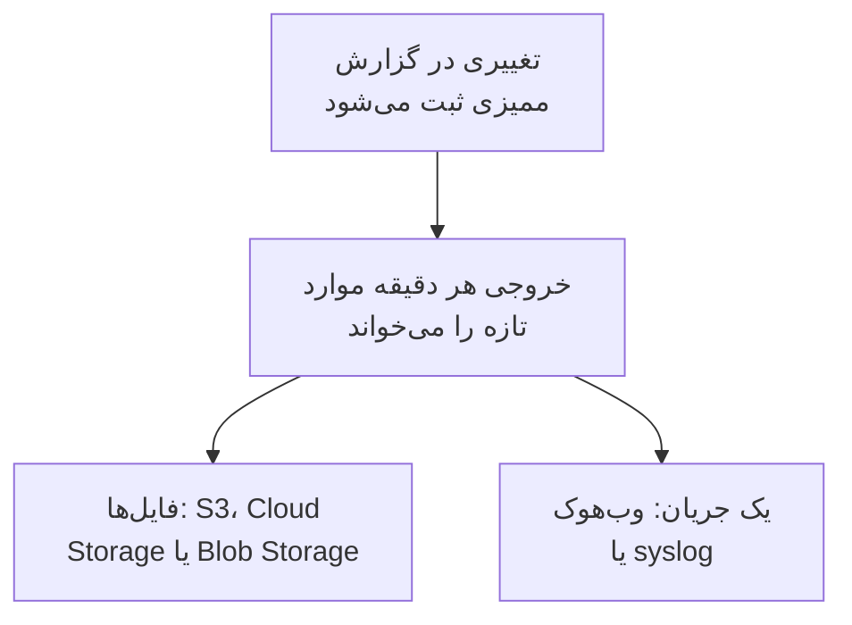

# خروجی گزارش ممیزی

گزارش ممیزی را همزمان با ثبت، به فضای ذخیره‌سازی یا سرویس دلخواه خود بفرستید: Amazon S3 یا فضای سازگار با S3، Google Cloud Storage، Azure Blob Storage، یک وب‌هوک یا syslog. موارد را تا هر زمان که بازبینی‌های انطباق شما لازم دارند آنجا نگه دارید، و در SIEM خود جست‌وجو کنید. مالکان و مدیران هر پروژه گزارش ممیزی آن را از تنظیمات پروژه خروجی می‌گیرند، و مدیران ارشد گزارش همهٔ پروژه‌ها را از Admin Dashboard. بخشی از طرح Enterprise در OneUptime Cloud، و بخشی از Enterprise Edition در نصب خودمیزبان است.

:::cards
- [راه‌اندازی یک خروجی](#راهاندازی-یک-خروجی): مقصدی انتخاب کنید، آزمایشش کنید، ذخیره‌اش کنید.
- [چه چیزی فرستاده می‌شود](#چه-چیزی-فرستاده-میشود): یک شیء JSON برای هر مورد، با طرحی پایدار.
- [موارد کی فرستاده می‌شوند](#موارد-کی-فرستاده-میشوند): هر دقیقه، هر مورد یک بار، به ترتیب.
- [وقتی مقصدی ناموفق است](#وقتی-مقصدی-ناموفق-است): تلاش‌های دوباره، خطا، و هیچ موردی جا نمی‌ماند.
:::

## یک مورد چگونه به مقصد شما می‌رسد



- **یک خروجی، یک مقصد.** هر پروژه می‌تواند چند خروجی داشته باشد، و هر کدام همهٔ موارد را به مقصد خودش می‌فرستد.
- **خروجی یک پروژه، یا خروجی نمونه.** خروجی یک پروژه موارد همان پروژه را می‌فرستد. خروجی‌ای که در Admin Dashboard راه‌اندازی شده، موارد همهٔ پروژه‌هایی را می‌فرستد که گزارش ممیزی ثبت می‌کنند.
- **از زمان ذخیره.** یک خروجی آنچه را پس از ذخیره‌اش ثبت می‌شود می‌فرستد، مگر اینکه **خروجی گرفتن از** را روی تاریخی زودتر بگذارید.

## پیش از شروع

- **در OneUptime Cloud، طرح Enterprise.** در طرح‌های دیگر، این صفحه نشان می‌دهد این قابلیت چه می‌کند و چگونه آن را به دست آورید.
- **در نصب خودمیزبان، Enterprise Edition**، با پروانه‌ای که گزارش‌های ممیزی را در بر دارد. [نسخه سازمانی](/docs/self-hosted/enterprise) را ببینید.
- **روشن بودن ثبت ممیزی** در هر پروژه‌ای که خروجی می‌گیرید. [گزارش‌های ممیزی](/docs/configuration/audit-logs) را ببینید.
- **یک Project Owner یا Project Admin** برای خروجی گرفتن از گزارش ممیزی یک پروژه، یا یک مدیر ارشد برای خروجی گرفتن از گزارش نمونه.

## راه‌اندازی یک خروجی

:::steps
### صفحهٔ خروجی را باز کنید

برای یک پروژه، به **تنظیمات پروژه** > **گزارش‌های ممیزی** > **خروجی** بروید. برای کل نمونه، در Admin Dashboard به **تنظیمات** > **خروجی گزارش ممیزی** بروید.

### مقصدی انتخاب کنید

روی **افزودن خروجی** کلیک کنید و یکی از شش مقصد زیر را انتخاب کنید. مقصد یک خروجی بعداً تغییر نمی‌کند.

### راه رسیدن به آن را وارد کنید

آنچه مقصد می‌خواهد را وارد کنید. تنظیماتی که بیشتر افراد دست نمی‌زنند زیر **فیلدهای بیشتر** هستند، و **راهنمای راه‌اندازی** بخش آن مقصد را در همین صفحه باز می‌کند.

### یک آزمایش بفرستید

روی **نوشتن فایل آزمایشی** یا **ارسال مورد آزمایشی** کلیک کنید. فضای ذخیره‌سازی فایل `oneuptime-audit-log-export-test.ndjson.gz` را در پوشهٔ خود می‌گیرد، و وب‌هوک یا syslog یک مورد با عمل `Test` می‌گیرد. آزمایش ناموفق می‌گوید چه چیزی را باید درست کنید.

### خروجی گرفتن را شروع کنید

روی **بعدی** کلیک کنید، نامی برای خروجی بگذارید، و روی **شروع خروجی گرفتن** کلیک کنید. نخستین موارد در چند دقیقه می‌رسند.
:::

ردیف خروجی نشان می‌دهد اوضاعش چگونه است: **در حال خروجی گرفتن**، **ناموفق**، **متوقف‌شده**، **در انتظار موارد** یا **در حال شروع**. **یک آزمایش بفرستید** با تنظیمات ذخیره‌شده یک آزمایش می‌فرستد، و **ویرایش** آن‌ها را تغییر می‌دهد: اعتبارنامه‌ای که خالی بگذارید همان مقدار ذخیره‌شده را نگه می‌دارد.

## مقصدها

| مقصد | چه چیزی می‌رسد | ورود با |
| --- | --- | --- |
| [Amazon S3](#amazon-s3) | فایل‌های فشردهٔ NDJSON | یک کلید دسترسی |
| [فضای سازگار با S3](#فضای-سازگار-با-s3) | فایل‌های فشردهٔ NDJSON | یک کلید دسترسی |
| [Google Cloud Storage](#google-cloud-storage) | فایل‌های فشردهٔ NDJSON | یک کلید حساب سرویس |
| [Azure Blob Storage](#azure-blob-storage) | فایل‌های فشردهٔ NDJSON | یک توکن SAS یا یک کلید دسترسی |
| [وب‌هوک](#وبهوک) | درخواست‌های HTTPS | یک سرآیند و رمز امضای اختیاری |
| [Syslog](#syslog) | پیام‌های RFC 5424 | هیچ |

### Amazon S3

| فیلد | چه چیزی وارد کنید |
| --- | --- |
| **باکت** | باکتی که فایل‌ها در آن نوشته می‌شوند. |
| **منطقه** | منطقهٔ باکت. در آغاز روی `us-east-1` است. |
| **شناسه کلید دسترسی** | کلید دسترسی‌ای که بتواند در باکت شیء بنویسد. |
| **کلید دسترسی مخفی** | رمز آن کلید. |
| **پوشه** | زیر **فیلدهای بیشتر**. اگر خالی بماند، فایل‌ها به `oneuptime/audit-logs/` می‌روند. |

کلید فقط به `s3:PutObject` روی پوشه نیاز دارد:

```json
{
  "Version": "2012-10-17",
  "Statement": [
    {
      "Effect": "Allow",
      "Action": "s3:PutObject",
      "Resource": "arn:aws:s3:::my-audit-logs/oneuptime/audit-logs/*"
    }
  ]
}
```

### فضای سازگار با S3

همان فیلدهای Amazon S3، پس از یک **نقطه پایانی**: نشانی S3 فضای ذخیره‌سازی، مانند `https://minio.example.com:9000` یا `https://<account>.r2.cloudflarestorage.com`. **منطقه** را روی همانی بگذارید که فضای ذخیره‌سازی انتظار دارد: `us-east-1` برای MinIO و پیش‌فرض Wasabi، و `auto` برای Cloudflare R2.

### Google Cloud Storage

**باکت** را وارد کنید و یک **کلید حساب سرویس** (JSON) بچسبانید که حساب سرویسش روی باکت نقش Storage Object Creator را دارد. **پوشه** زیر **فیلدهای بیشتر** است.

### Azure Blob Storage

**حساب ذخیره‌سازی** و **کانتینر** را وارد کنید، و در **ورود با** انتخاب کنید که چگونه وارد شود: با یک **توکن SAS** با مجوز Create و Write روی کانتینر، یا با یک **کلید دسترسی** حساب ذخیره‌سازی. توکن SAS را می‌توان به همین کانتینر محدود کرد، پس انتخاب امن‌تری است. **ابر** و **پوشه** زیر **فیلدهای بیشتر** هستند.

### وب‌هوک

OneUptime هر دسته را با POST به **URL** می‌فرستد، به شکل یک آرایهٔ JSON (`application/json`) یا یک مورد در هر خط (`application/x-ndjson`)، آن‌طور که **قالب بدنه** می‌گوید، با این سرآیندها:

| سرآیند | مقدار |
| --- | --- |
| `X-OneUptime-Event` | `audit-log-export` |
| `X-OneUptime-Batch-Id` | شناسهٔ نخستین مورد دسته: همان دسته اگر دوباره فرستاده شود همان شناسه را دارد. |
| `X-OneUptime-Entry-Count` | تعداد موارد درون بدنه. |
| `X-OneUptime-Signature` | `sha256=` و HMAC-SHA256 بدنه، با **رمز امضا**، وقتی تنظیم شده باشد. |

**اعتبارنامه**، مانند `Bearer <token>`، در سرآیندی فرستاده می‌شود که در **نام سرآیند** انتخاب می‌کنید، و اگر تغییرش ندهید `Authorization` است. **قالب بدنه**، **نام سرآیند** و **رمز امضا** زیر **فیلدهای بیشتر** هستند. هر پاسخ 2xx یک تحویل به حساب می‌آید. پاسخ `413` دسته را دو نیم می‌کند، و هر رد دیگری کل دسته را بعداً دوباره می‌فرستد.

### Syslog

هر مورد یک پیام RFC 5424 به **میزبان** و **پورت** است، روی TLS در پورت `6514` مگر اینکه **پروتکل** بگوید TCP، با facility ۱۳ (log audit) و severity ۶ (informational):

```text
<110>1 2026-10-24T09:15:03.000Z oneuptime.example.com oneuptime - audit-log - {"schemaVersion":1,"id":"..."}
```

پیام‌ها با شمارش هشت‌تایی (RFC 5425) از هم جدا می‌شوند، مگر اینکه **قاب‌بندی** بگوید یک پیام در هر خط. گیرنده‌ای که گواهی‌اش را یک CA خصوصی امضا کرده، به گواهی همان CA در **گواهی CA** نیاز دارد. هر دو زیر **فیلدهای بیشتر** هستند.

## چه چیزی فرستاده می‌شود

هر مورد یک شیء JSON است، با کلیدهایی که همیشه به این ترتیب‌اند:

| کلید | چه چیزی در آن است |
| --- | --- |
| `schemaVersion` | `1`. هر تغییر در طرح با نسخه‌ای تازه می‌آید. |
| `id` | شناسهٔ مورد. همان مورد اگر دو بار فرستاده شود همان شناسه را دارد. |
| `createdAt` | زمان ثبت تغییر، به UTC. |
| `projectId` | پروژه‌ای که تغییر در آن انجام شد. |
| `action` | `Create`، `Update`، `Delete` یا `Download`. |
| `resourceType`, `resourceId`, `resourceName` | آنچه تغییر کرد. |
| `rootResourceType`, `rootResourceId` | منبعی که این به آن تعلق دارد، مانند یک SLO برای قاعده‌اش. |
| `userId`, `userName`, `userEmail`, `userType` | کسی که تغییر را انجام داد. |
| `apiKeyId`, `apiKeyName` | کلید APIای که تغییر با آن انجام شد، اگر بود. |
| `mcpOAuthGrantId`, `mcpClientName` | کلاینت MCPای که تغییر از راه آن انجام شد، اگر بود. |
| `workflowId`, `workflowName` | گردش کاری‌ای که تغییر را انجام داد، اگر بود. |
| `changes` | هر فیلد تغییریافته: `field`، با `oldValue` و `newValue`. |

هر فایل در هر خط یک مورد دارد، با gzip فشرده می‌شود، و بر پایهٔ ساعت نخستین موردش بایگانی می‌شود: `oneuptime/audit-logs/2026/10/24/09/20261024T091503Z_<first entry id>.ndjson.gz`.

کلیدها، توکن‌ها و گذرواژه‌ها هرگز بیرون نمی‌روند: به صورت `[REDACTED]` ثبت می‌شوند، و فیلدهایی که هیچ‌کس اجازهٔ خواندنشان را ندارد از همهٔ موارد کنار گذاشته می‌شوند.

## موارد کی فرستاده می‌شوند

- **هر دقیقه.** مواردی که بیش از یک دقیقه پیش ثبت شده‌اند، از قدیمی‌ترین خوانده و دسته‌دسته فرستاده می‌شوند: تا ۵٬۰۰۰ مورد یا ۱۶ مگابایت در هر فایل، و ۵۰۰ مورد در هر درخواست وب‌هوک یا اتصال syslog.
- **برای هر مورد فایلی نوشته نمی‌شود.** فایل وقتی نوشته می‌شود که دسته پر شود یا نخستین موردش پنج دقیقه عمر داشته باشد.
- **هر مورد یک بار، به ترتیب.** پس از هر تحویل، خروجی آخرین مورد فرستاده‌شده را به خاطر می‌سپارد، پس یک راه‌اندازی دوباره یا کارگری دیگر از همان‌جا ادامه می‌دهد.
- **تکرار را می‌توان تشخیص داد.** دسته‌ای که پس از یک خرابی دوباره فرستاده شود همان نام فایل را می‌نویسد یا همان `X-OneUptime-Batch-Id` را دارد، و هر مورد `id` خودش را دارد.

## وقتی مقصدی ناموفق است

هر دسته سه بار با فاصلهٔ چند ثانیه آزموده می‌شود، سپس خروجی پیش از تلاش دوباره صبر می‌کند: یک دقیقه، سپس دو، چهار و همین‌طور، تا یک ساعت. ردیفش **ناموفق** را نشان می‌دهد، و **مشاهده خطا** نشان می‌دهد مقصد چه پاسخی داد و تلاش بعدی کی است.

هیچ موردی جا نمی‌ماند: موارد در گزارش ممیزی منتظر می‌مانند، و تحویل موفق بعدی از قدیمی‌ترین مورد عقب‌ماندگی را جبران می‌کند. با این حال هر مورد، فرستاده شده یا نه، همین که از مدت نگهداری‌ای که با آن ثبت شده قدیمی‌تر شود حذف می‌شود، پس خروجی ناموفق را در همین مدت درست کنید. مدت نگهداری طولانی‌تر فقط موارد ثبت‌شده پس از تغییر آن را بیشتر نگه می‌دارد.

خروجی ناموفق به کسانی که می‌توانند درستش کنند ایمیل می‌زند: برای خروجی یک پروژه به مالکان پروژه، و برای خروجی کل نصب به همهٔ مدیران ارشد. ایمیل اول پس از ۳۰ دقیقه خطا می‌رسد، همراه با پاسخی که مقصد داد. ایمیل دوم یک روز پیش از حذف قدیمی‌ترین موردی که خروجی هنوز نفرستاده می‌رسد، همراه با زمانی که از دست رفتن موارد آغاز می‌شود. هر کدام تا وقتی خطاها ادامه دارند یک بار فرستاده می‌شود، و یک تحویل موفق هر دو را از نو آغاز می‌کند.

برای متوقف کردن یک خروجی، در منوی ردیف آن **خاموش کردن** را انتخاب کنید: خروجی جایگاهش را حفظ می‌کند، و **روشن کردن** آنچه را در این فاصله ثبت شده می‌فرستد. در OneUptime Cloud، پروژه‌ای که طرح Enterprise را ترک کند خروجی گرفتن را متوقف می‌کند، و خروجی‌هایش زیر کارت ارتقا منتظر می‌مانند، جایی که می‌توان آن‌ها را خاموش یا حذف کرد. در نصب خودمیزبان، تا وقتی پروانه گزارش‌های ممیزی را در بر ندارد خروجی گرفتن متوقف است، و به محض اینکه پروانه‌ای آن‌ها را در بر بگیرد از همان جایی که ایستاده بود ادامه می‌دهد.

## عیب‌یابی

:::details آزمایش می‌گوید دسترسی رد شد
کلید، توکن یا حساب سرویس اجازهٔ نوشتن در جایی را که خروجی می‌نویسد ندارد. آن‌طور که بخش هر مقصد در بالا نشان می‌دهد، به آن اجازهٔ ساختن شیء در پوشه را بدهید، سپس آزمایش را دوباره بفرستید.
:::

:::details آزمایش به نشانی نمی‌رسد
خروجی یک پروژه در OneUptime Cloud نمی‌تواند به نشانی شبکهٔ خصوصی برسد. در نصب خودمیزبان می‌تواند، مگر اینکه `DATA_SOURCE_BLOCK_PRIVATE_ADDRESSES` برابر `true` باشد، و خروجی‌ای که در Admin Dashboard راه‌اندازی شده همیشه می‌تواند. به نشانی‌های loopback و link-local هرگز نمی‌رسد.
:::

:::details هیچ چیزی نمی‌رسد
بررسی کنید که ثبت ممیزی در پروژه روشن باشد، و کسی پس از ذخیرهٔ خروجی چیزی را تغییر داده باشد. فضای ذخیره‌سازی فقط وقتی فایلی می‌گیرد که دسته پر یا پنج دقیقه‌ای شده باشد.
:::

## گام‌های بعدی

:::cards
- [گزارش‌های ممیزی](/docs/configuration/audit-logs): چه چیزی ثبت می‌شود، و تا کی نگه داشته می‌شود.
- [کاربران، تیم‌ها و دسترسی‌ها](/docs/permissions/index): تعیین کنید چه کسی می‌تواند خروجی راه‌اندازی کند.
- [نسخه سازمانی](/docs/self-hosted/enterprise): گزارش‌های ممیزی در نصب خودمیزبان.
:::
