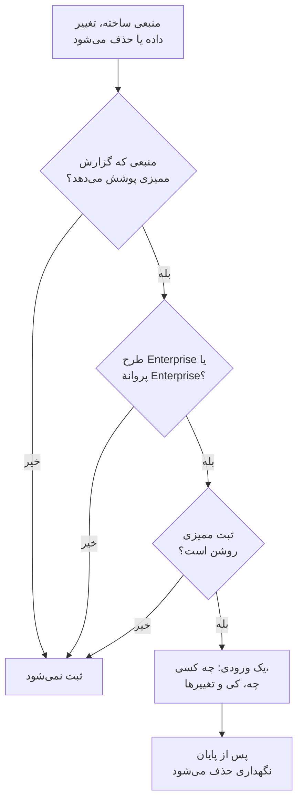

# گزارش‌های ممیزی

گزارش ممیزی ثبت می‌کند چه کسی چه چیزی را در پروژهٔ شما تغییر داد: هر ساخت، تغییر و حذف منابعی که پوشش می‌دهد، با مقدارهای پیش و پس از تغییر. از آن برای یافتن اینکه چه کسی یک مانیتور را خاموش کرد یا یک کلید API را تغییر داد، و برای نگه داشتن سابقه برای بازبینی‌های انطباق استفاده کنید. بخشی از طرح Enterprise در OneUptime Cloud، و بخشی از Enterprise Edition در نصب خودمیزبان است.

:::cards
- [روشن کردن ثبت ممیزی](#روشن-کردن-ثبت-ممیزی): در هر پروژه در آغاز خاموش است.
- [خواندن گزارش ممیزی](#خواندن-گزارش-ممیزی): چه کسی چه چیزی را کی تغییر داد.
- [چه چیزهایی ثبت می‌شود](#چه-چیزهایی-ثبت-میشود): منابع و اقدام‌هایی که پوشش می‌دهد.
- [ورودی‌ها چه مدت نگه داشته می‌شوند](#ورودیها-چه-مدت-نگه-داشته-میشوند): از ۷ تا ۱۸۰ روز.
:::

## یک تغییر چگونه به ورودی تبدیل می‌شود

- **در آغاز خاموش است.** پروژه تا وقتی کسی ثبت ممیزی را روشن نکند چیزی ثبت نمی‌کند، و هیچ چیز از پیش از آن لحظه را هم.
- **آنچه افراد انجام می‌دهند ثبت می‌کند.** تغییری که یک فرد، یک کلید API، یک کلاینت MCP یا یک گردش کاری انجام دهد ثبت می‌شود. تغییری که خود OneUptime انجام می‌دهد، مثلاً از یک کار پس‌زمینه، کنار گذاشته می‌شود، مگر اینکه **ذخیره رویدادهای سامانه** را روشن کنید.
- **ورودی‌ها تغییرپذیر نیستند.** هیچ‌کس نمی‌تواند یک ورودی را ویرایش یا حذف کند، نه در داشبورد و نه از راه API. یک ورودی فقط وقتی از بین می‌رود که نگهداری‌اش به پایان برسد.

## پیش از شروع

- **در OneUptime Cloud، طرح Enterprise.** در طرح‌های دیگر، صفحه‌های گزارش ممیزی نشان می‌دهند این قابلیت چه می‌کند و چگونه آن را به دست آورید.
- **در نصب خودمیزبان، Enterprise Edition**، با پروانه‌ای که گزارش‌های ممیزی را در بر دارد. [نسخه سازمانی](/docs/self-hosted/enterprise) را ببینید.
- **نقشی که بتواند گزارش ممیزی را بخواند.** Project Owner، Project Admin، Settings Admin یا دسترسی **Read Audit Log**. روشن کردن ثبت ممیزی و تغییر تنظیماتش به Project Owner، Project Admin یا دسترسی ویرایش پروژه نیاز دارد.

## روشن کردن ثبت ممیزی

:::steps
### تنظیمات گزارش ممیزی را باز کنید

به **تنظیمات پروژه** > **گزارش‌های ممیزی** > **تنظیمات** بروید. **گزارش‌های ممیزی** در منوی کناری در آغاز بسته است: برای باز کردنش روی آن کلیک کنید.

### تنظیمات را ویرایش کنید

روی **Edit Audit Log Settings** کلیک کنید.

### روشنش کنید

**فعال کردن گزارش‌های ممیزی** را روشن کنید، **نگهداری (روز)** را تنظیم کنید، و انتخاب کنید که آیا **ذخیره رویدادهای سامانه** انجام شود. روی **ذخیره تغییرات** کلیک کنید.
:::

| تنظیم | مقدار آغازین | چه می‌کند |
| --- | --- | --- |
| **فعال کردن گزارش‌های ممیزی** | خاموش | از این پس تغییرهای منابع پروژه را ثبت می‌کند. |
| **نگهداری (روز)** | ۷ | هر ورودی چند روز نگه داشته می‌شود: از ۷ تا ۱۸۰. |
| **ذخیره رویدادهای سامانه** | خاموش | تغییرهایی را هم ثبت می‌کند که خود OneUptime انجام می‌دهد و هیچ فرد یا کلیدی آغازشان نکرده است. |

تغییر این تنظیمات ظرف یک دقیقه اعمال می‌شود.

## خواندن گزارش ممیزی

**تنظیمات پروژه** > **گزارش‌های ممیزی** > **گزارش‌های ممیزی** همهٔ ورودی‌های پروژه را فهرست می‌کند، تازه‌ترین‌ها نخست:

| ستون | چه نشان می‌دهد |
| --- | --- |
| **چه زمانی** | چقدر پیش، با تاریخ و ساعت. |
| **اقدام** | `Create`، `Update` یا `Delete`، یا `Download` برای فایل ضبط بسته‌ای که کسی دانلودش کرده است. |
| **منبع** | نام منبع، که تا وقتی منبع وجود دارد آن را باز می‌کند، و نوعش. |
| **عامل** | چه کسی تغییر را انجام داد: یک فرد، یک کلید API، یک گردش کاری، یا `System` برای تغییری که خود OneUptime انجام داد. تغییر یک فرد از راه یک کلاینت MCP نام آن کلاینت را می‌آورد. |
| **تغییرها** | چند فیلد تغییر کرد، یا هنگام ساخت یا حذف ثبت شد. برای دیدن هر فیلد کلیک کنید. |

بر اساس **نوع منبع**، **نام منبع**، **اقدام**، **ایمیل کاربر** یا **زمان** فیلتر کنید. یک تغییر فقط فیلدهایی را نشان می‌دهد که تغییر کردند، پیش و پس، و ذخیره‌ای که چیزی را تغییر ندهد ورودی‌ای اضافه نمی‌کند.

مانیتورها، حوادث، هشدارها، صفحات وضعیت، SLOها و بسیاری از منابع دیگر هم صفحهٔ **گزارش‌های ممیزی** خود را دارند، در بخشی بسته از منوی کناری‌شان، مانند **پیشرفته**. این صفحه فقط ورودی‌های همان منبع را نشان می‌دهد، همراه با ورودی‌های چیزهایی که به آن تعلق دارند: صفحهٔ یک SLO قواعد و مالکانش را هم نشان می‌دهد.

## چه چیزهایی ثبت می‌شود

| منبع | **نوع منبع** در گزارش |
| --- | --- |
| مانیتورها | `Monitor` |
| حوادث | `Incident` |
| هشدارها | `Alert` |
| صفحات وضعیت | `Status Page` |
| رویدادهای تعمیر و نگهداری زمان‌بندی‌شده | `Scheduled Maintenance Event` |
| سیاست‌های آنکال | `On-Call Policy` |
| اهداف سطح خدمت (SLO) | `Service Level Objective` |
| قواعد و مالکان یک SLO | `SLO Burn Rate Rule`، `SLO Monitor Rule`، `Service Level Objective User Owner`، `Service Level Objective Team Owner` |
| تیم‌ها | `Team` |
| نقش‌های سفارشی، و تیم‌ها و کلیدهای API که یکی می‌گیرند | `Custom Role`، `Team Custom Role`، `API Key Custom Role` |
| برچسب‌ها | `Label` |
| وضعیت‌ها و شدت‌های حادثه | `Incident State`، `Incident Severity` |
| وضعیت‌ها و شدت‌های هشدار | `Alert State`، `Alert Severity` |
| وضعیت‌های مانیتور | `Monitor Status` |
| وضعیت‌های نگهداری زمان‌بندی‌شده | `Scheduled Maintenance State` |
| نقش‌های حادثه | `Incident Role` |
| وضعیت‌های گزارش پس از حادثه | `Postmortem Status` |
| کلیدهای API | `API Key` |
| کلاینت‌های MCP که افراد وصل می‌کنند | `MCP Client Authorization` |
| اقلام موجودی | `Inventory Item` |
| پیکربندی‌های کالکتور | `Collector Config` |
| سرورهای vCenter | `vCenter` |
| ضبط‌های بسته و دانلودهایشان | `Packet Capture` |
| پرونده‌های امنیتی و اولویت‌ها و وضعیت‌هایشان، پلی‌بوک‌ها و اجراهای آن‌ها، موجودیت‌های محافظت‌شده، اهمیت موجودیت، و ریسک موجودیتی که کسی بازنشانی کند | `Security Case`، `Security Case Priority`، `Security Case Status`، `Security Playbook`، `Security Playbook Run`، `Protected Entity`، `Entity Criticality`، `Entity Risk` |
| استثناهای قاعده | `Rule Exception` |
| فهرست‌های پایش | `Watchlist` |
| مقدارهای فهرست پایش | `Watchlist Value` |
| وظایف و شواهد پرونده‌های امنیتی | `Security Case Task`، `Security Case Evidence` |
| مخازن داده و یافته‌هایشان، و مسائل، تنظیمات، تنظیمات بررسی، انواع داده سفارشی و قواعد محل نگهداری داده در امنیت داده | `Data Store`، `Data Store Finding`، `Data Security Issue`، `Data Security Setting`، `Check Setting`، `Custom Data Type`، `Residency Rule` |
| خروجی‌های گزارش ممیزی | `Audit Log Export` |

این هم ثبت می‌شود که مدیری روش اعلان یا قاعدهٔ آنکال شخصی را روی حساب کس دیگری اضافه یا حذف کند، بدون خود نشانی یا شماره.

داده‌های دیگر در گزارش ممیزی نیستند، مانند اینکه چه کسی در یک تیم است، یا دسترسی‌ای که جداگانه به یک تیم افزوده شده است. فیلدهایی که هیچ‌کس اجازهٔ خواندنشان را ندارد از همهٔ ورودی‌ها کنار گذاشته می‌شوند، و کلیدها، توکن‌ها و گذرواژه‌ها به صورت `[REDACTED]` ثبت می‌شوند: ورودی نشان می‌دهد که تغییر کرده‌اند، نه مقدارشان را.

## ورودی‌ها چه مدت نگه داشته می‌شوند

هر ورودی به مدتی که **نگهداری (روز)** پروژه هنگام ثبت آن تعیین کرده بود نگه داشته می‌شود، و سپس حذف می‌شود. نگهداری تازه برای ورودی‌های تازه اعمال می‌شود: ورودی‌هایی که از پیش ثبت شده‌اند تاریخ‌هایشان را نگه می‌دارند.

برای نگه داشتن ورودی‌ها بیش از ۱۸۰ روز، آن‌ها را همزمان با ثبت به فضای ذخیره‌سازی یا SIEM خودتان بفرستید: [خروجی گزارش ممیزی](/docs/configuration/audit-log-export) را ببینید. همچنین می‌توانید آن‌ها را از راه API با یک کلید API که **Read Audit Log** دارد بخوانید، و هر جا لازم دارید ذخیره کنید. [مرجع API OneUptime](/docs/api-reference/api-reference) را ببینید.

## وقتی طرح یا پروانه دیگر گزارش‌های ممیزی را در بر ندارد

- **در OneUptime Cloud**، پروژه‌ای که طرح Enterprise را ترک کند ثبت را متوقف می‌کند، و صفحه‌های گزارش ممیزی‌اش کارت ارتقا را نشان می‌دهند تا وقتی دوباره به آن طرح برگردد.
- **در نصب خودمیزبان**، ثبت ممیزی وقتی متوقف می‌شود که دورهٔ آزمایشی Enterprise یا دورهٔ مهلت بدون پروانه به پایان برسد، یا وقتی پروانه گزارش‌های ممیزی را در بر نداشته باشد. گزارش ممیزی این را به رنگ قرمز نشان می‌دهد. ورودی‌هایی که از پیش ثبت شده‌اند نگه داشته می‌شوند، و ثبت با همان تنظیمات به‌محض فعال شدن یک پروانه از سر گرفته می‌شود. [وقتی پروانه منقضی شده یا وجود ندارد](/docs/self-hosted/enterprise#وقتی-پروانه-منقضی-شده-یا-وجود-ندارد) را ببینید.

## عیب‌یابی

:::details گزارش ممیزی خالی است
ثبت ممیزی در آغاز خاموش است و هیچ چیز از پیش از روشن شدنش را ثبت نمی‌کند. اگر فهرست می‌گوید ثبت ممیزی خاموش است، پیوندش را تا تنظیمات دنبال کنید و آن را روشن کنید. در غیر این صورت، یک مانیتور یا یک حادثه را تغییر دهید و فهرست را تازه کنید.
:::

:::details تغییری در گزارش ممیزی نیست
بررسی کنید که منبع در [چه چیزهایی ثبت می‌شود](#چه-چیزهایی-ثبت-میشود) آمده باشد، و تغییر پس از روشن شدن ثبت ممیزی انجام شده باشد. تغییری که خود OneUptime انجام داده، فقط وقتی **ذخیره رویدادهای سامانه** روشن باشد ثبت می‌شود.
:::

## گام‌های بعدی

:::cards
- [خروجی گزارش ممیزی](/docs/configuration/audit-log-export): گزارش ممیزی را به فضای ذخیره‌سازی یا SIEM خودتان بفرستید.
- [کاربران، تیم‌ها و دسترسی‌ها](/docs/permissions/index): تعیین کنید چه کسی می‌تواند گزارش ممیزی را بخواند.
- [تنظیمات پروژه](/docs/configuration/project-settings): دیگر تنظیمات پروژه.
- [صورت‌حساب و مصرف](/docs/configuration/billing): طرح پروژه را تغییر دهید.
- [نسخه سازمانی](/docs/self-hosted/enterprise): گزارش‌های ممیزی در نصب خودمیزبان.
:::
