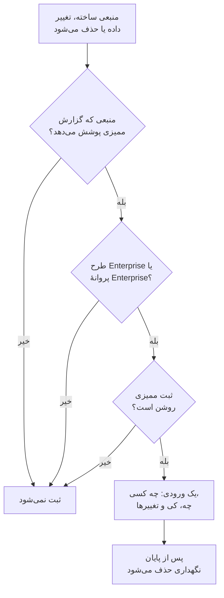

# گزارش‌های ممیزی

گزارش ممیزی ثبت می‌کند چه کسی چه چیزی را در پروژهٔ شما تغییر داد: هر ساخت، تغییر و حذف منابعی که پوشش می‌دهد، با مقدارهای پیش و پس از تغییر، و هر بار که کسی وارد یا خارج می‌شود. از آن برای یافتن اینکه چه کسی یک مانیتور را خاموش کرد یا یک کلید API را تغییر داد، چه کسی از کجا وارد شد، و برای نگه داشتن سابقه برای بازبینی‌های انطباق استفاده کنید. بخشی از طرح Enterprise در OneUptime Cloud، و بخشی از Enterprise Edition در نصب خودمیزبان است.

:::cards
- [روشن کردن ثبت ممیزی](#روشن-کردن-ثبت-ممیزی): در هر پروژه در آغاز خاموش است.
- [خواندن گزارش ممیزی](#خواندن-گزارش-ممیزی): چه کسی چه چیزی را کی تغییر داد.
- [چه چیزهایی ثبت می‌شود](#چه-چیزهایی-ثبت-میشود): منابع و اقدام‌هایی که پوشش می‌دهد.
- [ورودها و نشست‌ها](#ورودها-و-نشستها): چه کسی وارد شد، و هر نشست چگونه پایان یافت.
- [ورودی‌ها چه مدت نگه داشته می‌شوند](#ورودیها-چه-مدت-نگه-داشته-میشوند): از ۷ تا ۱۸۰ روز.
:::

## یک تغییر چگونه به ورودی تبدیل می‌شود

- **در آغاز خاموش است.** پروژه تا وقتی کسی ثبت ممیزی را روشن نکند چیزی ثبت نمی‌کند، و هیچ چیز از پیش از آن لحظه را هم.
- **آنچه افراد انجام می‌دهند ثبت می‌کند.** تغییری که یک فرد، یک کلید API، یک کلاینت MCP یا یک گردش کاری انجام دهد ثبت می‌شود. تغییری که خود OneUptime انجام می‌دهد، مثلاً از یک کار پس‌زمینه، کنار گذاشته می‌شود، مگر اینکه **ذخیره رویدادهای سامانه** را روشن کنید.
- **ورودی‌ها تغییرپذیر نیستند.** هیچ‌کس نمی‌تواند یک ورودی را ویرایش یا حذف کند، نه در داشبورد و نه از راه API. یک ورودی فقط وقتی از بین می‌رود که نگهداری‌اش به پایان برسد.

## پیش از شروع

- **در OneUptime Cloud، طرح Enterprise.** در طرح‌های دیگر، صفحه‌های گزارش ممیزی نشان می‌دهند این قابلیت چه می‌کند و چگونه آن را به دست آورید.
- **در نصب خودمیزبان، Enterprise Edition**، با پروانه‌ای که گزارش‌های ممیزی را در بر دارد. [نسخه سازمانی](/docs/self-hosted/enterprise) را ببینید.
- **نقشی که بتواند گزارش ممیزی را بخواند.** Project Owner، Project Admin، Settings Admin یا دسترسی **Read Audit Log**. روشن کردن ثبت ممیزی و تغییر تنظیماتش به Project Owner، Project Admin یا دسترسی ویرایش پروژه نیاز دارد.

## روشن کردن ثبت ممیزی

:::steps
### تنظیمات گزارش ممیزی را باز کنید

به **تنظیمات پروژه** > **گزارش‌های ممیزی** > **تنظیمات** بروید. **گزارش‌های ممیزی** در منوی کناری در آغاز بسته است: برای باز کردنش روی آن کلیک کنید.

### تنظیمات را ویرایش کنید

روی **Edit Audit Log Settings** کلیک کنید.

### روشنش کنید

**فعال کردن گزارش‌های ممیزی** را روشن کنید، **نگهداری (روز)** را تنظیم کنید، و انتخاب کنید که آیا **ذخیره رویدادهای سامانه** انجام شود. روی **ذخیره تغییرات** کلیک کنید.
:::

| تنظیم | مقدار آغازین | چه می‌کند |
| --- | --- | --- |
| **فعال کردن گزارش‌های ممیزی** | خاموش | از این پس تغییرهای منابع پروژه را ثبت می‌کند. |
| **نگهداری (روز)** | ۷ | هر ورودی چند روز نگه داشته می‌شود: از ۷ تا ۱۸۰. |
| **ذخیره رویدادهای سامانه** | خاموش | تغییرهایی را هم ثبت می‌کند که خود OneUptime انجام می‌دهد و هیچ فرد یا کلیدی آغازشان نکرده است. |

تغییر این تنظیمات ظرف یک دقیقه اعمال می‌شود.

## خواندن گزارش ممیزی

**تنظیمات پروژه** > **گزارش‌های ممیزی** > **گزارش‌های ممیزی** همهٔ ورودی‌های پروژه را فهرست می‌کند، تازه‌ترین‌ها نخست:

| ستون | چه نشان می‌دهد |
| --- | --- |
| **چه زمانی** | چقدر پیش، با تاریخ و ساعت. |
| **اقدام** | `Create`، `Update` یا `Delete`، `Download` برای فایل ضبط بسته‌ای که کسی دانلودش کرده است، یا برای یک نشست `Sign In`، `Sign Out`، `Session Timeout` یا `Session Revoked`. |
| **منبع** | نام منبع، که تا وقتی منبع وجود دارد آن را باز می‌کند، و نوعش. |
| **عامل** | چه کسی تغییر را انجام داد: یک فرد، یک کلید API، یک گردش کاری، یا `System` برای تغییری که خود OneUptime انجام داد. تغییر یک فرد از راه یک کلاینت MCP نام آن کلاینت را می‌آورد. |
| **تغییرها** | چند فیلد تغییر کرد، یا هنگام ساخت یا حذف ثبت شد. برای یک نشست، اینکه چگونه وارد شد یا چرا پایان یافت. برای دیدن هر فیلد کلیک کنید. |

بر اساس **نوع منبع**، **نام منبع**، **اقدام**، **ایمیل کاربر** یا **زمان** فیلتر کنید. یک تغییر فقط فیلدهایی را نشان می‌دهد که تغییر کردند، پیش و پس، و ذخیره‌ای که چیزی را تغییر ندهد ورودی‌ای اضافه نمی‌کند.

منبعی که نام خودش را ندارد، با آنچه آن را در OneUptime نام می‌برد نامیده می‌شود: یک استثنا با نوعش و آغاز پیامش، که شناسه‌ها، نشانی‌ها و هر چه شبیه یک راز باشد در آن پوشانده می‌شود، یک اجرای رانبوک با رانبوکش، شمارهٔ تلفن یک سیاست تماس ورودی با خودِ شماره، و یک الگو یا یک دامنه با نام خودش.

مانیتورها، حوادث، هشدارها، صفحات وضعیت، SLOها و بسیاری از منابع دیگر هم صفحهٔ **گزارش‌های ممیزی** خود را دارند، در بخشی بسته از منوی کناری‌شان، مانند **پیشرفته**. این صفحه فقط ورودی‌های همان منبع را نشان می‌دهد، همراه با ورودی‌های چیزهایی که به آن تعلق دارند: صفحهٔ یک SLO قواعد و مالکانش را هم نشان می‌دهد.

## چه چیزهایی ثبت می‌شود

هر چیزی که افراد در یک پروژه ایجاد، تغییر یا حذف می‌کنند ثبت می‌شود: مانیتورها، رخدادها، هشدارها، صفحه‌های وضعیت، گردش‌کارها و گام‌هایشان، صف‌ها، داشبوردها، سیاست‌های آنکال، تیم‌ها و اعضایشان، کلیدهای API و هر تنظیمی. **نوع منبع** می‌گوید هر ورودی دربارهٔ چیست، مانند `Monitor`، `Workflow` یا `Queue`.

| ثبت نمی‌شود | چرا |
| --- | --- |
| گزارش‌های پیام | هر کدام خودش سابقهٔ ایمیل، پیامک، تماس، اعلان فشاری یا پیام گفت‌وگویی است که OneUptime فرستاده یا دریافت کرده است. |
| سوابق اجراها | هر کدام خودش سابقهٔ اجرای یک گردش‌کار، یک تشدید آنکال، یک پویش، یک درون‌ریزی یا یک اجرای هوش مصنوعی است. |
| آنچه عامل‌ها و تله‌متری گزارش می‌دهند | منابع کشف‌شده، خوانش‌ها و مصرف با هر گزارش تغییر می‌کنند، نه چون کسی آن‌ها را تغییر داده است. |
| فیدهای فعالیت | یک فید تغییراتی را نشان می‌دهد که گزارش ممیزی از پیش ثبت می‌کند. |
| وضعیت کاری OneUptime | نشست‌های خوانندگان صفحه‌های وضعیت، کارهای در صف و وضعیت‌های دیگری که OneUptime هنگام کار نگه می‌دارد. |
| تنظیمات اعلان شخصی هر فرد | نشانی‌ها، شماره‌ها و قاعده‌های آنکال شخصی هر فرد فقط به خود او تعلق دارد. |
| ترجیحات شخصی هر فرد | محصولاتی که هر فرد در نوار بالای خودش سنجاق می‌کند فقط به خود او تعلق دارد و فقط خودش آن‌ها را می‌بیند. |

این هم ثبت می‌شود که مدیری روش اعلان یا قاعدهٔ آنکال شخصی را روی حساب کس دیگری اضافه یا حذف کند، بدون خود نشانی یا شماره.

فیلدهایی که فقط OneUptime می‌نویسد، مانند اینکه یک میزبان آخرین بار کی دیده شد، از همهٔ ورودی‌ها کنار گذاشته می‌شوند، و فیلدهایی که هیچ‌کس اجازهٔ خواندنشان را ندارد نیز همین‌طور. وقتی OneUptime یکی از آن‌ها را به درخواست کسی می‌نویسد، مانند ادغام یک استثنا با استثنایی دیگر یا بازنشانی نشانی وب‌هوک، ورودی آن را تغییرِ همان شخص ثبت می‌کند. کلیدها، توکن‌ها و گذرواژه‌ها به صورت `[REDACTED]` ثبت می‌شوند: ورودی نشان می‌دهد که تغییر کرده‌اند، نه مقدارشان را. گام‌های یک گردش‌کار به صورت آنچه تغییر کرده ثبت می‌شوند، با نام تنظیمات یک گام ولی هرگز آنچه در آن‌ها نوشته شده است، و جابه‌جا کردن یک گام روی بوم ثبت نمی‌شود.

آنچه OneUptime انجام می‌دهد چون کسی آن را خواسته نیز به عنوان تغییرِ همان شخص ثبت می‌شود، چه پروژه رویدادهای سامانه را نگه دارد و چه نه:

- آغاز، تأیید، کامل کردن، رد کردن و لغو یک اجرای رانبوک. گام‌های آن به صورت کاری که با هر یک انجام شد ثبت می‌شوند، برای نمونه `Approved "Restart the API" (step 3)`، و هرگز همراه با آنچه یک گام چاپ کرد.
- آنچه یک قاعده تغییر می‌دهد وقتی کسی آن را اجرا می‌کند: برچسب‌ها و مالکانی که می‌افزاید، رکوردهایی که یک قاعدهٔ حریم خصوصی خصوصی می‌کند، دستگاه‌هایی که یک قاعدهٔ تخصیص سایت جابه‌جا می‌کند، دستگاه‌ها و مانیتورهایی که یک قاعدهٔ درون‌ریزی خودکار می‌سازد، و آنچه یک قاعدهٔ مانیتورِ یک صفحهٔ وضعیت یا یک SLO در صفحه یا SLO خود تغییر می‌دهد.
- خرید، پیوست کردن و آزاد کردن شمارهٔ تلفن یک سیاست تماس ورودی.
- حل کردن یک هشدار داده که کسی آن را مورد انتظار یا بی‌مشکل علامت می‌زند.
- بازنشانی پیوند یک فید تقویم.
- تیم‌هایی که کسی هنگام ورود با SSO به آن‌ها می‌پیوندد.

آنچه یک قاعده خودبه‌خود انجام می‌دهد تغییرِ خودِ OneUptime است و با روشن بودن **ذخیره رویدادهای سامانه** ثبت می‌شود: برچسب‌ها و مالکانی که یک قاعده هنگام ساخته شدن یک رکورد می‌افزاید، و رکوردی که در آن هنگام خصوصی می‌کند؛ دستگاه‌ها و مانیتورهایی که یک قاعدهٔ درون‌ریزی خودکار از نتایج تازهٔ اسکن می‌سازد؛ و آنچه یک قاعدهٔ مانیتورِ یک صفحهٔ وضعیت یا یک SLO هنگام ذخیره شدن یک قاعده، یک مانیتور یا یک برچسب تغییر می‌دهد.

بازنشانی عامل هوش مصنوعی یک میزبان، یک خوشه یا یک حساب ابری در صفحهٔ **گزارش‌های ممیزی** خودِ آن منبع ثبت می‌شود، به عنوان تغییر `aiAgentResetAt` به دست کسی که آن را بازنشانی کرد: چه کسی، و کِی. ساختن یک کلید برای عامل هوش مصنوعی یک حساب ابری نیز همین‌طور است: کلیدها تغییرکرده نشان داده می‌شوند و هرگز همراه با یک کلید یا یک هش نیستند. آنچه یک عامل هنگام اتصال و گزارش‌دادن اعلام می‌کند، مانند پیش بیرون می‌ماند.

## ورودها و نشست‌ها

هر بار که یکی از اعضای پروژه به OneUptime وارد می‌شود، گزارش ممیزی آن را ثبت می‌کند، و بار دیگر وقتی آن نشست پایان می‌یابد. ورود به OneUptime است، نه به یک پروژه، پس هر پروژه‌ای که آن فرد عضوش است آن را ثبت می‌کند.

| اقدام | چه زمانی ثبت می‌شود |
| --- | --- |
| `Sign In` | کسی وارد می‌شود: با رمز عبور یا لینک ورود، کلید عبور، Google، Microsoft، Vercel یا ورود یکپارچه. |
| `Sign Out` | آن فرد خارج می‌شود. |
| `Session Timeout` | OneUptime نشست را با سر رسیدن زمانش پایان می‌دهد: مدت بی‌فعالیتی یا مدت نشستی که یک مدیر سرور تعیین کرده است، یا ۳۰ روز بدون استفاده. |
| `Session Revoked` | OneUptime نشست را پایان می‌دهد، چون رمز عبور تغییر کرد، حساب مسدود شد، یا یک مدیر سرور احراز هویت دومرحله‌ای را بازنشانی یا الزامی کرد. |

**منبع** یک ورودی همان نشست است و به نام دستگاهی نامیده می‌شود که از آن وارد شده است، مانند `Chrome 130 on macOS`. **عامل** آن فردی است که نشست از آنِ اوست، پس فیلتر کردن بر اساس **ایمیل کاربر** همهٔ ورودها و نشست‌های او را پیدا می‌کند. جزئیات آن می‌گوید او چگونه و با کدام عامل دوم وارد شد، نشانی IP و مکان، و برای نشستی که پایان یافته، کی وارد شد، آخرین بار کی استفاده شد و کی منقضی شد. ارائه‌دهندهٔ SSO خودِ یک پروژه فقط در گزارش ممیزی همان پروژه نام برده می‌شود.

ورودها و نشست‌ها ثبت می‌شوند، چه پروژه رویدادهای سامانه را نگه دارد و چه نه. سپری شدن مدت نشست یا ۳۰ روز بدون استفاده ظرف چند دقیقه پس از پایانش ثبت می‌شود. سپری شدن مدت بی‌فعالیتی وقتی ثبت می‌شود که زبانهٔ باز آن فرد یا برنامهٔ موبایل دفعهٔ بعد به OneUptime وصل شود.

## ورودی‌ها چه مدت نگه داشته می‌شوند

هر ورودی به مدتی که **نگهداری (روز)** پروژه هنگام ثبت آن تعیین کرده بود نگه داشته می‌شود، و سپس حذف می‌شود. نگهداری تازه برای ورودی‌های تازه اعمال می‌شود: ورودی‌هایی که از پیش ثبت شده‌اند تاریخ‌هایشان را نگه می‌دارند. از راه API هم، نگهداری عددی صحیح از ۷ تا ۱۸۰ روز است: هر مقدار دیگری رد می‌شود.

برای نگه داشتن ورودی‌ها بیش از ۱۸۰ روز، آن‌ها را همزمان با ثبت به فضای ذخیره‌سازی یا SIEM خودتان بفرستید: [خروجی گزارش ممیزی](/docs/configuration/audit-log-export) را ببینید. همچنین می‌توانید آن‌ها را از راه API با یک کلید API که **Read Audit Log** دارد بخوانید، و هر جا لازم دارید ذخیره کنید. [مرجع API OneUptime](/docs/api-reference/api-reference) را ببینید.

## وقتی طرح یا پروانه دیگر گزارش‌های ممیزی را در بر ندارد

- **در OneUptime Cloud**، پروژه‌ای که طرح Enterprise را ترک کند ثبت را متوقف می‌کند، و صفحه‌های گزارش ممیزی‌اش کارت ارتقا را نشان می‌دهند تا وقتی دوباره به آن طرح برگردد.
- **در نصب خودمیزبان**، ثبت ممیزی وقتی متوقف می‌شود که دورهٔ آزمایشی Enterprise یا دورهٔ مهلت بدون پروانه به پایان برسد، یا وقتی پروانه گزارش‌های ممیزی را در بر نداشته باشد. گزارش ممیزی این را به رنگ قرمز نشان می‌دهد. ورودی‌هایی که از پیش ثبت شده‌اند نگه داشته می‌شوند، و ثبت با همان تنظیمات به‌محض فعال شدن یک پروانه از سر گرفته می‌شود. [وقتی پروانه منقضی شده یا وجود ندارد](/docs/self-hosted/enterprise#وقتی-پروانه-منقضی-شده-یا-وجود-ندارد) را ببینید.

## عیب‌یابی

:::details گزارش ممیزی خالی است
ثبت ممیزی در آغاز خاموش است و هیچ چیز از پیش از روشن شدنش را ثبت نمی‌کند. اگر فهرست می‌گوید ثبت ممیزی خاموش است، پیوندش را تا تنظیمات دنبال کنید و آن را روشن کنید. در غیر این صورت، یک مانیتور یا یک حادثه را تغییر دهید و فهرست را تازه کنید.
:::

:::details تغییری در گزارش ممیزی نیست
بررسی کنید که منبع در [چه چیزهایی ثبت می‌شود](#چه-چیزهایی-ثبت-میشود) آمده باشد، و تغییر پس از روشن شدن ثبت ممیزی انجام شده باشد. تغییری که خود OneUptime انجام داده، فقط وقتی **ذخیره رویدادهای سامانه** روشن باشد ثبت می‌شود.
:::

## گام‌های بعدی

:::cards
- [خروجی گزارش ممیزی](/docs/configuration/audit-log-export): گزارش ممیزی را به فضای ذخیره‌سازی یا SIEM خودتان بفرستید.
- [کاربران، تیم‌ها و دسترسی‌ها](/docs/permissions/index): تعیین کنید چه کسی می‌تواند گزارش ممیزی را بخواند.
- [تنظیمات پروژه](/docs/configuration/project-settings): دیگر تنظیمات پروژه.
- [صورت‌حساب و مصرف](/docs/configuration/billing): طرح پروژه را تغییر دهید.
- [نسخه سازمانی](/docs/self-hosted/enterprise): گزارش‌های ممیزی در نصب خودمیزبان.
:::
