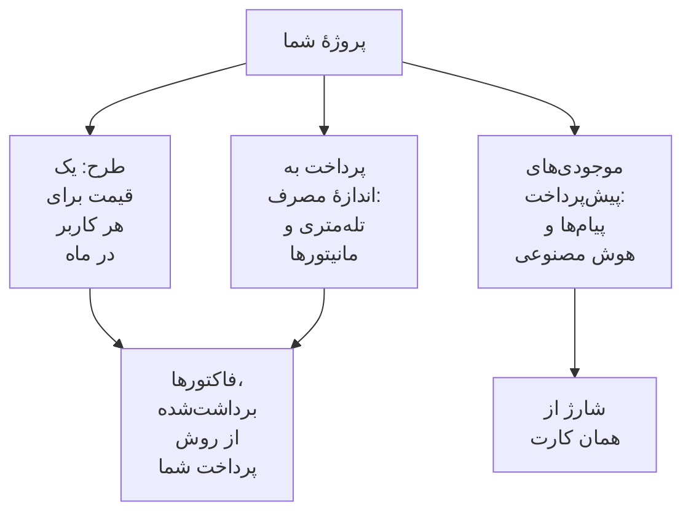

# صورت‌حساب و مصرف

در OneUptime Cloud، یک پروژه برای طرحش، به ازای هر کاربر، و برای آنچه مصرف می‌کند پرداخت می‌کند: تله‌متری، مانیتورهای فعال، و پیام‌ها و کار هوش مصنوعی که هزینه‌شان را از موجودی‌های پیش‌پرداخت می‌پردازد. این صفحه نشان می‌دهد هر یک را کجا ببینید و تغییر دهید، و چه کسی می‌تواند. نصب خودمیزبان صورت‌حساب ندارد، و هیچ‌یک از این صفحه‌ها را هم ندارد.

:::cards
- [طرح و نشست‌های شما](#طرح-و-نشستهای-شما): هزینهٔ طرح، و اینکه چه کسی یک نشست به شمار می‌آید.
- [روش‌های پرداخت](#روشهای-پرداخت): کارتی که فاکتورهایتان از آن برداشت می‌شود.
- [فاکتورها](#فاکتورها): پرداختشان کنید، دانلودشان کنید، و مصرفتان را بررسی کنید.
- [موجودی‌های پیش‌پرداخت](#موجودیهای-پیشپرداخت): پیام‌ها و هوش مصنوعی، که دستی یا خودکار شارژ می‌شوند.
:::

## یک پروژه برای چه پرداخت می‌کند

| چه | قیمتش چگونه تعیین می‌شود |
| --- | --- |
| طرح | یک قیمت برای هر کاربر در ماه، با صورت‌حساب ماهانه یا سالانه. هر فرد در پروژه یک نشست است. |
| تله‌متری | $۰٫۱۰ برای هر گیگابایت دریافت‌شده، با ۱۵ روز نگهداری. نگهداری طولانی‌تر هزینهٔ بیشتری دارد، و هزینهٔ نگهداری کمتر از ۷ روز به اندازهٔ ۷ روز محاسبه می‌شود: [هزینهٔ نگهداری](/docs/telemetry/data-retention#هزینهٔ-نگهداری) را ببینید. |
| بازپخش نشست | $۲ برای هر گیگابایت، با ۱۵ روز نگهداری. |
| مانیتورهای فعال | $۱ برای هر مانیتور در ماه. هر مانیتوری جز مانیتور دستی فعال است، حتی وقتی خاموش است. |
| پیامک، تماس، WhatsApp و Telegram | از موجودی پروژه، هم‌زمان با ارسال هر پیام، پرداخت می‌شود. |
| OneUptime AI | از اعتبار هوش مصنوعی پروژه پرداخت می‌شود، مگر اینکه روی ارائه‌دهندهٔ LLM خودتان اجرا شود. |

[صفحهٔ قیمت‌ها](https://oneuptime.com/pricing) طرح‌ها را مقایسه می‌کند.

## پیش از شروع

- **OneUptime Cloud.** بخش **صورت‌حساب و فاکتورها** در **تنظیمات پروژه** فقط در OneUptime Cloud است و در آغاز بسته است: برای باز کردنش روی عنوانش کلیک کنید.
- **نقشی که بتواند صورت‌حساب را بخواند.** Project Owner، افرادی با **Manage Billing** و سه نقش صورت‌حساب همهٔ صفحه‌های صورت‌حساب را می‌خوانند. [چه کسی چه کاری می‌تواند بکند](#چه-کسی-چه-کاری-میتواند-بکند) را ببینید.

## طرح و نشست‌های شما

به **تنظیمات پروژه** > **صورت‌حساب و فاکتورها** > **صورت‌حساب** بروید. کارت **طرح فعلی** طرح پروژه و قیمت آن برای هر کاربر را نشان می‌دهد، و **نشست‌ها** را: یکی برای هر فرد در پروژه.

یک فرد از لحظه‌ای که دعوتش می‌کنید، حتی پیش از آنکه بپذیرد، تا وقتی حذفش کنید یک نشست به شمار می‌آید. برای تغییر شمار نشست‌ها، افراد را دعوت یا حذف کنید: [دعوت از افراد](/docs/permissions/inviting-people) را ببینید.

## تغییر طرح

:::steps
### نخست یک روش پرداخت اضافه کنید

تغییر طرح به یک روش پرداخت نیاز دارد. بدون آن، **Change Plan** به جای آن **Add a Payment Method** را باز می‌کند: [روش‌های پرداخت](#روشهای-پرداخت) را ببینید.

### روی Change Plan کلیک کنید

روی کارت **طرح فعلی** روی **Change Plan** کلیک کنید. **طرح سالانه** در آغاز روشن است: برای دیدن قیمت‌های ماهانه خاموشش کنید.

### طرح را انتخاب کنید

هر طرح قیمت خود برای هر کاربر را نشان می‌دهد. یادداشت زیر طرح‌ها می‌گوید برای دورهٔ آزمایشی شما چه پیش می‌آید: **Your free trial carries over** تا وقتی پروژه هنوز در دورهٔ آزمایشی است، و **Changing plan does not start a free trial** وقتی دیگر نیست.

### تغییر را ذخیره کنید

روی **ذخیره تغییرات** کلیک کنید. طرح پولی از لحظه‌ای که به آن تغییر می‌دهید صورت‌حساب می‌شود، و هر کسی که در آن دعوت می‌کنید، هنگام دعوت صورت‌حساب می‌شود.
:::

کلیدهای API به طرح Growth یا طرحی بالاتر نیاز دارند، و زیر طرح Scale، اتصال‌های SCIM فقط افراد را حذف می‌کنند. طرحی که آن‌ها را متوقف کند، پیش از انتخابش می‌گوید چند تا، و صفحهٔ **صورت‌حساب** تا وقتی متوقف‌اند **در این طرح گنجانده نشده است** را نشان می‌دهد. هیچ چیز حذف نمی‌شود: در طرحی که آن‌ها را در بر داشته باشد دوباره کار می‌کنند.

> [!NOTE]
> OneUptime را از راه یک فروشنده یا بازارگاه ابری (AWS Marketplace، Microsoft Marketplace، Google Cloud Marketplace یا Vercel Marketplace) خریده‌اید؟ صفحهٔ **صورت‌حساب** این را می‌گوید. فروشنده طرح شما را برایتان تغییر می‌دهد، و بازارگاه طرح و مصرف پروژه را روی صورت‌حساب ابری شما می‌آورد.

## روش‌های پرداخت

کارت **روش‌های پرداخت** کارت‌های پروژه را فهرست می‌کند. فاکتورها خودکار از کارت پیش‌فرض برداشت می‌شوند.

:::steps
### پنجرهٔ افزودن را باز کنید

روی کارت **روش‌های پرداخت** روی **افزودن روش پرداخت** کلیک کنید.

### کارت را وارد کنید

جزئیات پرداخت را وارد کنید و روی **Save payment method** کلیک کنید. روشی که اضافه می‌کنید پیش‌فرض می‌شود، و افزودن یکی پرداخت بر اساس مصرف را فعال می‌کند. طرح شما را تغییر نمی‌دهد.
:::

- **تنظیم به‌عنوان پیش‌فرض** روش دیگری از فهرست را به روشی تبدیل می‌کند که فاکتورها از آن برداشت می‌شوند.
- **Re-sync Autopay**، روی روش پیش‌فرض، تمدیدی را که هنوز از کارتی قدیمی‌تر برداشت می‌کند درست می‌کند.
- پروژه دست‌کم یک روش پرداخت را نگه می‌دارد: پیش از حذف آخرین روش، روش دیگری اضافه کنید.

## نشانی صورت‌حساب و ایمیل فاکتور

کارت **اطلاعات کسب‌وکار / نشانی صورت‌حساب** آنچه را فاکتورهایتان دربارهٔ شما می‌گویند در خود دارد. روی **به‌روزرسانی** کلیک کنید و دو گام را پر کنید:

| گام | فیلدها |
| --- | --- |
| **آدرس صورت‌حساب** | **اطلاعات کسب‌وکار / نشانی صورت‌حساب**: نام حقوقی شرکت، نشانی و شناسهٔ مالیات بر ارزش افزوده یا شناسهٔ مالیاتی. **کشور**: کشور صورت‌حساب شما. |
| **فاکتورها** | **ایمیل مالی / حسابداری**: جایی که فاکتورها، رسیدها و پیام‌های صورت‌حساب فرستاده می‌شوند، چند نشانی جداشده با ویرگول. **ارسال فاکتورها از طریق ایمیل**: هر فاکتور را به‌محض صدور به آنجا بفرستید. |

## فاکتورها

**تنظیمات پروژه** > **صورت‌حساب و فاکتورها** > **فاکتورها** فاکتورهای پروژه را فهرست می‌کند، هر یک با **شماره فاکتور**، **تاریخ فاکتور**، **مبلغ** و **وضعیت فاکتور**.

- **پرداخت فاکتور** فاکتوری را که هنوز پرداخت نشده می‌پردازد.
- **دانلود** فاکتور را به‌صورت PDF باز می‌کند. روی فاکتوری که هنوز پرداخت نشده، در منوی ردیف، **⋯**، قرار دارد.

وقتی بانک شما هنوز در حال پردازش پرداخت است، OneUptime این را می‌گوید: برخی بانک‌ها تا ۲ روز برای تأیید پرداخت کارتی زمان می‌برند، و فاکتور خودش به‌روز می‌شود. دوباره آن را نپردازید.

## تاریخچه مصرف

**تنظیمات پروژه** > **صورت‌حساب و فاکتورها** > **تاریخچه مصرف** تله‌متری‌ای را که پروژه فرستاده نشان می‌دهد، یک ردیف برای هر محصول، سرویس و روز:

| ستون | چه نشان می‌دهد |
| --- | --- |
| **محصول** | لاگ‌ها، ردگیری‌ها، متریک‌ها و دیگر انواع تله‌متری. |
| **روز** | روزی که فرستاده شد. |
| **سرویس** | سرویس، یا میزبان، خوشه یا منبع دیگری که آن را فرستاد. |
| **داده دریافت‌شده (به گیگابایت)** | چه مقدار وارد شد. |
| **نگهداری داده (به روز)** | چه مدت نگه داشته می‌شود. |
| **هزینه کل** | هزینه‌اش چقدر بود، به دلار آمریکا. |

مصرف هر روز پس از پایان آن روز نمایش داده می‌شود. برای یافتن آنچه رشد کرده، بر اساس **محصول**، **روز** یا **سرویس** فیلتر کنید.

## موجودی‌های پیش‌پرداخت

پیامک، تماس، و پیام‌های WhatsApp و Telegram از موجودی پروژه پرداخت می‌شوند، و OneUptime AI از اعتبار هوش مصنوعی آن. هر یک را از پیش شارژ می‌کنید:

| موجودی | کجا |
| --- | --- |
| پیامک، تماس، WhatsApp و Telegram | **تنظیمات پروژه** > **اعلان‌ها** > **تنظیمات اعلان** |
| OneUptime AI | **تنظیمات پروژه** > **هوش مصنوعی** > **اعتبار هوش مصنوعی** |

:::steps
### اکنون شارژ کنید

روی کارت **موجودی فعلی** صفحه، روی **شارژ موجودی** کلیک کنید. مبلغی از $۲۰ تا $۱٬۰۰۰ وارد کنید و روی **شارژ** کلیک کنید. مبلغ از کارت پروژه برداشت می‌شود.

### یا بگذارید خودش شارژ شود

روی کارت **شارژ خودکار** روی **ویرایش شارژ خودکار** کلیک کنید و **فعال کردن شارژ خودکار** را روشن کنید. در آغاز خاموش است. وقتی روشن باشد، هر بار که موجودی به $۱۰ برسد OneUptime مبلغ $۲۰ اضافه می‌کند، یا مبلغ‌هایی که خودتان انتخاب کنید.
:::

وقتی موجودی نتواند بپردازد، پیام فرستاده نمی‌شود یا OneUptime AI متوقف می‌شود، و مالکان پروژه ایمیلی دریافت می‌کنند. [وقتی خبری فرستاده نمی‌شود](/docs/on-call/escalation-rules#وقتی-خبری-فرستاده-نمیشود) و [وقتی اعتبار هوش مصنوعی تمام می‌شود](/docs/ai/ai-sre#وقتی-اعتبار-هوش-مصنوعی-تمام-میشود) را ببینید.

## چه کسی چه کاری می‌تواند بکند

| برای | لازم است |
| --- | --- |
| خواندن صفحه‌های صورت‌حساب: طرح، فاکتورها، مصرف، موجودی‌ها و روش‌های پرداخت | Project Owner، **Manage Billing**، **مدیر صورت‌حساب**، **عضو صورت‌حساب** یا **بیننده صورت‌حساب** |
| دانلود یک فاکتور | Project Owner، Project Admin، **Manage Billing**، **Read Invoices**، **مدیر صورت‌حساب** یا **عضو صورت‌حساب** |
| تغییر نشانی صورت‌حساب و ایمیل فاکتور | Project Owner، **Manage Billing**، **مدیر صورت‌حساب** یا **عضو صورت‌حساب** |
| روشن یا خاموش کردن پیامک، تماس، WhatsApp یا Telegram | Project Owner، **Manage Billing** یا **مدیر صورت‌حساب** |
| افزودن یک روش پرداخت | Project Owner، **Manage Billing** یا **Create Payment Method** |
| پرداخت یک فاکتور | Project Owner، **Manage Billing** یا **Edit Invoices** |
| تغییر طرح، شارژ یک موجودی یا تغییر شارژ خودکار | Project Owner یا **Manage Billing** |

دکمه‌ای که اجازهٔ استفاده از آن را ندارید قفل‌شده نمایش داده می‌شود و می‌گوید چه کسی می‌تواند. برای نقش‌های صورت‌حساب [کاربران، تیم‌ها و دسترسی‌ها](/docs/permissions/index#تیمها) را ببینید.

## تنظیماتی که به طرح نیاز دارند

در OneUptime Cloud، این تنظیمات مدیریتی به طرح نیاز دارند. صفحه‌ای که طرحش را ندارید، نشان می‌دهد قابلیت چه می‌کند و به کدام طرح نیاز دارد.

| تنظیم | طرحی که لازم دارد |
| --- | --- |
| برچسب‌ها | Growth |
| کلیدهای API | Growth |
| سرورهای SMTP و حساب‌های Twilio خودتان | Growth |
| ارائه‌دهندگان LLM خودتان | Growth |
| اتصال کلاینت‌های MCP | Growth |
| ساختن تیم‌ها | Scale |
| SSO، OIDC و SCIM | Scale |
| بازنویسی‌های نگهداری | Scale |
| گزارش‌های ممیزی | Enterprise |

## لغو طرح

برای اینکه دیگر برای یک پروژه پرداخت نکنید، آن را حذف کنید: صورت‌حساب پس از حذف آن متوقف می‌شود. [حذف پروژه](/docs/configuration/project-settings#حذف-پروژه) را ببینید. پروژه‌ای که از راه یک فروشنده خریده شده نزد همان فروشنده لغو می‌شود، و پروژه‌ای که از راه یک بازارگاه ابری خریده شده در همان بازارگاه.

## عیب‌یابی

:::details "Add a payment method in Project Settings > Billing and Invoices > Billing before using paid monitoring or telemetry"
پروژه‌ای با طرح Free پیش از ساختن مانیتورهای فعال یا فرستادن تله‌متری به یک روش پرداخت نیاز دارد، چون هزینهٔ آن‌ها بر اساس مصرف پرداخت می‌شود. یکی را در [روش‌های پرداخت](#روشهای-پرداخت) اضافه کنید. مانیتورهای دستی رایگان می‌مانند.
:::

:::details یک نوار قرمز می‌گوید فاکتورهای پرداخت‌نشده وجود دارد
پروژه‌ای با فاکتورهای پرداخت‌نشده غیرفعال می‌شود، و اگر پرداخت‌نشده بمانند حذف می‌شود. **فاکتورها** را باز کنید و روی هر فاکتوری که هنوز پرداخت نشده روی **پرداخت فاکتور** کلیک کنید.
:::

:::details Change Plan، Add a Payment Method را باز می‌کند
پروژه هنوز روش پرداختی ندارد. یکی اضافه کنید، سپس طرح را تغییر دهید.
:::

:::details تاریخچه مصرف خالی است
مصرف روزانه شمرده می‌شود، و هر روز پس از پایانش نمایش داده می‌شود. پروژه‌ای که تله‌متری نفرستاده، ردیفی ندارد.
:::

## گام‌های بعدی

:::cards
- [تنظیمات پروژه](/docs/configuration/project-settings): هر چیز دیگری که برای کل پروژه اعمال می‌شود.
- [دعوت از افراد](/docs/permissions/inviting-people): افرادی را که نشست‌هایتان برای آن‌هاست اضافه کنید.
- [نگهداری داده](/docs/telemetry/data-retention): تله‌متری را به اندازهٔ لازم نگه دارید، نه بیشتر.
- [فیلترهای حذف و قواعد پالایش](/docs/telemetry/drop-filters-and-scrub-rules): برای تله‌متری‌ای که به کار نمی‌برید پرداخت نکنید.
:::
