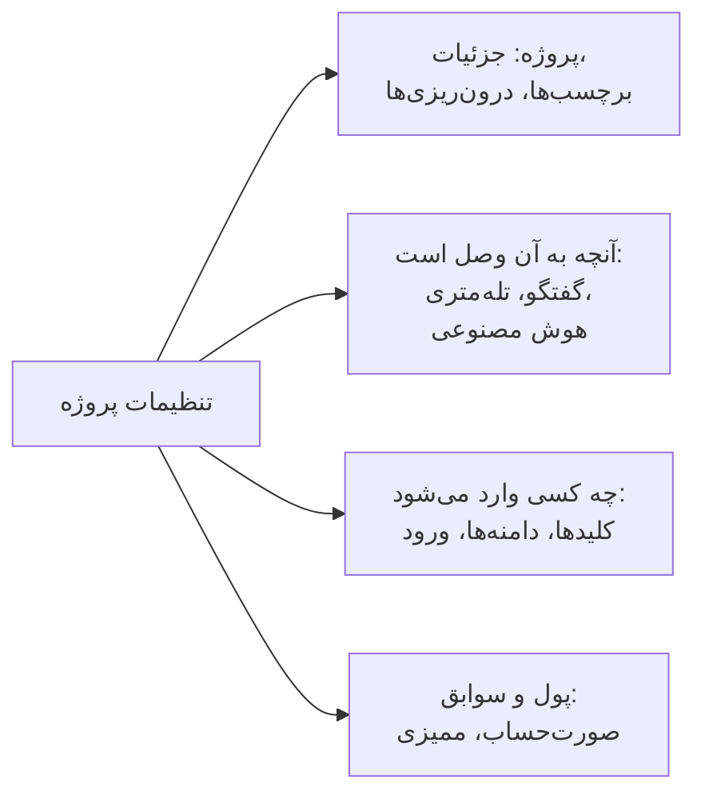

# تنظیمات پروژه

تنظیمات پروژه هر آنچه را برای کل پروژه اعمال می‌شود در خود دارد: نام آن، ابزارهایی که به آن‌ها وصل است، کلیدهایش، نحوهٔ ورود افراد، صورت‌حساب و ردپای ممیزی‌اش. بیشتر آن‌ها را یک بار تنظیم می‌کنید و به‌ندرت به آن‌ها برمی‌گردید. این صفحه نقشهٔ آن‌هاست و تنظیماتی را پوشش می‌دهد که صفحهٔ جداگانه‌ای ندارند: جزئیات پروژه، برچسب‌ها، پرچم‌های قابلیت و حذف پروژه.

:::cards
- [یافتن یک تنظیم](#یافتن-یک-تنظیم): هر بخش منوی کناری چه چیزی در خود دارد.
- [جزئیات پروژه](#جزئیات-پروژه): نام، شناسه و دسترسی پشتیبانی.
- [برچسب‌ها](#برچسبها): نشانه‌هایی برای منابع، دسترسی‌ها و قواعد.
- [حذف پروژه](#حذف-پروژه): چه چیزی لازم دارد، و چه چیزهایی با آن از بین می‌رود.
:::

## باز کردن تنظیمات پروژه

به **محصولات** > **تنظیمات** > **تنظیمات پروژه** بروید. منوی کناری صفحه‌ها را در بخش‌هایی دسته‌بندی می‌کند، و در آغاز فقط **پایه** باز است: برای باز کردن هر بخش روی عنوانش کلیک کنید. هر بخش روی هر یک از صفحه‌هایش خودبه‌خود باز می‌شود.

## پیش از شروع

- **نقشی که بتواند پروژه را تغییر دهد.** Project Owner و Project Admin بیشتر این تنظیمات را تغییر می‌دهند. صورت‌حساب، کانال‌های اعلان و حذف پروژه به بیش از این نیاز دارند، همان‌طور که هر بخش می‌گوید.
- **در OneUptime Cloud، طرحی که یک تنظیم را در بر دارد.** برخی تنظیمات به طرح نیاز دارند: [تنظیماتی که به طرح نیاز دارند](/docs/configuration/billing#تنظیماتی-که-به-طرح-نیاز-دارند) را ببینید.

## یافتن یک تنظیم

| بخش | صفحه‌ها | کجا بیشتر بخوانید |
| --- | --- | --- |
| **پایه** | **پروژه**، **برچسب‌ها** | [جزئیات پروژه](#جزئیات-پروژه)، [برچسب‌ها](#برچسبها) |
| **فضای کاری** | **Slack**، **Microsoft Teams**، **Video Calls** | [Slack](/docs/workspace-connections/slack)، [Microsoft Teams](/docs/workspace-connections/microsoft-teams)، [تماس‌های تصویری](/docs/workspace-connections/video-calls) |
| **تله‌متری و APM** | **کلیدهای دریافت داده**، **نگهداری داده** | [کلیدهای دریافت داده](/docs/telemetry/ingestion-keys)، [نگهداری داده](/docs/telemetry/data-retention) |
| **اعلان‌ها** | **تنظیمات اعلان**، **گزارش‌های اعلان**، **اپلیکیشن‌های موبایل** | [اعلان‌ها](#اعلانها) |
| **هوش مصنوعی** | **AI Features**، **ارائه‌دهندگان LLM**، **سرورهای MCP خارجی**، **اعتبار هوش مصنوعی**، **گزارش‌های هوش مصنوعی**، **سرور MCP** | [ارائه‌دهندگان LLM](/docs/ai/llm-provider)، [سرورهای MCP خارجی](/docs/ai/external-mcp-servers)، [سرور MCP](/docs/ai/mcp-server)، [AI SRE](/docs/ai/ai-sre#کنترلهای-هزینه) |
| **پیشرفته** | **دامنه‌ها**، **کلیدهای API**، **پرچم‌های قابلیت**، **درون‌ریزی از ابزاری دیگر** | [دامنه‌های سفارشی](/docs/status-pages/branding-and-domains#دامنههای-سفارشی)، [کلیدهای API](/docs/permissions/index#کلیدهای-api)، [پرچم‌های قابلیت](#پرچمهای-قابلیت)، [انتقال از Opsgenie](/docs/moving-to-oneuptime/opsgenie) و دیگر راهنماهای انتقال |
| **امنیت** | **SSO**، **SCIM** | [SSO](/docs/identity/sso)، [SCIM](/docs/identity/scim) |
| **صورت‌حساب و فاکتورها** | **صورت‌حساب**، **تاریخچه مصرف**، **فاکتورها** | [صورت‌حساب و مصرف](/docs/configuration/billing) |
| **گزارش‌های ممیزی** | **گزارش‌های ممیزی**، **تنظیمات**، **خروجی** | [گزارش‌های ممیزی](/docs/configuration/audit-logs)، [خروجی گزارش ممیزی](/docs/configuration/audit-log-export) |
| **منطقه خطر** | **منطقه خطر** | [حذف پروژه](#حذف-پروژه) |

**صورت‌حساب و فاکتورها** و **اعتبار هوش مصنوعی** فقط در OneUptime Cloud هستند: نصب خودمیزبان صورت‌حساب ندارد.

## جزئیات پروژه

**تنظیمات پروژه** > **پایه** > **پروژه** دو کارت دارد.

**جزئیات پروژه** نام و شناسهٔ پروژه را نشان می‌دهد:

- **نام پروژه**: برای تغییر نام پروژه روی **ویرایش پروژه** کلیک کنید. نام دست‌کم ۲ نویسه دارد. تغییر نام به Project Owner، یا دسترسی ویرایش پروژه یا مدیریت صورت‌حساب نیاز دارد.
- **شناسه پروژه**: آن را برای API، CLI و Terraform، یا هنگام نوشتن به پشتیبانی کپی کنید.
- **Data Residency**: در OneUptime Cloud، جایی که داده‌های پروژهٔ شما نگه داشته می‌شود، پس از آنکه OneUptime آن را ثبت کرده باشد. فقط OneUptime آن را تنظیم می‌کند.

**دسترسی پشتیبانی مشتری** در OneUptime Cloud تعیین می‌کند که آیا تیم پشتیبانی OneUptime می‌تواند پروژه را باز کند. وقتی کمک می‌خواهید، **اجازه دسترسی پشتیبانی OneUptime به این پروژه** را روشن کنید: OneUptime نخست می‌پرسد، چون پشتیبانی آنگاه می‌تواند همه‌چیز پروژه را ببیند و تغییر دهد، و شما روی **اجازه ورود به پشتیبانی** کلیک می‌کنید. وقتی کارشان تمام شد خاموشش کنید: بی‌درنگ ذخیره می‌شود. Project Owner و Project Admin آن را تغییر می‌دهند.

## برچسب‌ها

برچسب‌ها نشانه‌هایی هستند که روی مانیتورها، حوادث، صفحات وضعیت و منابع دیگر می‌گذارید. فهرست‌ها را فیلتر و گروه‌بندی می‌کنند، و دامنهٔ دسترسی‌های یک تیم و قواعد پروژه را محدود می‌کنند.

:::steps
### برچسب‌ها را باز کنید

به **تنظیمات پروژه** > **پایه** > **برچسب‌ها** بروید.

### یک برچسب بسازید

روی **ساخت برچسب** کلیک کنید. به آن یک **نام** و، اگر خواستید، **توضیحات** بدهید. **رنگ برچسب** از پیش انتخاب شده است، رنگی که هنوز هیچ برچسبی در صفحه به کار نمی‌برد: اگر ترجیح می‌دهید رنگ دیگری انتخاب کنید. برای ذخیره روی **ساخت برچسب** کلیک کنید.
:::

در OneUptime Cloud، ساختن و تغییر برچسب‌ها به طرح Growth نیاز دارد. برای اینکه برچسب‌ها چگونه دسترسی‌ها را محدود می‌کنند [برچسب‌ها](/docs/permissions/index#برچسبها) را ببینید، و برای گذاشتن برچسب روی منابع هنگام ساختشان [قواعد برچسب و مالکیت](/docs/configuration/label-and-owner-rules) را ببینید.

در یک فهرست، برچسب‌های یک رکورد زیر هم نشان داده می‌شوند؛ اگر بیش از چهار باشند، سه تای اول با پیوندی به بقیه نشان داده می‌شوند. هر جا برچسب‌ها فهرست می‌شوند (در فهرست‌ها، در صفحهٔ یک رکورد و در هر انتخابگر برچسب)، به ترتیب طبیعی می‌آیند: برچسب‌هایی که نامشان با عدد شروع می‌شود اول می‌آیند، به ترتیب همان عدد (`2. Team` پیش از `10. Owner`)، و سپس بقیه به ترتیب الفبایی، بدون توجه به حروف بزرگ و کوچک. برای تعیین ترتیب برچسب‌هایتان، نامشان را با یک عدد شروع کنید، مانند `1. Category` و `2. Subcategory`.

### بایگانی یک برچسب

برای کنار گذاشتن یک برچسب، به‌جای حذف آن را از منوی **⋯** ردیفش بایگانی کنید. هرچه این برچسب را دارد نگهش می‌دارد و همچنان می‌توانید با آن فیلتر کنید، اما هیچ‌کس دیگر نمی‌تواند آن را به چیزی اضافه کند: هیچ انتخابگر برچسبی آن را نشان نمی‌دهد و API، Terraform و MCP آن را رد می‌کنند. پنجرهٔ گفتگو قوانین و مجوزهایی را که برای استفاده از این برچسب تنظیم شده‌اند فهرست می‌کند؛ تا وقتی تغییرشان ندهید از آن استفاده می‌کنند. برچسب‌های بایگانی‌شده جدا فهرست می‌شوند، در بخش جمع‌شدهٔ **برچسب‌های بایگانی‌شده**، جایی که **خروج از بایگانی** یکی را برمی‌گرداند. **حذف** ابتدا همهٔ چیزهایی را که برچسب از آن‌ها برداشته می‌شود فهرست می‌کند و **به‌جای آن بایگانی شود** را پیشنهاد می‌دهد.

## اعلان‌ها

**تنظیمات پروژه** > **اعلان‌ها** نحوهٔ ارسال اعلان‌های پروژه را در خود دارد:

- **تنظیمات اعلان**: کارت **کانال‌های اعلان** پیامک، تماس تلفنی، WhatsApp و Telegram را برای پروژه روشن یا خاموش می‌کند. هر چهار در آغاز خاموش‌اند. یک Project Owner، یک **مدیر صورت‌حساب** یا کسی با **Manage Billing** آن‌ها را روشن می‌کند. این صفحه همچنین سرورهای ایمیل خود پروژه را زیر **پیکربندی‌های SMTP سفارشی** (ببینید [SMTP](/docs/emails/smtp)) و حساب Twilio خود آن را (ببینید [یکپارچه‌سازی Twilio](/docs/self-hosted/twilio-integration)) در خود دارد. در OneUptime Cloud، موجودی‌ای را هم که هزینهٔ این پیام‌ها از آن پرداخت می‌شود در خود دارد: [موجودی‌های پیش‌پرداخت](/docs/configuration/billing#موجودیهای-پیشپرداخت) را ببینید.
- **گزارش‌های اعلان**: هر اعلانی که پروژه فرستاده است، با یک زبانه برای هر کانال: **ایمیل**، **SMS**، **WhatsApp**، **Telegram**، **وب‌هوک**، **تماس**، **پوش** و **فضای کاری**.
- **اپلیکیشن‌های موبایل**: جایی که اپلیکیشن‌های iOS و Android را می‌گیرید. [نمای کلی اپلیکیشن‌ها](/docs/mobile-desktop-apps/index) را ببینید.

## پرچم‌های قابلیت

**تنظیمات پروژه** > **پیشرفته** > **پرچم‌های قابلیت** قابلیت‌های اختیاری را برای پروژه روشن یا خاموش می‌کند. هر کدام کلیدی است که با تغییر وضعیتش ذخیره می‌شود. امروز این صفحه **گروه‌های مانیتور** را دارد که در پروژهٔ تازه خاموش است: برای افزودن گروه‌های مانیتور به منوی مانیتورها روشنش کنید. خاموش کردنش هیچ گروهی را حذف نمی‌کند. [گروه‌های مانیتور](/docs/monitor/monitor-groups) را ببینید.

## حذف پروژه

حذف یک پروژه همه‌چیز درون آن را، برای همهٔ اعضا، حذف می‌کند: مانیتورها، حوادث، صفحات وضعیت، تنظیمات آنکال و تله‌متری. هیچ چیز آن را بازنمی‌گرداند.

:::steps
### منطقه خطر را باز کنید

به **تنظیمات پروژه** > **منطقه خطر** بروید.

### روی دکمهٔ حذف کلیک کنید

روی **حذف پروژه** کلیک کنید. پنجره‌ای از شما تأیید می‌خواهد.

### نام پروژه را بنویسید

نام را دقیقاً همان‌طور که هست بنویسید. تا این کار را نکنید، **حذف پروژه** قفل می‌ماند. در OneUptime Cloud، پنجره همچنین می‌پرسد چرا می‌روید: پاسخ اختیاری است.

### تأیید کنید

روی **حذف پروژه** کلیک کنید. OneUptime پروژه را حذف می‌کند و شما را از آن بیرون می‌برد.
:::

> [!CAUTION]
> حذف پروژه بازگشت‌پذیر نیست. به Project Owner یا دسترسی حذف پروژه نیاز دارد.

در OneUptime Cloud، طرح یک پروژه را با حذف پروژه لغو می‌کنید: صورت‌حساب پس از حذف پروژه متوقف می‌شود. پروژه‌ای که از راه یک بازارگاه ابری صورت‌حساب می‌شود، یک هزینهٔ پایانی برای مصرفش می‌گیرد، و خرید در بازارگاه تا وقتی آن را همان‌جا لغو نکنید فعال می‌ماند.

## عیب‌یابی

:::details به نظر می‌رسد بخشی از منوی کناری وجود ندارد
همهٔ بخش‌ها جز **پایه** در آغاز بسته‌اند. برای باز کردن بخش روی عنوانش کلیک کنید. در نصب خودمیزبان، نه بخش **صورت‌حساب و فاکتورها** هست و نه صفحهٔ **اعتبار هوش مصنوعی**.
:::

:::details ویرایش پروژه قفل است
تغییر نام به Project Owner، یا دسترسی ویرایش پروژه یا مدیریت صورت‌حساب نیاز دارد. دکمهٔ قفل‌شده دسترسی‌ای را که ندارید نام می‌برد.
:::

:::details حذف پروژه در پنجره قفل می‌ماند
نام پروژه را دقیقاً همان‌طور که پنجره نشان می‌دهد بنویسید: حروف بزرگ و کوچک مهم‌اند.
:::

## گام‌های بعدی

:::cards
- [دعوت از افراد](/docs/permissions/inviting-people): تیمتان را وارد پروژه کنید.
- [صورت‌حساب و مصرف](/docs/configuration/billing): طرح شما، روش‌های پرداخت، فاکتورها و مصرف.
- [گزارش‌های ممیزی](/docs/configuration/audit-logs): ببینید چه کسی چه چیزی را در پروژه تغییر داد.
- [SSO](/docs/identity/sso): بگذارید افراد با ارائه‌دهنده هویت شما وارد شوند.
:::
