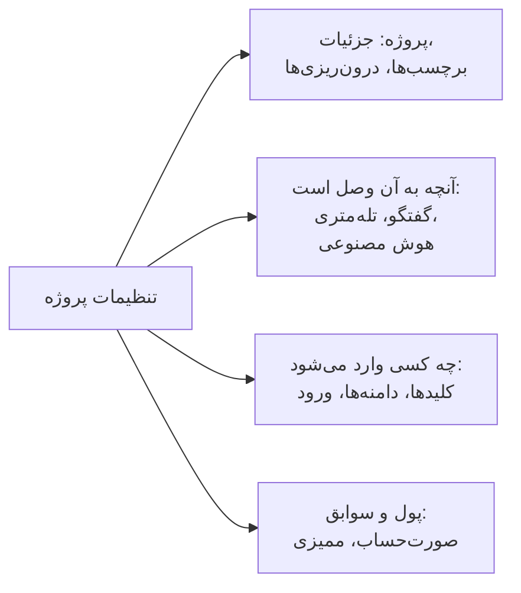

# تنظیمات پروژه

تنظیمات پروژه هر آنچه را برای کل پروژه اعمال می‌شود در خود دارد: نام آن، ابزارهایی که به آن‌ها وصل است، کلیدهایش، نحوهٔ ورود افراد، صورت‌حساب و ردپای ممیزی‌اش. بیشتر آن‌ها را یک بار تنظیم می‌کنید و به‌ندرت به آن‌ها برمی‌گردید. این صفحه نقشهٔ آن‌هاست و تنظیماتی را پوشش می‌دهد که صفحهٔ جداگانه‌ای ندارند: جزئیات پروژه، برچسب‌ها و حذف پروژه.

:::cards
- [یافتن یک تنظیم](#یافتن-یک-تنظیم): هر بخش منوی کناری چه چیزی در خود دارد.
- [جزئیات پروژه](#جزئیات-پروژه): نام، شناسه و دسترسی پشتیبانی.
- [نام‌های یکتا](#نامهای-یکتا): اینکه آیا دو رکورد از یک نوع می‌توانند نام یکسانی داشته باشند.
- [محصولات](#محصولات): محصولاتی که این پروژه نشان می‌دهد، و آن‌هایی که پنهان می‌کند.
- [برچسب‌ها](#برچسبها): نشانه‌هایی برای منابع، دسترسی‌ها و قواعد.
- [حذف پروژه](#حذف-پروژه): چه چیزی لازم دارد، و چه چیزهایی با آن از بین می‌رود.
:::

## باز کردن تنظیمات پروژه

به **محصولات** > **تنظیمات** > **تنظیمات پروژه** بروید. منوی کناری صفحه‌ها را در بخش‌هایی دسته‌بندی می‌کند، و در آغاز فقط **پایه** باز است: برای باز کردن هر بخش روی عنوانش کلیک کنید. هر بخش روی هر یک از صفحه‌هایش خودبه‌خود باز می‌شود.

## پیش از شروع

- **نقشی که بتواند پروژه را تغییر دهد.** مالک پروژه و مدیر پروژه بیشتر این تنظیمات را تغییر می‌دهند. صورت‌حساب، کانال‌های اعلان و حذف پروژه به بیش از این نیاز دارند، همان‌طور که هر بخش می‌گوید.
- **در OneUptime Cloud، طرحی که یک تنظیم را در بر دارد.** برخی تنظیمات به طرح نیاز دارند: [تنظیماتی که به طرح نیاز دارند](/docs/configuration/billing#تنظیماتی-که-به-طرح-نیاز-دارند) را ببینید.

## یافتن یک تنظیم

| بخش | صفحه‌ها | کجا بیشتر بخوانید |
| --- | --- | --- |
| **پایه** | **پروژه**، **محصولات**، **برچسب‌ها** | [جزئیات پروژه](#جزئیات-پروژه)، [نام‌های یکتا](#نامهای-یکتا)، [محصولات](#محصولات)، [برچسب‌ها](#برچسبها) |
| **فضای کاری** | **Slack**، **Microsoft Teams**، **Mattermost**، **تماس‌های تصویری** | [Slack](/docs/workspace-connections/slack)، [Microsoft Teams](/docs/workspace-connections/microsoft-teams)، [Mattermost](/docs/workspace-connections/mattermost)، [تماس‌های تصویری](/docs/workspace-connections/video-calls) |
| **تله‌متری و APM** | **کلیدهای دریافت داده**، **نگهداری داده**، **مصرف** | [کلیدهای دریافت داده](/docs/telemetry/ingestion-keys)، [نگهداری داده](/docs/telemetry/data-retention)، [مصرف تله‌متری](/docs/telemetry/usage) |
| **اعلان‌ها** | **کانال‌های اعلان**، **گزارش‌های اعلان**، **اپلیکیشن‌های موبایل** | [اعلان‌ها](#اعلانها) |
| **هوش مصنوعی** | **قابلیت‌های هوش مصنوعی**، **ارائه‌دهندگان LLM**، **سرورهای MCP خارجی**، **اعتبار هوش مصنوعی**، **نتایج هوش مصنوعی**، **گزارش‌های هوش مصنوعی**، **سرور MCP** | [ارائه‌دهندگان LLM](/docs/ai/llm-provider)، [سرورهای MCP خارجی](/docs/ai/external-mcp-servers)، [سرور MCP](/docs/ai/mcp-server)، [AI SRE](/docs/ai/ai-sre#کنترلهای-هزینه) |
| **پیشرفته** | **دامنه‌ها**، **کلیدهای API**، **درون‌ریزی از ابزاری دیگر** | [دامنه‌های سفارشی](/docs/status-pages/branding-and-domains#دامنههای-سفارشی)، [کلیدهای API](/docs/permissions/index#کلیدهای-api)، [انتقال از Opsgenie](/docs/moving-to-oneuptime/opsgenie) و دیگر راهنماهای انتقال |
| **امنیت** | **SSO**، **SCIM** | [SSO](/docs/identity/sso)، [SCIM](/docs/identity/scim) |
| **صورت‌حساب و فاکتورها** | **صورت‌حساب**، **فاکتورها** | [صورت‌حساب و مصرف](/docs/configuration/billing) |
| **گزارش‌های ممیزی** | **گزارش‌های ممیزی**، **تنظیمات**، **خروجی** | [گزارش‌های ممیزی](/docs/configuration/audit-logs)، [خروجی گزارش ممیزی](/docs/configuration/audit-log-export) |
| **منطقه خطر** | **حذف پروژه** | [حذف پروژه](#حذف-پروژه) |

**صورت‌حساب و فاکتورها** و **اعتبار هوش مصنوعی** فقط در OneUptime Cloud هستند: نصب خودمیزبان صورت‌حساب ندارد.

## جزئیات پروژه

**تنظیمات پروژه** > **پایه** > **پروژه** کارت‌های پروژه را دارد: **جزئیات پروژه**، **نام‌های یکتا** و، در OneUptime Cloud، **دسترسی پشتیبانی مشتری**.

**جزئیات پروژه** نام و شناسهٔ پروژه را نشان می‌دهد:

- **نام پروژه**: برای تغییر نام پروژه روی **ویرایش پروژه** کلیک کنید. نام دست‌کم ۲ نویسه دارد. تغییر نام به مالک پروژه، یا دسترسی ویرایش پروژه یا مدیریت صورت‌حساب نیاز دارد.
- **شناسه پروژه**: آن را برای API، CLI و Terraform، یا هنگام نوشتن به پشتیبانی کپی کنید.
- **محل نگهداری داده‌ها**: در OneUptime Cloud، جایی که داده‌های پروژهٔ شما نگه داشته می‌شود، پس از آنکه OneUptime آن را ثبت کرده باشد. فقط OneUptime آن را تنظیم می‌کند.

**دسترسی پشتیبانی مشتری** در OneUptime Cloud تعیین می‌کند که آیا تیم پشتیبانی OneUptime می‌تواند پروژه را باز کند. وقتی کمک می‌خواهید، **اجازه دسترسی پشتیبانی OneUptime به این پروژه** را روشن کنید: OneUptime نخست می‌پرسد، چون پشتیبانی آنگاه می‌تواند همه‌چیز پروژه را ببیند و تغییر دهد، و شما روی **اجازه ورود به پشتیبانی** کلیک می‌کنید. وقتی کارشان تمام شد خاموشش کنید: بی‌درنگ ذخیره می‌شود. مالک پروژه و مدیر پروژه آن را تغییر می‌دهند.

## نام‌های یکتا

**نام‌های یکتا** در **تنظیمات پروژه** > **پایه** > **پروژه** تعیین می‌کند که آیا دو رکورد از یک نوع می‌توانند در پروژه نام یکسانی داشته باشند. تا وقتی **الزام نام‌های یکتا** روشن است، OneUptime نامی را که رکورد دیگری از همان نوع دارد رد می‌کند، چه اینجا تایپ شود، چه از طریق API فرستاده شود یا در Terraform تعیین شود، و بزرگی و کوچکی حروف و فاصله‌ها فرقی نمی‌کند: `API Health Check` و `api health check` یک نام‌اند. کلید به‌محض تغییر ذخیره می‌شود. مالک پروژه و مدیر پروژه آن را تغییر می‌دهند.

در پروژهٔ تازه روشن است. پروژه‌ای که از قبل وجود داشته آن را خاموش نگه می‌دارد، چون کلاینت‌های API و پیکربندی‌های Terraform پروژه ممکن است به نام‌های تکراری متکی باشند: هر وقت آماده بودید روشنش کنید.

زیر کلید، کارت هر نامی را که پروژه بیش از یک بار دارد، نوع به نوع، با پیوندی به هر رکورد و روزی که ساخته شده فهرست می‌کند. بودجهٔ OpenStack در صفحه **مخارج** ابر خودش باز می‌شود، و خلاصهٔ فضای کاری در زبانهٔ **خلاصه** صفحهٔ Slack، Microsoft Teams یا Mattermost خودش. عامل‌های هوش مصنوعی در داشبورد صفحه‌ای ندارند، پس کارت نامشان را بدون پیوند می‌آورد و این را هم می‌گوید. روشن کردن کلید چیزی از موارد موجود را رد نمی‌کند: آن رکوردها تا وقتی کسی نامشان را تغییر ندهد کار می‌کنند، و فقط رکورد تازه یا تغییر نام به نامی مخصوص خود نیاز دارد. ذخیرهٔ دوبارهٔ یک رکورد با نام خودش، با هر حالت حروف، تغییر نام نیست.

فهرست خود هر نوع هم آن رکوردها را علامت می‌زند، با **هم‌نام با مانیتور دیگری** (یا قالب، کلید و مانند آن) و روزی که هر کدام ساخته شده، و بالای فهرست می‌گوید چند تا هستند. فهرست فقط رکوردهایی را علامت می‌زند که می‌توانید باز کنید.

کلید هر چه بگوید، وقتی نامی را تایپ می‌کنید که رکورد دیگری از همان نوع دارد، فرم هشدار می‌دهد و به آن رکورد پیوند می‌دهد. تا وقتی کلید روشن است، هشدار این را هم می‌گوید که ذخیره رد خواهد شد.

کلید شامل نوع‌هایی است که نامشان را شما می‌گذارید و با نام انتخابشان می‌کنید: مانیتورها، گروه‌های مانیتور، پراب‌ها، SLOها، قالب‌های حادثه، هشدار، نگه‌داری و صفحهٔ وضعیت، کلیدهای API، کلیدهای دریافت داده، نقش‌های سفارشی، ارائه‌دهندگان LLM، خطوط لوله، بودجه‌ها و اتصال‌ها. رویدادها و ثبت آنچه رخ داده عمداً نام‌هایشان را تکرار می‌کنند و کنار گذاشته شده‌اند: حوادث، هشدارها، اپیزودها، رویدادهای تعمیر و نگهداری و اطلاعیه‌های صفحهٔ وضعیت، و همچنین آنچه OneUptime خودش کشف می‌کند، مانند میزبان‌ها و پادها. تیم‌ها، برچسب‌ها، سیاست‌های آنکال، زمان‌بندی‌های آنکال، صفحات وضعیت، گردش‌های کاری و برخی نوع‌های دیگر در هر پروژه نامی مخصوص خود دارند، کلید هر چه بگوید.

وقتی OneUptime برای شما نامی روی رکوردی می‌گذارد، مانند مانیتوری که از یک پیشنهاد ساخته شده یا مانیتوری واردشده، و آن نام گرفته شده باشد، به‌جای رد کردن، عددی به آن اضافه می‌کند: `API Health Check 2`.

## محصولات

**تنظیمات پروژه** > **پایه** > **محصولات** محصولاتی را انتخاب می‌کند که این پروژه در منوی **محصولات**، در «خانه» و در فهرست جستجو نشان می‌دهد. هر محصول یک کلید دارد که با زدنش ذخیره می‌شود: روشن، محصول را نشان می‌دهد. کاربران، تیم‌ها و تنظیمات پروژه همیشه نشان داده می‌شوند، و **نمایش همه محصولات** همه را دوباره نشان می‌دهد.

محصول پنهان خاموش نمی‌شود. به **محصولات بیشتر**، آخرین ردیف منوی **محصولات**، می‌رود: جستجو همچنان آن را پیدا می‌کند، صفحه‌ها و API آن کار می‌کنند و داده‌هایش همچنان می‌رسند. هر کس آن را سنجاق کرده باشد، سنجاقش می‌ماند.

روی سرور خودمیزبان، یک مدیر اصلی همچنین می‌تواند یک محصول را برای همه پروژه‌ها خاموش کند، زیر **تنظیمات** > **محصولات** در Admin Dashboard ([فقط آنچه را لازم دارید اجرا کنید](/docs/installation/docker-compose#فقط-آنچه-را-لازم-دارید-اجرا-کنید) را ببینید). چنین محصولی اینجا کلیدی ندارد: **در این سرور خاموش است** را نشان می‌دهد، همراه با اینکه چه کسی می‌تواند آن را روشن کند.

هر محصول نشان داده می‌شود تا وقتی کسی آن را اینجا پنهان کند. هیچ محصولی خودبه‌خود پنهان نمی‌شود: آنچه مالک پروژه یا مدیر پروژه در «خانه» گفته برای آن آمده است فقط گام‌های نخست را همان‌جا آماده می‌کند، و محصولی که هنوز راه‌اندازی نشده سر جای خودش در منو می‌ماند.

هر محصول می‌گوید برای این پروژه چه وضعی دارد: **در حال استفاده**، **راه‌اندازی نشده** یا، در OneUptime Cloud، طرحی که لازم دارد. وقتی محصولی پنهان شروع به دریافت داده کند، «خانه» این را به مالکان پروژه و مدیران پروژه می‌گوید و **نمایش آن** یا **پنهان بماند** را پیشنهاد می‌کند.

مالکان پروژه، مدیران پروژه و هر کسی که اجازه ویرایش پروژه را دارد آن را تغییر می‌دهند؛ همه افراد دیگر پروژه می‌توانند آن را ببینند.

زیر **مانیتورها**، کلید **گروه‌های مانیتور** گروه‌های مانیتور را به منوی مانیتورها اضافه می‌کند. در پروژهٔ تازه خاموش است، با زدنش ذخیره می‌شود، و خاموش کردنش هیچ گروهی را حذف نمی‌کند. تغییر آن به نقش مالک پروژه، یا یک نقش سفارشی با مجوز Edit Project یا Manage Billing نیاز دارد. [گروه‌های مانیتور](/docs/monitor/monitor-groups) را ببینید.

## برچسب‌ها

برچسب‌ها نشانه‌هایی هستند که روی مانیتورها، حوادث، صفحات وضعیت و منابع دیگر می‌گذارید. فهرست‌ها را فیلتر و گروه‌بندی می‌کنند، و دامنهٔ دسترسی‌های یک تیم و قواعد پروژه را محدود می‌کنند.

:::steps
### برچسب‌ها را باز کنید

به **تنظیمات پروژه** > **پایه** > **برچسب‌ها** بروید.

### یک برچسب بسازید

روی **ساخت برچسب** کلیک کنید. به آن یک **نام** و، اگر خواستید، **توضیحات** بدهید. **رنگ برچسب** از پیش انتخاب شده است، رنگی که هنوز هیچ برچسبی در صفحه به کار نمی‌برد: اگر ترجیح می‌دهید رنگ دیگری انتخاب کنید. برای ذخیره روی **ساخت برچسب** کلیک کنید.
:::

در OneUptime Cloud، ساختن و تغییر برچسب‌ها به طرح Growth نیاز دارد. برای اینکه برچسب‌ها چگونه دسترسی‌ها را محدود می‌کنند [برچسب‌ها](/docs/permissions/index#برچسبها) را ببینید، و برای گذاشتن برچسب روی منابع هنگام ساختشان [قواعد برچسب و مالکیت](/docs/configuration/label-and-owner-rules) را ببینید.

در یک فهرست، برچسب‌های یک رکورد زیر هم نشان داده می‌شوند؛ اگر بیش از چهار باشند، سه تای اول با پیوندی به بقیه نشان داده می‌شوند. هر جا برچسب‌ها فهرست می‌شوند (در فهرست‌ها، در صفحهٔ یک رکورد و در هر انتخابگر برچسب)، به ترتیب طبیعی می‌آیند: برچسب‌هایی که نامشان با عدد شروع می‌شود اول می‌آیند، به ترتیب همان عدد (`2. Team` پیش از `10. Owner`)، و سپس بقیه به ترتیب الفبایی، بدون توجه به حروف بزرگ و کوچک. برای تعیین ترتیب برچسب‌هایتان، نامشان را با یک عدد شروع کنید، مانند `1. Category` و `2. Subcategory`.

### بایگانی یک برچسب

برای کنار گذاشتن یک برچسب، به‌جای حذف آن را از منوی **⋯** ردیفش بایگانی کنید. هرچه این برچسب را دارد نگهش می‌دارد و همچنان می‌توانید با آن فیلتر کنید، اما هیچ‌کس دیگر نمی‌تواند آن را به چیزی اضافه کند: هیچ انتخابگر برچسبی آن را نشان نمی‌دهد و API، Terraform و MCP آن را رد می‌کنند. پنجرهٔ گفتگو قوانین و مجوزهایی را که برای استفاده از این برچسب تنظیم شده‌اند فهرست می‌کند؛ تا وقتی تغییرشان ندهید از آن استفاده می‌کنند. برچسب‌های بایگانی‌شده جدا فهرست می‌شوند، در بخش جمع‌شدهٔ **برچسب‌های بایگانی‌شده**، جایی که **خروج از بایگانی** یکی را برمی‌گرداند. **حذف** ابتدا همهٔ چیزهایی را که برچسب از آن‌ها برداشته می‌شود فهرست می‌کند و **به‌جای آن بایگانی شود** را پیشنهاد می‌دهد.

**استفاده‌شده توسط**، در منوی ردیف یک برچسب، رکوردهای هر نوع را که آن برچسب را دارند می‌شمارد و آن‌ها را صفحه به صفحه باز می‌کند. رکوردهایی که اجازه‌ی باز کردنشان را ندارید شمرده می‌شوند، اما نامشان آورده نمی‌شود.

برچسبی که از پیش از اجباری شدن نام‌های یکتا با برچسبی دیگر هم‌نام است با **هم‌نام با برچسبی دیگر** علامت می‌خورد و فهرست می‌گوید چند تا از این برچسب‌ها هست: با **استفاده‌شده توسط** مقایسه کنید هر کدام کجا استفاده شده است، سپس نام یکی را با **تغییر نام** در ردیفش تغییر دهید.

## اعلان‌ها

**تنظیمات پروژه** > **اعلان‌ها** نحوهٔ ارسال اعلان‌های پروژه را در خود دارد:

- **کانال‌های اعلان**: کارت **کانال‌های اعلان** پیامک، تماس تلفنی، WhatsApp و Telegram را برای پروژه روشن یا خاموش می‌کند. هر چهار در آغاز خاموش‌اند. یک مالک پروژه، یک **مدیر صورت‌حساب** یا کسی با **Manage Billing** آن‌ها را روشن می‌کند. این صفحه همچنین، جمع‌شده زیر **تنظیمات بیشتر**، اینکه اعضا به‌طور پیش‌فرض چگونه فراخوانده می‌شوند، در **ترتیب تماس پیش‌فرض برای اعضای جدید** و **تلفن برای افراد آنکال** (ببینید [ترتیب تماس پیش‌فرض](/docs/notifications/on-call-rules#ترتیب-تماس-پیشفرض))، اینکه تماس‌های آنکال پست صوتی را از شخص تشخیص بدهند یا نه، در **پست صوتی در تماس‌های آنکال** (ببینید [پست صوتی در تماس‌های آنکال](/docs/self-hosted/twilio-integration#پست-صوتی-در-تماسهای-آنکال))، سرورهای ایمیل خود پروژه را در **پیکربندی‌های SMTP سفارشی** (ببینید [SMTP](/docs/emails/smtp)) و حساب Twilio خود آن را (ببینید [یکپارچه‌سازی Twilio](/docs/self-hosted/twilio-integration)) در خود دارد. در OneUptime Cloud، موجودی‌ای را هم که هزینهٔ این پیام‌ها از آن پرداخت می‌شود در خود دارد: [موجودی‌های پیش‌پرداخت](/docs/configuration/billing#موجودیهای-پیشپرداخت) را ببینید.
- **گزارش‌های اعلان**: هر اعلانی که پروژه فرستاده است، با یک زبانه برای هر کانال: **ایمیل**، **پیامک**، **WhatsApp**، **Telegram**، **وب‌هوک**، **تماس**، **پوش** و **فضای کاری**. زبانهٔ **وب‌هوک** از هر نشانی فقط طرح و میزبان را نگه می‌دارد: بقیهٔ آن کلید محرمانهٔ وب‌هوک است.
- **اپلیکیشن‌های موبایل**: جایی که اپلیکیشن‌های iOS و Android را می‌گیرید. [نمای کلی اپلیکیشن‌ها](/docs/mobile-desktop-apps/index) را ببینید.

## حذف پروژه

حذف یک پروژه همه‌چیز درون آن را، برای همهٔ اعضا، حذف می‌کند: مانیتورها، حوادث، صفحات وضعیت، تنظیمات آنکال و تله‌متری. هیچ چیز آن را بازنمی‌گرداند.

:::steps
### منطقه خطر را باز کنید

به **تنظیمات پروژه** > **منطقه خطر** > **حذف پروژه** بروید.

### روی دکمهٔ حذف کلیک کنید

روی **حذف پروژه** کلیک کنید. پنجره‌ای از شما تأیید می‌خواهد.

### نام پروژه را بنویسید

نام را دقیقاً همان‌طور که هست بنویسید. تا این کار را نکنید، **حذف پروژه** قفل می‌ماند. در OneUptime Cloud، پنجره همچنین می‌پرسد چرا می‌روید: پاسخ اختیاری است.

### تأیید کنید

روی **حذف پروژه** کلیک کنید. OneUptime پروژه را حذف می‌کند و شما را از آن بیرون می‌برد.
:::

> [!CAUTION]
> حذف پروژه بازگشت‌پذیر نیست. به مالک پروژه یا دسترسی حذف پروژه نیاز دارد.

در OneUptime Cloud، طرح یک پروژه را با حذف پروژه لغو می‌کنید: صورت‌حساب پس از حذف پروژه متوقف می‌شود. پروژه‌ای که از راه یک بازارگاه ابری صورت‌حساب می‌شود، یک هزینهٔ پایانی برای مصرفش می‌گیرد، و خرید در بازارگاه تا وقتی آن را همان‌جا لغو نکنید فعال می‌ماند.

## عیب‌یابی

:::details به نظر می‌رسد بخشی از منوی کناری وجود ندارد
همهٔ بخش‌ها جز **پایه** در آغاز بسته‌اند. برای باز کردن بخش روی عنوانش کلیک کنید. در نصب خودمیزبان، نه بخش **صورت‌حساب و فاکتورها** هست و نه صفحهٔ **اعتبار هوش مصنوعی**.
:::

:::details ویرایش پروژه قفل است
تغییر نام به مالک پروژه، یا دسترسی ویرایش پروژه یا مدیریت صورت‌حساب نیاز دارد. دکمهٔ قفل‌شده دسترسی‌ای را که ندارید نام می‌برد.
:::

:::details حذف پروژه در پنجره قفل می‌ماند
نام پروژه را دقیقاً همان‌طور که پنجره نشان می‌دهد بنویسید: حروف بزرگ و کوچک مهم‌اند.
:::

:::details نامی رد می‌شود چون پروژه نام‌های یکتا می‌خواهد
رکورد دیگری از همان نوع آن نام را دارد، بزرگی و کوچکی حروف و فاصله‌ها فرقی نمی‌کند. نام دیگری انتخاب کنید، یا اول نام آن رکورد دیگر را تغییر دهید: **نام‌های یکتا** در **تنظیمات پروژه** > **پایه** > **پروژه** نام‌هایی را که پروژه بیش از یک بار دارد، با پیوندی به هر رکورد، فهرست می‌کند. اگر فقط یک رکورد بایگانی‌شده آن نام را دارد، آن رکورد را از بایگانی خارج کنید یا نام دیگری انتخاب کنید.
:::

## گام‌های بعدی

:::cards
- [دعوت از افراد](/docs/permissions/inviting-people): تیمتان را وارد پروژه کنید.
- [صورت‌حساب و مصرف](/docs/configuration/billing): طرح شما، روش‌های پرداخت، فاکتورها و مصرف.
- [گزارش‌های ممیزی](/docs/configuration/audit-logs): ببینید چه کسی چه چیزی را در پروژه تغییر داد.
- [SSO](/docs/identity/sso): بگذارید افراد با ارائه‌دهنده هویت شما وارد شوند.
:::
