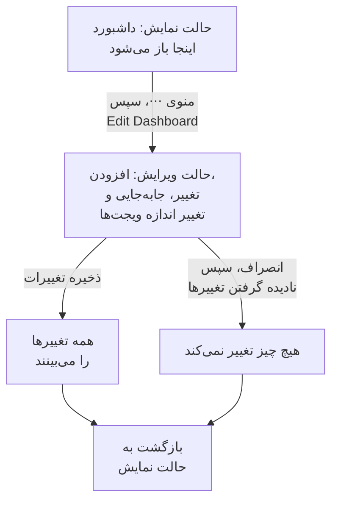

# ساخت یک داشبورد

برای ساخت یک داشبورد، **محصولات** > **داشبوردها** را باز کنید، روی **ساخت داشبورد** کلیک کنید و یک قالب را برگزینید، یا برای آغاز از صفر **Blank Dashboard** را. قالب نام داشبورد را برایتان پر می‌کند (اگر پروژه از پیش یکی با همان نام داشته باشد، با شماره، مانند «Kubernetes Dashboard 2»)؛ داشبورد خالی از شما نام می‌خواهد. روی **ساخت داشبورد** کلیک کنید تا داشبورد تازه باز شود. داشبورد خالی روی بوم خالی‌اش باز می‌شود و دکمه **افزودن ویجت** برای نخستین ویجت در آن است.

:::cards
- [ساختن داشبورد](#ساختن-داشبورد): از یک قالب یا از یک بوم خالی آغاز کنید.
- [ویرایش و ذخیره](#ویرایش-و-ذخیره): تا روی «ذخیره تغییرات» کلیک نکنید، برای هیچ کس چیزی تغییر نمی‌کند.
- [افزودن یک ویجت](#افزودن-یک-ویجت): آن را از کاتالوگ برگزینید، تنظیمش کنید و سر جایش بگذارید.
- [بزرگ‌نمایی یک جهش](#بزرگنمایی-یک-جهش): روی یک نمودار بکشید تا کل داشبورد را در آن لحظه بخوانید.
:::

## پیش از شروع

مالکان و مدیران پروژه می‌توانند همه داشبوردها را بسازند و ویرایش کنند. دیگران به یک دسترسی تیمی نیاز دارند: `CreateDashboard` برای ساخت داشبوردها و `EditDashboard` برای تغییر آن‌ها. اعضا و بینندگان پروژه بدون هیچ‌کدام از این دو می‌توانند داشبوردها را بخوانند. کسی که اجازه ویرایش یک داشبورد را ندارد همچنان منوی **⋯** آن را باز می‌کند، اما در آنجا **Edit Dashboard** قفل است و می‌گوید به کدام دسترسی نیاز است.

## ساختن داشبورد

:::steps
### انتخابگر قالب را باز کنید

**محصولات** > **داشبوردها** را باز کنید و روی **ساخت داشبورد** کلیک کنید. پنجره **ساخت از روی قالب** گزینه **Blank Dashboard** و پانزده قالب را نشان می‌دهد که بر پایه آنچه پایش می‌کنند دسته‌بندی شده‌اند.

### یک قالب برگزینید

روی یک کارت کلیک کنید. قالب ویجت‌هایش، و اغلب متغیرهایش، را برایتان می‌سازد؛ **Blank Dashboard** با یک بوم خالی آغاز می‌شود.

### به داشبورد نام بدهید

نام قالب پر شده است و پس از نام‌هایی که پروژه از پیش دارد شماره می‌گیرد. نام داشبورد خالی، خالی است: یکی بنویسید. توضیحات اختیاری است، زیر **فیلدهای بیشتر** بسته شده است و می‌توانید بعداً آن را در صفحه **نمای کلی** داشبورد بیفزایید.

### آن را بسازید

روی **ساخت داشبورد** کلیک کنید. داشبورد تازه باز می‌شود: با ویجت‌های قالب، بی‌درنگ، یا با بوم خالی داشبورد خالی که **افزودن ویجت** روی آن است.
:::

قالب‌ها، بر پایه گروهی که انتخابگر آن‌ها را زیرش فهرست می‌کند:

| گروه | قالب‌ها |
| --- | --- |
| Get Started | Blank Dashboard |
| Monitoring & APM | Monitor Dashboard, Metrics Dashboard, Real User Monitoring Dashboard, SLO Dashboard |
| Incident Response | Incident Dashboard, Alert Dashboard |
| Infrastructure | Kubernetes Dashboard, Kubernetes Cost Dashboard, Hosts Dashboard, Proxmox Dashboard, VMware Dashboard, Ceph Dashboard, Storage Array Dashboard, Docker Swarm Dashboard, Network Dashboard |

قالب یک نقطه آغاز است، نه یک پیوند: وقتی داشبورد ساخته شد، هر طور که می‌خواهید تغییرش دهید. بعداً هیچ چیز آن را از روی قالب به‌روز نمی‌کند.

## ویرایش و ذخیره

داشبورد در حالت نمایش، برای خواندن، باز می‌شود. برای تغییر آن، منوی **⋯** نوار ابزارش را باز کنید و **Edit Dashboard** را برگزینید. نوار ابزار کنار نام، **Editing** را نشان می‌دهد و بازه زمانی و دیگر کنترل‌هایش را با **افزودن ویجت**، **متغیرها**، **انصراف** و **ذخیره تغییرات** جایگزین می‌کند.

تغییرهای شما تا وقتی ذخیره‌شان نکنید فقط از آنِ شماست. هنگام ویرایش چیزی ذخیره نمی‌شود، پس دیگران همچنان داشبورد را همان‌طور که بود می‌بینند.

- **ذخیره تغییرات** ویجت‌ها، جا و اندازه‌شان، متغیرها و فاصله به‌روزرسانی خودکار را یک‌جا ذخیره می‌کند و به حالت نمایش برمی‌گردد. اگر ذخیره پذیرفته نشود، برای نمونه چون در این فاصله دسترسی را از دست داده‌اید، با تغییرهایتان در حالت ویرایش می‌مانید و دلیل بالای شبکه نشان داده می‌شود.
- **انصراف** نخست می‌پرسد، چون تغییرهایتان را دور می‌ریزد: **نادیده گرفتن تغییرها** به داشبورد همان‌طور که ذخیره شده بود برمی‌گردد، و **ادامه ویرایش** شما را به کارتان بازمی‌گرداند.

هنگام ویرایش، به‌روزرسانی خودکار متوقف می‌شود و بازه زمانیِ بزرگ‌نمایی‌شده به بازه‌ای که برگزیده بودید برمی‌گردد.

## افزودن یک ویجت

:::steps
### کاتالوگ ویجت‌ها را باز کنید

روی **افزودن ویجت** کلیک کنید: هنگام ویرایش در نوار ابزار، یا روی بوم یک داشبورد خالی. کاتالوگ ویجت‌هایش را بر پایه آنچه نشان می‌دهند دسته‌بندی می‌کند. در کادر جست‌وجوی آن بنویسید تا ویجتی را بر پایه نام یا کاربردش پیدا کنید ("error budget", "pods")، و برای افزودن نخستین نتیجه Enter را بزنید.

### یک ویجت برگزینید

روی آن کلیک کنید. ویجت در نخستین جای خالی شبکه که در آن جا شود می‌نشیند و تنظیماتش باز می‌شود.

### تعیین کنید چه نشان دهد

پنجره تنظیمات یک **Live Preview** از ویجت را بالای تنظیماتش نشان می‌دهد و پیش‌نمایش هر تغییری را که می‌دهید دنبال می‌کند. برگزینید ویجت چه بخواند (یک کوئری متریک، یک پالایه، یک متن) و چگونه به نظر برسد، سپس روی **انجام شد** کلیک کنید.

### آن را سر جایش بگذارید

ویجت را برای جابه‌جا کردن بکشید، و لبه‌ها یا گوشه‌هایش را برای تغییر اندازه بکشید. [ویجت‌ها روی شبکه](#ویجتها-روی-شبکه) را ببینید.
:::

[ویجت‌های داشبورد](/docs/dashboards/widgets) همه ویجت‌ها و تنظیماتشان را فهرست می‌کند.

## ویجت‌ها روی شبکه

بوم شبکه‌ای به پهنای دوازده ستون است. ویجت‌ها به آن می‌چسبند و هرچه سطر بیفزایید صفحه به پایین بلندتر می‌شود. هنگام کشیدن یک ویجت، یک خط‌چین نشان می‌دهد کجا فرود خواهد آمد، با ستون و سطرش؛ هنگام تغییر اندازه، خط‌چین اندازه آن را بر پایه واحدهای شبکه نشان می‌دهد. ویجت‌هایی که سر راه باشند کنار می‌روند، پس هیچ‌گاه دو ویجت روی هم نمی‌افتند.

هر گونه ویجت کمینه اندازه‌ای دارد تا آنچه می‌کشد خوانا بماند: یک نمودار دست‌کم شش ستون پهنا و سه سطر بلندا دارد، در حالی که یک عدد تنها در یک خانه جا می‌شود.

برای تغییر یک ویجت در آینده، هنگام ویرایش روی آن کلیک کنید. تنظیماتش دوباره باز می‌شود، با دو دکمه دیگر در پایین:

- **Duplicate Widget** یک رونوشت با همان تنظیمات در نخستین جای خالی می‌افزاید.
- **حذف ویجت** پس از تأیید شما آن را برمی‌دارد.

## بازه زمانی و به‌روزرسانی خودکار

در حالت نمایش، انتخابگر بازه زمانی نوار ابزار پنجره‌ای را تعیین می‌کند که همه ویجت‌های نمودار، عدد، لاگ و ترِیس می‌خوانند. یک پیش‌تنظیم، از ۵ دقیقه گذشته تا ۳ ماه گذشته، یا آغاز و پایانی دلخواه برگزینید. هر بار که داشبورد باز می‌شود، از یک ساعت گذشته آغاز می‌شود.

فهرست‌های حوادث، هشدارها، مانیتورها و منابع وضعیت کنونی‌شان را نشان می‌دهند، هر بازه زمانی که باشد.

کنار بازه زمانی، منوی به‌روزرسانی خودکار هر ویجت را هر ۵ ثانیه، ۱۰ ثانیه، ۳۰ ثانیه، ۱ دقیقه، ۵ دقیقه یا ۱۵ دقیقه دوباره می‌خواند و تا به‌روزرسانی بعدی شمارش معکوس نشان می‌دهد. هنگام بررسی آن را خاموش بگذارید تا نما ثابت بماند. برای آنکه یک فاصله از آنِ خود داشبورد شود، آن را برگزینید، سپس داشبورد را ویرایش کنید و روی **ذخیره تغییرات** کلیک کنید: از آن پس هر بازدید با آن آغاز می‌شود.

انتخابگر بازه زمانی، متغیرها و به‌روزرسانی خودکار به‌محض آنکه داشبورد ویجتی داشته باشد نمایان می‌شوند.

### بزرگ‌نمایی یک جهش

برای نگاه به یک جهش لازم نیست سراغ انتخابگر بازه زمانی بروید. روی بخش جالب هر نمودار خطی یا ناحیه‌ای بکشید تا **کل داشبورد** به آن پنجره برود، درست مانند وقتی که آن را در انتخابگر بازه زمانی برگزیده باشید — هر ویجتی که از بازه زمانی استفاده می‌کند همزمان دوباره کوئری می‌گیرد، پس یک لحظه را در سراسر داشبورد می‌خوانید، نه یک نمودار را با مقیاسی متفاوت از همسایگانش. فهرست‌های زنده مثل همیشه آنچه را اکنون رخ می‌دهد نشان می‌دهند.

**روی هر نموداری دوبار کلیک کنید** تا آن را برگردانید: داشبورد به بازه‌ای برمی‌گردد که پیش از آغاز بزرگ‌نمایی داشت، هر چند بار که بزرگ‌نمایی کرده باشید. تا وقتی بزرگ‌نمایی فعال است، دکمه **Reset zoom** کنار انتخابگر بازه زمانی نمایان می‌شود، و دوبار کلیک روی داشبوردی که بزرگ‌نمایی نشده کاری نمی‌کند.

پنجره بزرگ‌نمایی‌شده ثابت است، پس وقتی به‌روزرسانی خودکار روشن است دیگر جلو نمی‌رود — این عمدی است، چون پنجره‌ای که در میانه بررسی از زیر دستتان بلغزد بدتر است. بزرگ‌نمایی را بازنشانی کنید تا دوباره جلو برود.

بزرگ‌نمایی فقط در حالت نمایش کار می‌کند؛ در حالت ویرایش، کشیدن ویجت‌ها را جابه‌جا و اندازه‌شان را عوض می‌کند. نمودارهای میله‌ای هم همین‌طور بزرگ‌نمایی می‌شوند — روی میله‌ها بکشید — و دوبار کلیک روی یکی از آن‌ها داشبورد را مانند هر نمودار دیگری بازنشانی می‌کند. فقط کشیدن بزرگ‌نمایی می‌کند: یک کلیک ساده روی نمودار هیچ‌گاه بازه داشبورد را تغییر نمی‌دهد. همین حرکت‌ها روی نمودارهای سراسر OneUptime کار می‌کنند؛ [بزرگ‌نمایی یک بازه زمانی](/docs/telemetry/charts-and-time-ranges) را ببینید.

## تمام‌صفحه

**⋯** > **Full Screen** ویجت‌های داشبورد را در کل صفحه‌نمایش نشان می‌دهد، برای نمایشگر دیواری یا یک جلسه. برای خروج Esc را بزنید.

## نکته‌هایی برای داشبوردهایی که خوب می‌مانند

- **یک موضوع برای هر داشبورد.** چند داشبورد متمرکز از یک صفحه پر از همه چیزهایی که پایش می‌کنید بهتر است.
- **مهم‌ترین ویجت را بالا بگذارید.** مردم از بالا به پایین می‌خوانند، پس کاری کنید نخستین چیزی که می‌بینند به «آیا سالم است؟» پاسخ دهد.
- **با ویجت‌های متن به بخش‌ها نام بدهید.** یک سرعنوان کوتاه هر چند سطر («تأخیر»، «خطاها»، «ظرفیت») مرور صفحه را حتی از آن سوی اتاق آسان می‌کند.
- **به‌جای رونوشت، متغیر به کار ببرید.** اگر می‌خواهید همان داشبورد را برای سرویس دوم بسازید، به‌جای آن یک متغیر `service` بیفزایید. [متغیرها و فیلترهای داشبورد](/docs/dashboards/variables) را ببینید.
- **پیش از یک تغییر بزرگ رونوشت بگیرید.** **تکثیر داشبورد** در صفحه **تنظیمات** داشبورد یک رونوشت امن می‌سازد تا ایده‌هایتان را روی آن بیازمایید.

## گام‌های بعدی

:::cards
- [ویجت‌های داشبورد](/docs/dashboards/widgets): همه ویجت‌ها، تنظیماتشان، و این‌که کدام را برگزینید.
- [متغیرها و فیلترهای داشبورد](/docs/dashboards/variables): یک داشبورد برای هر سرویس، میزبان یا مشتری.
- [اشتراک‌گذاری و داشبوردهای عمومی](/docs/dashboards/sharing): داشبورد را بیرون از تیمتان به اشتراک بگذارید.
- [پیکربندی و دسترسی‌های داشبورد](/docs/dashboards/configuration): مالکان، برچسب‌ها، بایگانی و این‌که چه کسی چه کاری می‌تواند بکند.
:::
