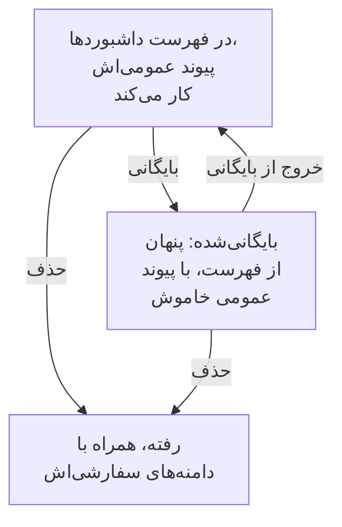

# پیکربندی و دسترسی‌های داشبورد

وقتی داشبوردی دارید که ارزش نگه داشتن دارد، این صفحه می‌گوید چه کسی می‌تواند آن را بخواند و تغییر دهد، مالکان و برچسب‌ها داشبوردهایتان را چگونه سامان می‌دهند، و چگونه از یک داشبورد رونوشت بگیرید، خروجی بگیرید، بایگانی‌اش کنید و حذفش کنید.

:::cards
- [چه کسی چه کاری می‌تواند بکند](#چه-کسی-چه-کاری-میتواند-بکند): دسترسی‌هایی که پشت هر اقدام‌اند، و این‌که چه کسانی آن‌ها را دارند.
- [مالکان](#مالکان): کاربران و تیم‌هایی که داشبورد از آنِ آن‌هاست.
- [تکثیر یک داشبورد](#تکثیر-یک-داشبورد): یک رونوشت امن، که برایتان شماره‌گذاری می‌شود.
- [بایگانی یک داشبورد](#بایگانی-یک-داشبورد): داشبوردی را بی‌آنکه حذفش کنید کنار بگذارید.
:::

## چه کسی چه کاری می‌تواند بکند

داشبوردها از [دسترسی‌های](/docs/permissions/index) پروژه شما پیروی می‌کنند. هر اقدام به یکی از این‌ها نیاز دارد که از راه یک تیم داده می‌شود:

| برای | نیاز دارد به |
| --- | --- |
| خواندن داشبوردها | `ReadDashboard`، یا یک نقش پروژه: Project Owner، Project Admin، Project Member، Viewer، یا یک نقش Settings |
| ساختن داشبوردها | `CreateDashboard`، Project Owner یا Project Admin |
| تغییر یک داشبورد: ویجت‌ها، متغیرها، اشتراک‌گذاری، برندینگ و بایگانی کردن آن | `EditDashboard`، Project Owner یا Project Admin |
| حذف یک داشبورد | `DeleteDashboard`، Project Owner یا Project Admin |
| افزودن و برداشتن مالکان | دسترسی‌های مالک داشبورد، Project Owner، Project Admin یا Project Member |
| افزودن و تغییر دامنه‌های سفارشی | دسترسی‌های دامنه داشبورد، Project Owner، Project Admin، Project Member، Settings Admin یا Settings Member |
| ساختن قواعد مالکیت و قواعد برچسب | دسترسی‌های قواعد، Project Owner یا Project Admin |

پس یک Project Member همه داشبوردها را می‌خواند، اما برای ساختن آن‌ها به `CreateDashboard` و `EditDashboard` نیاز دارد. خواندن، ویرایش و حذف را می‌توان هر کدام به داشبوردهایی که یک تیم مالک آن‌هاست، یا به داشبوردهایی که برچسب‌هایی معین دارند، محدود کرد: [دامنه: یک دسترسی مجاز چقدر می‌رسد](/docs/permissions/index#دامنه-یک-دسترسی-مجاز-چقدر-میرسد) را ببینید.

آن‌ها را در صفحه **دسترسی‌ها**ی یک تیم بدهید: **محصولات** > **تیم‌ها** را باز کنید و تیم را برگزینید.

این‌که چه کسی بیرون از پروژه می‌تواند یک داشبورد را ببیند پرسشی جداگانه است که در صفحه **اشتراک‌گذاری** آن پاسخ داده می‌شود: [دسترسی برای داشبوردهای عمومی](#دسترسی-برای-داشبوردهای-عمومی) را ببینید.

## مالکان

**مالکان** یک داشبورد کاربران و تیم‌هایی‌اند که داشبورد از آنِ آن‌هاست. آن‌ها را در صفحه **مالکان** داشبورد بیفزایید، یا چند داشبورد را در فهرست **داشبوردها** انتخاب کنید و به همه آن‌ها یک‌جا مالک بیفزایید.

مالکان وقتی دسترسی را محدود می‌کنند که از آن‌ها بخواهید: دسترسی تیمی‌ای که به داشبوردهای متعلق به تیم محدود شده، فقط به داشبوردهایی می‌رسد که آن تیم، یا کسی که اقدام می‌کند، را به‌عنوان مالک فهرست کرده‌اند. مالکیت به‌تنهایی هیچ دسترسی‌ای نمی‌دهد.

فهرست **داشبوردها** مالکان هر داشبورد را نشان می‌دهد، و پالایه **مالک** آن داشبوردهایی را پیدا می‌کند که یک فرد یا یک تیم مالک آن‌هاست.

## برچسب‌ها

برچسب‌ها تگ‌هایی برای سامان دادن داشبوردها هستند. آن‌ها را در صفحه **نمای کلی** داشبورد، جایی که نام و توضیحاتش را هم ویرایش می‌کنید، بیفزایید، یا از فهرست **داشبوردها** به چند داشبورد به‌طور هم‌زمان.

الگوهای رایج:

- **بر پایه تیم**: `team:platform`، `team:checkout`، `team:growth`.
- **بر پایه محیط**: `env:prod`، `env:staging`.
- **بر پایه کاربرد**: `purpose:oncall`، `purpose:exec`، `purpose:investigation`.

پالایه **برچسب‌ها** در فهرست **داشبوردها** سریع‌ترین راه برای پیدا کردن یک داشبورد در پروژه‌ای است که داشبوردهای فراوانی در آن جمع شده است. برچسب‌ها دسترسی‌ها را هم محدود می‌کنند: دسترسی تیمی‌ای که به برچسب‌هایی معین محدود شده، فقط به داشبوردهایی می‌رسد که یکی از آن برچسب‌ها را دارند.

## قواعد مالکیت و برچسب

به‌جای افزودن دستی مالکان و برچسب‌ها، بگذارید قواعد این کار را بکنند. زیر **تنظیمات** در منوی کناری **داشبوردها**، **قواعد مالکیت** مالک و **قواعد برچسب** برچسب به هر داشبورد تازه‌ای می‌افزایند که با آن‌ها جور درآید: بر پایه برچسب‌هایی که از پیش دارد، یا بر پایه الگویی در نام یا توضیحاتش. [قواعد برچسب و مالکیت](/docs/configuration/label-and-owner-rules) توضیح می‌دهد قواعد چگونه جور درمی‌آیند، و چگونه یکی را روی داشبوردهایی که از پیش دارید اجرا کنید.

## دسترسی برای داشبوردهای عمومی

این‌که چه کسی بیرون از پروژه می‌تواند یک داشبورد را ببیند، یک انتخاب در صفحه **اشتراک‌گذاری** آن است (همچنین **⋯** > **اشتراک‌گذاری** روی خود داشبورد؛ [اشتراک‌گذاری و داشبوردهای عمومی](/docs/dashboards/sharing) را ببینید):

1. **فقط افراد این پروژه** (پیش‌فرض) — داشبورد پیوند عمومی ندارد؛ نشانی عمومی آن صفحه «پیدا نشد» را نشان می‌دهد.
2. **هر کسی که پیوند را دارد** — هر کسی که پیوند عمومی را دارد می‌تواند بی‌آنکه وارد شود آن را ببیند.
3. **هر کسی که پیوند و رمز عبور را دارد** — بازدیدکنندگان پیش از نمایان شدن داشبورد یک رمز عبور وارد می‌کنند.

زیر **تنظیمات بیشتر** در همان صفحه، **فهرست IPهای مجاز** (پلن Scale) درخواست‌هایی را که از هر نشانی IP بیرون از آن به پیوند عمومی برسند رد می‌کند. بسته‌ترین چیدمان عمومی، **هر کسی که پیوند و رمز عبور را دارد** همراه با فهرست IPهای مجاز است — برای پورتال‌های شریکان، جایی که هر دو لایه را می‌خواهید، سودمند است.

## تکثیر یک داشبورد

برای رونوشت گرفتن از یک داشبورد، آن را باز کنید، به صفحه **تنظیمات** آن بروید و روی **تکثیر داشبورد** کلیک کنید. نام رونوشت برایتان پر می‌شود: نام داشبورد، با شماره‌ای پس از نام‌هایی که پروژه از پیش دارد (رونوشت «Checkout API» به نام «Checkout API 2» ساخته می‌شود، و رونوشت آن به نام «Checkout API 3»). اگر بخواهید آن را تغییر دهید، با **تکثیر داشبورد** تأیید کنید، و رونوشت باز می‌شود. ویجت‌ها، متغیرها، توضیحات و برچسب‌های داشبورد را دارد. برندینگ و دامنه‌های سفارشی با داشبورد اصلی می‌مانند، و اشتراک‌گذاری عمومی همیشه خاموش آغاز می‌شود، تا خودتان تصمیم بگیرید آن را روشن کنید یا نه.

این حرکت درست است وقتی می‌خواهید از یک قالب (مانند «داشبورد آنکال ما») یک رونوشت ویژه یک سرویس جدا کنید.

## خروجی گرفتن و وارد کردن

یک داشبورد به‌صورت JSON جابه‌جا می‌شود:

- **خروجی گرفتن از داشبورد**، در صفحه **تنظیمات** داشبورد، آن را به‌صورت یک فایل JSON دانلود می‌کند. برای خروجی گرفتن از چند داشبورد، آن‌ها را در فهرست **داشبوردها** انتخاب کنید و **خروجی JSON** را برگزینید.
- **واردکردن JSON**، بالای فهرست **داشبوردها**، از چنین فایلی داشبورد می‌سازد، در همین پروژه یا در پروژه‌ای دیگر.

خروجی تنظیمات خود داشبورد را دارد، از جمله ویجت‌ها و متغیرهایش. مالکان و برچسب‌هایش کنار گذاشته می‌شوند، و ویجت‌هایی که به منابع این پروژه اشاره دارند، مانند یک SLO یا یک منبع داده، ممکن است در پروژه‌ای دیگر لازم باشد دوباره برگزیده شوند.

## بایگانی یک داشبورد

داشبوردی را که دیگر به کار نمی‌برید ولی می‌خواهید نگهش دارید بایگانی کنید. داشبورد بایگانی‌شده از فهرست **داشبوردها** بیرون می‌رود و، اگر عمومی باشد، پیوند عمومی‌اش از کار می‌افتد — URL و دامنه‌های سفارشی آن با "Dashboard not found" پاسخ می‌دهند. ویجت‌ها، متغیرها، برندینگ، دامنه‌ها و تنظیمات عمومی‌اش همه نگه داشته می‌شوند، پس خروج از بایگانی آن را درست همان‌طور که بود برمی‌گرداند، پیوند عمومی هم.

برای بایگانی یک داشبورد، آن را باز کنید، به صفحه **تنظیمات** آن بروید و روی **بایگانی** کلیک کنید. برای بایگانی چند داشبورد، آن‌ها را در فهرست **داشبوردها** انتخاب کنید و **بایگانی** را برگزینید. برای بازگرداندن یکی، **داشبوردها** > **پیشرفته** > **بایگانی‌شده** را باز کنید، آن را انتخاب کنید و **خروج از بایگانی** را برگزینید، یا آن را باز کنید و روی **خروج از بایگانی** در نوار بالای صفحه‌هایش کلیک کنید.

بایگانی جایگزین برگشت‌پذیر حذف است: وقتی مطمئن نیستید، نخست سراغ آن بروید.

## حذف یک داشبورد

صفحه **حذف** داشبورد را باز کنید. حذف برگشت‌ناپذیر است: داشبورد، ویجت‌ها و متغیرهایش، و هر دامنه سفارشی که به آن وصل است برداشته می‌شوند. به تله‌متری شما دست زده نمی‌شود.

اگر داشبورد روی یک دامنه سفارشی عمومی است، نشانی به‌محض حذف آن دیگر پاسخ نمی‌دهد. برای آنکه نشانی همچنان ارائه شود، پس از حذف این داشبورد دامنه را به داشبوردی دیگر بیفزایید: یک دامنه در هر زمان به یک داشبورد تعلق دارد.

## گزارش‌های ممیزی

صفحه **گزارش‌های ممیزی** داشبورد هر تغییری را که در داشبورد داده شده، و این‌که چه کسی آن را داده، فهرست می‌کند. گزارش‌های ممیزی بخشی از پلن Enterprise و [نسخه سازمانی](/docs/self-hosted/enterprise) هستند.

## نگهداری داده‌ها و پشتیبان‌گیری

خود داشبوردها منقضی نمی‌شوند. داده‌هایی که نشان می‌دهند از تنظیمات نگهداری پروژه شما پیروی می‌کنند: با بازه زمانی ۳ ماه گذشته، پروژه‌ای که لاگ‌هایش را ۱۵ روز نگه می‌دارد ۱۵ روز آخر آن‌ها را نشان می‌دهد.

اگر OneUptime را خودتان میزبانی می‌کنید، یک پشتیبان‌گیری منظم از پایگاه داده کافی است: پیکربندی یک داشبورد همراه بقیه پروژه شما ذخیره می‌شود. در OneUptime Cloud، پشتیبان‌گیری برای شما انجام می‌شود. برای داشتن رونوشتی از آنِ خودتان، از داشبورد به‌صورت JSON خروجی بگیرید، یا آن را از راه [OneUptime API](/docs/api-reference/api-reference) بخوانید.

## گام‌های بعدی

:::cards
- [اشتراک‌گذاری و داشبوردهای عمومی](/docs/dashboards/sharing): پیوندهای عمومی، رمزهای عبور، فهرست‌های IPهای مجاز و دامنه‌های سفارشی.
- [کاربران، تیم‌ها و دسترسی‌ها](/docs/permissions/index): تیم‌ها، نقش‌ها، دامنه‌ها و مسدودسازی‌ها.
- [متغیرها و فیلترهای داشبورد](/docs/dashboards/variables): یک داشبورد برای همه سرویس‌ها.
- [نمای کلی داشبوردها](/docs/dashboards/index): تصویر کلی.
:::
