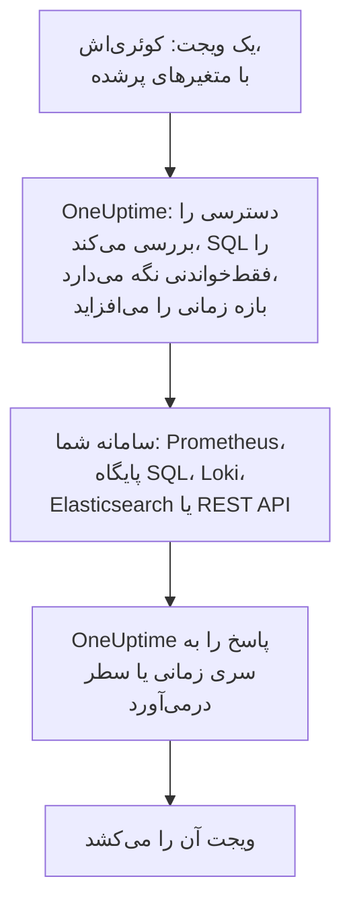

# منابع داده خارجی

یک منبع داده خارجی سامانه‌ای بیرون از OneUptime را وصل می‌کند، مانند Prometheus، یک پایگاه داده SQL، ClickHouse، Loki، Elasticsearch یا یک REST API، تا داشبوردهایتان بتوانند داده‌های آن را کنار داده‌های خودتان نمودار کنند. سامانه را یک بار وصل می‌کنید؛ پس از آن هر ویجت یک کوئری فقط‌خواندنی را به زبان خود آن سامانه اجرا می‌کند.

:::cards
- [وصل کردن یک منبع داده](#وصل-کردن-یک-منبع-داده): نوع را برگزینید، سپس بگویید کجاست و چگونه وارد شود.
- [نوشتن یک کوئری](#نوشتن-یک-کوئری): PromQL، SQL، LogQL، Query DSL یا یک درخواست.
- [محدودیت‌ها](#محدودیتها): مهلت‌ها و سقف‌هایی که از هر دو سو محافظت می‌کنند.
- [امن نگه داشتن](#امن-نگه-داشتن): کوئری‌های فقط‌خواندنی و اعتبارنامه‌های فقط‌نوشتنی.
:::

## یک کوئری چگونه اجرا می‌شود

ویجت کوئری‌اش را، با متغیرهایی که از پیش پر شده‌اند، به OneUptime می‌فرستد. OneUptime بررسی می‌کند که شما اجازه خواندن منبع داده را دارید، بازه زمانی را پر می‌کند و با اعتبارنامه‌هایی که نگه می‌دارد از سامانه شما می‌پرسد. سپس پاسخ را به سری‌های زمانی یا سطرهایی درمی‌آورد که ویجت بکشد.



## پیش از شروع

- **پلنی که آن را دربر دارد.** در OneUptime Cloud، ساختن و تغییر دادن منابع داده به پلن **Growth** نیاز دارد. حذف یک منبع داده در همه پلن‌ها کار می‌کند.
- **دسترسی‌ای برای افزودن آن‌ها.** مالکان و مدیران پروژه می‌توانند منبع داده بیفزایند؛ دیگران به `CreateDataSource` نیاز دارند، و برای تغییر و حذف آن‌ها به `EditDataSource` و `DeleteDataSource`. هر کسی که بتواند منابع داده پروژه را بخواند، از جمله اعضا و بینندگان، داده‌های ویجت‌های آن‌ها را می‌بیند.
- **یک حساب فقط‌خواندنی.** داشبوردها همیشه فقط می‌خوانند. پایگاه‌های داده را با حسابی وصل کنید که فقط بتواند بخواند، و منابع HTTP را با توکنی که فقط بتواند کوئری بگیرد.
- **راهی به درون.** سرور API در OneUptime به سامانه شما وصل می‌شود، پس باید بتواند به آن برسد: برای نشانی‌هایی که پذیرفته نمی‌شوند، [امن نگه داشتن](#امن-نگه-داشتن) را ببینید.

## سامانه‌های پشتیبانی‌شده

| نوع | زبان کوئری | سازگار با |
| --- | --- | --- |
| Prometheus | PromQL | Prometheus، Thanos، Cortex، Mimir، VictoriaMetrics |
| PostgreSQL | SQL | PostgreSQL، TimescaleDB، CockroachDB |
| MySQL | SQL | MySQL، MariaDB |
| Microsoft SQL Server | T-SQL | SQL Server، Azure SQL |
| ClickHouse | SQL | ClickHouse، از راه رابط HTTP آن |
| Grafana Loki | LogQL | Loki و endpointهای سازگار با Loki |
| Elasticsearch | Query DSL (JSON) | Elasticsearch، OpenSearch |
| REST API | درخواست (JSON) | هر API از نوع HTTP(S) که با JSON پاسخ می‌دهد |

## وصل کردن یک منبع داده

:::steps
### Data Sources را باز کنید

**محصولات** > **داشبوردها** را باز کنید، در منوی کناری **تنظیمات** را باز کنید و روی **منابع داده** کلیک کنید.

### نوع را برگزینید

روی **ساخت Data Source** کلیک کنید. پنجره **Choose a Data Source Type** نوع‌ها را بر پایه آنچه نگه می‌دارند دسته‌بندی می‌کند: متریک‌ها، لاگ‌ها، پایگاه‌های داده، جست‌وجو و APIها. روی یکی کلیک کنید.

### نامش را بگذارید

زیر **اطلاعات پایه**، به آن یک **نام** بدهید، مانند «Production Prometheus»، و اگر بخواهید **توضیحات** را هم بنویسید.

### بگویید کجاست

زیر **اتصال**، منبع HTTP نشانی‌ای را که در آن پاسخ می‌دهد در **URL** می‌گیرد. پایگاه داده **Database Host**، **Database Port** (برای 5432، 3306، 1433 یا 8123 آن را خالی بگذارید) و **نام پایگاه داده** خود را می‌گیرد.

### بگویید چگونه وارد شود

زیر **احراز هویت**، یک **نام کاربری** و **رمز عبور** وارد کنید، یا برای منبع HTTP یک **توکن API** که به‌صورت bearer token فرستاده می‌شود. **فیلدهای بیشتر** **Custom HTTP Headers** را دارد، مانند `{ "X-Scope-OrgID": "tenant-1" }`، و **Additional Options** را: `sslEnabled` و `sslRejectUnauthorized` برای پایگاه‌های داده، و `elasticsearchIndex` برای Elasticsearch، که بدون آن همه indexها (`*`) را می‌خواند.

### آن را بیازمایید

روی **ساخت Data Source** کلیک کنید، سپس روی **آزمایش** در سطر آن. OneUptime با جزئیاتی که داده‌اید وصل می‌شود و می‌گوید کار کرد یا چه چیزی اشتباه شد.
:::

برای تغییر یک منبع داده در آینده، آن را از فهرست باز کنید. **ویرایش** در **Data Source Details** همه چیز جز رازهایش را تغییر می‌دهد؛ **به‌روزرسانی اطلاعات ورود** رمز عبور، توکن یا سرآیندها را جایگزین می‌کند و فیلدهایی را که خالی می‌گذارید همان‌طور که بودند نگه می‌دارد؛ **آزمایش** دوباره آن را بررسی می‌کند.

## استفاده از آن در یک ویجت

یک داشبورد را ویرایش کنید، روی **افزودن ویجت** کلیک کنید و ویجتی از گروه منابع داده خارجی برگزینید: یک **نمودار**، یک **مقدار**، یک **گِیج** یا یک **جدول**. در تنظیمات آن:

- **Data Source** را برگزینید و **پرس‌وجو** را بنویسید. ویرایشگر زبان کوئری را نام می‌برد و نمونه‌ای برای آن نوع نشان می‌دهد.
- در یک نمودار، **افزودن کوئری** کوئری‌های بیشتری را روی همان محورها می‌گذارد، و **Legend (optional)** هر سری را از روی برچسب‌هایش نام‌گذاری می‌کند: `{{instance}} — errors` برچسب `instance` سری را در آغاز می‌نویسد.
- در یک مقدار یا یک گِیج، **Reduce** نقطه‌ها را به یک عدد تبدیل می‌کند: آخرین مقدار (پیش‌فرض)، نخستین، میانگین، جمع، کمینه یا بیشینه. **Unit** یک پسوند می‌افزاید و یکاهای شناخته‌شده را مقیاس می‌دهد: `Bytes` به‌صورت 1.5 MB خوانده می‌شود و `ms` به‌صورت 2.4 s.
- در یک جدول، هر کوئری فقط‌خواندنی کار می‌کند و سطرهایش همان‌طور که برمی‌گردند نمایش داده می‌شوند.

## نوشتن یک کوئری

هر نوع زبان خودش را می‌گیرد، با قاعده‌های یکسانی برای آنچه برمی‌گردد:

- **نمودارها، مقدارها و گِیج‌ها به سری زمانی نیاز دارند.** یک کوئری SQL یک ستون زمان با نام `time`، `timestamp`، `date` یا `ts` و یک ستون عددی `value` (یا نخستین ستون عددی خود) را برمی‌گرداند؛ هر ستون دیگری برچسب یک سری می‌شود. Elasticsearch به یک aggregation از نوع `date_histogram` نیاز دارد، و Loki به یک کوئری متریک مانند `rate()` یا `count_over_time()`.
- **جدول‌ها سطرها را نشان می‌دهند**، همان‌طور که کوئری برمی‌گرداند: سطرهای SQL، سری‌های Prometheus، سطرهای لاگ Loki، hitهای Elasticsearch، یا شیءهای موجود در `rowsPath` یک REST API.

:::tabs
@tab Prometheus
```text title="PromQL"
sum by (job) (rate(http_requests_total{job=~"{{job}}"}[5m]))
```
@tab SQL
```sql title="SQL"
SELECT date_trunc('minute', created_at) AS time, COUNT(*) AS value
FROM orders
WHERE created_at BETWEEN $__startTime AND $__endTime
GROUP BY 1
ORDER BY 1
```
@tab Loki
```text title="LogQL"
sum by (app) (rate({app="api"} |= "error" [5m]))
```
@tab Elasticsearch
```json title="Query DSL"
{
  "query": { "range": { "@timestamp": { "gte": "$__startTime", "lte": "$__endTime" } } },
  "aggs": {
    "over_time": {
      "date_histogram": { "field": "@timestamp", "fixed_interval": "1m" }
    }
  }
}
```
@tab REST API
```json title="Request"
{
  "path": "/api/stats?from=$__startTimeMs&to=$__endTimeMs",
  "method": "GET",
  "rowsPath": "data.items",
  "timestampField": "time",
  "valueField": "count",
  "seriesField": "service"
}
```
:::

### ماکروهای زمان

Prometheus و Loki بازه زمانی داشبورد را با هر درخواست دریافت می‌کنند، پس کوئری‌هایشان به چیز دیگری نیاز ندارد. نوع‌های دیگر بازه زمانی را جایی می‌گذارند که یک ماکرو می‌نویسید:

| ماکرو | تبدیل می‌شود به | در |
| --- | --- | --- |
| `$__startTime`، `$__endTime` | آغاز و پایان بازه، به وقت UTC: در SQL به‌صورت `'2026-10-13 09:00:00'`، و در جاهای دیگر ISO 8601 | SQL، Elasticsearch، REST API |
| `$__startTimeMs`، `$__endTimeMs` | همان، بر حسب میلی‌ثانیه از ۱۹۷۰ | SQL، Elasticsearch، REST API |
| `$__rangeSeconds` | طول بازه، بر حسب ثانیه | SQL |

ماکروهای SQL به وقت UTC نوشته می‌شوند، پس نشست‌های پایگاه داده‌تان را به وقت UTC اجرا کنید، یا در خود کوئری تبدیل کنید.

### متغیرهای داشبورد

`{{name}}` را هر جای یک کوئری بنویسید تا ویجت پیش از فرستادن کوئری مقدار متغیر را آنجا بگذارد. چند مقدار یک متغیر چندانتخابی با `|` به هم پیوسته می‌شوند، که همان چیزی است که یک matcher عبارت منظم در PromQL یا LogQL نیاز دارد: `job=~"{{job}}"`. متغیری که چیزی در آن برگزیده نشده جای‌نگهدار را همان‌طور که نوشته شده رها می‌کند، پس پیام خطا نام آن را می‌برد. [متغیرها و فیلترهای داشبورد](/docs/dashboards/variables) نشان می‌دهد چگونه یکی بیفزایید.

## محدودیت‌ها

هر کوئری محدود است، تا داشبوردی با بیست ویجت که هر دقیقه به‌روز می‌شود نتواند بار بیش از اندازه‌ای بر OneUptime یا سامانه شما بگذارد:

| محدودیت | مقدار |
| --- | --- |
| وصل شدن | ۱۰ ثانیه |
| اجرای یک کوئری | ۳۰ ثانیه |
| نقطه‌ها در پاسخی از نوع سری زمانی | ۱۱٬۰۰۰ |
| سطرها در یک جدول | ۱٬۰۰۰ |
| سری‌ها در یک پاسخ | ۱۰۰ |
| پاسخ از یک منبع HTTP | ۲۰ MB |

کوئری‌های بازه‌ای Prometheus و Loki حدود ۲۵۰ نقطه در سراسر بازه زمانی می‌خواهند، نه نزدیک‌تر از ۱۰ ثانیه و نه دورتر از یک روز از هم.

## امن نگه داشتن

- **SQL فقط‌خواندنی می‌ماند.** کوئری باید یک دستور باشد که با `SELECT`، `WITH`، `SHOW`، `EXPLAIN`، `DESCRIBE` یا `DESC` آغاز شود. واژه‌هایی که می‌نویسند یا نشستی را تغییر می‌دهند، مانند `INSERT`، `UPDATE`، `DELETE`، `DROP`، `INTO` یا `SET`، هر جایی بیرون از رشته‌ها و نام‌های داخل نقل‌قول پذیرفته نمی‌شوند، پس ستونی را که هم‌نام یکی از آن‌هاست در نقل‌قول بگذارید. نقل‌قول درون یک رشته را به‌صورت دو نقل‌قول (`''`) بنویسید: بک‌اسلش پیش از نقل‌قول پذیرفته نمی‌شود. نشست‌های PostgreSQL، MySQL و ClickHouse نیز فقط‌خواندنی‌اند. SQL Server نشست فقط‌خواندنی ندارد، پس آن را با یک login فقط‌خواندنی وصل کنید.
- **اعتبارنامه‌ها فقط‌نوشتنی‌اند.** **رمز عبور**، **توکن API** و **Custom HTTP Headers** رمزگذاری‌شده ذخیره می‌شوند و API هرگز آن‌ها را برنمی‌گرداند، حتی به خود شما.
- **نشانی‌ها بررسی می‌شوند.** نشانی‌های loopback، link-local (جایی که metadata ابر قرار دارد) و دیگر نشانی‌های رزروشده همه جا پذیرفته نمی‌شوند. نشانی‌های خصوصی در OneUptime Cloud پذیرفته نمی‌شوند و در نصب خودمیزبان مجازند، مگر آنکه `DATA_SOURCE_BLOCK_PRIVATE_ADDRESSES` برابر `true` باشد: [دسترسی به شبکه خصوصی](/docs/self-hosted/private-network-access) را ببینید.
- **داشبوردهای عمومی هرگز آن‌ها را اجرا نمی‌کنند.** ویجت‌های منابع داده خارجی، همراه کوئری‌ها و همه چیزشان، از یک [داشبورد عمومی](/docs/dashboards/sharing) کنار گذاشته می‌شوند.

## عیب‌یابی

:::details آزمایش می‌گوید نمی‌تواند وصل شود
URL، یا میزبان و پورت را از جایی که OneUptime اجرا می‌شود بررسی کنید: یک دیوار آتش، یک نشانی خصوصی در OneUptime Cloud، یا پایگاه داده‌ای که فقط روی ماشین خودش گوش می‌دهد، از اینجا همه یکسان به نظر می‌رسند. برای پایگاه داده‌ای که به TLS نیاز دارد، `{ "sslEnabled": true }` را زیر **Additional Options** بیفزایید.
:::

:::details "Only read-only queries are allowed"
کوئری با `SELECT`، `WITH`، `SHOW`، `EXPLAIN`، `DESCRIBE` یا `DESC` آغاز نمی‌شود. یک دستور بفرستید که فقط بخواند: دستور دومی پس از یک `;` نیز پذیرفته نمی‌شود، با پیام "Only a single SQL statement is allowed per query."
:::

:::details "Query contains a keyword that is not allowed"
واژه‌ای که می‌نویسد بیرون از یک رشته آمده است، اغلب به‌صورت نام یک ستون، مانند `delete` یا `set`. آن را همان‌گونه که پایگاه داده نقل‌قول می‌کند در نقل‌قول بگذارید: `"delete"` در PostgreSQL، `[delete]` در SQL Server، و درون backtick در MySQL و ClickHouse.
:::

:::details نمودار خالی می‌ماند، اما جدول سطر نشان می‌دهد
کوئری سطر برمی‌گرداند، اما سری زمانی نه. در SQL ستون زمان را `time` و عدد را `value` بنامید، در Elasticsearch یک aggregation از نوع `date_histogram` بیفزایید، یا کوئری لاگ Loki را با `rate()` یا `count_over_time()` به یک کوئری متریک تبدیل کنید.
:::

:::details بخشی از داده‌ها نیست
پاسخ به یک [محدودیت](#محدودیتها) رسیده است. بازه زمانی را کوتاه‌تر کنید، کوئری را پالایش کنید، یا آن را در سری‌های کمتری تجمیع کنید.
:::

## گام‌های بعدی

:::cards
- [ویجت‌های داشبورد](/docs/dashboards/widgets): همه ویجت‌ها، از جمله گروه منابع داده خارجی.
- [متغیرها و فیلترهای داشبورد](/docs/dashboards/variables): متغیرهایی برای استفاده در کوئری‌هایتان.
- [دسترسی به شبکه خصوصی](/docs/self-hosted/private-network-access): از یک نصب خودمیزبان به سامانه‌های یک شبکه خصوصی برسید.
- [پیکربندی و دسترسی‌های داشبورد](/docs/dashboards/configuration): چه کسی می‌تواند منبع داده بیفزاید، و چه کسی آن‌ها را می‌خواند.
:::
