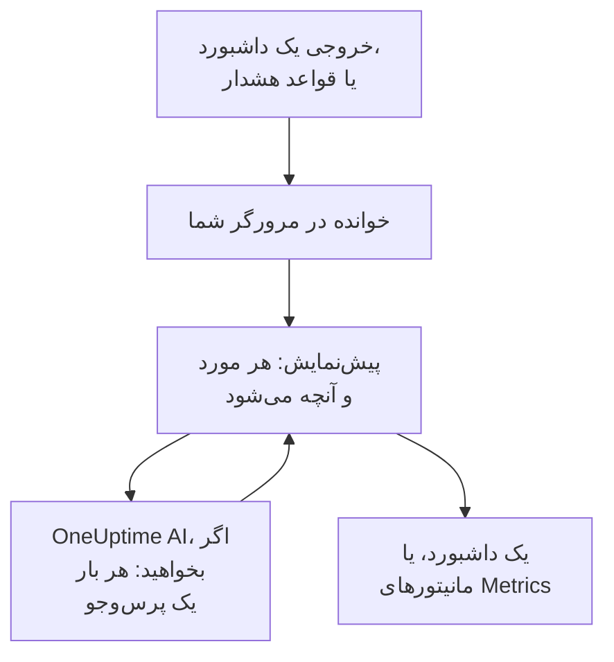

# واردکردن از Grafana و Datadog

داشبوردی را که در Grafana یا Datadog ساخته‌اید، یا قواعد هشداری را که برای Prometheus، Grafana یا Datadog نوشته‌اید، به OneUptime بیاورید. فایل را جای‌گذاری یا بارگذاری می‌کنید، می‌بینید هر پنل و هر قاعده به چه تبدیل می‌شود، و تنها پس از آن داشبورد یا مانیتورها را می‌سازید.

:::cards
- [واردکردن یک داشبورد](#واردکردن-یک-داشبورد): مدل JSON یک داشبورد Grafana، یا خروجی یک داشبورد Datadog.
- [واردکردن قواعد هشدار](#واردکردن-قواعد-هشدار): فایل‌های قواعد Prometheus، قواعد هشدار Grafana و مانیتورهای Datadog.
- [هر مورد چگونه تبدیل می‌شود](#هر-مورد-چگونه-تبدیل-میشود): دقیق، تقریبی یا اصلاً، و چرا.
- [تبدیل یک پرس‌وجو با OneUptime AI](#تبدیل-یک-پرسوجو-با-oneuptime-ai): برای پرس‌وجویی که هیچ قاعده‌ای تبدیلش نمی‌کند.
:::

## واردکردن چگونه انجام می‌شود

OneUptime فایل را در مرورگر شما می‌خواند و هر پنل، ویجت، متغیر و قاعده را جداگانه تبدیل می‌کند. پیش‌نمایش همه آن‌ها را همراه با آنچه هر کدام می‌شود فهرست می‌کند. تا وقتی ساختن را انتخاب نکنید چیزی ساخته نمی‌شود، و آن‌گاه با مجوزهای خود شما ساخته می‌شود، همان‌طور که فرم‌های داشبورد و مانیتور آن را می‌سازند.

## پیش از شروع

- ویجت‌ها و مانیتورهای واردشده متریک‌های خود این پروژه را با PromQL می‌خوانند. آن‌ها را با Prometheus remote write، OpenTelemetry یا Datadog Agent بفرستید، و همان نام‌هایی را که آنجا دارند نگه می‌دارند.
- واردکردن یک داشبورد نقشی می‌خواهد که بتواند داشبورد بسازد، و واردکردن قواعد هشدار نقشی که بتواند مانیتور بسازد.
- یک فایل می‌تواند تا ۱۰ مگابایت باشد، و تا ۵۰۰ پنل یا قاعده از آن خوانده می‌شود.

## واردکردن یک داشبورد

:::steps
### باز کردن واردکردن داشبورد

**محصولات** > **داشبوردها** را باز کنید، سپس **گزینه‌های بیشتر** > **واردکردن از Grafana یا Datadog** را برگزینید.

### جای‌گذاری داشبورد

در Grafana، مدل JSON را از تنظیمات داشبورد کپی کنید. در Datadog، JSON داشبورد را خروجی بگیرید. آن را جای‌گذاری کنید، یا **بارگذاری فایل** را برگزینید، سپس **پیش‌نمایش** را برگزینید.

### ساختن داشبورد

ببینید هر پنل و هر متغیر به چه تبدیل می‌شود، نامی به داشبورد بدهید و **ساخت داشبورد** را برگزینید. داشبورد تازه باز می‌شود.
:::

PromQL در Grafana همان‌طور که نوشته شده می‌ماند: OneUptime مقدارهای `$__interval`، `$__rate_interval` و `$__range` را همان‌گونه پر می‌کند که Grafana پر می‌کند، و متغیری که روی All است با هر مقداری منطبق می‌شود. یک پرس‌وجوی Datadog به PromQL روی متریک‌هایی تبدیل می‌شود که Datadog Agent فرستاده است: `avg:system.cpu.user{host:web-1}` همان `system_cpu_user{host="web-1"}` را می‌خواند.

## واردکردن قواعد هشدار

:::steps
### باز کردن واردکردن هشدارها

**محصولات** > **مانیتورها** را باز کنید، سپس **گزینه‌های بیشتر** > **واردکردن هشدارها** را برگزینید.

### جای‌گذاری قواعد

یک فایل قواعد Prometheus یا یک منبع PrometheusRule، خروجی قواعد هشدار Grafana، یا مانیتورهای Datadog را که به‌صورت JSON خروجی گرفته شده‌اند جای‌گذاری کنید، سپس **پیش‌نمایش** را برگزینید.

### ساختن مانیتورها

تیک هر قاعده‌ای را که نمی‌خواهید بردارید، در **وقتی یک قاعده فعال می‌شود** انتخاب کنید که قاعده فعال‌شده چه چیزی باز کند، و **ساخت مانیتورها** را برگزینید.
:::

هر قاعده به یک مانیتور Metrics با یک پرس‌وجوی PromQL، شرط قاعده و بازه آن تبدیل می‌شود. این مانیتور برای هر سری‌ای که از حد بگذرد یک هشدار یا یک حادثه باز می‌کند، و وقتی سری بهبود یابد آن را حل‌شده می‌کند. عنوان و توضیحات آن از خلاصه یا پیام قاعده می‌آیند و برچسب‌های سری در آن‌ها پر می‌شوند.

## هر مورد چگونه تبدیل می‌شود

| وضعیت | معنای آن |
| --- | --- |
| **دقیق تبدیل شد** | همان داده‌ها را می‌خواند و به همان شکل نشان می‌دهد. |
| **تقریبی تبدیل شد** | ساخته می‌شود، و یادداشت‌هایش می‌گویند چه چیزی فرق دارد. |
| **تبدیل نشد** | چیزی برایش ساخته نمی‌شود، و یادداشت‌هایش می‌گویند چرا. |

قواعد ضبط، قواعد هشدار روی لاگ‌ها، ویجت‌های Datadog که لاگ‌ها، ترِیس‌ها یا رویدادها را می‌خوانند، و مانیتورهای ناهنجاری، داده‌های پرت و پیش‌بینی Datadog تبدیل نمی‌شوند.

## تبدیل یک پرس‌وجو با OneUptime AI

پرس‌وجویی که هیچ قاعده‌ای تبدیلش نمی‌کند **تبدیل با OneUptime AI** را نشان می‌دهد، که به روشن بودن هوش مصنوعی برای پروژه نیاز دارد. فقط همان پرس‌وجو، همراه با نام متغیرهای داشبورد، به ارائه‌دهنده هوش مصنوعی پروژه شما می‌رود. پاسخ آن مانند هر پرس‌وجوی دیگری بررسی و به شما نشان داده می‌شود: برای استفاده از آن **استفاده از این پرس‌وجو** را برگزینید. تا وقتی داشبورد یا مانیتورها را نسازید چیزی ساخته نمی‌شود.

## گام‌های بعدی

:::cards
- [ویجت‌های داشبورد](/docs/dashboards/widgets): آنچه را یک ویجت واردشده نشان می‌دهد تغییر دهید.
- [متغیرها و فیلترهای داشبورد](/docs/dashboards/variables): متغیرهایی که یک واردکردن ساخته است.
- [مانیتور متریک‌ها](/docs/monitor/metrics-monitor): مانیتورهایی که یک واردکردن ساخته است.
- [PromQL](/docs/telemetry/promql): زبانی که ویجت‌ها و مانیتورهای واردشده می‌خوانند.
:::
