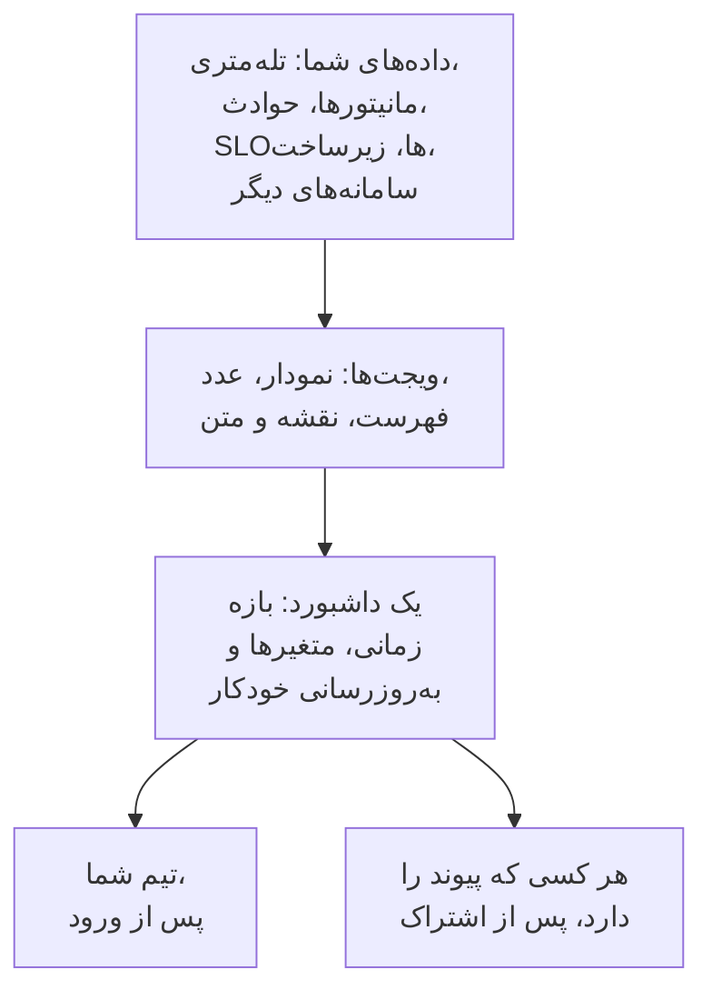

# نمای کلی داشبوردها

داشبورد یک صفحه از ویجت‌هاست که خودتان آن‌ها را می‌چینید: نمودارهای متریک‌ها، لاگ‌ها و ترِیس‌هایتان، فهرست حوادث، هشدارها و مانیتورها، SLOها و زیرساختتان، و حتی داده‌هایی از سامانه‌های بیرون از OneUptime. یکی برای صفحه‌نمایش آنکال، بررسی صبحگاهی یک تیم یا صفحه‌ای برای مشتریانتان بسازید و آن را با پروژه‌تان یا با هر کسی که پیوند را دارد به اشتراک بگذارید.

:::cards
- [داشبورد چگونه کار می‌کند](#داشبورد-چگونه-کار-میکند): داده‌هایش از کجا می‌آید و چه کسی آن را می‌بیند.
- [داشبوردهایتان را پیدا کنید](#داشبوردهایتان-را-پیدا-کنید): فهرست داشبوردها و صفحه‌های خود هر داشبورد.
- [نخستین داشبوردتان را بسازید](#نخستین-داشبوردتان-را-بسازید): از یک قالب تا یک صفحه اشتراکی در پنج گام.
- [یک نمونه: داشبورد آنکال](#یک-نمونه-داشبورد-آنکال): یک صفحه که برای همه سرویس‌ها کار می‌کند.
:::

## داشبورد چگونه کار می‌کند

هر ویجت از یک منبع می‌خواند، در بازه زمانی داشبورد و پالایش‌شده با متغیرهای آن. هر کسی که داشبورد را باز کند همان ویجت‌ها را می‌بیند: تیم شما هنگام ورود، و بازدیدکنندگان از راه پیوند عمومی پس از آنکه آن را به اشتراک بگذارید.

| اصطلاح | معنی |
| --- | --- |
| داشبورد | یک صفحه: یک نام، شبکه‌ای از ویجت‌ها، یک بازه زمانی، متغیرها و یک تنظیم به‌روزرسانی خودکار. |
| ویجت | یک کاشی روی شبکه: یک نمودار، یک عدد، یک فهرست، یک نقشه، یک ساعت یا یک بلوک متن. |
| متغیر | یک انتخابگر در نوار ابزار که هر ویجتِ پشتیبانی‌کننده را به یک سرویس، میزبان یا مشتری محدود می‌کند. |
| بازه زمانی | پنجره‌ای که همه نمودارها و عددها می‌خوانند. داشبورد با پیش‌فرض خود باز می‌شود، یعنی یک ساعت گذشته مگر آنکه کسی هنگام ویرایش چیز دیگری تعیین کند، و هر بیننده می‌تواند انتخاب خودش را داشته باشد. |
| به‌روزرسانی خودکار | این‌که ویجت‌ها هر چند وقت یک بار داده‌هایشان را دوباره بخوانند: خاموش، یا از هر ۵ ثانیه تا هر ۱۵ دقیقه. |
| نمایش و ویرایش | داشبورد برای خواندن باز می‌شود. ویرایش آن گامی جداگانه است که با ذخیره یا کنار گذاشتن تغییرهایتان پایان می‌یابد. |

## داشبوردها به چه کاری می‌آیند

- **صفحه‌ای برای پاسخ به «آیا همه چیز درست است؟»** برای مهندس آنکال، جلسه روزانه تیم یا یک نمایشگر روی دیوار.
- **دیدن پیوندها**: جهش CPU در کنار افزایش تأخیر و یک حادثه باز در یک صفحه آشکار است، و اگر در سه صفحه پخش باشد به‌آسانی از چشم می‌افتد.
- **بررسی**: نمودارهایی را که پیوسته دوباره باز می‌کنید کنار هم بگذارید و روی یک جهش بکشید تا همه ویجت‌ها را در آن لحظه بخوانید.
- **اشتراک بیرون از تیم**: صفحه‌ای درباره کارایی برای یک مشتری یا شریک، که اگر بخواهید با رمز عبور یا فهرست IPهای مجاز محافظت می‌شود.

## داشبوردهایتان را پیدا کنید

**محصولات** > **داشبوردها** را باز کنید. فهرست **داشبوردها** داشبوردهای پروژه را با توضیحات، برچسب‌ها و مالکانشان نشان می‌دهد. بر پایه نام یا توضیحات جست‌وجو کنید، فهرست را با پالایه‌های **مالک** و **برچسب‌ها** کوچک کنید، یا چند داشبورد را انتخاب کنید تا برچسب‌ها یا مالکانشان را تغییر دهید، آن‌ها را بایگانی کنید یا به‌صورت JSON خروجی بگیرید.

منوی کناری فهرست صفحه‌هایی دارد که همه داشبوردهایتان را اداره می‌کنند:

| صفحه | آنجا چه می‌کنید |
| --- | --- |
| **داشبوردها** | داشبوردهای پروژه. یکی بسازید، یا با **Import JSON** داشبوردها را وارد کنید. |
| **تنظیمات** > **قواعد مالکیت** | به داشبوردهای تازه به‌طور خودکار مالک بیفزایید. |
| **تنظیمات** > **قواعد برچسب** | به داشبوردهای تازه به‌طور خودکار برچسب بیفزایید. |
| **تنظیمات** > **منابع داده** | Prometheus، پایگاه‌های داده SQL، ClickHouse، Loki، Elasticsearch یا یک REST API را وصل کنید. |
| **پیشرفته** > **بایگانی‌شده** | داشبوردهایی که بایگانی کرده‌اید. از اینجا آن‌ها را از بایگانی بیرون بیاورید. |

یک داشبورد را باز کنید تا منوی کناری خودش این صفحه‌ها را نشان دهد. همه بخش‌ها به‌جز **پایه** بسته آغاز می‌شوند: برای باز کردن هر بخش روی عنوانش کلیک کنید.

| صفحه | آنجا چه می‌کنید |
| --- | --- |
| **داشبورد** | خود داشبورد. آن را بخوانید، یا از منوی **⋯** آن ویرایشش کنید. |
| **نمای کلی** | نام، توضیحات و برچسب‌هایش. |
| **اشتراک‌گذاری** | چه کسی می‌تواند آن را ببیند، پیوند عمومی‌اش، و فهرست IPهای مجاز در بخش «تنظیمات بیشتر». |
| **مالکان** | کاربران و تیم‌هایی که مالک آن هستند. |
| **برندینگ** | عنوان صفحه، توضیحات، لوگو، پوسته و Favicon داشبورد عمومی. |
| **دامنه‌های سفارشی** | میزبانی داشبورد عمومی روی دامنه خودتان. |
| **تنظیمات** | تکثیر، خروجی گرفتن یا بایگانی کردن داشبورد. |
| **گزارش‌های ممیزی** | هر تغییری که در داشبورد داده شده، و این‌که چه کسی آن را داده است. |
| **حذف** | حذف همیشگی داشبورد. |

## نخستین داشبوردتان را بسازید

:::steps
1. **بسازید** — یک قالب یا **شروع از صفر** را برگزینید. قالب نام را پر می‌کند و با ویجت‌هایش باز می‌شود؛ داشبوردی که از صفر شروع شده، خالی باز می‌شود و روی بوم آن **افزودن ویجت** هست.
2. **ویجت بیفزایید** — ویجتی را از کاتالوگ برگزینید، در تنظیماتش تعیین کنید چه بخواند، سپس آن را به جایش بکشید و اندازه‌اش را تغییر دهید.
3. **در صورت نیاز متغیر بیفزایید** — برای نمونه، یک متغیر `service` به یک داشبورد اجازه می‌دهد هر سرویسی را نشان دهد.
4. **ذخیره کنید** — روی **ذخیره تغییرات** کلیک کنید. تا این کار را نکنید، هیچ تغییری که هنگام ویرایش می‌دهید نگه داشته نمی‌شود.
5. **(اختیاری) به‌صورت عمومی به اشتراک بگذارید** — روی داشبورد **⋯** > **اشتراک‌گذاری** را برگزینید و تعیین کنید چه کسی می‌تواند آن را ببیند: هر کسی که پیوند را دارد، یا هر کسی که پیوند و رمز عبور را دارد.
:::

[ساخت یک داشبورد](/docs/dashboards/authoring) هر گام را شرح می‌دهد.

## یک نمونه: داشبورد آنکال

هدف: یک صفحه برای سرویس checkout، با تأخیر، نرخ خطا، حوادث باز و تازه‌ترین لاگ‌های آن، که برای هر سرویس دیگری هم کار کند.

1. روی **ساخت داشبورد** کلیک کنید، **شروع از صفر** را برگزینید و نام داشبورد را «آنکال Checkout» بگذارید.
2. روی **افزودن ویجت** کلیک کنید و یک **نمودار** از متریک تأخیر درخواست‌هایتان بیفزایید که به‌صورت P95 تجمیع شده باشد.
3. کنار آن یک **مقدار** از نرخ خطایتان بیفزایید، با آستانه هشدار ۱ و آستانه بحرانی ۵.
4. زیر آن‌ها یک **فهرست حوادث** پالایش‌شده بر حوادث حل‌نشده و یک **جریان لاگ** از لاگ‌های سرویس بیفزایید.
5. **متغیرها** را باز کنید، متغیری با نام `service` با منبع Telemetry Attribute و کلید ویژگی `service.name` بیفزایید و مقدار پیش‌فرض آن را `checkout` بگذارید.
6. روی **ذخیره تغییرات** کلیک کنید. در انتخابگر `service` نوار ابزار، `payments` را برگزینید: نمودار، مقدار و جریان لاگ به سرویس payments می‌روند و فهرست حوادث همچنان همه حوادث حل‌نشده را نشان می‌دهد.

## جایگاه داشبوردها در کنار بقیه OneUptime

- **مانیتورها و تله‌متری** جایی‌اند که داده‌ها از آن می‌آیند. هر متریک، لاگ و ترِیسی که می‌فرستید می‌تواند روی یک ویجت بیاید.
- **حوادث و هشدارها** در ویجت‌های **فهرست حوادث** و **فهرست هشدارها** نمایان می‌شوند. داشبورد فقط آن‌ها را نشان می‌دهد: رسیدگی به آن‌ها در صفحه‌های خودشان انجام می‌شود.
- **صفحات وضعیت** به مشتریانتان می‌گویند سرویستان برقرار است یا نه. داشبوردها رفتار آن را با جزئیات نشان می‌دهند. این دو در کنار هم کار می‌کنند.
- **گردش‌های کاری** بر پایه آنچه رخ می‌دهد اقدام می‌کنند. داشبوردها جایی‌اند که آن را می‌خوانید.

## گام‌های بعدی

:::cards
- [ساخت یک داشبورد](/docs/dashboards/authoring): یک داشبورد بسازید، ویرایشش کنید و تغییرهایتان را ذخیره کنید.
- [ویجت‌های داشبورد](/docs/dashboards/widgets): همه ویجت‌ها، و این‌که کدام را برگزینید.
- [متغیرها و فیلترهای داشبورد](/docs/dashboards/variables): یک داشبورد برای هر سرویس، میزبان یا مشتری.
- [اشتراک‌گذاری و داشبوردهای عمومی](/docs/dashboards/sharing): پیوندهای عمومی، رمزهای عبور، فهرست‌های IPهای مجاز و دامنه‌های سفارشی.
:::
