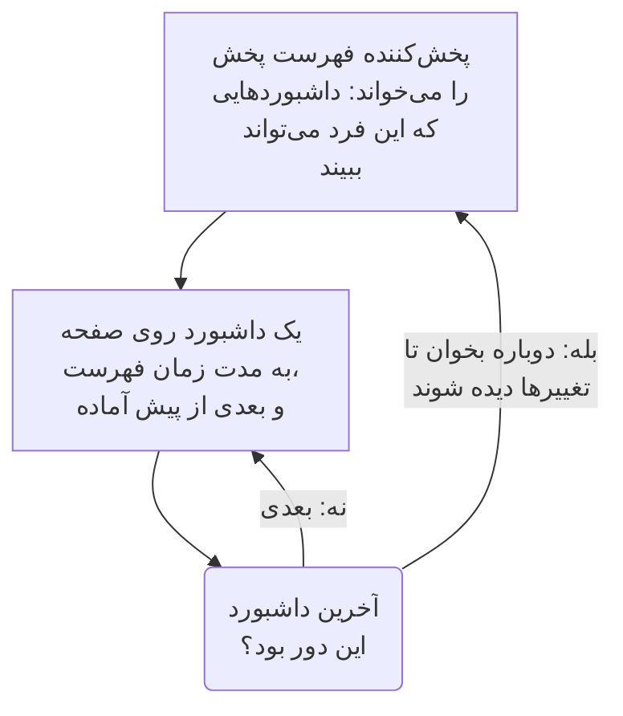

# فهرست‌های پخش داشبورد

فهرست پخش مجموعه‌ای از داشبوردها را یکی پس از دیگری روی صفحه‌نمایشی نشان می‌دهد که کسی به آن دست نمی‌زند، مانند دیوار NOC یا تلویزیون یک تیم: هر داشبورد به مدتی که خودتان انتخاب می‌کنید، دوباره و دوباره، تا وقتی کسی آن را متوقف کند. فهرست پخش را یک بار بسازید، پخش‌کننده‌اش را روی صفحه‌نمایش باز کنید و بگذارید کار کند.

:::cards
- [فهرست پخش چگونه پخش می‌شود](#فهرست-پخش-چگونه-پخش-میشود): ترتیب، نوبت‌ها و آنچه هر داشبورد نشان می‌دهد.
- [ساختن فهرست پخش](#ساختن-فهرست-پخش): یک نام، داشبوردهایش به ترتیب و مدت نمایش هر کدام.
- [پخش روی یک صفحه‌نمایش](#پخش-روی-یک-صفحهنمایش): نوار پخش‌کننده، دکمه‌ها و کلیدهای آن.
- [چه کسی چه چیزی می‌بیند](#چه-کسی-چه-چیزی-میبیند): دسترسی‌ها، و داشبوردهایی که یک فرد اجازه خواندنشان را ندارد.
:::

## فهرست پخش چگونه پخش می‌شود

پخش‌کننده نخستین داشبورد فهرست پخش را نشان می‌دهد، وقتی زمانش تمام شد داشبورد بعدی را، و پس از آخرین داشبورد دوباره از نخستین شروع می‌کند. هر داشبورد همان‌طور باز می‌شود که ویرایشگرانش آن را ذخیره کرده‌اند: با بازه زمانی پیش‌فرض خودش، به‌روزرسانی خودکار خودش و متغیرهای خودش، هر چه در نشانی پخش‌کننده آمده باشد. تا وقتی یک داشبورد روی صفحه است، پخش‌کننده داشبورد بعدی را دور از دید از پیش می‌کشد، پس صفحه هرگز میان دو داشبورد خالی نمی‌ماند.

فهرست پخش داشبوردهایش را نام می‌برد و هرگز از آن‌ها رونوشت نمی‌گیرد: تغییری که یک ویرایشگر در یک داشبورد ذخیره می‌کند، دفعه بعد که نوبت آن داشبورد برسد روی صفحه است. پخش‌کننده پیش از هر دور فهرست پخش را دوباره می‌خواند، پس داشبوردی که افزوده، جابه‌جا یا برداشته شده باشد در یک دور نمایان می‌شود، بی‌آنکه صفحه دوباره بارگذاری شود؛ اگر این خواندن شکست بخورد، صفحه دوری را که دارد دوباره پخش می‌کند.

## ساختن فهرست پخش

:::steps
### فهرست‌های پخش را باز کنید
**محصولات** > **داشبوردها** را باز کنید، سپس در منوی کناری **فهرست‌های پخش** را باز کنید. فهرست نشان می‌دهد هر فهرست پخش چند داشبورد دارد و هر کدام چه مدت نمایش داده می‌شود، و هر سطر **پخش** دارد.

### نامی بدهید
روی **ساخت فهرست پخش** کلیک کنید و به آن یک **نام** بدهید که بگوید کجا پخش می‌شود، مانند «دیوار NOC».

### داشبوردهایش را بیفزایید
زیر **داشبوردها**، هر کدام را از **افزودن داشبورد** انتخاب کنید، به همان ترتیبی که صفحه‌نمایش آن‌ها را نشان می‌دهد. دکمه‌های سطر هر داشبورد آن را بالا یا پایین می‌برند، یا برمی‌دارند. داشبوردهای بایگانی‌شده پیشنهاد نمی‌شوند.

### مدت نمایش هر کدام را انتخاب کنید
**مدت نمایش هر داشبورد** از یک دقیقه شروع می‌شود؛ زمانی از ۱۵ ثانیه تا یک ساعت انتخاب کنید. روی **ساخت فهرست پخش** کلیک کنید.
:::

صفحه فهرست پخش داشبوردهایش را به ترتیب، مدت نمایش هر کدام و **پیوند پخش‌کننده** را نشان می‌دهد. **ویرایش فهرست پخش** نام، داشبوردها، ترتیبشان و زمان را تغییر می‌دهد. **حذف فهرست پخش داشبورد**، در پایین صفحه، فهرست پخش را حذف می‌کند و هرگز داشبوردهایش را حذف نمی‌کند.

از راه API و Terraform، فهرست پخش یک `name` است، `dashboards` آن به‌صورت فهرستی مانند `[{"dashboardId": "<id>"}]` به ترتیبی که نشان داده می‌شوند، حداکثر ۱۰۰ مورد، و `intervalInSeconds`، هر عدد صحیحی از ثانیه‌ها از ۱۰ تا ۸۶۴۰۰ (یک روز). مقداری بیرون از این حدود رد می‌شود، همراه با این‌که چه چیزی نادرست است.

## پخش روی یک صفحه‌نمایش

روی **پخش** در سطر فهرست پخش یا در صفحه آن کلیک کنید. پخش‌کننده پنجره مرورگر را روی بقیه OneUptime پر می‌کند؛ **تمام‌صفحه** کل صفحه‌نمایش را پر می‌کند. برای این‌که یک صفحه‌نمایش خودش شروع کند، **پیوند پخش‌کننده** را روی آن باز کنید و نشانک بگذارید: این پیوند پخش‌کننده را بی‌درنگ باز می‌کند.

نوار پخش‌کننده داشبورد روی صفحه، فهرست پخش، جای دور («۲ از ۵») و داشبوردی را که بعد می‌آید نام می‌برد. خطی زیر نوار پر می‌شود تا وقتی نوبت یک داشبورد است. دکمه‌های نوار به داشبورد قبلی می‌روند، مکث یا پخش می‌کنند و به داشبورد بعدی می‌روند؛ روی رایانه، این کلیدها همین کار را می‌کنند:

| کلیدها | چه می‌کند |
| --- | --- |
| `Space` | **مکث یا پخش**. در حالت مکث، داشبورد روی صفحه می‌ماند و نوار **متوقف‌شده** را نشان می‌دهد. |
| `Right Arrow` | **داشبورد بعدی**. |
| `Left Arrow` | **داشبورد قبلی**. |
| `F` | **تمام‌صفحه**، یا بیرون آمدن از آن. |
| `Esc` | **خروج از پخش‌کننده**، بازگشت به صفحه فهرست پخش. در حالت تمام‌صفحه، نخستین `Esc` فقط از تمام‌صفحه بیرون می‌آید. |
| `?` | **نمایش میان‌برهای صفحه‌کلید**. |

داشبوردی که به آن می‌روید، بعدی یا قبلی، یک نوبت کامل می‌گیرد. در صفحه‌ای که از راست به چپ خوانده می‌شود، مانند فارسی، پیکان‌ها جابه‌جا می‌شوند: `Left Arrow` به داشبورد بعدی می‌رود. تا وقتی پخش می‌کند، پخش‌کننده نمی‌گذارد صفحه‌نمایش به خواب برود، هر جا مرورگر اجازه بدهد.

## چه کسی چه چیزی می‌بیند

فهرست‌های پخش دسترسی‌های خودشان را دارند که مانند دسترسی‌های داشبوردها از راه یک تیم داده می‌شوند:

| برای | نیاز دارد به |
| --- | --- |
| دیدن و پخش فهرست‌های پخش | `ReadDashboardPlaylist`، یا یک نقش پروژه: Project Owner، Project Admin، Project Member، Viewer، یا یک نقش Settings |
| ساختن فهرست‌های پخش | `CreateDashboardPlaylist`، Project Owner یا Project Admin |
| تغییر یک فهرست پخش: نام، داشبوردها و زمان آن | `EditDashboardPlaylist`، Project Owner یا Project Admin |
| حذف یک فهرست پخش | `DeleteDashboardPlaylist`، Project Owner یا Project Admin |

فهرست پخش هرگز داشبوردی را به کسی نشان نمی‌دهد که اجازه خواندنش را ندارد. پخش‌کننده فقط داشبوردهایی را پخش می‌کند که فردِ واردشده روی صفحه‌نمایش می‌تواند بخواند و بایگانی نشده‌اند، و بقیه را رد می‌کند: داشبورد حذف‌شده، داشبورد بایگانی‌شده، یا داشبوردی که دسترسی‌هایش او را از آن دور نگه می‌دارد. صفحه فهرست پخش می‌گوید چرا هر کدام را رد می‌کند. ذخیره کردن فهرست پخش داشبوردهایی را که ویرایشگر خودش نمی‌بیند در آن نگه می‌دارد، پس چیزی که کس دیگری در آن گذاشته از دست نمی‌رود.

| وقتی پخش‌کننده پیدا می‌کند | نشان می‌دهد |
| --- | --- |
| داشبوردهایی که اجازه نمایششان را دارد | هر کدام به نوبت. |
| هیچ داشبوردی که اجازه نمایشش را داشته باشد | **هنوز چیزی برای نمایش نیست**، و هر دقیقه دوباره نگاه می‌کند. |
| فهرست پخش حذف شده، یا آن فرد اجازه خواندنش را ندارد | **فهرست پخش پیدا نشد**. |
| خواندنی که شکست خورد | **این فهرست پخش بارگذاری نشد**، و هر دقیقه دوباره تلاش می‌کند، یا با **تلاش دوباره**. |

> [!NOTE]
> پخش‌کننده برای کسی است که به OneUptime وارد شده است. برای پخش یک فهرست پخش روی یک صفحه‌نمایش، روی همان صفحه‌نمایش با حسابی وارد شوید که می‌تواند فهرست پخش و داشبوردهایش را بخواند، مانند عضوی از تیم با نقش Viewer.

## گام‌های بعدی

:::cards
- [ساخت یک داشبورد](/docs/dashboards/authoring): داشبوردهایی را که فهرست پخش نشان می‌دهد بسازید.
- [متغیرها و فیلترهای داشبورد](/docs/dashboards/variables): انتخاب ذخیره‌شده‌ای که هر داشبورد با آن باز می‌شود.
- [اشتراک‌گذاری و داشبوردهای عمومی](/docs/dashboards/sharing): یک داشبورد را به کسانی نشان دهید که وارد نمی‌شوند.
- [پیکربندی و دسترسی‌های داشبورد](/docs/dashboards/configuration): مالکان، برچسب‌ها و این‌که چه کسی می‌تواند یک داشبورد را بخواند.
:::
