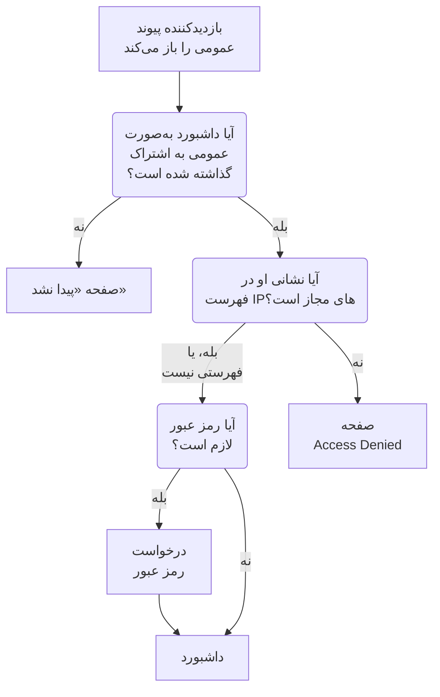

# اشتراک‌گذاری و داشبوردهای عمومی

به‌طور پیش‌فرض، داشبورد درون پروژه شما خصوصی است: فقط کسانی که به پروژه شما وارد می‌شوند می‌توانند آن را ببینند. همچنین می‌توانید آن را با یک پیوند عمومی به اشتراک بگذارید، آن پیوند را با رمز عبور محافظت کنید، آن را به نشانی‌های IP معینی محدود کنید و آن را روی دامنه خودتان میزبانی کنید. این صفحه هر چهار مورد را پوشش می‌دهد.

:::cards
- [چه کسی می‌تواند یک داشبورد را ببیند](#چه-کسی-میتواند-یک-داشبورد-را-ببیند): یک انتخاب از میان سه، با پلنی که هر کدام نیاز دارد.
- [اشتراک‌گذاری با رمز عبور](#اشتراکگذاری-با-رمز-عبور): پیوند و سپس رمز عبور را با کسانی که باید آن را ببینند به اشتراک بگذارید.
- [فهرست IPهای مجاز](#فهرست-ipهای-مجاز): پیوند عمومی را فقط به روی دفتر یا VPN خودتان باز کنید.
- [دامنه‌های سفارشی](#دامنههای-سفارشی): داشبورد را روی دامنه خودتان، با یک گواهی رایگان، ارائه کنید.
:::

## بازدیدکننده از چه مرحله‌هایی می‌گذرد

بازدیدکننده‌ای که پیوند عمومی یک داشبورد را باز می‌کند به‌ترتیب با هر یک از این بررسی‌ها روبه‌رو می‌شود. اعضای پروژه که به OneUptime وارد می‌شوند داشبورد را درون محصول می‌بینند، هر چه اینجا برگزینید.



## چه کسی می‌تواند یک داشبورد را ببیند

داشبورد را باز کنید و **⋯** > **اشتراک‌گذاری** را برگزینید، یا **اشتراک‌گذاری** را در منوی کناری داشبورد باز کنید. کارت **چه کسی می‌تواند این داشبورد را ببیند** یک انتخاب است:

- **فقط افراد این پروژه** (پیش‌فرض): اعضا وقتی به OneUptime وارد می‌شوند داشبورد را می‌بینند. پیوند عمومی ندارد: نشانی عمومی آن همان صفحه «پیدا نشد» را نشان می‌دهد که نشانی‌ای بدون هیچ داشبوردی نشان می‌دهد، و هیچ چیزی درباره داشبورد، حتی نامش را.
- **هر کسی که پیوند را دارد**: داشبورد عمومی است. هر کسی که پیوندش را دارد می‌تواند بی‌آنکه وارد شود آن را ببیند.
- **هر کسی که پیوند و رمز عبور را دارد**: بازدیدکنندگان پیوند را باز می‌کنند، سپس یک رمز عبور را وارد می‌کنند که شما با آن‌ها به اشتراک می‌گذارید. هیچ کس به حساب کاربری نیاز ندارد.

برگزیدن یک گزینه از شما تأیید می‌خواهد و می‌گوید چه چیزی برای بازدیدکنندگان تغییر می‌کند، سپس بی‌درنگ اعمال می‌شود. اگر داشبورد رمز عبوری نداشته باشد، برگزیدن **هر کسی که پیوند و رمز عبور را دارد** رمز عبور را در همان پنجره می‌خواهد؛ تا وقتی همین گزینه برگزیده است، **تغییر رمز عبور** آن را جایگزین می‌کند. تا وقتی داشبورد عمومی است، نشانی‌هایی که بازدیدکنندگان آن را با آن‌ها باز می‌کنند زیر گزینه می‌آیند: نخست دامنه‌های سفارشی آن، سپس پیوند عمومی آن، هر کدام با **کپی پیوند**. دامنه سفارشی‌ای که هنوز فعال نیست با **هنوز فعال نیست** و دلیلش نشان داده می‌شود.

درون پروژه، مالکان و برچسب‌ها تعیین می‌کنند چه کسی چه چیزی را ببیند — [پیکربندی و دسترسی‌های داشبورد](/docs/dashboards/configuration) را ببینید. کسی که می‌تواند داشبورد را ببیند ولی نمی‌تواند ویرایشش کند، گزینه را می‌بیند و می‌تواند از پیوند عمومی رونوشت بگیرد، اما نمی‌تواند آن را تغییر دهد.

در OneUptime Cloud، اشتراک‌گذاری یک داشبورد به پلن **Growth** نیاز دارد: در پلنی پایین‌تر، دو گزینه عمومی پلنی را که نیاز دارند نشان می‌دهند و نمی‌توان آن‌ها را برگزید. خصوصی کردن دوباره یک داشبورد — **فقط افراد این پروژه** — در همه پلن‌ها کار می‌کند، پس داشبوردی که پس از پایان دوره آزمایشی یا پس از رفتن به پلنی پایین‌تر عمومی مانده است همیشه می‌تواند از اشتراک بیرون بیاید؛ پنجره می‌گوید که اشتراک‌گذاری دوباره آن به **Growth** نیاز دارد. جابه‌جایی میان **هر کسی که پیوند را دارد** و **هر کسی که پیوند و رمز عبور را دارد**، و تغییر رمز عبور، در همه پلن‌ها کار می‌کند. داشبوردی که از راه API یا Terraform ساخته می‌شود تابع همین پلن‌هاست: اگر عمومی ساخته شود به **Growth** نیاز دارد، و اگر با فهرست IPهای مجاز ساخته شود به **Scale**.

این انتخاب در سه ستون ذخیره می‌شود که API و Terraform مانند گذشته آن‌ها را می‌خوانند و می‌نویسند: `isPublicDashboard`، `enableMasterPassword` و `masterPassword`. فقط داشبورد عمومی پیوند عمومی دارد، و هر بار که `enableMasterPassword` روشن باشد از بازدیدکنندگانش رمز عبور خواسته می‌شود. داشبورد عمومی‌ای که `enableMasterPassword` آن روشن است ولی رمز عبوری برایش تعیین نشده، هیچ کس را از راه پیوند عمومی‌اش راه نمی‌دهد: صفحه **اشتراک‌گذاری** آن را به‌صورت **هر کسی که پیوند و رمز عبور را دارد** نشان می‌دهد، می‌گوید که هنوز هیچ کس نمی‌تواند پیوند را باز کند، و **تعیین رمز عبور** را پیشنهاد می‌کند. برگزیدن **فقط افراد این پروژه** `enableMasterPassword` را هم خاموش می‌کند و رمز عبور را نگه می‌دارد، تا اشتراک‌گذاری دوباره با رمز عبور بتواند از آن استفاده کند.

## داشبوردهای عمومی

یک داشبورد عمومی:

- همیشه برای خواندن باز می‌شود. بازدیدکنندگان نمی‌توانند آن را ویرایش کنند و هرگز کنترل‌های ویرایش آن را نمی‌بینند.
- متغیرهایی را که افزوده‌اید دربر دارد. بازدیدکنندگان از همان انتخابگرهایی برمی‌گزینند که تیم شما به کار می‌برد، و می‌توانند بازه زمانی را تغییر دهند، بزرگ‌نمایی کنند، به‌روزرسانی خودکار را روشن کنند و به تمام‌صفحه بروند. با بازه زمانی و به‌روزرسانی خودکار پیش‌فرض داشبورد باز می‌شود، و مرورگر هر بازدیدکننده انتخاب‌های خودش را به خاطر می‌سپارد.
- به بازدیدکنندگان اجازه می‌دهد مانند تیم شما با کلیک روی یک سرستون [فهرست‌ها و جدول‌هایش را مرتب کنند](/docs/dashboards/widgets#مرتبسازی-فهرستها-و-جدولها). مرورگر هر بازدیدکننده مرتب‌سازی خود او را به خاطر می‌سپارد، و OneUptime خودش کل فهرست را مرتب می‌کند، همیشه فقط بر اساس یکی از ستون‌های خود ویجت.
- از برندینگی استفاده می‌کند که در صفحه **برندینگ** داشبورد تعیین می‌کنید: عنوان صفحه، توضیحات، لوگو، پوسته، Favicon.
- به هر بازدیدکننده امکان می‌دهد با یک دکمهٔ خورشید یا ماه در نوار ابزارش میان داشبورد روشن و تیره جابه‌جا شود؛ [پوسته](#پوسته) می‌گوید چگونه.

با اشتراک‌گذاری یک داشبورد مانند انتشار یک صفحه وب رفتار کنید. هر ویجت روی آن برای هر کسی که پیوند را دارد خواندنی می‌شود. پیش از اشتراک‌گذاری، ببینید چه چیزی روی بوم است.

هر ویجت فقط آنچه را می‌کشد منتشر می‌کند، و فقط برای منابعی که به آن‌ها اشاره دارد. برای نمونه، ویجت SLO عددهای اصلی آن SLO را منتشر می‌کند ولی هرگز تعریفش را — [SLO](/docs/dashboards/widgets#slo) را ببینید. ویجت‌های **Data Source** خارجی استثنا هستند: به‌جای رندر شدن، به‌کلی از داشبورد عمومی کنار گذاشته می‌شوند، چون پیکربندی‌شان خود کوئری است. چند ویجت دیگر بدون نشستی که با آن وارد شده باشید نمایش داده نمی‌شوند و در جای خود همین را می‌گویند: [در یک داشبورد عمومی](/docs/dashboards/widgets#در-یک-داشبورد-عمومی) آن‌ها را فهرست می‌کند.

## اشتراک‌گذاری با رمز عبور

**هر کسی که پیوند و رمز عبور را دارد** را برگزینید و رمز عبور را در پنجره وارد کنید. بازدیدکنندگان پیش از نمایان شدن داشبورد یک درخواست رمز عبور می‌بینند. این درخواست نام داشبورد، عنوان صفحه و Favicon آن را با پوستهٔ داشبورد نشان می‌دهد و نه هیچ چیز دیگر: توضیحات، لوگو و ویجت‌هایش پس از وارد شدن رمز عبور نمایان می‌شوند. رمز عبور به‌صورت hash ذخیره می‌شود — هیچ کس نمی‌تواند آن را بازخوانی کند. رمز عبور تازه بی‌درنگ کار می‌کند؛ کسانی که رمز قدیمی را وارد کرده بودند می‌توانند تا ۷ روز به دیدن داشبورد ادامه دهند.

از رمز عبور وقتی استفاده کنید که:

- می‌خواهید با یک شریک یا مشتری به اشتراک بگذارید، ولی نمی‌خواهید اگر URL درز کرد به کار کسی بیاید.
- داشبورد «نیمه‌عمومی» است — آن‌قدر باز که نمی‌خواهید هر بیننده را به‌عنوان عضو تیم دعوت کنید، ولی نه آن‌قدر باز که روی اینترنت باز بگذارید.

برای کنترل سخت‌گیرانه‌تر (حساب جداگانه برای هر بیننده، سابقه ممیزی از این‌که چه کسی چه چیزی را دیده است)، داشبورد را روی **فقط افراد این پروژه** نگه دارید و به‌جای آن بینندگان را به‌عنوان اعضای فقط‌خواندنی تیم دعوت کنید.

## فهرست IPهای مجاز

زیر **تنظیمات بیشتر** در صفحه **اشتراک‌گذاری**، بخش **فهرست IPهای مجاز** (ستون `ipWhitelist`) پیوند عمومی را به نشانی‌های IP یا بازه‌های IPv4 که فهرست می‌کنید محدود می‌کند، یکی در هر سطر، برای نمونه `203.0.113.7` یا `10.0.0.0/8`. با رمز عبور یا بدون آن اعمال می‌شود؛ اعضای پروژه که وارد می‌شوند تأثیری نمی‌پذیرند. برای مجاز کردن همه نشانی‌ها آن را خالی بگذارید. جدا از انتخاب، خودش ذخیره می‌شود، و تغییر آن در OneUptime Cloud به پلن **Scale** نیاز دارد؛ خالی کردنش در همه پلن‌ها کار می‌کند. تا وقتی فهرستی برقرار است، سرعنوان بسته **تنظیمات بیشتر** **فهرست IPهای مجاز** را با شمار ورودی‌هایش نشان می‌دهد. در نصب خودمیزبان، تغییر آن بخشی از Enterprise Edition است: در Community Edition، فهرستی که از قبل تنظیم شده همچنان اعمال می‌شود و فقط می‌توان آن را حذف کرد.

از آن وقتی استفاده کنید که:

- داشبورد باید فقط از دفتر یا VPN شما در دسترس باشد.
- پورتال یک فروشنده باید فقط از IPهای شناخته‌شده آن‌ها در دسترس باشد.
- علاوه بر رمز عبور، محافظتی بیشتر می‌خواهید.

درخواست‌هایی که از هر IP دیگری بیایند با یک صفحه **Access Denied** رد می‌شوند که هیچ چیزی درباره داشبورد نشان نمی‌دهد: نه نامش، نه برندینگش و نه درخواست رمز عبورش. سطری که نشانی IP یا بازه IPv4 نباشد هنگام ذخیره پذیرفته نمی‌شود، چون سرور از آن می‌گذشت.

## دامنه‌های سفارشی

در حالت پیش‌فرض، داشبورد عمومی در پیوند عمومی‌اش، روی نشانی خود OneUptime، ارائه می‌شود. برای میزبانی آن روی زیردامنه خودتان مانند `dashboard.acme.com`، در منوی کناری داشبورد **برندینگ** > **دامنه‌های سفارشی** را باز کنید. درست مانند صفحه **دامنه‌های سفارشی** یک صفحه وضعیت کار می‌کند.

عنوان کارت **دامنه‌های سفارشی** است و می‌گوید چه باید کرد: رکورد CNAME هر دامنه را به رکورد CNAME داشبورد نصب خودتان اشاره دهید، و OneUptime گواهی SSL دامنه را صادر و برایتان تمدید می‌کند. جدول دو ستون دارد، **دامنه** و **وضعیت**.

بردن داشبورد به دامنه خودتان سه گام دارد، و فقط دو گام نخست با شماست:

1. **دامنه را بیفزایید**: یک زیردامنه و یکی از دامنه‌های تأییدشده شما.
2. **رکورد CNAME آن را بیفزایید** نزد ارائه‌دهنده DNS خود. پنجره **راه‌اندازی DNS** به‌محض افزودن دامنه با همان رکورد باز می‌شود.
3. **گواهی SSL رایگان خودکار صادر می‌شود** به‌محض آنکه رکورد پیدا شود. دکمه‌ای برای فشردن نیست.

پس از تأیید، داشبورد هم روی دامنه سفارشی شما و هم روی URL اصلی در دسترس است.

### افزودن دامنه

روی **ساخت دامنه داشبورد** کلیک کنید. پنجره یک صفحه است:

- **زیردامنه**: فقط برچسب، با جای‌نگهدار `dashboard (leave blank for root)`. فقط `dashboard` را وارد کنید، نه کل نام میزبان. برای استفاده از دامنه ریشه یا apex، آن را خالی بگذارید یا `@` را وارد کنید.
- **دامنه**: دامنه‌هایی که زیر **تنظیمات پروژه** > **پیشرفته** > **دامنه‌ها** تأیید شده‌اند، جایی که با یک رکورد TXT ثابت می‌کنید مالک یک دامنه هستید. دامنه‌ای که تأییدش نکرده‌اید فهرست نمی‌شود، چون پذیرفته نمی‌شد. پیوند **افزودن دامنه** کنار فیلد آن صفحه را در زبانه‌ای تازه باز می‌کند.
- **فیلدهای بیشتر**: بسته. تا وقتی بسته است، سرعنوانش می‌گوید دامنه از کدام گواهی استفاده خواهد کرد: «ما برای این دامنه یک گواهی SSL رایگان صادر می‌کنیم و آن را به‌طور خودکار تمدید می‌کنیم.» فقط برای استفاده از گواهی خودتان آن را باز کنید (پایین‌تر را ببینید).

روی **ساخت دامنه داشبورد** کلیک کنید. پنجره بسته می‌شود و **راه‌اندازی DNS** دامنه تازه باز می‌شود. نام کامل دامنه هنگام افزودن آن ثابت می‌شود، پس **ویرایش** فقط گواهی آن را تغییر می‌دهد. برای استفاده از زیردامنه‌ای دیگر، آن دامنه را بیفزایید و دامنه قدیمی را حذف کنید.

### راه‌اندازی DNS و دکمه اکنون بررسی کن

پنجره **راه‌اندازی DNS** رکوردی را که باید نزد ارائه‌دهنده DNS خود بیفزایید نشان می‌دهد، یک فیلد در هر سطر، هر کدام با دکمه رونوشت: **نوع** `CNAME`، **نام** دامنه کاملی که افزوده‌اید، و **مقدار** رکورد CNAME داشبورد نصب شما. برای دامنه ریشه، یعنی دامنه‌ای بدون زیردامنه، پنجره یادداشتی می‌افزاید: بسیاری از ارائه‌دهندگان DNS آنجا رکورد CNAME را مجاز نمی‌دانند، پس به‌جای آن از رکورد ALIAS، ANAME یا CNAME flattening ارائه‌دهنده خود با همان مقدار استفاده کنید.

OneUptime هر دامنه تأییدنشده را هر ۱۵ دقیقه بررسی می‌کند، و وقتی بررسی رکورد را پیدا کند، گواهی رایگان Let's Encrypt دامنه را در همان بررسی سفارش می‌دهد، چه برگردید چه نه. برای بررسی فوری، روی **اکنون بررسی کن** کلیک کنید:

- **رکورد هنوز پیدا نشده است.** پنجره باز می‌ماند و می‌گوید به دنبال کدام رکورد گشته است. نمایان شدن یک رکورد DNS تازه ممکن است کمی زمان ببرد. بعداً دوباره روی **اکنون بررسی کن** کلیک کنید، یا کار را به بررسی ۱۵ دقیقه‌ای بسپارید.
- **رکورد پیدا شده است.** پنجره می‌گوید «رکورد CNAME شما تأیید شد.» و این‌که پس از آن چه بر سر گواهی می‌آید. گواهی رایگان در همان لحظه سفارش داده می‌شود و معمولاً ظرف ۱۵ دقیقه فعال است.

تا وقتی دامنه تأیید نشده و گواهی آن سر جایش نیست، سطر آن اقدامی با نام **راه‌اندازی DNS** دارد که همان پنجره را باز می‌کند. روی دامنه تأییدشده‌ای که سفارش گواهی‌اش پیوسته شکست می‌خورد، یا گواهی‌اش منقضی شده است، **اکنون بررسی کن** در آنجا دوباره سفارش می‌دهد و نشان می‌دهد چرا سفارش قبلی شکست خورد. برای هر دامنه حداکثر هر ۱۵ دقیقه یک بار سفارش می‌دهد؛ در این فاصله، OneUptime خودش به تلاش ادامه می‌دهد و پس از هر شکست پیاپی کمی بیشتر صبر می‌کند. تمدید خودکار است، مدت‌ها پیش از انقضای گواهی، و یک بررسی DNS ناموفق هرگز گواهی‌ای را که هنوز معتبر است برنمی‌دارد.

### خواندن ستون وضعیت

ستون **وضعیت** می‌گوید هر دامنه در مسیر رسیدن به HTTPS کجاست، در یکی از هشت حالت، همان‌هایی که در صفحات وضعیت هست. وقتی سفارشی شکست خورده باشد، دلیل در سطر زیرین است.

| آنچه ستون وضعیت می‌گوید | معنای آن |
| --- | --- |
| در انتظار DNS: رکورد CNAME را اضافه کنید. | رکورد CNAME هنوز پیدا نشده است. برای دیدن رکورد **راه‌اندازی DNS** را باز کنید، آن را نزد ارائه‌دهنده DNS خود بیفزایید، سپس روی **اکنون بررسی کن** کلیک کنید یا منتظر بررسی ۱۵ دقیقه‌ای بمانید. |
| در حال صدور گواهی رایگان، معمولاً ظرف ۱۵ دقیقه. | رکورد تأیید شده است و گواهی در حال سفارش یا نوشته شدن است. کاری لازم نیست. |
| هنوز نتوانسته‌ایم گواهی رایگان صادر کنیم. به تلاش ادامه می‌دهیم. | رکورد تأیید شده است، اما سفارش گواهی آن به دلیلی که در سطر زیرین آمده شکست خورد. علت را برطرف کنید، سپس **راه‌اندازی DNS** را باز کنید و روی **اکنون بررسی کن** کلیک کنید تا همین حالا دوباره سفارش دهد. |
| گواهی منقضی شده است. برای تمدید آن به تلاش ادامه می‌دهیم. | گواهی دامنه منقضی شده است، چون تمدیدهایش شکست خوردند. **راه‌اندازی DNS** را باز کنید و روی **اکنون بررسی کن** کلیک کنید تا همین حالا تمدیدش کنید و دلیل را ببینید. |
| گواهی صادر شد و به‌طور خودکار تمدید می‌شود. | انجام شد. دامنه گواهی خود را روی HTTPS ارائه می‌کند و OneUptime آن را تمدید می‌کند. |
| گواهی صادر شده است، اما تمدید آن ناموفق بود. به تلاش ادامه می‌دهیم. | دامنه هنوز گواهی معتبری ارائه می‌کند، اما آخرین تمدید آن به دلیلی که در سطر زیرین آمده شکست خورد. OneUptime مدت‌ها پیش از انقضای گواهی دوباره تلاش می‌کند. |
| از گواهی بارگذاری‌شده شما استفاده می‌کند. | رکورد تأیید شده است و دامنه با گواهی‌ای که بارگذاری کرده‌اید ارائه می‌شود. |
| تأیید شد. از HTTPS پروکسی خودتان استفاده می‌کند. | در نصب خودمیزبانی بدون کلید حساب Let's Encrypt، رکورد تأیید شده و دامنه در دسترس است. HTTPS آن با پروکسی خودتان است، مگر اینکه گواهی‌ای بارگذاری کنید. |

اگر سفارشی شکست بخورد، علت‌های معمول یک رکورد CAA روی دامنه شماست که `letsencrypt.org` را مجاز نمی‌کند، و در نصب خودمیزبان، سروری که Let's Encrypt نمی‌تواند روی پورت ۸۰ به آن برسد.

### گواهی خودتان، و صدور دوباره

برای استفاده از گواهی خودتان، هنگام افزودن دامنه **فیلدهای بیشتر** را باز کنید، **بارگذاری گواهی سفارشی** را روشن کنید و **گواهی** و **کلید خصوصی گواهی** آن را بچسبانید. OneUptime به‌جای سفارش یک گواهی Let's Encrypt، ظرف ۱۵ دقیقه آن را ارائه می‌کند، و جای هر گواهی Let's Encrypt را که دامنه پیش‌تر داشت می‌گیرد. تمدید گواهی بارگذاری‌شده با خود شماست: دامنه را ویرایش کنید و گواهی تازه را بچسبانید. اگر دامنه پیش‌تر گواهی رایگان داشت، OneUptime تا وقتی گواهی شما در کار است به تمدید آن ادامه می‌دهد، پس بازگشت به آن فوری است.

وقتی برای دامنه‌ای گواهی رایگان سفارش داده شد، سطر آن **Reissue SSL** را نشان می‌دهد که اگر پیش از تمدید خودکار گواهی تازه‌ای بخواهید، یک گواهی کاملاً نو از Let's Encrypt می‌خواهد. هر دامنه را می‌توان هر ۲۴ ساعت یک بار دوباره صادر کرد.

در نصب خودمیزبان، دامنه‌های سفارشی داشبورد با متغیر محیطی `DASHBOARD_CNAME_RECORD` (در Helm chart، `dashboard.cnameRecord`) روشن می‌شوند، که همان مقصدی است که رکوردهای CNAME شما به آن اشاره می‌کنند. بدون آن، کارت و پنجره **راه‌اندازی DNS** به‌جای نشان دادن رکورد می‌گویند "Custom Domains not enabled for this OneUptime installation"، و OneUptime برای داشبوردها نه دامنه‌ای را تأیید می‌کند و نه گواهی سفارش می‌دهد. نصبی که کلید حساب Let's Encrypt ندارد (`LETS_ENCRYPT_ACCOUNT_KEY`، در Helm chart `letsEncrypt.accountKey`) گواهی سفارش نمی‌دهد: دامنهٔ داشبورد به محض تأیید رکوردش در دسترس است و با HTTPS پروکسی خودتان یا گواهی‌ای که بارگذاری می‌کنید ارائه می‌شود.

### چه کسی می‌تواند بررسی کند و دوباره صادر کند

**اکنون بررسی کن**، سفارش گواهی یک دامنه و **Reissue SSL** دامنه را تغییر می‌دهند، پس به دسترسی ویرایش آن نیاز دارند: **Edit Dashboard Domain**، یا نقشی که آن را دربر دارد (Project Owner، Project Admin، Project Member، Settings Admin یا Settings Member).

کسی که فقط می‌تواند دامنه را بخواند، مانند یک Viewer یا Settings Viewer، همچنان ستون **وضعیت** و رکوردی را که باید افزود در **راه‌اندازی DNS** می‌بیند. برای او **اکنون بررسی کن** و **Reissue SSL** قفل‌اند و می‌گویند به کدام دسترسی نیاز است. در هر دو حالت، OneUptime خودش به بررسی هر دامنه و سفارش گواهی آن ادامه می‌دهد.

همین درباره کلیدهای API هم صادق است. کلیدی که فقط می‌تواند دامنه‌های داشبورد را بخواند نمی‌تواند `verify-cname`، `order-ssl` یا `reissue-ssl` را روی `/dashboard-domain` فراخوانی کند. اگر لازم است، به آن **Read Dashboard Domain** و **Edit Dashboard Domain** بدهید.

یک دامنه در هر زمان به یک داشبورد از پروژه تعلق دارد. اگر یک محتوا را برای چند مخاطب ارائه می‌کنید، می‌توانید بیش از یک دامنه سفارشی را به یک داشبورد وصل کنید: یک داشبورد برای مشتریان با برند خودتان، یک داشبورد شریک با برند مشترک، یا یک صفحه سلامت عمومی با URL خودش. نامی که یک صفحهٔ وضعیت یا یک فرم از پیش استفاده می‌کند، در هر پروژه‌ای، رد می‌شود: یک دامنه فقط یک صفحهٔ وضعیت، یک داشبورد یا یک فرم را نشان می‌دهد.

## برندینگ

در صفحه **برندینگ** داشبورد، می‌توانید این‌ها را پیکربندی کنید:

- **عنوان صفحه** — آنچه در زبانه مرورگر و بالای صفحه نمایش داده می‌شود.
- **توضیحات صفحه** — توضیحاتی که موتورهای جست‌وجو و پیش‌نمایش‌های شبکه‌های اجتماعی به کار می‌برند.
- **لوگو** — تصویری که در سرصفحه داشبورد عمومی نشان داده می‌شود.
- **پوسته** — روشن، تیره، یا همان‌طور که دستگاه هر بازدیدکننده تنظیم شده؛ [پوسته](#پوسته) را ببینید.
- **Favicon** — نماد کوچک در زبانه مرورگر.

لوگو و Favicon فایل‌هایی‌اند که در پروژه خود داشبورد بارگذاری شده‌اند، و این هر بار که یکی از آن‌ها ذخیره می‌شود بررسی می‌شود — از داشبورد، API، Terraform یا یک گردش کار. فایلی که در پروژه دیگری بارگذاری شده باشد با همان واژه‌هایی رد می‌شود که فایلی که دیگر وجود ندارد می‌گیرد: "The logo's file could not be found. Upload the logo again." یا "The favicon's file could not be found. Upload the favicon again." داشبورد عمومی فقط تصویرهای پروژه خودش را نشان می‌دهد.

عنوان صفحه و توضیحات، برای تیم شما هم به‌جای نام و توضیحات داشبورد، بالای نوار ابزار آن می‌آیند. لوگو، پوسته و Favicon فقط بر داشبورد عمومی اعمال می‌شوند.

بازدیدکنندگان برندینگ را فقط وقتی می‌بینند که اجازه دیدن داشبورد را داشته باشند. پیش از وارد شدن رمز عبور، داشبوردی که با رمز عبور به اشتراک گذاشته شده فقط عنوان صفحه، Favicon و پوسته خود را نشان می‌دهد، و موتورهای جست‌وجو و پیش‌نمایش‌های پیوند عنوان صفحه آن را می‌بینند ولی توضیحات صفحه را نه. داشبوردی با فهرست IPهای مجاز برندینگش را فقط به نشانی‌های درون فهرست نشان می‌دهد، و موتورهای جست‌وجو و پیش‌نمایش‌های پیوند هیچ چیزی از آن نمی‌بینند.

### پوسته

کارت **پوسته**، درست زیر لوگو، تعیین می‌کند داشبورد عمومی برای بازدیدکنندگانش چگونه دیده شود. یکی از سه گزینه‌اش را انتخاب کنید تا بی‌درنگ ذخیره شود؛ دکمهٔ **ویرایش** ندارد.

| گزینه | آنچه بازدیدکنندگان می‌بینند |
| ------ | ----------------- |
| **روشن** | داشبورد روشن، دستگاهشان هر طور تنظیم شده باشد. داشبوردهایی که پیش از وجود این تنظیم ساخته شده‌اند **روشن** هستند، پس همان‌طور دیده می‌شوند که همیشه دیده می‌شدند. |
| **تیره** | داشبورد تیره، دستگاهشان هر طور تنظیم شده باشد. |
| **مطابق دستگاه هر بازدیدکننده** | روشن یا تیره، همان‌طور که دستگاهشان تنظیم شده، و تا وقتی داشبورد باز است همراه دستگاه تغییر می‌کند. |

هر کدام را انتخاب کنید، یک دکمهٔ خورشید یا ماه در نوار ابزار داشبورد به هر بازدیدکننده امکان می‌دهد به داشبورد روشن یا تیره برود یا به پوسته‌ای که شما تعیین کرده‌اید برگردد، و مرورگرش این انتخاب را برای همهٔ داشبوردهای عمومی آن نشانی به خاطر می‌سپارد. در داشبورد تیره، لوگو روی پس‌زمینه‌ای روشن قرار می‌گیرد، پس لوگویی که برای صفحه‌ای سفید ساخته شده همچنان خوب دیده می‌شود.

داشبوردی که از این پس ساخته شود با **مطابق دستگاه هر بازدیدکننده** شروع می‌شود. در API و Terraform نام فیلد `theme` است، با یکی از مقدارهای `Light`، `Dark` یا `System` (**مطابق دستگاه هر بازدیدکننده**)، دقیقاً به همین شکل؛ هر مقدار دیگری رد می‌شود. پیکربندی Terraform که هیچ `theme` تعیین نکند `Light` می‌گیرد، پس پیکربندی‌ای که پیش از این تنظیم نوشته شده هرگز تغییری در داشبوردی که مدیریت می‌کند برنامه‌ریزی نمی‌کند.

پوسته در HTML داشبورد است، پس داشبورد از همان ابتدا با آن کشیده می‌شود: داشبورد تیره هنگام بارگذاری سفید نمی‌شود، و درخواست رمز عبورش هم با همان پوسته کشیده می‌شود. همهٔ ویجت‌ها از آن پیروی می‌کنند؛ کد خودِ یک ویجت HTML می‌تواند پوستهٔ تیره را سبک‌دهی کند، همان‌طور که [HTML](/docs/dashboards/widgets#html) می‌گوید. صفحه‌های **Access Denied** و «پیدا نشد» هیچ چیزی از یک داشبورد نشان نمی‌دهند، پس از بازدیدکننده پیروی می‌کنند: انتخاب خودش، وگرنه دستگاهش.

## جاسازی

می‌توانید یک داشبورد عمومی را با یک iframe در سایت خودتان جاسازی کنید، در پیوند عمومی آن یا در یکی از دامنه‌های سفارشی آن:

```html title="embed.html"
<iframe
  src="https://dashboard.acme.com"
  width="100%"
  height="800"
  frameborder="0"
></iframe>
```

اگر داشبورد با رمز عبور به اشتراک گذاشته شده باشد، بازدیدکنندگان درخواست رمز عبور را درون iframe خواهند دید.

برای اینکه داشبورد جاسازی‌شده ظاهر سایت شما را بگیرد، `?theme=light` یا `?theme=dark` را به نشانی آن بیفزایید، مانند `https://dashboard.acme.com/?theme=dark`: آنگاه داشبورد برای هر کسی که آن نشانی را باز کند با همان پوسته کشیده می‌شود، فارغ از پوستهٔ خود داشبورد و انتخاب بازدیدکننده، و نوار ابزارش دکمهٔ پوسته ندارد. `?theme=system` از دستگاه هر بازدیدکننده پیروی می‌کند. پوسته هنگام گذر از درخواست رمز عبور هم حفظ می‌شود.

## فرستادن یک پیوند

پیوند عمومی داشبورد را با پیش‌فرض‌های ذخیره‌شده‌اش باز می‌کند. برای فرستادن پیوندی که روی مقداری خاص باز شود، متغیر را به‌صورت `?var-<name>=<value>` به آن بیفزایید، همان‌طور که نوار نشانی وقتی بازدیدکننده‌ای مقداری را برمی‌گزیند انجام می‌دهد؛ چند مقدار با ویرگول از هم جدا می‌شوند. برای آنکه با بازه زمانی یا به‌روزرسانی خودکار خودش باز شود، به همان شیوه `range` و `refresh` را بیفزایید: `?range=1d&refresh=1m` روی یک روز گذشته باز می‌شود و هر دقیقه تازه می‌شود، همان‌گونه که یک صفحه‌نمایش دیواری نیاز دارد. `range` یکی از `5m`، `15m`، `30m`، `1h`، `2h`، `3h`، `1d`، `2d`، `7d`، `14d`، `1mo` یا `3mo` را می‌پذیرد، و `refresh` یکی از `off`، `5s`، `10s`، `30s`، `1m`، `5m` یا `15m` را. این‌ها بر پیش‌فرض‌های داشبورد و انتخاب‌های خود بازدیدکننده برتری دارند، و بازدیدکنندگان همچنان می‌توانند آن‌ها را تغییر دهند. برای باز کردن داشبورد با یک پوسته، `theme=light`، `theme=dark` یا `theme=system` را بیفزایید، همان‌طور که [جاسازی](#جاسازی) توضیح می‌دهد.

## گام‌های بعدی

:::cards
- [پیکربندی و دسترسی‌های داشبورد](/docs/dashboards/configuration): مالکان، برچسب‌ها و این‌که چه کسی می‌تواند اشتراک‌گذاری را تغییر دهد.
- [متغیرها و فیلترهای داشبورد](/docs/dashboards/variables): انتخابگرهایی که بازدیدکنندگان به کار می‌برند، و پیوندهایی که یک انتخاب را نگه می‌دارند.
- [ویجت‌های داشبورد](/docs/dashboards/widgets): هر ویجت در یک داشبورد عمومی چه چیزی منتشر می‌کند.
- [نمای کلی صفحات وضعیت](/docs/status-pages/index): به مشتریان بگویید سرویستان برقرار است یا نه.
:::
