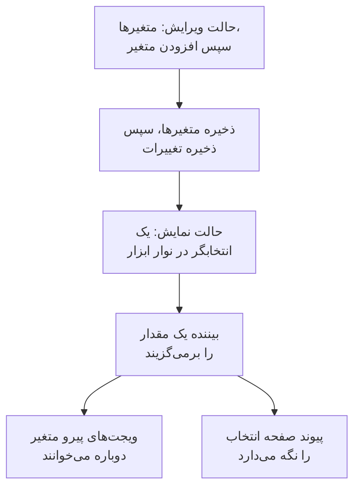

# متغیرها و فیلترهای داشبورد

متغیر یک انتخابگر در نوار ابزار داشبورد است. یک متغیر `service` بیفزایید تا همان نمودارها `checkout`، `payments` یا `search` را نشان دهند: بینندگان از نوار ابزار انتخاب می‌کنند، به‌جای آنکه شما سه داشبورد تقریباً یکسان بسازید.

:::cards
- [افزودن یک متغیر](#افزودن-یک-متغیر): نامش را بگذارید، تعیین کنید مقدارهایش از کجا بیایند، ذخیره کنید.
- [منبع‌های متغیر](#منبعهای-متغیر): Telemetry Attribute، Project Labels، Custom List و Text Input.
- [ویجت‌ها چگونه از متغیر استفاده می‌کنند](#ویجتها-چگونه-از-متغیر-استفاده-میکنند): کدام ویجت‌ها از کدام متغیرها پیروی می‌کنند.
- [پیوندهایی که انتخاب را نگه می‌دارند](#پیوندهایی-که-انتخاب-را-نگه-میدارند): پیوندی بفرستید که روی همان سرویس باز شود.
:::

## متغیر چگونه کار می‌کند

متغیرها را هنگام ویرایش داشبورد تعریف می‌کنید و همراه آن ذخیره می‌شوند. در حالت نمایش، هر کدام یک انتخابگر در نوار ابزار است. وقتی بیننده مقداری برمی‌گزیند، هر ویجتی که از متغیر پیروی می‌کند داده‌هایش را دوباره می‌خواند و پیوند صفحه انتخاب را نگه می‌دارد.



## افزودن یک متغیر

:::steps
### پنجره متغیرها را باز کنید

داشبورد را باز کنید، **⋯** > **ویرایش داشبورد** را برگزینید و در نوار ابزار روی **متغیرها** کلیک کنید. پنجره **متغیرهای داشبورد** متغیرهای داشبورد را فهرست می‌کند؛ دکمه نوار ابزار شمار آن‌ها را نشان می‌دهد.

### یکی بیفزایید

روی **افزودن متغیر** کلیک کنید. متغیر تازه یک ویژگی تله‌متری را می‌خواند؛ اگر به **منبع** دیگری نیاز دارید، آن را برگزینید.

### آن را پر کنید

به آن یک **نام** بدهید که ویجت‌ها و پیوندها به کار می‌برند، مانند `service`: حروف، رقم‌ها و زیرخط، با آغاز از یک حرف یا یک زیرخط، و متفاوت با دیگر نام‌های داشبورد. اگر بخواهید یک **برچسب** برای نوار ابزار و یک **پیش‌فرض** برای آغاز بیفزایید، و **اجازه انتخاب چندگانه** را تیک بزنید تا بینندگان بتوانند چند مقدار برگزینند.

### آن را ذخیره کنید

روی **ذخیره متغیرها** کلیک کنید، سپس در نوار ابزار روی **ذخیره تغییرات**. انتخابگر متغیر وقتی داشبورد به حالت نمایش برگشت در نوار ابزار نمایان می‌شود.
:::

برای تغییر یا برداشتن یک متغیر در آینده، پنجره را دوباره باز کنید: فیلدهایش را تغییر دهید، یا روی سطل زباله کنار آن کلیک کنید.

## منبع‌های متغیر

**منبع** تعیین می‌کند مقدارهای یک متغیر از کجا بیایند و کدام ویجت‌ها از آن پیروی کنند.

| منبع | مقدارهایش از کجا می‌آیند | چندانتخابی |
| --- | --- | --- |
| Telemetry Attribute | مقدارهای یک کلید ویژگی در متریک‌هایتان، مانند `service.name` | بله |
| Project Labels | برچسب‌های پروژه که مجاز می‌کنید، از ۱ تا ۱٬۰۰۰ | بله |
| Custom List | مقدارهایی که می‌نویسید، جداشده با ویرگول، مانند `prod, staging` | بله |
| Text Input | هر چه بیننده بنویسد | خیر |

### Telemetry Attribute

**کلید ویژگی** را تعیین کنید، مانند `service.name`، `host.name` یا `k8s.namespace.name`؛ فیلد کلیدهایی را که تله‌متری شما دارد پیشنهاد می‌کند. انتخابگر تا ۱۰۰ مقدار از آن کلید را پیشنهاد می‌کند که از متریک‌های روز گذشته شما خوانده می‌شوند، پس یک سرویس تازه بی‌آنکه داشبورد را ویرایش کنید در آن نمایان می‌شود.

این رایج‌ترین منبع است، چون به فهرستی از آنِ خود نیاز ندارد: مقدارها همان‌هایی‌اند که از پیش می‌فرستید.

### Project Labels

برچسب‌های موجود پروژه را برگزینید تا به‌صورت یک فهرست کشویی در داشبورد پیشنهاد شوند. برای نمونه، متغیری با نام `UNIT` بسازید، منبع آن را **برچسب‌های پروژه** بگذارید و برچسب‌های `0660` و `0661` را برگزینید.

داشبورد شناسه‌ها و نام‌های نمایشی برچسب‌های برگزیده را ذخیره می‌کند. پالایش از شناسه‌ها استفاده می‌کند، پس تغییر نام یک برچسب پروژه پیوند آن را نمی‌شکند. نام‌های نمایشی همراه داشبورد ذخیره می‌شوند؛ برای به‌روز کردن نام نمایشی یک برچسب تغییرنام‌یافته، آن را در ویرایشگر متغیر دوباره برگزینید. داشبوردهای عمومی همین انتخاب‌های ذخیره‌شده را نشان می‌دهند.

در یک ویجت **فهرست مانیتورها**، **فیلترها** > **متغیر برچسب** را باز کنید و `UNIT` را برگزینید. اکنون برگزیدن `0660` مانیتورهایی را نشان می‌دهد که آن برچسب را دارند. ویجت‌های دیگر تأثیری نمی‌پذیرند مگر آنکه به‌صراحت از متغیر پشتیبانی کنند و به آن پیوند داده شوند: **فهرست SLO** همین تنظیم **متغیر برچسب** را دارد.

پالایه‌های ثابت ویجت سر جای خود می‌مانند. برای نمونه، با یک برچسب ثابت `network` و `UNIT` برابر با `0660`، مانیتور باید هر دو برچسب را داشته باشد. چند واحد برگزیده با هر یک از واحدهای برگزیده جور درمی‌آیند. برگزیدن **همه** فقط شرط متغیر را برمی‌دارد و پالایه‌های ثابت برچسب، وضعیت و نوع مانیتور را نگه می‌دارد.

متغیری که وجود ندارد یا انتخابی بیرون از گزینه‌های پیکربندی‌شده‌اش خطا نشان می‌دهد. برچسب برگزیده‌ای که هیچ مانیتوری با آن جور نیست فهرست خالی را نشان می‌دهد. وقتی پیوند ویجت دیگر لازم نیست، آن را به‌صراحت بردارید.

### Custom List و Text Input

Custom List مقدارهایی را که می‌نویسید، جداشده با ویرگول، پیشنهاد می‌کند. Text Input به بیننده اجازه می‌دهد هر مقداری بنویسد، مانند یک نشانی IP یا شناسه یک درخواست. هیچ‌کدام به‌تنهایی ویجتی را پالایش نمی‌کند: مقدارهایشان به جایی می‌روند که `{{name}}` را می‌نویسید (پایین‌تر را ببینید).

متغیر Query از یک داشبورد قدیمی‌تر نگه داشته می‌شود و یک کادر متن در نوار ابزار نشان می‌دهد: OneUptime دیگر مقدارهایش را از یک کوئری بار نمی‌کند.

## چندانتخابی و پیش‌فرض‌ها

با تیک **اجازه انتخاب چندگانه**، بینندگان یک یا چند مقدار برمی‌گزینند و ویجت‌ها هر کدام از آن‌ها را نشان می‌دهند. انتخاب خالی یعنی **همه**، و متغیر چندانتخابی همیشه از **همه** آغاز می‌شود، پس **پیش‌فرض** آن خاکستری و غیرفعال است.

متغیر تک‌انتخابی از **پیش‌فرض** خود آغاز می‌شود، یا اگر پیش‌فرضی نداشته باشد از **همه**. **همه** پالایه متغیر را برمی‌دارد، پس ویجت‌ها همه چیز را نشان می‌دهند.

از چندانتخابی برای مقایسه «checkout و payments با هم» بی‌آنکه داشبورد را ترک کنید استفاده کنید. جایی که عددها در میان مقدارها با هم جمع نمی‌شوند، مانند میانگینِ میانگین‌ها، از آن پرهیز کنید.

## ویجت‌ها چگونه از متغیر استفاده می‌کنند

هر منبع به روش خودش به ویجت‌ها می‌رسد:

- متغیرهای **ویژگی تله‌متری** ویجت‌ها را بی‌آنکه چیزی روی آن‌ها تنظیم شود پالایش می‌کنند: هر نمودار، مقدار، گِیج و جدول متریک؛ **نمودار لاگ**، **جریان لاگ**، **نمودار ترِیس** و **جدول ترِیس**؛ و فهرست‌های زیرساختی که منابعشان آن ویژگی را دارند، مانند `host.name` در فهرست‌های میزبان و `k8s.namespace.name` در فهرست‌های Kubernetes. نمودار متریکی که آن ویژگی را ندارد، تا وقتی مقداری برگزیده است، داده‌ای نشان نمی‌دهد: برای دیدن دوباره آن **همه** را برگزینید. **فهرست ترِیس‌ها** و فهرست‌های حوادث و هشدارها از آن‌ها پیروی نمی‌کنند.
- متغیرهای **برچسب‌های پروژه** یک **فهرست مانیتورها** یا یک **فهرست SLO** را پالایش می‌کنند که **متغیر برچسب** آن نامشان را برده باشد.
- **هر متغیری** را می‌توان به‌صورت `{{name}}` در متن نوشت: در یک [ویجت HTML](/docs/dashboards/widgets#html)، در کوئری یک [منبع داده خارجی](/docs/dashboards/data-sources)، و در عنوان یک **فهرست مانیتورها** یا یک **فهرست SLO**. عنوانی مانند `{{UNIT}} NETWORK`، `0660 NETWORK`، `0660, 0661 NETWORK` یا `All NETWORK` را نشان می‌دهد. عنوان فقط متن نمایش‌داده‌شده را تعیین می‌کند؛ برای پالایش کوئری مانیتورها، **متغیر برچسب** را پیکربندی کنید.

[ویجت SLO](/docs/dashboards/widgets#slo) می‌تواند از یک متغیر Telemetry Attribute روی کلید `sloName` پیروی کند، تا بینندگان برگزینند کدام SLO را نشان دهد.

## پیوندهایی که انتخاب را نگه می‌دارند

پیوند صفحه انتخاب هر متغیر را به‌صورت `?var-<name>=<value>` با خود دارد، و چند مقدار را جداشده با ویرگول، پس پیوندی که رونوشت می‌گیرید با همان انتخاب باز می‌شود، و یک **همه** صریح نیز. پیوندی مانند این روی سرویس payments باز می‌شود:

```text title="A dashboard link with a variable"
https://oneuptime.com/dashboard/<project-id>/dashboards/<dashboard-id>?var-service=payments
```

پیوند، بازه زمانی و به‌روزرسانی خودکاری را هم که برگزیده‌اید به‌صورت `range` و `refresh` با خود دارد، تا کسانی که پیوند را برایشان می‌فرستید همان را ببینند که شما می‌بینید. [فرستادن یک پیوند](/docs/dashboards/sharing#فرستادن-یک-پیوند) مقدارهای آن‌ها را برمی‌شمارد.

## یک نمونه: یک داشبورد برای همه سرویس‌ها

یک داشبورد سرویس معمولاً این‌ها را دارد:

1. یک متغیر `service`، با منبع Telemetry Attribute و کلید ویژگی `service.name`، که پیش‌فرض آن پرکارترین سرویس شماست. چندانتخابی را خاموش بگذارید، تا نمودارها هر بار یک سرویس را نشان دهند.
2. یک متغیر `namespace`، با منبع Telemetry Attribute و کلید ویژگی `k8s.namespace.name`، با چندانتخابی روشن برای مقایسه namespaceها.
3. یک متغیر `environment`، با منبع Custom List و مقدارهای `prod, staging`، که به‌صورت `{{environment}}` در کوئری یک منبع داده به کار می‌رود.
4. ویجت‌هایی که آن ویژگی‌ها را می‌خوانند: نمودارها و مقدارهای متریک‌های سرویس، یک جریان لاگ و یک فهرست پادهای Kubernetes.

نتیجه: یک داشبورد برای همه سرویس‌ها، با سه انتخابگر در بالا.

## گام‌های بعدی

:::cards
- [ویجت‌های داشبورد](/docs/dashboards/widgets): کدام ویجت‌ها از کدام متغیرها پیروی می‌کنند.
- [منابع داده خارجی](/docs/dashboards/data-sources): یک متغیر را در یک کوئری PromQL یا SQL بگذارید.
- [اشتراک‌گذاری و داشبوردهای عمومی](/docs/dashboards/sharing): متغیرها در یک داشبورد عمومی.
- [ساخت یک داشبورد](/docs/dashboards/authoring): حالت ویرایش، ذخیره کردن و بازه زمانی.
:::
