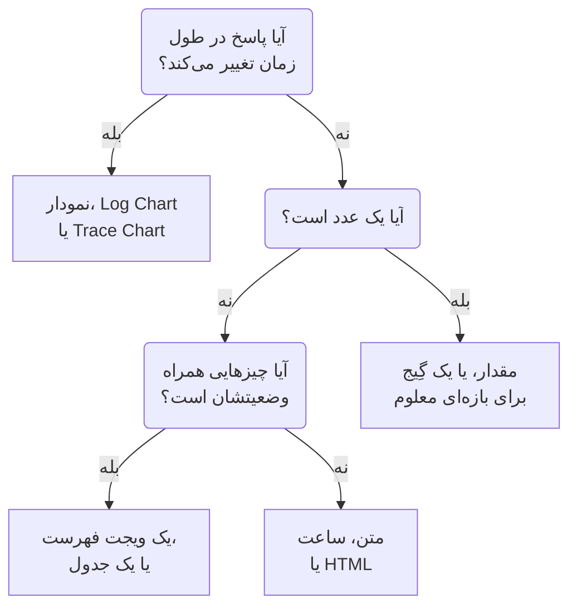

# ویجت‌های داشبورد

ویجت یک کاشی روی داشبورد است. این صفحه همه ویجت‌های کاتالوگ **افزودن ویجت** را فهرست می‌کند، این‌که هر کدام چه نشان می‌دهد و کدام تنظیماتش مهم است، در همان گروه‌هایی که کاتالوگ دارد. برای چیدن ویجت‌ها روی شبکه و ذخیره آن‌ها، [ساخت یک داشبورد](/docs/dashboards/authoring) را ببینید.

:::cards
- [از کدام ویجت استفاده کنم؟](#از-کدام-ویجت-استفاده-کنم): بر پایه پرسشی که کاشی به آن پاسخ می‌دهد انتخاب کنید.
- [نمودارها و عددها](#نمودارها-و-عددها): نمودار، مقدار، گِیج و جدول، از یک کوئری متریک.
- [لاگ‌ها، ترِیس‌ها و امنیت](#لاگها-ترِیسها-و-امنیت): نمودارهای حجم، جریان‌های زنده و فهرست‌ها.
- [مرتب‌سازی فهرست‌ها و جدول‌ها](#مرتبسازی-فهرستها-و-جدولها): بر اساس یک ستون مرتب کنید، و ترتیبی را که همه می‌بینند تعیین کنید.
- [وقتی ویجتی نمایش داده نمی‌شود](#وقتی-ویجتی-نمایش-داده-نمیشود): ویجت خراب چه نشان می‌دهد و چگونه درستش کنید.
:::

## از کدام ویجت استفاده کنم؟

از پرسشی آغاز کنید که کاشی باید به آن پاسخ دهد:

| پرسش | ویجت |
| --- | --- |
| یک متریک در طول زمان چگونه تغییر کرده است؟ | **نمودار** |
| چند لاگ، با کدام شدت، در طول زمان؟ | **نمودار لاگ** |
| درخواست‌ها چقدر سریع‌اند و چندتا در طول زمان شکست می‌خورند؟ | **نمودار ترِیس** |
| یک عدد در همین لحظه چیست؟ | **مقدار**، یا **گِیج** وقتی بازه‌ای معلوم دارد |
| کدام میزبان‌ها، سرویس‌ها یا endpointها متمایزند؟ | **جدول** یا **جدول ترِیس** |
| همین حالا چه رخ می‌دهد؟ | **جریان لاگ**، **فهرست ترِیس‌ها**، **فهرست حوادث** یا **فهرست هشدارها** |
| آیا همه سایت‌هایمان برقرارند؟ | **فهرست مانیتورها** |
| آیا اطمینان‌پذیری‌ای را که قول داده‌ایم نگه می‌داریم؟ | **SLO** یا **فهرست SLO** |
| خوشه‌ها و میزبان‌هایمان در چه وضعیتی‌اند؟ | ویجتی از گروه زیرساخت |
| شبکه ما در کجای جهان است و چه چیزی از کار افتاده است؟ | **نقشه شبکه** |
| یک سرعنوان، یک یادداشت، ساعت در دفتری دیگر؟ | **متن** یا **ساعت** |
| داده‌هایی که بیرون از OneUptime نگه داشته می‌شوند؟ | ویجتی از گروه منابع داده خارجی |
| چیزی که هیچ ویجتی پوشش نمی‌دهد؟ | **HTML**، وقتی مطمئن شدید هیچ ویجت دیگری آن را انجام نمی‌دهد |



بیشتر داشبوردها چند ویجت را با هم می‌آمیزند: یک نمودار در بالا، یکی دو مقدار کنارش، یک سرعنوان متنی و یکی دو فهرست در پایین.

## نمودارها و عددها

این چهار ویجت یک کوئری متریک می‌خوانند که همان‌گونه ساخته می‌شود که کاوشگر متریک‌ها می‌سازد: یک متریک و یک تجمیع برگزینید، پالایه‌های ویژگی بیفزایید و بر پایه یک ویژگی گروه‌بندی کنید تا برای هر مقدار یک سری داشته باشید.

### نمودار

یک سری زمانی از یک یا چند کوئری متریک در بازه زمانی داشبورد. **Chart Type** آن را به‌صورت نمودار خطی، میله‌ای، ناحیه‌ای، ناحیه‌ای انباشته یا دایره‌ای می‌کشد. **Additional Queries** متریک‌های بیشتری را روی همان محورها می‌گذارد و **Formulas** آن‌ها را با `+`، `-`، `*`، `/`، `%`، `^` و پرانتزها ترکیب می‌کند، مانند `(1 - a) * 100`. تنظیمات نمایش هر کوئری یک راهنما و یکا، یک رنگ، خط‌های هشدار و بحرانی، و نرخ بر ثانیه را برای شمارنده‌هایی که همیشه فقط بالا می‌روند می‌افزاید.

وقتی از آن استفاده کنید که شکل خط داستان را می‌گوید: تأخیر، خطاها، توان عملیاتی یا عمق صف.

### مقدار

یک عدد بزرگ با یک نمودار کوچک: مقدار کوئری در کل بازه زمانی، برای جمع یا شمارش جمع‌شده، برای بیشینه بالاترین، برای کمینه پایین‌ترین، و در غیر این صورت میانگین. یک پیکان نیمه دوم بازه را با نیمه نخست مقایسه می‌کند، هر نیمه به همان روش محاسبه می‌شود، و رنگش را از **Trend Direction** می‌گیرد: این‌که مقدار بالاتر بهتر است یا بدتر، یا از روی نام متریک خوانده شود. برای دیدن مقدار هر دو نیمه، اشاره‌گر را روی پیکان ببرید، و برای خواندن مقدار و زمان هر نقطه، روی نمودار کوچک. **Warning Threshold** پس‌زمینه را زرد می‌کند و **Critical Threshold** آن را قرمز، به‌محض آنکه مقدار به آن‌ها برسد.

وقتی از آن استفاده کنید که یک عدد به پرسش پاسخ می‌دهد: نرخ خطا، تأخیر P95، یا درخواست‌هایی که امروز پاسخ داده شده‌اند.

### گِیج

یک صفحه مدرج میان یک کمینه و یک بیشینه، ۰ و ۱۰۰ مگر آنکه خودتان تعیینشان کنید، با یک ناحیه زرد از **Warning Threshold** و یک ناحیه قرمز از **Critical Threshold**.

وقتی از آن استفاده کنید که مقدار در بازه‌ای معلوم می‌ماند: مصرف CPU یا دیسک بر حسب درصد، یا ظرفیت یک صف.

### جدول

مقدارهای متریک به‌صورت سطر. **Group By Attributes** برای هر مقدار یک سطر می‌دهد، مانند یکی برای هر `host.name`؛ بدون آن، هر سطر یک بازه زمانی است. **Metrics & Columns** ستون‌ها را تعیین می‌کند: متریک‌ها و فرمول‌هایی روی آن‌ها، مانند دسترس‌پذیری بر حسب درصد. وقتی گروه‌بندی می‌کنید، **Reduce across time** سری هر سطر را به یک مقدار تبدیل می‌کند: آخرین مقدار، میانگین، جمع، کمینه یا بیشینه.

برای یک تفکیک به‌جای یک روند از آن استفاده کنید: پرسروصداترین میزبان‌ها، خطاهای هر سرویس، درخواست‌های هر endpoint.

## متن، ساعت و HTML

این ویجت‌ها به هیچ منبع داده‌ای نیاز ندارند.

### متن

یک سطر یا یک بلوک متن، برای سرعنوان، یادداشت یا پیوند به runbookهایتان. **Markdown** را روشن کنید تا سرعنوان‌ها، پیوندها، فهرست‌ها، کد و جدول‌ها کشیده شوند؛ در غیر این صورت متن همان‌طور که نوشته شده نمایش داده می‌شود، اگر بخواهید پررنگ، کج یا زیرخط‌دار.

### ساعت

زمان کنونی در هر منطقه زمانی، به‌صورت رقمی یا با صفحه عقربه‌ای، با برچسبی مانند «دفتر سیدنی». اگر منطقه زمانی تعیین نشود، زمانِ خود هر بیننده را نشان می‌دهد. برای هر دفتر یکی بیفزایید تا ببینید چه کسی بیدار است.

### HTML

HTML، CSS و JavaScript خودتان، که به‌صورت یک ویجت کشیده می‌شود. تنظیماتش بدنه HTML، یک stylesheet اختیاری، یک اسکریپت اختیاری و سه کلید دسترسی است.

وقتی از آن استفاده کنید که به چیزی نیاز دارید که هیچ ویجت آماده‌ای پوشش نمی‌دهد: یک نشان جاسازی‌شده از یک سرویس دیگر، جدولی که از یک API داخلی خوانده می‌شود، یک راهنمای سفارشی، یا مجموعه‌ای از پیوندهای آراسته به ابزارهای خودتان.

#### چه کارهایی می‌تواند و نمی‌تواند بکند

ویجت در یک قاب sandbox روی origin ایزوله خودش رندر می‌شود. درون آن قاب، کد شما تقریباً هر کاری می‌تواند بکند: DOM بسازد، تایمر اجرا کند، از هر URL داده بگیرد، روی canvas بکشد.

کاری که نمی‌تواند بکند دسترسی به صفحه OneUptime پیرامونش است. به DOM داشبورد، کوکی‌ها، local storage یا نشست API دسترسی ندارد و نمی‌تواند زبانه مرورگر را به جای دیگری ببرد. این چه داشبورد خصوصی باشد و چه به‌صورت عمومی به اشتراک گذاشته شده باشد، برقرار است.

دو پیامد که بهتر است پیش از چسباندن چیزی بدانید:

- یک `fetch` از ویجت، درخواستی cross-origin از یک origin مات است، پس سروری که فرامی‌خوانید باید با CORS آن را مجاز کند. فراخوانی API خود OneUptime از اینجا پشتیبانی نمی‌شود.
- ویجت شفاف آغاز می‌شود. اگر می‌خواهید کارت را پر کند، در CSS خود یک پس‌زمینه روی `body` بگذارید. در پوستهٔ تیره متن آن روشن آغاز می‌شود و عنصر `<html>` آن کلاس `dark` را دارد: برای سبک‌دهی فقط به پوستهٔ تیره، قاعدهٔ CSS را با `html.dark` آغاز کنید.

#### استفاده از متغیرهای داشبورد

`{{variableName}}` را هر جای HTML، CSS یا JavaScript بنویسید تا پیش از رندر ویجت با مقدار کنونی آن متغیر جایگزین شود. برگزیدن مقداری تازه ویجت را دوباره رندر می‌کند. جای‌نگهداری که نام متغیری ناموجود را دارد همان‌طور که هست می‌ماند.

اسکریپت‌ها همین مقدارها را، به‌علاوه بازه زمانی داشبورد، روی `window.ONEUPTIME` می‌گیرند:

```javascript title="window.ONEUPTIME"
window.ONEUPTIME.variables.environment; // current value, or "" if unset
window.ONEUPTIME.startDate; // ISO 8601 string, start of the dashboard's time range
window.ONEUPTIME.endDate; // ISO 8601 string, end of it
```

ویجت هر بار که داشبورد به‌روز می‌شود دوباره بارگذاری می‌شود، پس ویجتی که داده‌هایش را خودش می‌گیرد با فاصله به‌روزرسانی همگام می‌ماند.

#### دسترسی‌ها

**Run JavaScript** (به‌طور پیش‌فرض روشن) اسکریپت شما را اجرا می‌کند. آن را خاموش کنید تا فقط markup و styleها رندر شوند — در این حالت اسکریپت به‌کلی از ویجت کنار گذاشته می‌شود، نه فقط مسدود.

**Open links in a new tab** (به‌طور پیش‌فرض روشن) اجازه می‌دهد پیوندها و `window.open` یک زبانه مرورگر باز کنند. پیوندها همیشه در زبانه‌ای تازه باز می‌شوند؛ ویجت هرگز نمی‌تواند خود داشبورد را به جای دیگری ببرد.

**Allow forms to submit** (به‌طور پیش‌فرض خاموش) اجازه می‌دهد یک `<form>` درون ویجت ارسال شود.

هر کسی که بتواند داشبورد را ویرایش کند تعیین می‌کند این ویجت چه چیزی اجرا کند، و هر کسی که داشبورد را ببیند آن را اجرا می‌کند — در یک داشبورد عمومی، این شامل بازدیدکنندگان ناشناس هم می‌شود. با دسترسی ویرایش به داشبوردی که یک ویجت HTML دارد همان‌گونه رفتار کنید که با دسترسی به هر کد دیگری که منتشر می‌کنید.

## لاگ‌ها، ترِیس‌ها و امنیت

| ویجت | چه نشان می‌دهد | تنظیماتی که مهم‌اند |
| --- | --- | --- |
| **نمودار لاگ** | حجم لاگ‌ها در طول زمان، یک سری برای هر شدت، به‌صورت میله، خط یا ناحیه. | شدت‌ها، متنی که بدنه دارد، پالایه‌های ویژگی. |
| **جریان لاگ** | تازه‌ترین سطرهای لاگ که با یک پالایه جور درمی‌آیند. | شدت، متنی که بدنه دارد، پالایه‌های ویژگی مانند `@service.name:checkout`، چند سطر. |
| **نمودار ترِیس** | شمار درخواست‌ها، شمار خطاها یا زمان پاسخ (میانگین، کمینه، بیشینه، P50 تا P99) در طول زمان. | متریک، کدام spanها شمرده شوند، و ویژگی‌ای که سری‌ها بر پایه آن جدا شوند. |
| **فهرست ترِیس‌ها** | تازه‌ترین ترِیس‌ها، با مدت و وضعیتشان. | وضعیت، چند سطر. |
| **جدول ترِیس** | نام‌های span، وضعیت‌ها یا مقدارهای ویژگی برتر بر پایه شمار درخواست، با میانه، میانگین، کمینه و بیشینه زمان پاسخ. | این‌که سطرها بر پایه چه گروه‌بندی شوند، و کدام spanها شمرده شوند. |
| **رویدادهای امنیتی** | تازه‌ترین رویدادهای امنیتی، با شدت، کلاس رویداد و میزبان. | شدت‌ها، کلاس‌های رویداد، متنی که پیام دارد. |
| **جریان رویدادهای امنیتی** | جریانی از رویدادهای امنیتی از منبعشان، از میان کلاس رویدادشان، تا شدتشان. | شدت‌ها، چند رویداد. |

ویجت‌های ترِیس فقط spanهای ریشه را می‌شمارند، همان‌طور که کاوشگر ترِیس‌ها می‌شمارد، مگر آنکه spanهای فرزند را در تنظیماتشان بگنجانید. یک الگوی رایج، نمودار تأخیر در بالا و فهرستی از ترِیس‌های کند در زیر آن است.

## حوادث، هشدارها و مانیتورها

| ویجت | چه نشان می‌دهد | پالایه‌ها |
| --- | --- | --- |
| **فهرست حوادث** | حوادث با وضعیت و شدتشان. | حل‌نشده، تأییدشده یا حل‌شده؛ شدت، وضعیت، مانیتورها و برچسب‌ها. |
| **فهرست هشدارها** | هشدارها با وضعیت و شدتشان. | حل‌نشده، تأییدشده یا حل‌شده؛ شدت، وضعیت، مانیتورها و برچسب‌ها. |
| **فهرست مانیتورها** | مانیتورها با وضعیت کنونی‌شان. | عملیاتی یا نه، وضعیت، نوع مانیتور و برچسب‌ها، یا یک **متغیر برچسب** که بینندگان در نوار ابزار برمی‌گزینند. |

مانند بیشتر ویجت‌های فهرست، این سه می‌توانند به‌جای جدول، کندویی از خانه‌هایی رنگ‌شده بر پایه وضعیت بکشند: آن را زیر **حالت نمایش** برگزینید. این‌ها وضعیت کنونی را نشان می‌دهند، بازه زمانی داشبورد هر چه باشد.

## اهداف سطح سرویس

### SLO

یک Service Level Objective، که یا به‌صورت یک عدد تنها یا به‌صورت خطی در طول زمان کشیده می‌شود.

**تنظیمات**: کدام SLO، یا SLOای که در یک متغیر داشبورد برگزیده شده است؛ کدام یک از سه عددش (SLI، Error Budget Remaining یا Burn Rate)؛ نمایش Tile یا Chart؛ و یک عنوان اختیاری.

- **Tile** عدد کنونی را چاپ می‌کند، به‌علاوه سطری دوم هر جا که باشد — هدف زیر SLI، دقیقه‌های باقی‌مانده زیر بودجه خطا. یک برچسب وضعیت کل آن را رنگ می‌کند.
- **نمودار** همان عدد را در بازه زمانی داشبورد می‌کشد، با هدف که به‌صورت خط‌چین روی سری SLI مشخص شده است. تاریخچه هر چند دقیقه یک بار به دست کارگر ارزیابی نوشته می‌شود، پس یک SLO تازه تا نخستین ارزیابی‌اش نمودار خالی دارد.

وقتی از آن استفاده کنید که داشبورد به «آیا به آنچه قول داده‌ایم عمل می‌کنیم؟» پاسخ می‌دهد، نه به «همین حالا چه رخ می‌دهد».

ویجت SLO روی [داشبوردهای عمومی](/docs/dashboards/sharing) کار می‌کند. آنچه منتشر می‌شود عددهای اصلی SLO است — نام، هدف، SLI کنونی، بودجه خطای باقی‌مانده، نرخ مصرف و وضعیت آن — هر کدام از آن‌ها که ویجت بکشد. تعریفش خصوصی می‌ماند: مانیتورهایی که می‌پاید، برچسب‌هایش، توضیحاتش، کوئری‌اش و زمان‌بندی ارزیابی‌اش هرگز برای بیننده عمومی فرستاده نمی‌شوند. ویجت Tile فقط همان عددهای کنونی را منتشر می‌کند؛ ویجت Chart تاریخچه همان یک سری‌ای را که می‌کشد نیز منتشر می‌کند، و نه هیچ چیز دیگر.

### SLO List

همه SLOها با وضعیت، SLI، بودجه خطا و نرخ مصرفشان، با کمترین بودجه باقی‌مانده در آغاز. آن را بر پایه وضعیت یا برچسب‌ها پالایش کنید، یا با یک **متغیر برچسب** که بینندگان در نوار ابزار برمی‌گزینند. [متریک‌ها و داشبوردهای SLO](/docs/slo/metrics) هر دو ویجت SLO را در کار نشان می‌دهد.

## زیرساخت

هر یک از این‌ها منابعی را فهرست می‌کند که یک عامل یا یک کلکتور به OneUptime گزارش می‌دهد. در پالایه‌هایشان آن‌ها را بر پایه خوشه، میزبان یا namespace محدود کنید و به‌صورت فهرست یا کندو نشانشان دهید.

| گروه | ویجت‌ها | پرشده به دست |
| --- | --- | --- |
| **میزبان‌ها** | **میزبان‌ها**، با وضعیت اتصال، سیستم‌عامل، CPU و حافظه‌شان | هر کلکتور OpenTelemetry که `host.name` را می‌فرستد |
| **Kubernetes** | **پادها**، **گره‌ها**، **Namespaceها**، **Deploymentها**، **StatefulSetها**، **DaemonSetها**، **Jobها**، **CronJobها** | [عامل Kubernetes](/docs/monitor/kubernetes-agent) |
| **Docker** | **میزبان‌ها**، **کانتینرها**، **ایمیج‌ها**، **شبکه‌ها**، **حجم‌ها** | عامل Docker |
| **Docker Swarm** | **گره‌ها**، **سرویس‌ها** | عامل Docker Swarm |
| **Podman** | **میزبان‌ها**، **کانتینرها**، **ایمیج‌ها**، **شبکه‌ها**، **حجم‌ها** | عامل Podman |
| **Proxmox** | **گره‌ها**، **مهمان‌ها** | عامل Proxmox |
| **VMware** | **میزبان‌ها**، **ماشین‌های مجازی** | عامل VMware، یا یک vCenter که وصل می‌کنید |
| **Ceph** | **OSDها**، به‌صورت دیواری رنگ‌شده بر پایه وضعیت، و **Poolها** | عامل Ceph |
| **آرایه‌های ذخیره‌سازی** | **حجم‌ها**، و **سخت‌افزار** به‌صورت دیواری رنگ‌شده بر پایه وضعیت | عامل Storage Array |

برای صفحه‌ای از آن‌ها استفاده کنید که وضعیت زیرساختتان را با تله‌متری بارهای کاری روی آن در هم می‌آمیزد.

### Network Map

سایت‌های شبکه شما روی نقشه جهان، هر کدام سنجاق‌شده در عرض و طول جغرافیایی خودش و رنگ‌شده بر پایه وضعیت مانیتورهایی که روی آن جمع می‌شوند. سایت‌هایی که به هم نزدیک‌اند یک نشانگر مشترک دارند که شمارشان درونش چاپ شده است؛ نشانگری که درست یک سایت را نمایندگی می‌کند، با کلیک، همان سایت را باز می‌کند.

نقشه خودش را به سایت‌هایی که کشیده است قاب می‌گیرد — مجموعه‌ای درون یک کشور قاب را با همان کشور پر می‌کند، و مجموعه‌ای که در چند قاره پخش است روی جهان باز می‌شود. کنترلی برای بزرگ‌نمایی یا جابه‌جایی نیست: کاشی داشبورد یک تصویر است، و صفحه نقشه شبکه در بخش شبکه جایی است که سلسله‌مراتب را در آن می‌پیمایید.

بالای نقشه شمار سایت‌هایی که از کار افتاده‌اند چاپ می‌شود، چون یک نقطه قرمز دوپیکسلی میان دویست نقطه سبز چیزی نیست که کسی از فاصله دیدن داشبورد بخواند. زیر آن، سطر پوشش می‌گوید نقشه چه چیزی را نشان نمی‌دهد: سایت‌های بدون مختصات، و این‌که آیا سقف سطرها پر شده است.

**تنظیمات**: عنوان، نمای نقشه یا فهرست، بیشترین شمار سایت‌هایی که کشیده می‌شوند، این‌که نام سایت‌ها چاپ شوند یا نه، و پالایه‌هایی بر پایه نوع سایت و وضعیت. وقتی نقشه برای خوانا ماندن نام‌ها بیش از اندازه شلوغ شود، نام سایت‌ها خودبه‌خود برداشته می‌شوند؛ راهنمای شناور همچنان نام هر نشانگر را می‌گوید.

سایت فقط وقتی نمایان می‌شود که مختصات داشته باشد. برای سنجاق کردن آن، عرض و طول جغرافیایی را روی سایت بیفزایید (یا از CSV وارد کنید).

## منابع داده خارجی

گروه منابع داده خارجی یک **نمودار**، یک **مقدار**، یک **گِیج** یا یک **جدول** را از سامانه‌ای می‌کشد که از آنِ OneUptime نیست: Prometheus، PostgreSQL، MySQL، SQL Server، ClickHouse، Loki، Elasticsearch یا هر REST API. سامانه را یک بار وصل می‌کنید، سپس کوئری هر ویجت را به زبان خود آن سامانه می‌نویسید. [منابع داده خارجی](/docs/dashboards/data-sources) چگونگی‌اش را نشان می‌دهد.

## مرتب‌سازی فهرست‌ها و جدول‌ها

روی سرستون یک ستون کلیک کنید تا یک فهرست یا جدول بر اساس آن مرتب شود: اولین کلیک همان‌طور مرتب می‌کند که جدول زیر می‌گوید، کلیک بعدی برعکس، و کلیک پس از آن ویجت را به ترتیب خودش برمی‌گرداند. روی ستونی که ویجت از قبل بر اساس آن مرتب است، یک کلیک ترتیب را برعکس می‌کند. یک پیکان ستونی را نشان می‌دهد که ردیف‌ها بر اساس آن مرتب شده‌اند.

| ستون | اولین کلیک | کلیک بعدی |
| --- | --- | --- |
| یک وضعیت یا شدت | بدترین‌ها اول | بهترین‌ها اول |
| یک زمان | تازه‌ترین اول | قدیمی‌ترین اول |
| یک عدد | بیشترین اول | کمترین اول |
| متن | الف تا ی | ی تا الف |

بدترین بودن از ترتیب خود پروژه شما پیروی می‌کند: وضعیت یک مانیتور بر اساس اولویتش، شدت و وضعیت یک حادثه یا هشدار بر اساس ترتیبی که آن‌ها را نگه می‌دارید، و منبعی که از کار افتاده، آماده نیست یا خاموش است پیش از یک منبع سالم. فاز یک پاد به این ترتیب مرتب می‌شود: Failed، سپس Unknown، سپس Pending، سپس Running و Succeeded. SLI و بودجه خطای یک SLO، و VMID یک مهمان Proxmox، از کمترین مرتب می‌شوند.

کل فهرست مرتب می‌شود، نه فقط ردیف‌های روی صفحه: فهرستی که 25 ردیف نشان می‌دهد و با بدترین‌ها اول مرتب شده، 25 مورد بدتر از همه را نشان می‌دهد. ردیف‌های برابر ترتیب خود ویجت را نگه می‌دارند. ستونی که نمی‌توان کل فهرست را بر اساس آن مرتب کرد، مانند پیام یک رویداد امنیتی، مرتب نمی‌شود.

### مرتب‌سازی خودتان

مرتب‌سازی شما فقط از آنِ شماست: مرورگرتان آن را برای آن ویجت در آن داشبورد به خاطر می‌سپارد، پس تازه‌سازی صفحه یا راه‌اندازی دوباره یک صفحه‌نمایش دیواری آن را نگه می‌دارد، و هیچ‌کس دیگری آن را نمی‌بیند. کلیکی که ویجت را به ترتیب خودش برمی‌گرداند مرتب‌سازی شما را فراموش می‌کند، و از آن پس ویجت از ترتیب خودش پیروی می‌کند، حتی وقتی ویرایشگری بعدها آن را تغییر دهد.

### ترتیبی که همه می‌بینند

برای تعیین ترتیبی که یک ویجت برای همه با آن باز می‌شود، آن را ویرایش کنید و ترتیب را زیر **مرتب‌سازی** برگزینید، یا در **Live Preview** آن روی یک سرستون کلیک کنید، سپس روی **ذخیره تغییرات** کلیک کنید. ترتیب تازه را بی‌درنگ می‌بینید؛ بیننده‌ای که ویجت را به روش خودش مرتب کرده، مرتب‌سازی خودش را نگه می‌دارد.

قالب‌های داشبورد فهرست‌های میزبان‌ها، گره‌ها، پادها، سرویس‌های Swarm و دستگاه‌های شبکه را با بدترین‌ها اول باز می‌کنند.

از راه API و Terraform، ترتیب همان `arguments.sort` ویجت است: یک ستون و یک جهت، مانند `status:desc`. ویجت فهرستی ستونی را که ندارد نمی‌پذیرد، و پیام خطا مرتب‌سازی‌هایی را که دارد فهرست می‌کند.

## در یک داشبورد عمومی

یک [داشبورد عمومی](/docs/dashboards/sharing) بیشتر ویجت‌ها را برای بازدیدکنندگانش می‌کشد، و هر کدام فقط همان چیزی را نشان می‌دهد که برای نمایشش تنظیم شده است. چند ویجت بدون نشستی که با آن وارد شده باشید نمایش داده نمی‌شوند:

- **نمودار لاگ**، **نمودار ترِیس**، **جدول ترِیس**، **رویدادهای امنیتی** و **جریان رویدادهای امنیتی** در جای خود می‌گویند که در داشبوردهای عمومی در دسترس نیستند.
- ویجت‌های منابع داده خارجی به‌کلی از داشبورد عمومی کنار گذاشته می‌شوند، چون تنظیماتشان خود کوئری است.

## وقتی ویجتی نمایش داده نمی‌شود

ویجتی که نمی‌توان آن را کشید در جای خود **این ویجت نمایش داده نشد** را نشان می‌دهد و بقیه داشبورد همچنان کار می‌کند. این زمانی رخ می‌دهد که OneUptime ویجتی از آن نوع نداشته باشد (ویجتی که برداشته شده، هنگام نوشتن داشبورد از راه API نامش اشتباه نوشته شده، یا در نسخه‌ای تازه‌تر افزوده شده است)، یا وقتی ویجت هنگام کشیده شدن شکست بخورد، برای نمونه چون تنظیمات ذخیره‌شده‌اش ناقص است.

اگر می‌توانید داشبورد را ویرایش کنید، روی **ویرایش ویجت** در آن کلیک کنید. داشبورد با تنظیمات باز همان ویجت به حالت ویرایش می‌رود: آن‌ها را درست کنید، یا روی **حذف ویجت** کلیک کنید، سپس روی **ذخیره تغییرات**. ویجتی که هنگام کشیده شدن شکست خورده **تلاش دوباره** را هم پیشنهاد می‌کند و در به‌روزرسانی خودکار بعدی یا وقتی بازه زمانی را تغییر دهید دوباره کشیده می‌شود.

به بازدیدکنندگان داشبورد عمومی فقط گفته می‌شود که ویجت نمایش داده نشد.

## گام‌های بعدی

:::cards
- [متغیرها و فیلترهای داشبورد](/docs/dashboards/variables): بگذارید بینندگان ویجت‌ها را به یک سرویس، یک میزبان یا یک مشتری ببرند.
- [منابع داده خارجی](/docs/dashboards/data-sources): Prometheus، SQL، Loki و بیشتر را کنار داده‌های خودتان نمودار کنید.
- [ساخت یک داشبورد](/docs/dashboards/authoring): ویجت‌ها را بیفزایید، بچینید و ذخیره کنید.
- [اشتراک‌گذاری و داشبوردهای عمومی](/docs/dashboards/sharing): داشبورد را بیرون از تیمتان به اشتراک بگذارید.
:::
