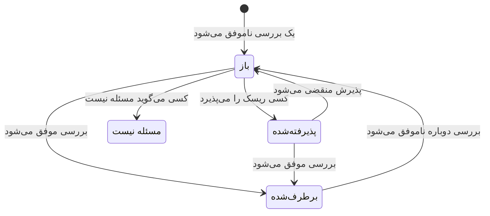

# بررسی‌ها و مسائل امنیت داده

امنیت داده 32 بررسی را، در نُه گروه، روی هر مخزن اجرا می‌کند. یک بررسی آنچه را دربارهٔ یک مخزن معلوم است می‌خواند - چگونه پیکربندی شده، چه چیزی در آن پیدا شده، چه کسی به آن دسترسی دارد، کجا قرار دارد - و موفق می‌شود، ناموفق می‌شود یا نمی‌تواند تشخیص دهد. یک بررسی ناموفق یک مسئله روی آن مخزن باز می‌کند، و مسئله به‌محض موفق شدن بررسی خودبه‌خود بسته می‌شود. این صفحه همهٔ بررسی‌ها را فهرست می‌کند، و می‌گوید شدت و امتیاز ریسک یک مسئله چگونه محاسبه می‌شود و در طول عمر یک مسئله چه بر سر آن می‌آید.

:::cards
- [یک بررسی چگونه تصمیم می‌گیرد](#یک-بررسی-چگونه-تصمیم-میگیرد): موفق، ناموفق یا نامشخص، و یک شکست چقدر جدی است.
- [همهٔ بررسی‌ها](#همهٔ-بررسیها): هر 32 مورد، با اینکه هر کدام چه چیزی را بررسی می‌کند و چگونه رفعش کنید.
- [امتیاز ریسک](#امتیاز-ریسک): مسائل درون یک شدت چگونه مرتب می‌شوند.
- [چه بر سر یک مسئله می‌آید](#چه-بر-سر-یک-مسئله-میآید): باز، برطرف‌شده، پذیرفته‌شده، مسئله نیست.
- [از همین‌جا رفع کنید](#از-همینجا-رفع-کنید): با یک کلیک، یک باکت عمومی را مسدود کنید یا اشتراک‌گذاری یک اسنپ‌شات را متوقف کنید.
:::

## یک بررسی چگونه تصمیم می‌گیرد

هر بررسی واقعیت‌هایی دربارهٔ یک مخزن را می‌خواند و به یکی از چهار شکل پاسخ می‌دهد:

| پاسخ | معنای آن | چه بر سر مسئله می‌آید |
| --- | --- | --- |
| موفق | بررسی هیچ ایرادی پیدا نمی‌کند. | مسئلهٔ باز یا پذیرفته‌شده برطرف می‌شود. |
| ناموفق | بررسی مشکل را پیدا می‌کند، و آنچه را دیده در یک جمله می‌گوید: شواهد مسئله. | یک مسئله باز می‌شود، یا مسئلهٔ باز به‌روز می‌شود. |
| نامشخص | یک واقعیت را نمی‌شد خواند: مجوزی که نقش ندارد، فراخوانی‌ای که ناموفق شد. | چیزی تغییر نمی‌کند: مسئلهٔ باز باز می‌ماند، چون وقتی OneUptime نتوانسته نگاه کند، هیچ‌کس نباید نتیجه بگیرد که مشکلی رفع شده است. |
| کاربرد ندارد | گونهٔ مخزن چنین تنظیمی ندارد. | مسئلهٔ باز برطرف می‌شود. |

### شدت از داده پیروی می‌کند

همان مشکل روی داده‌های حساس‌تر اهمیت بیشتری دارد. هر بررسی برای هر سطح حساسیت یک شدت تعیین می‌کند، و یک مسئله شدت مربوط به مخزن خود را می‌گیرد: یک باکت عمومی از شماره کارت‌ها بحرانی است، و یک باکت عمومی از تصاویر وب‌سایت فقط کم. خط تیره یعنی هیچ مسئله‌ای در کار نیست. حساسیت یک مخزن از یافته‌هایش می‌آید ([انواع داده‌های حساس](/docs/data-security/data-types#حساسیت) را ببینید)، پس نمونه‌های محتوا شدت‌ها را درست می‌کنند.

چند بررسی در عوض شدت را از روی آنچه دیده‌اند تعیین می‌کنند. **رازها در آن ذخیره شده‌اند** روی هر مخزنی زیاد است، و روی مخزنی که عمومی است یا با حساب‌های دیگر به اشتراک گذاشته شده بحرانی.

## همهٔ بررسی‌ها

شدت برای داده‌های محدود، محرمانه، داخلی و عمومی، به همین ترتیب، آمده است. صفحهٔ هر مسئله راه رفع کامل را برای مخزن خودش نشان می‌دهد - گام‌های کنسول، فرمان CLI و، هر جا که مناسب باشد، Terraform - با نام و منطقهٔ مخزن که از پیش پر شده‌اند.

### در معرض بودن

| بررسی | اجرا روی | چه چیزی را بررسی می‌کند | شدت | چگونه رفع کنید |
| --- | --- | --- | --- | --- |
| هر کسی در اینترنت می‌تواند آن را بخواند (`public-read`) | ذخیره‌سازی شیء، انبار داده، جست‌وجو | سیاست، ACL یا پیوندهای IAM مخزن به هر کسی اجازه می‌دهند بدون ورود داده‌هایش را بخواند. | بحرانی / بحرانی / زیاد / کم | هر مجوزی را که به اصل‌های امنیتی ناشناس یا همهٔ احرازهویت‌شده‌ها داده شده بردارید. فایل‌هایی که باید عمومی باشند جایشان در مخزنی است که **عمومی از روی طراحی** علامت خورده و چیز دیگری در آن نیست. |
| هر کسی در اینترنت می‌تواند آن را تغییر دهد (`public-write`) | ذخیره‌سازی شیء، انبار داده، جست‌وجو | سیاست، ACL یا پیوندهای IAM مخزن به هر کسی اجازه می‌دهند داده‌هایش را بنویسد یا حذف کند. | بحرانی / بحرانی / بحرانی / زیاد | هر مجوز نوشتن یا حذفی را که به اصل‌های امنیتی ناشناس یا همهٔ احرازهویت‌شده‌ها داده شده بردارید. |
| دسترسی عمومی مسدود نشده است (`public-access-not-blocked`) | AWS S3 Bucket | S3 Block Public Access برای باکت یا حساب آن کاملاً روشن نیست، پس یک تغییر سیاست می‌تواند آن را عمومی کند. | زیاد / متوسط / کم / — | هر چهار تنظیم Block Public Access را برای باکت روشن کنید. |
| پایگاه داده اتصال از اینترنت را می‌پذیرد (`internet-reachable`) | پایگاه داده، انبار داده، جست‌وجو، کش | پایگاه داده یک نقطهٔ پایانی عمومی دارد یا دسترسی شبکهٔ عمومی آن روشن است. | زیاد / زیاد / متوسط / کم | نقطهٔ پایانی عمومی را خاموش کنید، و از راه یک شبکهٔ خصوصی یا یک bastion به پایگاه داده دسترسی پیدا کنید. |
| فایروال آن به همهٔ آدرس‌ها اجازهٔ ورود می‌دهد (`open-to-all-addresses`) | پایگاه داده، انبار داده، جست‌وجو، کش | یک قاعدهٔ فایروال یا شبکهٔ مجاز، 0.0.0.0/0 یا کل بازهٔ آدرس‌ها را مجاز می‌کند. | بحرانی / بحرانی / زیاد / متوسط | قاعده‌ای را که همه چیز را مجاز می‌کند با آدرس‌ها یا شبکه‌هایی جایگزین کنید که به دسترسی نیاز دارند. |
| هر کسی می‌تواند یک اسنپ‌شات آن را بازیابی کند (`snapshot-public`) | پایگاه داده، اسنپ‌شات | یک اسنپ‌شات پایگاه داده به‌صورت عمومی به اشتراک گذاشته شده، پس هر حساب ابری می‌تواند یک کپی کامل را بازیابی کند. | بحرانی / بحرانی / بحرانی / زیاد | اسنپ‌شات را خصوصی کنید. |
| یک اسنپ‌شات آن با حساب‌های دیگر به اشتراک گذاشته شده است (`snapshot-shared-externally`) | پایگاه داده، اسنپ‌شات | یک اسنپ‌شات پایگاه داده با حساب‌هایی بیرون از حساب‌های متصل شما به اشتراک گذاشته شده است. | زیاد / زیاد / متوسط / کم | اشتراک‌گذاری اسنپ‌شات را با حساب‌هایی که نباید آن را داشته باشند متوقف کنید. |
| حساب‌های بیرون از سازمان شما به آن دسترسی دارند (`shared-with-external-accounts`) | همهٔ مخازن جز تله‌متری | سیاست مخزن به حساب‌ها، tenantها یا پروژه‌هایی دسترسی می‌دهد که به OneUptime متصل نیستند. | زیاد / زیاد / متوسط / کم | هر اصل امنیتی بیرونی را مرور کنید، و آن‌هایی را که به دسترسی نیاز ندارند بردارید. |

### رمزگذاری

| بررسی | اجرا روی | چه چیزی را بررسی می‌کند | شدت | چگونه رفع کنید |
| --- | --- | --- | --- | --- |
| داده‌هایش در حالت ذخیره رمزگذاری نشده‌اند (`not-encrypted-at-rest`) | همهٔ مخازن جز تله‌متری | رمزگذاری ذخیره‌سازی خاموش است. | زیاد / متوسط / کم / — | رمزگذاری در حالت ذخیره را روشن کنید. یک نمونهٔ RDS را نمی‌توان درجا رمزگذاری کرد: یک کپی رمزگذاری‌شده از اسنپ‌شات آن را بازیابی کنید. |
| دادهٔ محدود زیر کلید خود شما نیست (`no-customer-managed-key`) | همهٔ مخازن جز تله‌متری | مخزن دادهٔ محدود نگه می‌دارد اما با کلید پیش‌فرض ارائه‌دهنده رمزگذاری شده است، نه با کلیدی که مشتری مدیریت می‌کند. | متوسط / — / — / — | مخزن را با کلیدی که در سرویس کلید خود مدیریت می‌کنید رمزگذاری کنید. |
| اتصال‌های رمزگذاری‌نشده مجازند (`encryption-in-transit-not-enforced`) | همهٔ مخازن جز تله‌متری | مخزن اتصال‌هایی را می‌پذیرد که از TLS استفاده نمی‌کنند. | زیاد / متوسط / کم / — | برای هر اتصال TLS را الزامی کنید. در S3، هر درخواستی را که در آن `aws:SecureTransport` برابر false است رد کنید. |
| TLS قدیمی‌تر از 1.2 را می‌پذیرد (`weak-tls`) | همهٔ مخازن جز تله‌متری | حداقل نسخهٔ TLS برابر 1.0 یا 1.1 است. | متوسط / متوسط / کم / — | حداقل نسخهٔ TLS را روی 1.2 یا بالاتر بگذارید. |

### بازیابی

| بررسی | اجرا روی | چه چیزی را بررسی می‌کند | شدت | چگونه رفع کنید |
| --- | --- | --- | --- | --- |
| پشتیبان ندارد، یا پشتیبان‌ها را کمتر از 7 روز نگه می‌دارد (`no-backups`) | پایگاه داده، انبار داده | پشتیبان‌گیری خودکار خاموش است، یا پشتیبان‌ها کمتر از 7 روز نگه داشته می‌شوند. | زیاد / متوسط / کم / — | پشتیبان‌گیری خودکار را روشن کنید، و پشتیبان‌ها را دست‌کم 7 روز نگه دارید. |
| بازیابی به نقطهٔ زمانی خاموش است (`no-point-in-time-recovery`) | AWS DynamoDB Table, Azure Cosmos DB Account | جدول یا پایگاه داده را نمی‌توان به لحظه‌ای پیش از یک اشتباه بازگرداند. | متوسط / کم / — / — | بازیابی به نقطهٔ زمانی را روشن کنید. |
| می‌توان آن را در یک گام حذف کرد (`deletion-protection-off`) | پایگاه داده، انبار داده | محافظت در برابر حذف خاموش است. | متوسط / کم / — / — | محافظت در برابر حذف را روشن کنید. |
| فایل‌های حذف‌شده یا بازنویسی‌شده قابل بازیابی نیستند (`deleted-data-not-recoverable`) | ذخیره‌سازی شیء | نسخه‌بندی و حذف نرم هر دو خاموش‌اند. | متوسط / کم / — / — | نسخه‌بندی یا حذف نرم را روشن کنید. |

### دیدپذیری

| بررسی | اجرا روی | چه چیزی را بررسی می‌کند | شدت | چگونه رفع کنید |
| --- | --- | --- | --- | --- |
| هیچ‌کس نمی‌فهمد چه کسی آن را خوانده است (`access-not-logged`) | همهٔ مخازن جز تله‌متری | خواندن‌های مخزن ثبت نمی‌شوند: نه لاگ دسترسی، نه لاگ ممیزی دسترسی به داده. | زیاد / متوسط / کم / — | ثبت لاگ دسترسی یا ممیزی را برای خواندن‌ها روشن کنید: لاگ‌های دسترسی سرور S3 یا رویدادهای دادهٔ CloudTrail، لاگ‌های تشخیصی StorageRead در Azure، لاگ‌های ممیزی Data Access در Cloud Storage. |

### دسترسی

| بررسی | اجرا روی | چه چیزی را بررسی می‌کند | شدت | چگونه رفع کنید |
| --- | --- | --- | --- | --- |
| هر کسی که کلید حساب را دارد می‌تواند همه چیز را بخواند (`shared-key-access`) | Azure Storage Account | حساب ذخیره‌سازی دسترسی با کلید مشترک را مجاز می‌کند، که Microsoft Entra ID را دور می‌زند و هیچ ردپای ممیزی‌ای به تفکیک افراد باقی نمی‌گذارد. | متوسط / کم / — / — | برنامه‌ها را به Microsoft Entra ID منتقل کنید، سپس دسترسی با کلید حساب ذخیره‌سازی را خاموش کنید. |
| اشیا می‌توانند قواعد دسترسی خودشان را داشته باشند (`object-acls-enabled`) | AWS S3 Bucket, Google Cloud Storage Bucket | ACLهای شیء روشن‌اند، پس یک شیء را می‌توان عمومی کرد در حالی که باکت خصوصی به نظر می‌رسد. | کم / کم / — / — | در S3، Object Ownership را روی Bucket owner enforced بگذارید. در Cloud Storage، دسترسی یکنواخت در سطح باکت را روشن کنید. |
| بیش از 25 هویت می‌توانند دادهٔ محدود را بخوانند (`many-readers`) | همهٔ مخازن جز تله‌متری | هویت‌هایی بیش از آنچه بیشتر تیم‌ها بتوانند مرور کنند، دسترسی خواندن به مخزن دارند. | متوسط / — / — / — | صفحهٔ **چه کسی دسترسی دارد** مخزن را باز کنید، و دسترسی‌ای را که استفاده نمی‌شود یا گسترده‌تر از نیاز است بردارید. |

### بهداشت داده

| بررسی | اجرا روی | چه چیزی را بررسی می‌کند | شدت | چگونه رفع کنید |
| --- | --- | --- | --- | --- |
| رازها در آن ذخیره شده‌اند (`secrets-stored`) | همهٔ مخازن جز تله‌متری | گذرواژه‌ها، کلیدهای API، توکن‌ها یا کلیدهای خصوصی در داده‌های مخزن پیدا شدند. | زیاد / زیاد / زیاد / زیاد | هر راز پیداشده را، به‌عنوان رازی نشت‌کرده، تعویض کنید. رازها را به یک مدیر راز منتقل کنید و از مخزن حذفشان کنید. |
| کدهای امنیتی کارت ذخیره شده‌اند (`card-security-codes-stored`) | همهٔ مخازن جز تله‌متری | کدهای CVV یا CVC پیدا شدند. PCI DSS نگه داشتن آن‌ها را پس از مجوز گرفتن یک پرداخت، رمزگذاری‌شده یا نه، ممنوع می‌کند. | بحرانی / بحرانی / بحرانی / بحرانی | کدی را که آن‌ها را می‌نویسد متوقف کنید، کدهای ذخیره‌شده را حذف کنید، و بررسی کنید که هیچ‌کدام در پشتیبان‌ها باقی نمانده باشد. |
| شماره کارت‌ها خوانا ذخیره شده‌اند (`card-numbers-readable`) | همهٔ مخازن جز تله‌متری | شماره کارت‌های کامل به شکل خوانا پیدا شدند. PCI DSS الزام می‌کند که هر جا ذخیره می‌شوند ناخوانا باشند. | زیاد / زیاد / زیاد / زیاد | شماره کارت‌ها را با ارائه‌دهندهٔ پرداخت خود توکنیزه کنید، یا آن‌ها را در سطح فیلد رمزگذاری کنید، و کپی‌های خوانا را حذف کنید. |
| گذرواژه‌ها به‌صورت متن ساده ذخیره شده‌اند (`plaintext-passwords`) | همهٔ مخازن جز تله‌متری | یک فیلد گذرواژه مقادیری دارد که هش گذرواژه (bcrypt، argon2، scrypt یا PBKDF2) نیستند. | بحرانی / بحرانی / بحرانی / بحرانی | گذرواژه‌ها را با bcrypt، scrypt یا argon2 هش کنید، گذرواژه‌های ذخیره‌شده را مهاجرت دهید، و همهٔ حساب‌ها را وادار کنید گذرواژه‌شان را بازنشانی کنند. |
| دادهٔ تولید در یک مخزن غیرتولیدی کپی شده است (`production-data-in-non-production`) | همهٔ مخازن جز تله‌متری | مقادیری که در یک مخزن تولید پیدا شدند، اینجا، در یک مخزن توسعه، آزمایش یا پیش‌تولید، هم پیدا شدند. | زیاد / متوسط / — / — | کپی را با داده‌های پوشانده‌شده یا مصنوعی جایگزین کنید، و داده‌های واقعی را از مخزن غیرتولیدی حذف کنید. |
| داده‌های حساسی که 90 روز کسی از آن‌ها استفاده نکرده است (`stale-sensitive-data`) | همهٔ مخازن جز تله‌متری | مخزن داده‌های حساس نگه می‌دارد و 90 روز هیچ خواندن یا نوشتنی نداشته است. | متوسط / کم / — / — | مطمئن شوید داده دیگر لازم نیست، سپس آن را با یک تاریخ نگهداری بایگانی کنید، یا حذفش کنید. |
| این مخزن حساس هیچ مالکی ندارد (`no-owner`) | همهٔ مخازن | مخزن داده‌های حساس نگه می‌دارد و هیچ مالکی ندارد. | متوسط / کم / — / — | در صفحهٔ **مالکان** مخزن یک مالک اضافه کنید، یا یک قاعده مالکیت که با تگ‌های آن جور باشد. |

### تله‌متری

| بررسی | اجرا روی | چه چیزی را بررسی می‌کند | شدت | چگونه رفع کنید |
| --- | --- | --- | --- | --- |
| داده‌های حساس به تله‌متری شما می‌رسند (`sensitive-data-in-telemetry`) | تله‌متری | لاگ‌ها، ترِیس‌ها، استثناها، بازپخش‌ها یا گفتگوهای هوش مصنوعی داده‌های حساسی را با خود دارند که هیچ قاعده پاک‌سازی آن‌ها را نمی‌پوشاند. | زیاد / متوسط / کم / — | روی هر یافته **پاک‌سازی** را بزنید تا داده هنگام دریافت پوشانده شود، سپس کدی را که آن را می‌نویسد اصلاح کنید. |
| رازها به تله‌متری شما می‌رسند (`secrets-in-telemetry`) | تله‌متری | گذرواژه‌ها، کلیدهای API یا توکن‌ها در لاگ‌ها، ترِیس‌ها، استثناها یا گفتگوهای هوش مصنوعی ظاهر می‌شوند. | بحرانی / بحرانی / بحرانی / بحرانی | نخست راز را تعویض کنید، سپس **پاک‌سازی** را بزنید و کدی را که آن را می‌نویسد اصلاح کنید. |

### محل نگهداری داده

| بررسی | اجرا روی | چه چیزی را بررسی می‌کند | شدت | چگونه رفع کنید |
| --- | --- | --- | --- | --- |
| داده بیرون از مناطقی که مجاز است ذخیره شده است (`residency-violation`) | همهٔ مخازن جز تله‌متری | منطقهٔ مخزن، یا منطقه‌ای که داده‌هایش به آن تکثیر می‌شود، یک قاعده محل نگهداری داده را نقض می‌کند. | زیاد / زیاد / متوسط / — | داده را به یک منطقهٔ مجاز منتقل کنید، یا کپی کردن آن به منطقهٔ دیگر را متوقف کنید. اگر انتقال قانونی است، مسئله را بپذیرید و دلیلش را ثبت کنید. |

### هوش مصنوعی

| بررسی | اجرا روی | چه چیزی را بررسی می‌کند | شدت | چگونه رفع کنید |
| --- | --- | --- | --- | --- |
| داده‌های حساس به یک ارائه‌دهندهٔ هوش مصنوعی فرستاده می‌شوند (`sensitive-data-to-ai`) | گفتگوهای هوش مصنوعی | گفتگوهای هوش مصنوعی ثبت‌شده در OneUptime داده‌های حساس را به یک ارائه‌دهندهٔ مدل می‌برند. | بحرانی / زیاد / کم / — | پیش از فرستادن پرامپت‌ها، مقادیر حساس را پنهان کنید، یا این فراخوانی‌ها را به مدلی بفرستید که خودتان میزبانی می‌کنید. |
| دادهٔ محدود در مخزنی است که برای هوش مصنوعی استفاده می‌شود (`sensitive-data-in-ai-store`) | همهٔ مخازن جز تله‌متری | مخزنی که به‌عنوان دادهٔ آموزش یا بازیابی هوش مصنوعی تگ خورده، دادهٔ محدود نگه می‌دارد. | زیاد / متوسط / — / — | پیش از آنکه دادهٔ محدود برای آموزش یا زمینه‌سازی یک مدل به کار رود، آن را بردارید یا بپوشانید. |

## امتیاز ریسک

شدت می‌گوید یک مسئله چقدر جدی است. امتیاز ریسک، از 0 تا 100، مسائل یک شدت را بر پایهٔ چیزهایی مرتب می‌کند که همان مشکل را بدتر می‌کنند:

```text
risk = severity + 10 × exposure + 6 × volume + 5 × activity + 4 × production, at most 100
```

| عامل | امتیاز |
| --- | --- |
| شدت | 75 برای بحرانی، 50 برای زیاد، 25 برای متوسط، 0 برای کم |
| در معرض بودن | 10 برای عمومی، 8 برای حساب‌های دیگر، 6 برای قابل دسترسی از اینترنت، 3 برای ناشناخته، 0 برای خصوصی |
| حجم | تا 6، بر اساس تعداد تخمینی رکوردهای حساس مخزن در مقیاس لگاریتمی: 1 برای 10 رکورد، 3 برای 1,000، 5 برای یک میلیون، 6 برای ده میلیون یا بیشتر |
| فعالیت | 5 وقتی عملیات امنیتی در هفتهٔ گذشته تشخیص‌هایی روی مخزن دیده باشد |
| تولید | 4 برای مخزنی در تولید |

عوامل اضافی حداکثر 25 امتیاز می‌افزایند، پس امتیاز یک مسئله هرگز کمتر از مسئله‌ای با شدت پایین‌تر نمی‌شود. یک باکت عمومی در تولید با یک میلیون رکورد از دادهٔ محدود، برای یک مسئلهٔ بحرانی امتیاز 75 + 10 + 5 + 4 = 94 می‌گیرد. هر مسئله عواملی را که به امتیازش افزوده‌اند، همراه با امتیازشان، فهرست می‌کند، و مخزن امتیاز بدترین مسئلهٔ باز خود را نشان می‌دهد.

محیط یک مخزن - تولید، Staging، Development، Test یا ناشناخته - از تگ‌هایش می‌آید (`env`، `environment`، `stage`، `tier` و مانند این‌ها) یا، اگر تگی نباشد، از واژه‌های نامش، مانند `prod`، `staging`، `dev` یا `qa`. وقتی هیچ‌کدام چیزی نمی‌گویند، آن را روی مخزن تعیین کنید.

## چه بر سر یک مسئله می‌آید



OneUptime هم‌زمان با اجرای بررسی‌ها مسائل را باز، به‌روز و برطرف می‌کند. کاری که یک فرد با یک مسئله می‌کند این است که تصمیم بگیرد بعد چه شود:

| وضعیت | چگونه به آن می‌رسد | پس از آن چه می‌شود |
| --- | --- | --- |
| **باز** | بررسی‌اش اکنون روی مخزن ناموفق است. | تا وقتی بررسی موفق شود، در نمای کلی، در خلاصهٔ مخزن و در انطباق به شمار می‌آید. |
| **برطرف‌شده** | بررسی‌اش در اجرای بعدی موفق شد، دیگر کاربرد ندارد یا خاموش شد، یا مخزنش بایگانی شد. یک فرد هم می‌تواند **علامت‌گذاری به‌عنوان برطرف‌شده** را انتخاب کند: مخزن بی‌درنگ دوباره بررسی می‌شود. | اگر بررسی دوباره ناموفق شود دوباره باز می‌شود، و مسئله می‌شمارد چند بار دوباره باز شده است. |
| **پذیرفته‌شده** | یک فرد **پذیرش ریسک** را انتخاب کرد، با یک **دلیل** و تاریخی در **پذیرفته‌شده تا** که حداکثر یک سال بعد است. | تا آن تاریخ بسته می‌ماند، سپس اگر بررسی هنوز ناموفق باشد دوباره باز می‌شود. اگر دلیل هنوز برقرار است، آنگاه دوباره آن را بپذیرید. |
| **مسئله نیست** | یک فرد **مسئله نیست** را انتخاب کرد: یافته نادرست بود. | بسته می‌ماند، حتی وقتی بررسی ناموفق است. **بازگشایی** آن را به وضعیت باز برمی‌گرداند. |

نقش‌های Security Member، Security Admin، Project Admin و Project Owner می‌توانند وضعیت یک مسئله را تغییر دهند، و با **تخصیص** آن را به یک فرد یا یک تیم بسپارند. هر تغییر در **خط زمانی** مسئله نوشته می‌شود: کی باز شد، هر تغییر شدت، هر تغییر وضعیت و اینکه چه کسی آن را انجام داد، بررسی‌های دوباره‌ای که درخواست شدند، و آنچه یکپارچه‌سازی‌ها انجام دادند.

مسئله‌ای که دوباره باز می‌شود تاریخچه‌اش را نگه می‌دارد. ریسک‌های پذیرفته‌شده هر روز دوباره وارسی می‌شوند، تا هر کدام به‌موقع منقضی شود، حتی وقتی چیزی اسکن نشده باشد.

## از همین‌جا رفع کنید

یک مسئلهٔ باز دربارهٔ یک باکت عمومی یا یک اسنپ‌شات اشتراک‌گذاری‌شده را می‌توان از صفحهٔ خودش رفع کرد. بالای گام‌های کنسول، **از همین‌جا رفع کنید** تغییری را پیشنهاد می‌دهد که آن را رفع می‌کند:

| مسئله | مخزن آن | دکمه | چه چیزی را تغییر می‌دهد |
| --- | --- | --- | --- |
| `public-read`، `public-write` یا `public-access-not-blocked` | یک باکت S3، یک حساب ذخیره‌سازی Azure یا یک باکت Cloud Storage | **مسدود کردن دسترسی عمومی** | چهار تنظیم Block Public Access باکت را روشن می‌کند، دسترسی ناشناس به blob را در حساب ذخیره‌سازی خاموش می‌کند، یا جلوگیری از دسترسی عمومی را روی باکت اعمال می‌کند |
| `snapshot-public` یا `snapshot-shared-externally` | یک اسنپ‌شات RDS، یک پایگاه داده RDS، یا یک خوشهٔ Aurora یا DocumentDB | **لغو اشتراک‌گذاری** | اشتراک‌گذاری اسنپ‌شات، یا هر اسنپ‌شات دستی اشتراک‌گذاری‌شدهٔ پایگاه داده، را با همه و با حساب‌های بیرون از حساب‌هایی که متصل کرده‌اید متوقف می‌کند |

ابتدا می‌پرسد، و می‌گوید چه چیزی تغییر می‌کند و چه چیزی دیگر کار نمی‌کند. شیوهٔ اشتراک‌گذاری مخزن را تغییر می‌دهد، هرگز داده‌هایش را، و چیزی را که از پیش بسته است تغییر نمی‌دهد. مخزنی که **عمومی از روی طراحی** علامت خورده هرگز مسدود نمی‌شود.

از راه اتصال ابری مخزن عمل می‌کند، پس در اتصال باید **پاسخ امنیت داده** روشن باشد و فرمان راه‌اندازی آن دوباره اجرا شده باشد ([راه‌اندازی امنیت داده](/docs/data-security/setup#اجازه-دهید-امنیت-داده-در-معرض-بودن-را-رفع-کند) را ببینید). تا آن زمان، پنل می‌گوید چه چیزی را روشن کنید. مخزن بلافاصله پس از آن دوباره بررسی می‌شود، و مسئله به‌محض موفق شدن بررسی‌اش خودبه‌خود برطرف می‌شود. **خط زمانی** مسئله و **خط زمانی** مخزن می‌گویند چه کاری انجام شد و چه کسی آن را انجام داد.

## تنظیمات بررسی‌ها

**امنیت داده** > **تنظیمات** > **بررسی‌ها** همهٔ بررسی‌ها را به تفکیک گروه فهرست می‌کند، همراه با اینکه هر کدام به دنبال چه می‌گردد و شدتی که یک شکست برای هر حساسیت می‌گیرد. هر بررسی را می‌توان برای پروژه تنظیم کرد، و هر تغییر بی‌درنگ ذخیره می‌شود:

- **کلید آن** بررسی را خاموش می‌کند، وقتی با شیوهٔ کار شما جور نیست. مسائل باز و پذیرفته‌شدهٔ آن برطرف می‌شوند، و می‌گویند که بررسی دیگر اجرا نمی‌شود.
- **شدت آن** به‌طور پیش‌فرض **بر اساس حساسیت** است، یا یک شدت واحد که هر شکست بررسی، هر چه مخزنش در خود داشته باشد، می‌گیرد.

برای ساکت کردن یک بررسی فقط روی یک مخزن، ریسک را روی مسئلهٔ آن مخزن بپذیرید، یا مسئله را «مسئله نیست» علامت بزنید. برای یافته‌ای که نادرست است، نه مشکلی که اهمیتی ندارد، به‌جای آن یافته را غیرحساس علامت بزنید ([انواع داده‌های حساس](/docs/data-security/data-types#غیرحساس-و-هرگز-حساس) را ببینید).

**اکنون بررسی کن** روی یک مخزن پیکربندی آن را دوباره می‌خواند و بررسی‌هایش را اجرا می‌کند. **اکنون اسکن کن** از محتوای آن نمونه برمی‌دارد، و بررسی‌هایش وقتی اسکن پایان یابد اجرا می‌شوند.

## گام‌های بعدی

:::cards
- [یکپارچه‌سازی‌های امنیت داده](/docs/data-security/integrations): پرونده‌های امنیتی، هشدارها و ایمیل به مالکان وقتی یک مسئله باز می‌شود.
- [جریان‌های داده، دسترسی و محل نگهداری داده](/docs/data-security/flows-access-residency): دسترسی‌ها، کپی‌ها و مناطقی که چند بررسی آن‌ها را می‌خوانند.
- [انطباق امنیت داده](/docs/data-security/compliance): الزامات چارچوب‌ها که هر بررسی شاهدی برای آن‌هاست.
:::
