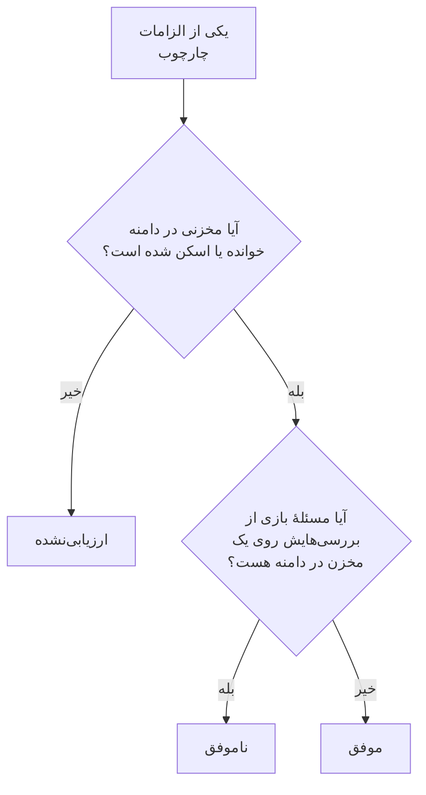

# انطباق امنیت داده

امنیت داده بر پایهٔ آنچه اسکن‌هایش پیدا کرده‌اند به نُه چارچوب انطباق امتیاز می‌دهد. هر چارچوب مخازنی را پوشش می‌دهد که قواعدش دربارهٔ آن‌هاست - GDPR مخازنی که دادهٔ شخصی دارند، PCI DSS مخازنی که دادهٔ کارت در آن‌ها پیدا شده، SOC 2 همهٔ مخازن - و هر یک از الزاماتش با بررسی‌هایی که شاهد آن‌اند برآورده یا نقض می‌شود. **امنیت داده** > **انطباق** امتیاز هر چارچوب، تعداد مخازنی که پوشش می‌دهد، و هر الزام را همراه با تعداد مسائل بازی که آن را نقض می‌کنند نشان می‌دهد. یک امتیاز شاهدی برای ممیزی است، نه یک گواهی‌نامه: می‌گوید OneUptime از مخازنی که می‌خواند چه چیزی را می‌تواند ببیند.

:::cards
- [چارچوب‌ها](#چارچوبها): این نُه چارچوب، و اینکه هر کدام کدام مخازن را پوشش می‌دهد.
- [یک چارچوب چگونه امتیاز می‌گیرد](#یک-چارچوب-چگونه-امتیاز-میگیرد): الزامات موفق، ناموفق و ارزیابی‌نشده.
- [الزامات و بررسی‌های آن‌ها](#الزامات-و-بررسیهای-آنها): هر الزام، و بررسی‌هایی که شاهد آن‌اند.
- [سوابق پردازش](#سوابق-پردازش): مادهٔ 30 GDPR، نوشته‌شده از روی مخازن شما.
:::

## چارچوب‌ها

| چارچوب | نام کامل | مخازن در دامنه |
| --- | --- | --- |
| GDPR | مقررات عمومی حفاظت از دادهٔ اتحادیهٔ اروپا | مخازنی که دادهٔ شخصی دارند. |
| CCPA | قانون حریم خصوصی مصرف‌کنندگان کالیفرنیا، با اصلاحات CPRA | مخازنی که اطلاعات شخصی دارند. |
| HIPAA | قاعدهٔ امنیتی HIPAA | مخازنی که دادهٔ سلامت دارند. |
| PCI DSS | PCI DSS v4.0 | مخازنی که شماره‌های کارت در آن‌ها پیدا شده است. |
| SOC 2 | معیارهای خدمات اعتماد SOC 2 | هر مخزن داده. |
| ISO 27001 | ISO/IEC 27001:2022 | هر مخزن داده. |
| NIST CSF | چارچوب امنیت سایبری NIST 2.0 | هر مخزن داده. |
| LGPD | قانون عمومی حفاظت از دادهٔ برزیل | مخازنی که دادهٔ شخصی افراد در برزیل را دارند. |
| DPDP | قانون حفاظت از دادهٔ شخصی دیجیتال هند، 2023 | مخازنی که دادهٔ شخصی افراد در هند را دارند. |

## یک چارچوب کدام مخازن را پوشش می‌دهد

دامنهٔ یک مخزن از داده‌ای می‌آید که در آن پیدا شده است، پس با پیدا شدن چیزهای بیشتر در اسکن‌ها تغییر می‌کند:

- **SOC 2، ISO 27001 و NIST CSF** چارچوب‌های امنیتی‌اند: هر مخزنی را پوشش می‌دهند، هر چه در آن باشد.
- **GDPR، CCPA، HIPAA و PCI DSS** مخازنی را پوشش می‌دهند که نوع داده‌ای را که از آن محافظت می‌کنند در خود دارند. دادهٔ شخصی GDPR و CCPA را وارد می‌کند، دادهٔ سلامت HIPAA را هم، و شماره‌های کارت، کدهای امنیتی کارت و تاریخ‌های انقضای کارت PCI DSS را. مخزنی که فقط رازها یا اسناد تجاری دارد در هیچ‌کدام از آن‌ها نیست.
- **LGPD و DPDP** قوانین خود کشورها هستند: مخازنی را پوشش می‌دهند که دادهٔ شخصی افراد در برزیل یا هند را دارند، که از روی انواع داده‌ای خوانده می‌شود که به آن کشور تعلق دارند، مانند یک CPF برزیلی یا یک شمارهٔ Aadhaar هندی.

[انواع داده‌های حساس](/docs/data-security/data-types#انواع-داده-داخلی) هر نوع داده را همراه با کشورش فهرست می‌کند.

## یک چارچوب چگونه امتیاز می‌گیرد

- **یک الزام موفق است** وقتی هیچ مسئلهٔ بازی از بررسی‌های نگاشته‌شده به آن روی مخزنی در دامنهٔ چارچوب نباشد، و **ناموفق است** وقتی چنین مسئله‌ای باشد.
- **ارزیابی‌نشده است** تا وقتی پیکربندی هیچ مخزنی در دامنه خوانده یا محتوایش اسکن نشده باشد.
- **دو الزام را خود امنیت داده برآورده می‌کند**: مادهٔ 30 GDPR، سوابق فعالیت‌های پردازش، و A.5.12 در ISO 27001، طبقه‌بندی اطلاعات. این دو وقتی همهٔ مخازن در دامنه خوانده یا اسکن شده باشند موفق‌اند، و تا وقتی یکی خوانده یا اسکن نشده ناموفق‌اند.
- **امتیاز** سهم الزامات ارزیابی‌شدهٔ یک چارچوب است که موفق‌اند، به‌صورت یک درصد صحیح. چارچوبی که هیچ چیز ارزیابی‌شده‌ای ندارد امتیازی ندارد.

فقط مسائل باز به شمار می‌آیند. مسئله‌ای که ریسکش پذیرفته شده، یا مسئله نیست، الزاماتش را ناموفق نمی‌کند، پس یک ریسک پذیرفته‌شده تصمیمی است که ممیزی شما می‌تواند روی مسئله ببیند: چه کسی آن را پذیرفت، چرا، و تا کی.

## الزامات و بررسی‌های آن‌ها

### GDPR

| الزام | چه می‌خواهد | بررسی‌ها |
| --- | --- | --- |
| Art. 5(1)(c) | کمینه‌سازی داده | `production-data-in-non-production`، `stale-sensitive-data`، `sensitive-data-in-telemetry`، `sensitive-data-to-ai`، `sensitive-data-in-ai-store` |
| Art. 5(1)(e) | محدودیت ذخیره‌سازی | `stale-sensitive-data` |
| Art. 25 | حفاظت از داده در طراحی و به‌طور پیش‌فرض | `production-data-in-non-production`، `stale-sensitive-data`، `sensitive-data-in-telemetry`، `sensitive-data-to-ai`، `sensitive-data-in-ai-store` |
| Art. 28 | پردازشگران | `sensitive-data-to-ai` |
| Art. 30 | سوابق فعالیت‌های پردازش | با خود امنیت داده برآورده می‌شود |
| Art. 32 | امنیت پردازش | `public-read`، `public-write`، `public-access-not-blocked`، `internet-reachable`، `open-to-all-addresses`، `snapshot-public`، `snapshot-shared-externally`، `shared-with-external-accounts`، `not-encrypted-at-rest`، `no-customer-managed-key`، `encryption-in-transit-not-enforced`، `weak-tls`، `no-backups`، `no-point-in-time-recovery`، `deletion-protection-off`، `deleted-data-not-recoverable`، `access-not-logged`، `shared-key-access`، `object-acls-enabled`، `many-readers`، `secrets-stored`، `plaintext-passwords`، `secrets-in-telemetry` |
| Arts. 44-49 | انتقال به کشورهای ثالث | `residency-violation` |

### CCPA

| الزام | چه می‌خواهد | بررسی‌ها |
| --- | --- | --- |
| 1798.100(c) | گردآوری محدود به آنچه لازم است | `production-data-in-non-production`، `stale-sensitive-data`، `sensitive-data-in-telemetry`، `sensitive-data-to-ai`، `sensitive-data-in-ai-store` |
| 1798.150 | رویه‌های امنیتی معقول | `public-read`، `public-write`، `public-access-not-blocked`، `internet-reachable`، `open-to-all-addresses`، `snapshot-public`، `snapshot-shared-externally`، `shared-with-external-accounts`، `shared-key-access`، `object-acls-enabled`، `many-readers` |

### HIPAA

| الزام | چه می‌خواهد | بررسی‌ها |
| --- | --- | --- |
| 164.308(a)(7) | برنامهٔ اضطراری | `no-backups`، `no-point-in-time-recovery`، `deletion-protection-off`، `deleted-data-not-recoverable` |
| 164.312(a)(1) | کنترل دسترسی | `public-read`، `public-write`، `public-access-not-blocked`، `internet-reachable`، `open-to-all-addresses`، `snapshot-public`، `snapshot-shared-externally`، `shared-with-external-accounts`، `shared-key-access`، `object-acls-enabled`، `many-readers` |
| 164.312(a)(2)(iv) | رمزگذاری و رمزگشایی | `not-encrypted-at-rest`، `no-customer-managed-key` |
| 164.312(b) | کنترل‌های ممیزی | `access-not-logged` |
| 164.312(e)(1) | امنیت انتقال | `encryption-in-transit-not-enforced`، `weak-tls` |

### PCI DSS

| الزام | چه می‌خواهد | بررسی‌ها |
| --- | --- | --- |
| 3.3.1 | دادهٔ احراز هویت حساس پس از مجوزدهی نگه داشته نمی‌شود | `card-security-codes-stored` |
| 3.4.1 | شماره‌های کارت هنگام نمایش پوشانده می‌شوند | `card-numbers-readable`، `sensitive-data-in-telemetry` |
| 3.5.1 | شماره‌های کارت هر جا ذخیره شوند ناخوانا هستند | `not-encrypted-at-rest`، `no-customer-managed-key`، `card-numbers-readable` |
| 4.2.1 | رمزنگاری قوی از دادهٔ کارت در حین انتقال محافظت می‌کند | `encryption-in-transit-not-enforced`، `weak-tls` |
| 7.2 | دسترسی بر پایهٔ نیاز تعریف و واگذار می‌شود | `public-read`، `public-write`، `public-access-not-blocked`، `internet-reachable`، `open-to-all-addresses`، `snapshot-public`، `snapshot-shared-externally`، `shared-with-external-accounts`، `shared-key-access`، `object-acls-enabled`، `many-readers` |
| 8.3.2 | عامل‌های احراز هویت هنگام ذخیره ناخوانا هستند | `plaintext-passwords` |
| 10.2 | لاگ‌های ممیزی دسترسی به دادهٔ کارت را ثبت می‌کنند | `access-not-logged` |

### SOC 2

| الزام | چه می‌خواهد | بررسی‌ها |
| --- | --- | --- |
| A1.2 | پشتیبان‌گیری و بازیابی | `no-backups`، `no-point-in-time-recovery`، `deletion-protection-off`، `deleted-data-not-recoverable` |
| CC6.1 | امنیت دسترسی منطقی | `public-read`، `public-write`، `public-access-not-blocked`، `internet-reachable`، `open-to-all-addresses`، `snapshot-public`، `snapshot-shared-externally`، `shared-with-external-accounts`، `not-encrypted-at-rest`، `no-customer-managed-key`، `shared-key-access`، `object-acls-enabled`، `many-readers`، `secrets-stored`، `plaintext-passwords`، `secrets-in-telemetry` |
| CC6.7 | انتقال اطلاعات | `encryption-in-transit-not-enforced`، `weak-tls` |
| CC7.2 | پایش اجزای سیستم | `access-not-logged` |

### ISO 27001

| الزام | چه می‌خواهد | بررسی‌ها |
| --- | --- | --- |
| A.5.9 | فهرست دارایی‌های اطلاعاتی و دیگر دارایی‌های مرتبط | `no-owner` |
| A.5.12 | طبقه‌بندی اطلاعات | با خود امنیت داده برآورده می‌شود |
| A.5.15 | کنترل دسترسی | `public-read`، `public-write`، `public-access-not-blocked`، `internet-reachable`، `open-to-all-addresses`، `snapshot-public`، `snapshot-shared-externally`، `shared-with-external-accounts`، `shared-key-access`، `object-acls-enabled`، `many-readers` |
| A.5.34 | حریم خصوصی و حفاظت از PII | `production-data-in-non-production`، `stale-sensitive-data`، `sensitive-data-in-telemetry`، `sensitive-data-to-ai`، `sensitive-data-in-ai-store` |
| A.8.11 | پوشاندن داده | `production-data-in-non-production`، `stale-sensitive-data`، `sensitive-data-in-telemetry`، `sensitive-data-to-ai`، `sensitive-data-in-ai-store` |
| A.8.12 | پیشگیری از نشت داده | `secrets-stored`، `secrets-in-telemetry` |
| A.8.13 | پشتیبان‌گیری از اطلاعات | `no-backups`، `no-point-in-time-recovery`، `deletion-protection-off`، `deleted-data-not-recoverable` |
| A.8.15 | ثبت لاگ | `access-not-logged` |
| A.8.24 | استفاده از رمزنگاری | `not-encrypted-at-rest`، `no-customer-managed-key`، `encryption-in-transit-not-enforced`، `weak-tls`، `plaintext-passwords` |

### NIST CSF

| الزام | چه می‌خواهد | بررسی‌ها |
| --- | --- | --- |
| ID.AM-07 | فهرست‌هایی از داده و فراداده نگهداری می‌شوند | `no-owner` |
| PR.AA-05 | مجوزهای دسترسی مدیریت می‌شوند | `public-read`، `public-write`، `public-access-not-blocked`، `internet-reachable`، `open-to-all-addresses`، `snapshot-public`، `snapshot-shared-externally`، `shared-with-external-accounts`، `shared-key-access`، `object-acls-enabled`، `many-readers` |
| PR.DS-01 | دادهٔ در حال سکون محافظت می‌شود | `not-encrypted-at-rest`، `no-customer-managed-key`، `secrets-stored`، `secrets-in-telemetry` |
| PR.DS-02 | دادهٔ در حال انتقال محافظت می‌شود | `encryption-in-transit-not-enforced`، `weak-tls` |
| PR.DS-11 | از داده‌ها پشتیبان نگه داشته و آزموده می‌شود | `no-backups`، `no-point-in-time-recovery`، `deletion-protection-off`، `deleted-data-not-recoverable` |
| DE.CM-09 | داده و استفاده از آن پایش می‌شود | `access-not-logged` |

### LGPD

| الزام | چه می‌خواهد | بررسی‌ها |
| --- | --- | --- |
| Art. 6 | ضرورت و محدودیت هدف | `production-data-in-non-production`، `stale-sensitive-data`، `sensitive-data-in-telemetry`، `sensitive-data-to-ai`، `sensitive-data-in-ai-store` |
| Art. 33 | انتقال بین‌المللی داده | `residency-violation` |
| Art. 46 | تدابیر امنیتی | `public-read`، `public-write`، `public-access-not-blocked`، `internet-reachable`، `open-to-all-addresses`، `snapshot-public`، `snapshot-shared-externally`، `shared-with-external-accounts`، `not-encrypted-at-rest`، `no-customer-managed-key`، `shared-key-access`، `object-acls-enabled`، `many-readers` |

### DPDP

| الزام | چه می‌خواهد | بررسی‌ها |
| --- | --- | --- |
| Sec. 8(5) | تدابیر حفاظتی امنیتی معقول | `public-read`، `public-write`، `public-access-not-blocked`، `internet-reachable`، `open-to-all-addresses`، `snapshot-public`، `snapshot-shared-externally`، `shared-with-external-accounts`، `not-encrypted-at-rest`، `no-customer-managed-key`، `shared-key-access`، `object-acls-enabled`، `many-readers` |
| Sec. 8(7) | پاک کردن داده پس از برآورده شدن هدف | `production-data-in-non-production`، `stale-sensitive-data`، `sensitive-data-in-telemetry`، `sensitive-data-to-ai`، `sensitive-data-in-ai-store` |
| Sec. 16 | انتقال به بیرون از هند | `residency-violation` |

## سوابق پردازش

مادهٔ 30 GDPR از شما می‌خواهد سوابق فعالیت‌های پردازش خود را نگه دارید. امنیت داده آن بخش از این سوابق را می‌نویسد که دربارهٔ محل نگهداری دادهٔ شخصی است: یک ردیف برای هر مخزنی که دادهٔ شخصی دارد.

| ستون | از کجا می‌آید |
| --- | --- |
| مخزن، گونه، ارائه‌دهنده و منطقه | Discovery |
| محیط | تگ‌ها یا نام مخزن، یا آنچه شما تنظیم می‌کنید |
| حساسیت، دسته‌ها و انواع داده | آنچه اسکن‌ها پیدا کردند، یا حساسیتی که شما تنظیم کردید |
| مالکان | مالکان مخزن، افراد و اعضای تیم‌های آن |
| هدف | آنچه در **هدف** مخزن می‌نویسید: چرا دادهٔ شخصی را در خود دارد |
| نگهداری | آنچه در **نگهداری** مخزن می‌نویسید: داده چه مدت در آن نگه داشته می‌شود |
| چارچوب‌ها | چارچوب‌هایی که انواع داده‌اش آن‌ها را در دامنه قرار می‌دهند |

**هدف** و **نگهداری** را در **تنظیمات** هر مخزن پر کنید: این دو چیزی‌اند که هیچ اسکنی نمی‌تواند بداند. سوابق و امتیازها را API امنیت داده هم، در `/data-security/record-of-processing` و `/data-security/compliance`، برای هر کسی که می‌تواند مخازن داده را بخواند برمی‌گرداند ([یکپارچه‌سازی‌های امنیت داده](/docs/data-security/integrations#api-terraform-و-mcp) را ببینید).

## گام‌های بعدی

:::cards
- [بررسی‌ها و مسائل امنیت داده](/docs/data-security/checks-and-issues): بررسی‌های پشت هر الزام، و چگونگی رفع آن‌ها.
- [جریان‌های داده، دسترسی و محل نگهداری داده](/docs/data-security/flows-access-residency): قواعد محل نگهداری داده، برای انتقال‌های GDPR، LGPD و DPDP.
- [انواع داده‌های حساس](/docs/data-security/data-types): انواع داده‌ای که یک مخزن را در دامنهٔ یک چارچوب قرار می‌دهند.
:::
