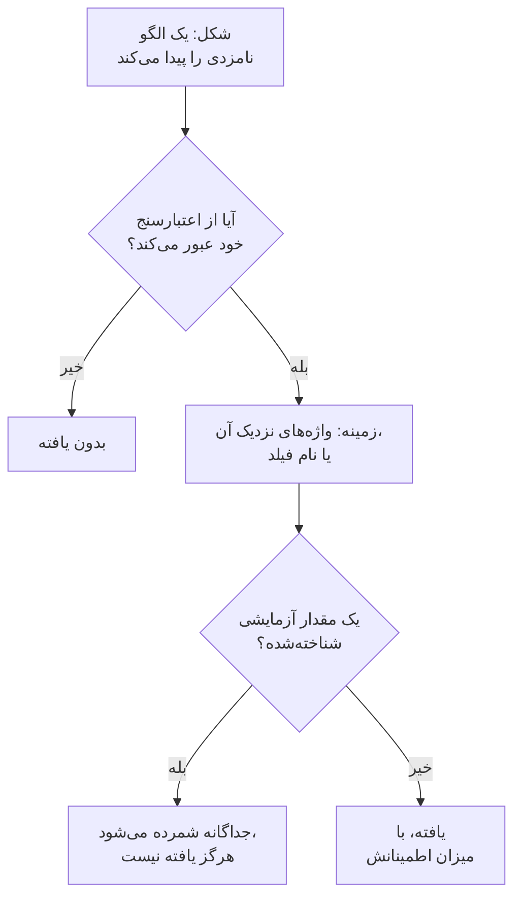

# انواع داده‌های حساس

امنیت داده ۱۴۳ گونه از داده‌های حساس را می‌شناسد: شماره کارت‌ها، حساب‌های بانکی، شناسه‌های ملی ۴۳ کشور، شناسه‌های سلامت، کلیدها و توکن‌های API، و دسته‌های ویژهٔ دادهٔ شخصی. هر کدام یک دسته، یک حساسیت و، وقتی به یک کشور تعلق دارد، آن کشور را دارد. این صفحه می‌گوید یک مقدار چگونه پیدا می‌شود و همهٔ انواع داده را فهرست می‌کند، تا بتوانید بفهمید چرا چیزی پیدا شده و تصمیم بگیرید با آن چه کنید.

:::cards
- [یک مقدار چگونه پیدا می‌شود](#یک-مقدار-چگونه-پیدا-میشود): شکل، اعتبارسنج، زمینه، مقادیر آزمایشی، اطمینان.
- [فیلدها و ستون‌ها](#فیلدها-و-ستونها): یک ستون یا ویژگی چگونه به‌صورت یک کل سنجیده می‌شود.
- [نام‌ها و نشانی‌های خیابان در متن آزاد](#نامها-و-نشانیهای-خیابان-در-متن-آزاد): مدل کوچک درون اسکنر، و امتیازهایش.
- [همهٔ انواع داده](#انواع-داده-داخلی): هر ۱۴۳ مورد، بر اساس دسته.
- [انواع دادهٔ خودتان](#انواع-دادهٔ-خودتان): شناسه‌های کارمندی، شماره‌های بیمه‌نامه، و کادر «آزمایش».
- [انواع داده‌ای که OneUptime AI پیدا می‌کند](#انواع-دادهای-که-oneuptime-ai-پیدا-میکند): انواع دادهٔ خودتان، پیداشده در فیلدهایی که هیچ آشکارسازی نتوانست جایشان را تعیین کند.
- [حکم‌های OneUptime AI](#حکمهای-oneuptime-ai): حکمی دربارهٔ هر یافته‌ای که منتظر شماست، با تصمیم‌های تیم شما به‌عنوان سابقه.
:::

## یک مقدار چگونه پیدا می‌شود



هر اسکن - یک خط لاگ، یک خانهٔ CSV، یک ردیف پایگاه داده، نخستین بایت‌های یک شیء - همین گام‌ها را اجرا می‌کند:

1. **شکل.** هر نوع داده الگوهایی دارد که مقادیر نامزد را پیدا می‌کنند: شانزده رقم، `AKIA` و شانزده حرف، یک واژه، یک `@` و یک دامنه. یک الگو هرگز درون یک توکن بلندتر منطبق نمی‌شود، پس یک شماره کارت درون رشتهٔ بلندتری از ارقام پیدا نمی‌شود.
2. **اعتبارسنج.** یک مقدار نامزد باید از قواعد خود نوعش عبور کند: یک جمع کنترلی (Luhn برای کارت‌ها، mod 97 برای IBANها، Verhoeff برای شماره‌های Aadhaar، رقم کنترلی بیشتر شناسه‌های ملی)، یک تاریخ واقعی، یک پیشوند شناخته‌شده، تصادفی بودن کافی برای یک راز. نامزدی که رد شود اصلاً یافته نیست. مقادیر جای‌نگهدار مانند `000000000` و `123456789` در همهٔ انواع عددی رد می‌شوند.
3. **زمینه.** واژه‌هایی نزدیک یک مقدار نامزد - به‌طور پیش‌فرض تا ۶۴ نویسه پیش از آن و ۳۲ نویسه پس از آن - که می‌گویند چیست، اطمینان آن را یک سطح بالا می‌برند، و فیلدی که نامش به آن نوع اشاره دارد هم همین‌طور. واژه‌هایی که می‌گویند چیز دیگری است، مانند شماره سفارش یا شماره رهگیری، آن را یک سطح پایین می‌آورند. عددی بدون جمع کنترلی و با شکلی رایج، مانند شماره گذرنامه یا حساب بانکی، فقط کنار واژه‌هایی که نامش را می‌برند به شمار می‌آید.
4. **مقادیر آزمایشی شناخته‌شده.** شماره کارت‌های آزمایشی منتشرشده (مانند `4242 4242 4242 4242` در Stripe)، IBANهای نمونه، آدرس‌هایی در `example.com` و دیگر دامنه‌های رزروشده، آدرس‌های IP مخصوص مستندات، شناسه‌های نمونه‌ای که مستندات دولتی چاپ می‌کنند، کلیدهای حالت آزمایشی مانند `sk_test_` و کلیدهای جای‌نگهدار جداگانه شمرده می‌شوند. این‌ها هرگز یافته نمی‌سازند، پس مخزنی پر از آن‌ها یک محیط آزمایشی دیده می‌شود، نه یک رخنه.
5. **اطمینان.** آنچه باقی می‌ماند یک یافته است، با اطمینانی به اندازه‌ای که شواهدش اجازه می‌دهد.

| اطمینان | معنای آن |
| --- | --- |
| **زیاد** | مقدار از اعتبارسنج خود عبور کرده، و واژه‌های پیرامونش یا فیلدی که در آن قرار دارد می‌گویند چیست - یا، برای یک فیلد، بیشتر مقادیرش از آن نوع‌اند. |
| **متوسط** | مقدار از اعتبارسنج خود عبور کرده بی‌آنکه چیزی در پیرامونش آن را تأیید کند، یا نام فیلد می‌گوید چه چیزی در خود دارد و برخی مقادیر با آن هم‌خوان‌اند. |
| **کم** | شکل منطبق است، اما چیزی آن را تأیید نمی‌کند. |

فقط یافته‌های با اطمینان زیاد و متوسط به شمار می‌آیند: یک مخزن را حساس می‌کنند و می‌توانند یک مسئله باز کنند. یافته‌های با اطمینان کم، جمع‌شده، روی مخزن فهرست می‌شوند تا یک نفر دربارهٔ آن‌ها قضاوت کند: **تأیید** روی یافته‌ای که درست است آن را زیاد می‌کند، و در اسکن‌های بعدی هم زیاد می‌ماند.

وقتی دو نوع داده مدعی نویسه‌های یکسانی باشند، یافتهٔ مطمئن‌تر برنده است: نخست اطمینان بالاتر، سپس آشکارسازی که قواعد خودش چیز بیشتری را ثابت می‌کند، سپس تطابق بلندتر.

یک مقدار همان‌طور که مردم آن را می‌نویسند هم خوانده می‌شود. نویسه‌های گریز درصدی یک URL خوانده می‌شوند، پس یک نشانی IP یا یک نشانی ایمیل در رشتهٔ پرس‌وجو، مانند `jane%40example.com`، پیدا می‌شود. رقم‌های یک شمارهٔ کارت در هر خطی خوانده می‌شوند، مانند رقم‌های تمام‌عرض (`４１１１ １１１１ １１１１ １１１１`) یا رقم‌های عربی-هندی، نخست هر خط جداگانه و سپس با هم. یک نشانی ایمیل در هر خطی پیدا می‌شود، مانند `张伟@example.com` یا `почта@пример.рф`، و یک نشانی IPv6 درست پس از دونقطهٔ یک کلید، مانند `ip:2001:db8::1`. هر یافته همان مقدار است به همان شکلی که نوشته شده، پس یک قاعدهٔ پالایش آن را همان‌جا پنهان می‌کند.

یک مقدار بلند در پنجره‌هایی ۶۴ KB خوانده می‌شود که ۴ KB با هم هم‌پوشانی دارند، تا هر مقدار هر جا که باشد کامل پیدا شود، و از یک مقدار حداکثر ۴ MB خوانده می‌شود.

## فیلدها و ستون‌ها

یک ستون، یک فیلد JSON یا یک ویژگی لاگ به‌صورت یک کل سنجیده می‌شود. نامش به یک نوع داده اشاره می‌کند، و مقادیر نمونه‌برداری‌شده‌اش آن را ثابت می‌کنند. سهم مقادیری که آن نوع را دارند تعیین می‌کند یافته چقدر مطمئن است:

| مقادیری که آن نوع را دارند | اطمینان |
| --- | --- |
| ۶۰٪ یا بیشتر | زیاد |
| ۲۵٪ یا بیشتر | زیاد وقتی نام فیلد به آن نوع اشاره دارد، در غیر این صورت متوسط |
| کمتر | متوسط وقتی نام فیلد به آن نوع اشاره دارد، در غیر این صورت کم: چند ایمیل در ستونی از چیزی دیگر |

فیلدی که میانگین طول مقادیرش بیش از ۸۰ نویسه باشد متن آزاد است - یادداشت‌ها، پیام‌ها، توضیحات - و انتظار نمی‌رود فقط یک نوع را در خود داشته باشد. یافته‌هایش همان اطمینانی را نگه می‌دارند که هر تطابق به‌تنهایی به دست آورده است، و می‌گویند در متن آزاد پیدا شده‌اند. تا ۱٬۰۰۰ مقدار از یک فیلد، و از هر کدام تا ۱۶ KB، طبقه‌بندی می‌شوند.

نام یک فیلد به واژه‌هایش شکسته می‌شود - `customerEmail`، `customer_email` و `customer-email` همگی «customer email» هستند - و راهنمای نام یک نوع وقتی منطبق می‌شود که واژه‌هایش به همان ترتیب و کنار هم بیایند: «date of birth» با `customer_date_of_birth` منطبق می‌شود، نه با `birth_city`. فقط آخرین بخش یک مسیر نقطه‌دار نام خود فیلد است، همراه با بخش پیش از آن وقتی بخش آخر واژه‌ای عمومی مانند `number`، `id` یا `value` باشد: `customer.address.city` یک نشانی خیابان نیست، و `card.number` همچنان یک شماره کارت است.

برخی انواع داده را نمی‌توان از روی مقادیرشان تشخیص داد: هیچ الگویی نام یک شخص را از نام یک خیابان، یا یک دین را از هر واژهٔ دیگری جدا نمی‌کند. این‌ها فقط از روی نام فیلد پیدا می‌شوند، وقتی فیلد مقدار داشته باشد: نام شخص، نام کاربری، جنسیت، ملیت، اطلاعات سلامت، خاستگاه نژادی یا قومی، باور دینی، گرایش جنسی، دیدگاه سیاسی، عضویت در اتحادیهٔ صنفی، دادهٔ زیست‌سنجی، دادهٔ ژنتیکی و سابقهٔ کیفری. آنگاه اطمینان یک نام، یک نام کاربری، یک جنسیت یا یک ملیت وقتی ۶۰٪ یا بیشتر مقادیر شبیه آن باشند زیاد است، و در غیر این صورت متوسط. در متن آزاد، نام افراد و نشانی‌های خیابان را یک مدل کوچک هم پیدا می‌کند: [نام‌ها و نشانی‌های خیابان در متن آزاد](#نامها-و-نشانیهای-خیابان-در-متن-آزاد) را ببینید.

فیلدی که نامش می‌گوید گذرواژه نگه می‌دارد - `password`، `passwordHash`، `pwd`، نه `password_changed_at` - باید یک هش نگه دارد: bcrypt، argon2، scrypt، PBKDF2 یا طرح دیگری که یک مخزن احتمالاً به کار می‌برد. مقادیر خالی، مقادیر جای‌نگهدار مانند `********` و مقادیر رمزگذاری‌شده کنار گذاشته می‌شوند. وقتی از بقیه، مقادیری که هش نیستند بیشتر از هش‌ها باشند، فیلد خود گذرواژه‌ها را نگه می‌دارد، که هیچ الگویی نمی‌تواند ببیند، و مخزن در [گذرواژه‌ها به‌صورت متن ساده ذخیره شده‌اند](/docs/data-security/checks-and-issues#بهداشت-داده) ناموفق می‌شود.

### فیلدهایی که هیچ آشکارسازی نتوانست جایشان را تعیین کند

ستون یا فیلدی که نامش به هیچ نوع داده‌ای اشاره نمی‌کند، و مقدارهایش با هیچ آشکارسازی جور نمی‌شود، معلوم نیست امن باشد: ممکن است شمارهٔ مشتری خود شما باشد، یا ستونی که به زبان دیگری نام‌گذاری شده است. وقتی **فعال کردن هوش مصنوعی** در پروژه روشن است، یک اسکن محتوا چنین فیلدهایی را نگه می‌دارد، حداکثر ۲۰۰ فیلد در هر اسکن، و از OneUptime AI پرسیده می‌شود هر کدام کدام یک از انواع دادهٔ پروژه را در خود دارد، حداکثر ۴۰ فیلد از یک مخزن در هر بار. فقط نام فیلد، نام فیلدهای کناری و شکل مقدارهایش به آن گفته می‌شود - هر حرف به شکل `a` یا `A` و هر رقم به شکل `9` نوشته می‌شود، پس `AB-1234` می‌شود `AA-9999` - هرگز یک مقدار. دربارهٔ متن آزاد، فیلدهای با کمتر از ۵ مقدار، عددهای صحیح کوچک، و فیلدهایی که نامشان شناسه، زمان یا وضعیت است پرسیده نمی‌شود.

اسکن تله‌متری هم ویژگی‌هایی را که هیچ آشکارسازی جایشان را تعیین نکرد به همین شکل نگه می‌دارد، از لاگ‌ها، اسپن‌ها، متریک‌ها و بقیهٔ تله‌متری یک سرویس، در هر اسکن حداکثر ۵۰ مورد برای هر سرویس. هرگز ویژگی‌های خود OneUptime را نگه نمی‌دارد، نه ویژگی‌هایی را که قراردادهای OpenTelemetry روی هر رکورد می‌نویسند تا بگویند از کجا آمده، مثل سرویس، میزبان یا پاد، و نه متن آزاد را، مثل بدنهٔ یک لاگ.

هر نوعی که OneUptime AI نام می‌برد یک یافتهٔ با اطمینان کم است، با برچسب **پیشنهاد OneUptime AI** و دلیلش، که به زبان پروژهٔ شما نوشته می‌شود و در سراسر ردیف یافته نشان داده می‌شود. مانند هر یافتهٔ با اطمینان کم، تا وقتی یک نفر در صفحهٔ **محتوا** مخزن **تأیید** را انتخاب نکند در هیچ چیز به شمار نمی‌آید؛ **علامت‌گذاری به‌عنوان غیرحساس** آن را رد می‌کند. فیلدی که پاسخ گرفته تا ۳۰ روز دوباره پرسیده نمی‌شود، و فیلدی که یک نفر دربارهٔ آن قضاوت کرده دیگر هرگز.

## نام‌ها و نشانی‌های خیابان در متن آزاد

هیچ الگویی نام یک شخص را از هر واژهٔ دیگری تشخیص نمی‌دهد. برای همین متن آزاد - یادداشت پشتیبانی، یک خط لاگ، پیام یک استثنا، یک پرامپت - را یک مدل زبانی کوچک هم می‌خواند که نام افراد و نشانی‌های خیابان را پیدا می‌کند. مدل درون اسکنر اجرا می‌شود، روی کارگرهای OneUptime و روی پراب‌های شما: متن هرگز از اسکنر بیرون نمی‌رود، هنگام اجرا چیزی دانلود نمی‌شود، و هیچ پرامپتی نوشته نمی‌شود. این مدل OneUptime AI نیست، و کلیدهای OneUptime AI آن را روشن یا خاموش نمی‌کنند: این کار را **پیدا کردن نام‌ها و نشانی‌های خیابان** می‌کند.

- **چه چیزی را می‌خواند.** فیلدی که مقدارهایش به‌طور میانگین بیش از ۸۰ نویسه‌اند، و در تله‌متری هر بدنهٔ لاگ، پیام استثنا، ردِ پشته و گفتگوی هوش مصنوعی، هر قدر هم کوتاه باشد. تا ۱۰۰ مقدار متفاوت از یک فیلد را می‌خواند، روی هم ۳۲ KB متن، و تا ۱۶ KB از یک مقدار.
- **چه چیزی را پیدا می‌کند.** یک **نام شخص** (`person-name`)، و یک **نشانی خیابان** (`postal-address`): جایی که مدل آن را کنار یک پلاک می‌خواند، مانند `14 Calle Mayor`، همراه با کد پستی و شهری که پس از آن می‌آیند. یک شهر یا یک کشور به‌تنهایی نشانی خیابان نیست.
- **چقدر مطمئن است.** نام یا نشانی‌ای که مدل پیدا می‌کند به‌خودی‌خود اطمینان متوسط دارد. وقتی نام فیلد بگوید فیلد نام یا نشانی نگه می‌دارد، یا واژه‌های نزدیک آن چنین بگویند، مانند "customer"، "Kunde" یا "dirección"، اطمینانش زیاد است. وقتی مدل از آن مطمئن نیست، با امتیازی کمتر از ۰٫۶، اطمینانش کم است. هر کدام اطمینانی را نگه می‌دارد که خودش به دست آورده، پس یک نام در میان هزار خط لاگ همچنان متوسط است.
- **مقادیر آزمایشی.** جای‌نگهدارهایی مانند `Jane Doe`، `John Smith`، `Max Mustermann` و `123 Main Street` جداگانه شمرده می‌شوند، همان‌طور که مقادیر آزمایشی هر نوع.
- **چه چیزی نگه می‌دارد.** نمونه‌هایش مانند نامی که از روی نام فیلد پیدا شده پوشانده می‌شوند: نویسهٔ نخست و چهار ستاره، `M****`. هرگز برایشان اثرانگشت ساخته نمی‌شود. در صفحهٔ **محتوا** مخزن، کنار چنین یافته‌ای نوشته شده **مدل اسکنر آن را در متن آزاد پیدا کرد**.

| مدل | پروانه | اندازه | بازبینی | زبان‌های سنجیده‌شده |
| --- | --- | --- | --- | --- |
| [openmasq/ner-multilingual](https://huggingface.co/openmasq/ner-multilingual): شش لایه از BERT چندزبانه، ONNX با int8 | Apache 2.0 | ۹۸ MB | `8cf7273` | انگلیسی، اسپانیایی، آلمانی، فرانسوی، ایتالیایی، پرتغالی، هلندی |

### چقدر خوب آن‌ها را پیدا می‌کند

این مدل با کد خود اسکنر روی مجموعه‌آزمونی سنجیده شد که برای همین نوشته شد: ۳۹۲ جملهٔ ساختگی به هفت زبان - خط‌های لاگ، یادداشت‌های پشتیبانی، ایمیل‌ها، پرامپت‌ها - که ۱۶۸ تای آن‌ها نه نامی دارند نه نشانی‌ای. یک یافته درست است وقتی با نام یا نشانی‌ای از نوع خودش هم‌پوشانی داشته باشد. معیار پیش از سنجیدن هر مدلی نوشته شد: دقت (precision) دست‌کم ۰٫۹۰ برای هر نوع در همهٔ زبان‌ها و ۰٫۸۵ در هر زبان، بازخوانی (recall) دست‌کم ۰٫۷۰، و حداکثر ۲۰ یافتهٔ نادرست در هر ۱٬۰۰۰ مقداری که هیچ‌کدام را ندارد. از چهار مدل سنجیده‌شده، دو مدل از معیار گذشتند و کوچک‌ترشان انتخاب شد. یک آزمون این امتیازها را نگه می‌دارد: تغییری در مدل یا اسکنر که یکی از آن‌ها را پایین بیاورد شکست می‌خورد.

| زبان | نام‌ها: دقت | نام‌ها: بازخوانی | نشانی‌ها: دقت | نشانی‌ها: بازخوانی |
| --- | --- | --- | --- | --- |
| انگلیسی | ۰٫۹۶ | ۰٫۹۶ | ۱٫۰۰ | ۱٫۰۰ |
| اسپانیایی | ۰٫۹۶ | ۰٫۹۶ | ۱٫۰۰ | ۱٫۰۰ |
| آلمانی | ۱٫۰۰ | ۰٫۹۳ | ۱٫۰۰ | ۱٫۰۰ |
| فرانسوی | ۰٫۹۶ | ۰٫۹۶ | ۱٫۰۰ | ۱٫۰۰ |
| ایتالیایی | ۰٫۹۶ | ۰٫۹۶ | ۱٫۰۰ | ۱٫۰۰ |
| پرتغالی | ۰٫۹۳ | ۰٫۸۹ | ۱٫۰۰ | ۱٫۰۰ |
| هلندی | ۰٫۹۶ | ۰٫۸۹ | ۱٫۰۰ | ۱٫۰۰ |
| هر هفت زبان | ۰٫۹۶ | ۰٫۹۴ | ۱٫۰۰ | ۱٫۰۰ |

روی ۱۶۸ جملهٔ مجموعه‌آزمون که هیچ‌کدام را ندارند، ۱۸ یافتهٔ نادرست در هر ۱٬۰۰۰ دارد. روی بخشی از یک بنچمارک عمومی، [gretelai/synthetic_pii_finance_multilingual](https://huggingface.co/datasets/gretelai/synthetic_pii_finance_multilingual) (Apache 2.0): ۱۵ سند مالی در هر یک از هفت زبان، با برچسب‌هایی که ماشین زده و کامل نیستند، پس آن را کنار جدول بالا بخوانید، نه به‌تنهایی:

| زبان | نام‌ها: دقت | نام‌ها: بازخوانی | نشانی‌ها: دقت | نشانی‌ها: بازخوانی |
| --- | --- | --- | --- | --- |
| انگلیسی | ۰٫۹۱ | ۰٫۹۰ | ۰٫۸۳ | ۱٫۰۰ |
| اسپانیایی | ۰٫۸۹ | ۰٫۳۷ | ۰٫۵۸ | ۰٫۷۰ |
| آلمانی | ۰٫۹۳ | ۰٫۵۸ | ۰٫۷۵ | ۰٫۷۰ |
| فرانسوی | ۰٫۸۴ | ۰٫۵۰ | ۰٫۴۲ | ۰٫۸۳ |
| ایتالیایی | ۰٫۷۳ | ۰٫۶۱ | ۰٫۷۹ | ۰٫۶۹ |
| هلندی | ۰٫۹۱ | ۰٫۴۹ | ۱٫۰۰ | ۰٫۸۹ |
| سوئدی | ۱٫۰۰ | ۰٫۶۱ | ۱٫۰۰ | ۰٫۹۳ |
| هر هفت زبان | ۰٫۸۹ | ۰٫۵۴ | ۰٫۷۷ | ۰٫۸۲ |

چهار مدل سنجیده‌شده، روی مجموعه‌آزمون نوشته‌شده، یکی پس از دیگری روی یک ماشین، هر کدام روی یک هسته با کد بومی onnxruntime زمان‌سنجی شده. OneUptime مدل انتخاب‌شده را با WebAssembly در onnxruntime اجرا می‌کند که در هر ایمیجی اجرا می‌شود، پنج تا هشت برابر کندتر:

| مدل | پروانه | اندازه | نام‌ها: دقت / بازخوانی | نشانی‌ها: دقت / بازخوانی | یافتهٔ نادرست در هر ۱٬۰۰۰ | زمان برای هر ۱٬۰۰۰ مقدار ۷۵ / ۱٬۱۸۱ نویسه‌ای |
| --- | --- | --- | --- | --- | --- | --- |
| openmasq/ner-multilingual (انتخاب‌شده) | Apache 2.0 | ۹۸ MB | ۰٫۹۶۳ / ۰٫۹۳۹ | ۱٫۰۰۰ / ۱٫۰۰۰ | ۱۸ | ۵٫۹ ثانیه / ۸۲ ثانیه |
| Wismut/nym-pii-multilingual-small | MIT | ۱۲۱ MB | ۰٫۹۹۵ / ۰٫۹۷۴ | ۰٫۹۸۵ / ۱٫۰۰۰ | ۱۲ | ۷٫۴ ثانیه / ۱۰۳ ثانیه |
| jkomyno/minilmv2-l6-h384-ner-en-it-q8 | MIT | ۳۴ MB | ۰٫۷۰۴ / ۰٫۹۲۹ | ۰٫۸۳۹ / ۱٫۰۰۰ | ۳۶۹ | ۳٫۷ ثانیه / ۶۸ ثانیه |
| balticml/mmbert-small-pii-redaction | Apache 2.0 | ۳۸ MB | ۰٫۷۱۲ / ۰٫۹۹۵ | ۰٫۷۶۲ / ۰٫۹۹۲ | ۵۸۹ | ۷٫۸ ثانیه / ۱۵۹ ثانیه |

### کجا اجرا می‌شود، و چه هزینه‌ای دارد

- **در هر ایمیج.** ایمیج App، که کارگرها را اجرا می‌کند، و ایمیج پراب مدل، واژگانش و محیط اجرا را با خود دارند، ایمیج‌های بدون اتصال به اینترنت و Iron Bank هم: حدود ۱۱۴ MB روی دیسک. این‌ها هنگام ساخت ایمیج از یک بازبینی ثابت آورده و با SHA-256 خودشان بررسی می‌شوند. هنگام اجرای اسکن چیزی دانلود نمی‌شود.
- **حافظه.** نخستین باری که اسکنی به آن نیاز دارد بارگذاری می‌شود، یک بار در هر فرایند: حدود ۵۵۰ MB، که پس از ۱۰ دقیقه بدون اسکن آزاد می‌شود.
- **زمان.** روی یک هسته، از ۳۰ ثانیه تا یک دقیقه برای هر ۱٬۰۰۰ مقدار به درازای یک خط لاگ، و حدود ۹ دقیقه برای هر ۱٬۰۰۰ مقدار ۱٬۲۰۰ نویسه‌ای. اسکن محتوای یک مخزن تا ۲ دقیقه به آن می‌دهد. اسکن ساعتی تله‌متری روی هم تا ۱ دقیقه و برای هر مخزن ۶ ثانیه به آن می‌دهد، هر ساعت به دستهٔ دیگری از مخزن‌ها.
- **وقتی زمانش تمام می‌شود**، اسکن با آنچه مدل خوانده تمام می‌شود، و هشدارهایش می‌گویند چند مقدار از متن آزاد را خوانده، هرگز چه چیزی را. کارگر یا پرابی که مدل را ندارد مانند گذشته اسکن می‌کند و دلیلش را می‌گوید:

```text
Names and street addresses were looked for in 120 of 500 free-text values: this store's 6 seconds of model time ran out.
Names and street addresses in free text were not looked for: the model's model_quantized.onnx is not installed on this probe.
```

**پیدا کردن نام‌ها و نشانی‌های خیابان** در هر پروژه روشن است: اسکن‌های محتوای باکت‌ها، پایگاه‌های داده و مجموعه‌داده‌های BigQuery متن آزاد را با مدل می‌خوانند، روی کارگرها و روی پراب‌ها. **پیدا کردن نام‌ها و نشانی‌های خیابان در تله‌متری**، زیر آن، خاموش است: یک بار خواندن هر بدنهٔ لاگ، استثنا و گفتگوی یک پروژهٔ پرکار با ۲۰۰ سرویس حدود ۴۸ دقیقه از یک هسته وقت می‌گیرد، و دقیقهٔ ساعتی اسکن حدود ۴٪ آن را می‌خواند. آن را روشن کنید تا هر اسکن ساعتی بخشی از آن‌ها را بخواند. هر دو در **امنیت داده** > **تنظیمات** > **تنظیمات اسکن**، زیر **آنچه امنیت داده می‌خواند** هستند. **آزمایش** در مرورگر شما و بدون مدل اجرا می‌شود: آنچه مدل پیدا می‌کرد آنجا نشان داده نمی‌شود.

## حساسیت

| حساسیت | معنای آن |
| --- | --- |
| **محدود** | اگر نشت کند آسیب در پی دارد: رازها، شماره کارت‌ها، سوابق سلامت، شناسه‌های دولتی. |
| **محرمانه** | دادهٔ شخصی، و اسنادی که محرمانه علامت خورده‌اند. |
| **داخلی** | دادهٔ خود کسب‌وکار، که برای افراد بیرونی نیست. |
| **عمومی** | چیز حساسی پیدا نشد. |

یک مخزن به اندازهٔ حساس‌ترین نوع داده‌ای که با اطمینان دست‌کم متوسط در آن پیدا شده حساس است. مقادیر آزمایشی و یافته‌هایی که غیرحساس علامت خورده‌اند هیچ به شمار نمی‌آیند، و مخزنی که چیزی در آن پیدا نشده عمومی است. برای اینکه با یک مخزن حساس‌تر یا کم‌حساس‌تر از آنچه یافته‌هایش می‌گویند رفتار شود، حساسیتش را خودتان در **تنظیمات** مخزن تعیین کنید: آنگاه بررسی‌ها همان را به کار می‌برند.

## دسته‌ها

| دسته | چه چیزی را پوشش می‌دهد | دادهٔ شخصی |
| --- | --- | --- |
| رازها و اعتبارنامه‌ها | گذرواژه‌ها، کلیدهای API، توکن‌ها و کلیدهای خصوصی که قفل سیستم‌های دیگر را باز می‌کنند. | خیر |
| مالی | شماره کارت‌ها، حساب‌های بانکی، IBANها و کیف‌پول‌های رمزارز. | بله |
| سلامت | شماره‌های پرونده پزشکی، شناسه‌های سلامت، تشخیص‌ها و نسخه‌های پزشکی. | بله |
| شناسه دولتی | شماره‌های هویت ملی، مالیاتی، گذرنامه و تأمین اجتماعی. | بله |
| دستهٔ ویژه | آنچه ماده ۹ GDPR بیش از همه از آن محافظت می‌کند: قومیت، دین، گرایش جنسی، سیاست، عضویت در اتحادیه، و دادهٔ زیست‌سنجی و ژنتیکی. | بله |
| تماس و هویت | اینکه کسی کیست و چگونه می‌توان با او تماس گرفت: ایمیل، تلفن، نشانی، تاریخ تولد، آدرس IP. | بله |
| محرمانهٔ کسب‌وکار | اسنادی که محرمانه، فقط داخلی یا دارای امتیاز حقوقی علامت خورده‌اند. | خیر |

دادهٔ شخصی داده‌ای دربارهٔ یک شخص است، به همان معنایی که GDPR، CCPA، LGPD و DPDP در نظر دارند. مخزنی که فقط رازها و اسناد کسب‌وکار را نگه می‌دارد بیرون از دامنهٔ یک چارچوب حریم خصوصی است، اما هرگز بیرون از دامنهٔ یک چارچوب امنیتی نیست ([انطباق امنیت داده](/docs/data-security/compliance) را ببینید).

## انواع داده داخلی

نوع داده‌ای که به یک کشور تعلق دارد، آن کشور را به‌صورت یک کد ISO 3166-1 نام می‌برد: قواعد محل نگهداری داده و چارچوب‌های وابسته به کشور آن را می‌خوانند ([محل نگهداری داده](/docs/data-security/flows-access-residency#قواعد-محل-نگهداری-داده) را ببینید). شناسه همان نامی است که API و یافته‌ها نوع را با آن نام می‌برند.

### تماس و هویت

| نوع داده | شناسه | چیست | حساسیت | کشور |
| --- | --- | --- | --- | --- |
| آدرس ایمیل | `email-address` | آدرس ایمیل یک شخص. | محرمانه | — |
| شماره تلفن | `phone-number` | یک شماره تلفن در قالب بین‌المللی یا ملی. | محرمانه | — |
| نام شخص | `person-name` | نام، نام خانوادگی یا نام کامل یک شخص، که از روی نام فیلد، یا با مدل اسکنر در متن آزاد پیدا می‌شود. | محرمانه | — |
| نشانی خیابان | `postal-address` | یک نشانی خیابان: یک پلاک، نام خیابان و نوع خیابان. | محرمانه | — |
| کد پستی | `postal-code` | یک کد پستی. به‌تنهایی محدودهٔ محل زندگی کسی را تنگ‌تر می‌کند. | داخلی | — |
| تاریخ تولد | `date-of-birth` | تاریخی کنار واژه‌هایی که می‌گویند تاریخ تولد کسی است. | محرمانه | — |
| آدرس IP | `ip-address` | یک آدرس IPv4 یا IPv6 عمومی، که GDPR آن را دادهٔ شخصی می‌داند. | محرمانه | — |
| آدرس MAC | `mac-address` | آدرس سخت‌افزاری یک کارت شبکه، که یک دستگاه را شناسایی می‌کند. | محرمانه | — |
| شناسه تبلیغاتی | `advertising-id` | یک شناسه تبلیغاتی موبایل (IDFA، GAID، AAID) که یک دستگاه را ردیابی می‌کند. | محرمانه | — |
| موقعیت دقیق | `geolocation` | عرض و طول جغرافیایی‌ای آن‌قدر دقیق که بتوان یک ساختمان را پیدا کرد. | محرمانه | — |
| نام کاربری | `username` | نام ورود یا نام حساب یک شخص، که از روی نام فیلد پیدا می‌شود. | محرمانه | — |
| جنسیت | `gender` | جنسیت یا جنس یک شخص، که از روی نام فیلد پیدا می‌شود. | محرمانه | — |
| ملیت | `nationality` | ملیت یا تابعیت یک شخص، که از روی نام فیلد پیدا می‌شود. | محرمانه | — |
| شماره شناسایی خودرو | `vehicle-identification-number` | یک VIN با ۱۷ نویسه و رقم کنترلی معتبر. | محرمانه | — |

### شناسه دولتی

| نوع داده | شناسه | چیست | حساسیت | کشور |
| --- | --- | --- | --- | --- |
| شماره تأمین اجتماعی آمریکا | `us-ssn` | یک شماره تأمین اجتماعی آمریکا. | محدود | US |
| شناسه مالیات‌دهنده آمریکا (ITIN) | `us-itin` | یک شماره شناسایی مالیات‌دهندهٔ انفرادی آمریکا. | محدود | US |
| شناسه کارفرمای آمریکا (EIN) | `us-ein` | یک شماره شناسایی کارفرمای آمریکا، کنار واژه‌هایی که همین را می‌گویند. | محرمانه | US |
| شماره گذرنامه آمریکا | `us-passport` | یک شماره گذرنامهٔ آمریکا، کنار واژه‌هایی که همین را می‌گویند. | محدود | US |
| شماره گواهینامه رانندگی آمریکا | `us-drivers-license` | یک شماره گواهینامهٔ رانندگی آمریکا، کنار واژه‌هایی که همین را می‌گویند. | محدود | US |
| شماره بیمه ملی بریتانیا | `uk-nino` | یک شماره بیمهٔ ملی بریتانیا. | محدود | GB |
| شماره گذرنامه بریتانیا | `uk-passport` | یک شماره گذرنامهٔ بریتانیا، کنار واژه‌هایی که همین را می‌گویند. | محدود | GB |
| شماره گواهینامه رانندگی بریتانیا | `uk-driving-licence` | یک شماره گواهینامهٔ رانندگی بریتانیا با ۱۶ نویسه. | محدود | GB |
| شماره بیمه اجتماعی کانادا | `ca-sin` | یک شماره بیمهٔ اجتماعی کانادا با رقم کنترلی معتبر. | محدود | CA |
| CURP مکزیک | `mx-curp` | یک Clave Única de Registro de Población مکزیکی. | محدود | MX |
| RFC مکزیک | `mx-rfc` | یک شناسه مالیاتی Registro Federal de Contribuyentes مکزیکی. | محدود | MX |
| CPF برزیل | `br-cpf` | یک شماره Cadastro de Pessoas Físicas برزیلی. | محدود | BR |
| CNPJ برزیل | `br-cnpj` | یک شماره ثبت شرکت برزیلی (CNPJ). | محرمانه | BR |
| CUIT / CUIL آرژانتین | `ar-cuit` | یک کد شناسایی مالیاتی یا کاری آرژانتینی. | محدود | AR |
| RUT شیلی | `cl-rut` | یک Rol Único Tributario شیلیایی با رقم کنترلی معتبر. | محدود | CL |
| DNI اسپانیا | `es-dni` | شماره سند هویت ملی اسپانیایی با حرف کنترلی آن. | محدود | ES |
| NIE اسپانیا | `es-nie` | شماره هویت اتباع خارجی در اسپانیا با حرف کنترلی آن. | محدود | ES |
| NIF پرتغال | `pt-nif` | یک شماره شناسایی مالیاتی پرتغالی. | محدود | PT |
| شماره تأمین اجتماعی فرانسه (NIR) | `fr-nir` | یک شماره INSEE فرانسوی با کلید دورقمی آن. | محدود | FR |
| شناسه مالیاتی آلمان | `de-tax-id` | یک Steuerliche Identifikationsnummer آلمانی. | محدود | DE |
| codice fiscale ایتالیا | `it-codice-fiscale` | یک کد مالیاتی ایتالیایی با نویسهٔ کنترلی معتبر. | محدود | IT |
| BSN هلند | `nl-bsn` | یک شماره خدمات شهروندی هلندی که از آزمون یازده عبور می‌کند. | محدود | NL |
| شماره ملی بلژیک | `be-national-number` | یک شماره ثبت ملی بلژیکی. | محدود | BE |
| PESEL لهستان | `pl-pesel` | یک شماره شناسایی ملی لهستانی. | محدود | PL |
| شماره هویت شخصی سوئد | `se-personnummer` | یک personnummer سوئدی با رقم کنترلی معتبر. | محدود | SE |
| شماره هویت ملی نروژ | `no-fodselsnummer` | یک fødselsnummer نروژی با هر دو رقم کنترلی. | محدود | NO |
| شماره CPR دانمارک | `dk-cpr` | یک شماره ثبت مدنی دانمارکی، کنار واژه‌هایی که همین را می‌گویند. | محدود | DK |
| کد هویت شخصی فنلاند | `fi-hetu` | یک henkilötunnus فنلاندی با نویسهٔ کنترلی آن. | محدود | FI |
| شماره PPS ایرلند | `ie-ppsn` | یک شماره خدمات عمومی شخصی ایرلندی. | محدود | IE |
| شماره AHV سوئیس | `ch-ahv` | یک شماره تأمین اجتماعی سوئیسی (AHV / AVS). | محدود | CH |
| CNP رومانی | `ro-cnp` | یک کد عددی شخصی رومانیایی. | محدود | RO |
| EGN بلغارستان | `bg-egn` | یک شماره مدنی یکسان بلغاری. | محدود | BG |
| OIB کرواسی | `hr-oib` | یک شماره شناسایی شخصی کرواسیایی. | محدود | HR |
| AMKA یونان | `gr-amka` | یک شماره تأمین اجتماعی یونانی. | محدود | GR |
| شماره هویت ترکیه | `tr-tckn` | یک شماره T.C. Kimlik ترکیه‌ای. | محدود | TR |
| شماره هویت اسرائیل | `il-teudat-zehut` | یک شماره Teudat Zehut اسرائیلی. | محدود | IL |
| شماره شناسایی آفریقای جنوبی | `za-id` | یک شماره هویت آفریقای جنوبی با تاریخ و رقم کنترلی معتبر. | محدود | ZA |
| Emirates ID امارات | `ae-emirates-id` | شماره کارت هویت امارات متحدهٔ عربی. | محدود | AE |
| شناسه ملی عربستان سعودی | `sa-national-id` | یک شناسه ملی یا شماره اقامهٔ سعودی. | محدود | SA |
| شماره Aadhaar هند | `in-aadhaar` | یک شماره Aadhaar با ۱۲ رقم که از کنترل Verhoeff عبور می‌کند. | محدود | IN |
| PAN هند | `in-pan` | یک شماره حساب دائمی هندی. | محدود | IN |
| شماره هویت مقیم چین | `cn-resident-id` | شماره کارت هویت مقیم چینی با ۱۸ نویسه. | محدود | CN |
| My Number ژاپن | `jp-my-number` | یک شماره فردی ژاپنی با رقم کنترلی معتبر. | محدود | JP |
| شماره ثبت اقامت کره جنوبی | `kr-rrn` | یک شماره ثبت اقامت کره‌ای. | محدود | KR |
| NRIC / FIN سنگاپور | `sg-nric` | شماره کارت هویت سنگاپور یا شماره شناسایی اتباع خارجی. | محدود | SG |
| شماره کارت هویت هنگ‌کنگ | `hk-hkid` | یک شماره کارت هویت هنگ‌کنگ با رقم کنترلی آن. | محدود | HK |
| شناسه ملی تایوان | `tw-national-id` | یک شماره شناسایی ملی تایوانی. | محدود | TW |
| شناسه ملی تایلند | `th-national-id` | یک شماره شناسایی شهروندی تایلندی. | محدود | TH |
| شماره MyKad مالزی | `my-mykad` | یک شماره کارت هویت مالزیایی. | محدود | MY |
| NIK اندونزی | `id-nik` | یک شماره هویت جمعیتی اندونزیایی. | محدود | ID |
| شماره پرونده مالیاتی استرالیا | `au-tfn` | یک شماره پرونده مالیاتی استرالیایی با کنترل معتبر. | محدود | AU |
| شماره IRD نیوزیلند | `nz-ird` | یک شماره سازمان درآمد داخلی نیوزیلند با رقم کنترلی معتبر. | محدود | NZ |
| SNILS روسیه | `ru-snils` | یک شماره حساب بیمهٔ روسی با عدد کنترلی آن. | محدود | RU |
| INN روسیه | `ru-inn` | یک شماره شناسایی مالیات‌دهندهٔ روسی. | محدود | RU |
| شماره گذرنامه | `passport-number` | یک شماره گذرنامه از هر کشوری، کنار واژه‌هایی که همین را می‌گویند. | محدود | — |

### مالی

| نوع داده | شناسه | چیست | حساسیت | کشور |
| --- | --- | --- | --- | --- |
| شماره کارت | `credit-card-number` | یک شماره کارت پرداخت که از کنترل Luhn عبور می‌کند و به یک برند کارت تعلق دارد. | محدود | — |
| کد امنیتی کارت | `card-verification-code` | یک CVV یا CVC، که PCI DSS نگه داشتن آن را پس از مجوز گرفتن یک پرداخت ممنوع می‌کند. | محدود | — |
| تاریخ انقضای کارت | `card-expiration-date` | تاریخ انقضای یک کارت، کنار واژه‌هایی که همین را می‌گویند. | محرمانه | — |
| IBAN | `iban` | یک شماره حساب بانکی بین‌المللی که از کنترل mod-97 عبور می‌کند. | محدود | — |
| شماره حساب بانکی | `bank-account-number` | یک شماره حساب بانکی، کنار واژه‌هایی که همین را می‌گویند. | محدود | — |
| کد SWIFT / BIC | `swift-bic` | کد SWIFT یا BIC یک بانک، کنار واژه‌هایی که همین را می‌گویند. | داخلی | — |
| شماره مسیریابی بانکی آمریکا | `us-bank-routing-number` | یک شماره مسیریابی ABA با جمع کنترلی معتبر، کنار واژه‌هایی که همین را می‌گویند. | داخلی | US |
| کد شعبه بانکی بریتانیا | `uk-sort-code` | یک کد شعبهٔ بانکی بریتانیا، کنار واژه‌هایی که همین را می‌گویند. | داخلی | GB |
| IFSC هند | `in-ifsc` | یک کد سیستم مالی هند که یک شعبهٔ بانک را نام می‌برد. | داخلی | IN |
| BSB استرالیا | `au-bsb` | یک شماره بانک-ایالت-شعبهٔ استرالیایی، کنار واژه‌هایی که همین را می‌گویند. | داخلی | AU |
| آدرس Bitcoin | `bitcoin-address` | یک آدرس Bitcoin با جمع کنترلی معتبر. | محرمانه | — |
| آدرس Ethereum | `ethereum-address` | یک آدرس Ethereum، کنار واژه‌هایی که همین را می‌گویند. | محرمانه | — |

### سلامت

| نوع داده | شناسه | چیست | حساسیت | کشور |
| --- | --- | --- | --- | --- |
| شماره NHS بریتانیا | `uk-nhs-number` | یک شماره خدمات سلامت ملی بریتانیا با رقم کنترلی معتبر. | محدود | GB |
| شناسه ذی‌نفع Medicare آمریکا | `us-medicare-mbi` | یک شناسه ذی‌نفع Medicare آمریکا. | محدود | US |
| شماره Medicare استرالیا | `au-medicare-number` | یک شماره کارت Medicare استرالیایی با رقم کنترلی معتبر. | محدود | AU |
| شماره بیمه درمانی آلمان | `de-health-insurance-number` | یک Krankenversichertennummer آلمانی با رقم کنترلی معتبر. | محدود | DE |
| شماره پرونده پزشکی | `medical-record-number` | شماره پرونده پزشکی یک بیمار، کنار واژه‌هایی که همین را می‌گویند. | محدود | — |
| شناسه عضویت طرح سلامت | `health-plan-id` | یک شماره عضویت یا شماره بیمه‌نامهٔ بیمهٔ درمانی، کنار واژه‌هایی که همین را می‌گویند. | محدود | — |
| کد تشخیص (ICD-10) | `diagnosis-code` | یک کد تشخیص ICD-10، کنار واژه‌هایی که همین را می‌گویند. | محدود | — |
| کد دارو (NDC) | `drug-code` | یک کد ملی داروی آمریکا، کنار واژه‌هایی که همین را می‌گویند. | محرمانه | — |
| شماره DEA آمریکا | `us-dea-number` | شماره اداره مبارزه با مواد مخدر یک تجویزکننده، با رقم کنترلی معتبر. | محرمانه | US |
| شناسه ارائه‌دهنده آمریکا (NPI) | `us-npi` | یک شناسه ملی ارائه‌دهنده. یک ارائه‌دهندهٔ خدمات درمانی را نام می‌برد، نه یک بیمار. | داخلی | US |
| اطلاعات سلامت | `health-information` | تشخیص‌ها، بیماری‌ها، داروها و دیگر جزئیات سلامت، که از روی نام فیلد پیدا می‌شوند. | محدود | — |

### رازها و اعتبارنامه‌ها

| نوع داده | شناسه | چیست | حساسیت | کشور |
| --- | --- | --- | --- | --- |
| شناسه کلید دسترسی AWS | `aws-access-key-id` | نیمهٔ عمومی یک کلید دسترسی AWS. همراه با راز خود، درخواست‌های AWS را امضا می‌کند. | محدود | — |
| کلید دسترسی سری AWS | `aws-secret-access-key` | نیمهٔ سری یک کلید دسترسی AWS، کنار واژه‌هایی که همین را می‌گویند. | محدود | — |
| کلید API Google | `google-api-key` | یک کلید API برای Google Cloud یا Maps. | محدود | — |
| کلید حساب سرویس Google | `google-service-account-key` | فایل کلید یک حساب سرویس Google Cloud همراه با کلید خصوصی آن. | محدود | — |
| راز کلاینت Google OAuth | `google-oauth-client-secret` | یک راز کلاینت Google OAuth. | محدود | — |
| کلید حساب ذخیره‌سازی Azure | `azure-storage-account-key` | یک کلید حساب ذخیره‌سازی Azure یا رشته اتصالی که چنین کلیدی را در خود دارد. | محدود | — |
| توکن SAS در Azure | `azure-sas-token` | یک امضای دسترسی مشترک Azure، که بدون ورود دسترسی می‌دهد. | محدود | — |
| راز کلاینت Azure | `azure-client-secret` | راز کلاینت یک برنامهٔ Microsoft Entra ID. | محدود | — |
| توکن GitHub | `github-token` | یک توکن دسترسی شخصی، OAuth، برنامه یا ریزدانهٔ GitHub. | محدود | — |
| توکن GitLab | `gitlab-token` | یک توکن دسترسی شخصی GitLab. | محدود | — |
| توکن Slack | `slack-token` | یک توکن ربات، کاربر یا برنامهٔ Slack. | محدود | — |
| URL وب‌هوک Slack | `slack-webhook-url` | یک وب‌هوک ورودی Slack، که به هر کسی اجازه می‌دهد در یک کانال پست بگذارد. | محدود | — |
| کلید سری Stripe | `stripe-secret-key` | یک کلید سری یا محدودشدهٔ live در Stripe، که می‌تواند پول جابه‌جا کند. | محدود | — |
| کلید API Twilio | `twilio-api-key` | یک SID کلید API در Twilio همراه با راز آن. | محدود | — |
| کلید API SendGrid | `sendgrid-api-key` | یک کلید API در SendGrid. | محدود | — |
| کلید API Mailgun | `mailgun-api-key` | یک کلید API در Mailgun. | محدود | — |
| کلید API Mailchimp | `mailchimp-api-key` | یک کلید API در Mailchimp. | محدود | — |
| کلید API OpenAI | `openai-api-key` | یک کلید API در OpenAI، که اعتبار حساب را خرج می‌کند. | محدود | — |
| کلید API Anthropic | `anthropic-api-key` | یک کلید API در Anthropic. | محدود | — |
| توکن Hugging Face | `huggingface-token` | یک توکن Hugging Face. | محدود | — |
| توکن npm | `npm-token` | یک توکن دسترسی npm، که می‌تواند بسته منتشر کند. | محدود | — |
| توکن PyPI | `pypi-token` | یک توکن بارگذاری PyPI. | محدود | — |
| توکن Docker Hub | `docker-hub-token` | یک توکن دسترسی شخصی Docker Hub. | محدود | — |
| توکن Shopify | `shopify-token` | یک توکن دسترسی یا برنامهٔ Shopify. | محدود | — |
| توکن Square | `square-token` | یک توکن دسترسی یا راز Square. | محدود | — |
| توکن دسترسی Braintree | `braintree-access-token` | یک توکن دسترسی محیط تولید Braintree. | محدود | — |
| توکن DigitalOcean | `digitalocean-token` | یک توکن دسترسی شخصی DigitalOcean. | محدود | — |
| کلید API New Relic | `new-relic-api-key` | یک کلید API کاربر در New Relic. | محدود | — |
| کلید API Datadog | `datadog-api-key` | یک کلید API یا کلید برنامهٔ Datadog، کنار واژه‌هایی که همین را می‌گویند. | محدود | — |
| توکن HashiCorp Vault | `vault-token` | یک توکن سرویس HashiCorp Vault. | محدود | — |
| توکن Terraform Cloud | `terraform-cloud-token` | یک توکن API برای Terraform Cloud یا Enterprise. | محدود | — |
| توکن API Atlassian | `atlassian-api-token` | یک توکن API در Atlassian. | محدود | — |
| کلید API Linear | `linear-api-key` | یک کلید API در Linear. | محدود | — |
| توکن وب JSON | `json-web-token` | یک JWT امضاشده، که اغلب یک توکن نشست یا دسترسی است. | محدود | — |
| کلید خصوصی | `private-key` | یک بلوک کلید خصوصی PEM، OpenSSH یا PGP. | محدود | — |
| گذرواژه در یک URL | `password-in-url` | URLی که یک نام کاربری و گذرواژه را در خود دارد، مانند رشته اتصال یک پایگاه داده. | محدود | — |
| گذرواژه در یک رشته اتصال | `connection-string-password` | یک مقدار Password= یا Pwd= در یک رشته اتصال. | محدود | — |
| سرآیند Authorization | `authorization-header` | یک اعتبارنامهٔ Basic یا Bearer که از یک سرآیند HTTP Authorization کپی شده است. | محدود | — |
| گذرواژه یا راز | `generic-secret` | مقداری که به یک گذرواژه، راز، کلید API یا توکن نسبت داده شده و آن‌قدر تصادفی به نظر می‌رسد که واقعی باشد. | محدود | — |
| کلید خصوصی Bitcoin | `bitcoin-private-key` | یک کلید خصوصی Bitcoin در قالب واردکردن کیف پول، با جمع کنترلی معتبر. | محدود | — |

### دستهٔ ویژه

| نوع داده | شناسه | چیست | حساسیت | کشور |
| --- | --- | --- | --- | --- |
| خاستگاه نژادی یا قومی | `racial-or-ethnic-origin` | نژاد یا قومیت، که از روی نام فیلد پیدا می‌شود. | محدود | — |
| باور دینی | `religious-belief` | دین یا باور، که از روی نام فیلد پیدا می‌شود. | محدود | — |
| گرایش جنسی | `sexual-orientation` | گرایش جنسی، که از روی نام فیلد پیدا می‌شود. | محدود | — |
| دیدگاه سیاسی | `political-opinion` | دیدگاه‌های سیاسی یا عضویت حزبی، که از روی نام فیلد پیدا می‌شوند. | محدود | — |
| عضویت در اتحادیهٔ صنفی | `trade-union-membership` | عضویت در اتحادیهٔ صنفی، که از روی نام فیلد پیدا می‌شود. | محدود | — |
| دادهٔ زیست‌سنجی | `biometric-data` | اثر انگشت، الگوی چهره، اثر صوتی و دیگر داده‌های زیست‌سنجی، که از روی نام فیلد پیدا می‌شوند. | محدود | — |
| دادهٔ ژنتیکی | `genetic-data` | دادهٔ DNA و ژنوم، که از روی نام فیلد پیدا می‌شود. | محدود | — |
| سابقهٔ کیفری | `criminal-record` | محکومیت‌ها و جرایم کیفری (ماده ۱۰ GDPR)، که از روی نام فیلد پیدا می‌شوند. | محدود | — |

### محرمانهٔ کسب‌وکار

| نوع داده | شناسه | چیست | حساسیت | کشور |
| --- | --- | --- | --- | --- |
| سند دارای امتیاز حقوقی | `privileged-document` | سندی که با عنوان امتیاز وکیل و موکل یا امتیاز حقوقی علامت خورده است. | محدود | — |
| سند با علامت محرمانه | `confidential-document` | سندی که با عنوان محرمانه، کاملاً محرمانه یا راز تجاری علامت خورده است. | محرمانه | — |
| سند با علامت داخلی | `internal-document` | سندی که با عنوان فقط برای استفادهٔ داخلی یا نه برای توزیع علامت خورده است. | داخلی | — |

## انواع دادهٔ خودتان

برای چیزی که فقط شرکت شما دارد یک نوع داده اضافه کنید: یک شناسه کارمندی، یک شماره بیمه‌نامه، یک کد پروژه. به **امنیت داده** > **تنظیمات** > **انواع داده** بروید و آن را زیر **انواع داده شما** اضافه کنید. از اسکن بعدی به بعد، دقیقاً مانند انواع داخلی، در باکت‌ها، پایگاه‌های داده و تله‌متری اسکن می‌شود.

:::steps
### بگویید چیست

به آن یک **نام**، مانند شناسه کارمندی، یک **دسته** و یک **حساسیت** بدهید: اینکه مخزنی که آن را در خود دارد چقدر حساس است. **توضیحات** برای هر کسی که یافته‌ای از آن را می‌خواند می‌گوید چیست.

### بگویید چگونه پیدا می‌شود

یک **الگو** وارد کنید: یک عبارت باقاعدهٔ JavaScript برای یک مقدار، مانند `EMP-\d{6}`. در **نام فیلدها** نام فیلدهایی را که آن را در خود دارند اضافه کنید، مانند `employee id`، و در **کلیدواژه‌ها** واژه‌هایی را که اگر نزدیک یک مقدار باشند تأیید می‌کنند از همین نوع است. برای اینکه نوع فقط از روی نام فیلدها پیدا شود، الگو را خالی بگذارید.

### آن را بیازمایید

متنی نمونه را در **آزمایش** بچسبانید تا ببینید نوع داده‌تان چه چیزی در آن پیدا می‌کند. این کار کد خود اسکنر را روی متن، در مرورگر شما، اجرا می‌کند: متن هرگز به OneUptime فرستاده نمی‌شود، و فقط ۶۴ KB نخست آن آزمایش می‌شود.
:::

زیر **فیلدهای بیشتر**، **نادیده گرفتن بزرگی و کوچکی حروف** الگو را بدون توجه به بزرگی و کوچکی حروفش منطبق می‌کند، **نیازمند کلیدواژه** یک مقدار را فقط وقتی به شمار می‌آورد که کلیدواژه‌ای نزدیکش باشد یا نام فیلد بگوید از همین نوع است، و **جمع کنترلی** از یک مقدار می‌خواهد از یک کنترل عبور کند: **هیچ‌کدام**، **Luhn** (رقم کنترلی‌ای که شماره کارت‌ها دارند)، **Mod97** (ارقام کنترلی یک IBAN) یا **Verhoeff** (رقم کنترلی یک شماره Aadhaar).

یک الگو هنگام ذخیره اعتبارسنجی می‌شود: باید کامپایل شود، با هیچ متن خالی‌ای منطبق نشود و در زمانی متناسب با طول متن اجرا شود. الگو با تطبیق‌دهنده‌ای اجرا می‌شود که هرگز عقب‌گرد نمی‌کند، پس هیچ الگویی، هر طور که نوشته شده باشد، نمی‌تواند یک اسکن را معطل کند. یک نوع حداکثر ۵۰ کلیدواژه و ۵۰ نام فیلد می‌پذیرد.

مقداری از نوع شما، وقتی از یک جمع کنترلی عبور کند، به‌تنهایی اطمینان متوسط و با کلیدواژه‌ای در نزدیکی‌اش اطمینان زیاد دارد، و وقتی جمع کنترلی نداشته باشد، به‌تنهایی کم و با یک کلیدواژه متوسط. در یک ستون، مانند همهٔ انواع، سهم مقادیر منطبق تعیین‌کننده است.

### توصیف

بالای فرم یک نوع دادهٔ جدید، **توصیف** فرم را برای شما پر می‌کند. بنویسید داده چه شکلی است، مثلاً «شناسه‌های کارمندی ما شبیه EMP-123456 هستند، گاهی بدون خط تیره»، اگر خواستید چند نمونه اضافه کنید، هر خط یکی، و **پر کردن فرم** را انتخاب کنید. OneUptime AI جملهٔ شما و شکل نمونه‌هایتان را دریافت می‌کند، نه خود نمونه‌ها را: نمونه‌ها در مرورگر شما می‌مانند، جایی که **آزمایش** نشان می‌دهد الگویش چند تا از آن‌ها را پیدا می‌کند. آنچه پر کرده را بخوانید، هر چه خواستید تغییر دهید و ذخیره کنید: تا شما ذخیره نکنید چیزی ذخیره نمی‌شود، و الگو مثل الگویی که خودتان نوشته‌اید بررسی می‌شود. توصیف به روشن بودن **فعال کردن هوش مصنوعی** در پروژه نیاز دارد.

## انواع داده‌ای که OneUptime AI پیدا می‌کند

فیلدهایی که هیچ آشکارسازی نتوانست جایشان را تعیین کند اغلب یک نوع دادهٔ مخصوص شرکت شما را در خود دارند که در جاهای زیادی با نام‌هایی هم‌معنا نگه داشته شده است: مثل شماره‌های بیمه‌نامهٔ یک بیمه‌گر در ستون‌هایی به نام `policy_no`، `policyNumber` و `police_nr` در همهٔ پایگاه‌های داده‌اش. وقتی **فعال کردن هوش مصنوعی** در پروژه روشن باشد، OneUptime AI چنین نوع داده‌ای را در فیلدهایی که اسکن‌های شما نگه داشته‌اند پیدا می‌کند و فقط وقتی دربارهٔ آن از شما می‌پرسد که اسکن‌های خودتان آن را ثابت کرده باشند.

:::steps
### یک گروه فیلد پیدا می‌کند

سه فیلد یا بیشتر در دو مخزن یا بیشتر یک گروه می‌سازند وقتی بیشتر مقدارهایشان یک شکل داشته باشند، با جداکننده‌های میان بخش‌هایش یا بدون آن‌ها، و نام‌هایشان واژه‌ای مشترک داشته باشند که بگوید چه چیزی در آن‌هاست. شکلی بدون رقم، تاریخ، ساعت یا عدد اعشاری هرگز گروه نمی‌سازد، و واژه‌ای مثل `id`، `no` یا `number` به‌تنهایی چیزی نمی‌گوید.

### یک نوع داده پیش‌نویس می‌کند

OneUptime AI برای هر گروه تازه یک نوع داده پیش‌نویس می‌کند، هر بار حداکثر ۳ مورد، از نام فیلدها و شکل مقدارهایشان، هرگز از یک مقدار. پیش‌نویس باید همان بررسی‌هایی را بگذراند که یک نوع ذخیره‌شده می‌گذراند و شکل‌هایی را پیدا کند که از آن‌ها پیش‌نویس شده است. پیش‌نویسی که این کار را نکند، یک بار دیگر همراه با دلیلش خواسته می‌شود.

### اسکن‌های بعدی شما آن را ثابت می‌کنند

پیش‌نویس در اسکن بعدی هر مخزن گروهش اجرا می‌شود، حداکثر ۴۸ ساعت یا یک بازهٔ اسکن، هر کدام طولانی‌تر باشد. هیچ یافته‌ای نمی‌سازد: هر اسکن می‌شمارد که چند مقدار را پیدا می‌کرد، در فیلدهای گروه و در هر فیلد دیگر همان مخازن. وقتی پیشنهاد می‌شود که دست‌کم ۸۰٪ مقدارهای فیلدهای خودش و حداکثر ۱٪ مقدارهای دیگر را پیدا کند. فیلدی در جای دیگر که تقریباً همهٔ مقدارهایش را پیدا می‌کند، همان داده را با نام دیگری نگه می‌دارد: نامش آورده می‌شود، نه اینکه علیه آن شمرده شود.
:::

هر پیش‌نویس هم‌زمان به شکل محدودشده هم شمرده می‌شود: بیرون از فیلدهای گروهش، پیش‌نویس محدودشده یک مقدار را فقط وقتی پیدا می‌کند که یکی از کلیدواژه‌هایش کنارش باشد یا زیر نام فیلدی باشد که آن را نام می‌برد. پیش‌نویسی که در جاهای دیگر بیش از حد پیدا می‌کند، اگر کافی باشد به شکل محدودشده پیشنهاد می‌شود. پیش‌نویسی که به هیچ‌یک از این دو شکل کافی نباشد کنار گذاشته می‌شود و گروهش تا ۳۰ روز دوباره پیش‌نویس نمی‌شود.

هر نوع داده‌ای که پیشنهاد می‌کند زیر **انواع داده برای بازبینی** منتظر می‌ماند، بالای **امنیت داده** > **تنظیمات** > **انواع داده** و در **امنیت داده ← هوش مصنوعی**، همراه با آنچه اسکن‌های شما شمرده‌اند، مثلاً «با ۹۸٪ از مقدارهای این ۱۱ فیلد و ۰٫۱٪ از مقدارهای جاهای دیگرِ همین مخازن جور درمی‌آید.» **افزودن نوع داده** فرم یک نوع داده را پرشده با آن باز می‌کند تا آن را تغییر دهید و آزمایش کنید؛ ذخیره کردنش نوع را اضافه می‌کند و اسکن‌ها از اجرای بعدی‌شان آن را پیدا می‌کنند. **نوع داده نیست** آن را رد می‌کند: دیگر هرگز برای آن فیلدها پیشنهاد نمی‌شود. افزودن به نقشی نیاز دارد که بتواند نوع داده بسازد.

## غیرحساس، و هرگز حساس

یک اسکن ممکن است چیزی پیدا کند که آن چیزی نیست که به نظر می‌رسد: ستونی از شماره‌های سفارش که از کنترل Luhn عبور می‌کنند، یا آدرس پشتیبانی خودتان در هر خط لاگ. این را به OneUptime بگویید تا دیگر آن را نشمارد:

- **یافته را غیرحساس علامت بزنید.** در صفحهٔ **محتوا** مخزن، روی یافته **علامت‌گذاری به‌عنوان غیرحساس** را انتخاب کنید و بگویید چرا. دیگر در حساسیت مخزن یا بررسی‌های آن به شمار نمی‌آید، و مخزن بی‌درنگ دوباره بررسی می‌شود. یافته، علامت‌خورده و همراه با دلیل شما، روی مخزن می‌ماند تا نفر بعدی ببیند چه تصمیمی گرفته شده است.
- **مقدار را به «هرگز حساس نیست» بیفزایید**، در تنظیمات امنیت داده، برای مقداری که هیچ‌جا یافته نیست، مانند `support@yourcompany.com`. مقادیر پس از آنکه اسکنر آن‌ها را نرمال‌سازی کرد، بدون توجه به بزرگی و کوچکی حروف مقایسه می‌شوند.
- **یک نوع داده داخلی را خاموش کنید.** زیر **انواع داده داخلی**، در **امنیت داده** > **تنظیمات** > **انواع داده**، هر نوع داده یک کلید دارد که همان لحظه که زده شود ذخیره می‌شود. هیچ اسکنی در پروژه به دنبال نوعی که خاموش است نمی‌گردد.

## حکم‌های OneUptime AI

وقتی **فعال کردن هوش مصنوعی** در پروژه روشن است و **کار روی مسائل جدید** در **امنیت داده ← هوش مصنوعی** روشن است، OneUptime AI پس از هر اسکن یک مخزن، دربارهٔ هر یافتهٔ آن که منتظر یک شخص است حکم می‌دهد. یک یافته وقتی منتظر می‌ماند که اسکن از آن مطمئن نبوده است - یک یافتهٔ با اطمینان کم، یا یکی از پیشنهادهای OneUptime AI - یا وقتی یک یافتهٔ با اطمینان متوسط یا زیاد نشانه‌ای از تطابق اشتباه دارد:

- بیشتر آنچه منطبق شد مقادیر آزمایشی شناخته‌شده بودند؛
- نام فیلد به نوع دادهٔ دیگری اشاره می‌کند، و نه به همین نوع؛
- یک فیلد شناسه، مانند `order_number`، `invoice_no` یا `ref_id`، نوعی را در خود دارد که با الگوریتم Luhn کنترل می‌شود، کنترلی که از هر ده رشتهٔ دلخواه از ارقام یکی از آن عبور می‌کند، و نامش به آن نوع اشاره نمی‌کند.

حکم **تأییدش کنید**، **غیرحساس** یا **قابل تشخیص نیست** است، با دلیلی به زبان پروژهٔ شما. این حکم در سراسر ردیف یافته در صفحهٔ **محتوا** مخزن و در صفحهٔ **در تله‌متری شما** نشان داده می‌شود، همراه با تصمیم‌هایی از تیم شما که بر آن‌ها تکیه دارد، مانند «تیم شما `order_number` را در ۴ مخزن غیرحساس علامت زد». **نمایش تصمیم‌ها** هر کدام را فهرست می‌کند: مخزنش، فیلدش و دلیلی که تیم شما آورد.

### تصمیم‌های تیم شما به‌عنوان سابقه

به OneUptime AI تصمیم‌های پیشین تیم شما دربارهٔ یافته‌های همان نوع داده گفته می‌شود، حداکثر ده مورد. اول تصمیم‌هایی می‌آیند که در فیلدی با همان نام، در هر مخزنی، گرفته شده‌اند: `order_number`، `orderNumber` و `public.orders.order_number` همگی «order number» هستند. در میان آن‌ها همان جایگاه اول می‌آید، سپس تازه‌ترین تصمیم. سپس فیلدهایی می‌آیند که نامشان، یا دلیل‌هایی که برایشان آمده، همان چیز را می‌گوید، مانند `order_ref` با دلیل «Shopify order numbers». به آن گفته می‌شود هر یافته کجا بود، چه تصمیمی گرفته شد و چه دلیلی آمد، بدون هیچ مقداری که در یک دلیل آمده باشد. هرگز یک مقدار، یک نمونهٔ پوشانده‌شده یا یک رکورد به آن گفته نمی‌شود.

یافته‌ای در متن آزاد، مانند بدنهٔ یک لاگ یا یک پیام، نام فیلدی ندارد که بتوان با آن جورش کرد. سابقهٔ آن همان جایگاه در مخزنی دیگر است، مانند بدنهٔ لاگ یک سرویس دیگر.

### آنچه OneUptime AI خودش تصمیم می‌گیرد

- **هرگز یافته‌ای را غیرحساس علامت نمی‌زند**، هر قاعده‌ای که باشد. این کار را یک شخص انجام می‌دهد، با دلیل خودش. جایی که حکم **غیرحساس** است، **علامت‌گذاری به‌عنوان غیرحساس** از دلیلی شروع می‌شود که OneUptime AI پیش‌نویس کرده و شما می‌توانید تغییرش دهید.
- **فقط جایی یافته‌ای را خودش تأیید می‌کند که یک قاعدهٔ هوش مصنوعی چنین بگوید**: یک قاعدهٔ هوش مصنوعی امنیت داده که **داوری** آن روی **به‌صورت خودکار** است، برای آن مخزن و آن نوع داده. همچنین لازم است تیم شما خودش یافته‌ای مشابه را تأیید کرده باشد، یا فیلدی به نام آن نوع وجود داشته باشد. این تأیید در **خط زمانی** مخزن و در **انجام‌شده توسط هوش مصنوعی** در **امنیت داده ← هوش مصنوعی** ثبت می‌شود، و **واگرد** آن را پس می‌گیرد.

در غیر این صورت، حکم روی ردیف یافته منتظر می‌ماند. جایی که پروژه قواعد هوش مصنوعی دارد، یک یافته فقط وقتی حکم می‌گیرد که قاعده‌ای برای مخزن و نوع داده‌اش **داوری** را روشن کرده باشد؛ قاعده‌ای که به برخی بررسی‌ها یا شدت‌ها محدود است دربارهٔ مسائل است، و هیچ یافته‌ای را داوری نمی‌کند. OneUptime AI پس از یک اسکن حداکثر ۴۰ یافتهٔ یک مخزن را داوری می‌کند، اول آن‌هایی را که هرگز داوری نکرده، و بقیه را پس از اسکن بعدی. پس از یک اسکن بعدی، دربارهٔ یک یافته فقط وقتی دوباره پرسیده می‌شود که چیزی که حکمش بر آن تکیه دارد تغییر کرده باشد، مانند تصمیمی تازه دربارهٔ یافته‌ای مشابه.

## یافته‌های مشابه

پس از اینکه یافته‌ای را تأیید کردید یا غیرحساس علامت زدید، **اعمال روی یافته‌های مشابه** یافته‌های مشابهی را فهرست می‌کند که هنوز کسی دربارهٔ آن‌ها تصمیم نگرفته است: همان نوع داده، در فیلدی با همان نام، در این مخزن و در هر مخزن دیگری که اجازهٔ خواندنش را دارید. همهٔ آن‌ها تیک خورده‌اند. تیک هر کدام را که می‌خواهید جداگانه داوری کنید بردارید، و بقیه همان تصمیم را، با دلیل شما، به‌عنوان تغییر خود شما می‌گیرند؛ یافته‌ای که اجازهٔ تغییرش را ندارید همان‌طور که بود می‌ماند. **فعلاً نه** همه را همان‌طور که هستند می‌گذارد. یافته‌ای در متن آزاد هرگز یافتهٔ مشابه ندارد: آنچه یک متن در خود دارد چیزی دربارهٔ متن دیگر نمی‌گوید.

## آنچه تصمیم‌های شما دربارهٔ اسکن‌ها می‌گویند

وقتی تیم شما یافته‌هایی را غیرحساس علامت می‌زند، OneUptime AI زیر **در انتظار شما** در **امنیت داده ← هوش مصنوعی** تغییراتی در اسکن‌ها پیشنهاد می‌دهد:

- **خاموش کردن یک نوع داده داخلی**، وقتی همهٔ یافته‌هایش غیرحساس علامت خورده‌اند: دست‌کم ۳ یافته، در دست‌کم ۲ مخزن. یافته‌ای که OneUptime AI فقط پیشنهادش داده بود به شمار نمی‌آید.
- **کنار گذاشتن یک جایگاه از اسکن‌های یک مخزن**، وقتی همهٔ یافته‌های آنجا غیرحساس علامت خورده‌اند، دست‌کم ۲ مورد. این برای یک ستون پایگاه داده یا یک ویژگی تله‌متری پیشنهاد می‌شود، که یک اسکن می‌تواند آن را به‌تنهایی کنار بگذارد.

هر کدام همیشه منتظر می‌ماند تا یک شخص تأییدش کند: اسکنی که دیگر نمی‌گردد، دادهٔ واقعی‌ای را که بعداً می‌آید از دست می‌دهد. **هرگز حساس نیست** هرگز پیشنهاد نمی‌شود، چون مقدارها را در خود دارد، و OneUptime AI هرگز مقداری نمی‌بیند.

## گام‌های بعدی

:::cards
- [بررسی‌ها و مسائل امنیت داده](/docs/data-security/checks-and-issues): حساسیت یک مخزن چه چیزی را در مسائل آن تغییر می‌دهد.
- [داده‌های حساس در تله‌متری](/docs/data-security/telemetry): انواع داده‌ای که در لاگ‌ها، ترِیس‌ها و پرامپت‌های شما پیدا می‌شوند.
- [انطباق امنیت داده](/docs/data-security/compliance): چارچوب‌هایی که هر نوع داده یک مخزن را در دامنهٔ آن‌ها قرار می‌دهد.
:::
