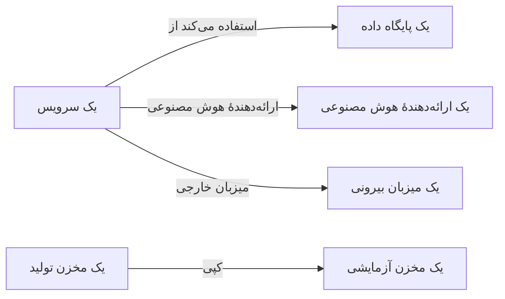

# جریان‌های داده، دسترسی و محل نگهداری داده

دانستن اینکه یک مخزن چه چیزی در خود دارد نیمی از کار است. امنیت داده همچنین مشخص می‌کند که آن داده به کجا می‌رود - کدام سرویس‌ها از مخزن استفاده می‌کنند، داده به کدام ارائه‌دهندگان هوش مصنوعی و میزبان‌های بیرونی می‌رسد، و کجا کپی شده است - چه کسی به هر مخزن دسترسی دارد، و آیا در مناطقی نگهداری می‌شود که مجاز است. همهٔ این‌ها از شواهدی می‌آید که OneUptime از پیش دارد: ترِیس‌های شما، تنظیمات دسترسی خود ابر شما، و اثرانگشت‌هایی از آنچه اسکن‌ها پیدا کرده‌اند.

:::cards
- [جریان‌های داده](#جریانهای-داده): سرویس‌ها، ارائه‌دهندگان هوش مصنوعی، میزبان‌های بیرونی و کپی‌ها.
- [چه کسی به یک مخزن دسترسی دارد](#چه-کسی-به-یک-مخزن-دسترسی-دارد): هر دسترسی اعطاشده‌ای که ابر شما گزارش می‌دهد، و میزان در معرض بودن مخزن.
- [قواعد محل نگهداری داده](#قواعد-محل-نگهداری-داده): مناطقی که هر گونه داده می‌تواند در آن‌ها نگهداری شود.
:::

## جریان‌های داده

| جریان | چه معنایی دارد | از کجا می‌آید |
| --- | --- | --- |
| **استفاده می‌کند از** | یک سرویس با یک مخزن ارتباط دارد. | نقشهٔ سرویس، که OneUptime هر ده دقیقه از اسپن‌های کلاینت سرویس‌های شما به دست می‌آورد. هر پایگاه داده‌ای در آن با نام، نشانی یا نقطهٔ پایانی به مخزن خودش پیوند می‌خورد، پس پایگاه داده‌ای که هیچ منبع دیگری فهرستش نمی‌کند خودش یک مخزن جداگانه می‌شود. |
| **ارائه‌دهندهٔ هوش مصنوعی** | یک سرویس داده به یک ارائه‌دهندهٔ هوش مصنوعی می‌فرستد. | فراخوانی‌های هوش مصنوعی در ترِیس‌های 7 روز گذشتهٔ سرویس، که ارائه‌دهنده‌ای را که به آن می‌رسند نام می‌برند. |
| **میزبان خارجی** | یک سرویس میزبانی بیرون از سیستم‌های شما را فرا می‌خواند. | سرویس‌های راه دور نقشهٔ سرویس، بر پایهٔ نشانی‌ای که با آن فراخوانده می‌شوند. |
| **کپی** | یک مخزن مقدارهایی از مخزن دیگر را در خود دارد. | اثرانگشت‌های مقدارهایی که هر اسکن پیدا کرد: دو مخزن وقتی دادهٔ مشترک دارند که اثرانگشت‌هایشان از یک نوع داده نصف یا بیشتر هم‌پوشانی داشته باشند. |

یک جریان انواع داده‌ای را که منبعش در خود دارد، همراه با حساسیت آن‌ها، با خود می‌برد. یک جریان وقتی تأییدشده است که یک اسکن ثابت کرده باشد داده آنجاست، نه فقط اینکه راهی به آن هست: یک کپی همیشه تأییدشده است، و یک جریان ارائه‌دهندهٔ هوش مصنوعی وقتی که گفتگوهای هوش مصنوعی سرویس دادهٔ محرمانه یا محدود داشته باشند. جریانی که 30 روز دوباره دیده نشود حذف می‌شود.

دو بررسی جریان‌ها را می‌خوانند. [دادهٔ تولید در یک مخزن غیرتولیدی کپی شده است](/docs/data-security/checks-and-issues#بهداشت-داده) روی مقصد یک کپی ناموفق می‌شود. وقتی فقط یکی از دو مخزن در تولید باشد، کپی از مخزن تولید آغاز می‌شود، و در غیر این صورت از مخزنی که OneUptime اول پیدا کرده است. [داده‌های حساس به یک ارائه‌دهندهٔ هوش مصنوعی فرستاده می‌شوند](/docs/data-security/checks-and-issues#هوش-مصنوعی) روی گفتگوهای هوش مصنوعی یک سرویس، وقتی داده‌های حساس دارند، ناموفق می‌شود و ارائه‌دهندگانی را که به آن‌ها رسیده‌اند نام می‌برد.

### اثرانگشت‌ها چگونه خصوصی می‌مانند

یک کپی بدون مقدارهای هیچ‌یک از دو مخزن پیدا می‌شود. برای هر نوع داده‌ای که یک اسکن با اطمینان زیاد پیدا کند، مقدارهایی را که خوانده به‌صورت یک MinHash خلاصه می‌کند: 128 خانه، هر کدام کوچک‌ترین مقدار یک تابع هش روی مقدارها، که از آن فقط 16 بیت پایین نگه داشته می‌شود. دو خلاصه تقریباً در همان نسبتی از خانه‌ها با هم یکی‌اند که دو مجموعهٔ مقدارشان هم‌پوشانی دارند، پس مقایسهٔ خلاصه‌ها تخمین می‌زند چه مقدار از یک مخزن در دیگری است.

- **مقدارها با کلیدی که از آن خود پروژه است هش می‌شوند** (HMAC-SHA256)، پس هیچ‌کس بدون آن کلید نمی‌تواند یک مقدار شناخته‌شده را با یک خلاصه بیازماید، و خلاصه‌های دو پروژه هرگز با هم مقایسه‌پذیر نیستند.
- **از هر کمینه فقط 16 بیت از اسکن بیرون می‌رود.** هیچ مقداری، و هیچ هشی از یک مقدار، را نمی‌توان از یک خلاصه بازخواند.
- **یک خلاصه دربارهٔ یک نوع داده است، نه یک فیلد.** یک مخزن برای هر نوع داده‌ای که با اطمینان زیاد در آن پیدا شده یک خلاصه دارد، و نه بیشتر.

## چه کسی به یک مخزن دسترسی دارد

خواندن پیکربندی، تنظیمات دسترسی خود هر ابر - سیاست‌های باکت و ACLها، انتساب‌های نقش Azure، پیوندهای IAM در Google Cloud، اشتراک‌گذاری‌های اسنپ‌شات - را به یک فهرست از کسانی که به مخزن دسترسی دارند تبدیل می‌کند، که در صفحهٔ **چه کسی دسترسی دارد** مخزن نمایش داده می‌شود:

| ستون | چه می‌گوید |
| --- | --- |
| **اصل امنیتی** | چه کسی یا چه چیزی دسترسی دارد، به همان نامی که ابر به کار می‌برد: `*`، یک شناسهٔ حساب، یک ARN، یک ایمیل، یک حساب سرویس. |
| **نوع اصل امنیتی** | عمومی، حساب، نقش، کاربر، گروه، اصل امنیتی سرویس، حساب سرویس یا سرویس. |
| **سطح دسترسی** | خواندن، نوشتن یا مدیر. |
| **اعطاشده از طریق** | آنچه آن را اعطا می‌کند: یک سیاست باکت، یک ACL، یک انتساب نقش، یک پیوند IAM یا اشتراک‌گذاری یک اسنپ‌شات. |
| **خارجی** | اصل امنیتی بیرون از حساب‌ها، اشتراک‌ها و پروژه‌هایی است که به OneUptime متصل شده‌اند. |
| **عمومی** | اصل امنیتی هر کسی در اینترنت است. |

این فهرست با هر بار خواندن پیکربندی دوباره خوانده می‌شود، و دسترسی‌ای که ابر دیگر گزارش نمی‌دهد حذف می‌شود. [بیش از 25 هویت می‌توانند دادهٔ محدود را بخوانند](/docs/data-security/checks-and-issues#دسترسی) خوانندگان روی آن را می‌شمارد. سرویس‌هایی که از یک مخزن استفاده می‌کنند، جریان‌های **استفاده می‌کند از** آن مخزن هستند.

از روی آنچه می‌خواند، هر مخزن یک وضعیت در معرض بودن می‌گیرد:

| در معرض بودن | چه معنایی دارد |
| --- | --- |
| **عمومی** | هر کسی در اینترنت می‌تواند آن را بخواند. |
| **حساب‌های دیگر** | حساب‌هایی بیرون از حساب‌های متصل شما به آن دسترسی دارند. |
| **قابل دسترسی از اینترنت** | نقطهٔ پایانی شبکهٔ آن اتصال‌ها را از اینترنت می‌پذیرد. |
| **خصوصی** | فقط حساب‌ها و شبکه‌های خود شما به آن دسترسی دارند. |
| **ناشناخته** | OneUptime نتوانست به اندازهٔ کافی از پیکربندی آن را بخواند تا این را بگوید. |

عمومی بر اشتراکی مقدم است، و اشتراکی بر قابل دسترسی: باکت عمومی‌ای که با حساب دیگری هم به اشتراک گذاشته شده، در وضعیت Public است. در معرض بودن به [امتیاز ریسک](/docs/data-security/checks-and-issues#امتیاز-ریسک) یک مسئله می‌افزاید.

## قواعد محل نگهداری داده

یک قاعده محل نگهداری داده می‌گوید یک گونه داده کجا می‌تواند نگهداری شود. یکی را در **امنیت داده** > **تنظیمات** > **قواعد محل نگهداری داده** بیفزایید:

| فیلد | چه می‌کند |
| --- | --- |
| **نام** | قاعده چیست، مانند «دادهٔ شخصی اتحادیهٔ اروپا در اتحادیهٔ اروپا می‌ماند». |
| **مناطق مجاز** | مناطقی که آن داده می‌تواند در آن‌ها ذخیره و کپی شود، به همان شکلی که ابر شما آن‌ها را نام می‌برد. قاعده‌ای بدون هیچ منطقه‌ای چیزی را بررسی نمی‌کند. |
| **دسته‌های داده** | دسته‌های داده‌ای که پوشش می‌دهد. خالی بودن آن هر گونه دادهٔ شخصی را پوشش می‌دهد. |
| **داده‌های افراد در** | فقط داده‌های افراد در این کشورها، به‌صورت کدهای ISO 3166-1 مانند `DE` یا `IN`. خالی بودن آن داده‌های افراد در هر جایی را پوشش می‌دهد. |
| **توضیحات** | قاعده برای چیست، مانند «داده‌های مشتریان اروپایی ما فقط در اتحادیهٔ اروپا ذخیره می‌شود». |
| **فعال** | اینکه مخازن با این قاعده بررسی شوند یا نه. |

یک مخزن وقتی قاعده‌ای را نقض می‌کند که داده‌ای را در خود داشته باشد که قاعده پوشش می‌دهد، و منطقهٔ خودش، یا منطقه‌ای که داده‌اش در آن کپی می‌شود، با هیچ‌یک از مناطق مجاز جور نباشد. کپی‌ها مناطقی‌اند که دادهٔ یک مخزن در آن‌ها تکثیر می‌شود: تکثیر S3، کپی افزونگی جغرافیایی یک حساب ذخیره‌سازی، رپلیکاهای یک پایگاه داده. در این صورت مخزن در [داده بیرون از مناطقی که مجاز است ذخیره شده است](/docs/data-security/checks-and-issues#محل-نگهداری-داده) ناموفق می‌شود، همراه با منطقه و قاعده‌ای که نقض کرده است.

### مناطق و نویسه‌های عام

یک `*` در یک منطقهٔ مجاز به‌جای هر نویسه‌ای می‌نشیند، حروف بزرگ و کوچک یکسان‌اند، و الگو باید با کل منطقه جور باشد:

| منطقهٔ مجاز | جور است با | جور نیست با |
| --- | --- | --- |
| `eu-*` (AWS) | `eu-west-1`، `eu-central-1` | `us-east-1`، `us-eu-1` |
| `europe-*` (Google Cloud) | `europe-west1`، `europe-north1` | `us-central1` |
| `westeurope` (Azure) | `westeurope` | `northeurope` |

برای هر ابری که استفاده می‌کنید یک الگو فهرست کنید: `eu-*`، `europe-*`، `westeurope` و `northeurope` با هم داده را روی هر سه ابر در اروپا نگه می‌دارند.

### یک مخزن دادهٔ چه کسانی را در خود دارد

OneUptime از روی خود داده می‌خواند که یک مخزن دادهٔ چه کسانی را در خود دارد. نوع داده‌ای که به یک کشور تعلق دارد نشان می‌دهد افرادش در آن کشورند: شناسهٔ مالیاتی آلمان `DE` را نشان می‌دهد، شمارهٔ Aadhaar هند `IN` را، و شمارهٔ NHS بریتانیا `GB` را. مخزن آن کشورها را به‌عنوان کشورهای صاحبان داده‌اش فهرست می‌کند، و قاعده‌ای که به افرادی در برخی کشورها محدود است فقط مخازنی را پوشش می‌دهد که دادهٔ آن‌ها را دارند. [انواع داده‌های حساس](/docs/data-security/data-types#انواع-داده-داخلی) کشور هر نوع داده‌ای را که کشوری دارد نام می‌برد.

## گام‌های بعدی

:::cards
- [بررسی‌ها و مسائل امنیت داده](/docs/data-security/checks-and-issues): هر بررسی‌ای که این جریان‌ها، دسترسی‌ها و قواعد به آن داده می‌دهند.
- [انطباق امنیت داده](/docs/data-security/compliance): محل نگهداری داده و دسترسی چگونه در GDPR، LGPD و DPDP به حساب می‌آیند.
- [توپولوژی](/docs/telemetry/topology): نقشهٔ سرویسی که جریان‌ها از آن می‌آیند.
:::
