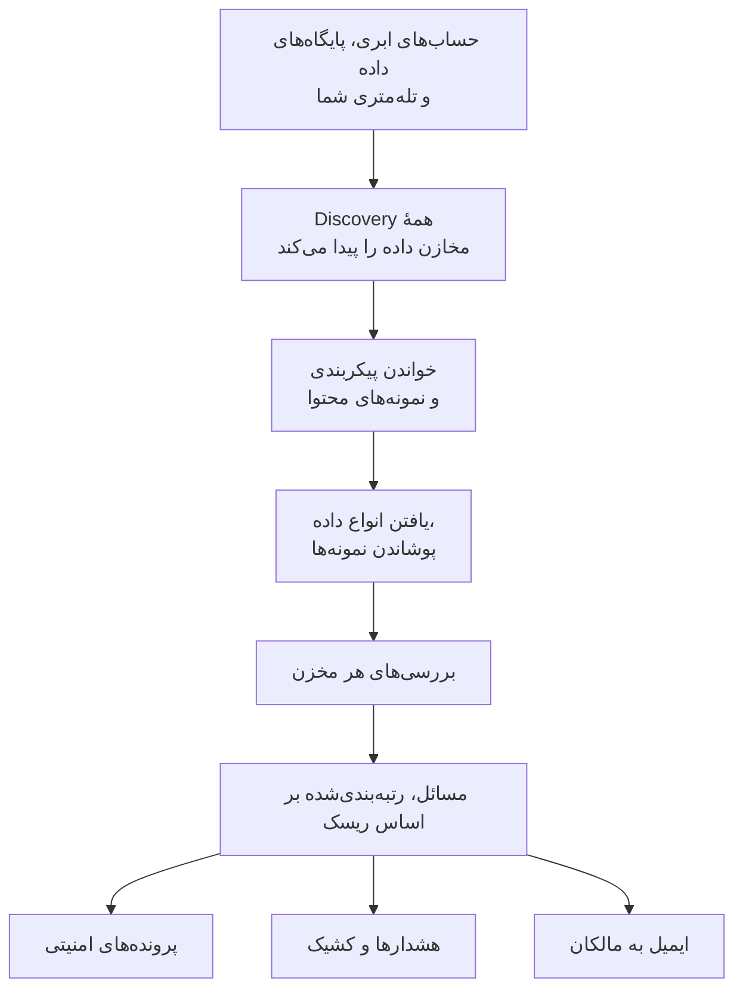

# امنیت داده

امنیت داده، داده‌های حساسی را که شرکت شما نگه می‌دارد پیدا می‌کند - در باکت‌های ابری، پایگاه‌های داده و انبارهای داده، و در تله‌متری‌ای که برای OneUptime می‌فرستید - و به شما می‌گوید در شیوهٔ نگهداری آن‌ها چه ایرادی هست. مخازن را خودش پیدا می‌کند، می‌خواند که هر کدام چگونه پیکربندی شده است، از آنچه در خود دارد نمونه برمی‌دارد، و برای هر مشکل یک مسئله باز می‌کند که بر اساس ریسک رتبه‌بندی می‌شود.

به چهار پرسش پاسخ می‌دهد:

:::cards
- [داده‌های حساس ما کجاست؟](/docs/data-security/data-types): 143 نوع داده، از شماره کارت‌ها و شناسه‌های ملی تا کلیدهای API، که در باکت‌ها، جدول‌ها و تله‌متری پیدا می‌شوند.
- [آیا در معرض دسترسی است؟](/docs/data-security/checks-and-issues): 32 بررسی برای هر مخزن: دسترسی عمومی، رمزگذاری، پشتیبان‌ها، ثبت لاگ، رازها و کپی‌ها.
- [چه کسی به آن دسترسی دارد، و به کجا می‌رود؟](/docs/data-security/flows-access-residency): چه کسی می‌تواند هر مخزن را بخواند، کدام سرویس‌ها از آن استفاده می‌کنند، و داده‌هایش به کدام ارائه‌دهندگان هوش مصنوعی و میزبان‌ها می‌رسد.
- [آیا با قواعد ما سازگار است؟](/docs/data-security/compliance): قواعد محل نگهداری داده، و نُه چارچوب انطباق که از روی آنچه اسکن‌ها پیدا کرده‌اند امتیاز می‌گیرند.
:::

## چگونه کار می‌کند

1. **Discovery** مخازنی را پیدا می‌کند که OneUptime از پیش می‌شناسد: فهرست منابع ابری شما، پایگاه‌های داده‌ای که محصول پایگاه داده پایش می‌کند، پایگاه‌های داده‌ای که سرویس‌هایتان در نقشهٔ سرویس با آن‌ها در ارتباط‌اند، و تله‌متری هر سرویس. فقط وقتی مخزنی را دستی اضافه می‌کنید که هیچ منبعی آن را فهرست نکند.
2. **خواندن پیکربندی** از هر ابر می‌پرسد که هر مخزن چگونه پیکربندی شده است: چه کسی به آن دسترسی دارد، و رمزگذاری، پشتیبان‌گیری و ثبت لاگ آن چگونه است. تنظیمات را می‌خواند، هرگز داده را.
3. **نمونه‌های محتوا** هر جا که اجازه دهید، اندکی از آنچه را یک مخزن در خود دارد می‌خوانند: چند شیء از هر گونه در یک باکت، چند ردیف از هر جدول، و تازه‌ترین رکوردهای تله‌متری هر سرویس.
4. **طبقه‌بندی** مقادیر حساس را در نمونه‌ها پیدا می‌کند، و شمارش‌ها و نمونه‌های پوشانده‌شده را نگه می‌دارد، هرگز خود مقدار را.
5. **بررسی‌ها** تعیین می‌کنند هر مخزن چه ایرادی دارد، و این ایراد برای داده‌ای که در آن است چقدر جدی است. هر بررسی ناموفق یک مسئله باز می‌کند، که به‌محض موفق شدن بررسی خودبه‌خود بسته می‌شود.

## چه چیزی آن را متفاوت می‌کند

- **تله‌متری شما یک مخزن داده است.** لاگ‌ها، ترِیس‌ها، استثناها، بازپخش‌های نشست و گفتگوهای هوش مصنوعی هر سرویس، هر ساعت مانند یک باکت بررسی می‌شوند. یک آدرس ایمیل در یک خط لاگ یک یافته است، و **پاک‌سازی** از آن پس آن را هنگام دریافت می‌پوشاند. [داده‌های حساس در تله‌متری](/docs/data-security/telemetry) را ببینید.
- **جریان‌ها از ترافیک واقعی می‌آیند.** نقشهٔ سرویس می‌گوید کدام سرویس از کدام پایگاه داده استفاده می‌کند، فراخوانی‌های هوش مصنوعی ارائه‌دهنده‌ای را که به آن می‌رسند نام می‌برند، و کپی‌های دادهٔ تولید با مقایسهٔ اثرانگشت‌ها پیدا می‌شوند. [جریان‌های داده، دسترسی و محل نگهداری داده](/docs/data-security/flows-access-residency) را ببینید.
- **شواهد همیشه پوشانده می‌شوند.** یک یافته شمارش‌ها و حداکثر سه نمونه پوشانده‌شده، مانند `j***@e******.com`، را نگه می‌دارد که پیش از آنکه چیزی از اسکنر بیرون برود، درون خود اسکنر پوشانده می‌شوند. نمونه‌ها را خاموش کنید تا فقط شمارش‌ها نگه داشته شوند.
- **اسکنر متن‌باز است.** الگو، جمع کنترلی، واژه‌های زمینه و مقادیر آزمایشی هر نوع داده در کد منبع OneUptime هست، پس می‌توانید دقیقاً بخوانید چه چیزی یک یافته می‌سازد. همین کد روی کارگرهای OneUptime، روی یک پراب، و در کادر **آزمایش** اجرا می‌شود.
- **با بقیهٔ OneUptime کار می‌کند.** یک مسئلهٔ بحرانی یک پرونده امنیتی روی مخزن باز می‌کند، تا [عملیات امنیتی](/docs/telemetry/security-cases) مانند هر تهدید دیگری به آن رسیدگی کند. می‌تواند هشداری ایجاد کند که هر کسی را که در کشیک است فرا می‌خواند، و به مالکان مخزن ایمیل می‌فرستد. [یکپارچه‌سازی‌های امنیت داده](/docs/data-security/integrations) را ببینید.
- **OneUptime AI به رفع آن کمک می‌کند.** **توضیح با هوش مصنوعی** به مالک یک مخزن می‌گوید چه ایرادی هست و چگونه آن را روی ابر خودش رفع کند، و **رفع با هوش مصنوعی** یک pull request در کد زیرساخت شما باز می‌کند.

## پیش از شروع

- **نقشی که بتواند آن را راه‌اندازی کند.** نقش‌های Project Owner، Project Admin و Security Admin تنظیمات امنیت داده را تغییر می‌دهند. نقش Security Member به مسائل رسیدگی می‌کند و مخازن را اسکن می‌کند، و نقش Security Viewer آنچه را پیدا شده می‌خواند. نقش‌های دیگر هیچ‌کدام از این‌ها را نمی‌بینند، مگر اینکه مجوزهای آن به تیمشان داده شود: اینکه کدام باکت‌ها شماره کارت نگه می‌دارند دقیقاً همان چیزی است که یک مهاجم می‌خواهد بداند. [نقش‌ها](/docs/permissions/reference#نقشها) را ببینید.
- **یک حساب ابری برای خواندن، یا یک پایگاه داده.** امنیت داده یک حساب ابری را از راه یک [اتصال ابری](/docs/telemetry/cloud-accounts) می‌خواند، و پایگاه داده‌ای را که خودتان اجرا می‌کنید از راه یک رشته اتصال فقط‌خواندنی. تله‌متری به چیزی نیاز ندارد: هر ساعت اسکن می‌شود.

## شروع سریع

:::steps
### یک حساب ابری متصل کنید

به **ابر** > **اتصال** بروید و ابر خود را انتخاب کنید. اگر حساب از قبل متصل است، به‌جای آن روی اتصالش **ویرایش** را انتخاب کنید. [اتصال یک حساب ابری](/docs/telemetry/cloud-accounts) هر ابر را گام‌به‌گام توضیح می‌دهد.

### سطح امنیت داده را انتخاب کنید

زیر **فیلدهای بیشتر**، **امنیت داده** را روی **فقط پیکربندی** بگذارید تا پیکربندی همهٔ مخازن بررسی شود، یا روی **پیکربندی و نمونه‌های محتوا** تا داده‌های حساس درون آن‌ها هم پیدا شود. فرمانی که فرم نشان می‌دهد با انتخاب شما تغییر می‌کند: آن را همان‌طور که فرم می‌گوید در ترمینال ابر خود اجرا کنید. [راه‌اندازی امنیت داده](/docs/data-security/setup) دقیقاً فهرست می‌کند که هر سطح چه چیزی اعطا می‌کند، و [اتصال یک حساب ابری](/docs/telemetry/cloud-accounts#امنیت-داده) فرمان هر سطح را نشان می‌دهد.

### مسائل را مرور کنید

**امنیت داده** را باز کنید. مخازن همان‌طور که فرایند کشف پیدایشان می‌کند، هر 15 دقیقه، زیر **مخازن داده** نمایان می‌شوند، و پیکربندی یک اتصال ظرف یک ساعت خوانده می‌شود. مسائل به‌محض پایان یک خواندن یا یک اسکن زیر **مسائل** باز می‌شوند، هر کدام با امتیاز ریسک خود، و **نمای کلی** پرخطرترین پنج مسئله را نشان می‌دهد. هر مسئله می‌گوید چه ایرادی هست، چرا مهم است و چگونه رفعش کنید، همراه با فرمان‌های ابر شما.
:::

## چه چیزی مخزن داده به شمار می‌آید

| کجا | مخازن | نمونه‌های محتوا |
| --- | --- | --- |
| AWS | AWS S3 Bucket, AWS RDS Instance, AWS Aurora Cluster, AWS RDS Snapshot, AWS DynamoDB Table, AWS Redshift Cluster, AWS DocumentDB Cluster, AWS OpenSearch Domain, AWS ElastiCache Cluster, AWS EFS File System | AWS S3 Bucket |
| Azure | Azure Storage Account, Azure SQL Database, Azure Cosmos DB Account, Azure PostgreSQL Server, Azure MySQL Server | Azure Storage Account |
| Google Cloud | Google Cloud Storage Bucket, Google Cloud SQL Instance, Google BigQuery Dataset, Google Firestore Database, Google Spanner Instance, Google Bigtable Instance | Google Cloud Storage Bucket, Google BigQuery Dataset |
| پایگاه‌های داده‌ای که خودتان اجرا می‌کنید | PostgreSQL, MySQL, MongoDB, SQL Server, Oracle, Redis, Elasticsearch | PostgreSQL, MySQL |
| OneUptime | لاگ‌ها، ترِیس‌ها، استثناها، بازپخش‌های نشست، گفتگوهای هوش مصنوعی | لاگ‌ها، ترِیس‌ها، استثناها، بازپخش‌های نشست، گفتگوهای هوش مصنوعی |

هر مخزن بررسی‌هایی را می‌گیرد که به گونهٔ آن مربوط‌اند. مخزنی که نمی‌توان از محتوایش نمونه برداشت همچنان بررسی می‌شود: یک باکت عمومی یا یک پایگاه دادهٔ رمزگذاری‌نشده، هر چه در خود داشته باشد، یک مشکل است.

وقتی منبع یک مخزن دیگر آن را فهرست نکند، مخزن همراه با تاریخچه‌اش بایگانی می‌شود و مسائل باز آن برطرف می‌شوند: **مخازن بایگانی‌شده**، در انتهای منوی امنیت داده، آن را نگه می‌دارد. اگر منبعش دوباره آن را فهرست کند خودبه‌خود برمی‌گردد، و مسئله‌ای که بررسی‌اش هنوز ناموفق است دوباره باز می‌شود.

**خط زمانی** یک مخزن می‌گوید چه چیزی برایش رخ داده و چه کسی آن را انجام داده است: کی پیدا یا اضافه شد، هر تغییر در تنظیمات و مالکانش، کی بایگانی شد یا برگشت، و هر بار که در معرض بودن آن از یک مسئله یا یک پلی‌بوک رفع شد.

## هر چند وقت یک بار اجرا می‌شود

| چه چیزی | چه زمانی |
| --- | --- |
| پیدا کردن مخازن تازه | هر 15 دقیقه |
| خواندن پیکربندی یک اتصال ابری | روزی یک بار، و ظرف یک ساعت پس از آنکه CloudTrail تغییری را در دسترسی، رمزگذاری، پشتیبان‌ها یا اشتراک‌گذاری یک مخزن AWS ثبت کند |
| نمونه‌برداری از محتوای یک مخزن | هر 24 ساعت، یا هر چند وقت یک بار که **اسکن هر (ساعت)** بگوید |
| نمونه‌برداری از تله‌متری هر سرویس | هر ساعت، از یک ساعت گذشتهٔ آن |
| بررسی دوبارهٔ همهٔ مخازن | پس از هر خواندن و اسکن، پس از تغییر هر چیزی که یک بررسی به آن وابسته است، و روزی یک بار |

**اکنون اسکن کن** روی یک مخزن بی‌درنگ از محتوای آن نمونه برمی‌دارد، و **اکنون بررسی کن** پیکربندی آن را دوباره می‌خواند.

## گام‌های بعدی

:::cards
- [راه‌اندازی امنیت داده](/docs/data-security/setup): سه سطح، مجوزهایی که هر کدام اعطا می‌کند، و اسکن پایگاه‌های دادهٔ خودتان.
- [انواع داده‌های حساس](/docs/data-security/data-types): یک مقدار چگونه پیدا می‌شود، و همهٔ انواع داده‌ای که امنیت داده می‌شناسد.
- [بررسی‌ها و مسائل امنیت داده](/docs/data-security/checks-and-issues): همهٔ بررسی‌ها، امتیاز ریسک و آنچه بر سر یک مسئله می‌آید.
- [یکپارچه‌سازی‌های امنیت داده](/docs/data-security/integrations): پرونده‌های امنیتی، هشدارها، مالکان، گردش‌های کار و OneUptime AI.
:::
