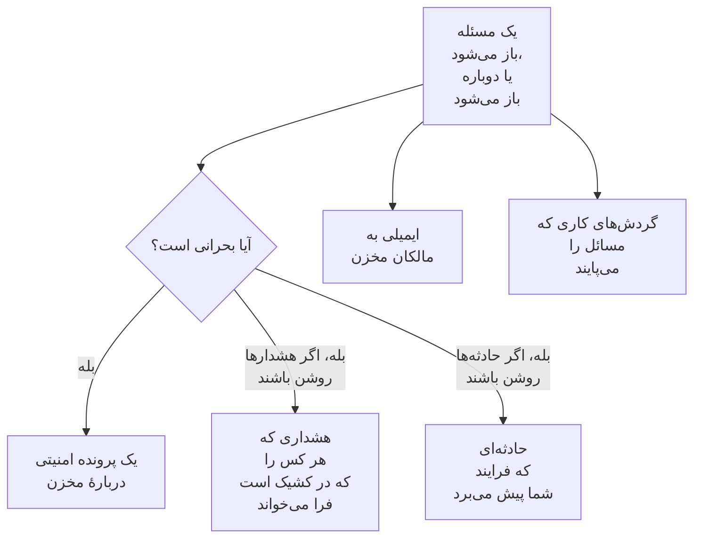

# یکپارچه‌سازی‌های امنیت داده

امنیت داده پیجر یا صف امنیتی جداگانه‌ای از خودش ندارد. آنچه را پیدا می‌کند به بخش‌هایی از OneUptime می‌سپارد که از پیش همین کار را می‌کنند: یک مسئلهٔ بحرانی به یک پرونده امنیتی تبدیل می‌شود، می‌تواند هر کسی را که در کشیک است فرا بخواند یا یک حادثه اعلام کند، و هر مسئلهٔ تازه برای مالکان مخزن ایمیل می‌شود. گردش‌های کار، OneUptime AI، API، Terraform و سرور MCP به همهٔ آنچه نگه می‌دارد دسترسی دارند.

:::cards
- [عملیات امنیتی](#عملیات-امنیتی): یک پرونده امنیتی برای هر مخزنی که یک مسئلهٔ بحرانی دارد.
- [آیا نقض بود؟](#آیا-نقض-بود): هر در معرض بودن بحرانی ارزیابی می‌شود: چه مدت، چه کسی می‌توانست آن را بخواند، داده‌های چه کسانی، و قوانین نقضی که ممکن است اعمال شوند.
- [هشدارها و کشیک](#هشدارها-و-کشیک): وقتی یک مسئلهٔ بحرانی باز می‌شود، هر کسی را که در کشیک است فرا بخوانید.
- [حادثه‌ها](#حادثهها): برای رخنه‌ای که فرایند حادثهٔ شما باید آن را پیش ببرد، یک حادثه اعلام کنید.
- [مالکان](#مالکان): یک مسئله را تحلیل کنید، Pull Request ای که آن را رفع می‌کند باز کنید، یا دربارهٔ داده‌هایتان از پرسش از هوش مصنوعی بپرسید و بگذارید با تأیید شما اقدام کند.
- [OneUptime AI](#oneuptime-ai): یک مسئله را توضیح دهید، یک pull request باز کنید که آن را رفع کند، یا دربارهٔ داده‌هایتان از «پرسش از هوش مصنوعی» بپرسید.
- [رفع در معرض بودن](#رفع-در-معرض-بودن): دسترسی عمومی را مسدود کنید یا اشتراک‌گذاری را متوقف کنید، از یک مسئله یا یک پلی‌بوک، و محافظتی را که نیست از یک مسئله روشن کنید.
:::

## چگونه کار می‌کند

هر یک از این‌ها وقتی اجرا می‌شود که یک ارزیابی مسئله‌ای را باز کند، یا دوباره باز کند. هر کدام در حد توان انجام می‌شود: مسئله از پیش باز است و در خط زمانی‌اش ثبت شده، پس یکپارچه‌سازی‌ای که ناموفق شود ثبت می‌شود و از آن گذشته می‌شود، و هرگز دوباره امتحان نمی‌شود تا به پرونده یا فراخوانی دوم بینجامد. آنچه هر کدام انجام داد در **خط زمانی** مسئله نوشته می‌شود، و صفحهٔ مسئله به پرونده، هشدار و حادثه‌ای که آغاز کرد پیوند می‌دهد.

| تنظیم | پیش‌فرض | چه می‌کند |
| --- | --- | --- |
| **باز کردن پرونده‌های امنیتی** | روشن | یک مسئلهٔ بحرانی یک پرونده امنیتی باز می‌کند که بر پایهٔ مخزن گروه‌بندی می‌شود. |
| **ایجاد هشدار** | خاموش | یک مسئلهٔ بحرانی هشداری ایجاد می‌کند که هر کسی را که در کشیک است فرا می‌خواند. |
| **شدت هشدار** | خالی | شدت آن هشدارها. خالی یعنی شدیدترین شدت پروژه. |
| **اعلام حادثه‌ها** | خاموش | یک مسئلهٔ بحرانی حادثه‌ای اعلام می‌کند که فرایند حادثهٔ شما آن را پیش می‌برد. |
| **شدت حادثه** | خالی | شدت آن حادثه‌ها. خالی یعنی شدیدترین شدت پروژه. |
| **اطلاع به مالکان** | روشن | هر مسئلهٔ تازه برای مالکان مخزنش ایمیل می‌شود. |

## عملیات امنیتی

هر مخزن در عملیات امنیتی موجودیتی جداگانه از نوع **مخزن داده** است. وقتی **باز کردن پرونده‌های امنیتی** روشن باشد، یک مسئلهٔ بحرانی به‌صورت یک تشخیص دربارهٔ مخزن به عملیات امنیتی فرستاده می‌شود:

- منبع آن **امنیت داده** است، و قاعده‌اش به نام بررسی نام‌گذاری می‌شود، مانند `Data Security: public-read`؛
- بحرانی است، پس پرونده‌ای که باز می‌کند در اولویت بحرانی پروژه است؛
- بر پایهٔ مخزن گروه‌بندی می‌شود: دومین مسئلهٔ بحرانی روی همان مخزن، به‌جای باز کردن پرونده‌ای دیگر، به پروندهٔ باز دربارهٔ آن می‌پیوندد.

از آنجا به بعد، به این پرونده مانند هر پروندهٔ دیگری رسیدگی می‌شود: واگذار می‌شود، یادداشت می‌خورد، بسته می‌شود، و پلی‌بوک‌های پروژه به آن پاسخ می‌دهند. تشخیص‌های مخزن، مانند تشخیص‌های هر موجودیت دیگری، در ریسک آن در [ریسک موجودیت](/docs/telemetry/security-entity-risk) شمرده می‌شوند. [پرونده‌های امنیتی و پلی‌بوک‌ها](/docs/telemetry/security-cases) را ببینید.

هر پرونده امنیتی، هر چه بازش کرده باشد، دادهٔ در معرض خطر را در **تأثیر** خود نشان می‌دهد: مخازن دارای دادهٔ حساس که پرونده دربارهٔ آن‌هاست، و هر مخزنی که کاربران و نقش‌هایش می‌توانند به آن برسند، حساس‌ترین اول، همراه با آنچه هر کدام در خود دارد، تقریباً چند رکورد، چقدر در معرض است و چند هویت می‌توانند به آن برسند. نشست نقشی که بر عهده گرفته شده و پرونده نامش را می‌برد به‌عنوان همان نقش شمرده می‌شود، و یک نشانی ایمیل به‌عنوان کاربران ابری که به آن‌ها تعلق دارد. خواندن با مجوزهای خود خواننده انجام می‌شود، پس نقشی که نمی‌تواند امنیت داده را بخواند می‌بیند که این بخش کنار گذاشته شده است.

## آیا نقض بود؟

پروندهٔ در معرض بودن بحرانی یک مخزن با داده‌های **محدود** یا **محرمانه** - باز بودن برای هر کسی در اینترنت، اشتراک‌گذاری با حساب‌هایی بیرون از حساب‌های شما، یا اسنپ‌شاتی که دیگران می‌توانند بازیابی‌اش کنند - خودبه‌خود، همان وقتی که باز می‌شود، ارزیابی می‌شود. هر پروندهٔ دیگری دربارهٔ یک مخزن داده وقتی ارزیابی می‌شود که یک نفر در **نمای کلی** آن **ارزیابی این در معرض بودن** را بزند. کد ساده ارزیابی را از آنچه OneUptime ثبت کرده است به دست می‌آورد، و هر بار که خوانده می‌شود دوباره به دست می‌آورد:

- **چه مدت باز بود**: از تغییری در گزارش ابر شما که مخزن را در معرض قرار داد، اگر چنین تغییری در ۳۰ روزِ پیش از یافته شدن آن ثبت شده باشد، وگرنه دست‌کم از زمانی که امنیت داده آن را یافت؛ تا وقتی که پاسخ خود امنیت داده آن را بست، تغییری آن را بست، یا یک بررسی آن را بسته یافت.
- **چه کسی می‌توانست آن را بخواند**: اینکه آیا مخزن خواندن‌ها را ثبت می‌کرد. جایی که ثبت نمی‌کرد، ارزیابی می‌گوید «خواندن‌ها ثبت نشده بودند. داده را خوانده‌شده فرض کنید.» حساب‌های بیرون از شرکت شما را که می‌توانستند مخزن را بخوانند می‌شمارد، و اینکه چند تا از آن‌ها در مدتی که مخزن باز بود از دسترسی خود استفاده کردند، بی‌آنکه هرگز نامشان را ببرد. اگر مخزن یک باکت S3 باشد که دسترسی‌های سرورش را ثبت می‌کند، **خواندن گزارش‌های دسترسی** این گزارش‌ها را برای آن بازه می‌خواند و Data Security هم پیش از آنکه OneUptime AI ارزیابی را بنویسد، خودش آن‌ها را می‌خواند: چند خواندن از سوی هر کسی در اینترنت، از حساب‌های بیرون از شرکت شما و از درخواست‌دهندگانی که نمی‌تواند تشخیص دهد آمده، چند شیء خوانده شده و چه مقدار فرستاده شده است. کسی که اجازه دارد ببیند چه کسانی به مخزن دسترسی دارند، می‌بیند کدام حساب‌های بیرونی آن را خوانده‌اند؛ پرونده، OneUptime AI و خروجی‌ها فقط شمارش‌ها را نگه می‌دارند. گزارش‌هایی که فقط بخشی از آن‌ها خوانده شده، هرگز نشان نمی‌دهند که کسی داده‌ها را نخوانده است.
- **داده‌های چه کسانی بود**: آنچه مخزن در خود دارد، تقریباً چند رکورد، این رکوردها دربارهٔ چه کسانی‌اند، و آن افراد کجا زندگی می‌کنند، آن‌طور که داده نشان می‌دهد و آن‌طور که یک نفر می‌گوید. یک نفر منطقه‌ای را نام می‌برد، یا هر ایالت آمریکا، ناحیه کلمبیا و پورتوریکو را.
- **رازهایی که باید چرخانده شوند**: هر رازی که در مدت باز بودن مخزن در آن یافت شد، بر اساس نوعش و جایی که یافت شد، هرگز مقدارش.
- **قوانین نقضی که ممکن است اعمال شوند**: هر ردیف از جدول قوانین نقض OneUptime، همراه با اینکه چه می‌خواهد، به چه کسی باید اطلاع داد، مهلتش که از زمان یافتن در معرض بودن به دست امنیت داده شمرده می‌شود، و آنچه یک نفر هنوز باید پیش از اعمال آن بررسی کند.

این جدول مواد ۳۳ و ۳۴ GDPR، مواد ۳۳ و ۳۴ UK GDPR، Breach Notification Rule قانون HIPAA، الزام 12.10.1 در PCI DSS و در کنار آن قواعد منتشرشده خود برندهای کارت (Visa، Mastercard و American Express)، LGPD برزیل، DPDP Rules هند و دستورالعمل‌های CERT-In را پوشش می‌دهد، و نیز قوانین نقض همه ایالت‌های آمریکا جز ویرجینیای غربی، و ناحیه کلمبیا را. برای هر ایالت، اطلاعیه آن به افراد هست و، هرجا قانونش از کسب‌وکار بخواهد، اطلاعیه‌های آن به دادستان کل یا اداره دیگری از ایالت و به مؤسسه‌های گزارش اعتبار مصرف‌کننده، که هر کدام از متن خود قانون خوانده شده است. هر ردیف به متن خود قانون، یعنی منبعش، پیوند دارد و روزی را می‌گوید که آخرین بار با آن تطبیق داده شده است. تا وقتی کسی نگفته افراد در کدام ایالت‌ها زندگی می‌کنند، قوانین ایالت‌ها روی کارت کنار هم نشان داده می‌شوند، اطلاعیه‌های هر ایالت زیر نام آن، و به OneUptime AI فقط گفته می‌شود چند قانون ممکن است اعمال شود. آنچه جدول پوشش نمی‌دهد (کشوری دیگر، ویرجینیای غربی و پورتوریکو که متن قانونشان از منبعی رسمی خوانده نشد، گوام و جزایر ویرجین ایالات متحده، برندهای کارتی که مهلتی منتشر نمی‌کنند، جایی که سازمان شما در آن تأسیس شده، قراردادهای شما) را ارزیابی با زبانی ساده می‌گوید.

OneUptime AI ارزیابی را همان‌طور که قواعد هوش مصنوعی امنیت داده شما اجازه می‌دهند، یا وقتی یک نفر درخواست کند، به نوشته درمی‌آورد: این یعنی چه، اطلاعیه‌ای به نهاد ناظر، اطلاعیه‌ای به افراد آسیب‌دیده و یک خلاصه داخلی ([OneUptime AI در امنیت داده](/docs/data-security/ai) را ببینید). هر پیش‌نویس به واقعیت‌های ارزیابی پایبند نگه داشته می‌شود: پیش‌نویسی که عدد یا قانونی بیاورد که هیچ‌یک از این واقعیت‌ها در خود ندارد کنار گذاشته می‌شود. چیزی به هیچ‌جا فرستاده نمی‌شود: یک اطلاعیه متنی است که یک نفر ویرایش و کپی می‌کند، و ارزیابی و هر پیش‌نویس می‌گویند که مشاوره حقوقی نیستند.

خوانندگانی از پرونده که اجازهٔ خواندن مخزن و یافته‌هایش را هم دارند ارزیابی را می‌بینند، چون ارزیابی نام می‌برد که مخزن چه چیزی در خود دارد. ارزیابی کردن، پیش‌نویس کردن، ویرایش یک اطلاعیه و گفتن اینکه افراد کجا زندگی می‌کنند به اجازهٔ ویرایش پرونده هم نیاز دارد. برای کارت‌های پرونده، [آیا نقض بود؟](/docs/telemetry/security-cases#آیا-نقض-بود) را ببینید.

## هشدارها و کشیک

وقتی **ایجاد هشدار** روشن باشد، یک مسئلهٔ بحرانی هشداری ایجاد می‌کند که نامش «Data Security:» و سپس عنوان مسئله و مخزن است. هشدار، مانند هر هشدار دیگری، با قواعد خودش هر کسی را که در کشیک است فرا می‌خواند ([هشدارها](/docs/alerts/index) و [کشیک](/docs/on-call/index) را ببینید). یک مسئله در هر زمان حداکثر یک هشدار باز دارد، هر چند بار هم که ارزیابی شود. **شدت هشدار** شدت هشدار را تعیین می‌کند؛ اگر خالی بماند، شدیدترین شدت پروژه است.

یک هشدار با مسئله‌اش پایان می‌یابد: همین که مسئله دیگر باز نباشد - بررسی‌اش موفق شود، یا کسی آن را برطرف‌شده علامت بزند، ریسکش را بپذیرد یا بگوید مسئله نیست - هشدار برطرف می‌شود، و **خط زمانی** مسئله همین را می‌گوید. مسئله‌ای که دوباره باز شود هشدار تازه‌ای ایجاد می‌کند.

هشدارها به‌طور پیش‌فرض خاموش‌اند، چون بیشتر تیم‌ها می‌خواهند یک یافتهٔ امنیت داده اول در یک پرونده امنیتی بیاید. وقتی یک باکت عمومی پر از شماره‌های کارت باید کسی را از خواب بیدار کند، آن‌ها را روشن کنید.

## حادثه‌ها

وقتی **اعلام حادثه‌ها** روشن باشد، یک مسئلهٔ بحرانی حادثه‌ای اعلام می‌کند که مانند هشدارش نام‌گذاری می‌شود، برای رخنه‌ای که فرایند حادثهٔ شما باید آن را پیش ببرد: کشیک، کانال‌های فضای کاری، صفحه‌های وضعیت و یک پست‌مورتم ([حادثه‌ها](/docs/incidents/index) را ببینید). یک مسئله در هر زمان حداکثر یک حادثهٔ باز دارد. **شدت حادثه** شدت حادثه را تعیین می‌کند؛ اگر خالی بماند، شدیدترین شدت پروژه است.

امنیت داده هرگز یک حادثه را برطرف نمی‌کند، حتی وقتی مسئله‌اش برطرف شده باشد: یک حادثه می‌تواند یک صفحهٔ وضعیت و یک پست‌مورتم داشته باشد، پس هر کسی که آن را پیش می‌برد آن را می‌بندد. یک پرونده امنیتی راه دیگری به یک حادثه است: **اعلام حادثه** روی پرونده حادثه‌ای پیوندخورده با آن باز می‌کند ([اعلام یک حادثه](/docs/telemetry/security-cases#اعلام-یک-حادثه) را ببینید).

## مالکان

مالکان یک مخزن افراد و تیم‌هایی هستند که در صفحهٔ **مالکان** مخزن آمده‌اند. مسئله برای آن‌هاست: ایمیل را آن‌ها دریافت می‌کنند، و **این مخزن حساس هیچ مالکی ندارد** روی مخزن حساسی که مالکی ندارد ناموفق می‌شود.

وقتی **اطلاع به مالکان** روشن باشد، هر ارزیابی‌ای که مسائلی را روی یک مخزن باز کند یک ایمیل به مالکانش می‌فرستد - افرادی که مالک آن‌اند، و اعضای تیم‌هایی که مالک آن‌اند، تا ۵۰ نفر - با عنوانی که می‌گوید مخزن چند مسئلهٔ تازه دارد، مانند «Data Security: 2 new issues on orders-db». این ایمیل شدت و عنوان هر مسئلهٔ تازه و حساسیت مخزن را فهرست می‌کند و به مخزن پیوند می‌دهد. هرگز نمونه‌ای در آن نیست.

تا وقتی OneUptime AI خودش روی مسائل جدید کار می‌کند، ایمیل تا ۱۰ دقیقه منتظر تحلیل آن می‌ماند و به هر مسئلهٔ تحلیل‌شده دو خط دیگر می‌دهد: حکمش و چرا، و کوتاه‌ترین راه تا رفع. هر مالک خط‌هایی را می‌گیرد که اجازهٔ خواندنشان را دارد: مالکی که اجازهٔ خواندن مسئله را ندارد هیچ خطی نمی‌گیرد، و خطی که بر چیزی تکیه دارد که او اجازهٔ خواندنش را ندارد حذف می‌شود.

### قواعد مالکیت و قواعد برچسب

قواعد، هم‌زمان با پیدا شدن مخازن، مالکان و برچسب‌ها را برایتان تعیین می‌کنند:

| قاعده | کجا | چه می‌کند |
| --- | --- | --- |
| **قواعد مالکیت** | **امنیت داده** > **قواعد** > **قواعد مالکیت** | کاربران و تیم‌های مالک را به هر مخزنی که جور باشد می‌افزاید |
| **قواعد برچسب** | **امنیت داده** > **قواعد** > **قواعد برچسب** | به هر مخزنی که جور باشد برچسب می‌افزاید |

یک قاعده با برچسب‌های مخزن، با الگویی از نام یا توضیحات آن، یا با **الگوی تگ ابری** با مخزن جور می‌شود: الگویی که با هر یک از تگ‌های ابری مخزن، به شکل `key=value`، مقایسه می‌شود. `^team=payments$` با هر مخزنی که تگ `team=payments` دارد جور است، و `^env=` با هر مخزنی که تگ `env` دارد. یک مخزن تازه همان لحظه که پیدا شود قواعد پروژه را می‌گیرد، و **اطلاع به مالکان** در یک قاعده مالکیت تعیین می‌کند که به مالکانی که می‌افزاید اطلاع داده شود یا نه. [قواعد برچسب و مالکیت](/docs/configuration/label-and-owner-rules) می‌گوید هر قاعده چگونه جور می‌شود و قواعد کی اجرا می‌شوند.

### مالکانی که OneUptime AI پیشنهاد می‌دهد

مخزنی که مالک ندارد می‌تواند مالکانش را از OneUptime AI بگیرد. OneUptime AI آنچه را از قبل به یک مالک اشاره می‌کند می‌خواند - تگ‌های ابری مخزن، سرویس‌هایی که از آن استفاده می‌کنند، مالکان کد فایلی که آن را تعریف می‌کند، و کسی که آن را تغییر داده یا افزوده است - و از روی آن تیم‌ها و افراد پروژهٔ خود شما را پیشنهاد می‌دهد. تا وقتی کسی آن را در **مالکان برای بازبینی**، در **مخازن داده** یا **امنیت داده ← هوش مصنوعی**، تأیید نکند چیزی تغییر نمی‌کند، و به مالکان افزوده‌شده مانند هر مالک دیگری اطلاع داده می‌شود. وقتی مالکان سه مخزن یا بیشتر بر یک تگ یا یک آغاز نام تکیه دارند، قاعده مالکیتی را هم پیشنهاد می‌دهد که مخزن مشابه بعدی را دارای مالک نگه می‌دارد و پس از تأیید به **قواعد مالکیت** افزوده می‌شود. [OneUptime AI در امنیت داده](/docs/data-security/ai) می‌گوید چه می‌فرستد و کی اجرا می‌شود.

## گردش‌های کار

**مخزن داده** و **مسئله امنیت داده** تریگرهای گردش کار هستند، هر کدام با **هنگام ایجاد**، **هنگام به‌روزرسانی**، **هنگام ایجاد یا به‌روزرسانی** و **هنگام حذف**. آن‌ها را در پنل **افزودن تریگر**، زیر **منابع OneUptime** انتخاب کنید.

- **مسئله امنیت داده** > **هنگام ایجاد** وقتی اجرا می‌شود که مسئله‌ای برای نخستین بار باز شود. شدتش را در یک بلوک **اگر / وگرنه** بخوانید، و مسائل بحرانی را در یک کانال بفرستید یا در ردیاب خود یک تیکت باز کنید.
- **مسئله امنیت داده** > **هنگام به‌روزرسانی**، وقتی **فیلدهای مورد پایش** روی وضعیت آن تنظیم شده باشد، وقتی اجرا می‌شود که مسئله‌ای برطرف شود، پذیرفته شود یا دوباره باز شود.
- **مخزن داده** > **هنگام ایجاد** وقتی اجرا می‌شود که فرایند کشف یک مخزن را پیدا کند، برای نمونه برای اینکه یک تیم از هر باکت تازه باخبر شود.

برای فیلدهایی که هر تریگر منتقل می‌کند، [تریگرهای گردش کار](/docs/workflows/triggers) را ببینید.

## درخواست‌های ادغام

یک نشت را ارزان‌تر از همه پیش از ادغام می‌توان درست کرد. در مخزن کدی که زیر **کد** وصل است و بازبینی‌های عملیاتی‌اش روشن است، بازبینی هر درخواست ادغام یک بخش **داده‌های حساس** دارد که از diff آن خوانده می‌شود: کدی که داده‌های شخصی یا یک راز را در تله‌متری می‌نویسد (در یک لاگ، یک اسپن، یک متریک، پیام یک استثنا، گزارش یک ردیاب خطا یا کاربر یک نشست ضبط‌شده)، کد زیرساختی که مخزن داده‌ای را عمومی می‌کند یا رمزگذاری، پشتیبان‌گیری یا ثبت آن را خاموش می‌کند، و مهاجرت‌هایی که برای داده‌های شخصی، گذرواژه‌ها یا داده‌های کارت ستون اضافه می‌کنند. هر نکته بررسی امنیت داده‌ای را نام می‌برد که تغییر پس از استقرار در آن ناموفق می‌شد، و نوع‌های دادهٔ خود شما از روی راهنماهای نامشان خوانده می‌شوند، همان‌طور که اسکن‌ها آن‌ها را می‌خوانند. [بازبینی عملیاتی درخواست‌های ادغام](/docs/ai/ai-agent#بازبینی-عملیاتی-درخواستهای-ادغام) را ببینید.

آنچه امنیت داده می‌داند این نکته‌ها را دقیق‌تر می‌کند، در دیدگاه یک مخزن کد خصوصی و، در کد، برای کسانی که می‌توانند یافته‌های امنیت داده را بخوانند: جایی که تله‌متری سرویس در ۷ روز گذشته همان نوع داده را داشته - یا، برای کد یک برنامهٔ وب یا موبایل، بازپخش‌های نشست برنامهٔ RUM آن - قاعدهٔ پاک‌سازی‌ای که هنگام دریافت آن را می‌پوشاند، و مخزن داده‌ای که یک منبع همان است، همراه با حساسیتش. برای یک مهاجرت، فقط در یک مخزن کد خصوصی، این‌ها را هم نام می‌برد: مخزن داده‌ای که جدول در آن است، آنچه آن مخزن داده نگه می‌دارد، اینکه آن مخزن داده از بیرون در دسترس است یا در حالت ذخیره رمزگذاری نشده است، و ستون‌هایی از جدول که پیش‌تر معلوم شده همان نوع داده را دارند. مخزنی که **عمومی از روی طراحی** علامت خورده برای عمومی بودن نکته‌ای نمی‌سازد. دیدگاه یک مخزن کد عمومی فقط چیزی را می‌گوید که diff نشان می‌دهد.

**نشت‌های گرفته‌شده پیش از ادغام** در **تنظیمات پروژه ← هوش مصنوعی ← نتایج هوش مصنوعی** نشت‌هایی را که بازبینی‌ها در درخواست‌های ادغام گرفتند، چه همان‌جا درست شده باشند چه هنوز نه، کنار مسائلی می‌شمارد که اسکن‌ها پس از استقرار کد روی همان بررسی‌ها باز کردند.

## OneUptime AI

دو اقدام روی یک مسئله از OneUptime AI کمک می‌خواهند. هر دو عنوان و شدت مسئله، نام، گونه، منطقه و شناسهٔ ابری مخزن، حساسیت و انواع داده آن، هر کدام با نامش - انواع داده خودتان با نامی که به آن‌ها داده‌اید -، شواهد، اهمیت بررسی و راه رفع برای ابر مخزن را برای OneUptime AI می‌فرستند - هرگز نمونه‌های یک یافته را. هر دو زیر کلیدها و محدودیت‌های OneUptime AI پروژه اجرا می‌شوند. آنچه هر کدام می‌فرستد، آنچه هرگز نمی‌فرستد و مدلی که رویش اجرا می‌شود در [OneUptime AI در امنیت داده](/docs/data-security/ai) آمده است.

- **تحلیل مسئله** در بالای صفحهٔ مسئله از OneUptime AI می‌خواهد تحلیلش را بنویسد: اینکه مسئله واقعی است یا نه، چه چیزی را در خطر می‌گذارد، رفع چه چیزی را خراب می‌کند و کوتاه‌ترین راه تا رفع (ببینید [بررسی‌ها و مسائل امنیت داده](/docs/data-security/checks-and-issues)). همچنین می‌فرستد چه کسی می‌تواند به مخزن برسد - هر مجوز و تقریباً آخرین بار کی استفاده شده است، و سرویس‌هایی که در حال استفاده از آن دیده شده‌اند -، نسخه‌هایی از داده‌های آن در مخزن‌های دیگر، پرونده‌های امنیتی آن، اقدام پاسخی که مسئله را رفع می‌کند، مخزن کد و فایل‌هایی که مخزن را تعریف می‌کنند، و اینکه چند مالک دارد، هرگز اینکه چه کسانی هستند. تحلیل روی مسئله نگه داشته می‌شود و حکمش در **خط زمانی** مسئله. نه آنچه فرستاده شد و نه پاسخ در **تنظیمات پروژه ← هوش مصنوعی ← گزارش‌های هوش مصنوعی** نگه داشته نمی‌شود، که هر عضو پروژه و بیننده‌ای می‌تواند بخواند: آن ردیف فقط می‌گوید فراخوانی انجام شد و چقدر هزینه داشت. هر کسی که بتواند مسئله را بخواند می‌تواند درخواست دهد، و **توضیح با هوش مصنوعی** از طریق API و سرور MCP با همان تحلیل پاسخ می‌دهد.
- **رفع با هوش مصنوعی** از OneUptime AI می‌خواهد مسئله را در کد زیرساخت شما - Terraform، CloudFormation، Bicep یا مانند آن - با کوچک‌ترین تغییری که بررسی را موفق کند رفع کند، و یک pull request باز کند. به مخزن کدی نیاز دارد که کد زیرساخت مخزن داده را در خود دارد و زیر **کد** متصل شده است: وقتی می‌توانید در چند مخزن کد درخواست کنید، آن را زیر **مخزن** انتخاب کنید. pull request زیر **کد** نمایش داده می‌شود ([کد](/docs/ai/ai-agent) را ببینید). عضو امنیت و نقش‌های بالاتر می‌توانند آن را درخواست کنند، در مخزن کدی که اجازهٔ تغییرش را زیر **کد** دارند، همان‌طور که درخواست از هوش مصنوعی در آنجا لازم دارد: یک نقش امنیتی به‌تنهایی هیچ مخزن کدی را نمی‌خواند و تغییر نمی‌دهد، پس به تیمشان **Read Code Repository** و **Edit Code Repository** را هم بدهید. وقتی هوش مصنوعی اکنون نمی‌تواند کار کند - خاموش است، اعتبار هوش مصنوعی پروژه تمام شده، به محدودیت‌های روزانه‌اش رسیده یا هیچ Runner برخطی نیست - رفع با هوش مصنوعی می‌گوید چه چیزی را باید درست کرد و هیچ کاری را شروع نمی‌کند. برای مسئله‌ای در تله‌متری یک سرویس، ابتدا یک Pull Request برای همه نشت‌های سرویس نشان می‌دهد، با جایی که رکوردهایش می‌گویند هر نشت نوشته می‌شود - هرگز یک مقدار - و جایی که داده در بیش از سه جا نوشته می‌شود، به‌جای آن یک مرحله پوشاندن همراه با یک تست اضافه می‌کند: [اصلاح در کد](/docs/data-security/telemetry#اصلاح-در-کد) را ببینید.

OneUptime AI همچنین همان‌طور که قواعد هوش مصنوعی شما اجازه می‌دهند، خودبه‌خود روی هر مسئلهٔ جدید کار می‌کند: [OneUptime AI در امنیت داده](/docs/data-security/ai) را ببینید.

### پرسش از هوش مصنوعی

**پرسش از هوش مصنوعی** امنیت داده را می‌خواند و با تأیید شما در آن اقدام می‌کند. در هر صفحهٔ امنیت داده بپرسید کدام مخزن‌ها شمارهٔ کارت دارند، اول چه چیزی را رفع کنید، یا اگر نقشی نشت کند به کدام مخزن‌ها می‌رسد؛ در صفحهٔ یک مخزن یا یک مسئله، اول همان رکورد را می‌خواند. با این ابزارها می‌خواند که همه با مجوزهای خود شما اجرا می‌شوند:

| ابزار | چه می‌خواند |
| --- | --- |
| `query_data_stores` | مخازن، پرخطرترین‌ها اول، بر اساس حساسیت، نوع داده، در معرض بودن، ارائه‌دهنده یا نام - یا یک مخزن همراه با اینکه چه چیزی کجا پیدا شده، چه کسی به آن دسترسی دارد و مسائل باز آن |
| `query_data_security_issues` | مسائل، پرخطرترین‌ها اول، بر اساس وضعیت، شدت، مخزن یا بررسی - یا یک مسئله همراه با شواهدش و راه رفع برای ابرش |
| `query_data_store_access` | چه کسی به یک مخزن دسترسی دارد، یا همهٔ مخازنی که یک اصل امنیتی به آن‌ها دسترسی دارد |

این‌ها نوع داده، محل و شمارش را می‌خوانند و هرگز نمونه‌های یک یافته را، چه پوشانده‌شده چه نه. دو ابزار دیگر آنچه را OneUptime AI رویش کار می‌کند می‌خوانند: `query_data_security_proposals` پیشنهادهای آن را فهرست می‌کند، و انواع داده‌ای را که پیدا کرده و اسکن‌ها هنوز دنبالشان نمی‌گردند، هر کدام با اینکه چطور اثبات شده و در کدام فیلدها هست، هرگز با یک مقدار؛ `draft_data_security_rule` از جملهٔ شما پیش‌نویس یک قاعده می‌سازد و می‌گوید امروز با کدام مخزن‌ها جور است. چیزی ذخیره نمی‌کند.

پرسش از هوش مصنوعی همان کاری را می‌کند که دکمه‌های امنیت داده می‌کنند، و هر کدام دقیقاً همان تغییری را می‌دهد که دکمه‌اش می‌دهد، به‌جای شما و با مجوزهای شما:

| اقدام | چه می‌کند | اول از شما می‌پرسد |
| --- | --- | --- |
| `scrub_data_security_finding` | **پاک‌سازی** روی یک یافته در تله‌متری: قاعدهٔ پاک‌سازی اثبات‌شده و دقیق آن | در **پرسش پیش از اقدام**، و در هر حالتی وقتی چیزی آنچه را پنهان می‌کند می‌خواند |
| `judge_data_security_finding` | **تأیید**، یا **غیرحساس** با دلیل شما، و همین برای یافته‌های مشابه | **غیرحساس** در هر حالتی؛ **تأیید** در هر حالتی وقتی یک مسئلهٔ بحرانی در پروژهٔ شما کسی را فرا می‌خواند |
| `change_data_security_issue` | **پذیرش ریسک** با دلیل شما و تاریخ پایان، **مسئله نیست** با دلیل شما، **بازگشایی** یا **تخصیص** | **پذیرش ریسک** و **مسئله نیست** در هر حالتی |
| `set_data_store_owners` | مالکان یک مخزن را اضافه یا حذف می‌کند | در هر حالتی |
| `save_data_security_rule` | یک قاعدهٔ محل نگهداری داده، مالکیت یا برچسب را که از جملهٔ شما ساخته شده ذخیره می‌کند، و قاعدهٔ مالکیت یا برچسب را روی مخزن‌هایی که امروز با آن جورند اعمال می‌کند | در هر حالتی |
| `respond_on_data_store` | یک اقدام واکنشی از راه اتصال ابری مخزن، مانند **مسدود کردن دسترسی عمومی** | در هر حالتی |
| `fix_data_security_issue_with_ai` | **رفع با هوش مصنوعی**: یک Pull Request که کسی بازبینی و ادغامش می‌کند. رفعی که از پیش در راه است دو بار شروع نمی‌شود | در **پرسش پیش از اقدام** |
| `decide_data_security_proposal` | **تأیید** یا **پنهان کردن** برای آنچه OneUptime AI پیشنهاد می‌دهد. یک نوع دادهٔ پیداشده از فرم خودش در **تنظیمات ← انواع داده** اضافه می‌شود، پس اینجا فقط می‌توان آن را رد کرد | در هر حالتی |

هر اقدام اول کارتی نشان می‌دهد که به زبان ساده می‌گوید چه چیزی تغییر می‌کند، چه چیزی از کار می‌افتد و هزینه‌اش چیست. در **پرسش پیش از اقدام** هر اقدام را مجاز می‌کنید یا از آن می‌گذرید. در **اجرای خودکار** هم اقدام‌های بالا که در هر حالتی می‌پرسند همچنان منتظر شما می‌مانند: آن‌ها تغییر می‌دهند چه کسی به داده‌هایتان برسد، یک یافته یا مسئله را از شمارش بیرون می‌برند، تغییر می‌دهند چه کسی از یک مخزن باخبر شود، یا می‌گذارند OneUptime AI پیشنهاد خودش را تأیید کند. نام مخزن‌ها، محل یافته‌ها و شواهد از ابرهای شما و از هر کسی که در آن‌ها می‌نویسد می‌آیند، پس پرسش از هوش مصنوعی هرگز به این دلیل که چنین متنی می‌خواهد اقدام نمی‌کند، و هر اقدام هنگام اجرا دوباره با مجوزهای شما بررسی می‌شود.

## رفع در معرض بودن

دو تغییر در معرض بودن یک مخزن ابری را رفع می‌کنند، هر کدام از راه اتصال ابری مخزن که در آن **پاسخ امنیت داده** روشن است ([راه‌اندازی امنیت داده](/docs/data-security/setup#اجازه-دهید-امنیت-داده-در-معرض-بودن-را-رفع-کند) را ببینید)، و شش تغییر دیگر تنظیمی را روشن می‌کنند که از یک مخزن محافظت می‌کند، فقط از مسئلهٔ آن:

- **مسدود کردن دسترسی عمومی**، روی یک باکت S3، یک حساب ذخیره‌سازی Azure یا یک باکت Cloud Storage.
- **لغو اشتراک‌گذاری**، روی یک اسنپ‌شات RDS، یا روی اسنپ‌شات‌های دستی اشتراک‌گذاری‌شدهٔ یک پایگاه داده RDS، یک خوشهٔ Aurora یا یک خوشهٔ DocumentDB.
- **روشن کردن نسخه‌بندی**، **روشن کردن حذف نرم**، **خاموش کردن ACLهای شیء**، **روشن کردن دسترسی یکنواخت**، **الزامی کردن انتقال امن** و **روشن کردن بازیابی به نقطه زمانی**، روی مخازنی که [از همین‌جا رفع کنید](/docs/data-security/checks-and-issues#از-همینجا-رفع-کنید) فهرست می‌کند.

یک فرد یکی از آن‌ها را از یک مسئلهٔ باز که آن را رفع می‌کند، با **از همین‌جا رفع کنید** اجرا می‌کند ([بررسی‌ها و مسائل امنیت داده](/docs/data-security/checks-and-issues#از-همینجا-رفع-کنید) را ببینید). یک پلی‌بوک عملیات امنیتی آن‌ها را به‌صورت گام‌هایی از دستهٔ **مهار** اجرا می‌کند، **مسدود کردن دسترسی عمومی به مخازن داده** و **لغو اشتراک‌گذاری مخزن داده**: روی هر مخزن داده‌ای که پرونده دربارهٔ آن است، حداکثر ۱۰ مخزن، و هر کدام گامی است که با **نیازمند تأیید** روشن آغاز می‌شود. مخزنی که **عمومی از روی طراحی** علامت خورده هرگز مسدود نمی‌شود. در هر دو حالت، فید مخزن می‌گوید چه کاری انجام شد، و مخزن بی‌درنگ دوباره بررسی می‌شود، پس وقتی تغییر اعمال شد مسئله برطرف می‌شود.

قالب پلی‌بوک **بستن افشای داده** به پرونده‌هایی که امنیت داده باز می‌کند پاسخ می‌دهد: به مالکان مخزن ایمیل می‌فرستد، پس از اینکه یک نفر هر گام را تأیید کرد دسترسی عمومی را مسدود و اشتراک‌گذاری را لغو می‌کند، و چک‌لیست پاسخ را به‌صورت کارهایی به پرونده اضافه می‌کند - چه کسی داده را در مدتی که در معرض بود خوانده، آیا این نقضی است که باید گزارشش کنید، کدام رازها باید عوض شوند، و هنگام بستن پرونده چه باید نوشت. آن را از **ساخت از روی قالب** در پلی‌بوک‌های پروژه اضافه کنید. کارت **آیا نقض بود؟** پرونده به هر یک از این کارها پاسخ می‌دهد ([آیا نقض بود؟](#آیا-نقض-بود) را ببینید).

## API، Terraform و MCP

هر چیزی که امنیت داده نگه می‌دارد رکوردی از API در OneUptime است که با همان مجوزهای داشبورد خوانده می‌شود ([مرجع API](/docs/api-reference/api-reference) را ببینید):

| رکوردها | مسیر API |
| --- | --- |
| مخازن داده، خط‌های زمانی‌شان، یافته‌هایشان، اینکه چه کسی به آن‌ها دسترسی دارد و هر هویتی که دسترسی دارد | `/data-store`، `/data-store-feed`، `/data-store-finding`، `/data-store-access`، `/data-security-identity` |
| مسائل، خط‌های زمانی‌شان، Pull Requestهای پیوندداده‌شده به آن‌ها و جریان‌های داده | `/data-security-issue`، `/data-security-issue-feed`، `/data-security-issue-pull-request`، `/data-security-flow` |
| اسکن‌ها | `/data-security-scan` |
| انواع داده سفارشی، تنظیمات بررسی، تنظیمات انطباق و قواعد محل نگهداری داده | `/data-security-custom-data-type`، `/data-security-check-setting`، `/data-security-compliance-setting`، `/data-security-residency-rule` |
| تنظیمات پروژه | `/data-security-setting` |
| مالکان، قواعد مالکیت و قواعد برچسب | `/data-store-owner-user`، `/data-store-owner-team`، `/data-store-owner-rule`، `/data-store-label-rule` |
| آنچه OneUptime AI برای یک مسئله پیشنهاد می‌دهد، و اینکه چرا روی یک مسئله اقدام کرد یا نکرد | `/data-security-ai-proposal`، `/data-security-ai-decision` |

چند پاسخ به‌جای ذخیره شدن، هنگام درخواست محاسبه می‌شوند. هر کدام یک `POST` است:

| مسیر | چه می‌کند |
| --- | --- |
| `/data-security/overview` | ارقام نمای کلی: مخازن بر اساس حساسیت و دسته، مسائل باز بر اساس شدت، پرخطرترین مسائل و ۳۰ روز گذشتهٔ آن‌ها |
| `/data-security/compliance` | امتیاز و الزامات هر چارچوب |
| `/data-security/resource-scope` | مخازن دادهٔ یک منبع - یک خوشهٔ Kubernetes، یک میزبان Docker یا Podman، یک پایگاه داده، یک سرویس یا یک منبع ابری - و اینکه از کلیدهای انطباق کدام منبع پیروی می‌کنند |
| `/data-security/resource-compliance` | چارچوب‌های یک منبع: امتیازهایشان برای مخازن آن، و آنچه برای آن خاموش شده است |
| `/data-security/record-of-processing` | سوابق پردازش GDPR، یک ردیف برای هر مخزنی که دادهٔ شخصی دارد. مخزنی که OneUptime برای امنیت شما نگه می‌دارد یک شیء `declared` دارد: هدف و مدت نگهداری خودش، و اینکه چه کسی می‌تواند آن را بخواند |
| `/data-store/<id>/declared` | آنچه سوابق دربارهٔ مخزنی می‌گوید که OneUptime برای امنیت شما نگه می‌دارد: آنچه در آن است، چرا، تا چه مدت و چه کسی می‌تواند آن را بخواند |
| `/data-store/<id>/scan-now` | **اکنون اسکن کن**: همین حالا از محتوای مخزن نمونه برمی‌دارد |
| `/data-store/<id>/check-now` | **اکنون بررسی کن**: پیکربندی مخزن را دوباره می‌خواند و بررسی‌هایش را اجرا می‌کند |
| `/data-store-finding/<id>/scrub` | **پاک‌سازی** روی یک یافتهٔ تله‌متری |
| `/data-store-finding/<id>/drop-metric-impact` | آنچه **رها کردن این متریک** برای یافته‌ای در نام یک متریک رها می‌کند: چند متریک، و مانیتورها، داشبوردها، SLOها و قواعد ضبطی که آن‌ها را می‌خوانند |
| `/data-store-finding/<id>/drop-metric` | **رها کردن این متریک**: یک قاعده خط لوله متریک که نقطه‌های دادهٔ تازهٔ آن متریک‌های سرویس را برای همیشه رها می‌کند. `{"confirmDataLoss": true}` را می‌گیرد |
| `/data-security-issue/<id>/explain` | **توضیح با هوش مصنوعی**: تحلیل OneUptime AI از یک مسئله، همان‌طور که **تحلیل مسئله** آن را می‌نویسد. وقتی چیزی که تحلیل بر آن تکیه دارد تغییر نکرده باشد، تحلیلِ نگه‌داشته‌شده روی مسئله را برمی‌گرداند و در غیر این صورت تحلیل تازه‌ای می‌نویسد؛ `{"force": true}` تحلیل تازه‌ای می‌نویسد، همان کاری که **تحلیل دوباره** می‌کند |
| `/data-security-issue/<id>/analysis` | تحلیلِ نگه‌داشته‌شده روی مسئله، آن‌طور که اجازهٔ خواندنش را دارید. هرگز از OneUptime AI نمی‌پرسد |
| `/data-security-issue/<id>/fix-with-ai` | **رفع با هوش مصنوعی** روی یک مسئله |
| `/data-store/<id>/response-actions` | کدام اقدام‌های پاسخ را همین حالا می‌توان روی مخزن انجام داد، و اگر نه، چرا |
| `/data-store/<id>/respond` | یک کنش پاسخ روی مخزن، مانند **مسدود کردن دسترسی عمومی** یا **روشن کردن نسخه‌بندی**، همراه با مسئله‌ای که از آن اجرا شده است |
| `/data-security-ai-proposal/<id>/approve` | **تأیید** روی تغییری که OneUptime AI پیشنهاد می‌دهد، که آن را با مجوزهای خود شما انجام می‌دهد. `expectedPlanFingerprint` پیشنهادی را که به شما نشان داده شد می‌گیرد و پیشنهادی را که از آن زمان تغییر کرده رد می‌کند |
| `/data-security-ai-proposal/<id>/dismiss` | **رد کردن پیشنهاد**، با `{"reason": "..."}`، که در خط زمانی مسئله ثبت می‌شود |
| `/data-security-ai-proposal/<id>/undo` | **واگرد** روی تغییری که OneUptime AI انجام داد: برگردانده می‌شود و مخزن دوباره بررسی می‌شود |
| `/security-case/<id>/exposure-assessment` | ارزیابی در معرض بودن یک پرونده امنیتی، آن‌طور که اجازهٔ خواندنش را دارید: آنچه کد ساده از مخزنی که پرونده دربارهٔ آن است به دست می‌آورد، و نوشتهٔ OneUptime AI |
| `/security-case/<id>/exposure-assessment/assess` | **ارزیابی این در معرض بودن**: ارزیابی پرونده را آغاز می‌کند، و وقتی پرونده دربارهٔ بیش از یک مخزن است، برای مخزنی که `{"dataStoreId": "..."}` نام می‌برد |
| `/security-case/<id>/exposure-assessment/draft` | **پیش‌نویس با OneUptime AI**: OneUptime AI هر بخشی را که هیچ‌کس ویرایش نکرده می‌نویسد. چیزی فرستاده نمی‌شود |
| `/security-case/<id>/exposure-assessment/edit` | یک بخش به کلمات خود یک نفر، مانند `{"part": "regulatorNotice", "markdown": "..."}`، که دیگر هرگز برایش پیش‌نویس نوشته نمی‌شود |
| `/security-case/<id>/exposure-assessment/people` | اینکه افرادی که داده دربارهٔ آن‌هاست کجا زندگی می‌کنند، مانند `{"places": ["EEA", "GB"]}`؛ یک فهرست خالی پاسخ را پس می‌گیرد |

[ارائه‌دهندهٔ Terraform](/docs/terraform/index) برای هر گونه رکوردی که می‌سازید یک منبع دارد - مخازن داده‌ای که خودتان می‌افزایید، انواع داده سفارشی، تنظیمات بررسی، تنظیمات انطباق، قواعد محل نگهداری داده، قواعد مالکیت و برچسب - که به نام همان رکورد است، مانند `oneuptime_residency_rule`.

[سرور MCP](/docs/ai/mcp-server) برای این رکوردهای امنیت داده ابزارهای ساخت، دریافت، فهرست، به‌روزرسانی، حذف و شمارش دارد: Data Store، Data Store Finding، Data Store Access Entry، Data Security Identity، Data Flow، Data Security Issue، Data Security Scan، Custom Data Type، Check Setting، Compliance Setting، Residency Rule و Data Security Setting. سپس یک دستیار هوش مصنوعی می‌تواند با مجوزهای شما بپرسد کدام مخازن شماره‌های کارت دارند، یا چه چیزی روی یک باکت باز است. این سرور [اقدام‌های پرسش از هوش مصنوعی](#پرسش-از-هوش-مصنوعی) را هم دارد، هر کدام با یک فراخوانی، و هر کدام دقیقاً همان تغییری را می‌دهد که دکمه‌اش می‌دهد، به‌جای شما. سرور MCP نمی‌تواند به کسی کارت نشان دهد، پس اقدامی که پرسش از هوش مصنوعی در هر حالتی دربارهٔ آن می‌پرسد آنجا رد می‌شود: پاسخ می‌گوید چرا، و صفحه‌ای از OneUptime را نام می‌برد که تغییر را در آن می‌دهید. همین‌طور عملیات نوشتنی روی یکی از این رکوردها که همان تغییر را بدهد هم رد می‌شود، مثل تغییر `status` یک مسئله به `Accepted` از راه `update_data_security_issue`، خاموش کردن یک نوع داده، یا کنار گذاشتن یک جایگاه از اسکن‌های یک مخزن؛ هر فیلد دیگری مثل قبل تغییر می‌کند.

## گام‌های بعدی

:::cards
- [پرونده‌های امنیتی و پلی‌بوک‌ها (SOAR)](/docs/telemetry/security-cases): به پرونده‌هایی که امنیت داده باز می‌کند رسیدگی کنید.
- [قواعد برچسب و مالکیت](/docs/configuration/label-and-owner-rules): قواعد چگونه جور می‌شوند، و کی اجرا می‌شوند.
- [تریگرهای گردش کار](/docs/workflows/triggers): وقتی مسئله‌ای باز می‌شود یا مخزنی پیدا می‌شود، یک گردش کار اجرا کنید.
- [بررسی‌ها و مسائل امنیت داده](/docs/data-security/checks-and-issues): هر مسئله چه معنایی دارد، و چگونه آن را رفع کنید.
:::
