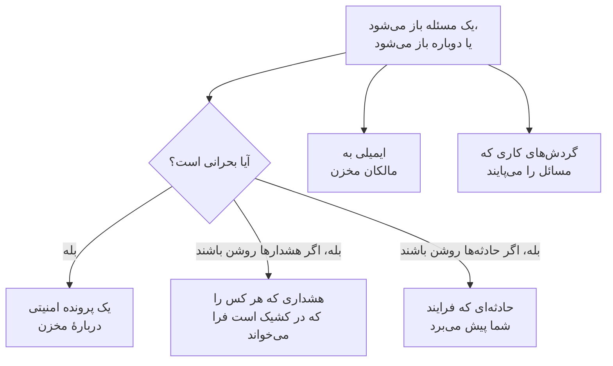

# یکپارچه‌سازی‌های امنیت داده

امنیت داده پیجر یا صف امنیتی جداگانه‌ای از خودش ندارد. آنچه را پیدا می‌کند به بخش‌هایی از OneUptime می‌سپارد که از پیش همین کار را می‌کنند: یک مسئلهٔ بحرانی به یک پرونده امنیتی تبدیل می‌شود، می‌تواند هر کسی را که در کشیک است فرا بخواند یا یک حادثه اعلام کند، و هر مسئلهٔ تازه برای مالکان مخزن ایمیل می‌شود. گردش‌های کار، OneUptime AI، API، Terraform و سرور MCP به همهٔ آنچه نگه می‌دارد دسترسی دارند.

:::cards
- [عملیات امنیتی](#عملیات-امنیتی): یک پرونده امنیتی برای هر مخزنی که یک مسئلهٔ بحرانی دارد.
- [هشدارها و کشیک](#هشدارها-و-کشیک): وقتی یک مسئلهٔ بحرانی باز می‌شود، هر کسی را که در کشیک است فرا بخوانید.
- [حادثه‌ها](#حادثهها): برای رخنه‌ای که فرایند حادثهٔ شما باید آن را پیش ببرد، یک حادثه اعلام کنید.
- [مالکان](#مالکان): مالک هر مخزن کیست، که دستی یا با قواعد تعیین می‌شود، و ایمیلی که دریافت می‌کنند.
- [OneUptime AI](#oneuptime-ai): یک مسئله را توضیح دهید، یک pull request باز کنید که آن را رفع کند، یا دربارهٔ داده‌هایتان از «پرسش از هوش مصنوعی» بپرسید.
- [رفع در معرض بودن](#رفع-در-معرض-بودن): دسترسی عمومی را مسدود کنید یا اشتراک‌گذاری را متوقف کنید، از یک مسئله یا یک پلی‌بوک.
:::

## چگونه کار می‌کند

هر یک از این‌ها وقتی اجرا می‌شود که یک ارزیابی مسئله‌ای را باز کند، یا دوباره باز کند. هر کدام در حد توان انجام می‌شود: مسئله از پیش باز است و در خط زمانی‌اش ثبت شده، پس یکپارچه‌سازی‌ای که ناموفق شود ثبت می‌شود و از آن گذشته می‌شود، و هرگز دوباره امتحان نمی‌شود تا به پرونده یا فراخوانی دوم بینجامد. آنچه هر کدام انجام داد در **خط زمانی** مسئله نوشته می‌شود، و صفحهٔ مسئله به پرونده، هشدار و حادثه‌ای که آغاز کرد پیوند می‌دهد.

| تنظیم | پیش‌فرض | چه می‌کند |
| --- | --- | --- |
| **باز کردن پرونده‌های امنیتی** | روشن | یک مسئلهٔ بحرانی یک پرونده امنیتی باز می‌کند که بر پایهٔ مخزن گروه‌بندی می‌شود. |
| **ایجاد هشدار** | خاموش | یک مسئلهٔ بحرانی هشداری ایجاد می‌کند که هر کسی را که در کشیک است فرا می‌خواند. |
| **شدت هشدار** | خالی | شدت آن هشدارها. خالی یعنی شدیدترین شدت پروژه. |
| **اعلام حادثه‌ها** | خاموش | یک مسئلهٔ بحرانی حادثه‌ای اعلام می‌کند که فرایند حادثهٔ شما آن را پیش می‌برد. |
| **شدت حادثه** | خالی | شدت آن حادثه‌ها. خالی یعنی شدیدترین شدت پروژه. |
| **اطلاع به مالکان** | روشن | هر مسئلهٔ تازه برای مالکان مخزنش ایمیل می‌شود. |

## عملیات امنیتی

هر مخزن در عملیات امنیتی موجودیتی جداگانه از نوع **مخزن داده** است. وقتی **باز کردن پرونده‌های امنیتی** روشن باشد، یک مسئلهٔ بحرانی به‌صورت یک تشخیص دربارهٔ مخزن به عملیات امنیتی فرستاده می‌شود:

- منبع آن **امنیت داده** است، و قاعده‌اش به نام بررسی نام‌گذاری می‌شود، مانند `Data Security: public-read`؛
- بحرانی است، پس پرونده‌ای که باز می‌کند در اولویت بحرانی پروژه است؛
- بر پایهٔ مخزن گروه‌بندی می‌شود: دومین مسئلهٔ بحرانی روی همان مخزن، به‌جای باز کردن پرونده‌ای دیگر، به پروندهٔ باز دربارهٔ آن می‌پیوندد.

از آنجا به بعد، به این پرونده مانند هر پروندهٔ دیگری رسیدگی می‌شود: واگذار می‌شود، یادداشت می‌خورد، بسته می‌شود، و پلی‌بوک‌های پروژه به آن پاسخ می‌دهند. تشخیص‌های مخزن، مانند تشخیص‌های هر موجودیت دیگری، در ریسک آن در [ریسک موجودیت](/docs/telemetry/security-entity-risk) شمرده می‌شوند. [پرونده‌های امنیتی و پلی‌بوک‌ها](/docs/telemetry/security-cases) را ببینید.

## هشدارها و کشیک

وقتی **ایجاد هشدار** روشن باشد، یک مسئلهٔ بحرانی هشداری ایجاد می‌کند که نامش «Data Security:» و سپس عنوان مسئله و مخزن است. هشدار، مانند هر هشدار دیگری، با قواعد خودش هر کسی را که در کشیک است فرا می‌خواند ([هشدارها](/docs/alerts/index) و [کشیک](/docs/on-call/index) را ببینید). یک مسئله در هر زمان حداکثر یک هشدار باز دارد، هر چند بار هم که ارزیابی شود. **شدت هشدار** شدت هشدار را تعیین می‌کند؛ اگر خالی بماند، شدیدترین شدت پروژه است.

یک هشدار با مسئله‌اش پایان می‌یابد: همین که مسئله دیگر باز نباشد - بررسی‌اش موفق شود، یا کسی آن را برطرف‌شده علامت بزند، ریسکش را بپذیرد یا بگوید مسئله نیست - هشدار برطرف می‌شود، و **خط زمانی** مسئله همین را می‌گوید. مسئله‌ای که دوباره باز شود هشدار تازه‌ای ایجاد می‌کند.

هشدارها به‌طور پیش‌فرض خاموش‌اند، چون بیشتر تیم‌ها می‌خواهند یک یافتهٔ امنیت داده اول در یک پرونده امنیتی بیاید. وقتی یک باکت عمومی پر از شماره‌های کارت باید کسی را از خواب بیدار کند، آن‌ها را روشن کنید.

## حادثه‌ها

وقتی **اعلام حادثه‌ها** روشن باشد، یک مسئلهٔ بحرانی حادثه‌ای اعلام می‌کند که مانند هشدارش نام‌گذاری می‌شود، برای رخنه‌ای که فرایند حادثهٔ شما باید آن را پیش ببرد: کشیک، کانال‌های فضای کاری، صفحه‌های وضعیت و یک پست‌مورتم ([حادثه‌ها](/docs/incidents/index) را ببینید). یک مسئله در هر زمان حداکثر یک حادثهٔ باز دارد. **شدت حادثه** شدت حادثه را تعیین می‌کند؛ اگر خالی بماند، شدیدترین شدت پروژه است.

امنیت داده هرگز یک حادثه را برطرف نمی‌کند، حتی وقتی مسئله‌اش برطرف شده باشد: یک حادثه می‌تواند یک صفحهٔ وضعیت و یک پست‌مورتم داشته باشد، پس هر کسی که آن را پیش می‌برد آن را می‌بندد. یک پرونده امنیتی راه دیگری به یک حادثه است: **اعلام حادثه** روی پرونده حادثه‌ای پیوندخورده با آن باز می‌کند ([اعلام یک حادثه](/docs/telemetry/security-cases#اعلام-یک-حادثه) را ببینید).

## مالکان

مالکان یک مخزن افراد و تیم‌هایی هستند که در صفحهٔ **مالکان** مخزن آمده‌اند. مسئله برای آن‌هاست: ایمیل را آن‌ها دریافت می‌کنند، و **این مخزن حساس هیچ مالکی ندارد** روی مخزن حساسی که مالکی ندارد ناموفق می‌شود.

وقتی **اطلاع به مالکان** روشن باشد، هر ارزیابی‌ای که مسائلی را روی یک مخزن باز کند یک ایمیل به مالکانش می‌فرستد - افرادی که مالک آن‌اند، و اعضای تیم‌هایی که مالک آن‌اند، تا 50 نفر - با عنوانی که می‌گوید مخزن چند مسئلهٔ تازه دارد، مانند «Data Security: 2 new issues on orders-db». این ایمیل شدت و عنوان هر مسئلهٔ تازه و حساسیت مخزن را فهرست می‌کند و به مخزن پیوند می‌دهد. هرگز نمونه‌ای در آن نیست.

### قواعد مالکیت و قواعد برچسب

قواعد، هم‌زمان با پیدا شدن مخازن، مالکان و برچسب‌ها را برایتان تعیین می‌کنند:

| قاعده | کجا | چه می‌کند |
| --- | --- | --- |
| **قواعد مالکیت** | **امنیت داده** > **قواعد** > **قواعد مالکیت** | کاربران و تیم‌های مالک را به هر مخزنی که جور باشد می‌افزاید |
| **قواعد برچسب** | **امنیت داده** > **قواعد** > **قواعد برچسب** | به هر مخزنی که جور باشد برچسب می‌افزاید |

یک قاعده با برچسب‌های مخزن، با الگویی از نام یا توضیحات آن، یا با **الگوی تگ ابری** با مخزن جور می‌شود: الگویی که با هر یک از تگ‌های ابری مخزن، به شکل `key=value`، مقایسه می‌شود. `^team=payments$` با هر مخزنی که تگ `team=payments` دارد جور است، و `^env=` با هر مخزنی که تگ `env` دارد. یک مخزن تازه همان لحظه که پیدا شود قواعد پروژه را می‌گیرد، و **اطلاع به مالکان** در یک قاعده مالکیت تعیین می‌کند که به مالکانی که می‌افزاید اطلاع داده شود یا نه. [قواعد برچسب و مالکیت](/docs/configuration/label-and-owner-rules) می‌گوید هر قاعده چگونه جور می‌شود و قواعد کی اجرا می‌شوند.

## گردش‌های کار

**مخزن داده** و **مسئله امنیت داده** تریگرهای گردش کار هستند، هر کدام با **هنگام ایجاد**، **هنگام به‌روزرسانی**، **هنگام ایجاد یا به‌روزرسانی** و **هنگام حذف**. آن‌ها را در پنل **افزودن تریگر**، زیر **منابع OneUptime** انتخاب کنید.

- **مسئله امنیت داده** > **هنگام ایجاد** وقتی اجرا می‌شود که مسئله‌ای برای نخستین بار باز شود. شدتش را در یک بلوک **اگر / وگرنه** بخوانید، و مسائل بحرانی را در یک کانال بفرستید یا در ردیاب خود یک تیکت باز کنید.
- **مسئله امنیت داده** > **هنگام به‌روزرسانی**، وقتی **فیلدهای مورد پایش** روی وضعیت آن تنظیم شده باشد، وقتی اجرا می‌شود که مسئله‌ای برطرف شود، پذیرفته شود یا دوباره باز شود.
- **مخزن داده** > **هنگام ایجاد** وقتی اجرا می‌شود که فرایند کشف یک مخزن را پیدا کند، برای نمونه برای اینکه یک تیم از هر باکت تازه باخبر شود.

برای فیلدهایی که هر تریگر منتقل می‌کند، [تریگرهای گردش کار](/docs/workflows/triggers) را ببینید.

## OneUptime AI

دو اقدام روی یک مسئله از OneUptime AI کمک می‌خواهند. هر دو عنوان و شدت مسئله، نام، گونه، منطقه و شناسهٔ ابری مخزن، حساسیت و انواع داده آن، شواهد، اهمیت بررسی و راه رفع برای ابر مخزن را برای OneUptime AI می‌فرستند - هرگز نمونه‌های یک یافته را. هر دو زیر کلیدها و محدودیت‌های OneUptime AI پروژه اجرا می‌شوند.

- **توضیح با هوش مصنوعی** برای مالک مخزن می‌نویسد که چه چیزی نادرست است، چه ممکن است رخ دهد و گام‌های دقیق رفع آن روی ابرش چیست. توضیح در **خط زمانی** مسئله نگه داشته می‌شود. هر کسی که می‌تواند امنیت داده را بخواند می‌تواند آن را درخواست کند.
- **رفع با هوش مصنوعی** از OneUptime AI می‌خواهد مسئله را در کد زیرساخت شما - Terraform، CloudFormation، Bicep یا مانند آن - با کوچک‌ترین تغییری که بررسی را موفق کند رفع کند، و یک pull request باز کند. به مخزن کدی نیاز دارد که کد زیرساخت مخزن داده را در خود دارد و زیر **کد** متصل شده است: وقتی پروژه چند مخزن کد دارد، آن را زیر **مخزن** انتخاب کنید. pull request زیر **کد** نمایش داده می‌شود ([کد](/docs/ai/ai-agent) را ببینید). Security Member و نقش‌های بالاتر می‌توانند آن را درخواست کنند.

### پرسش از هوش مصنوعی

**پرسش از هوش مصنوعی** امنیت داده را هم می‌خواند. در هر صفحهٔ امنیت داده بپرسید کدام مخازن شماره‌های کارت دارند، اول چه چیزی را رفع کنید، یا اگر یک نقش نشت کند به کدام مخازن می‌تواند دسترسی داشته باشد؛ در صفحهٔ یک مخزن یا یک مسئله، اول همان رکورد را می‌خواند. با سه ابزار خواندن پاسخ می‌دهد که با مجوزهای خود شما اجرا می‌شوند:

| ابزار | چه می‌خواند |
| --- | --- |
| `query_data_stores` | مخازن، پرخطرترین‌ها اول، بر اساس حساسیت، نوع داده، در معرض بودن، ارائه‌دهنده یا نام - یا یک مخزن همراه با اینکه چه چیزی کجا پیدا شده، چه کسی به آن دسترسی دارد و مسائل باز آن |
| `query_data_security_issues` | مسائل، پرخطرترین‌ها اول، بر اساس وضعیت، شدت، مخزن یا بررسی - یا یک مسئله همراه با شواهدش و راه رفع برای ابرش |
| `query_data_store_access` | چه کسی به یک مخزن دسترسی دارد، یا همهٔ مخازنی که یک اصل امنیتی به آن‌ها دسترسی دارد |

این ابزارها انواع داده، مکان‌ها و شمارش‌ها را می‌خوانند، و هرگز نمونه‌های یک یافته را، چه پوشانده‌شده و چه نه. پرسش از هوش مصنوعی چیزی را در امنیت داده تغییر نمی‌دهد.

## رفع در معرض بودن

دو تغییر در معرض بودن یک مخزن ابری را رفع می‌کنند، هر کدام از راه اتصال ابری مخزن که در آن **پاسخ امنیت داده** روشن است ([راه‌اندازی امنیت داده](/docs/data-security/setup#اجازه-دهید-امنیت-داده-در-معرض-بودن-را-رفع-کند) را ببینید):

- **مسدود کردن دسترسی عمومی**، روی یک باکت S3، یک حساب ذخیره‌سازی Azure یا یک باکت Cloud Storage.
- **لغو اشتراک‌گذاری**، روی یک اسنپ‌شات RDS، یا روی اسنپ‌شات‌های دستی اشتراک‌گذاری‌شدهٔ یک پایگاه داده RDS، یک خوشهٔ Aurora یا یک خوشهٔ DocumentDB.

یک فرد یکی از آن‌ها را از یک مسئلهٔ باز که آن را رفع می‌کند، با **از همین‌جا رفع کنید** اجرا می‌کند ([بررسی‌ها و مسائل امنیت داده](/docs/data-security/checks-and-issues#از-همینجا-رفع-کنید) را ببینید). یک پلی‌بوک عملیات امنیتی آن‌ها را به‌صورت گام‌هایی از دستهٔ **مهار** اجرا می‌کند، **مسدود کردن دسترسی عمومی به مخازن داده** و **لغو اشتراک‌گذاری مخزن داده**: روی هر مخزن داده‌ای که پرونده دربارهٔ آن است، حداکثر 10 مخزن، و هر کدام گامی است که با **نیازمند تأیید** روشن آغاز می‌شود. مخزنی که **عمومی از روی طراحی** علامت خورده هرگز مسدود نمی‌شود. در هر دو حالت، فید مخزن می‌گوید چه کاری انجام شد، و مخزن بی‌درنگ دوباره بررسی می‌شود، پس وقتی تغییر اعمال شد مسئله برطرف می‌شود.

## API، Terraform و MCP

هر چیزی که امنیت داده نگه می‌دارد رکوردی از API در OneUptime است که با همان مجوزهای داشبورد خوانده می‌شود ([مرجع API](/docs/api-reference/api-reference) را ببینید):

| رکوردها | مسیر API |
| --- | --- |
| مخازن داده، خط‌های زمانی‌شان، یافته‌هایشان و اینکه چه کسی به آن‌ها دسترسی دارد | `/data-store`، `/data-store-feed`، `/data-store-finding`، `/data-store-access` |
| مسائل، خط‌های زمانی‌شان و جریان‌های داده | `/data-security-issue`، `/data-security-issue-feed`، `/data-security-flow` |
| اسکن‌ها | `/data-security-scan` |
| انواع داده سفارشی، تنظیمات بررسی و قواعد محل نگهداری داده | `/data-security-custom-data-type`، `/data-security-check-setting`، `/data-security-residency-rule` |
| تنظیمات پروژه | `/data-security-setting` |
| مالکان، قواعد مالکیت و قواعد برچسب | `/data-store-owner-user`، `/data-store-owner-team`، `/data-store-owner-rule`، `/data-store-label-rule` |

چند پاسخ به‌جای ذخیره شدن، هنگام درخواست محاسبه می‌شوند. هر کدام یک `POST` است:

| مسیر | چه می‌کند |
| --- | --- |
| `/data-security/overview` | ارقام نمای کلی: مخازن بر اساس حساسیت و دسته، مسائل باز بر اساس شدت، پرخطرترین مسائل و 30 روز گذشتهٔ آن‌ها |
| `/data-security/compliance` | امتیاز و الزامات هر چارچوب |
| `/data-security/record-of-processing` | سوابق پردازش GDPR، یک ردیف برای هر مخزنی که دادهٔ شخصی دارد |
| `/data-store/<id>/scan-now` | **اکنون اسکن کن**: همین حالا از محتوای مخزن نمونه برمی‌دارد |
| `/data-store/<id>/check-now` | **اکنون بررسی کن**: پیکربندی مخزن را دوباره می‌خواند و بررسی‌هایش را اجرا می‌کند |
| `/data-store-finding/<id>/scrub` | **پاک‌سازی** روی یک یافتهٔ تله‌متری |
| `/data-security-issue/<id>/explain` | **توضیح با هوش مصنوعی** روی یک مسئله |
| `/data-security-issue/<id>/fix-with-ai` | **رفع با هوش مصنوعی** روی یک مسئله |
| `/data-store/<id>/response-actions` | کدام اقدام‌های پاسخ را همین حالا می‌توان روی مخزن انجام داد، و اگر نه، چرا |
| `/data-store/<id>/respond` | **مسدود کردن دسترسی عمومی** یا **لغو اشتراک‌گذاری** روی مخزن، همراه با مسئله‌ای که از آن اجرا شده است |

[ارائه‌دهندهٔ Terraform](/docs/terraform/index) برای هر گونه رکوردی که می‌سازید یک منبع دارد - مخازن داده‌ای که خودتان می‌افزایید، انواع داده سفارشی، تنظیمات بررسی، قواعد محل نگهداری داده، قواعد مالکیت و برچسب - که به نام همان رکورد است، مانند `oneuptime_residency_rule`.

[سرور MCP](/docs/ai/mcp-server) برای این رکوردهای امنیت داده ابزارهای ساخت، دریافت، فهرست، به‌روزرسانی، حذف و شمارش دارد: Data Store، Data Store Finding، Data Store Access Entry، Data Flow، Data Security Issue، Data Security Scan، Custom Data Type، Check Setting، Residency Rule و Data Security Setting. سپس یک دستیار هوش مصنوعی می‌تواند با مجوزهای شما بپرسد کدام مخازن شماره‌های کارت دارند، یا چه چیزی روی یک باکت باز است.

## گام‌های بعدی

:::cards
- [پرونده‌های امنیتی و پلی‌بوک‌ها (SOAR)](/docs/telemetry/security-cases): به پرونده‌هایی که امنیت داده باز می‌کند رسیدگی کنید.
- [قواعد برچسب و مالکیت](/docs/configuration/label-and-owner-rules): قواعد چگونه جور می‌شوند، و کی اجرا می‌شوند.
- [تریگرهای گردش کار](/docs/workflows/triggers): وقتی مسئله‌ای باز می‌شود یا مخزنی پیدا می‌شود، یک گردش کار اجرا کنید.
- [بررسی‌ها و مسائل امنیت داده](/docs/data-security/checks-and-issues): هر مسئله چه معنایی دارد، و چگونه آن را رفع کنید.
:::
