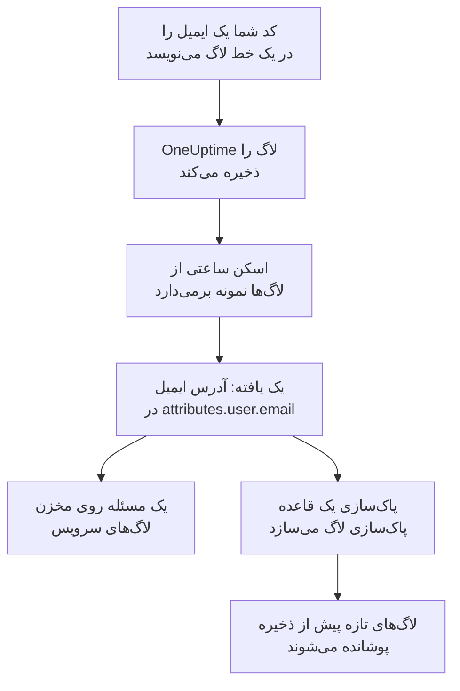

# داده‌های حساس در تله‌متری

تله‌متری هر چیزی را که کد شما می‌نویسد در خود نگه می‌دارد: یک آدرس ایمیل در یک خط لاگ، یک شماره کارت در ویژگی یک اسپن، یک توکن در یک استک‌تریس، پرسش یک مشتری در یک پرامپت، آدرس IP یک کاربر در برچسب یک متریک. امنیت داده لاگ‌ها، ترِیس‌ها، متریک‌ها، استثناها و گفتگوهای هوش مصنوعی هر سرویس، و نشست‌های هر برنامهٔ RUM را، مخازن داده‌ای جداگانه به شمار می‌آورد. هر ساعت از آن‌ها نمونه برمی‌دارد، داده‌های حساس را همان‌طور در آن‌ها پیدا می‌کند که در یک باکت، و **پاک‌سازی** یک یافته را به قاعده‌ای تبدیل می‌کند که از آن پس آن داده را هنگام دریافت، در سرویسی که در آن پیدا شده، پنهان می‌کند.

لازم نیست چیزی راه‌اندازی کنید: تله‌متری هر سرویس هر ساعت اسکن می‌شود، مگر اینکه **اسکن تله‌متری** در تنظیمات پروژه خاموش باشد. برای کنار گذاشتن لاگ‌ها، ردها یا سیگنال دیگری از یک سرویس، **اسکن محتوا** را در **تنظیمات** همان مخزن خاموش کنید: از اسکن بعدی، هیچ‌چیز از آن خوانده نمی‌شود.

:::cards
- [چه چیزهایی خوانده می‌شود](#چه-چیزهایی-خوانده-میشود): ویژگی‌ها، بدنه‌ها، پیام‌ها و پرامپت‌های هر سیگنال.
- [اسکن چگونه نمونه‌برداری می‌کند](#اسکن-چگونه-نمونهبرداری-میکند): تازه‌ترین رکوردهای هر سرویس، هر ساعت.
- [پاک‌سازی](#پاکسازی): یک یافته را هنگام دریافت، در سرویسی که در آن پیدا شده، پنهان کنید.
- [مهار خودبه‌خود](#مهار-خودبهخود): رازی که امن بودنش اثبات شده، بی‌آنکه کسی چیزی را بزند پنهان می‌شود.
- [اصلاح در کد](#اصلاح-در-کد): یک Pull Request که جلوی نوشتن همه نشت‌های یک سرویس را می‌گیرد.
- [رها کردن این متریک](#رها-کردن-این-متریک): ذخیرهٔ متریک‌هایی را که نامشان دادهٔ حساس دارد متوقف کنید.
- [چه چیزی پاک‌سازی‌شده به شمار می‌آید](#چه-چیزی-پاکسازیشده-به-شمار-میآید): وقتی یک قاعده پاک‌سازی از پیش یافته‌ای را پوشش می‌دهد.
:::

## چگونه کار می‌کند

یافته‌ای که یک قاعده پاک‌سازی پوششش می‌دهد، پاک‌سازی‌شده علامت می‌خورد: آنچه OneUptime از آن داده ذخیره می‌کند دادهٔ قدیمی‌ای است که منتظر پایان دورهٔ نگهداری‌اش است. با این حال کد هنوز آن را می‌نویسد، پس دو بررسی تله‌متری آن را مهارشده می‌شمارند، نه رفع‌شده: مسئلهٔ آن‌ها وقتی همهٔ یافته‌ها پاک‌سازی شوند با **مهارشده هنگام دریافت** برطرف می‌شود، و با **اصلاح‌شده در کد** فقط وقتی نسخهٔ تازهٔ یک اصلاح کد دیگر داده را ننویسد ([چه بر سر یک مسئله می‌آید](/docs/data-security/checks-and-issues#چه-بر-سر-یک-مسئله-میآید) را ببینید).

## چه چیزهایی خوانده می‌شود

| مخزن | چه چیزی خوانده می‌شود | یافته به کجا اشاره می‌کند |
| --- | --- | --- |
| لاگ‌ها | هر ویژگی، و بدنه | `attributes.<key>`، `body` |
| ترِیس‌ها | هر ویژگی اسپن، و ویژگی‌های هر رویداد اسپن | `attributes.<key>`، `events.<event>.<key>` |
| استثناها | پیام، استک‌تریس و ویژگی‌ها | `message`، `stackTrace`، `attributes.<key>` |
| گفتگوهای هوش مصنوعی | پرامپت‌ها و پاسخ‌های هر فراخوانی هوش مصنوعی، زیر کلیدهایی که قراردادهای GenAI آن‌ها را در آن می‌گذارند، و هر ویژگی دیگر | کلیدی که در آن هستند، مانند `gen_ai.input.messages` یا `gen_ai.prompt[].content` |
| بازپخش‌های نشست | ویژگی‌های اسپن‌ها و لاگ‌های یک برنامهٔ RUM، ویژگی‌های نشست‌هایش، صفت‌هایی که `identify()` به کاربرانش داده و ارجاع کاربری که به آن اعلام شده | `spans.attributes.<key>`، `logs.attributes.<key>`، `sessions.attributes.<key>`، `sessions.identifiedUserTraits.<key>`، `sessions.identifiedUserLabel` |
| متریک‌ها | هر ویژگی یک نقطهٔ داده، از جمله ویژگی‌های منبع آن، و نام متریک‌ها | `attributes.<key>`، `attributes.resource.<key>`، `name` |

کلیدهای شماره‌دار در یک مکان یکی می‌شوند: `gen_ai.prompt.3.content` همان `gen_ai.prompt[].content` است، پس بیست پیام یک گفتگو یک یافته‌اند، نه بیست یافته. ویژگی‌هایی که خود OneUptime می‌افزاید، یعنی آن‌هایی که با `oneuptime.` آغاز می‌شوند، خوانده نمی‌شوند.

### متریک‌ها

ویژگی‌های یک متریک همان برچسب‌های سری‌های آن‌اند. این ویژگی‌ها روی همهٔ نقطه‌های دادهٔ یک سری یکسان‌اند، پس متریکی که دقیقه‌ای هزار نقطه می‌نویسد شاید فقط سه مقدار داشته باشد، و برچسبی که ایمیل یک کاربر را فاش می‌کند یک سری می‌افزاید، نه یک نقطه. پس از یک متریک بر پایهٔ سری‌هایش نمونه برداشته می‌شود، نه بر پایهٔ نقطه‌هایش:

- **یک نقطه از هر سری.** هر متریک در تازه‌ترین دقیقه‌ای خوانده می‌شود که در یک ساعت گذشته در آن نوشته است: یک نقطهٔ داده از هر یک از حداکثر ۱۰۰ سری آن دقیقه، هر قدر هم که متریک زود به زود فرستاده شود، تا یک سری پرکار هرگز جای یک سری آرام را نگیرد. هر مقدار یک بار طبقه‌بندی می‌شود، هر چند سری هم که تکرارش کنند، پس یک یافته مقدارهای متمایز را در جای خود می‌شمارد.
- **متریک‌های تازه اول، بعد بقیه به نوبت.** اینکه یک سرویس کدام متریک‌ها را نوشته، و هر کدام در روز گذشته نخستین بار کی نوشته است، از تجمیع دقیقه‌به‌دقیقه‌ای می‌آید که جدول متریک‌ها نگه می‌دارد، هرگز از نقطه‌هایش. هر اسکن پرکارترین متریک‌های یک سرویس را می‌خواند که به احتمال زیاد سری‌های بسیاری دارند. سپس متریک‌هایی می‌آیند که در ۲ ساعت گذشته نوشتنشان را آغاز کرده است، چون نشت تازه معمولاً از کد تازه می‌آید، و پس از آن متریک‌های بعدیِ دیگرش، به ترتیبی ثابت، از جایی که اسکن قبلی ایستاده بود. متریک‌های تازه حداکثر نیمی از این نوبت‌ها را می‌گیرند، تا بقیه همیشه نوبت خود را داشته باشند.
- **هر متریک در زمانی معین.** هر اسکن به هر سرویس ۱۰ خواندن می‌دهد، و اگر پروژه بیش از ۱۰ سرویس داشته باشد کمتر. خواندن‌هایی که سرویسی چون متریک کمتری دارد بی‌استفاده می‌گذارد، یکی‌یکی به سرویس‌هایی می‌رسد که هنوز متریک‌هایی در انتظار نوبت دارند، پس هیچ خواندنی هدر نمی‌رود و هیچ سرویسی کمتر از سهمش نمی‌گیرد. ۵ متریک پرکار هر سرویس ۵ تا از خواندن‌هایش را می‌گیرند، و بقیه به نوبت متریک‌های دیگرش را می‌خوانند: در سرویسی با M متریک که r خواندن به نوبت می‌گیرد، هر متریک دست‌کم یک بار در هر M ÷ r ساعت خوانده می‌شود، رو به بالا گرد شده. این برای سرویسی با ۳۰۰ متریک که فقط ۵ خواندن خودش را می‌گیرد ۶۰ ساعت است، و وقتی دو سرویس دیگر با ۳۰۰ متریک در پروژه‌اش شریک باشند ۱۱ ساعت، چون آن‌گاه هر کدام ۲۸ یا ۲۹ خواندن می‌گیرد. تا وقتی که هر ساعت متریک‌های تازه آغاز می‌کند، این زمان حداکثر دو برابر است.
- **بازهٔ خود هر متریک.** متریک‌ها با هم خوانده می‌شوند، هر کدام با بازهٔ خودش از کلید اصلی جدول. متریکی که تازه‌ترین دقیقه‌اش بیش از ۱۶٬۳۸۴ نقطه دارد، مانند متریکی که با ایمیل هر کاربر برچسب خورده است، جداگانه خوانده می‌شود، و خواندن در نخستین نقطه‌هایش متوقف می‌شود، پس هزینه‌اش بیشتر از هر متریک دیگری نیست.

یک یافته ویژگی را نام می‌برد، مانند `attributes.user.email`، یا `name` را برای داده‌ای در نام یک متریک. رکوردهایش نقطه‌های داده‌ای هستند که در آن‌ها پیدا شد: هر کدام متریک خود و مقدار پوشانده‌شدهٔ ویژگی را نشان می‌دهد، و همان متریک را در **متریک‌ها** باز می‌کند، گروه‌بندی‌شده بر پایهٔ همان ویژگی. جایی که نام یک متریک داده‌های حساس دارد، نام هم پوشانده می‌شود، و رکورد به‌جای آن متریک‌های سرویس را باز می‌کند.

### چرا ضبط یک بازپخش هرگز خوانده نمی‌شود

ضبط یک بازپخش نشست متن صفحه‌هایی را که افراد دیده‌اند در خود دارد. تماشای آن مجوز جداگانه‌ای می‌خواهد، و یافته‌ای که از آن خوانده شود متن پوشانده‌شدهٔ صفحه را به هر کسی که می‌تواند امنیت داده را بخواند نشان می‌دهد. پس یک بازپخش فقط از روی ویژگی‌هایش خوانده می‌شود: اسپن‌ها، لاگ‌ها و جزئیات نشست در کنار ضبط. ضبط‌کننده از پیش آنچه را در مرورگر ضبط می‌کند می‌پوشاند، و قواعد پاک‌سازی لاگ روی ضبط‌ها هم اجرا می‌شوند ([بازپخش نشست](/docs/telemetry/session-replay) را ببینید).

### گفتگوهای هوش مصنوعی

پرامپت یک فراخوانی هوش مصنوعی کل گفتگوی پیش از تازه‌ترین پیام فرد را با خود دارد، پس از هر مقدار یک فراخوانی هوش مصنوعی تا ۱۶٬۳۸۴ نویسه خوانده می‌شود. وقتی گفتگوهای هوش مصنوعی داده‌های حساس دارند، دو چیز دیگر هم پیش می‌آید: ارائه‌دهندهٔ هوش مصنوعی‌ای که فراخوانی‌ها به آن رفته‌اند یک جریان داده از آن داده‌ها به شمار می‌آید، و [داده‌های حساس به یک ارائه‌دهندهٔ هوش مصنوعی فرستاده می‌شوند](/docs/data-security/checks-and-issues#هوش-مصنوعی) روی آن مخزن ناموفق می‌شود.

گفتگوهای یک [ابزار هوش مصنوعی شرکت](/docs/telemetry/ai-company-tools) کنار گذاشته می‌شوند. فقط مالک پروژه و مدیر پروژه می‌توانند آن‌ها را بخوانند، و یافته جایی قرار می‌گیرد که هر کسی که امنیت داده را می‌خواند آن را هم می‌خواند، پس اسپن‌های آن سرویس‌ها هرگز خوانده نمی‌شوند، و گفتگوهای هوش مصنوعی‌شان خوانده‌نشده گزارش می‌شوند.

## اسکن چگونه نمونه‌برداری می‌کند

هر ساعت، تازه‌ترین رکوردهای یک ساعت گذشتهٔ هر سیگنال خوانده می‌شوند و مانند رکوردهای هر مخزن دیگری فیلد به فیلد طبقه‌بندی می‌شوند ([فیلدها و ستون‌ها](/docs/data-security/data-types#فیلدها-و-ستونها) را ببینید):

| محدودیت | مقدار |
| --- | --- |
| رکوردهای هر سرویس و سیگنال | **اندازه نمونه تله‌متری**، به‌طور پیش‌فرض ۵۰۰، هرگز بیش از ۱٬۰۰۰ |
| سرویس‌ها یا برنامه‌های RUM خوانده‌شده برای هر سیگنال | پرکارترین ۲۰۰ مورد |
| رکوردها در یک بار خواندن | ۵٬۰۰۰، مشترک میان سرویس‌ها؛ ۵۰۰ برای فراخوانی‌های هوش مصنوعی |
| نویسه‌های بدنهٔ یک لاگ، پیام یک استثنا یا یک استک‌تریس | ۸٬۱۹۲ |
| نویسه‌های مقدار یک ویژگی | ۴٬۰۹۶ |
| نویسه‌های یک مقدار از یک فراخوانی هوش مصنوعی | ۱۶٬۳۸۴ |
| ویژگی‌های یک رکورد | ۱۲۸؛ ۶۴ برای یک فراخوانی هوش مصنوعی |
| رویدادهای یک اسپن، و ویژگی‌های یک رویداد | ۱۶ و ۳۲ |
| مکان‌های یک مخزن | ۵۰۰ |
| متریک‌های خوانده‌شده در یک اسکن | ۱۰۰، مشترک میان سرویس‌ها، دست‌کم یکی از هر سرویس؛ ۱۰ از هر سرویس، نیمی از پرکارترین‌هایش و نیمی از تازه‌ها و بقیه به نوبت، و خواندن‌هایی که سرویسی بی‌استفاده می‌گذارد به نوبت به سرویس‌های دیگر می‌رسد |
| یک متریک تازه | متریکی که نخستین نقطه‌اش در ۲۴ ساعت گذشته، در ۲ ساعت گذشته رسیده است |
| سری‌های یک متریک | یک نقطهٔ داده از هر کدام، از تازه‌ترین دقیقه‌اش، حداکثر ۱۰۰ |

هر مقدار در خود پایگاه داده کوتاه می‌شود، پس هیچ مقدار بلندی از آن بیرون نمی‌رود، و هر بار خواندن پس از ۳۰ ثانیه متوقف می‌شود. خواندنی که ناموفق شود، اخطاری روی مخازنی است که برای آن‌ها انجام می‌شد؛ اسکن با خواندن بعدی ادامه می‌یابد.

برای کنار گذاشتن چیزی، آن را به **استثناهای اسکن** مخزن بیفزایید: مکانی که کامل نام برده شود (`attributes.http.url`)، همه چیز زیر یک مکان (`attributes.http`)، یا یک کلید ویژگی که بدون پیشوند نام برده شود (`http.url`).

## پاک‌سازی

**پاک‌سازی** روی یک یافته، قاعده‌ای را می‌سازد که از آن پس آن نوع داده را در آن مکان پنهان می‌کند، یا به قاعدهٔ فعالی اشاره می‌کند که از پیش همین کار را می‌کند:

:::steps
### یافته را باز کنید

مسئله را باز کنید - **کجا پیدا شد** هر یافته‌ای را که پشت آن است فهرست می‌کند - یا **امنیت داده** > **در تله‌متری شما** را، که در آن **نمایش رکوردها** رکوردهایی را که یافته در آن‌ها پیدا شد کنار فهرست باز می‌کند.

### پاک‌سازی را بزنید

روی **پاک‌سازی** کلیک کنید. پیش از آنکه چیزی ساخته شود، یک پنجره می‌گوید قاعده چه خواهد کرد: رکوردهای چه کسی را تغییر می‌دهد، با آنچه پیدا می‌کند چه می‌کند و چه چیزی مقادیری را که پنهان خواهد کرد می‌خواند. برای ساختن قاعده، در آن روی **پاک‌سازی** کلیک کنید. OneUptime برای لاگ‌ها و لاگ‌های یک برنامهٔ RUM یک قاعده پاک‌سازی لاگ، و برای اسپن‌ها، استثناها و فراخوانی‌های هوش مصنوعی یک قاعده پاک‌سازی ترِیس می‌سازد، روی همان بخشی از رکورد که یافته در آن است، و برای ویژگی یک متریک یک قاعده خط لوله متریک.

### کد را هم اصلاح کنید

قاعده دادهٔ تازه را پیش از ذخیره شدن پنهان می‌کند. داده‌ای که از پیش ذخیره شده تا پایان دورهٔ نگهداری‌اش می‌ماند، پس کدی را که آن را می‌نویسد اصلاح کنید: یافته سرویس و ویژگی را نام می‌برد. **رفع با هوش مصنوعی** روی مسئله یک Pull Request برای همه نشت‌های سرویس باز می‌کند: [اصلاح در کد](#اصلاح-در-کد) را ببینید.
:::

نام قاعده از چیزی می‌آید که پنهان می‌کند، مانند «Data Security: Email address in log attributes of checkout»، یا «Data Security: Password or secret in db.password of checkout» برای قاعده‌ای که ویژگی‌اش را نام می‌برد، و در کنار دیگر قواعد پاک‌سازی شما فهرست می‌شود ([فیلترهای حذف و قواعد پاک‌سازی](/docs/telemetry/drop-filters-and-scrub-rules#پالایش-دادههای-حساس) را ببینید). این قاعده باریک‌ترین قاعده‌ای است که دادهٔ یافته را پنهان می‌کند، یعنی نخستین مورد از این‌ها که جور باشد:

| یافته | قاعده‌ای که پاک‌سازی می‌سازد |
| --- | --- |
| آدرس ایمیل، شماره کارت، شماره تأمین اجتماعی آمریکا، شماره تلفن یا آدرس IP | الگوی داخلی همان نوع، پوشانده‌شده. آدرس IP به‌طور کامل حذف می‌شود، یا جایی که [رویدادهای امنیتی](/docs/telemetry/security-events) آن رکوردها را می‌خواند درهم‌سازی می‌شود تا همچنان بتواند آدرسی را که باید مسدود شود نام ببرد. |
| هر نوع دادهٔ دیگری که یک الگو به‌تنهایی پیدا می‌کند، مانند یک توکن GitHub | یک قاعدهٔ **عبارت باقاعده سفارشی** ساخته‌شده از الگوهای خود آن نوع داده. راز به‌طور کامل حذف می‌شود. |
| یکی از انواع دادهٔ خودتان، با یک الگو | همان الگو، فقط در ویژگی‌ای که در آن پیدا شد |
| نوع داده‌ای که با واژه‌های پیرامونش بازشناخته می‌شود، مانند شماره مسیریابی بانکی | شکل آن، فقط در ویژگی‌ای که در آن پیدا شد |
| نوع داده‌ای که از روی نام فیلد پیدا می‌شود، مانند نام یک فرد زیر `customer_name` یا زیر پارامتر `full_name` یک URL، یا مقداری زیر کلیدی که یک راز را نام می‌برد | یک قاعدهٔ **ویژگی‌های نام‌برده**، که کل مقدار آن ویژگی را پنهان می‌کند |
| مقداری زیر کلیدی که حساس به نظر می‌رسد، جایی که هیچ قاعدهٔ باریک‌تری آن را پنهان نمی‌کند | یک قاعدهٔ **کلیدهای ویژگی حساس**، که کل مقدار هر ویژگی از این دست را حذف می‌کند |
| هر نوع داده‌ای در ویژگی یک متریک | یک قاعده خط لوله متریک **پوشاندن ویژگی** برای سرویس، که مقدارهایی از ویژگی را که آن نوع داده را در خود دارند با `[REDACTED]` جایگزین می‌کند. برای یک نشانی IP، یک نشانی ایمیل، یک شمارهٔ کارت، یک شمارهٔ تلفن یا یک شمارهٔ تأمین اجتماعی آمریکا، فیلترش **با نوع الگو مطابقت دارد** با همان نوع است، که همان چیزی را پیدا می‌کند که یک قاعدهٔ لاگ یا ترِیس با همان **نوع الگو** پیدا می‌کند، از جمله نشانی‌های IPv6، مقدارهایی با کدگذاری درصدی، در خطی دیگر یا تایپ‌شده به‌صورت تمام‌عرض، و شماره‌ای در کنار واژه‌ای که آن را نام می‌برد. برای نوع دادهٔ دیگر، الگوی خود آن نوع است، و اگر هیچ الگویی آن نوع داده را پیدا نکند، قاعده هر مقدار ویژگی را جایگزین می‌کند |

### اثبات‌شده روی رکوردهایی که در آن‌ها دیده شد

پیش از آنکه پنجره بگوید قاعده چه خواهد کرد، OneUptime هر قاعده‌ای را که می‌توانست بسازد روی رکوردهایی که یافته در آن‌ها دیده شد، و روی تازه‌ترین رکوردهای سرویس آن که در آن جایگاه مقداری دارند، با همان کدی که دریافت اجرا می‌کند، اجرا می‌کند و از اسکنر می‌پرسد چه چیزی باقی مانده است. نخستین قاعده‌ای که داده را در هر مقداری که آن را داشت پنهان کند، و از مقدارهای دیگر آنجا حداکثر ۵ در ۱۰۰ را تغییر دهد، همان قاعده است. پنجره می‌گوید روی چند رکورد اجرا شد، چند مقدار داده را داشتند و چند مقدار دیگر را تغییر داد. الگویی که بیشتر از این تغییر دهد هرگز پیشنهاد نمی‌شود: به‌جای آن قاعده‌ای پیشنهاد می‌شود که ویژگی را نام می‌برد، و می‌گوید چه چیز دیگری را تغییر می‌دهد.

اثبات همراه قاعده نگه داشته می‌شود، و فهرست قواعد پاک‌سازی تا وقتی قاعده تغییر نکرده، در ردیف آن **اثبات‌شده** را نشان می‌دهد. قاعدهٔ یک استثنا روی استثناهایی اجرا می‌شود که داده در آن‌ها دیده شد، همان‌طور که دریافت، استثنایی را که یک span ثبت می‌کند پالایش می‌کند. جایی که هیچ رکوردی برای اجرای قاعده باقی نمانده، مانند رکوردهای یک بازپخش نشست، یا رکوردهایی که از دورهٔ نگهداری‌شان گذشته‌اند، قاعده همان‌طور که برنامه‌ریزی شده ساخته می‌شود و پنجره این را می‌گوید.

قاعدهٔ لاگ یا ترِیس برای سرویسی است که یافته در آن پیدا شده: لاگ‌ها یا اسپن‌های همان سرویس را پاک‌سازی می‌کند و مال سرویس‌های دیگر همان‌طور که هستند می‌مانند، پس هیچ چیزی که آن‌ها را می‌خواند تغییر نمی‌کند. ستون **دامنه** در فهرست قواعد پاک‌سازی می‌گوید قاعده برای کدام سرویس است. یافته‌ای در بازپخش‌های نشست یک برنامهٔ RUM قاعده‌ای برای همهٔ سرویس‌ها و برنامه‌های پروژه می‌سازد، چون قواعد لاگ بازپخش‌ها را هم پاک‌سازی می‌کنند، و پنجره این را می‌گوید. اگر سرویس دیگر وجود نداشته باشد، **پاک‌سازی** این را می‌گوید و قاعده‌ای نمی‌سازد.

پنجره، هر کدام به صورت پیوند، مانیتورها، داشبوردها با ویجت‌هایشان، نماهای ذخیره‌شده، قواعد ضبط و SLOهایی را نام می‌برد که مقادیری را که قاعده پنهان خواهد کرد می‌خوانند، و می‌گوید چه بر سرشان می‌آید: فیلتر روی یک مقدار پنهان‌شده دیگر مطابقت نمی‌کند، و گروه‌بندی بر اساس آن دیگر مقادیر واقعی را نشان نمی‌دهد. همچنین می‌گوید [رویدادهای امنیتی](/docs/telemetry/security-events) که این رکوردها را می‌خوانند چه چیزی را از دست می‌دهند: با پنهان شدن نشانی‌های IP، رویدادهایشان نمی‌توانند نشانی‌ای را که باید مسدود شود نام ببرند. آنچه نمی‌توانید ببینید شمرده می‌شود، اما هرگز نام برده نمی‌شود. پنجره هرگز جلوی قاعده را نمی‌گیرد: می‌گوید، و شما تصمیم می‌گیرید. فرم‌های قواعد پاک‌سازی هم پیش از ذخیره یا روشن کردن یک قاعده همین را نشان می‌دهند.

برخی یافته‌ها را نمی‌توان با یک قاعده پاک‌سازی کرد، و **پاک‌سازی** می‌گوید چرا. ویژگی یک متریک را همیشه می‌توان پاک‌سازی کرد، چون قاعده‌اش می‌تواند هر مقدار آن ویژگی را پنهان کند:

- نوع داده‌ای که فقط از روی نام فیلدها در بدنهٔ لاگ پیدا می‌شود، مانند نام یک فرد: هیچ قاعده‌ای نمی‌تواند آن را از بقیهٔ پیام بازشناسد. آن را به‌صورت یک ویژگی بفرستید، که یک قاعدهٔ **ویژگی‌های نام‌برده** پنهانش می‌کند، یا دیگر آن را نفرستید.
- هر قاعده‌ای که آزموده شد بسیار بیشتر از داده را پنهان می‌کرد: هر کدام روی رکوردهایی که داده در آن‌ها دیده شد اجرا شد و چیزهای دیگر زیادی را تغییر داد. در کدی که آن را می‌نویسد، دیگر آن را نفرستید.
- نشانه‌گذاری یک سند: پنهان کردن آن واژه سند را پنهان نمی‌کند.
- جزئیات خود یک نشست (`sessions.*`): دریافت بازپخش نشست هیچ قاعده پاک‌سازی‌ای را اجرا نمی‌کند.
- نام یک متریک (`name`): کدی که متریک را می‌سازد آن را تعیین می‌کند، و یک قاعده خط لوله فقط می‌تواند نام کل یک متریک را تغییر دهد. نام متریک را تغییر دهید، و آنچه را در نامش تغییر می‌کند به‌جای آن به‌صورت یک ویژگی بفرستید. تا آن زمان، **رها کردن این متریک** می‌تواند ذخیرهٔ آن متریک‌ها را متوقف کند.

**پاک‌سازی** قاعده را به نام شما و با مجوزهای خودتان می‌سازد: مالک پروژه و مدیر پروژه می‌توانند آن را بزنند، و همچنین تیمی که می‌تواند قواعد پاک‌سازی لاگ بسازد، برای اسپن‌ها، استثناها و فراخوانی‌های هوش مصنوعی تیمی که می‌تواند قواعد پاک‌سازی ترِیس بسازد، و برای متریک‌ها تیمی که می‌تواند قواعد خط لوله متریک بسازد.

## مهار خودبه‌خود

وقتی OneUptime AI روی مسائل امنیت داده کار می‌کند ([OneUptime AI در امنیت داده](/docs/data-security/ai) را ببینید)، یک مسئلهٔ تله‌متری، جایی که امن بودنش اثبات شده، بی‌آنکه کسی چیزی را بزند مهار می‌شود. برای هر جایگاهی که مسئله می‌شمارد، OneUptime AI قاعده‌ای را که **پاک‌سازی** می‌ساخت برنامه‌ریزی می‌کند، به همان شیوه اثبات‌شده، و فقط وقتی همهٔ این‌ها برقرار باشد آن را خودبه‌خود می‌سازد:

- **داده یک راز است**، مانند یک گذرواژه، یک توکن یا یک کلید.
- **قاعده اثبات شده است** روی رکوردهایی که داده در آن‌ها دیده شد: داده را در هر مقداری که آن را داشت پنهان کرد.
- **چیز دیگری را آنجا تغییر نمی‌دهد**: هیچ‌یک از مقدارهای دیگر جایگاهش را.
- **هیچ چیز آنچه را پنهان می‌کند نمی‌خواند**: هیچ مانیتور، داشبورد، نمای ذخیره‌شده، قاعدهٔ ضبط یا SLO، و هیچ چیزی که رویدادهای امنیتی به آن نیاز دارد.
- **برای سرویسی است** که داده در آن دیده شد.

همهٔ موارد دیگر به‌جای آن پیشنهاد می‌شوند، در **امنیت داده ← هوش مصنوعی** و در صفحهٔ مسئله، با اینکه قاعده چگونه اثبات شد و چه چیزی آنچه را پنهان خواهد کرد می‌خواند: دادهٔ شخصی، قاعده‌ای که چیزی آن را می‌خواند، قاعده‌ای که مقدارهای دیگر را تغییر می‌دهد، قاعده‌ای که هیچ رکوردی برای اجرایش نماند، قاعده‌ای برای همهٔ سرویس‌ها، و هر جایگاهی که کسی قاعدهٔ پیشینش را واگرد یا رد کرد. یک قاعدهٔ هوش مصنوعی امنیت داده که **مهار** را برای یک مسئله روی **به‌صورت خودکار** بگذارد، اجازه می‌دهد دادهٔ شخصی اثبات‌شده هم خودبه‌خود پنهان شود. هیچ قاعده‌ای اجازه نمی‌دهد تغییری که امن بودنش اثبات نشده خودبه‌خود اجرا شود.

ویژگی یک متریک هم با همین شرط‌ها سنجیده می‌شود. قاعده‌اش روی نقطه‌های داده‌ای که یافته در آن‌ها دیده شد، و روی تازه‌ترین نقطه‌های سرویسش که مقداری در آن ویژگی دارند، از راه پایپ‌لاین متریکی که دریافت اجرا می‌کند، اجرا می‌شود، و آنچه آن را می‌خواند هر مانیتور، داشبورد، قاعدهٔ ضبط و SLO است که یکی از متریک‌های سرویس را می‌خواند که در روز گذشته آن ویژگی را داشته‌اند.

جایی که هیچ‌یک از قواعد **پاک‌سازی** نمی‌تواند داده را پنهان کند، مانند یکی از انواع دادهٔ خودتان که الگویی ندارد، OneUptime AI یکی می‌نویسد: الگویی برای داده، یا ویژگی‌ای که باید به‌طور کامل پنهان شود. به آن نوع داده، جای آن، نام ویژگی‌های کنارش و شکل مقدارها گفته می‌شود، مانند `AA-9999` برای `AB-1234`، هرگز یک مقدار، و آنچه می‌نویسد مانند هر قاعدهٔ دیگری پیش از پیشنهاد یا ساخته شدن روی رکوردها اثبات می‌شود. برای هر جایگاه یک بار از آن پرسیده می‌شود: آنچه نوشت، یا اینکه چیزی نتوانست بنویسد، همراه یافته نگه داشته می‌شود، پس وقتی دوباره روی مسئله کار می‌شود، آنچه نوشت دوباره روی تازه‌ترین رکوردها اثبات می‌شود و هیچ اعتبار هوش مصنوعی خرج نمی‌شود. وقتی آنچه به آن گفته می‌شد تغییر کند، دوباره پرسیده می‌شود: نوع داده، جای داده، نام‌های کنارش یا شکل مقدارهایش. فراخوانی‌ای که شکست بخورد چیزی نگه نمی‌دارد، پس دفعهٔ بعد دوباره از آن جایگاه پرسیده می‌شود.

تغییری که OneUptime AI خودبه‌خود انجام داد:

- **در خط زمانی مسئله است**، با قواعدی که ساخت، اینکه هر کدام چگونه اثبات شد، و **واگرد**، که آن‌ها را حذف می‌کند. **امنیت داده ← هوش مصنوعی** همان **واگرد** را دارد. جایگاهی که قاعده‌اش را واگرد کنید، دیگر هرگز خودبه‌خود مهار نمی‌شود: OneUptime AI به‌جای آن پیشنهادش می‌دهد.
- **ایمیل می‌شود** به مالکان مخزن و مالکان سرویس.
- **می‌گوید راز باید چرخانده شود.** پنهان کردن یک راز فقط جلوی نسخه‌های تازه را می‌گیرد: راز همچنان کار می‌کند، و رکوردهایی که پیش از قاعده ذخیره شدند تا پایان دورهٔ نگهداری‌شان آن را نگه می‌دارند. خط زمانی و ایمیل می‌گویند کجا دیده شد.

یافته‌های تازه در سرویسی که مسئله‌اش از پیش باز است، به همان شیوه مهار می‌شوند، همین که اسکن ساعتی آن‌ها را پیدا کند.

## اصلاح در کد

یک قاعده پالایش داده تازه را هنگام دریافت پنهان می‌کند، اما کد همچنان آن را می‌نویسد. **رفع با هوش مصنوعی** روی یک مسئله تله‌متری از OneUptime AI یک Pull Request می‌خواهد که جلوی نوشتن هر نشتی را که OneUptime هنوز در تله‌متری سرویس می‌بیند می‌گیرد: نشت این مسئله و نشت‌های دیگر سرویس، از جمله آن‌هایی که هنگام دریافت مهار شده‌اند. پیش از آنکه چیزی آغاز شود، یک پنجره نشان می‌دهد Pull Request چه خواهد کرد، و **باز کردن Pull Request** دقیقاً همان را درخواست می‌کند.

:::steps
### پیدا کردن جایی که هر نشت نوشته می‌شود

پیش از آنکه OneUptime AI شروع کند، امنیت داده رکوردهایی را که هر نشت در آن‌ها دیده شد، درون OneUptime دوباره می‌خواند و فقط جایی را نگه می‌دارد که کد آن‌ها را نوشته است:

- **یک اسپن یا یک فراخوانی هوش مصنوعی**: فایل، خط و تابعی که ویژگی‌های `code.*` آن نام می‌برند، و نام اسپن.
- **یک استثنا**: فریم‌های بالایی خود آن، آن‌هایی که در کد سرویس هستند.
- **یک خط لاگ**: فایل، خط و تابعی که ویژگی‌هایش نام می‌برند، اگر داشته باشد، لاگر آن، و خود خط به‌صورت الگو که هر مقدار در آن با نام نوعش جایگزین شده است، مثل `User <Email address> signed up`، و هر واژه‌ای که از واژه‌هایی نیست که کد خط‌های لاگ را با آن‌ها می‌نویسد، مثل نام یک شخص یا یک نام کاربری، با `<value>`، فارغ از اینکه چند تا از رکوردهایش این واژه را مشترک دارند: `Payment declined for Maria Gonzalez`، `Payment declined for <value>` می‌شود، و `Ticket assigned to jdoe`، خوانده‌شده از همهٔ رکوردهای آن خط، `Ticket assigned to <value>` می‌شود. نام یک اسپن و نام یک متریک هم به همین شیوه خوانده می‌شوند.
- **یک متریک**: نام متریک.
- **هر نشت**: کلید ویژگی آن، مثل `user.email`، که کد معمولاً همان‌طور که هست می‌نویسد.

### انتخاب مخزن

Pull Request به مخزنی می‌رود که فایل‌هایی را که رکوردها نام می‌برند در خود دارد و این فایل‌ها مثل فایل‌های یک ردگیری پشته تطبیق داده می‌شوند. نشتی که رکوردهایش هیچ فایلی نام نمی‌برند، به جایی می‌رود که نشت‌های دیگر سرویس هستند، وگرنه به مخزنی که هم‌نام سرویس است، یا به تنها مخزن پروژه. در مخزنی که چند سرویس دارد، OneUptime AI در پوشه سرویس کار می‌کند: پوشه‌ای که این فایل‌ها در آن مشترک‌اند، وگرنه پوشه‌ای که بازبینی‌های تولید سرویس به کار می‌برند. وقتی هیچ‌چیز تعیین نکند، خودتان از میان مخزن‌هایی که می‌توانید از OneUptime AI بخواهید در آن‌ها کار کند انتخاب می‌کنید.

### باز کردن Pull Request

پنجره می‌گوید کد چگونه تغییر می‌کند، هر نشت را با جایی که نوشته می‌شود فهرست می‌کند، و مخزن، دلیل انتخاب آن و فایل‌هایی را که OneUptime AI از آن‌ها شروع می‌کند نام می‌برد. **باز کردن Pull Request** دقیقاً همان طرح را درخواست می‌کند: اگر از زمانی که پنجره را باز کرده‌اید نشتی پیدا یا اصلاح شده باشد، چیزی آغاز نمی‌شود و طرح دوباره نشان داده می‌شود.
:::

اینکه کد چگونه تغییر کند به تعداد جاهایی بستگی دارد که داده را می‌نویسند:

| جایی که داده نوشته می‌شود | کاری که Pull Request می‌کند |
| --- | --- |
| در سه جا یا کمتر | کد را در هر جا تغییر می‌دهد: مقدار را حذف می‌کند، یا پیش از ارسال آن را ماسک یا هش می‌کند |
| در بیش از سه جا | به‌جای تغییر هر جا، یک مرحله پوشاندن همراه با یک تست در جایی اضافه می‌کند که سرویس تله‌متری خود را راه‌اندازی می‌کند |
| جایی که قواعد پالایش شما از قبل آن را هنگام دریافت پنهان می‌کنند | آن مرحله پوشاندن را برای این کلیدها هم اضافه می‌کند تا کد همان کاری را بکند که دریافت می‌کند |

یک Pull Request یک سرویس را در یک مخزن اصلاح می‌کند: سرویسی که نشت‌هایش در دو مخزن نوشته می‌شوند، در هر کدام یکی می‌گیرد. تا وقتی در حال نوشته شدن است، **رفع با هوش مصنوعی** روی هر مسئله سرویس به آن اشاره می‌کند و Pull Request دومی آغاز نمی‌شود.

به OneUptime AI جاها، کلیدها، انواع داده و الگوها فرستاده می‌شود، هرگز مقداری از داده‌های شما، نمونه ماسک‌شده یا رکورد، و عامل کدنویسی هنگام کار هیچ‌چیز از تله‌متری شما نمی‌خواند. توضیح Pull Request نشت‌ها را فهرست می‌کند و به مسئله‌هایی که اصلاح می‌کند پیوند می‌دهد و هرگز رکوردی را نقل نمی‌کند.

هر مسئله‌ای که Pull Request اصلاح می‌کند آن را نگه می‌دارد: کارت **نحوه رفع** آن می‌گوید Pull Request در حال نوشته شدن، باز، ادغام‌شده یا بسته است، همراه با پیوند به Pull Request و وظیفه، و پس از ادغام، اینکه تولید چه نشان داد. خط زمانی مسئله می‌گوید Pull Request کی باز شد. مسئله به‌صورت **اصلاح‌شده در کد** حل می‌شود، همین که نسخه تازه سرویس دیگر داده را ننویسد ([چه بر سر یک مسئله می‌آید](/docs/data-security/checks-and-issues#چه-بر-سر-یک-مسئله-میآید) را ببینید).

یک راز به بیش از اصلاح کد نیاز دارد: کد فقط جلوی کپی‌های تازه را می‌گیرد و راز همچنان کار می‌کند. Pull Request، خط زمانی مسئله و کارت **نحوه رفع** آن می‌گویند که راز را عوض کنید، و کارت فهرست می‌کند که کجا دیده شده است.

وقتی **کار روی مسائل جدید** روشن است، OneUptime AI اصلاح هر سرویس را هم خودبه‌خود پیشنهاد می‌کند، از پرخطرترین سرویس، در **امنیت داده ← هوش مصنوعی** و روی پرخطرترین مسئله سرویس. به‌طور پیش‌فرض منتظر شما می‌ماند. یک قاعده هوش مصنوعی امنیت داده که **اصلاح** را برای پرخطرترین مسئله سرویس روی **به‌صورت خودکار** می‌گذارد، Pull Request را بدون پرسیدن باز می‌کند، در مخزنی که چیزی درباره‌اش تصمیم گرفته است. **بیشینه Pull Requestهای باز اصلاحی** مخزن هر دو را محدود می‌کند: در سقف، Pull Requestی که یک قاعده باز می‌کرد منتظر شما می‌ماند و تا یکی ادغام یا بسته نشود، هیچ Pull Request اصلاحی تازه‌ای باز نمی‌شود.

### فرانت‌اند یک برنامه RUM

**رفع با هوش مصنوعی** روی یک مسئله بازپخش نشست، همین کار را برای یک برنامه RUM انجام می‌دهد: یک Pull Request که کد فرانت‌اند آن را از ارسال هر نشتی که OneUptime هنوز در لاگ‌های مرورگر، اسپن‌های مرورگر و جزئیات نشست‌های آن می‌بیند بازمی‌دارد. جای نوشته‌شدن هر نشت از رکوردهایی می‌آید که در آن‌ها دیده شده و درون OneUptime خوانده می‌شوند:

- **یک لاگ یا اسپن مرورگر**: فایل، خط و تابعی که پشته JavaScript آن از راه سورس‌مپ‌هایی که بیلدهای شما بارگذاری کرده‌اند به آن‌ها می‌رسد (نگاه کنید به [Source Maps](/docs/telemetry/source-maps))، وگرنه ویژگی‌های `code.*` آن؛ خط لاگ یا نام اسپن به‌صورت الگو؛ و صفحه‌ای که در آن نوشته شده، تنها با مسیرش، با پوشاندن هر شناسه و مقدار در آن.
- **جزئیات کاربر یک نشست**: فراخوانی `identify()` ضبط‌کننده نشست که آن‌ها را داده است، و صفحه‌ای که نشست در آن آغاز شده است.

Pull Request به مخزنی می‌رود که آن فایل‌ها را دارد، وگرنه به مخزنی که بیشترِ فایل‌هایی را دارد که سورس‌مپ‌های تازه‌ترین نسخه نام می‌برند، وگرنه به مخزنی که هم‌نام **شناسه اپلیکیشن** برنامه است، یا به تنها مخزن پروژه؛ وقتی هیچ‌چیز تعیین نکند، شما انتخاب می‌کنید. کد مرورگر را در هر جا تغییر می‌دهد (کاربر نشست با یک شناسه مبهم شناسایی می‌شود، نه با ایمیل)، یا یک مرحله پوشاندن جایی اضافه می‌کند که برنامه تله‌متری مرورگرش را راه‌اندازی می‌کند. ضبط یک نشست هرگز خوانده نمی‌شود و عامل کدنویسی هیچ‌یک از تله‌متری شما را نمی‌خواند. هر مسئله به‌محض اینکه نسخه تازه برنامه دیگر داده را نفرستد، به‌عنوان **اصلاح‌شده در کد** حل می‌شود. OneUptime AI هنوز اصلاح یک برنامه را خودش پیشنهاد نمی‌دهد: آن را با **رفع با هوش مصنوعی** بخواهید.

## رها کردن این متریک

هیچ قاعده‌ای داده را از نام یک متریک بیرون نمی‌آورد، پس تا وقتی کدی که نام متریک را می‌گذارد اصلاح نشده، داده همچنان می‌رسد. **رها کردن این متریک** روی یافته‌ای در نام یک متریک، ذخیرهٔ متریک‌هایی را که نامشان آن داده را دارد متوقف می‌کند، به بهای از دست رفتن داده‌هایشان، پس فقط وقتی انجام می‌شود که خودتان بخواهید:

- **متریک‌های یک سرویس.** یک قاعده خط لوله متریک **حذف** برای سرویس یافته می‌سازد: هر نقطهٔ دادهٔ تازه از متریکی که نامش آن نوع داده را دارد، پیش از ذخیره رها می‌شود. فیلترش الگوی خود آن نوع داده روی نام متریک است، پس نوعی که هیچ الگویی پیدایش نمی‌کند، مانند نام یک شخص، رها نمی‌شود و پنجرهٔ گفت‌وگو دلیلش را می‌گوید.
- **پیش از انجام گفته می‌شود.** پنجرهٔ گفت‌وگو می‌گوید که آن نقطه‌های داده برای همیشه از دست می‌روند، چند تا از متریک‌های سرویس که در روز گذشته نوشته شده‌اند چنین نامی دارند، چه چیزهایی آن‌ها را می‌خوانند و دیگر دادهٔ تازه نمی‌گیرند، اینکه آنچه از قبل ذخیره شده تا پایان دوره نگهداری‌اش می‌ماند، و اینکه چگونه برش گردانید. تا وقتی تیک نزنید که متوجه هستید، چیزی رها نمی‌شود.
- **چه چیزی آن‌ها را می‌خواند، و چه بر سرش می‌آید.** پنجرهٔ گفت‌وگو هر مانیتور، هر داشبورد همراه با ویجت‌هایش که آن متریک‌ها را می‌خوانند، هر SLO متریک سرویس و هر قاعده ضبط متریکی که آن‌ها را می‌خواند را، هر کدام به‌صورت پیوند، نام می‌برد. مانیتورها دیگر نمی‌توانند روی مقدارهایشان هشدار دهند، ویجت‌ها دادهٔ تازه‌ای نشان نمی‌دهند، SLOها دیگر رویداد تازه‌ای از آن‌ها نمی‌شمارند، و آن متریک‌ها دیگر در متریک‌های خروجی قواعد ضبط به حساب نمی‌آیند. زیر هر قاعده ضبط، نام آنچه متریک خروجی آن قاعده را می‌خواند و آنچه به نوبهٔ خود متریک‌های خروجی آن‌ها را می‌خواند هم برده می‌شود، تا سه متریک خروجی در ادامهٔ زنجیره. پیوند هر ویجت، داشبوردش را روی همان ویجت باز می‌کند. آنچه نمی‌توانید ببینید شمرده می‌شود، اما هرگز نامش برده نمی‌شود.
- **به نام شما، و ثبت‌شده.** قاعده با مجوز خودتان برای ساختن قواعد خط لوله متریک ساخته می‌شود: مالک پروژه و مدیر پروژه می‌توانند آن را بسازند، و همچنین تیمی که می‌تواند قواعد خط لوله متریک بسازد. گزارش‌های ممیزی ثبت می‌کنند چه کسی آن را ساخته است.
- **با حذف قاعده برمی‌گردد.** قاعده به نام چیزی که رها می‌کند نام‌گذاری می‌شود، مانند «Data Security: drop metrics named with Email address»، و کنار دیگر قواعد خط لوله متریک شما در **متریک‌ها ← تنظیمات ← قواعد خط لوله** فهرست می‌شود. آن را حذف یا خاموش کنید تا آن متریک‌ها از آن پس دوباره ذخیره شوند. آنچه در این میان رها شده برنمی‌گردد.

سپس یافته با برچسب **رهاشده** نشان داده می‌شود و پاک‌سازی‌شده به شمار می‌آید: دیگر هیچ بخشی از آن داده ذخیره نمی‌شود.

## چه چیزی پاک‌سازی‌شده به شمار می‌آید

یک یافته فقط وقتی پاک‌سازی‌شده علامت می‌خورد که دریافت داده یک قاعدهٔ فعال را روی آن اجرا کند و آن قاعده نوع داده‌اش را پیدا کند:

- **رکوردهای درست.** قواعد لاگ، لاگ‌ها و لاگ‌های یک برنامهٔ RUM را پوشش می‌دهند. قواعد ترِیس، اسپن‌ها، استثناها و فراخوانی‌های هوش مصنوعی را پوشش می‌دهند: یک استثنا رونوشتی از رویداد استثنای اسپن خودش است، پس قواعدی که رویدادها را پاک‌سازی می‌کنند آن را هم پاک‌سازی می‌کنند.
- **بخش درست.** **فیلدهایی که باید پالایش شوند** در قاعده، بخشی از رکورد را که یافته در آن است دربر می‌گیرد، یا قاعده آن را روی پیش‌فرض نگه داشته است.
- **سرویس درست.** قاعدهٔ لاگ یا ترِیس برای یک سرویس فقط یافته‌های همان سرویس را پوشش می‌دهد. قاعده‌ای بدون سرویس یافته‌های همهٔ سرویس‌ها را پوشش می‌دهد.
- **الگویی که آن نوع را پیدا کند.** در **نوع الگو**، هر گزینهٔ داخلی نوع دادهٔ خودش را پیدا می‌کند: **آدرس ایمیل** آدرس‌های ایمیل را، **شماره کارت اعتباری** شماره‌های کارت را، **SSN (شماره تأمین اجتماعی)** شماره‌های تأمین اجتماعی آمریکا را، **شماره تلفن** شماره‌های تلفن را و **آدرس IP** آدرس‌های IP را. **کلیدهای ویژگی حساس** هر مقداری را زیر کلیدی که حساس به نظر می‌رسد پوشش می‌دهد، هر چه آن مقدار باشد.
- **قاعده‌ای که روی رکوردهای یافته اثبات شده است.** قاعده‌ای که OneUptime روی رکوردهایی که یافته در آن‌ها دیده شد ساخت و اثبات کرد، آن یافته را پوشش می‌دهد، الگویش هر چه باشد، تا وقتی همان قاعده‌ای است که اثبات شد: الگو، ویژگی‌ها، اقدام، فیلدها یا سرویسش را تغییر دهید، دیگر پوشش نمی‌دهد.
- **یک قاعدهٔ ویژگی‌های نام‌برده** یافته‌ای را در ویژگی‌ای که نام می‌برد، یا در ویژگی‌ای تودرتو زیر آن، پوشش می‌دهد.
- **در غیر این صورت الگوهای سفارشی خودتان هرگز به شمار نمی‌آیند.** یک **عبارت باقاعده سفارشی** که خودتان نوشته‌اید فقط وقتی یافته‌ای را پوشش می‌دهد که دقیقاً همان الگویی باشد که **پاک‌سازی** برای نوع آن می‌سازد. یک یافته فقط نمونه‌های پوشانده‌شده را نگه می‌دارد که هیچ الگویی را نمی‌توان روی آن‌ها آزمود، پس OneUptime نمی‌توانست ثابت کند که الگوی شما داده را پنهان می‌کند، و یافته‌ای که به اشتباه پاک‌سازی‌شده خوانده شود نشتی است که هیچ‌کس به آن نگاه نمی‌کند.
- **ویژگی یک متریک.** یک قاعده خط لوله متریک **پوشاندن ویژگی** یا **حذف ویژگی** روی کلید همان ویژگی، برای سرویس یافته یا کل پروژه، آن را پوشش می‌دهد، اگر فیلتری نداشته باشد یا فیلترش دقیقاً همان فیلتری باشد که **پاک‌سازی** می‌سازد. فیلتری که خودتان نوشته‌اید، به همان دلیل، هرگز به شمار نمی‌آید. قاعده‌ای که **پاک‌سازی** برای یک نشانی IP، یک نشانی ایمیل، یک شمارهٔ کارت، یک شمارهٔ تلفن یا یک شمارهٔ تأمین اجتماعی آمریکا ساخته بود، پیش از آنکه فیلترش **با نوع الگو مطابقت دارد** شود، هنگام ارتقا به همان فیلتر منتقل می‌شود، پس نشانی‌های IPv6 را هم پنهان می‌کند، و نیز شماره‌هایی را که به‌صورت تمام‌عرض تایپ شده‌اند یا کنار واژه‌ای آمده‌اند که آن‌ها را نام می‌برد، و یافته‌اش را پوشش می‌دهد.
- **نام یک متریک.** یک قاعده خط لوله متریک **حذف** برای سرویس یافته یا کل پروژه، آن را پوشش می‌دهد اگر دقیقاً همان فیلتری را داشته باشد که **رها کردن این متریک** می‌سازد، یا هیچ فیلتری نداشته باشد، که در آن صورت هیچ‌یک از متریک‌های سرویس را ذخیره نمی‌کند. چنین قاعده‌ای بدون فیلتر، همهٔ یافته‌های آن متریک‌ها را پوشش می‌دهد.

قاعده‌ای که خاموش است، یا چیزی را پاک‌سازی نمی‌کند، هرگز به شمار نمی‌آید. پوشش پس از هر اسکن دوباره محاسبه می‌شود، پس قاعده‌ای که دستی می‌افزایید یا حذف می‌کنید، ظرف یک ساعت آنچه را پاک‌سازی‌شده علامت خورده تغییر می‌دهد.

## گام‌های بعدی

:::cards
- [فیلترهای حذف و قواعد پاک‌سازی](/docs/telemetry/drop-filters-and-scrub-rules): همهٔ گزینه‌های قاعده پاک‌سازی، و قواعدی که خودتان می‌نویسید.
- [بررسی‌ها و مسائل امنیت داده](/docs/data-security/checks-and-issues): دو بررسی تله‌متری و بررسی‌های هوش مصنوعی.
- [جریان‌های داده، دسترسی و محل نگهداری داده](/docs/data-security/flows-access-residency): ارائه‌دهندگان هوش مصنوعی و میزبان‌هایی که سرویس‌های شما داده به آن‌ها می‌فرستند.
:::
