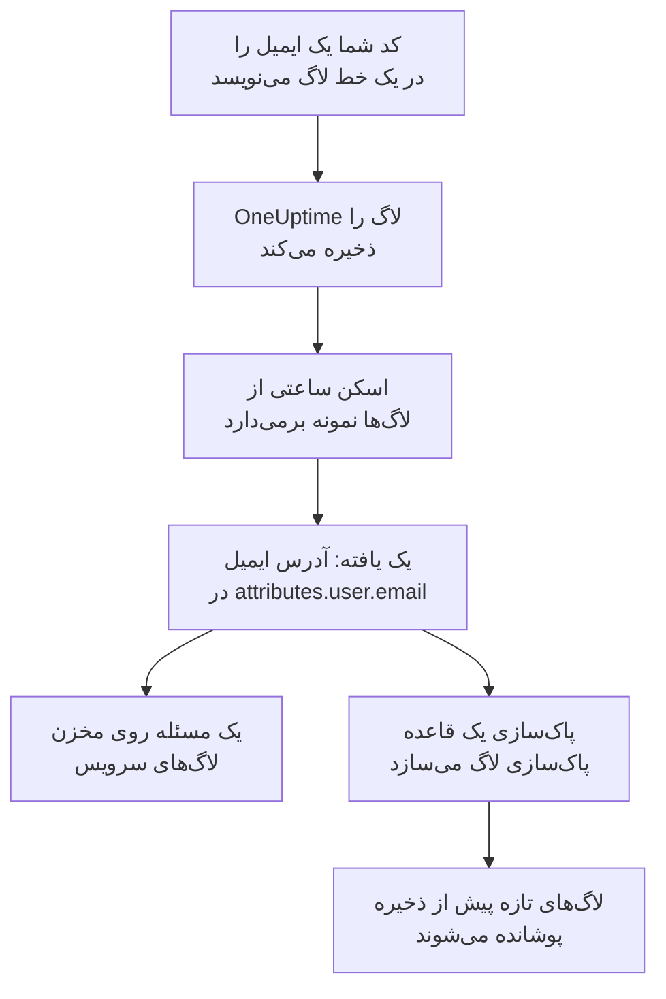

# داده‌های حساس در تله‌متری

تله‌متری هر چیزی را که کد شما می‌نویسد در خود نگه می‌دارد: یک آدرس ایمیل در یک خط لاگ، یک شماره کارت در ویژگی یک اسپن، یک توکن در یک استک‌تریس، پرسش یک مشتری در یک پرامپت، آدرس IP یک کاربر در برچسب یک متریک. امنیت داده لاگ‌ها، ترِیس‌ها، متریک‌ها، استثناها و گفتگوهای هوش مصنوعی هر سرویس، و نشست‌های هر برنامهٔ RUM را، مخازن داده‌ای جداگانه به شمار می‌آورد. هر ساعت از آن‌ها نمونه برمی‌دارد، داده‌های حساس را همان‌طور در آن‌ها پیدا می‌کند که در یک باکت، و **پاک‌سازی** یک یافته را به قاعده‌ای تبدیل می‌کند که از آن پس آن داده را هنگام دریافت می‌پوشاند.

لازم نیست چیزی راه‌اندازی کنید: تله‌متری هر سرویس هر ساعت اسکن می‌شود، مگر اینکه **اسکن تله‌متری** در تنظیمات پروژه خاموش باشد. برای کنار گذاشتن لاگ‌ها، ردها یا سیگنال دیگری از یک سرویس، **اسکن محتوا** را در **تنظیمات** همان مخزن خاموش کنید: از اسکن بعدی، هیچ‌چیز از آن خوانده نمی‌شود.

:::cards
- [چه چیزهایی خوانده می‌شود](#چه-چیزهایی-خوانده-میشود): ویژگی‌ها، بدنه‌ها، پیام‌ها و پرامپت‌های هر سیگنال.
- [اسکن چگونه نمونه‌برداری می‌کند](#اسکن-چگونه-نمونهبرداری-میکند): تازه‌ترین رکوردهای هر سرویس، هر ساعت.
- [پاک‌سازی](#پاکسازی): یک یافته را با یک کلیک، هنگام دریافت بپوشانید.
- [رها کردن این متریک](#رها-کردن-این-متریک): ذخیرهٔ متریک‌هایی را که نامشان دادهٔ حساس دارد متوقف کنید.
- [چه چیزی پاک‌سازی‌شده به شمار می‌آید](#چه-چیزی-پاکسازیشده-به-شمار-میآید): وقتی یک قاعده پاک‌سازی از پیش یافته‌ای را پوشش می‌دهد.
:::

## چگونه کار می‌کند

یافته‌ای که یک قاعده پاک‌سازی پوششش می‌دهد، پاک‌سازی‌شده علامت می‌خورد: آنچه از آن داده مانده دادهٔ قدیمی‌ای است که منتظر پایان دورهٔ نگهداری‌اش است، نه نشتی که هنوز ادامه دارد. دو بررسی تله‌متری فقط چیزی را می‌شمارند که هیچ قاعده‌ای پوششش نمی‌دهد، پس مسئلهٔ آن‌ها وقتی همهٔ یافته‌ها پاک‌سازی شوند برطرف می‌شود ([بررسی‌های تله‌متری](/docs/data-security/checks-and-issues#تلهمتری) را ببینید).

## چه چیزهایی خوانده می‌شود

| مخزن | چه چیزی خوانده می‌شود | یافته به کجا اشاره می‌کند |
| --- | --- | --- |
| لاگ‌ها | هر ویژگی، و بدنه | `attributes.<key>`، `body` |
| ترِیس‌ها | هر ویژگی اسپن، و ویژگی‌های هر رویداد اسپن | `attributes.<key>`، `events.<event>.<key>` |
| استثناها | پیام، استک‌تریس و ویژگی‌ها | `message`، `stackTrace`، `attributes.<key>` |
| گفتگوهای هوش مصنوعی | پرامپت‌ها و پاسخ‌های هر فراخوانی هوش مصنوعی، زیر کلیدهایی که قراردادهای GenAI آن‌ها را در آن می‌گذارند، و هر ویژگی دیگر | کلیدی که در آن هستند، مانند `gen_ai.input.messages` یا `gen_ai.prompt[].content` |
| بازپخش‌های نشست | ویژگی‌های اسپن‌ها و لاگ‌های یک برنامهٔ RUM، ویژگی‌های نشست‌هایش، صفت‌هایی که `identify()` به کاربرانش داده و ارجاع کاربری که به آن اعلام شده | `spans.attributes.<key>`، `logs.attributes.<key>`، `sessions.attributes.<key>`، `sessions.identifiedUserTraits.<key>`، `sessions.identifiedUserLabel` |
| متریک‌ها | هر ویژگی یک نقطهٔ داده، از جمله ویژگی‌های منبع آن، و نام متریک‌ها | `attributes.<key>`، `attributes.resource.<key>`، `name` |

کلیدهای شماره‌دار در یک مکان یکی می‌شوند: `gen_ai.prompt.3.content` همان `gen_ai.prompt[].content` است، پس بیست پیام یک گفتگو یک یافته‌اند، نه بیست یافته. ویژگی‌هایی که خود OneUptime می‌افزاید، یعنی آن‌هایی که با `oneuptime.` آغاز می‌شوند، خوانده نمی‌شوند.

### متریک‌ها

ویژگی‌های یک متریک همان برچسب‌های سری‌های آن‌اند. این ویژگی‌ها روی همهٔ نقطه‌های دادهٔ یک سری یکسان‌اند، پس متریکی که دقیقه‌ای هزار نقطه می‌نویسد شاید فقط سه مقدار داشته باشد، و برچسبی که ایمیل یک کاربر را فاش می‌کند یک سری می‌افزاید، نه یک نقطه. پس از یک متریک بر پایهٔ سری‌هایش نمونه برداشته می‌شود، نه بر پایهٔ نقطه‌هایش:

- **یک نقطه از هر سری.** هر متریک در تازه‌ترین دقیقه‌ای خوانده می‌شود که در یک ساعت گذشته در آن نوشته است: یک نقطهٔ داده از هر یک از حداکثر ۱۰۰ سری آن دقیقه، هر قدر هم که متریک زود به زود فرستاده شود، تا یک سری پرکار هرگز جای یک سری آرام را نگیرد. هر مقدار یک بار طبقه‌بندی می‌شود، هر چند سری هم که تکرارش کنند، پس یک یافته مقدارهای متمایز را در جای خود می‌شمارد.
- **متریک‌های تازه اول، بعد بقیه به نوبت.** اینکه یک سرویس کدام متریک‌ها را نوشته، و هر کدام در روز گذشته نخستین بار کی نوشته است، از تجمیع دقیقه‌به‌دقیقه‌ای می‌آید که جدول متریک‌ها نگه می‌دارد، هرگز از نقطه‌هایش. هر اسکن پرکارترین متریک‌های یک سرویس را می‌خواند که به احتمال زیاد سری‌های بسیاری دارند. سپس متریک‌هایی می‌آیند که در ۲ ساعت گذشته نوشتنشان را آغاز کرده است، چون نشت تازه معمولاً از کد تازه می‌آید، و پس از آن متریک‌های بعدیِ دیگرش، به ترتیبی ثابت، از جایی که اسکن قبلی ایستاده بود. متریک‌های تازه حداکثر نیمی از این نوبت‌ها را می‌گیرند، تا بقیه همیشه نوبت خود را داشته باشند.
- **هر متریک در زمانی معین.** هر اسکن به هر سرویس ۱۰ خواندن می‌دهد، و اگر پروژه بیش از ۱۰ سرویس داشته باشد کمتر. خواندن‌هایی که سرویسی چون متریک کمتری دارد بی‌استفاده می‌گذارد، یکی‌یکی به سرویس‌هایی می‌رسد که هنوز متریک‌هایی در انتظار نوبت دارند، پس هیچ خواندنی هدر نمی‌رود و هیچ سرویسی کمتر از سهمش نمی‌گیرد. ۵ متریک پرکار هر سرویس ۵ تا از خواندن‌هایش را می‌گیرند، و بقیه به نوبت متریک‌های دیگرش را می‌خوانند: در سرویسی با M متریک که r خواندن به نوبت می‌گیرد، هر متریک دست‌کم یک بار در هر M ÷ r ساعت خوانده می‌شود، رو به بالا گرد شده. این برای سرویسی با ۳۰۰ متریک که فقط ۵ خواندن خودش را می‌گیرد ۶۰ ساعت است، و وقتی دو سرویس دیگر با ۳۰۰ متریک در پروژه‌اش شریک باشند ۱۱ ساعت، چون آن‌گاه هر کدام ۲۸ یا ۲۹ خواندن می‌گیرد. تا وقتی که هر ساعت متریک‌های تازه آغاز می‌کند، این زمان حداکثر دو برابر است.
- **بازهٔ خود هر متریک.** متریک‌ها با هم خوانده می‌شوند، هر کدام با بازهٔ خودش از کلید اصلی جدول. متریکی که تازه‌ترین دقیقه‌اش بیش از ۱۶٬۳۸۴ نقطه دارد، مانند متریکی که با ایمیل هر کاربر برچسب خورده است، جداگانه خوانده می‌شود، و خواندن در نخستین نقطه‌هایش متوقف می‌شود، پس هزینه‌اش بیشتر از هر متریک دیگری نیست.

یک یافته ویژگی را نام می‌برد، مانند `attributes.user.email`، یا `name` را برای داده‌ای در نام یک متریک. رکوردهایش نقطه‌های داده‌ای هستند که در آن‌ها پیدا شد: هر کدام متریک خود و مقدار پوشانده‌شدهٔ ویژگی را نشان می‌دهد، و همان متریک را در **متریک‌ها** باز می‌کند، گروه‌بندی‌شده بر پایهٔ همان ویژگی. جایی که نام یک متریک داده‌های حساس دارد، نام هم پوشانده می‌شود، و رکورد به‌جای آن متریک‌های سرویس را باز می‌کند.

### چرا ضبط یک بازپخش هرگز خوانده نمی‌شود

ضبط یک بازپخش نشست متن صفحه‌هایی را که افراد دیده‌اند در خود دارد. تماشای آن مجوز جداگانه‌ای می‌خواهد، و یافته‌ای که از آن خوانده شود متن پوشانده‌شدهٔ صفحه را به هر کسی که می‌تواند امنیت داده را بخواند نشان می‌دهد. پس یک بازپخش فقط از روی ویژگی‌هایش خوانده می‌شود: اسپن‌ها، لاگ‌ها و جزئیات نشست در کنار ضبط. ضبط‌کننده از پیش آنچه را در مرورگر ضبط می‌کند می‌پوشاند، و قواعد پاک‌سازی لاگ روی ضبط‌ها هم اجرا می‌شوند ([بازپخش نشست](/docs/telemetry/session-replay) را ببینید).

### گفتگوهای هوش مصنوعی

پرامپت یک فراخوانی هوش مصنوعی کل گفتگوی پیش از تازه‌ترین پیام فرد را با خود دارد، پس از هر مقدار یک فراخوانی هوش مصنوعی تا ۱۶٬۳۸۴ نویسه خوانده می‌شود. وقتی گفتگوهای هوش مصنوعی داده‌های حساس دارند، دو چیز دیگر هم پیش می‌آید: ارائه‌دهندهٔ هوش مصنوعی‌ای که فراخوانی‌ها به آن رفته‌اند یک جریان داده از آن داده‌ها به شمار می‌آید، و [داده‌های حساس به یک ارائه‌دهندهٔ هوش مصنوعی فرستاده می‌شوند](/docs/data-security/checks-and-issues#هوش-مصنوعی) روی آن مخزن ناموفق می‌شود.

گفتگوهای یک [ابزار هوش مصنوعی شرکت](/docs/telemetry/ai-company-tools) کنار گذاشته می‌شوند. فقط مالک پروژه و مدیر پروژه می‌توانند آن‌ها را بخوانند، و یافته جایی قرار می‌گیرد که هر کسی که امنیت داده را می‌خواند آن را هم می‌خواند، پس اسپن‌های آن سرویس‌ها هرگز خوانده نمی‌شوند، و گفتگوهای هوش مصنوعی‌شان خوانده‌نشده گزارش می‌شوند.

## اسکن چگونه نمونه‌برداری می‌کند

هر ساعت، تازه‌ترین رکوردهای یک ساعت گذشتهٔ هر سیگنال خوانده می‌شوند و مانند رکوردهای هر مخزن دیگری فیلد به فیلد طبقه‌بندی می‌شوند ([فیلدها و ستون‌ها](/docs/data-security/data-types#فیلدها-و-ستونها) را ببینید):

| محدودیت | مقدار |
| --- | --- |
| رکوردهای هر سرویس و سیگنال | **اندازه نمونه تله‌متری**، به‌طور پیش‌فرض ۵۰۰، هرگز بیش از ۱٬۰۰۰ |
| سرویس‌ها یا برنامه‌های RUM خوانده‌شده برای هر سیگنال | پرکارترین ۲۰۰ مورد |
| رکوردها در یک بار خواندن | ۵٬۰۰۰، مشترک میان سرویس‌ها؛ ۵۰۰ برای فراخوانی‌های هوش مصنوعی |
| نویسه‌های بدنهٔ یک لاگ، پیام یک استثنا یا یک استک‌تریس | ۸٬۱۹۲ |
| نویسه‌های مقدار یک ویژگی | ۴٬۰۹۶ |
| نویسه‌های یک مقدار از یک فراخوانی هوش مصنوعی | ۱۶٬۳۸۴ |
| ویژگی‌های یک رکورد | ۱۲۸؛ ۶۴ برای یک فراخوانی هوش مصنوعی |
| رویدادهای یک اسپن، و ویژگی‌های یک رویداد | ۱۶ و ۳۲ |
| مکان‌های یک مخزن | ۵۰۰ |
| متریک‌های خوانده‌شده در یک اسکن | ۱۰۰، مشترک میان سرویس‌ها، دست‌کم یکی از هر سرویس؛ ۱۰ از هر سرویس، نیمی از پرکارترین‌هایش و نیمی از تازه‌ها و بقیه به نوبت، و خواندن‌هایی که سرویسی بی‌استفاده می‌گذارد به نوبت به سرویس‌های دیگر می‌رسد |
| یک متریک تازه | متریکی که نخستین نقطه‌اش در ۲۴ ساعت گذشته، در ۲ ساعت گذشته رسیده است |
| سری‌های یک متریک | یک نقطهٔ داده از هر کدام، از تازه‌ترین دقیقه‌اش، حداکثر ۱۰۰ |

هر مقدار در خود پایگاه داده کوتاه می‌شود، پس هیچ مقدار بلندی از آن بیرون نمی‌رود، و هر بار خواندن پس از ۳۰ ثانیه متوقف می‌شود. خواندنی که ناموفق شود، اخطاری روی مخازنی است که برای آن‌ها انجام می‌شد؛ اسکن با خواندن بعدی ادامه می‌یابد.

برای کنار گذاشتن چیزی، آن را به **استثناهای اسکن** مخزن بیفزایید: مکانی که کامل نام برده شود (`attributes.http.url`)، همه چیز زیر یک مکان (`attributes.http`)، یا یک کلید ویژگی که بدون پیشوند نام برده شود (`http.url`).

## پاک‌سازی

**پاک‌سازی** روی یک یافته، قاعده‌ای را می‌سازد که از آن پس آن نوع داده را در آن مکان پنهان می‌کند، یا به قاعدهٔ فعالی اشاره می‌کند که از پیش همین کار را می‌کند:

:::steps
### یافته را باز کنید

مسئله را باز کنید - **کجا پیدا شد** هر یافته‌ای را که پشت آن است فهرست می‌کند - یا **امنیت داده** > **در تله‌متری شما** را، که در آن **نمایش رکوردها** رکوردهایی را که یافته در آن‌ها پیدا شد کنار فهرست باز می‌کند.

### پاک‌سازی را بزنید

روی **پاک‌سازی** کلیک کنید. OneUptime برای لاگ‌ها و لاگ‌های یک برنامهٔ RUM یک قاعده پاک‌سازی لاگ، و برای اسپن‌ها، استثناها و فراخوانی‌های هوش مصنوعی یک قاعده پاک‌سازی ترِیس می‌سازد، روی همان بخشی از رکورد که یافته در آن است، و برای ویژگی یک متریک یک قاعده خط لوله متریک.

### کد را هم اصلاح کنید

قاعده دادهٔ تازه را پیش از ذخیره شدن می‌پوشاند. داده‌ای که از پیش ذخیره شده تا پایان دورهٔ نگهداری‌اش می‌ماند، پس کدی را که آن را می‌نویسد اصلاح کنید: یافته سرویس و ویژگی را نام می‌برد.
:::

نام قاعده از چیزی می‌آید که پنهان می‌کند، مانند «Data Security: Email address in attributes.user.email»، و در کنار دیگر قواعد پاک‌سازی شما فهرست می‌شود ([فیلترهای حذف و قواعد پاک‌سازی](/docs/telemetry/drop-filters-and-scrub-rules#پالایش-دادههای-حساس) را ببینید). این قاعده یکی از این‌هاست:

| یافته | قاعده‌ای که پاک‌سازی می‌سازد |
| --- | --- |
| آدرس ایمیل، شماره کارت، شماره تأمین اجتماعی آمریکا، شماره تلفن یا آدرس IP | الگوی داخلی همان نوع. شماره‌های کارت، شماره‌های تأمین اجتماعی و شماره‌های تلفن پوشانده می‌شوند، و بقیه به‌طور کامل حذف می‌شوند. |
| مقداری زیر کلیدی که حساس به نظر می‌رسد، مانند `password` یا `token` | یک قاعدهٔ **کلیدهای ویژگی حساس**، که کل مقدار هر ویژگی از این دست را حذف می‌کند |
| هر نوع داده دیگری که یک الگو بتواند پیدا کند | یک قاعدهٔ **عبارت باقاعده سفارشی** ساخته‌شده از الگوهای خود آن نوع داده، که هر مقداری با شکل آن را حذف می‌کند |
| هر نوع داده‌ای در ویژگی یک متریک | یک قاعده خط لوله متریک **پوشاندن ویژگی** برای سرویس، که مقدارهایی از ویژگی را که شکل آن نوع داده را دارند با `[REDACTED]` جایگزین می‌کند، یا اگر هیچ الگویی آن نوع داده را پیدا نکند، هر مقدار ویژگی را |

برخی یافته‌ها را نمی‌توان با یک قاعده پاک‌سازی کرد، و **پاک‌سازی** می‌گوید چرا. ویژگی یک متریک را همیشه می‌توان پاک‌سازی کرد، چون قاعده‌اش می‌تواند هر مقدار آن ویژگی را پنهان کند:

- نوع داده‌ای که فقط از روی نام فیلدها پیدا می‌شود، مانند نام یک فرد: هیچ الگویی نمی‌تواند آن را پیدا کند. نام ویژگی را به کلیدی تغییر دهید که یک قاعدهٔ کلیدهای حساس پنهانش می‌کند، یا دیگر آن را نفرستید.
- نوع داده‌ای که فقط با واژه‌های پیرامونش از مقدارهای دیگر بازشناخته می‌شود، مانند شماره مسیریابی بانکی: یک قاعده چیزهایی بسیار بیشتر از آن نوع داده را پنهان می‌کرد.
- نشانه‌گذاری یک سند: پنهان کردن آن واژه سند را پنهان نمی‌کند.
- یکی از انواع داده خودتان: خودتان یک قاعده پاک‌سازی سفارشی با الگوی آن بیفزایید.
- جزئیات خود یک نشست (`sessions.*`): دریافت بازپخش نشست هیچ قاعده پاک‌سازی‌ای را اجرا نمی‌کند.
- نام یک متریک (`name`): کدی که متریک را می‌سازد آن را تعیین می‌کند، و یک قاعده خط لوله فقط می‌تواند نام کل یک متریک را تغییر دهد. نام متریک را تغییر دهید، و آنچه را در نامش تغییر می‌کند به‌جای آن به‌صورت یک ویژگی بفرستید. تا آن زمان، **رها کردن این متریک** می‌تواند ذخیرهٔ آن متریک‌ها را متوقف کند.

**پاک‌سازی** قاعده را به نام شما و با مجوزهای خودتان می‌سازد: مالک پروژه و مدیر پروژه می‌توانند آن را بزنند، و همچنین تیمی که می‌تواند قواعد پاک‌سازی لاگ بسازد، برای اسپن‌ها، استثناها و فراخوانی‌های هوش مصنوعی تیمی که می‌تواند قواعد پاک‌سازی ترِیس بسازد، و برای متریک‌ها تیمی که می‌تواند قواعد خط لوله متریک بسازد.

## رها کردن این متریک

هیچ قاعده‌ای داده را از نام یک متریک بیرون نمی‌آورد، پس تا وقتی کدی که نام متریک را می‌گذارد اصلاح نشده، داده همچنان می‌رسد. **رها کردن این متریک** روی یافته‌ای در نام یک متریک، ذخیرهٔ متریک‌هایی را که نامشان آن داده را دارد متوقف می‌کند، به بهای از دست رفتن داده‌هایشان، پس فقط وقتی انجام می‌شود که خودتان بخواهید:

- **متریک‌های یک سرویس.** یک قاعده خط لوله متریک **حذف** برای سرویس یافته می‌سازد: هر نقطهٔ دادهٔ تازه از متریکی که نامش آن نوع داده را دارد، پیش از ذخیره رها می‌شود. فیلترش همان الگویی است که **پاک‌سازی** برای آن نوع به کار می‌برد، پس نوعی که هیچ الگویی پیدایش نمی‌کند، مانند نام یک شخص، رها نمی‌شود و پنجرهٔ گفت‌وگو دلیلش را می‌گوید.
- **پیش از انجام گفته می‌شود.** پنجرهٔ گفت‌وگو می‌گوید که آن نقطه‌های داده برای همیشه از دست می‌روند، چند تا از متریک‌های سرویس که در روز گذشته نوشته شده‌اند چنین نامی دارند، چه چیزهایی آن‌ها را می‌خوانند و دیگر دادهٔ تازه نمی‌گیرند، اینکه آنچه از قبل ذخیره شده تا پایان دوره نگهداری‌اش می‌ماند، و اینکه چگونه برش گردانید. تا وقتی تیک نزنید که متوجه هستید، چیزی رها نمی‌شود.
- **چه چیزی آن‌ها را می‌خواند، و چه بر سرش می‌آید.** پنجرهٔ گفت‌وگو هر مانیتور، هر داشبورد همراه با ویجت‌هایش که آن متریک‌ها را می‌خوانند، هر SLO متریک سرویس و هر قاعده ضبط متریکی که آن‌ها را می‌خواند را، هر کدام به‌صورت پیوند، نام می‌برد. مانیتورها دیگر نمی‌توانند روی مقدارهایشان هشدار دهند، ویجت‌ها دادهٔ تازه‌ای نشان نمی‌دهند، SLOها دیگر رویداد تازه‌ای از آن‌ها نمی‌شمارند، و آن متریک‌ها دیگر در متریک‌های خروجی قواعد ضبط به حساب نمی‌آیند. آنچه نمی‌توانید ببینید شمرده می‌شود، اما هرگز نامش برده نمی‌شود.
- **به نام شما، و ثبت‌شده.** قاعده با مجوز خودتان برای ساختن قواعد خط لوله متریک ساخته می‌شود: مالک پروژه و مدیر پروژه می‌توانند آن را بسازند، و همچنین تیمی که می‌تواند قواعد خط لوله متریک بسازد. گزارش‌های ممیزی ثبت می‌کنند چه کسی آن را ساخته است.
- **با حذف قاعده برمی‌گردد.** قاعده به نام چیزی که رها می‌کند نام‌گذاری می‌شود، مانند «Data Security: drop metrics named with Email address»، و کنار دیگر قواعد خط لوله متریک شما در **متریک‌ها ← تنظیمات ← قواعد خط لوله** فهرست می‌شود. آن را حذف یا خاموش کنید تا آن متریک‌ها از آن پس دوباره ذخیره شوند. آنچه در این میان رها شده برنمی‌گردد.

سپس یافته با برچسب **رهاشده** نشان داده می‌شود و پاک‌سازی‌شده به شمار می‌آید: دیگر هیچ بخشی از آن داده ذخیره نمی‌شود.

## چه چیزی پاک‌سازی‌شده به شمار می‌آید

یک یافته فقط وقتی پاک‌سازی‌شده علامت می‌خورد که دریافت داده یک قاعدهٔ فعال را روی آن اجرا کند و آن قاعده نوع داده‌اش را پیدا کند:

- **رکوردهای درست.** قواعد لاگ، لاگ‌ها و لاگ‌های یک برنامهٔ RUM را پوشش می‌دهند. قواعد ترِیس، اسپن‌ها، استثناها و فراخوانی‌های هوش مصنوعی را پوشش می‌دهند: یک استثنا رونوشتی از رویداد استثنای اسپن خودش است، پس قواعدی که رویدادها را پاک‌سازی می‌کنند آن را هم پاک‌سازی می‌کنند.
- **بخش درست.** **فیلدهایی که باید پالایش شوند** در قاعده، بخشی از رکورد را که یافته در آن است دربر می‌گیرد، یا قاعده آن را روی پیش‌فرض نگه داشته است.
- **الگویی که آن نوع را پیدا کند.** در **نوع الگو**، هر گزینهٔ داخلی نوع دادهٔ خودش را پیدا می‌کند: **آدرس ایمیل** آدرس‌های ایمیل را، **شماره کارت اعتباری** شماره‌های کارت را، **SSN (شماره تأمین اجتماعی)** شماره‌های تأمین اجتماعی آمریکا را، **شماره تلفن** شماره‌های تلفن را و **آدرس IP** آدرس‌های IP را. **کلیدهای ویژگی حساس** هر مقداری را زیر کلیدی که حساس به نظر می‌رسد پوشش می‌دهد، هر چه آن مقدار باشد.
- **الگوهای سفارشی خودتان هرگز به شمار نمی‌آیند.** یک **عبارت باقاعده سفارشی** فقط وقتی یافته‌ای را پوشش می‌دهد که دقیقاً همان الگویی باشد که **پاک‌سازی** برای نوع آن می‌سازد. یک یافته فقط نمونه‌های پوشانده‌شده را نگه می‌دارد که هیچ الگویی را نمی‌توان روی آن‌ها آزمود، پس OneUptime نمی‌توانست ثابت کند که الگوی شما داده را پنهان می‌کند، و یافته‌ای که به اشتباه پاک‌سازی‌شده خوانده شود نشتی است که هیچ‌کس به آن نگاه نمی‌کند.
- **ویژگی یک متریک.** یک قاعده خط لوله متریک **پوشاندن ویژگی** یا **حذف ویژگی** روی کلید همان ویژگی، برای سرویس یافته یا کل پروژه، آن را پوشش می‌دهد، اگر فیلتری نداشته باشد یا فیلترش دقیقاً همان فیلتری باشد که **پاک‌سازی** می‌سازد. فیلتری که خودتان نوشته‌اید، به همان دلیل، هرگز به شمار نمی‌آید.
- **نام یک متریک.** یک قاعده خط لوله متریک **حذف** برای سرویس یافته یا کل پروژه، آن را پوشش می‌دهد اگر دقیقاً همان فیلتری را داشته باشد که **رها کردن این متریک** می‌سازد، یا هیچ فیلتری نداشته باشد، که در آن صورت هیچ‌یک از متریک‌های سرویس را ذخیره نمی‌کند. چنین قاعده‌ای بدون فیلتر، همهٔ یافته‌های آن متریک‌ها را پوشش می‌دهد.

قاعده‌ای که خاموش است، یا چیزی را پاک‌سازی نمی‌کند، هرگز به شمار نمی‌آید. پوشش پس از هر اسکن دوباره محاسبه می‌شود، پس قاعده‌ای که دستی می‌افزایید یا حذف می‌کنید، ظرف یک ساعت آنچه را پاک‌سازی‌شده علامت خورده تغییر می‌دهد.

## گام‌های بعدی

:::cards
- [فیلترهای حذف و قواعد پاک‌سازی](/docs/telemetry/drop-filters-and-scrub-rules): همهٔ گزینه‌های قاعده پاک‌سازی، و قواعدی که خودتان می‌نویسید.
- [بررسی‌ها و مسائل امنیت داده](/docs/data-security/checks-and-issues): دو بررسی تله‌متری و بررسی‌های هوش مصنوعی.
- [جریان‌های داده، دسترسی و محل نگهداری داده](/docs/data-security/flows-access-residency): ارائه‌دهندگان هوش مصنوعی و میزبان‌هایی که سرویس‌های شما داده به آن‌ها می‌فرستند.
:::
