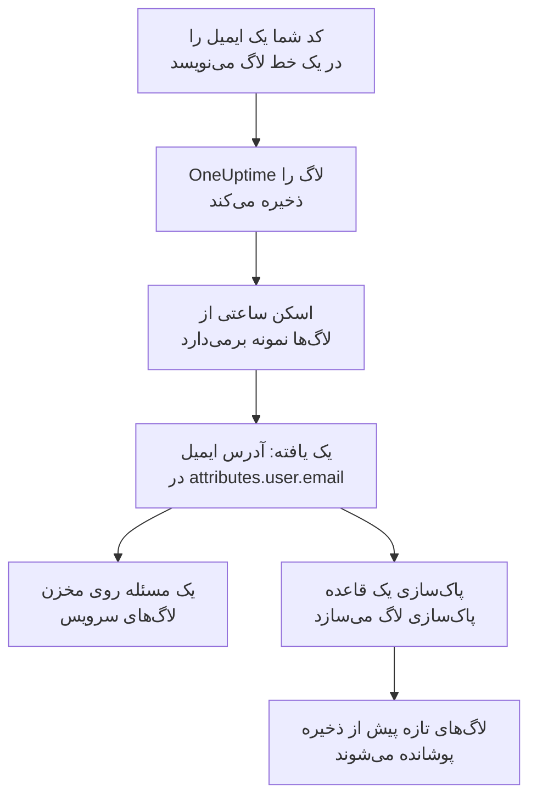

# داده‌های حساس در تله‌متری

تله‌متری هر چیزی را که کد شما می‌نویسد در خود نگه می‌دارد: یک آدرس ایمیل در یک خط لاگ، یک شماره کارت در ویژگی یک اسپن، یک توکن در یک استک‌تریس، پرسش یک مشتری در یک پرامپت. امنیت داده لاگ‌ها، ترِیس‌ها، استثناها و گفتگوهای هوش مصنوعی هر سرویس، و نشست‌های هر برنامهٔ RUM را، مخازن داده‌ای جداگانه به شمار می‌آورد. هر ساعت از آن‌ها نمونه برمی‌دارد، داده‌های حساس را همان‌طور در آن‌ها پیدا می‌کند که در یک باکت، و **پاک‌سازی** یک یافته را به قاعده پاک‌سازی‌ای تبدیل می‌کند که از آن پس آن داده را هنگام دریافت می‌پوشاند.

لازم نیست چیزی راه‌اندازی کنید: تله‌متری هر سرویس هر ساعت اسکن می‌شود، مگر اینکه **اسکن تله‌متری** در تنظیمات پروژه خاموش باشد.

:::cards
- [چه چیزهایی خوانده می‌شود](#چه-چیزهایی-خوانده-میشود): ویژگی‌ها، بدنه‌ها، پیام‌ها و پرامپت‌های هر سیگنال.
- [اسکن چگونه نمونه‌برداری می‌کند](#اسکن-چگونه-نمونهبرداری-میکند): تازه‌ترین رکوردهای هر سرویس، هر ساعت.
- [پاک‌سازی](#پاکسازی): یک یافته را با یک کلیک، هنگام دریافت بپوشانید.
- [چه چیزی پاک‌سازی‌شده به شمار می‌آید](#چه-چیزی-پاکسازیشده-به-شمار-میآید): وقتی یک قاعده پاک‌سازی از پیش یافته‌ای را پوشش می‌دهد.
:::

## چگونه کار می‌کند

یافته‌ای که یک قاعده پاک‌سازی پوششش می‌دهد، پاک‌سازی‌شده علامت می‌خورد: آنچه از آن داده مانده دادهٔ قدیمی‌ای است که منتظر پایان دورهٔ نگهداری‌اش است، نه نشتی که هنوز ادامه دارد. دو بررسی تله‌متری فقط چیزی را می‌شمارند که هیچ قاعده‌ای پوششش نمی‌دهد، پس مسئلهٔ آن‌ها وقتی همهٔ یافته‌ها پاک‌سازی شوند برطرف می‌شود ([بررسی‌های تله‌متری](/docs/data-security/checks-and-issues#تلهمتری) را ببینید).

## چه چیزهایی خوانده می‌شود

| مخزن | چه چیزی خوانده می‌شود | یافته به کجا اشاره می‌کند |
| --- | --- | --- |
| لاگ‌ها | هر ویژگی، و بدنه | `attributes.<key>`، `body` |
| ترِیس‌ها | هر ویژگی اسپن، و ویژگی‌های هر رویداد اسپن | `attributes.<key>`، `events.<event>.<key>` |
| استثناها | پیام، استک‌تریس و ویژگی‌ها | `message`، `stackTrace`، `attributes.<key>` |
| گفتگوهای هوش مصنوعی | پرامپت‌ها و پاسخ‌های هر فراخوانی هوش مصنوعی، زیر کلیدهایی که قراردادهای GenAI آن‌ها را در آن می‌گذارند، و هر ویژگی دیگر | کلیدی که در آن هستند، مانند `gen_ai.input.messages` یا `gen_ai.prompt[].content` |
| بازپخش‌های نشست | ویژگی‌های اسپن‌ها و لاگ‌های یک برنامهٔ RUM، ویژگی‌های نشست‌هایش، صفت‌هایی که `identify()` به کاربرانش داده و ارجاع کاربری که به آن اعلام شده | `spans.attributes.<key>`، `logs.attributes.<key>`، `sessions.attributes.<key>`، `sessions.identifiedUserTraits.<key>`، `sessions.identifiedUserLabel` |

کلیدهای شماره‌دار در یک مکان یکی می‌شوند: `gen_ai.prompt.3.content` همان `gen_ai.prompt[].content` است، پس بیست پیام یک گفتگو یک یافته‌اند، نه بیست یافته. ویژگی‌هایی که خود OneUptime می‌افزاید، یعنی آن‌هایی که با `oneuptime.` آغاز می‌شوند، خوانده نمی‌شوند.

### چرا ضبط یک بازپخش هرگز خوانده نمی‌شود

ضبط یک بازپخش نشست متن صفحه‌هایی را که افراد دیده‌اند در خود دارد. تماشای آن مجوز جداگانه‌ای می‌خواهد، و یافته‌ای که از آن خوانده شود متن پوشانده‌شدهٔ صفحه را به هر کسی که می‌تواند امنیت داده را بخواند نشان می‌دهد. پس یک بازپخش فقط از روی ویژگی‌هایش خوانده می‌شود: اسپن‌ها، لاگ‌ها و جزئیات نشست در کنار ضبط. ضبط‌کننده از پیش آنچه را در مرورگر ضبط می‌کند می‌پوشاند، و قواعد پاک‌سازی لاگ روی ضبط‌ها هم اجرا می‌شوند ([بازپخش نشست](/docs/telemetry/session-replay) را ببینید).

### گفتگوهای هوش مصنوعی

پرامپت یک فراخوانی هوش مصنوعی کل گفتگوی پیش از تازه‌ترین پیام فرد را با خود دارد، پس از هر مقدار یک فراخوانی هوش مصنوعی تا 16,384 نویسه خوانده می‌شود. وقتی گفتگوهای هوش مصنوعی داده‌های حساس دارند، دو چیز دیگر هم پیش می‌آید: ارائه‌دهندهٔ هوش مصنوعی‌ای که فراخوانی‌ها به آن رفته‌اند یک جریان داده از آن داده‌ها به شمار می‌آید، و [داده‌های حساس به یک ارائه‌دهندهٔ هوش مصنوعی فرستاده می‌شوند](/docs/data-security/checks-and-issues#هوش-مصنوعی) روی آن مخزن ناموفق می‌شود.

گفتگوهای یک [ابزار هوش مصنوعی شرکت](/docs/telemetry/ai-company-tools) کنار گذاشته می‌شوند. فقط Project Owner و Project Admin می‌توانند آن‌ها را بخوانند، و یافته جایی قرار می‌گیرد که هر کسی که امنیت داده را می‌خواند آن را هم می‌خواند، پس اسپن‌های آن سرویس‌ها هرگز خوانده نمی‌شوند، و گفتگوهای هوش مصنوعی‌شان خوانده‌نشده گزارش می‌شوند.

## اسکن چگونه نمونه‌برداری می‌کند

هر ساعت، تازه‌ترین رکوردهای یک ساعت گذشتهٔ هر سیگنال خوانده می‌شوند و مانند رکوردهای هر مخزن دیگری فیلد به فیلد طبقه‌بندی می‌شوند ([فیلدها و ستون‌ها](/docs/data-security/data-types#فیلدها-و-ستونها) را ببینید):

| محدودیت | مقدار |
| --- | --- |
| رکوردهای هر سرویس و سیگنال | **اندازه نمونه تله‌متری**، به‌طور پیش‌فرض 500، هرگز بیش از 1,000 |
| سرویس‌ها یا برنامه‌های RUM خوانده‌شده برای هر سیگنال | پرکارترین 200 مورد |
| رکوردها در یک بار خواندن | 5,000، مشترک میان سرویس‌ها؛ 500 برای فراخوانی‌های هوش مصنوعی |
| نویسه‌های بدنهٔ یک لاگ، پیام یک استثنا یا یک استک‌تریس | 8,192 |
| نویسه‌های مقدار یک ویژگی | 4,096 |
| نویسه‌های یک مقدار از یک فراخوانی هوش مصنوعی | 16,384 |
| ویژگی‌های یک رکورد | 128؛ 64 برای یک فراخوانی هوش مصنوعی |
| رویدادهای یک اسپن، و ویژگی‌های یک رویداد | 16 و 32 |
| مکان‌های یک مخزن | 500 |

هر مقدار در خود پایگاه داده کوتاه می‌شود، پس هیچ مقدار بلندی از آن بیرون نمی‌رود، و هر بار خواندن پس از 30 ثانیه متوقف می‌شود. خواندنی که ناموفق شود، اخطاری روی مخازنی است که برای آن‌ها انجام می‌شد؛ اسکن با خواندن بعدی ادامه می‌یابد.

برای کنار گذاشتن چیزی، آن را به **استثناهای اسکن** مخزن بیفزایید: مکانی که کامل نام برده شود (`attributes.http.url`)، همه چیز زیر یک مکان (`attributes.http`)، یا یک کلید ویژگی که بدون پیشوند نام برده شود (`http.url`).

## پاک‌سازی

**پاک‌سازی** روی یک یافته، قاعده پاک‌سازی‌ای را می‌سازد که از آن پس آن نوع داده را در آن مکان پنهان می‌کند، یا به قاعدهٔ فعالی اشاره می‌کند که از پیش همین کار را می‌کند:

:::steps
### یافته را باز کنید

مخزن تله‌متری را باز کنید - برای نمونه، **لاگ‌ها** در یک سرویس - و سپس یافته را.

### پاک‌سازی را بزنید

روی **پاک‌سازی** کلیک کنید. OneUptime برای لاگ‌ها و لاگ‌های یک برنامهٔ RUM یک قاعده پاک‌سازی لاگ، و برای اسپن‌ها، استثناها و فراخوانی‌های هوش مصنوعی یک قاعده پاک‌سازی ترِیس می‌سازد، روی همان بخشی از رکورد که یافته در آن است.

### کد را هم اصلاح کنید

قاعده دادهٔ تازه را پیش از ذخیره شدن می‌پوشاند. داده‌ای که از پیش ذخیره شده تا پایان دورهٔ نگهداری‌اش می‌ماند، پس کدی را که آن را می‌نویسد اصلاح کنید: یافته سرویس و ویژگی را نام می‌برد.
:::

نام قاعده از چیزی می‌آید که پنهان می‌کند، مانند «Data Security: Email address in attributes.user.email»، و در کنار دیگر قواعد پاک‌سازی شما فهرست می‌شود ([فیلترهای حذف و قواعد پاک‌سازی](/docs/telemetry/drop-filters-and-scrub-rules#پالایش-دادههای-حساس) را ببینید). این قاعده یکی از این‌هاست:

| یافته | قاعده‌ای که پاک‌سازی می‌سازد |
| --- | --- |
| آدرس ایمیل، شماره کارت، شماره تأمین اجتماعی آمریکا، شماره تلفن یا آدرس IP | الگوی داخلی همان نوع. شماره‌های کارت، شماره‌های تأمین اجتماعی و شماره‌های تلفن پوشانده می‌شوند، و بقیه به‌طور کامل حذف می‌شوند. |
| مقداری زیر کلیدی که حساس به نظر می‌رسد، مانند `password` یا `token` | یک قاعدهٔ **Sensitive Attribute Keys**، که کل مقدار هر ویژگی از این دست را حذف می‌کند |
| هر نوع داده دیگری که یک الگو بتواند پیدا کند | یک قاعدهٔ **عبارت باقاعده سفارشی** ساخته‌شده از الگوهای خود آن نوع داده، که هر مقداری با شکل آن را حذف می‌کند |

برخی یافته‌ها را نمی‌توان با یک قاعده پاک‌سازی کرد، و **پاک‌سازی** می‌گوید چرا:

- نوع داده‌ای که فقط از روی نام فیلدها پیدا می‌شود، مانند نام یک فرد: هیچ الگویی نمی‌تواند آن را پیدا کند. نام ویژگی را به کلیدی تغییر دهید که یک قاعدهٔ کلیدهای حساس پنهانش می‌کند، یا دیگر آن را نفرستید.
- نوع داده‌ای که فقط با واژه‌های پیرامونش از مقدارهای دیگر بازشناخته می‌شود، مانند شماره مسیریابی بانکی: یک قاعده چیزهایی بسیار بیشتر از آن نوع داده را پنهان می‌کرد.
- نشانه‌گذاری یک سند: پنهان کردن آن واژه سند را پنهان نمی‌کند.
- یکی از انواع داده خودتان: خودتان یک قاعده پاک‌سازی سفارشی با الگوی آن بیفزایید.
- جزئیات خود یک نشست (`sessions.*`): دریافت بازپخش نشست هیچ قاعده پاک‌سازی‌ای را اجرا نمی‌کند.

**پاک‌سازی** قاعده را به نام شما و با مجوزهای خودتان می‌سازد: Project Owner و Project Admin می‌توانند آن را بزنند، و همچنین تیمی که می‌تواند قواعد پاک‌سازی لاگ بسازد، و برای اسپن‌ها، استثناها و فراخوانی‌های هوش مصنوعی، تیمی که می‌تواند قواعد پاک‌سازی ترِیس بسازد.

## چه چیزی پاک‌سازی‌شده به شمار می‌آید

یک یافته فقط وقتی پاک‌سازی‌شده علامت می‌خورد که دریافت داده یک قاعدهٔ فعال را روی آن اجرا کند و آن قاعده نوع داده‌اش را پیدا کند:

- **رکوردهای درست.** قواعد لاگ، لاگ‌ها و لاگ‌های یک برنامهٔ RUM را پوشش می‌دهند. قواعد ترِیس، اسپن‌ها، استثناها و فراخوانی‌های هوش مصنوعی را پوشش می‌دهند: یک استثنا رونوشتی از رویداد استثنای اسپن خودش است، پس قواعدی که رویدادها را پاک‌سازی می‌کنند آن را هم پاک‌سازی می‌کنند.
- **بخش درست.** **فیلدهایی که باید پالایش شوند** در قاعده، بخشی از رکورد را که یافته در آن است دربر می‌گیرد، یا قاعده آن را روی پیش‌فرض نگه داشته است.
- **الگویی که آن نوع را پیدا کند.** در **نوع الگو**، هر گزینهٔ داخلی نوع دادهٔ خودش را پیدا می‌کند: **آدرس ایمیل** آدرس‌های ایمیل را، **شماره کارت اعتباری** شماره‌های کارت را، **SSN (شماره تأمین اجتماعی)** شماره‌های تأمین اجتماعی آمریکا را، **شماره تلفن** شماره‌های تلفن را و **آدرس IP** آدرس‌های IP را. **Sensitive Attribute Keys** هر مقداری را زیر کلیدی که حساس به نظر می‌رسد پوشش می‌دهد، هر چه آن مقدار باشد.
- **الگوهای سفارشی خودتان هرگز به شمار نمی‌آیند.** یک **عبارت باقاعده سفارشی** فقط وقتی یافته‌ای را پوشش می‌دهد که دقیقاً همان الگویی باشد که **پاک‌سازی** برای نوع آن می‌سازد. یک یافته فقط نمونه‌های پوشانده‌شده را نگه می‌دارد که هیچ الگویی را نمی‌توان روی آن‌ها آزمود، پس OneUptime نمی‌توانست ثابت کند که الگوی شما داده را پنهان می‌کند، و یافته‌ای که به اشتباه پاک‌سازی‌شده خوانده شود نشتی است که هیچ‌کس به آن نگاه نمی‌کند.

قاعده‌ای که خاموش است، یا چیزی را پاک‌سازی نمی‌کند، هرگز به شمار نمی‌آید. پوشش پس از هر اسکن دوباره محاسبه می‌شود، پس قاعده‌ای که دستی می‌افزایید یا حذف می‌کنید، ظرف یک ساعت آنچه را پاک‌سازی‌شده علامت خورده تغییر می‌دهد.

## گام‌های بعدی

:::cards
- [فیلترهای حذف و قواعد پاک‌سازی](/docs/telemetry/drop-filters-and-scrub-rules): همهٔ گزینه‌های قاعده پاک‌سازی، و قواعدی که خودتان می‌نویسید.
- [بررسی‌ها و مسائل امنیت داده](/docs/data-security/checks-and-issues): دو بررسی تله‌متری و بررسی‌های هوش مصنوعی.
- [جریان‌های داده، دسترسی و محل نگهداری داده](/docs/data-security/flows-access-residency): ارائه‌دهندگان هوش مصنوعی و میزبان‌هایی که سرویس‌های شما داده به آن‌ها می‌فرستند.
:::
