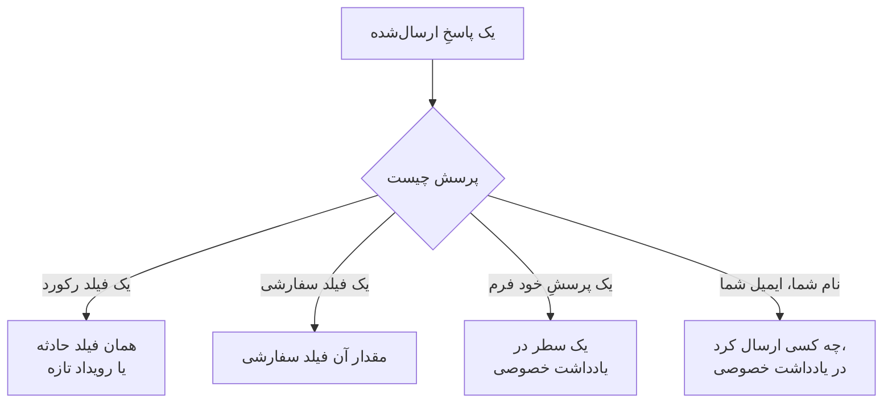

# ساختن فرم

صفحهٔ **ساخت** یک فرم جایی است که تعیین می‌کنید فرم چه بپرسد و صفحه‌اش چگونه به نظر برسد. پرسش‌ها در سمت چپ هستند، به همان ترتیبی که صفحهٔ عمومی نشانشان می‌دهد؛ **افزودن پرسش** در سمت راست هر چیزی را که می‌توانید بیفزایید فهرست می‌کند. بالای پرسش‌ها، به‌صورت جمع‌شده، [برندینگ](#برندینگ) فرم قرار دارد: لوگو و فاوآیکن آن. مجموعه‌های نام‌دار پاسخ که افراد می‌توانند فرم را از روی آن‌ها آغاز کنند — که هر کدام می‌تواند برای مورد خودش یک پرسش را الزامی، اختیاری یا پنهان هم کند — در صفحهٔ **قالب‌ها** آن هستند: [قالب‌ها](#قالبها) را ببینید.

:::cards
- [سازنده](#سازنده): پرسش‌ها را بیفزایید، ویرایش کنید، جابه‌جا کنید و ذخیره کنید.
- [آنچه می‌توانید بیفزایید](#آنچه-میتوانید-بیفزایید): پرسش‌های خودتان، فیلدهای رکورد، فیلدهای سفارشی و فرستنده.
- [پرسش‌های پنهان](#پرسشهای-پنهان): یک قالب به آن‌ها پاسخ می‌دهد، هرگز کسی که فرم را ارسال می‌کند.
- [قالب‌ها](#قالبها): یک فرم، و یک پیوند، برای هر موردی که تیم شما زیاد گزارش می‌کند.
:::

## هر پاسخ کجا می‌رود

هر پاسخ همراه ارسال هم، در صفحهٔ **ارسال‌ها** فرم، نگه داشته می‌شود. فیلدی که فرم نمی‌پرسد، یا خالی می‌ماند، از [تنظیمات هنگام ارسال](/docs/forms/on-submit) فرم پر می‌شود.

## سازنده

:::steps
### افزودن یک پرسش

در **افزودن پرسش** برگزینید چه چیزی بیفزایید. پرسش تازه پس از پرسش انتخاب‌شده، یا در انتها، درج و انتخاب می‌شود.

### ویرایش در همان‌جا

یک کارت را برای ویرایش انتخاب کنید: پرسش، متن راهنما، نوع پاسخ و گزینه‌های آن، اینکه الزامی یا پنهان باشد، و دکمه‌های تکثیر یا حذف آن. **انجام شد** آن را می‌بندد.

### گذاشتن آن در جای خودش

کارت را از دستگیره‌اش بکشید تا جابه‌جا شود، یا از **انتقال به بالا** و **انتقال به پایین** روی کارت انتخاب‌شده استفاده کنید — روی گوشی، یا با صفحه‌کلید.

### ذخیرهٔ فرم

**ذخیره تغییرات** همهٔ تغییرها را یک‌جا ذخیره می‌کند. تا وقتی ذخیره نکرده‌اید، سازنده **تغییرات ذخیره‌نشده** را نشان می‌دهد و **نادیده گرفتن تغییرها** را پیشنهاد می‌کند، و مرورگر پیش از ترک صفحه می‌پرسد.
:::

- **سرصفحهٔ فرم** نام و توضیحات آن را همان‌طور که صفحهٔ عمومی نشان خواهد داد نشان می‌دهد. **ویرایش نام و توضیحات** آن‌ها را تغییر می‌دهد.
- **پرسش‌ها** کارت هستند. هر کارت پرسش را همان‌طور که افراد خواهند دید نشان می‌دهد، با نشانی که می‌گوید به چه چیزی پیوند دارد — **حادثه · شدت**، **فیلد سفارشی · Region**، **ارسال‌کننده · ایمیل**، یا برای پرسشِ خود فرم، نوع پاسخ آن. یک ستارهٔ قرمز پرسش الزامی را نشان می‌دهد، و یک نشان **پنهان** پرسش [پنهان](#پرسشهای-پنهان) را.
- **محدودیت‌ها.** یک فرم می‌تواند تا ۵۰ پرسش داشته باشد. کسانی که می‌توانند فرمی را بخوانند اما ویرایش نکنند، سازنده را فقط‌خواندنی می‌بینند.

## برندینگ

**برندینگ**، که بالای پرسش‌ها جمع شده است، ظاهر صفحهٔ فرم است: لوگوی شما بالای صفحه، بالای نام فرم، و فاوآیکن شما در زبانهٔ مرورگر تا وقتی فرم باز است. تا وقتی لوگو و فاوآیکن خودتان را بارگذاری نکنید، فرم لوگو و فاوآیکن OneUptime را نشان می‌دهد.

در حالت جمع‌شده، این بخش **لوگو** و **Favicon** را فهرست می‌کند — که وقتی فرم تصویرهای خودش را داشته باشد به‌صورت تنظیم‌شده نشان داده می‌شوند — و می‌گوید کدام تصویرهای OneUptime هنوز به کار می‌روند. آن را باز کنید تا هر دو را همان‌طور که صفحه نشانشان می‌دهد ببینید: لوگو همان‌طور که بالای صفحه قرار می‌گیرد، و فاوآیکن در یک زبانهٔ مرورگر کنار نام فرم، که عنوان زبانه است.

**ویرایش برندینگ** آن‌ها را در یک پنجره تغییر می‌دهد:

| فیلد | چیست |
| --- | --- |
| **لوگو** | بالای صفحهٔ فرم، بالای نام آن، به جای لوگوی OneUptime نشان داده می‌شود. یک تصویر PNG، JPEG، GIF، WebP یا SVG با حجم ۵۱۲ KB یا کمتر. برای بازگشت به لوگوی OneUptime آن را حذف کنید. |
| **Logo Alt Text** | آنچه لوگو می‌گوید و صفحه‌خوان‌ها آن را می‌خوانند: معمولاً نام سازمان شما. وقتی لوگو وجود دارد پرسیده می‌شود. خالی‌اش بگذارید تا صفحه‌خوان‌ها از لوگو بگذرند — نام فرم به هر حال پس از آن می‌آید. حذف لوگو این را هم پاک می‌کند. |
| **Favicon** | آیکن زبانهٔ مرورگر تا وقتی فرم باز است، به جای فاوآیکن OneUptime. یک تصویر PNG، JPEG، GIF، WebP، SVG یا ICO با حجم ۱۲۸ KB یا کمتر؛ یک PNG، SVG یا ICO مربعی بهترین نتیجه را می‌دهد. برای بازگشت به فاوآیکن OneUptime آن را حذف کنید. |

لوگو ارتفاع لوگوی OneUptime را که جایگزینش می‌شود حفظ می‌کند، و لوگوی پهن به عرض صفحه جا داده می‌شود. هر تصویر هنگام ذخیره بررسی می‌شود — از داشبورد، API، Terraform یا یک گردش کاری: باید در پروژهٔ خود فرم بارگذاری شده باشد، یکی از نوع‌های بالا باشد، و از حد خود بزرگ‌تر نباشد. لوگویی که یکی از آن تصویرها نباشد با «The logo must be a PNG, JPEG, GIF, WebP or SVG image.» رد می‌شود، لوگویی که بیش از حد بزرگ باشد با «The logo must be 512 KB or smaller.»، و لوگویی که بارگذاری‌اش دیگر وجود ندارد — یا در پروژه‌ای دیگر بارگذاری شده — با «The logo's file could not be found. Upload the logo again.». فاوآیکن هم به همین شکل رد می‌شود، با «The favicon must be a PNG, JPEG, GIF, WebP, SVG or ICO image.»، «The favicon must be 128 KB or smaller.» و «The favicon's file could not be found. Upload the favicon again.».

**پیش‌نمایش** لوگو را همان‌طور که صفحه نشان می‌دهد نشان می‌دهد. کسانی که می‌توانند فرمی را بخوانند اما ویرایش نکنند، برندینگ آن را بدون **ویرایش برندینگ** می‌بینند. لوگو و فاوآیکن فقط درون خود فرم به صفحهٔ فرم می‌رسند — [اشتراک‌گذاری و امنیت](/docs/forms/sharing-and-security#چه-چیزی-از-یک-فرم-محافظت-میکند) را ببینید.

## آنچه می‌توانید بیفزایید

**افزودن پرسش** چهار گروه را فهرست می‌کند: **پرسش‌ها** خود فرم، **فیلدهای حادثه** یا **فیلدهای تعمیر و نگهداری زمان‌بندی‌شده** آنچه فرم می‌سازد، **فیلدهای سفارشی**، و **ارسال‌کننده**.

### پرسش‌های خود فرم

| نوع پاسخ | آنچه فرستنده می‌دهد |
| --- | --- |
| **پاسخ کوتاه** | یک سطر متن. |
| **پاراگراف** | چند سطر متن. |
| **متن قالب‌دار** | متن با قالب‌بندی و پیوند. |
| **شماره** | یک عدد. |
| **فهرست کشویی** | یک گزینه از یک فهرست. |
| **چندگزینه‌ای** | هر تعداد گزینه از یک فهرست. |
| **کادر انتخاب** | کادری برای تیک زدن، مانند یک تأیید. |
| **تاریخ** | یک روز. |
| **تاریخ و زمان** | یک روز و یک ساعت. |

یک فهرست کشویی یا چندگزینه‌ای، **گزینه‌ها** را که به آن می‌دهید فهرست می‌کند، هر کدام با یک رنگ اختیاری (دکمهٔ کنار یک گزینه مجموعه‌ای از رنگ‌های نام‌دار را باز می‌کند، با **رنگ دلخواه** برای یک کد دقیق)، از یک تا ۱۰۰ گزینه. تغییر یک پرسش میان **فهرست کشویی** و **چندگزینه‌ای** گزینه‌هایش را نگه می‌دارد؛ پرسشی که به یکی از این دو تبدیل شود با دو گزینه که می‌توانید نامشان را عوض کنید آغاز می‌شود، و پرسشی که دیگر یکی از این دو نباشد آن‌ها را کنار می‌گذارد. **تکثیر** از یک پرسشِ خود فرم، درست زیر آن، رونوشت می‌سازد.

پاسخ‌های این پرسش‌ها همراه ارسال نگه داشته می‌شوند و در یادداشت خصوصی آنچه فرم می‌سازد فهرست می‌شوند — هیچ فیلدی از آن را پر نمی‌کنند. برای پر کردن یک فیلد، خود آن فیلد را از دو گروه بعدی بیفزایید.

### فیلدهای آنچه فرم می‌سازد

فیلدهای یک حادثه، یا یک رویداد تعمیر و نگهداری زمان‌بندی‌شده، که فرستنده می‌تواند به آن‌ها پاسخ دهد. پاسخ مقدار فیلد می‌شود.

| فیلد حادثه | پاسخ با |
| --- | --- |
| **عنوان** | یک سطر، تا ۵۰۰ نویسه. |
| **توضیحات** | متن قالب‌دار، تا ۲۰٬۰۰۰ نویسه. |
| **شدت** | یکی از شدت‌های حادثهٔ شما. |
| **مانیتورها** | هر یک از مانیتورهایی که پیشنهاد می‌کنید — مانیتورهای تحت تأثیر حادثه. |
| **برچسب‌ها** | هر یک از برچسب‌هایی که پیشنهاد می‌کنید. |
| **زمان شروع اثر** | یک تاریخ و ساعت: مشکل کی آغاز شد، آن‌طور که فرستنده به یاد دارد. |

| فیلد تعمیر و نگهداری زمان‌بندی‌شده | پاسخ با |
| --- | --- |
| **عنوان** | یک سطر، تا ۱۰۰ نویسه. |
| **توضیحات** | متن قالب‌دار، تا ۲۰٬۰۰۰ نویسه. |
| **شروع در** | یک تاریخ و ساعت. همیشه پرسیده می‌شود و همیشه الزامی است. |
| **پایان در** | یک تاریخ و ساعت پس از **شروع در**. همیشه پرسیده می‌شود و الزامی است. |
| **مانیتورها** | هر یک از مانیتورهایی که پیشنهاد می‌کنید. |
| **صفحات وضعیت** | هر یک از صفحات وضعیتی که پیشنهاد می‌کنید. |
| **برچسب‌ها** | هر یک از برچسب‌هایی که پیشنهاد می‌کنید. |

هر فیلد را می‌توان یک بار پرسید؛ فهرست، فیلدهایی را که از قبل روی فرم هستند با **افزوده شد** نشان می‌دهد. فیلدی که فرم نمی‌پرسد — یا خالی می‌ماند — از [تنظیمات هنگام ارسال](/docs/forms/on-submit) فرم پر می‌شود.

**گزینه‌های ارائه‌شده.** یک صفحهٔ عمومی نباید کل پروژهٔ شما را به غریبه‌ها فهرست کند، پس فیلدی که با برگزیدن رکوردها پاسخ داده می‌شود فقط آن‌هایی را پیشنهاد می‌کند که شما برمی‌گزینید. **مانیتورها**، **برچسب‌ها** و **صفحات وضعیت** دقیقاً گزینه‌هایی را که پیشنهاد می‌کنید فهرست می‌کنند، و تا وقتی دست‌کم یکی پیشنهاد نکنید پرسیده نمی‌شوند. **شدت** همهٔ شدت‌های حادثه را پیشنهاد می‌کند مگر آنکه محدودش کنید، چون شدت‌ها محرمانه نیستند. پاسخ‌های بیرون از گزینه‌های پیشنهادی رد می‌شوند.

### فیلدهای سفارشی

فیلدهای سفارشی حادثهٔ شما — یا برای یک فرم نگهداری، فیلدهای سفارشی تعمیر و نگهداری زمان‌بندی‌شده — هر کدام پرسشی که پاسخش مقدار فیلد می‌شود. پرسش نوع و گزینه‌هایش را از فیلد سفارشی می‌گیرد، و با نام آن به‌عنوان پرسش و توضیحاتش به‌عنوان متن راهنما آغاز می‌شود، که می‌توانید تغییرشان دهید.

فرم فقط فیلدهای سفارشی‌ای را می‌پرسد که به آن می‌افزایید، هر چه **نمایش هنگام ایجاد** بگوید: هر فیلدی که فرم می‌پرسد نام، توضیحات و گزینه‌هایش را به هر کسی که پیوند را دارد نشان می‌دهد. وقتی یک فیلد سفارشی حذف می‌شود، پرسش آن روی فرم می‌ماند اما دیگر پرسیده نمی‌شود، و کارتش همین را می‌گوید — پرسش را حذف کنید. فیلدی که دوباره با همان نام ساخته شود فیلد تازه‌ای است: دوباره آن را بیفزایید.

فیلد سفارشی‌ای که مقدارش را از یک فیلد سفارشی مانیتور کپی می‌کند این را روی کارتش می‌گوید: وقتی حادثه یا رویداد مانیتورهایی دارد که روی یک مقدار برای آن هم‌نظرند، آن مقدار جای پاسخ فرستنده را می‌گیرد.

### فرستنده

**نام شما** و **ایمیل شما** می‌پرسند چه کسی ارسال می‌کند. همراه ارسال نگه داشته می‌شوند و در یادداشت خصوصی نام برده می‌شوند، تا تیم شما بتواند پیگیری کند، و هرگز روی خود حادثه یا رویداد نشان داده نمی‌شوند. OneUptime هرگز به فرستنده ایمیل نمی‌زند. برای پذیرفتن ارسال‌های ناشناس، آن‌ها را کنار بگذارید یا اختیاری کنید.

ایمیل باید یک نشانی معمولی باشد، مانند `ada@example.com` — نه یک نام با نشانی داخل براکت‌های زاویه‌دار، و نه فهرستی از نشانی‌ها. نام و ایمیل هر کدام تا ۱۰۰ نویسه.

## پرسش‌های یک فرم تازه

یک فرم تازه با پرسش‌هایی آغاز می‌شود که تقریباً همیشه باید بپرسد، تا از همان لحظهٔ ساخته شدن کار کند: **عنوان**، الزامی؛ **توضیحات**؛ برای یک فرم نگهداری، **شروع در** و **پایان در**؛ و **نام شما** و **ایمیل شما**، الزامی. متن آن‌ها به زبان داشبورد شماست. هر طور خواستید تغییرشان دهید، پنهانشان کنید یا حذفشان کنید — جز آغاز و پایان یک رویداد نگهداری، که بدون آن‌ها هیچ رویدادی را نمی‌توان زمان‌بندی کرد. وقتی پرسش‌های خودتان همه چیز را می‌گویند، به جای گذاشتن کادری که کسی نباید در آن بنویسد، **توضیحات** را پنهان کنید: [پرسش‌های پنهان](#پرسشهای-پنهان) را ببینید.

## پرسش‌های الزامی

**الزامی** یعنی فرم را بدون پاسخ نمی‌توان ارسال کرد. پاسخی که چیزی جز فاصله، تب یا شکست سطر نباشد پاسخ به شمار نمی‌آید، و یک **کادر انتخاب** الزامی باید تیک خورده باشد. سرور هنگام ارسال فرم همهٔ پرسش‌های الزامی را دوباره بررسی می‌کند، پس درخواستی که بدون صفحه فرستاده شود هم مشمول آن‌هاست.

پرسشی که الزامی نیست می‌تواند خالی بماند: آنگاه فیلد آن از تنظیمات هنگام ارسال پر می‌شود، گویی فرم آن را نپرسیده است.

## پرسش‌های پنهان

**پنهان** را روی یک کارت روشن کنید تا پرسش دیگر روی فرم نشان داده نشود. از هیچ‌کس پرسیده نمی‌شود، پس هرگز الزامی نیست، و یک ارسال نمی‌تواند به آن پاسخ دهد — درخواست حتی برای آن خوانده نمی‌شود. فقط [قالبی](#قالبها) که ارسال از آن آغاز می‌شود به آن پاسخ می‌دهد، و وقتی فرستنده از هیچ قالبی آغاز نکند، یا از قالبی که آن را خالی می‌گذارد، بی‌پاسخ می‌ماند. یک قالب می‌تواند برای مورد خودش یک پرسش پنهان را با این حال بپرسد: [یک قالب هر پرسش را چگونه می‌پرسد](#یک-قالب-هر-پرسش-را-چگونه-میپرسد) را ببینید.

وقتی پاسخ یک پرسش را تیم شما باید تعیین کند، نه فرستنده، آن را پنهان کنید:

- **توضیحات حادثه**، وقتی پرسش‌هایی که افزوده‌اید همه چیز را می‌گویند. پنهان که باشد، دیگر از افراد دعوت نمی‌کند آنجا بنویسند؛ به هر قالب متن استانداردی را بدهید که برای مورد آن می‌فرستید، یا بگذارید حوادث بدون آن آغاز شوند.
- **فیلد سفارشی‌ای که گردش‌های کاری یا قواعد شما می‌خوانند**، مانند یک نوع اعلان، که هر قالب تنظیمش می‌کند.
- **یک پرسشِ خود فرم** که فقط تیم شما به پاسخش در یادداشت خصوصی نیاز دارد.

یک پرسش پنهان جایش، متنش و تنظیماتش را نگه می‌دارد، پس هر زمان می‌توانید دوباره نشانش دهید. فیلدی که هدف فرم بدون آن ساخته نمی‌شود — **شروع در** و **پایان در** یک رویداد نگهداری — را نمی‌توان پنهان کرد. پاسخ یک پرسش پنهان دقیقاً مانند یک پاسخ تایپ‌شده بررسی و ذخیره می‌شود، و همراه ارسال نگه داشته می‌شود.

## قالب‌ها

صفحهٔ **قالب‌ها** یک فرم مجموعه‌های نام‌دار پاسخ را نگه می‌دارد که افراد می‌توانند فرم را از روی آن‌ها آغاز کنند — یکی برای هر موردی که تیم شما زیاد گزارش می‌کند، مانند **قطعی برنامه**، **نگهداری برنامه‌ریزی‌شده** یا **سرویس بازیابی شد** — تا یک فرم، و یک پیوند، برای همهٔ آن‌ها کافی باشد.

:::steps
### افزودن یک قالب

روی **افزودن قالب** کلیک کنید. ویرایشگر دو بخش دارد. **پرسش‌ها** همهٔ پرسش‌های فرم را با شیوه‌ای که این قالب آن‌ها را می‌پرسد فهرست می‌کند — [یک قالب هر پرسش را چگونه می‌پرسد](#یک-قالب-هر-پرسش-را-چگونه-میپرسد) را ببینید. **پاسخ‌ها** دوباره آن‌ها را فهرست می‌کند، پرسش‌های پنهان هم، و هیچ‌کدام الزامی نیست: آنچه را قالب باید پاسخ دهد پر کنید، و بقیه را به کسی که ارسال می‌کند بسپارید. پاسخ به پرسشی که قالب نمی‌پرسد این را زیرش می‌گوید — همان‌طور که هست به کار می‌رود.

### انتخاب پیش‌فرض

**پیش‌فرض** آن را قالبی می‌کند که فرم با آن باز می‌شود. فقط یک قالب می‌تواند پیش‌فرض باشد، و فرمی که تنها قالبش پیش‌فرض آن است، به‌سادگی یک فرم ازپیش‌پرشده است.

### اشتراک‌گذاری پیوند آن

**کپی پیوند** پیوند خود قالب را کپی می‌کند، که فرم را پرشده با آن باز می‌کند. [اشتراک‌گذاری و امنیت](/docs/forms/sharing-and-security#یک-پیوند-برای-هر-قالب) را ببینید.
:::

هر قالب فهرست می‌کند چه چیزی را پر می‌کند و کدام پرسش‌ها را به شیوهٔ خودش می‌پرسد، مانند **تاریخ تعمیر و نگهداری زمان‌بندی‌شده · پنهان**، و **ویرایش**، **تکثیر** — یک رونوشت درست پس از آن، با نامی مانند **قطعی برنامه 2** — **انتقال به بالا** و **انتقال به پایین**، برای ترتیبی که فرم آن‌ها را فهرست می‌کند، و **حذف** را دارد.

در صفحهٔ عمومی، فرمی که قالب دارد آن‌ها را بالای پرسش‌هایش، زیر **شروع از یک قالب** فهرست می‌کند. برگزیدن یکی فرم را پر می‌کند و پرسش‌ها را همان‌طور که آن قالب می‌پرسد می‌پرسد؛ فرستنده هنوز می‌تواند پیش از ارسال هر پاسخی را تغییر دهد، و برگزیدن قالبی دیگر فرم را از نو با آن آغاز می‌کند. صفحه با قالبی که پیوندش نام می‌برد باز می‌شود، وگرنه با پیش‌فرض، وگرنه بدون قالب. **پیش‌نمایش** هم قالب‌ها را فهرست می‌کند و روی پیش‌فرض باز می‌شود.

> [!IMPORTANT]
> هر کسی که پیوند را باز می‌کند نام هر قالب و پاسخ‌های آن به پرسش‌هایی را که می‌پرسد می‌بیند — صفحه این‌گونه خودش را پر می‌کند. پاسخ‌های یک قالب به پرسش‌هایی که نمی‌پرسد هرگز از سرور بیرون نمی‌روند، پس هر چیز داخلی را در یک پرسش پنهان نگه دارید.

هر پاسخِ هر قالب هنگام ذخیرهٔ قالب‌ها با پرسشش سنجیده می‌شود — گزینه‌ای که پرسش پیشنهاد می‌کند، رکوردی که فرم پیشنهاد می‌کند، متنی که جا شود — و همین‌طور هر پرسشی که یک قالب به شیوهٔ خودش می‌پرسد، و ذخیره با پیامی که قالب و مشکل را نام می‌برد رد می‌شود، چه از داشبورد بیاید، چه از API یا Terraform. نام یک قالب تا ۱۰۰ نویسه است و در فرم یکتاست، و یک فرم تا ۵۰ قالب دارد. وقتی بعداً پرسش‌ها را تغییر می‌دهید، پاسخ یک قالب به پرسشی که حذف کرده‌اید، یا دیگر با آن جور نیست، به‌سادگی به کار نمی‌رود، و ذخیرهٔ بعدی آن قالب آن را کنار می‌گذارد. ذخیرهٔ قالب‌های دیگر هرگز به این دلیل رد نمی‌شود: آنچه یک قالب از قبل داشت دوباره بررسی نمی‌شود.

### یک قالب هر پرسش را چگونه می‌پرسد

موارد مختلف پرسش‌های مختلفی لازم دارند: یک قطعی، برنامهٔ تحت تأثیر را لازم دارد و نه بازهٔ نگهداری را، نگهداری برنامه‌ریزی‌شده بازه را لازم دارد. به جای ساختن یک فرم برای هر مورد، بگذارید هر قالب پرسش‌های فرم را به شیوهٔ خودش بپرسد. در **پرسش‌ها** یک قالب، هر پرسش یکی از این‌ها را دارد:

| تنظیم | وقتی کسی از روی قالب آغاز می‌کند |
| --- | --- |
| **پیش‌فرض فرم** | پرسش همان‌طور پرسیده می‌شود که فرم آن را می‌پرسد — الزامی، اختیاری یا پنهان، همان‌طور که کارتش در سازنده می‌گوید. انتخابگر می‌گوید کدام، مانند **پیش‌فرض فرم (پنهان)**، و وقتی کارت را تغییر می‌دهید همراهش تغییر می‌کند. |
| **الزامی** | پرسش پرسیده می‌شود، و فرم را بدون پاسخ نمی‌توان ارسال کرد. |
| **اختیاری** | پرسش پرسیده می‌شود، و می‌تواند خالی بماند. |
| **پنهان** | پرسش پرسیده نمی‌شود. پاسخ خود قالب به آن، اگر داشته باشد، همان پاسخ است، مانند پرسشی که فرم پنهانش می‌کند. |

این‌گونه یک فرم حادثه می‌تواند به هر دو مورد پاسخ دهد:

| پرسش | قطعی برنامه | نگهداری برنامه‌ریزی‌شده |
| --- | --- | --- |
| نام برنامه | الزامی | الزامی |
| تأسیسات تحت تأثیر | الزامی | اختیاری |
| تاریخ تعمیر و نگهداری زمان‌بندی‌شده | پنهان | الزامی |

هر پرسش روی **پیش‌فرض فرم** آغاز می‌شود، و هر پرسشی هم که بعداً به فرم بیفزایید، در هر قالب. **شروع در** و **پایان در** یک رویداد نگهداری همیشه پرسیده می‌شوند و همیشه الزامی‌اند: هیچ قالبی نمی‌تواند تغییرشان دهد. یک قالب می‌تواند همهٔ پرسش‌های دیگر را پنهان کند و خودش به آن‌ها پاسخ دهد: آنگاه پیوندش فرمی با یک دکمه است، **ارسال** — به‌دردبخور برای موردی مانند **سرویس بازیابی شد**.

صفحه از قالبی که فرستنده برمی‌گزیند پیروی می‌کند: برگزیدن قالبی دیگر فرم را دوباره با پرسش‌های آن قالب رسم می‌کند، و **پیش‌نمایش** هم همین کار را می‌کند. سرور هر ارسال را، هر چه آن را فرستاده باشد، مشمول پرسش‌ها به شیوه‌ای می‌کند که قالبِ نام‌برده می‌پرسد: پرسشی که قالب الزامی می‌کند باید پاسخ داده شود، و پرسشی که پنهان می‌کند از درخواست خوانده نمی‌شود — پاسخ خود قالب به کار می‌رود. ارسالی که هیچ قالبی را نام نبرد، یا قالبی را که از آن پس حذف شده، مشمول تنظیمات خود فرم است. پرسشی که فرم پنهان می‌کند فقط وقتی به صفحهٔ عمومی نشان داده می‌شود که یک قالب آن را بپرسد.

## وقتی سازنده یک پرسش را علامت می‌زند

کارتی که اشکالی دارد، با رنگ کهربایی، می‌گوید چه اشکالی:

| کارت می‌گوید | چه اشکالی هست |
| --- | --- |
| **این فیلد سفارشی حذف شده است، پس این پرسش پرسیده نمی‌شود. پرسش را حذف کنید.** | صفحهٔ عمومی پرسش را کنار می‌گذارد. |
| **دست‌کم یک گزینه برای ارائه انتخاب کنید، وگرنه این پرسش پرسیده نمی‌شود.** | فیلدی که با برگزیدن رکوردها پاسخ داده می‌شود هیچ‌کدام را پیشنهاد نمی‌کند: مانیتورها، برچسب‌ها یا صفحات وضعیتی را که پیشنهاد می‌کند برگزینید. |
| **دست‌کم یک گزینه اضافه کنید.** | یک فهرست کشویی یا چندگزینه‌ای چیزی برای انتخاب ندارد. |
| **پرسش را بنویسید.** | پرسش متنی ندارد. |

تا وقتی پرسشی یکی از سه مورد آخر را دارد فرم ذخیره نمی‌شود: **ذخیره تغییرات** می‌گوید کدام پرسش و چه اشکالی، و پیش‌نمایش چنین پرسشی را کنار می‌گذارد. ذخیره پرسش‌ها را به‌صورت یک کل هم بررسی می‌کند، و با پیامی که مشکل را نام می‌برد رد می‌شود وقتی، برای نمونه، دو پرسش یک فیلد را بپرسند، یا یک فرم نگهداری نپرسد نگهداری کی آغاز می‌شود و کی پایان می‌یابد — چه پرسش‌ها از سازنده بیایند، چه از API، Terraform یا یک گردش کاری.

## پیش‌نمایش

**پیش‌نمایش** فرم را دقیقاً همان‌طور که افراد در پیوندش می‌بینند باز می‌کند — همان لوگو، پرسش‌ها، ورودی‌ها، گزینه‌ها و بررسی‌ها، فهرست قالب‌هایش، و فقط پرسش‌هایی که قالب برگزیده می‌پرسد — و می‌گذارد آن را پر کنید. هیچ چیزی که آنجا وارد می‌کنید ارسال نمی‌شود: **ارسال** فقط پاسخ‌های شما را بررسی می‌کند، و **دوباره پر کنید** از نو آغاز می‌کند. پیش‌نمایش پرسش‌ها را همان‌طور که در سازنده هستند نشان می‌دهد، ذخیره‌شده یا نه، و می‌گوید کی یک پرسش علامت‌خورده را کنار می‌گذارد.

## آنچه فرستنده می‌بیند

صفحهٔ عمومی لوگوی فرم را نشان می‌دهد — تا وقتی لوگوی خودتان را بارگذاری نکنید، لوگوی OneUptime — سپس نام و توضیحات فرم، قالب‌هایش اگر داشته باشد، پرسش‌هایی که می‌پرسد — همان‌طور که قالب برگزیده آن‌ها را می‌پرسد، یا آن‌هایی که پنهان نمی‌کند وقتی قالبی برگزیده نشده — و **ارسال**، و زبانهٔ مرورگر نام فرم و فاوآیکن آن را نشان می‌دهد. صفحه به زبان فرستنده است وقتی OneUptime آن را دارد — زبانی که آخرین بار در OneUptime روی آن مرورگر برگزیده، وگرنه زبانی که مرورگرش درخواست می‌کند — و در غیر این صورت به انگلیسی. پرسش‌ها، گزینه‌ها و متن‌های راهنمای شما همان‌طور که نوشته‌اید نشان داده می‌شوند.

پس از ارسال، صفحه «سپاسگزاریم — پاسخ شما ارسال شد.» را می‌گوید و شمارهٔ آنچه ساخته شد را می‌دهد — «شماره پیگیری شما INC-42 است.» — و پس از آن پیام قدردانی فرم، اگر در صفحهٔ **اشتراک‌گذاری** یکی نوشته باشید. **ارسال پاسخ دیگر** یک فرم خالی باز می‌کند. فرستنده هیچ ایمیلی و هیچ راهی برای بازگشت به حادثه یا رویداد نمی‌گیرد.

## محدودیت‌های اندازه

| پاسخ | محدودیت |
| --- | --- |
| **عنوان** یک حادثه | ۵۰۰ نویسه، بدون شمردن فاصله‌های دو سر. |
| **عنوان** یک رویداد نگهداری | ۱۰۰ نویسه. |
| **توضیحات** | ۲۰٬۰۰۰ نویسه. |
| هر پاسخ متنی دیگر | ۱۰٬۰۰۰ نویسه. |
| یک پاسخ چندگزینه‌ای | ۱۰۰ گزینه. |
| **نام شما**، **ایمیل شما** | هر کدام ۱۰۰ نویسه. |

ارسالی که از یک محدودیت فراتر رود، یک پاسخ الزامی را جا بیندازد یا پاسخی بدهد که با پرسشش جور نیست، با پیامی که می‌گوید کدام رد می‌شود، و چیزی ساخته نمی‌شود. پاسخ‌ها به پرسش‌هایی که فرم نمی‌پرسد نادیده گرفته می‌شوند.

## گام‌های بعدی

:::cards
- [ارسال چه چیزی ایجاد می‌کند](/docs/forms/on-submit): پاسخ‌ها و تنظیمات هنگام ارسال چگونه به یک حادثه یا یک رویداد نگهداری تبدیل می‌شوند.
- [اشتراک‌گذاری و امنیت](/docs/forms/sharing-and-security): اشتراک‌گذاری پیوند، یک پیوند برای هر قالب، و آنچه از آن‌ها محافظت می‌کند.
- [تنظیمات و خودکارسازی حادثه](/docs/incidents/settings): فیلدهای سفارشی و قالب‌های حادثه.
:::
