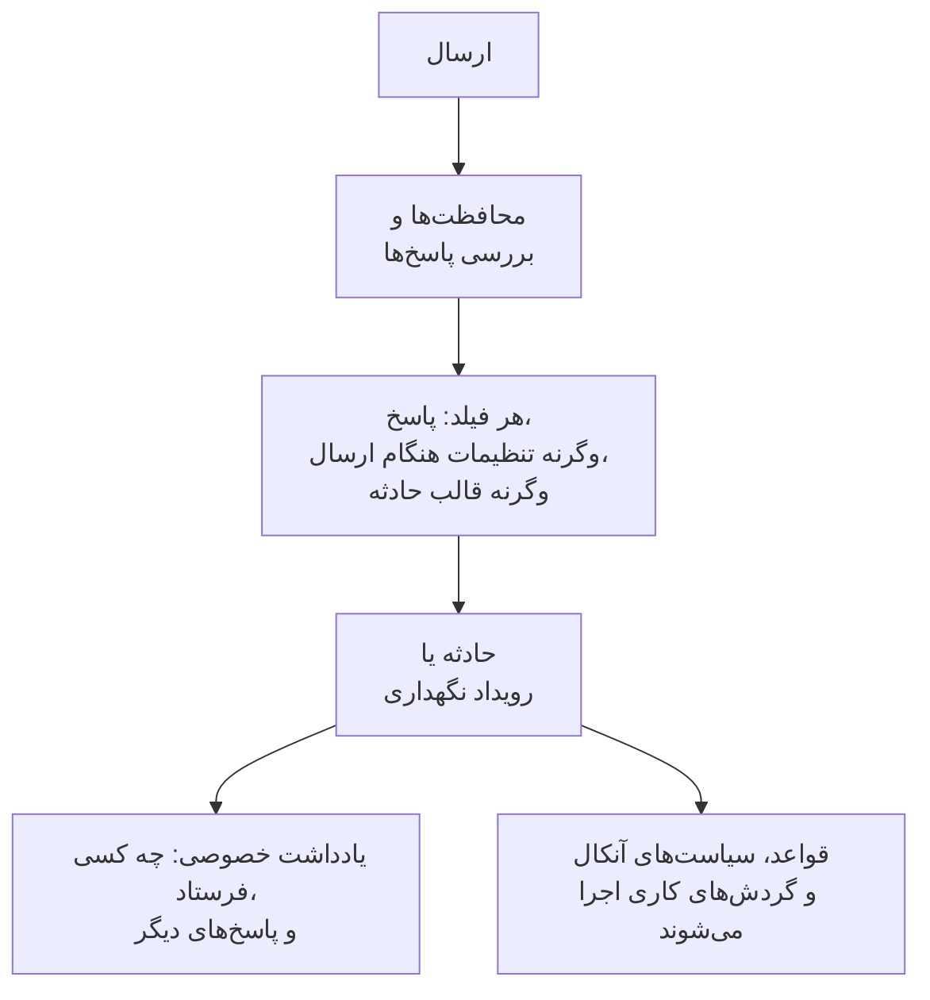

# ارسال چه چیزی ایجاد می‌کند

هر ارسال از راه یک فرم یک رکورد در پروژهٔ شما می‌سازد: یک **حادثه** یا یک **رویداد تعمیر و نگهداری زمان‌بندی‌شده**. صفحهٔ **هنگام ارسال** یک فرم نشان می‌دهد کدام، و هر فیلد رکورد تازه چگونه پر می‌شود — از یک پاسخ، از یک پیش‌فرض، از تنظیمی که همیشه اعمال می‌شود، یا از قالب حادثه. **ویرایش تنظیمات** پیش‌فرض‌ها و آنچه همیشه اعمال می‌شود را تغییر می‌دهد.

:::cards
- [ارسال چگونه به یک حادثه تبدیل می‌شود](#ارسال-چگونه-به-یک-حادثه-تبدیل-میشود): هر فیلد حادثهٔ تازه، و اینکه مقدارش از کجا می‌آید.
- [ارسال چگونه به یک رویداد تعمیر و نگهداری زمان‌بندی‌شده تبدیل می‌شود](#ارسال-چگونه-به-یک-رویداد-تعمیر-و-نگهداری-زمانبندیشده-تبدیل-میشود): همین، برای یک درخواست نگهداری.
- [تنظیمات هنگام ارسال](#تنظیمات-هنگام-ارسال): پیش‌فرض‌ها، آنچه همیشه پیوست می‌شود، مالکان و انتشار.
- [یادداشت خصوصی](#یادداشت-خصوصی): چه کسی آن را فرستاد، و پاسخ‌هایی که هیچ فیلدی نگه نمی‌دارد.
:::

## با زدن ارسال چه رخ می‌دهد

ارسالی که در یک بررسی رد شود چیزی نمی‌سازد. [چه چیزی از یک فرم محافظت می‌کند](/docs/forms/sharing-and-security#چه-چیزی-از-یک-فرم-محافظت-میکند) را ببینید.

## هر ارسال چه چیزی ایجاد می‌کند

کارت **هر ارسال چه چیزی ایجاد می‌کند** انتخابی را نگه می‌دارد که هنگام ساختن فرم کردید:

- **حادثه** — هر ارسال یک حادثه اعلام می‌کند، پس تیم آنکال شما بی‌درنگ باخبر می‌شود. برای گزارش مشکل از آن استفاده کنید.
- **تعمیر و نگهداری زمان‌بندی‌شده** — هر ارسال یک رویداد نگهداری زمان‌بندی می‌کند. برای درخواست‌های تغییر و نگهداری از آن استفاده کنید.

برگزیدن گزینهٔ دیگر از شما تأیید می‌خواهد، چون فرم همراه آن تغییر می‌کند:

- عنوان، توضیحات، مانیتورها و برچسب‌ها پیوندشان را نگه می‌دارند: هر دو نوع رکورد آن‌ها را دارند.
- هر پرسش پیوندی دیگر — یک شدت، یک انتخاب صفحهٔ وضعیت، یک فیلد سفارشی از نوع قبلی — با همان متن به یک پرسشِ خود فرم تبدیل می‌شود که پاسخش در یادداشت خصوصی فهرست می‌شود.
- تنظیمات هنگام ارسال از نو آغاز می‌شوند، چون تنظیمات یک حادثه و یک رویداد متفاوت‌اند.
- فرمی که اکنون رویداد نگهداری می‌سازد می‌پرسد نگهداری کی آغاز می‌شود و کی پایان می‌یابد.

پرسش‌ها بی‌درنگ، همراه با تغییر، ذخیره می‌شوند. آن‌ها را در صفحهٔ **ساخت** بررسی کنید.

## ارسال چگونه به یک حادثه تبدیل می‌شود

کارت همهٔ فیلدهای حادثهٔ تازه و اینکه مقدار هر کدام از کجا می‌آید را فهرست می‌کند:

| فیلد | از کجا می‌آید |
| --- | --- |
| **عنوان** | پاسخ به پرسش **عنوان**. وقتی فرم آن را نمی‌پرسد، یا خالی می‌ماند: **عنوان پیش‌فرض**، وگرنه نام فرم. |
| **توضیحات** | پاسخ به پرسش **توضیحات**. وقتی پرسیده نمی‌شود یا خالی می‌ماند، توضیحات قالب حادثه، اگر فرم قالبی داشته باشد. |
| **شدت** | انتخاب فرستنده، وقتی فرم آن را می‌پرسد. وگرنه تنظیم **شدت** فرم، وگرنه شدت قالب حادثه. |
| **مانیتورها** | مانیتورهایی که فرستنده برگزیده، همراه با آن‌هایی که تنظیمات همیشه پیوست می‌کنند. اگر هیچ‌کدام نباشد، مانیتورهای قالب حادثه. |
| **برچسب‌ها** | برچسب‌هایی که فرستنده برگزیده، همراه با آن‌هایی که تنظیمات همیشه می‌افزایند. اگر هیچ‌کدام نباشد، برچسب‌های قالب حادثه. |
| **زمان شروع اثر** | پاسخ به **زمان شروع اثر**، وقتی فرم آن را می‌پرسد. |
| **قالب حادثه** | تنظیم **قالب حادثه** فرم. هر چه را پاسخ‌ها و تنظیمات تعیین نکنند پر می‌کند. |
| **سیاست‌های آنکال** | سیاست‌هایی که تنظیمات نام می‌برند، که برای هر حادثه‌ای که فرم اعلام می‌کند اجرا می‌شوند. اگر هیچ‌کدام نباشد، سیاست‌های قالب حادثه. |
| **مالکان** | افراد و تیم‌هایی که تنظیمات نام می‌برند، همراه با مالکان قالب. دربارهٔ هر حادثه به آن‌ها خبر داده می‌شود. |
| **فیلدهای سفارشی** | پاسخ هر پرسش فیلد سفارشی — مگر اینکه فیلد مقدارش را از یک فیلد سفارشی مانیتور کپی کند و مانیتورهای حادثه چنین مقداری داشته باشند؛ بقیه را قالب پر می‌کند. |
| **صفحات وضعیت** | تا وقتی کسی از تیم شما حادثه را منتشر نکند، هرگز روی صفحات وضعیت نشان داده نمی‌شود، و به مشترکان خبر داده نمی‌شود. |
| **پاسخ‌های دیگر** | در یک یادداشت خصوصی روی حادثه فهرست می‌شوند، همراه با اینکه چه کسی آن را ارسال کرده است. |

> [!IMPORTANT]
> **بدون شدت، بدون حادثه.** یک حادثه به یک شدت نیاز دارد. وقتی فرم شدتی نمی‌پرسد و تنظیماتش هیچ شدتی را نام نمی‌برند — یا شدتی که نام بردند حذف شده — و قالبش هم شدتی تعیین نمی‌کند، ردیف **شدت** به شما هشدار می‌دهد، و هر ارسال با «این فرم نمی‌تواند حادثه‌ای ایجاد کند، زیرا شدتی برای آن تعیین نشده است. لطفاً به تیمی که آن را به اشتراک گذاشته اطلاع دهید.» رد می‌شود. در **ویرایش تنظیمات** یک شدت برگزینید، یا قالبی که شدتی تعیین می‌کند.

### قالب حادثه

یک **قالب حادثه** را در تنظیمات برگزینید تا هر حادثه‌ای که فرم اعلام می‌کند از روی آن اعلام شود، همان‌طور که سرور در هر جای دیگری یک قالب را اعمال می‌کند — [قالب چگونه اعمال می‌شود](/docs/incidents/settings#قالب-چگونه-اعمال-میشود) را ببینید. پاسخ‌ها و تنظیمات فرم مقدم‌اند، و قالب همهٔ بقیه را پر می‌کند: حالت اولیه، توضیحات، شدت، منابع تحت تأثیر، سیاست‌های آنکال، مالکان، برچسب‌ها، مقادیر فیلدهای سفارشی و یک تغییر وضعیت مانیتور.

> [!WARNING]
> **مراقب مانیتورها باشید.** اعلام یک حادثه روی یک مانیتور از راه یک فرم دقیقاً همان اثری را روی مانیتور دارد که اعلام دستی یک حادثه روی آن: پایش فعال روی مانیتور تا برطرف شدن حادثه متوقف می‌شود، و **تغییر وضعیت مانیتور به** یک قالب وضعیت مانیتور را بی‌درنگ تغییر می‌دهد — در هر صفحهٔ وضعیتی که مانیتور را فهرست می‌کند، حتی وقتی خود حادثه پنهان است. با یک فرم، هر کسی که پیوند را دارد می‌تواند این کار را بکند. فقط وقتی از راه فرم مانیتور پیوست کنید که هر ارسال باید آن‌ها را متوقف کند.

### حادثه چگونه به نظر می‌رسد

حادثه‌ای که از راه یک فرم اعلام می‌شود یک حادثهٔ معمولی است، با چند تنظیم ویژهٔ خودش:

- **پنهان از صفحات وضعیت.** **قابل مشاهده در صفحه وضعیت** خاموش است، و **اطلاع به مشترکان صفحه وضعیت** هم. تا وقتی یک پاسخ‌دهنده آن را منتشر نکند، هیچ چیزی دربارهٔ حادثه به صفحهٔ وضعیت یا مشترکی نمی‌رسد — جز تغییر وضعیت مانیتور توسط قالب، که در بالا آمد.
- **اعلام‌شده توسط هیچ‌کس.** فرستنده کاربر OneUptime نیست، پس هیچ کاربری به‌عنوان اعلام‌کنندهٔ حادثه ثبت نمی‌شود.
- **به مالکانش خبر داده می‌شود.** مالکانی که تنظیمات و قالب نام می‌برند پس از ساخته شدن کانال‌های Slack و Microsoft Teams حادثه افزوده می‌شوند و اعلان می‌گیرند — اعلان **حادثه ساخته شد** حادثه منتظر می‌ماند تا آن‌ها مالکانش شوند، پس به جای مالکان پروژه به آن‌ها می‌رسد.
- **یک یادداشت خصوصی ارسال را ثبت می‌کند** — [یادداشت خصوصی](#یادداشت-خصوصی) را ببینید.

هر چیزی که برای یک حادثهٔ تازه اجرا می‌شود برای این‌ها هم اجرا می‌شود: قواعد حریم خصوصی، مالک، برچسب، آنکال و رانبوک، سیاست‌های آنکال، و گردش‌های کاری **On Create Incident**. قواعد آنکال با حوادث یک فرم مانند هر حادثهٔ دیگری جور می‌شوند — از جمله بر اساس عنوان و توضیحاتشان، که فرستنده نوشته است.

:::steps
#### آنچه فرستنده نوشته را بخوانید

عنوان و توضیحات پس از انتشار حادثه روی صفحات وضعیت نشان داده می‌شوند.

#### حادثه را منتشر کنید

**قابل مشاهده در صفحه وضعیت** را از صفحهٔ **تنظیمات** حادثه روشن کنید.

#### اگر مشترکان باید بدانند، به آن‌ها خبر دهید

چون حادثه با **اطلاع به مشترکان صفحه وضعیت** خاموش اعلام شده، انتشار آن اعلان «حادثه ساخته شد» را نمی‌فرستد. برای خبر دادن به مشترکان، یک یادداشت عمومی با تیک **اطلاع به مشترکان صفحه وضعیت** منتشر کنید — [انتشار یک یادداشت عمومی](/docs/incidents/notes-owners-and-feed#انتشار-یک-یادداشت-عمومی) را ببینید.
:::

## ارسال چگونه به یک رویداد تعمیر و نگهداری زمان‌بندی‌شده تبدیل می‌شود

| فیلد | از کجا می‌آید |
| --- | --- |
| **عنوان** | پاسخ به پرسش **عنوان**. وقتی فرم آن را نمی‌پرسد، یا خالی می‌ماند: **عنوان پیش‌فرض**، وگرنه نام فرم. |
| **توضیحات** | پاسخ به پرسش **توضیحات**. |
| **شروع در**، **پایان در** | پاسخ‌ها به **شروع در** و **پایان در**، که هر فرم نگهداری آن‌ها را می‌پرسد و الزامی می‌کند. پایان باید پس از آغاز باشد. |
| **مانیتورها** | مانیتورهایی که فرستنده برگزیده، همراه با آن‌هایی که تنظیمات همیشه پیوست می‌کنند. |
| **صفحات وضعیت** | صفحات وضعیتی که فرستنده برگزیده، همراه با آن‌هایی که تنظیمات نام می‌برند. |
| **برچسب‌ها** | برچسب‌هایی که فرستنده برگزیده، همراه با آن‌هایی که تنظیمات همیشه می‌افزایند. |
| **مالکان** | افراد و تیم‌هایی که تنظیمات نام می‌برند. آن‌ها مالک هر رویدادی هستند که فرم زمان‌بندی می‌کند. |
| **نمایش در صفحات وضعیت** | **خیر** مگر آنکه تنظیمات آن را روشن کنند. |
| **اطلاع به مشترکان** | **خیر** مگر آنکه تنظیمات آن را روشن کنند. |
| **فیلدهای سفارشی** | پاسخ هر پرسش فیلد سفارشی — مگر اینکه فیلد مقدارش را از یک فیلد سفارشی مانیتور کپی کند و مانیتورهای رویداد چنین مقداری داشته باشند. |
| **پاسخ‌های دیگر** | در یک یادداشت خصوصی روی رویداد فهرست می‌شوند، همراه با اینکه چه کسی آن را ارسال کرده است. |

رویداد در حالت **Scheduled** پروژهٔ شما آغاز می‌شود و مانند هر رویداد دیگری پیش می‌رود: وقتی آغاز می‌شود جاری می‌شود و وقتی پایان می‌یابد پایان می‌یابد.

یک ارسال درخواست کسی است، و یک درخواست پیش از انتشار بازبینی می‌شود. بنابراین، مگر آنکه آن را تغییر دهید، رویداد تا وقتی کسی از تیم شما نشانش ندهد از صفحات وضعیتش دور می‌ماند، و به مشترکانش هنگام ساخته شدن، آغاز یا پایانش خبر داده نمی‌شود. **نمایش در صفحات وضعیت** و **اطلاع به مشترکان**، در گام **انتشار** تنظیمات، این را برای هر رویدادی که فرم زمان‌بندی می‌کند تغییر می‌دهند — فقط وقتی روشنشان کنید که به هر کسی که پیوند را دارد اعتماد دارید.

## تنظیمات هنگام ارسال

**ویرایش تنظیمات** تنظیمات را گام‌به‌گام باز می‌کند: **بعدی** پیش می‌رود، و **ذخیره تغییرات** در گام آخر است. هر گام از قبل پر شده است، پس فهرست گام‌ها کنار فرم هر کدام از آن‌ها را باز می‌کند، از جمله گام آخر: تنظیمی را در گام خودش تغییر دهید، سپس گام آخر را باز کنید و ذخیره کنید.

| گام | فرم حادثه | فرم نگهداری |
| --- | --- | --- |
| **پیش‌فرض‌ها** | **عنوان پیش‌فرض**، **شدت**، **قالب حادثه** | **عنوان پیش‌فرض** |
| **همیشه پیوست شود** | **مانیتورها**، **برچسب‌ها**، **سیاست‌های آنکال** | **مانیتورها**، **صفحات وضعیت**، **برچسب‌ها** |
| **مالکان** | **مالکان** | **مالکان** |
| **انتشار** | — | **نمایش در صفحات وضعیت**، **اطلاع به مشترکان** |

**مالکان** یک انتخابگر برای افراد و تیم‌هاست: **افزودن مالک** یک فهرست جست‌وجو از هر دو باز می‌کند، و هر انتخاب به‌صورت تراشه‌ای نشان داده می‌شود که می‌توانید حذفش کنید. هر چه تنظیمات نام می‌برند باید متعلق به پروژهٔ فرم باشد، و مالکان باید عضو آن باشند. رکوردی که پس از انتخاب شدن حذف شده، هنگام ساخته شدن یک ارسال نادیده گرفته می‌شود، و بقیه همچنان اعمال می‌شود.

## یادداشت خصوصی

هر ارسال یک یادداشت خصوصی روی آنچه ساخته است می‌گذارد:

> Submitted through the form **Report a Problem** by Ada Lovelace (<ada@example.com>).
>
> **Which office are you in?**\
> Berlin

این یادداشت فرم و فرستنده را نام می‌برد — «Submitted anonymously through the form **Report a Problem**.» وقتی فرم نپرسیده او کیست — سپس، وقتی ارسال از یکی از قالب‌های فرم آغاز شده، می‌گوید کدام: «Started from the template **Application Outage**.» — و سپس پاسخ‌های پرسش‌های خود فرم را، هر کدام زیر پرسشش، به ترتیب فرم فهرست می‌کند. پاسخ‌های پرسش‌های پیوندی از قبل روی رکوردند: عنوانش، شدتش، فیلدهای سفارشی‌اش. چون خصوصی است، یادداشت هرگز به صفحهٔ وضعیت نمی‌رسد، اما مانند هر یادداشت دیگری در کانال‌های Slack و Microsoft Teams رکورد منتشر می‌شود.

نشانی، پیوندی است که دقیقاً به همان نشانی نامه می‌نویسد — در داشبورد، در Slack و در ایمیل مالکان.

## پرسش‌های پنهان و قالب‌ها

یک [پرسش پنهان](/docs/forms/building#پرسشهای-پنهان) از روی [قالبی](/docs/forms/building#قالبها) پاسخ داده می‌شود که ارسال از آن آغاز شده — هرگز از درخواست — و پاسخش دقیقاً همان جایی می‌رود که پاسخی تایپ‌شده می‌رفت: یک **توضیحات** پنهان توضیحات حادثه می‌شود، یک فیلد سفارشی پنهان مقدار آن، و یک پرسش پنهانِ خود فرم یک سطر در یادداشت خصوصی. ارسالی که از هیچ قالبی آغاز نشده پرسش‌های پنهان را بی‌پاسخ می‌گذارد، و فیلدهای آن‌ها، مانند هر پرسشی که خالی بماند، از تنظیمات هنگام ارسال پر می‌شوند. قالبی که در زمانی حذف شود که کسی فرم را باز داشته، جلوی ارسال او را نمی‌گیرد: ارسال همان‌طور که او پاسخ داده ساخته می‌شود، بدون پاسخ‌های پنهان قالب.

یک قالب می‌تواند پرسش‌های فرم را [به شیوهٔ خودش](/docs/forms/building#یک-قالب-هر-پرسش-را-چگونه-میپرسد) بپرسد، و سرور ارسال را مشمول پرسش‌ها به همان شیوه‌ای می‌کند که قالبِ نام‌برده آن‌ها را می‌پرسد. پرسشی که قالب پنهان می‌کند، مانند یک پرسش پنهان، از روی قالب پاسخ داده می‌شود، حتی وقتی فرم آن را می‌پرسد؛ پرسشی که قالب می‌پرسد از درخواست خوانده می‌شود، حتی وقتی فرم آن را پنهان می‌کند؛ و پرسشی که قالب الزامی می‌کند باید پاسخ داده شود، وگرنه ارسال رد می‌شود و چیزی ساخته نمی‌شود.

پاسخ‌هایی که یک قالب در صفحه پر کرده، پس از ارسال، از آنِ فرستنده‌اند: سرور پاسخ‌هایی را می‌گیرد که درخواست برای پرسش‌های صفحه می‌فرستد، هر چه قالب گفته باشد.

## متنی که فرستنده می‌نویسد

یک ارسال مستقیم به جاهایی می‌رود که متن می‌تواند در آن‌ها خودش کاری کند — کانال‌های Slack و Microsoft Teams، مرورگر هر پاسخ‌دهنده، ایمیل‌های مالکان — و هیچ‌کس پیش از آن آن را نمی‌خواند. پس پیش از ساخته شدن رکورد:

| آنچه فرستنده می‌نویسد | آنچه ذخیره می‌شود |
| --- | --- |
| یک نام‌بری، مانند \<!channel\>، \<!here\> یا \<@U0123ABC\>، در عنوان، توضیحات یا هر پاسخ متنی | **نام‌بری‌ها به هیچ‌کس خبر نمی‌دهند.** هر چیزی که Slack آن را نام‌بری بخواند پس از براکت آغازینش یک نویسهٔ نامرئی می‌گیرد. همه‌جا همان‌طور خوانده می‌شود، اما هیچ ابزار گفتگویی بر اساس آن عمل نمی‌کند. |
| یک تصویر، در توضیحات یا یک پاسخ **متن قالب‌دار** | **تصویرها پیوند می‌شوند.** هر تصویر به پیوندی به همان نشانی تبدیل می‌شود، پس تا یک پاسخ‌دهنده رویش کلیک نکند، چیزی از جایی که فرستنده برگزیده بارگذاری نمی‌شود. |
| یک بلوک کد که زبانش `mermaid` است، با هر نگارشی | **نمودارها کد می‌شوند.** به‌صورت کد ساده ذخیره می‌شود، پس به جای رسم نمودار متنش را نشان می‌دهد. |
| نحو تصویر یا بلوک کد نمودار در عنوان | **عنوان متن ساده است.** آن‌ها هم نویسهٔ نامرئی می‌گیرند، پس عنوان هر جا که برسد — یک اپیزود، یک پیام گفتگو، یک قالب یادداشت — چیزی بارگذاری نمی‌کند و چیزی رسم نمی‌کند. نویسه‌های نامرئی در محدودیت عنوان شمرده می‌شوند. |

هر چیز دیگر — پیوندها، بقیهٔ Markdown، انتخاب‌های فهرست کشویی، عددها، تاریخ‌ها، یک کادر انتخاب تیک‌خورده — همان‌طور که فرستنده داده ذخیره می‌شود، و ارسال نام و ایمیل فرستنده را همان‌طور که تایپ شده نگه می‌دارد.

## گام‌های بعدی

:::cards
- [ساختن فرم](/docs/forms/building): پرسش‌هایی که این فیلدها را پر می‌کنند، پرسش‌های پنهان و قالب‌ها.
- [تنظیمات و خودکارسازی حادثه](/docs/incidents/settings): قالب‌های حادثه و فیلدهای سفارشی.
- [یادداشت‌ها، مالکان و فید حادثه](/docs/incidents/notes-owners-and-feed): یادداشت‌های خصوصی، یادداشت‌های عمومی و مالکان.
- [اشتراک‌گذاری و امنیت](/docs/forms/sharing-and-security): چه کسی می‌تواند ارسال کند، و چند بار.
:::
