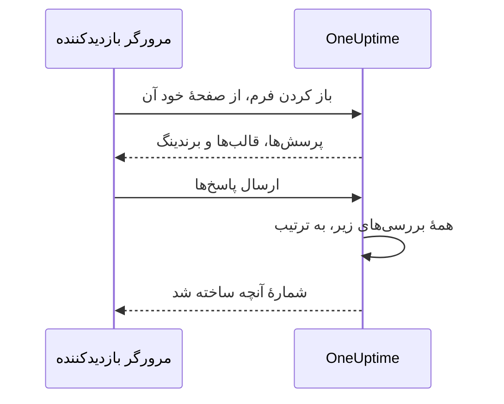

# اشتراک‌گذاری و امنیت

یک فرم به روی هر کسی که پیوندش را دارد باز است، و هر ارسال می‌تواند تیم آنکال شما را فراخواند یا یک بازهٔ نگهداری روی تقویم شما بگذارد. این صفحه دربارهٔ صفحهٔ **اشتراک‌گذاری** فرم است — پیوند، خاموش کردن فرم، پیام پس از ارسال و فهرست IPهای مجاز — و همهٔ بررسی‌های دیگری که یک درخواست در راه از آن‌ها می‌گذرد.

:::cards
- [اشتراک‌گذاری پیوند](#اشتراکگذاری-پیوند): آن را کپی کنید، باز کنید، و وقتی بیش از حد پخش شد بازنشانی‌اش کنید.
- [یک پیوند برای هر قالب](#یک-پیوند-برای-هر-قالب): یک نشانک برای هر مورد، و یک فرم پشت همهٔ آن‌ها.
- [چه چیزی از یک فرم محافظت می‌کند](#چه-چیزی-از-یک-فرم-محافظت-میکند): هر بررسی‌ای که یک درخواست از آن می‌گذرد، به ترتیب.
- [رفع اشکال](#رفع-اشکال): هر پیام روی صفحهٔ فرم چه معنایی دارد، و چه باید کرد.
:::

## صفحهٔ اشتراک‌گذاری

| کارت | آنچه در خود دارد |
| --- | --- |
| **وضعیت** | **پذیرش ارسال‌ها** — اینکه پیوند فرم کار می‌کند یا نه. |
| **پیوند اشتراک‌گذاری** | پیوند، با **کپی پیوند**، **باز کردن فرم** و **بازنشانی پیوند**. |
| **پس از ارسال** | **پیام قدردانی** که افراد پس از ارسال، زیر شمارهٔ آنچه فرم ساخته، می‌بینند. |
| **دسترسی** | **فهرست IPهای مجاز**. |

## اشتراک‌گذاری پیوند

کارت **پیوند اشتراک‌گذاری** پیوند فرم را نشان می‌دهد، مانند `https://oneuptime.com/accounts/form/<share-key>`:

- **کپی پیوند** آن را کپی می‌کند.
- **باز کردن فرم** فرم را در یک زبانهٔ تازه باز می‌کند، همان‌طور که افراد آن را می‌بینند.
- **بازنشانی پیوند** پس از تأیید شما، پیوند تازه‌ای به فرم می‌دهد. پیوند قدیمی بی‌درنگ از کار می‌افتد و پیام در دسترس نبودن را نشان می‌دهد، پس همهٔ کسانی که آن را با آن‌ها به اشتراک گذاشته‌اید به پیوند تازه نیاز دارند. وقتی پیوندی بیش از آنچه باید پخش شده، از آن استفاده کنید.

هر کسی که پیوند را دارد می‌تواند فرم را باز و ارسال کند، بدون حساب OneUptime و بدون ورود. وارد بودن چیزی را تغییر نمی‌دهد: OneUptime فقط از نام و ایمیلی که در فرم تایپ شده می‌فهمد چه کسی ارسال کرده است. پس با پیوند مانند شمارهٔ تلفن تیم آنکال خود رفتار کنید. آن را جایی به اشتراک بگذارید که کسانی که باید از آن استفاده کنند پیدایش کنند — یک صفحهٔ اینترانت، یک رانبوک پشتیبانی، یک پیام سنجاق‌شده در گفتگو — و نه در یک وب‌سایت عمومی، مگر آنکه ارسال از هر کسی را بخواهید.

پیوند یک کلید تصادفی از آنِ خودش دارد، نه شناسهٔ فرم را. روی یک نصب خودمیزبان، از میزبان OneUptime خودتان ارائه می‌شود، و فقط در نشانی‌ای کار می‌کند که `HTTP_PROTOCOL` و `HOST` پیکربندی می‌کنند: اگر با نام دیگری از سرور، یا با نشانی IP آن باز شود، درخواست‌های فرم به‌عنوان درخواست‌هایی از وب‌سایتی دیگر رد می‌شوند.

پیوندهای فرم‌های حادثهٔ قدیمی، `/accounts/incident-form/<share-key>`، همان فرم را در نشانی تازه‌اش باز می‌کنند.

### یک پیوند برای هر قالب

هر یک از [قالب‌های](/docs/forms/building#قالبها) فرم پیوند خودش را دارد: پیوند فرم با `?template=` و شناسهٔ قالب، مانند `https://oneuptime.com/accounts/form/<share-key>?template=<template-id>`. **کپی پیوند** در صفحهٔ **قالب‌ها** فرم آن را کپی می‌کند. فرم را پرشده با آن قالب باز می‌کند، پس یک تیم می‌تواند برای هر مورد یک پیوند را نشانک‌گذاری کند در حالی که شما یک فرم را نگه می‌دارید. وقتی فرستنده قالب دیگری برمی‌گزیند، نشانی مرورگرش هم همراه آن تغییر می‌کند، پس پیوندی که کپی می‌کند همان فرمی است که می‌بیند.

پیوند یک قالب همان پیوند فرم است: تا وقتی **پذیرش ارسال‌ها** فرم روشن است کار می‌کند، و **بازنشانی پیوند** آن را همراه بقیه از کار می‌اندازد. پیوندی که قالبی حذف‌شده را نام می‌برد فرم را طوری باز می‌کند که گویی هیچ قالبی را نام نبرده — با قالب پیش‌فرض، اگر باشد.

### خاموش کردن فرم

برای اینکه بدون حذف فرم دیگر ارسال نپذیرید، **پذیرش ارسال‌ها** را خاموش کنید. آنگاه پیوند «این فرم در دسترس نیست. ممکن است غیرفعال شده باشد یا پیوند آن قدیمی باشد.» را نشان می‌دهد، و کارت **پیوند اشتراک‌گذاری** به شما یادآوری می‌کند که فرم خاموش است. دوباره روشنش کنید تا همان پیوند باز کار کند.

### پیام قدردانی

پس از یک ارسال، صفحه «سپاسگزاریم — پاسخ شما ارسال شد.» را می‌گوید و شمارهٔ آنچه ساخته شد را می‌دهد، سپس **پیام قدردانی** شما را، به Markdown. از آن برای گفتن اینکه بعد چه می‌شود، و وقتی چیزی فوری است کجا باید رفت، استفاده کنید. بدون آن، صفحه فقط پیام استاندارد را نشان می‌دهد.

تصویری در توضیحات فرم یا پیام قدردانی، تا وقتی **پذیرش ارسال‌ها** فرم روشن است، به هر کسی که پیوند را باز می‌کند نشان داده می‌شود. فرم را خاموش کنید، یا تصویر را بردارید، تا تصویر دوباره خصوصی شود، مگر آنکه چیز دیگری که همه می‌بینند هنوز آن را در خود داشته باشد.

## چه چیزی از یک فرم محافظت می‌کند

هر درخواست به این ترتیب از این بررسی‌ها می‌گذرد:

1. درخواست باید از صفحهٔ خود فرم بیاید، نه از وب‌سایتی دیگر — [درخواست‌هایی از وب‌سایت‌های دیگر](#درخواستهایی-از-وبسایتهای-دیگر) را ببینید.
2. باید در محدودهٔ محدودیت‌های نرخ باشد.
3. فرم باید وجود داشته باشد، **پذیرش ارسال‌ها** آن روشن باشد، و متعلق به پروژه‌ای با طرحی باشد که فرم‌ها را در بر می‌گیرد.
4. وقتی فرم **فهرست IPهای مجاز** دارد، باید از نشانی‌ای در آن بیاید.
5. وقتی کپچا روی نمونه روشن است، ارسال باید از کپچا بگذرد.
6. هر پاسخ باید در محدودیت‌های اندازه باشد و با پرسشش جور باشد — [ساختن فرم](/docs/forms/building#محدودیتهای-اندازه) را ببینید.
7. آنچه پاسخ‌ها و تنظیمات می‌سازند باید قابل ساختن باشد: یک حادثه به یک شدت نیاز دارد، یک رویداد به پایانی پس از آغازش.
8. یک ارسال باید در سهمیهٔ ساعتی فرم جا شود — [محدودیت‌های نرخ](#محدودیتهای-نرخ) را ببینید.

لوگو و فاوآیکن یک فرم بخشی از فرم‌اند: درون پاسخی که فرم را باز می‌کند، به base64، و فقط پس از گذشتن از چهار بررسی نخست فرستاده می‌شوند، و هرگز از نشانی‌ای از آنِ خودشان. هیچ‌کس بدون فرم نمی‌تواند آن‌ها را بگیرد، و هیچ فایلی را نمی‌توان با شناسه‌اش از راه یک فرم گرفت؛ خود فایل‌ها خصوصی می‌مانند. یک فرم فقط تصویرهایی را نشان می‌دهد که در پروژهٔ خودش بارگذاری شده‌اند: فایلی از پروژه‌ای دیگر هنگام ذخیرهٔ فرم رد می‌شود، و هرگز به صفحهٔ آن فرستاده نمی‌شود.

### فهرست IPهای مجاز

برای محدود کردن یک فرم به شبکه‌های خودتان:

:::steps
1. صفحهٔ **اشتراک‌گذاری** فرم را باز کنید.
2. در کارت **دسترسی**، روی **ویرایش فهرست IPهای مجاز** کلیک کنید.
3. در هر سطر یک شبکه وارد کنید، و ذخیره کنید. آنگاه کارت آن‌ها را زیر **فهرست IPهای مجاز** فهرست می‌کند.
:::

هر سطر یکی از این‌هاست:

| ورودی | نمونه | نکته |
| --- | --- | --- |
| یک نشانی IPv4 | `203.0.113.7` | |
| یک نشانی IPv6 | `2001:db8::7` | هر طور نوشته شود جور می‌شود، با حروف بزرگ یا با صفرهای کامل. |
| یک بازهٔ IPv4، با نمادگذاری CIDR | `10.0.0.0/8` | بازه‌های IPv6 پشتیبانی نمی‌شوند — هر نشانی IPv6 را در یک سطر جداگانه بنویسید. |

یک نشانی IPv4 باید به‌صورت IPv4 نوشته شود: اگر به شیوهٔ IPv6 نوشته شود، مانند `::ffff:203.0.113.7`، رد می‌شود. فهرست هر بار که ذخیره شود بررسی می‌شود — از داشبورد، API، Terraform یا یک گردش کاری — و سطری که هرگز نمی‌تواند جور شود با پیامی که آن را نام می‌برد رد می‌شود. برای مجاز کردن همهٔ شبکه‌ها فهرست را خالی بگذارید. وقتی یک ورودی داشته باشد، درخواستی که نشانی‌اش قابل تعیین نیست رد می‌شود.

در OneUptime Cloud، تنظیم فهرست IPهای مجاز به طرح **Scale** نیاز دارد - چه وقتی فرمی با آن از راه API ساخته می‌شود و چه وقتی ویرایش می‌شود - مانند فهرست IPهای مجاز یک [داشبورد عمومی](/docs/dashboards/sharing). خالی کردن آن در همهٔ طرح‌ها کار می‌کند.

### درخواست‌هایی از وب‌سایت‌های دیگر

مرورگر به سرور می‌گوید کدام صفحه درخواستی را فرستاده است. وقتی صفحهٔ وب‌سایتی دیگر مرورگر یک بازدیدکننده را وادار کند فرمی را باز یا ارسال کند، درخواست با «This form can only be used from its own page.» رد می‌شود — پیش از آنکه هیچ محدودیت نرخی آن را بشمارد، و هر پیوندی که باشد، پس پاسخ چیزی دربارهٔ اینکه کدام فرم‌ها وجود دارند نمی‌گوید.

درخواستی رد می‌شود که سرآیند `Sec-Fetch-Site` آن وجود داشته باشد و چیزی جز `same-origin` یا `none` بگوید، یا سرآیند `Origin` آن وجود داشته باشد و نشانی OneUptime شما نباشد — `HTTP_PROTOCOL` و `HOST`، همراه با پورت وقتی `HOST` پورت دارد. یک ارسال باید به‌صورت JSON (`application/json`) هم فرستاده شود؛ ارسالی که به‌صورت فیلدهای فرم یک صفحهٔ وب، یا متن ساده، فرستاده شود با «The request must be a JSON object holding the form's answers in "data".» رد می‌شود. خواندن یک فرم به سرآیندی هم نیاز دارد که صفحهٔ فرم به هر درخواستی که می‌فرستد می‌افزاید، `X-OneUptime-Form: 1`: یک صفحه بدون اسکریپت نمی‌تواند مرورگر را وادار به افزودن سرآیند کند، و اسکریپت وب‌سایتی دیگر که آن را بیفزاید با `Origin` خود رسوا می‌شود.

### محدودیت‌های نرخ

باز کردن یک فرم و ارسال آن بر اساس نشانی شبکه محدود می‌شوند، و ارسال بر اساس فرم هم محدود می‌شود:

- **باز کردن یک فرم** — برای هر فرم از یک نشانی، و برای هر نشانی در همهٔ فرم‌ها، با جای کافی برای یک دفتر کامل که هم‌زمان پیوند را باز می‌کند. با گذشتن از هر یک، صفحه «درخواست‌های بیش از حد. لطفاً بعداً دوباره تلاش کنید.» را نشان می‌دهد. اگر محدودکنندهٔ نرخ در دسترس نباشد، فرم‌ها باز هم باز می‌شوند.
- **ارسال، برای هر نشانی** — برای هر فرم از یک نشانی، و برای هر نشانی در همهٔ فرم‌ها. با گذشتن از هر یک، فرستنده «ارسال‌های بیش از حد از شبکه شما انجام شده است. لطفاً چند دقیقه صبر کنید و دوباره تلاش کنید.» را می‌بیند. همهٔ کسانی که پشت یک نشانی‌اند — یک شبکهٔ اداری، یک دروازهٔ VPN — این محدودیت‌ها را مشترک دارند، و هر ارسال شمرده می‌شود، حتی ارسالی که سپس به دلیل پاسخی نادرست رد شود.
- **ارسال، برای هر فرم** — یک فرم در یک ساعت چند رکورد می‌تواند بسازد، از همهٔ نشانی‌ها روی هم، پس حتی ارسال‌های هم‌زمان از نشانی‌های بسیار هم فقط می‌توانند تعداد محدودی بار در ساعت شما را فراخوانند. فقط ارسالی شمرده می‌شود که از همهٔ بررسی‌های دیگر گذشته باشد، درست پیش از ساخته شدن رکوردش. با گذشتن از آن، تا پایان بازه همه «این فرم در حال حاضر ارسال‌های بیش از حدی دریافت می‌کند. لطفاً بعداً دوباره تلاش کنید.» را می‌بینند. **بازنشانی پیوند** پیوند تازه را با سهمیه‌ای تازه آغاز می‌کند.

هر محدودیت با `429` و یک سرآیند `Retry-After`، بر حسب ثانیه، پاسخ می‌دهد، و صفحه به فرستنده می‌گوید کی دوباره تلاش کند. بازه‌ها ثابت‌اند، نه غلتان. اگر محدودکنندهٔ نرخ در دسترس نباشد، ارسال‌ها به جای آنکه بی‌شمارش پذیرفته شوند رد می‌شوند: API با `503` پاسخ می‌دهد، و فرستنده «در حال حاضر امکان پذیرش ارسال‌ها وجود ندارد. لطفاً چند دقیقه دیگر دوباره تلاش کنید.» را می‌بیند.

روی یک نصب خودمیزبان، این متغیرهای محیطی اپ OneUptime محدودیت‌ها را تغییر می‌دهند:

| متغیر | پیش‌فرض | آنچه تنظیم می‌کند |
| --- | --- | --- |
| `FORM_RATE_LIMIT_WINDOW_SECONDS` | `60` | بازهٔ باز کردن فرم‌ها، بر حسب ثانیه. |
| `FORM_RATE_LIMIT_PER_FORM_AND_IP_PER_WINDOW` | `120` | یک نشانی در هر بازه چند بار می‌تواند یک فرم را باز کند. |
| `FORM_RATE_LIMIT_PER_IP_PER_WINDOW` | `600` | یک نشانی در هر بازه چند بار می‌تواند فرم‌ها را باز کند، در همهٔ فرم‌ها. |
| `FORM_SUBMIT_RATE_LIMIT_WINDOW_SECONDS` | `900` | بازهٔ محدودیت‌های ارسال برای هر نشانی، بر حسب ثانیه. |
| `FORM_SUBMIT_RATE_LIMIT_PER_FORM_AND_IP_PER_WINDOW` | `10` | ارسال‌ها به یک فرم از یک نشانی در هر بازه. |
| `FORM_SUBMIT_RATE_LIMIT_PER_IP_PER_WINDOW` | `30` | ارسال‌ها از یک نشانی در هر بازه، در همهٔ فرم‌ها. |
| `FORM_SUBMIT_RATE_LIMIT_PER_FORM_WINDOW_SECONDS` | `3600` | بازهٔ محدودیت هر فرم، بر حسب ثانیه. |
| `FORM_SUBMIT_RATE_LIMIT_PER_FORM_PER_WINDOW` | `60` | رکوردهایی که یک فرم در هر بازه می‌تواند بسازد، از همهٔ نشانی‌ها روی هم. |

هر متغیر نام قدیمی‌اش را هم می‌خواند، با `INCIDENT_FORM_` در آغاز به جای `FORM_` — مانند `INCIDENT_FORM_SUBMIT_RATE_LIMIT_PER_FORM_PER_WINDOW` — پس نصبی که فرم‌های حادثه را تنظیم کرده بود محدودیت‌هایش را نگه می‌دارد؛ وقتی هر دو تنظیم شده باشند نام تازه مقدم است. نه `config.env` و نه مقادیر چارت Helm آن‌ها را منتقل نمی‌کنند: خودتان آن‌ها را به محیط کانتینر `app` بیفزایید — با `app.extraEnv`، یا `extraEnv` سراسری چارت، در چارت Helm، یا در یک `docker-compose.override.yml` برای Docker Compose. `TRUSTED_PROXY_HOPS` تعیین می‌کند محدودیت‌های هر نشانی کدام نشانی را بشمارند.

### کپچا

وقتی hCaptcha روی نمونهٔ OneUptime شما روشن است، فرم یک کپچا نشان می‌دهد، و ارسالی که از آن نگذشته رد می‌شود. تنظیمی برای هر فرم وجود ندارد. یک نصب خودمیزبان کپچا را با `CAPTCHA_ENABLED`، `CAPTCHA_SITE_KEY` و `CAPTCHA_SECRET_KEY` روشن می‌کند — همان تنظیم‌هایی که از ثبت‌نام محافظت می‌کنند. بدون آن، محدودیت‌های نرخ و فهرست IPهای مجاز بار را به دوش می‌کشند.

## رفع اشکال

:::details پیوند می‌گوید فرم در دسترس نیست
«این فرم در دسترس نیست. ممکن است غیرفعال شده باشد یا پیوند آن قدیمی باشد.» صفحه هر دلیلی که باشد همین پاسخ را می‌دهد، پس هرگز به یک غریبه نمی‌گوید فرمی وجود دارد یا نه:

- **پذیرش ارسال‌ها** در صفحهٔ **اشتراک‌گذاری** خاموش است.
- پیوند با **بازنشانی پیوند** جایگزین شده است. پیوند تازه را به اشتراک بگذارید.
- فرم حذف شده است.
- در OneUptime Cloud، پروژه پایین‌تر از طرح **Growth** است، یا اشتراکش پرداخت نشده است.
- پیوند هنگام کپی ناقص شده است.
:::

:::details فرم فقط از یک شبکهٔ مجاز باز می‌شود
«این فرم فقط از یک شبکه مجاز باز می‌شود.» نشانی فرستنده در **فهرست IPهای مجاز** فرم نیست: شبکهٔ او را بیفزایید، یا فهرست را خالی کنید. روی یک نصب خودمیزبان پشت یک پراکسی یا متعادل‌کنندهٔ بار، `TRUSTED_PROXY_HOPS` را بررسی کنید — وقتی بیش از حد کم باشد، OneUptime به جای نشانی فرستنده نشانی پراکسی شما را می‌بیند. صفحه همین را می‌گوید وقتی فرم در نشانی‌ای جز نشانی خود OneUptime شما باز شده باشد: پیوند را دقیقاً همان‌طور باز کنید که کارت **پیوند اشتراک‌گذاری** نشانش می‌دهد.
:::

:::details ارسال‌های بیش از حد
«ارسال‌های بیش از حد از شبکه شما انجام شده است. لطفاً چند دقیقه صبر کنید و دوباره تلاش کنید.» همهٔ کسانی که پشت یک نشانی‌اند محدودیت‌های هر نشانی را مشترک دارند، که در یک قطعی بزرگ، وقتی بسیاری هم‌زمان گزارش می‌دهند، اهمیت پیدا می‌کند. صفحه می‌گوید کی دوباره تلاش کنید. «این فرم در حال حاضر ارسال‌های بیش از حدی دریافت می‌کند. لطفاً بعداً دوباره تلاش کنید.» به جای آن سهمیهٔ هر فرم است: به شبکهٔ فرستنده ربطی ندارد، و گزارش‌ها پس از پایان بازه دوباره پذیرفته می‌شوند. اگر ارسال‌ها واقعی نیستند چون پیوند بیش از آنچه باید پخش شده، **بازنشانی پیوند** پیوند قدیمی را بی‌درنگ از کار می‌اندازد.
:::

:::details اکنون امکان پذیرش ارسال‌ها نیست
«در حال حاضر امکان پذیرش ارسال‌ها وجود ندارد. لطفاً چند دقیقه دیگر دوباره تلاش کنید.» محدودکنندهٔ نرخ در دسترس نبود، پس ارسال‌ها به جای آنکه بی‌شمارش پذیرفته شوند رد می‌شوند. باز کردن فرم همچنان کار می‌کند. روی یک نصب خودمیزبان، بررسی کنید که Valkey، حافظهٔ نهانی که محدودکنندهٔ نرخ در آن می‌شمارد، بالا باشد و از اپ OneUptime در دسترس باشد.
:::

:::details این فرم نمی‌تواند حادثه‌ای ایجاد کند، زیرا شدتی برای آن تعیین نشده است
فرم شدتی نمی‌پرسد، تنظیماتش هیچ شدتی را نام نمی‌برند — یا شدتی که نام بردند حذف شده — و قالب حادثه‌اش هم شدتی تعیین نمی‌کند. در صفحهٔ **هنگام ارسال** فرم یک شدت برگزینید. [بدون شدت، بدون حادثه](/docs/forms/on-submit#ارسال-چگونه-به-یک-حادثه-تبدیل-میشود) را ببینید.
:::

:::details یک ارسال رد می‌شود
پیام می‌گوید چه اشکالی هست: یک پاسخ الزامی جا افتاده یا فقط فاصله است، یک پاسخ بیش از حد بلند است یا با پرسشش جور نیست، نشانی ایمیل یک نشانی معمولی نیست، یا یک بازهٔ نگهداری پیش از آغازش پایان می‌یابد. «تأیید کپچا ناموفق بود. لطفاً دوباره تلاش کنید.» یعنی کپچا گذرانده نشده، یا منقضی شده است: دوباره آن را حل کنید. روی یک نصب خودمیزبان که در آن هر ارسال در کپچا رد می‌شود، بررسی کنید که `CAPTCHA_SITE_KEY` و `CAPTCHA_SECRET_KEY` هر دو تنظیم شده باشند.
:::

:::details یک پرسش روی فرم نیست
سازنده پرسش‌هایی را که از فرم عمومی کنار می‌گذارد علامت می‌زند — برای نمونه یک فیلد سفارشی حذف‌شده — و **پیش‌نمایش** می‌گوید کی یکی را کنار می‌گذارد. [وقتی سازنده یک پرسش را علامت می‌زند](/docs/forms/building#وقتی-سازنده-یک-پرسش-را-علامت-میزند) را ببینید. پرسشی با نشان **پنهان** عمداً کنار گذاشته شده: فقط قالب‌ها به آن پاسخ می‌دهند. [پرسش‌های پنهان](/docs/forms/building#پرسشهای-پنهان) را ببینید. یک پرسش ممکن است برای یک قالب روی فرم باشد و برای قالبی دیگر نباشد: هر قالب می‌تواند پرسشی را پنهان کند، یا پرسشی را که فرم پنهان می‌کند بپرسد. **ویرایش** قالب را باز کنید و **پرسش‌ها** آن را بررسی کنید. [یک قالب هر پرسش را چگونه می‌پرسد](/docs/forms/building#یک-قالب-هر-پرسش-را-چگونه-میپرسد) را ببینید.
:::

:::details یک قالب پرسشی را پر نمی‌کند
پاسخ یک قالب فقط تا وقتی به کار می‌رود که هنوز با پرسشش جور باشد: گزینه‌ای که پرسش هنوز پیشنهاد می‌کند، رکوردی که فرم هنوز پیشنهاد می‌کند، متنی که بیش از حد بلند نیست. قالب را ویرایش کنید، دوباره به پرسش پاسخ دهید، و آن را ذخیره کنید. [قالب‌ها](/docs/forms/building#قالبها) را ببینید.
:::

:::details حادثه یا رویداد روی صفحهٔ وضعیت نیست
این عمدی است: حوادثی که از یک فرم می‌آیند پنهان اعلام می‌شوند، و رویدادهای نگهداری پنهان می‌مانند مگر آنکه تنظیمات **انتشار** فرم چیز دیگری بگویند. [ارسال چه چیزی ایجاد می‌کند](/docs/forms/on-submit) را ببینید.
:::

:::details هیچ‌کس فراخوانده نشد
حادثهٔ یک فرم سیاست‌های آنکالی را که تنظیمات و قالبش نام می‌برند، و هر چه قواعد آنکال شما بیفزایند، اجرا می‌کند، مانند هر حادثهٔ دیگری. اگر هیچ‌کدام نباشد، هیچ‌کس فراخوانده نمی‌شود. یک سیاست آنکال در صفحهٔ **هنگام ارسال** فرم بیفزایید، یا یک قاعدهٔ آنکال بنویسید که با حوادث آن جور شود — برای نمونه با برچسبی که فرم همیشه می‌افزاید.
:::

## گام‌های بعدی

:::cards
- [نمای کلی فرم‌ها](/docs/forms/index): فرم‌ها برای چه هستند، دسترسی‌ها و API.
- [ساختن فرم](/docs/forms/building): پرسش‌ها، پرسش‌های پنهان و قالب‌ها.
- [ارسال چه چیزی ایجاد می‌کند](/docs/forms/on-submit): حادثه یا رویدادی که هر ارسال می‌سازد.
:::
