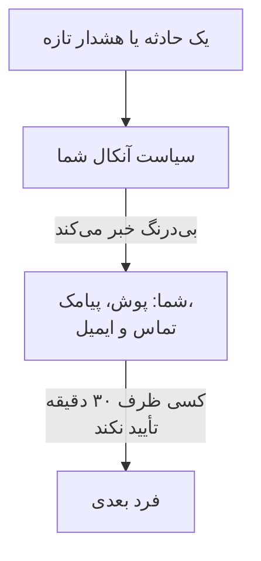

# با تماس، پیامک یا پوش خبر شوید

در پایان این راهنما، هر حادثه و هشدار تازه در پروژه‌تان شما را روی تلفنتان با اعلان پوش، پیامک یا تماس تلفنی خبر می‌کند. اگر کسی ظرف ۳۰ دقیقه تأیید نکند، فرد بعدی خبر می‌شود. یک فراخوان آزمایشی که خودتان تأییدش کرده‌اید نشان می‌دهد همه چیز کار می‌کند. این راهنما راه‌اندازی گام‌به‌گام **وقتی چیزی خراب می‌شود، فرد درست را خبر کنم** را دنبال می‌کند و حدود ۱۰ دقیقه طول می‌کشد.

## آنچه نیاز دارید

- پروژه‌ای که مالکش هستید: روشن کردن پیامک و تماس کار مالک آن است، و ساختن سیاست آنکال کار مالک یا یک مدیر.
- تلفن همراهتان.
- هم‌تیمی‌هایی که می‌خواهید خبر شوند، به‌عنوان اعضای پروژه: [دعوت از افراد](/docs/permissions/inviting-people) روشش را نشان می‌دهد.

:::tabs
@tab OneUptime Cloud
اعلان‌های پوش در همهٔ طرح‌ها رایگان‌اند. هزینهٔ پیامک‌ها و تماس‌ها از موجودی پروژه پرداخت می‌شود که از 0.00 USD شروع می‌شود، و افزودن شمارهٔ تلفن یک پیامک می‌فرستد، پس موجودی باید پیش از آن بیشتر از 1.00 USD باشد. افزودن موجودی، مبلغ را از کارت پروژه برداشت می‌کند. طرح Free یک نفر و یک قاعدهٔ تشدید را در بر می‌گیرد: فقط شما خبر می‌شوید، و فراخوان به‌جای رسیدن به کس دیگری تکرار می‌شود.
@tab خودمیزبان
سرور شما باید بتواند ایمیل، پیامک و تماس بفرستد. مدیر ارشد آن این‌ها را در `/admin/setup` راه‌اندازی می‌کند، هر کدام با یک آزمایش، همان‌طور که [راهنمای خودمیزبانی](/docs/installation/self-hosting-guide) نشان می‌دهد. اعلان‌های پوش از راه رلهٔ پوش OneUptime به برنامه می‌رسند و نیازی به راه‌اندازی ندارند.
:::

## گام‌ها

:::steps
### راه‌اندازی گام‌به‌گام را باز کنید

در صفحهٔ **خانه** پروژه‌تان، در فهرست **به OneUptime خوش آمدید 👋** روی **یک سیاست آنکال تنظیم کنید** کلیک کنید. صفحهٔ خانهٔ یک پروژهٔ تازه نخست می‌پرسد **اول می‌خواهید چه کار کنید؟**: **وقتی چیزی خراب می‌شود، فرد درست را خبر کنم** را تیک بزنید و روی **ادامه** کلیک کنید. اگر این گام دیده نمی‌شود یا از قبل انجام شده است، `Ctrl+K` را فشار دهید (در Mac، `Cmd+K`)، `get paged` را تایپ کنید و **وقتی چیزی خراب می‌شود، فرد درست را خبر کنم** را انتخاب کنید.

### برنامه را روی تلفنتان نصب کنید

برنامهٔ OneUptime On-Call را از App Store یا Google Play نصب کنید و وارد شوید: این کار تلفن شما را برای اعلان‌های پوش ثبت می‌کند. به راه‌اندازی برگردید و روی **بررسی دوباره** کلیک کنید: اکنون **برنامهٔ موبایل یا مرورگر** زیر **چطور به شما برسیم؟** تلفن شما را فهرست می‌کند.

### پیامک و تماس را روشن کنید

پیامک و تماس تلفنی در پروژه‌های تازه خاموش‌اند. اگر مالک پروژه هستید، روی **روشن کردن پیامک و تماس تلفنی** کلیک کنید؛ به دیگران گفته می‌شود چه کسی می‌تواند این کار را بکند. در OneUptime Cloud، اگر موجودی 1.00 USD یا کمتر است، روی **افزودن موجودی** کلیک کنید، زیر **مبلغ (دلار)** بین ۲۰ تا ۱۰۰۰ دلار وارد کنید و روی **شارژ** کلیک کنید.

### شمارهٔ تلفن خود را اضافه کنید

شمارهٔ موبایل خود را همراه با کد کشور در **شمارهٔ تلفن شما** تایپ کنید، مانند `+15551234567`، و روی **کد را برایم پیامک کن** کلیک کنید. کدی را که پیامک شده وارد کنید و روی **تأیید** کلیک کنید: برای فراخوان‌ها با همین شماره تماس هم گرفته می‌شود. روی **ادامه** کلیک کنید. برای اینکه فقط با برنامه و ایمیل خبر شوید، شماره را خالی بگذارید و مستقیم روی **ادامه** کلیک کنید.

### انتخاب کنید چه کسان دیگری خبر شوند

زیر **چه کسان دیگری آنکال هستند؟**، شما از قبل در بخش **نخست فراخوانده می‌شوند** هستید. برای اینکه دیگران هم همراه شما خبر شوند، روی **افزودن اعضای تیم** کلیک کنید، سپس روی **ذخیره و ادامه** کلیک کنید. در پروژه‌ای که هنوز سیاست آنکالی ندارد، این کار `Default on-call policy` را می‌سازد که برای هر حادثه و هشدار تازه آن‌ها را خبر می‌کند. در پروژه‌ای که یکی دارد، آن را زیر **سیاست آنکال** انتخاب کنید و به‌جای آن، افراد را زیر **افزودن به نخستین قاعدهٔ تشدید** اضافه کنید. اگر هنوز نمی‌شود به کسی رسید، این گام روی **آیا فراخوان به آن‌ها می‌رسد؟** باز می‌ماند: برای او روی **ارسال یادآوری راه‌اندازی** کلیک کنید، سپس روی **ادامه**.

### تصمیم بگیرید اگر کسی پاسخ ندهد چه شود

زیر **اگر کسی پاسخ ندهد چه؟**، گزینهٔ **فراخواندن کس دیگر** را نگه دارید، زیر **سپس فراخوانده می‌شوند** انتخاب کنید چه کسی، و **دقیقه‌های انتظار** را روی `30` بگذارید یا تغییرش دهید. روی **ذخیره و ادامه** کلیک کنید. در طرح Free، این گام به‌جای آن **فراخواندن دوبارهٔ همان افراد** را پیشنهاد می‌دهد، با **تعداد فراخوان دوباره** روی `2`.

### یک فراخوان آزمایشی بفرستید

زیر **فرستادن فراخوان آزمایشی**، روی **آزمایش این سیاست** کلیک کنید. یک **شدت** انتخاب کنید و روی **فرستادن فراخوان آزمایشی** کلیک کنید. افراد نخستین قاعدهٔ تشدید سیاست درست مانند یک حادثهٔ واقعی خبر می‌شوند، و در هر پیام TEST نوشته شده است. هیچ حادثه‌ای ساخته نمی‌شود و به هیچ صفحه وضعیت یا مشترکی خبر داده نمی‌شود.

### فراخوان آزمایشی را تأیید کنید

پیوند داخل پیامک یا ایمیل را باز کنید و فراخوان را همان‌جا تأیید کنید، یا هنگام تماس تلفنی ۱ را فشار دهید. برنامه نشان می‌دهد که فراخوان رسیده، اما نمی‌تواند یک آزمایش را تأیید کند. سپس در پنجره روی **انجام شد** کلیک کنید، و بعد روی **ادامه**.
:::

## بررسی کنید که درست کار کرد

- گام آزمایش می‌گوید چه کسی فراخوان را تأیید کرد، چگونه و با چه سرعتی.
- راه‌اندازی با خلاصهٔ **فراخوان راه‌اندازی شد** تمام می‌شود که از روی رکوردهای ذخیره‌شده خوانده می‌شود: **چه کسی فراخوانده می‌شود**، **اگر کسی پاسخ ندهد** و **آزمایش شد**. مشکلی در خود سیاست، مانند کسی که سیاست نمی‌تواند به او برسد، زیر **نیاز به توجه** فهرست می‌شود.
- در صفحهٔ **خانه**، فهرست **یک سیاست آنکال تنظیم کنید** را انجام‌شده نشان می‌دهد. اگر این آخرین گام بوده باشد، فهرست دیگر نمایش داده نمی‌شود.

اگر سیاست پس از شما کس دیگری را خبر می‌کند، می‌توانید تشدید را هم ببینید: در خلاصه روی **باز کردن سیاست آنکال** کلیک کنید، سپس روی **آزمایش این سیاست**. **گذر از همهٔ سطح‌های ارتقا** را روشن کنید، آن را بفرستید و نخستین فراخوان را تأیید نکنید: فرد بعدی حداکثر ۲ دقیقه بعد خبر می‌شود.

## چه مشکلی ممکن است پیش بیاید

:::details دکمهٔ «کد را برایم پیامک کن» دیده نمی‌شود
پیامک خاموش است یا نمی‌تواند فرستاده شود، و این گام دلیلش را می‌گوید. فقط مالک پروژه، یا کسی که صورت‌حساب را مدیریت می‌کند، **روشن کردن پیامک و تماس تلفنی** را می‌بیند. در OneUptime Cloud، موجودی 1.00 USD یا کمتر این فیلد را پنهان می‌کند. در سرور خودمیزبانی که نمی‌تواند پیامک بفرستد، مدیر ارشد آن **راه‌اندازی پیامک و تماس** را می‌بیند که Admin Dashboard را برای افزودن Twilio باز می‌کند، همان‌طور که [یکپارچه‌سازی Twilio](/docs/self-hosted/twilio-integration) نشان می‌دهد.
:::

:::details «افزودن موجودی» می‌گوید هیچ روش پرداختی پیدا نشد
افزودن موجودی، مبلغ را از کارت پروژه برداشت می‌کند. یک کارت را زیر **تنظیمات پروژه ← صورت‌حساب و فاکتورها ← صورت‌حساب** با **افزودن روش پرداخت** اضافه کنید، سپس دوباره موجودی بیفزایید. تا آن موقع، برنامه و ایمیل همچنان شما را خبر می‌کنند.
:::

:::details خودمیزبان: شماره رد می‌شود چون هیچ حساب Twilio راه‌اندازی نشده است
فقط مدیر ارشد از پیش هشدار می‌گیرد که سرور نمی‌تواند پیامک بفرستد. از او بخواهید پیامک و تماس را در `/admin/setup` راه‌اندازی کند. در این میان، روی **ادامه** کلیک کنید: برنامه و ایمیل همچنان شما را خبر می‌کنند.
:::

:::details کد یا فراخوان آزمایشی هرگز نمی‌رسد
اول کد کشور شماره را بررسی کنید. پس از یک فراخوان آزمایشی، پنجره را با **انجام شد** ببندید و روی **به دستم نرسید** کلیک کنید: می‌گوید چه چیزی را بررسی کنید، و **باز کردن روش‌های اعلان من** همهٔ راه‌هایی را که می‌شود به شما رسید فهرست می‌کند. در سرور خودمیزبان، از `/admin/setup` یک پیامک آزمایشی بفرستید و `npm run doctor` را روی سرور اجرا کنید.
:::

## پس از این چه کنید

:::cards
- [زمان‌بندی‌های آنکال](/docs/on-call/schedules): به نوبت آنکال باشید تا هر فراخوان به کسی برسد که آنکال است. در Cloud، از طرح Growth به بالا.
- [قواعد تشدید](/docs/on-call/escalation-rules): سطح‌ها، تیم‌ها و زمان‌بندی‌ها را به سیاست اضافه کنید.
- [راه‌های تماس با من](/docs/notifications/on-call-rules): انتخاب کنید کدام روش اول به شما برسد، و کی.
- [یک صفحه وضعیت منتشر کنید](/docs/guides/status-page): به مشتریانتان بگویید چه خبر است، روی دامنهٔ خودتان.
:::
