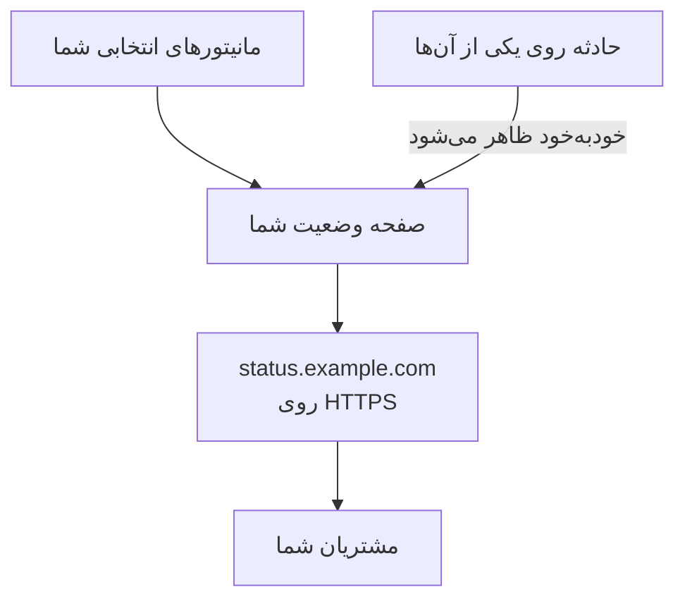

# یک صفحه وضعیت منتشر کنید

در پایان این راهنما، مشتریانتان یک صفحه وضعیت را روی نشانی خودتان، مانند `status.example.com`، با HTTPS باز می‌کنند. این صفحه مانیتورهایی را که انتخاب می‌کنید همراه با وضعیت و زمان کارکردشان نشان می‌دهد، و حادثه‌ای روی یکی از آن‌ها خودبه‌خود همان‌جا نمایش داده می‌شود. این راهنما راه‌اندازی گام‌به‌گام **یک صفحهٔ وضعیت منتشر کنید** را دنبال می‌کند، سپس دامنهٔ شما را در **دامنه‌های سفارشی** صفحه اضافه می‌کند: حدود ۱۵ دقیقه، به‌علاوهٔ زمانی که ارائه‌دهندهٔ DNS شما لازم دارد.

## آنچه نیاز دارید

- دست‌کم یک مانیتور: صفحه وضعیت مانیتورها را نشان می‌دهد. اگر هنوز مانیتوری ندارید، راه‌اندازی گام‌به‌گام اول **راه‌اندازی یک مانیتور** را پیشنهاد می‌دهد.
- نقش مالک یا مدیر پروژه: ساختن صفحه به دسترسی ساخت صفحات وضعیت نیاز دارد، و دامنهٔ شما به دسترسی افزودن و تأیید دامنه‌های پروژه.
- دامنه‌ای که در اختیار شماست، و دسترسی به رکوردهای DNS آن نزد ارائه‌دهندهٔ DNS خود.

:::tabs
@tab OneUptime Cloud
دامنهٔ سفارشی و گواهی SSL رایگان آن در همهٔ طرح‌ها هست. طرح Free برای هر پروژه یک صفحه وضعیت دارد: اگر از قبل یکی دارید، **دامنه‌های سفارشی** آن را باز کنید و از گامی شروع کنید که دامنهٔ شما را اضافه می‌کند. صفحه وضعیت تازه عمومی است؛ خصوصی کردن آن به طرح Growth نیاز دارد.
@tab خودمیزبان
سرور شما به یک نام میزبان مخصوص خودش نیاز دارد، با یک رکورد A که به آن اشاره کند، مانند `oneuptime.example.com`، و روی پورت‌های ۸۰ و ۴۴۳ پاسخ دهد. آن را به‌عنوان `STATUS_PAGE_CNAME_RECORD` در `config.env` بگذارید (در چارت Helm، `statusPage.cnameRecord`)، به‌جای مقدار نمونه‌ای که آنجاست. گواهی‌های رایگان به `LETS_ENCRYPT_ACCOUNT_KEY` (`letsEncrypt.accountKey`) هم نیاز دارند: یک کلید خصوصی که با openssl ساخته و با base64 کدگذاری شده باشد. پس از تغییر این‌ها، OneUptime را دوباره راه‌اندازی کنید. **افزودن دامنهٔ سفارشی** اول سرور را بررسی می‌کند و آنچه را هنوز کم است فهرست می‌کند.
:::

## گام‌ها

:::steps
### راه‌اندازی گام‌به‌گام را باز کنید

در صفحهٔ **خانه** پروژه‌تان، در فهرست **به OneUptime خوش آمدید 👋** روی **یک صفحهٔ وضعیت منتشر کنید** کلیک کنید. صفحهٔ خانهٔ یک پروژهٔ تازه نخست می‌پرسد **اول می‌خواهید چه کار کنید؟**: **با یک صفحهٔ وضعیت به مشتریانم خبر بدهم** را تیک بزنید و روی **ادامه** کلیک کنید. اگر این گام دیده نمی‌شود یا از قبل انجام شده است، `Ctrl+K` را فشار دهید (در Mac، `Cmd+K`)، `status page` را تایپ کنید و **یک صفحهٔ وضعیت منتشر کنید** را انتخاب کنید.

### نام بگذارید و انتخاب کنید چه نمایش دهد

زیر **نام بگذارید و انتخاب کنید چه چیزی نمایش دهد**، **نام صفحه وضعیت** پیشنهادی را نگه دارید یا نام خودتان را تایپ کنید. زیر **آنچه نمایش می‌دهد**، مانیتورهایی را که مشتریانتان باید ببینند تیک بزنید، یا روی **انتخاب همه** کلیک کنید. روی **ساخت صفحه وضعیت** کلیک کنید. صفحه از همین لحظه در پیوند خود عمومی است و فقط مانیتورهایی را که تیک زده‌اید نشان می‌دهد.

### ببینید مشتریانتان چه می‌بینند

در بخش **این چیزی است که مشتریان شما می‌بینند**، نشانی زیر **پیوند عمومی** را باز کنید: مانیتورهای شما با وضعیتشان فهرست شده‌اند. به راه‌اندازی برگردید و روی **خوب به نظر می‌رسد** کلیک کنید.

### دامنه‌های سفارشی را باز کنید

راه‌اندازی با یک خلاصه تمام می‌شود. زیر **آن را شخصی‌سازی کنید (اختیاری)**، روی **دامنه سفارشی شما** کلیک کنید. صفحهٔ **دامنه‌های سفارشی** صفحه وضعیت باز می‌شود.

### دامنهٔ خود را اضافه کنید

روی **افزودن دامنهٔ سفارشی** کلیک کنید. در **دامنه**، نشانی‌ای را که مشتریانتان باز خواهند کرد تایپ کنید، مانند `status.example.com`، و روی **ادامه** کلیک کنید. **راه‌اندازی DNS** با رکوردهایی که باید اضافه کنید باز می‌شود.

### رکوردهای DNS را اضافه کنید

نزد ارائه‌دهندهٔ DNS خود، هر رکوردی را که **راه‌اندازی DNS** فهرست می‌کند با **نوع**، **نام** و **مقدار** آن اضافه کنید: یک رکورد CNAME که نشانی را به OneUptime اشاره می‌دهد و، نخستین باری که پروژه از این دامنه استفاده می‌کند، یک رکورد TXT که نشان می‌دهد پروژه مالک آن است. اگر ارائه‌دهندهٔ شما خودش دامنه را به هر نام اضافه می‌کند، فقط بخش پیش از آن را تایپ کنید، مانند `status`، و برای خود دامنه `@` را.

### رکوردها را بررسی کنید

**راه‌اندازی DNS** را باز نگه دارید و روی **اکنون بررسی کن** کلیک کنید. زیر هر رکورد می‌گوید چه چیزی را جست‌وجو کرد و چه پاسخی برگشت. رکورد TXT اول می‌آید: تا وقتی پیدا نشود، دامنه اضافه نمی‌شود، پس آن‌قدر دوباره روی **اکنون بررسی کن** کلیک کنید تا پیدا شود. همین که رکورد CNAME پیدا شد، پنجره می‌گوید **رکورد CNAME شما تأیید شد.** و یک گواهی SSL رایگان صادر می‌شود، معمولاً ظرف ۱۵ دقیقه.
:::

## بررسی کنید که درست کار کرد

- نشانی خودتان را به‌جای `https://status.example.com` باز کنید: صفحه وضعیت شما بدون هشدار گواهی باز می‌شود.
- در **دامنه‌های سفارشی**، **وضعیت** دامنه می‌گوید **گواهی صادر شد و به‌طور خودکار تمدید می‌شود.** ممکن است تا مدتی پس از باز شدن صفحه، هنوز **در حال صدور گواهی رایگان، معمولاً ظرف ۱۵ دقیقه.** را نشان دهد.
- در صفحهٔ **خانه**، فهرست **یک صفحهٔ وضعیت منتشر کنید** را انجام‌شده نشان می‌دهد: این گام وقتی انجام‌شده به حساب می‌آید که یک صفحه وضعیت یک مانیتور را نشان دهد. اگر این آخرین گام بوده باشد، فهرست دیگر نمایش داده نمی‌شود.

کار دیگری لازم نیست: OneUptime گواهی را خودش تمدید می‌کند. همین که دامنه در فهرست آمد، OneUptime هر ۱۵ دقیقه رکورد CNAME آن را بررسی می‌کند و وقتی رکورد فعال شد آن را تأیید می‌کند، حتی اگر **راه‌اندازی DNS** را ببندید.

## چه مشکلی ممکن است پیش بیاید

:::details دامنه پس از بستن راه‌اندازی DNS در فهرست نیست
**راه‌اندازی DNS** پیش از پیدا شدن رکورد TXT آن بسته شد، پس دامنه هرگز اضافه نشد. روی **افزودن دامنهٔ سفارشی** کلیک کنید، همان نشانی را تایپ کنید، روی **ادامه** کلیک کنید، سپس آن‌قدر روی **اکنون بررسی کن** کلیک کنید تا پنجره هر دو رکورد را پیدا کند.
:::

:::details دامنه روی «در انتظار DNS» می‌ماند
**راه‌اندازی DNS** را از ردیف دامنه باز کنید و روی **اکنون بررسی کن** کلیک کنید: می‌گوید چه چیزی پیدا کرد. بررسی کنید که نام رکورد کل نشانی باشد، مانند `status.example.com`، و مقدار آن همانی باشد که **راه‌اندازی DNS** نشان می‌دهد. اگر نام با یک نشانی IP پاسخ می‌دهد، یک رکورد A دارد یا ارائه‌دهندهٔ DNS شما آن را پروکسی می‌کند: رکورد A را جایگزین کنید، یا نام را روی حالت «فقط DNS» بگذارید. برای دامنهٔ ریشه، مانند `example.com`، از رکورد ALIAS، ANAME یا CNAME مسطح‌شدهٔ ارائه‌دهندهٔ خود استفاده کنید.
:::

:::details وضعیت می‌گوید نتوانسته گواهی رایگان صادر کند
رکورد CAA‌ای روی دامنهٔ شما که `letsencrypt.org` را کنار بگذارد، جلوی گواهی را می‌گیرد. در سرور خودمیزبان، Let's Encrypt باید بتواند روی پورت ۸۰ به سرور برسد. علت را رفع کنید: OneUptime خودش به تلاش ادامه می‌دهد، و **اکنون بررسی کن** در **راه‌اندازی DNS** دوباره سفارش می‌دهد، برای هر دامنه حداکثر هر ۱۵ دقیقه یک بار.
:::

:::details خودمیزبان: سرور برای دامنه‌های سفارشی آماده نیست
**افزودن دامنهٔ سفارشی** می‌گوید **این سرور هنوز برای دامنه‌های سفارشی آماده نیست**، با یک سطر برای هر چیزی که هنوز کم است و آنچه باید تغییر کند: تنظیم‌های بخش [آنچه نیاز دارید](#آنچه-نیاز-دارید). بدون `LETS_ENCRYPT_ACCOUNT_KEY`، یک دامنهٔ تأییدشده می‌گوید **تأیید شد. از HTTPS پروکسی خودتان استفاده می‌کند.**: HTTPS آن را از پروکسی خودتان ارائه کنید. [برندینگ و دامنه‌های صفحه وضعیت](/docs/status-pages/branding-and-domains#پیش-از-شروع) جزئیات را دارد.
:::

## پس از این چه کنید

:::cards
- [برندینگ و دامنه‌های صفحه وضعیت](/docs/status-pages/branding-and-domains): لوگو، رنگ‌ها، پیوندهای سربرگ و پاورقی شما.
- [مشترکان و اطلاعیه‌ها](/docs/status-pages/subscribers): بگذارید مشتریان مشترک شوند، و اطلاعیه منتشر کنید.
- [تعمیر و نگهداری زمان‌بندی‌شده](/docs/scheduled-maintenance/index): پیش از شروع کارهای برنامه‌ریزی‌شده، به مشتریان خبر بدهید.
- [با تماس، پیامک یا پوش خبر شوید](/docs/guides/paging): وقتی یکی از آن مانیتورها از دسترس خارج شد، خبر شوید.
:::
