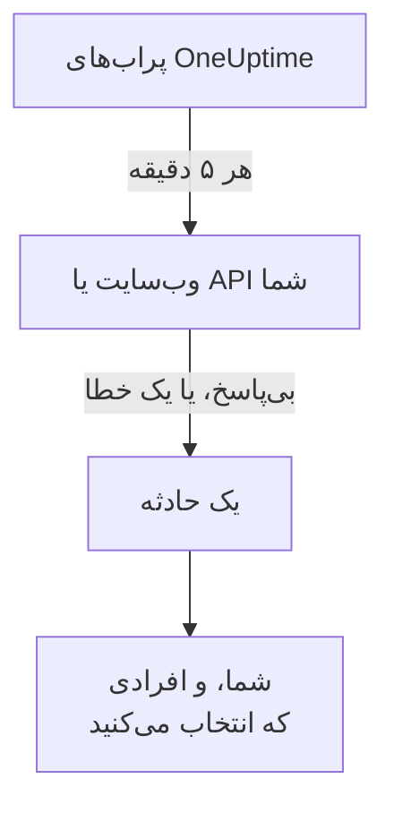

# بدانید چه زمانی وب‌سایت یا API شما از کار می‌افتد

در پایان این راهنما، OneUptime هر ۵ دقیقه وب‌سایت یا API شما را بررسی می‌کند، وقتی دیگر پاسخ ندهد یا با خطا پاسخ دهد یک حادثه باز می‌کند و به شما خبر می‌دهد. یک فراخوان آزمایشی که خودتان تأییدش کرده‌اید نشان می‌دهد پیام به شما می‌رسد. این راهنما راه‌اندازی گام‌به‌گام **بدانم وب‌سایت یا API من کی از کار افتاده است** را دنبال می‌کند و حدود ۵ دقیقه طول می‌کشد.

## آنچه نیاز دارید

- یک پروژهٔ OneUptime که در آن اجازهٔ ساختن مانیتور دارید: مالک، مدیر یا عضو این اجازه را دارد. برای ساختن حساب و پروژه، بخش نخست [شروع سریع](/docs/introduction/quickstart#یک-پروژه-بسازید) را دنبال کنید.
- نشانی‌ای که باید بررسی شود، مانند `https://example.com`. برای یک API، یک نقطهٔ پایانی انتخاب کنید که بدون هیچ کلیدی به یک درخواست `GET` ساده پاسخ دهد، مانند یک بررسی سلامت: پاسخی مانند `401` از کار افتادن به حساب می‌آید.

:::tabs
@tab OneUptime Cloud
پراب‌هایی در چند منطقه نشانی را بررسی می‌کنند، پس باید از اینترنت در دسترس باشد. طرح Free شامل ۱۰ مانیتور فعال است.
@tab خودمیزبان
نشانی از پراب خود سرور شما بررسی می‌شود، پس باید از آنجا در دسترس باشد. برای دریافت ایمیل، سرور باید بتواند ایمیل بفرستد: مدیر ارشد آن ایمیل را در `/admin/setup` راه‌اندازی می‌کند، همان‌طور که [راهنمای خودمیزبانی](/docs/installation/self-hosting-guide) نشان می‌دهد. مدیر ارشد مالک چیزهایی که می‌سازد نمی‌شود، پس برای دریافت ایمیل، خودش را در صفحهٔ **مالکان** مانیتور اضافه می‌کند.
:::

## گام‌ها

:::steps
### راه‌اندازی گام‌به‌گام را باز کنید

صفحهٔ **خانه** یک پروژهٔ تازه نخست می‌پرسد **اول می‌خواهید چه کار کنید؟**: **بدانم وب‌سایت یا API من کی از کار افتاده است** را تیک بزنید و روی **ادامه** کلیک کنید. سپس در فهرست **به OneUptime خوش آمدید 👋** روی **اولین مانیتور خود را بسازید** کلیک کنید. اگر فهرست آن را نشان نمی‌دهد، `Ctrl+K` را فشار دهید (در Mac، `Cmd+K`)، `website down` را تایپ کنید و **بدانم وب‌سایت یا API من کی از کار افتاده است** را انتخاب کنید.

### نشانی را وارد کنید

زیر **چه چیزی را بررسی کنیم؟**، نشانی را در **نشانی وب‌سایت یا API** تایپ کنید. برای یک نقطهٔ پایانی API، **این یک نقطه پایانی API است** را تیک بزنید. روی **شروع بررسی** کلیک کنید: پراب‌ها بی‌درنگ آن را بررسی می‌کنند و یک جمله می‌گوید چه یافتند. روی **ادامه** کلیک کنید.

### انتخاب کنید چه کسی باخبر شود

زیر **چه کسی باید باخبر شود؟**، آنچه می‌بینید به پروژه بستگی دارد:

- اگر پروژه هنوز هیچ سیاست آنکال یا قاعدهٔ آنکالی ندارد، شما از قبل در **چه کسی فراخوانده می‌شود** هستید. برای افزودن افرادی که از قبل در پروژه هستند روی **افزودن اعضای تیم** کلیک کنید، سپس روی **ذخیره و ادامه** کلیک کنید. این کار `Default on-call policy` را می‌سازد که برای هر حادثه و هشدار تازه در پروژه آن‌ها را خبر می‌کند.
- اگر پروژه سیاست یا قاعدهٔ آنکالی دارد، قواعد خود پروژه تعیین می‌کنند چه کسی فراخوانده شود: روی **ادامه** کلیک کنید.
- اگر عضو پروژه هستید و اجازهٔ راه‌اندازی فراخوان را ندارید، به شما گفته می‌شود که به‌عنوان مالک مانیتور ایمیل دریافت می‌کنید: روی **ادامه** کلیک کنید.

### برای خودتان یک آزمایش بفرستید

زیر **یک آزمایش بفرستید**، روی **برایم فراخوان آزمایشی بفرست** کلیک کنید. یک **شدت** انتخاب کنید و روی **فرستادن فراخوان آزمایشی** کلیک کنید. آزمایش درست مانند یک فراخوان واقعی به شما می‌رسد، و در هر پیام TEST نوشته شده است. هیچ حادثه‌ای ساخته نمی‌شود.

### فراخوان آزمایشی را تأیید کنید

پیوند داخل ایمیل را باز کنید و فراخوان را همان‌جا تأیید کنید. یک شمارهٔ تلفن تأییدشده هم کار می‌کند، به شرط آنکه پیامک و تماس برای پروژه روشن شده باشد: پیوند داخل پیامک را باز کنید، یا هنگام تماس ۱ را فشار دهید. سپس در پنجره روی **انجام شد** کلیک کنید، و بعد روی **ادامه**.
:::

## بررسی کنید که درست کار کرد

- راه‌اندازی با خلاصهٔ خود تمام می‌شود که از روی رکوردهای ذخیره‌شده خوانده می‌شود: **زمان بررسی**، **وقتی از کار می‌افتد**، **به چه کسی گفته می‌شود** و **آزمایش شد**.
- روی **باز کردن مانیتور** کلیک کنید، سپس در کارت **وقتی از کار بیفتد** روی **نمایش زنجیره**: زنجیره را از مانیتور تا افرادی که به آن‌ها می‌رسد نشان می‌دهد، و وقتی هیچ چیز جلوی آن را نمی‌گیرد، می‌گوید **چیزی زنجیره را متوقف نمی‌کند.**
- در صفحهٔ **خانه**، فهرست به‌محض رسیدن نتیجهٔ نخستین بررسی، **اولین مانیتور خود را بسازید** را انجام‌شده نشان می‌دهد. اگر این آخرین گام بوده باشد، فهرست دیگر نمایش داده نمی‌شود.

برای اینکه بعداً نشانی دیگری را هم تنظیم کنید، راه‌اندازی را دوباره باز کنید و روی **بررسی نشانی دیگر** کلیک کنید.

## چه مشکلی ممکن است پیش بیاید

:::details نتیجهٔ نخستین بررسی هرگز نمی‌رسد
جمله‌ای که می‌گوید هیچ مکانی نشانی را بررسی نمی‌کند یعنی مانیتور هیچ پرابی ندارد؛ جمله‌ای که مدام می‌گوید در حال بررسی است یعنی پراب آن متصل نیست. برای دیدن وضعیت هر پراب، **مانیتورها ← تنظیمات ← پراب‌ها** را باز کنید. در سرور خودمیزبان، مدیر ارشد پراب سرور را در `/admin/setup` بررسی می‌کند. سپس مانیتور را باز کنید، یک پراب متصل به آن اضافه کنید و راه‌اندازی را دوباره باز کنید.
:::

:::details سایت کار می‌کند، اما مانیتور می‌گوید از کار افتاده است
مانیتور بی‌پاسخ ماندن، یا پاسخی خارج از ۲۰۰ تا ۳۹۹، را از کار افتادن به حساب می‌آورد. دیوارهٔ آتشی که پراب‌ها را مسدود کند، مانند بی‌پاسخ ماندن دیده می‌شود: در OneUptime Cloud، به نشانی‌هایی که در [آدرس‌های IP](/docs/configuration/ip-addresses) آمده‌اند اجازه دهید؛ در سرور خودمیزبان، به ماشینی که پراب روی آن اجرا می‌شود اجازه دهید. برای تغییر این قاعده، [مانیتور وب‌سایت](/docs/monitor/website-monitor) یا [مانیتور API](/docs/monitor/api-monitor) را ببینید.
:::

:::details فراخوان آزمایشی را نمی‌شود تأیید کرد
چیزی نرسیده که بشود فراخوان را از آن تأیید کرد، که در سرور خودمیزبان معمولاً یعنی سرور هنوز نمی‌تواند ایمیل بفرستد: این گام همین را می‌گوید، و مدیر ارشد آن **راه‌اندازی ایمیل** را می‌بیند. آن را راه‌اندازی کنید، سپس روی **ارسال یک آزمایش دیگر** کلیک کنید، یا روی **رد کردن آزمایش** کلیک کنید و بعداً برگردید. پس از یک آزمایش، پنجره را با **انجام شد** ببندید و روی **به دستم نرسید** کلیک کنید: می‌گوید چه چیزی را بررسی کنید.
:::

## پس از این چه کنید

:::cards
- [با تماس، پیامک یا پوش خبر شوید](/docs/guides/paging): روی تلفنتان خبر شوید، و اگر کسی پاسخ نداد فرد بعدی را خبر کنید.
- [یک صفحه وضعیت منتشر کنید](/docs/guides/status-page): مانیتور را روی دامنهٔ خودتان به مشتریانتان نشان دهید.
- [معیارها و وضعیت‌ها](/docs/monitor/criteria-and-statuses): دقیقاً تعیین کنید مانیتور چه زمانی از کار افتاده به حساب بیاید.
:::
