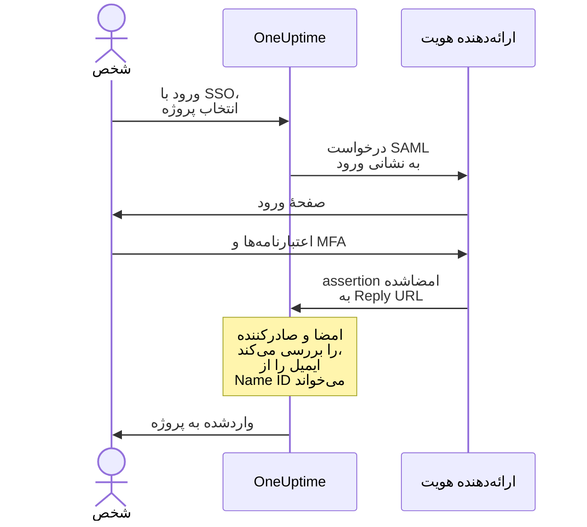

# SSO

ورود یکپارچه (SSO) به افراد پروژهٔ شما امکان می‌دهد با ارائه‌دهنده هویت (IdP) سازمانتان، از راه SAML 2.0 یا OpenID Connect، به OneUptime وارد شوند. دسترسی، گذرواژه‌ها و احراز هویت چندعاملی را در یک جا مدیریت می‌کنید و می‌توانید SSO را برای همهٔ افراد پروژه الزامی کنید.

> [!NOTE]
> **نسخه:** SSO، از جمله «Require SSO to sign in»، بخشی از همهٔ نسخه‌های OneUptime است: نصب‌های خودمیزبان آن را در Community Edition دارند و به پروانه نیازی نیست. در OneUptime Cloud از طرح **Scale** به بالا در دسترس است. برای اینکه ببینید هر نسخه چه چیزهایی دارد، [نسخه سازمانی](/docs/self-hosted/enterprise) را ببینید.

:::cards
- [برپا کردن یک ارائه‌دهنده SAML](#برپا-کردن-sso): آن را در OneUptime بسازید و دو نشانی به IdP خود بدهید.
- [راهنمای ارائه‌دهندگان هویت](#راهنمای-ارائهدهندگان-هویت): Keycloak، Microsoft Entra ID و Okta، گام به گام.
- [OpenID Connect](#openid-connect-oidc): به‌جای آن با یک برنامه OIDC وارد شوید.
- [الزامی کردن SSO](#الزامی-کردن-sso-برای-پروژهٔ-شما): SSO را تنها راه ورود به پروژه کنید.
:::

## ورود با SAML چگونه کار می‌کند

یک ارائه‌دهنده SAML یک پروژه را به یک برنامه در ارائه‌دهنده هویت شما وصل می‌کند. کسی که وارد می‌شود، پروژه را در صفحهٔ **ورود با SSO** در OneUptime انتخاب می‌کند، در IdP شما وارد می‌شود و واردشده بازمی‌گردد.



OneUptime فقط چند چیز را از assertionی که IdP شما می‌فرستد می‌خواند:

| از assertion | OneUptime با آن چه می‌کند |
| --- | --- |
| امضا | آن را با **گواهی عمومی** ارائه‌دهنده بررسی می‌کند. پاسخ باید امضا شده باشد و نباید رمزنگاری شده باشد. |
| Issuer | باید دقیقاً با **صادرکننده** ارائه‌دهنده یکی باشد. |
| Audience | باید **شناسه (Entity ID)** ارائه‌دهنده باشد. پاسخی که IdP شما برای برنامه‌ای دیگر ساخته است رد می‌شود. |
| Recipient و Destination | باید **نشانی پاسخ** ارائه‌دهنده باشند، یعنی نشانی‌ای که پاسخ به آن فرستاده شده است. |
| `NotBefore` و `NotOnOrAfter` | پاسخ فقط تا وقتی پذیرفته می‌شود که این دو اجازه دهند، و حداکثر تا ۱۰ دقیقه پس از صدورش، با ۳ دقیقه رواداری برای ساعت‌هایی که با هم یکسان نیستند. |
| Name ID | نشانی ایمیل شخص. باید یک نشانی ایمیل معتبر باشد. |
| ویژگی‌های نام | نام شخص، که OneUptime هنگام ساختن حساب او به کار می‌برد: یک نام نمایشی (`displayName`، یا `http://schemas.microsoft.com/identity/claims/displayname`)، یا نام و نام خانوادگی (`firstName` و `lastName`، یا claimهای `givenname` و `surname` که Microsoft Entra ID به‌طور پیش‌فرض می‌فرستد). اختیاری. |
| `http://schemas.microsoft.com/identity/claims/objectidentifier` | شناسهٔ شیء (object ID) شخص، که Microsoft Entra ID به‌طور پیش‌فرض می‌فرستد. نخستین ورود از راه این ارائه‌دهنده حساب را به آن پیوند می‌دهد، و ورود بعدی‌ای که نشانی ایمیل همان حساب را با شناسهٔ شیء دیگری بیاورد رد می‌شود. اختیاری. |

هر پاسخ فقط یک بار کسی را وارد می‌کند. اگر دوباره فرستاده شود، مثلاً با برگشتن در مرورگر پس از ورود، رد می‌شود: دوباره وارد شوید.

کسانی که برای نخستین بار وارد می‌شوند به **تیم‌ها**ی ارائه‌دهنده می‌پیوندند، و همین تیم‌ها تعیین می‌کنند که چه کاری می‌توانند بکنند: [نقش‌ها و تیم‌ها برای کاربران SSO](#نقشها-و-تیمها-برای-کاربران-sso) را ببینید.

> [!NOTE]
> در OneUptime Cloud، نخستین باری که کسی با یکی از ارائه‌دهندگان SAML یا OIDC پروژه به آن پروژه وارد می‌شود، OneUptime به‌جای وارد کردن او، پیوندی برایش ایمیل می‌کند. او پیوند را باز می‌کند، تأیید می‌کند که ورود یکپارچهٔ پروژه می‌تواند او را وارد کند، و ورود را ادامه می‌دهد. پیوند ۲۴ ساعت کار می‌کند. این کار برای هر پروژه یک بار انجام می‌شود، و اگر پروژه را ترک کند و برگردد، دوباره انجام می‌شود. کسی که دعوتش می‌کنید و ورودش با SSO مدیریت می‌شود، چنین ایمیلی نمی‌گیرد، چه از قبل حساب OneUptime داشته باشد چه نه: اگر در صفحه‌ای که دعوتش باز می‌کند یکی از ارائه‌دهندگان پروژه را برگزیند، بی‌درنگ وارد می‌شود، چون پیوند دعوتش پیش‌تر نشان داده است که صندوق پستی از آنِ اوست. نصب‌های خودمیزبان افراد را بی‌درنگ وارد می‌کنند. در OneUptime Cloud، هر ورودی که مستقیم انجام نشود همین پاسخ را می‌گیرد، چه نشانی حساب داشته باشد چه نه: کسی که هنوز حساب ندارد هم همین ایمیل را می‌گیرد و حسابش هنگام تأیید ساخته می‌شود، اما حساب مسدودشده یا مدیر OneUptime ایمیلی نمی‌گیرد. نصب خودمیزبان در عوض این دو را با یک پیام رد می‌کند.

در OneUptime Cloud، کسی که از راه SSO به پروژه می‌پیوندد، درست مانند کسی که دعوتش می‌کنید، یک صندلی را می‌گیرد. اگر طرح شما شمار ثابتی صندلی دارد و همهٔ آن‌ها پر شده‌اند، افراد تازه تا خالی شدن یک صندلی نمی‌توانند از راه SSO بپیوندند.

## برپا کردن SSO

به دسترسی افزودن ارائه‌دهندگان SSO نیاز دارید — **مالک پروژه**، **مدیر پروژه** یا **Create Project SSO** — و در OneUptime Cloud به طرح **Scale**. برای سمت ارائه‌دهنده هویت خود، [راهنمای ارائه‌دهندگان هویت](#راهنمای-ارائهدهندگان-هویت) را ببینید.

:::steps
1. **رفتن به تنظیمات پروژه**

   - به پروژه OneUptime خود بروید
   - به **تنظیمات پروژه** > **امنیت** > **SSO** بروید

2. **ساخت پیکربندی SSO**

   - روی **افزودن ارائه‌دهنده SAML** کلیک کنید
   - یک **نام** برای پیکربندی SSO وارد کنید (برای نمونه «Keycloak SAML» یا «Okta SAML»)
   - **نشانی ورود** را از ارائه‌دهنده هویت خود وارد کنید
   - **صادرکننده** (Entity ID) را از ارائه‌دهنده هویت خود وارد کنید
   - **گواهی عمومی** را از ارائه‌دهنده هویت خود بچسبانید
   - در گام **ورود**، **تیم‌ها** با تیم اعضای پروژه شما آغاز می‌شود: کسانی که برای نخستین بار وارد می‌شوند به این تیم‌ها می‌پیوندند. فقط تیم‌هایی پذیرفته می‌شوند که خودتان بتوانید کسی را به آن‌ها دعوت کنید: تیمی که دسترسی بیشتری از دسترسی شما می‌دهد، زیر **تیم‌ها** نام برده می‌شود
   - بقیه در **فیلدهای بیشتر** از پیش پر شده‌اند: **روش امضا** (`RSA-SHA256`)، **روش خلاصه‌سازی** (`SHA256`) و یک توضیح («Sign in with» و نام). فقط اگر ارائه‌دهنده هویت شما لازم دارد آن‌ها را تغییر دهید

3. **گرفتن فراداده SSO از OneUptime**
   - ذخیره کردن، پنجرهٔ **پیکربندی SSO** را باز می‌کند. می‌توانید آن را دوباره با دکمهٔ **مشاهده پیکربندی SSO** باز کنید
   - **شناسه (Entity ID)** را کپی کنید، مانند `https://oneuptime.com/<project-id>/<provider-id>` — در پیکربندی IdP شما لازم است
   - **نشانی پاسخ (نشانی سرویس مصرف‌کنندهٔ ادعا)** را کپی کنید، مانند `https://oneuptime.com/identity/idp-login/<project-id>/<provider-id>` — در پیکربندی IdP شما لازم است
   - ارائه‌دهندهٔ تازه خاموش آغاز می‌شود. وقتی IdP شما این دو مقدار را داشت، ارائه‌دهنده را ویرایش کنید و **فعال** را روشن کنید

4. **آزمودن ارائه‌دهنده**
   - پیوند کارت **پیوند ورود با SSO** را باز کنید و در صفحه‌ای که باز می‌شود ارائه‌دهنده را انتخاب کنید. به صفحهٔ ورود ارائه‌دهنده هویت خود فرستاده می‌شوید و سپس واردشده به OneUptime برمی‌گردید
   - وقتی کار کرد، می‌توانید SSO را برای پروژه [الزامی کنید](#الزامی-کردن-sso-برای-پروژهٔ-شما)
:::

## راهنمای ارائه‌دهندگان هویت

ارائه‌دهنده هویت خود را انتخاب کنید. هر راهنما مقدارهای IdP را می‌گیرد، ارائه‌دهنده را در OneUptime می‌سازد و سپس **شناسه (Entity ID)** و **نشانی پاسخ** را از OneUptime به IdP می‌دهد.

:::tabs
@tab Keycloak
Keycloak یک راه‌حل متن‌باز و پرطرفدار برای مدیریت هویت و دسترسی است. به یک نمونهٔ در حال اجرای Keycloak با یک realm، و دسترسی مدیر به Keycloak و OneUptime هر دو نیاز دارید.

:::steps
1. **گردآوری مقدارهای realm**

   - **نشانی ورود**: `https://<your-keycloak-domain>/auth/realms/<your-realm>/protocol/saml`
   - **صادرکننده**: `https://<your-keycloak-domain>/auth/realms/<your-realm>`
   - **گواهی**: گواهی امضای realm. `https://<your-keycloak-domain>/auth/realms/<your-realm>/protocol/saml/descriptor` را باز کنید و مقدار `X509Certificate` را کپی کنید، یا **Realm settings** > **Keys** را باز کنید و روی **Certificate** کلید RS256 کلیک کنید

   Keycloak ۱۷ و نسخه‌های بعدی این نشانی‌ها را بدون پیشوند `/auth` ارائه می‌کنند. گواهی را میان خط‌های خودش بگذارید، این‌گونه:

   ```text
   -----BEGIN CERTIFICATE-----
   MIICnzCCAYcCBgFyPZ8QFzANBgkqhkiG.......
   -----END CERTIFICATE-----
   ```

2. **ساخت ارائه‌دهنده در OneUptime**

   به **تنظیمات پروژه** > **امنیت** > **SSO** بروید، روی **افزودن ارائه‌دهنده SAML** کلیک کنید و این‌ها را پر کنید:
   - **نام**: یک نام توصیفی (برای نمونه `my-project-oneuptime`)
   - **نشانی ورود** و **صادرکننده**: مقدارهای بالا
   - **گواهی عمومی**: گواهی، میان خط‌های `BEGIN CERTIFICATE` و `END CERTIFICATE` خودش
   - **روش امضا** و **روش خلاصه‌سازی**: از پیش در **فیلدهای بیشتر** تنظیم شده‌اند (`RSA-SHA256` و `SHA256`)

   ذخیره کنید و **شناسه (Entity ID)** و **نشانی پاسخ (نشانی سرویس مصرف‌کنندهٔ ادعا)** را از پنجره‌ای که باز می‌شود کپی کنید.

3. **ساخت کلاینت Keycloak**

   در Keycloak، **Clients** را در realm خود باز کنید و یک کلاینت بسازید یا کلاینتی موجود را ویرایش کنید:
   - **Client Protocol** (نوع کلاینت): `saml`
   - **Client ID**: **شناسه (Entity ID)** از OneUptime
   - **Root URL** و **Valid Redirect URIs**: نشانی OneUptime شما
   - **Assertion Consumer Service POST Binding URL**: **نشانی پاسخ (نشانی سرویس مصرف‌کنندهٔ ادعا)** از OneUptime

4. **تنظیم کلاینت**

   - **Name ID Format** را روی `email` بگذارید و **Force Name ID Format** را روشن کنید، تا Keycloak همیشه ایمیل را به‌عنوان Name ID بفرستد
   - در زبانهٔ **Keys** کلاینت، **Client signature required** (در **Signing keys config**) را خاموش کنید: OneUptime درخواست‌های ورودش را امضا نمی‌کند

5. **روشن کردن و آزمودن ارائه‌دهنده**

   در OneUptime ارائه‌دهنده را ویرایش کنید و **فعال** را روشن کنید، سپس پیوند کارت **پیوند ورود با SSO** را باز کنید و ارائه‌دهنده را انتخاب کنید. باید به صفحهٔ ورود Keycloak و سپس دوباره به OneUptime فرستاده شوید.
:::
@tab Microsoft Entra ID
Microsoft Entra ID (پیش‌تر Azure AD / Active Directory) سرویس هویت ابری Microsoft است. به یک tenant نیاز دارید که از برنامه‌های سازمانی با SAML SSO پشتیبانی کند، و دسترسی مدیر به Entra ID و OneUptime هر دو. در OneUptime Cloud، اگر OneUptime در گالری برنامه‌های Microsoft Entra فهرست شده است، آن را از همان‌جا بیفزایید: این برنامه claimهایی را که OneUptime می‌خواند و الگوی نشانی‌های OneUptime را از پیش دارد.

:::steps
1. **ساخت یک برنامهٔ سازمانی در Entra ID**

   - به [Microsoft Entra admin center](https://entra.microsoft.com) وارد شوید
   - به **Identity** > **Applications** > **Enterprise applications** بروید و روی **+ New application** کلیک کنید
   - از گالری: OneUptime را جست‌وجو کنید، آن را انتخاب کنید و روی **Create** کلیک کنید
   - در غیر این صورت: روی **+ Create your own application** کلیک کنید، یک نام وارد کنید (برای نمونه «OneUptime»)، **Integrate any other application you don't find in the gallery (Non-gallery)** را انتخاب کنید و روی **Create** کلیک کنید

2. **کپی کردن مقدارهای SAML از Entra ID**

   - در برنامه به **Single sign-on** بروید و **SAML** را انتخاب کنید
   - در **SAML Certificates**، **Certificate (Base64)** را دانلود کنید، فایل را در یک ویرایشگر متن باز کنید و محتوایش را کپی کنید
   - در **Set up OneUptime**، **Login URL** و **Microsoft Entra Identifier** (در tenantهای قدیمی‌تر **Azure AD Identifier**) را کپی کنید

3. **ساخت ارائه‌دهنده در OneUptime**

   به **تنظیمات پروژه** > **امنیت** > **SSO** بروید، روی **افزودن ارائه‌دهنده SAML** کلیک کنید و این‌ها را پر کنید:
   - **نام**: یک نام توصیفی (برای نمونه `Azure AD SAML`)
   - **نشانی ورود**: **Login URL**
   - **صادرکننده**: **Microsoft Entra Identifier**
   - **گواهی عمومی**: گواهی Base64، همراه با خط‌های `BEGIN CERTIFICATE` و `END CERTIFICATE`
   - **روش امضا** و **روش خلاصه‌سازی**: از پیش در **فیلدهای بیشتر** تنظیم شده‌اند (`RSA-SHA256` و `SHA256`)

   ذخیره کنید و **شناسه (Entity ID)** و **نشانی پاسخ (نشانی سرویس مصرف‌کنندهٔ ادعا)** را از پنجره‌ای که باز می‌شود کپی کنید.

4. **دادن نشانی‌های OneUptime به Entra ID**

   در **Basic SAML Configuration** روی **Edit** کلیک کنید و این‌ها را تنظیم کنید:
   - **Identifier (Entity ID)**: **شناسه (Entity ID)** از OneUptime
   - **Reply URL (Assertion Consumer Service URL)**: **نشانی پاسخ** از OneUptime

   روی **Save** کلیک کنید.

5. **فرستادن ایمیل به‌عنوان Name ID**

   در **Attributes & Claims** روی **Edit** کلیک کنید. برنامهٔ گالری این‌ها را از پیش تنظیم کرده است: بررسی‌شان کنید.
   - **Unique User Identifier (Name ID)** را روی نشانی ایمیل کاربر بگذارید: `user.mail`، یا `user.userprincipalname` در جایی که همان نشانی ایمیل است
   - **Name identifier format** را روی `Email address` بگذارید
   - claimهای پیش‌فرض Entra ID را نگه دارید: حساب‌های تازه نام شخص را از `givenname` و `surname` می‌گیرند، و حساب به شناسهٔ شیء شخص، یعنی `objectidentifier`، پیوند داده می‌شود. اگر خواستید، یک claim با نام `http://schemas.microsoft.com/identity/claims/displayname` و ویژگی منبع `user.displayname` بیفزایید تا حساب‌های تازه به‌جای آن با نام نمایشی نام‌گذاری شوند. OneUptime دیگر claimها را نادیده می‌گیرد

6. **واگذاری کاربران و گروه‌ها**

   در **Users and groups** برنامه روی **+ Add user/group** کلیک کنید، کاربران و گروه‌هایی را که باید دسترسی SSO بگیرند انتخاب کنید و روی **Assign** کلیک کنید.

7. **روشن کردن و آزمودن ارائه‌دهنده**

   در OneUptime ارائه‌دهنده را ویرایش کنید و **فعال** را روشن کنید، سپس پیوند کارت **پیوند ورود با SSO** را باز کنید و ارائه‌دهنده را انتخاب کنید. باید به صفحهٔ ورود Microsoft و سپس دوباره به OneUptime فرستاده شوید.
:::
@tab Okta
Okta یک بستر هویت پرکاربرد با SAML SSO است. به یک سازمان Okta با دسترسی مدیر، و دسترسی مدیر به OneUptime نیاز دارید. در OneUptime Cloud، اگر OneUptime در Okta Integration Network فهرست شده است، آن را از همان‌جا بیفزایید: این برنامه افراد را از صفحهٔ **ورود با SSO** در OneUptime و از داشبورد Okta خودشان وارد می‌کند، در نخستین ورود برایشان حساب می‌سازد، و به‌جای نشانی‌های OneUptime دو شناسه می‌خواهد.

:::steps
1. **افزودن OneUptime به Okta**

   - در Okta Admin Console به **Applications** > **Applications** بروید
   - از Okta Integration Network: روی **Browse App Catalog** کلیک کنید، OneUptime را جست‌وجو کنید و روی **Add Integration** کلیک کنید. Okta پیش از آنکه OneUptime بتواند **OneUptime Project ID** و **OneUptime SSO Provider ID** را نشان دهد، آن‌ها را می‌خواهد: فعلاً در هر دو `0` وارد کنید؛ در گام ۴ جایگزینشان می‌کنید. روی **Done** کلیک کنید و با گام ۲ ادامه دهید
   - در غیر این صورت، روی **Create App Integration** کلیک کنید، **SAML 2.0** را انتخاب کنید و روی **Next** کلیک کنید، «OneUptime» را به‌عنوان **App name** وارد کنید و روی **Next** کلیک کنید
   - Okta پیش از نشان دادن نشانی‌های خودش، نشانی‌های OneUptime را می‌خواهد. فعلاً نشانی OneUptime خود (برای نمونه `https://oneuptime.com`) را به‌عنوان **Single sign-on URL** و **Audience URI (SP Entity ID)** وارد کنید: هر دو را در گام ۴ جایگزین می‌کنید
   - **Name ID format** را روی `EmailAddress` و **Application username** را روی `Email` بگذارید
   - روی **Next** کلیک کنید، **I'm an Okta customer adding an internal app** را انتخاب کنید و روی **Finish** کلیک کنید

2. **کپی کردن مقدارهای SAML از Okta**

   در زبانهٔ **Sign On** برنامه، در **SAML Signing Certificates**، گواهی فعال را پیدا کنید:
   - روی **Actions** > **View IdP metadata** کلیک کنید و **نشانی ورود** (Identity Provider Single Sign-On URL) و **صادرکننده** (Identity Provider Issuer) را کپی کنید
   - روی **Actions** > **Download certificate** کلیک کنید، فایل `.cert` را در یک ویرایشگر متن باز کنید و محتوایش را کپی کنید

3. **ساخت ارائه‌دهنده در OneUptime**

   به **تنظیمات پروژه** > **امنیت** > **SSO** بروید، روی **افزودن ارائه‌دهنده SAML** کلیک کنید و این‌ها را پر کنید:
   - **نام**: یک نام توصیفی (برای نمونه `Okta SAML`)
   - **نشانی ورود** و **صادرکننده**: مقدارهای Okta
   - **گواهی عمومی**: گواهی، همراه با خط‌های `BEGIN CERTIFICATE` و `END CERTIFICATE`
   - **روش امضا** و **روش خلاصه‌سازی**: از پیش در **فیلدهای بیشتر** تنظیم شده‌اند (`RSA-SHA256` و `SHA256`)

   ذخیره کنید و **شناسه (Entity ID)** و **نشانی پاسخ (نشانی سرویس مصرف‌کنندهٔ ادعا)** را از پنجره‌ای که باز می‌شود کپی کنید.

4. **دادن نشانی‌های OneUptime به Okta**

   برای برنامه‌ای که از Okta Integration Network افزوده‌اید، در زبانهٔ **General**، در **App Settings** روی **Edit** کلیک کنید و این را تنظیم کنید:
   - **OneUptime Project ID** و **OneUptime SSO Provider ID**: دو شناسه‌ای که در **شناسه (Entity ID)** از OneUptime آمده‌اند، `https://oneuptime.com/<project-id>/<provider-id>`

   روی **Save** کلیک کنید و بررسی کنید که در زبانهٔ **Sign On**، مقدار **Application username format** برابر `Email` باشد.

   برای برنامهٔ خودتان، در زبانهٔ **General**، در **SAML Settings** روی **Edit** و سپس **Next** کلیک کنید و این‌ها را تنظیم کنید:
   - **Single sign-on URL**: **نشانی پاسخ (نشانی سرویس مصرف‌کنندهٔ ادعا)** از OneUptime
   - **Audience URI (SP Entity ID)**: **شناسه (Entity ID)** از OneUptime

   اگر خواستید، attribute statementهای `firstName` با مقدار `user.firstName` و `lastName` با مقدار `user.lastName` را بیفزایید تا حساب‌های تازه نام شخص را بگیرند. روی **Next** و سپس **Finish** کلیک کنید.

5. **واگذاری افراد**

   در زبانهٔ **Assignments** روی **Assign** > **Assign to People** یا **Assign to Groups** کلیک کنید، کسانی را که باید دسترسی SSO بگیرند انتخاب کنید، برای هر کدام روی **Assign** و سپس روی **Done** کلیک کنید.

6. **روشن کردن و آزمودن ارائه‌دهنده**

   در OneUptime ارائه‌دهنده را ویرایش کنید و **فعال** را روشن کنید، سپس پیوند کارت **پیوند ورود با SSO** را باز کنید و ارائه‌دهنده را انتخاب کنید. باید به صفحهٔ ورود Okta و سپس دوباره به OneUptime فرستاده شوید.
:::
@tab دیگر
SSO در OneUptime از SAML 2.0 استفاده می‌کند و با هر ارائه‌دهنده هویت سازگاری کار می‌کند:

:::steps
1. **نشانی ورود** (نقطه پایانی SSO آن)، **صادرکننده** (Entity ID آن) و **گواهی عمومی** (گواهی امضای X.509 آن) را از ارائه‌دهنده هویت خود بگیرید. اگر IdP شما آن‌ها را فقط پس از ساختن یک برنامه نشان می‌دهد، برنامه را با نشانی OneUptime خود به‌عنوان نشانی‌های موقت بسازید.
2. در OneUptime ارائه‌دهنده را با این مقدارها بسازید و **شناسه (Entity ID)** و **نشانی پاسخ (نشانی سرویس مصرف‌کنندهٔ ادعا)** را از پنجرهٔ **پیکربندی SSO** (یا **مشاهده پیکربندی SSO**) کپی کنید.
3. در برنامهٔ SAML ارائه‌دهنده هویت خود، **Assertion Consumer Service URL / Reply URL** و **Entity ID / Audience URI** را روی مقدارهای OneUptime، و **Name ID Format** را روی نشانی ایمیل بگذارید.
4. **روش امضا** (`RSA-SHA256`) و **روش خلاصه‌سازی** (`SHA256`) از پیش در **فیلدهای بیشتر** تنظیم شده‌اند؛ فقط اگر ارائه‌دهنده هویت شما به شکل دیگری امضا می‌کند آن‌ها را تغییر دهید
5. **فعال** را برای ارائه‌دهنده روشن کنید و آن را با پیوند کارت **پیوند ورود با SSO** بیازمایید.
:::
:::

## OpenID Connect (OIDC)

یک پروژه می‌تواند از راه یک ارائه‌دهنده OpenID Connect هم وارد شود، مانند Google Workspace، Okta، Microsoft Entra ID، Auth0 یا Keycloak. به دسترسی افزودن ارائه‌دهندگان OIDC (**مالک پروژه**، **مدیر پروژه** یا **Create Project OIDC**) و در OneUptime Cloud به طرح **Scale** نیاز دارید.

:::steps
1. نزد ارائه‌دهنده هویت خود یک برنامه (یک کلاینت OIDC) ثبت کنید که بتواند از جریان authorization code با PKCE استفاده کند، و **نشانی صادرکننده**، **شناسه کلاینت** و **کلید محرمانه کلاینت** آن را کپی کنید.
2. در OneUptime به **تنظیمات پروژه** > **امنیت** > **SSO** بروید و زیر ارائه‌دهندگان SAML روی **افزودن ارائه‌دهنده OIDC** کلیک کنید.
3. یک **نام** (آنچه افراد در صفحهٔ ورود می‌بینند)، **نشانی صادرکننده**، **شناسه کلاینت** و **کلید محرمانه کلاینت** را وارد کنید. می‌توانید به‌جای آن نشانی کشف ارائه‌دهنده را در **نشانی صادرکننده** بچسبانید.
4. در گام **ورود**، **تیم‌ها** با تیم اعضای پروژه شما آغاز می‌شود: کسانی که برای نخستین بار وارد می‌شوند به این تیم‌ها می‌پیوندند. بقیه در **فیلدهای بیشتر** از پیش پر شده‌اند: **نشانی کشف** (صادرکننده و پس از آن `/.well-known/openid-configuration`)، **دامنه‌ها** (`openid email profile`)، نام‌های claim یعنی `email` و `name`، و یک توضیح («Sign in with» و نام). فقط اگر ارائه‌دهنده شما لازم دارد آن‌ها را تغییر دهید. فقط تیم‌هایی پذیرفته می‌شوند که خودتان بتوانید کسی را به آن‌ها دعوت کنید: تیمی که دسترسی بیشتری از دسترسی شما می‌دهد، زیر **تیم‌ها** نام برده می‌شود.
5. ذخیره کنید. پنجرهٔ **پیکربندی OIDC** با **URI بازگشت** باز می‌شود: آن را به نشانی‌های بازگشت مجاز برنامهٔ خود بیفزایید. ارائه‌دهندهٔ تازه خاموش آغاز می‌شود، پس سپس آن را ویرایش کنید و **فعال** را روشن کنید.
6. پیش از الزامی کردن SSO برای پروژه، پیوند کارت **پیوند ورود با SSO** را باز کنید و ارائه‌دهنده را برگزینید تا از راه آن وارد شوید.
:::

## خروج از ارائه‌دهندهٔ هویت هم

خروج از OneUptime فرد را در ارائه‌دهندهٔ هویت وارد شده باقی می‌گذارد، پس در یک رایانهٔ مشترک، مانند صفحهٔ NOC یا یک کیوسک، نفر بعدی که در صفحهٔ ورود ارائه‌دهنده را انتخاب کند، به‌جای کسی که رفته وارد می‌شود. در یک ارائه‌دهندهٔ SAML یا OIDC، **از ارائه‌دهندهٔ هویت هم خارج شود** را در **فیلدهای بیشتر** روشن کنید تا خروج از OneUptime نشست ارائه‌دهنده را هم پایان دهد. به‌طور پیش‌فرض خاموش است: در یک لپ‌تاپ شخصی، فرد را از هر برنامهٔ دیگری که از ارائه‌دهنده استفاده می‌کند هم خارج می‌کرد. برای کسانی اعمال می‌شود که پس از روشن شدن آن در مرورگر وارد می‌شوند؛ برنامهٔ همراه فقط از OneUptime خارج می‌شود.

:::tabs
@tab SAML
نشانی خروج ارائه‌دهندهٔ هویت خود را در **فیلدهای بیشتر** به‌عنوان **نشانی خروج** ارائه‌دهنده وارد کنید: بدون آن نمی‌توان کلید را روشن کرد. سپس **نشانی خروج یکپارچه (Single Logout)** را از گفت‌وگوی **پیکربندی SSO**، و گواهی‌ای را که OneUptime درخواست‌های خروجش را با آن امضا می‌کند، از **دانلود گواهی امضا** در همان گفت‌وگو، به ارائه‌دهندهٔ هویت بدهید.

| ارائه‌دهندهٔ هویت | نشانی خروج | نشانی خروج یکپارچه و گواهی کجا می‌روند |
| --- | --- | --- |
| Okta | **Identity Provider Single Logout URL**، در **View SAML setup instructions** در زبانهٔ **Sign On** | در زبانهٔ **General**، **SAML Settings** را ویرایش کنید، روی **Show Advanced Settings** کلیک کنید و **Allow application to initiate Single Logout** را انتخاب کنید. **Single Logout URL** را روی نشانی خروج یکپارچه و **SP Issuer** را روی شناسه (Entity ID) بگذارید و گواهی را به‌عنوان **Signature Certificate** بارگذاری کنید. |
| Microsoft Entra ID | **Logout URL**، در **Set up OneUptime** | در **Basic SAML Configuration**، **Logout Url (Optional)** را روی نشانی خروج یکپارچه بگذارید. Entra ID به گواهی نیازی ندارد. |
| Keycloak | نقطهٔ پایانی SAML قلمرو، همان نشانی ورود | در زبانهٔ **Advanced** کلاینت، **Logout Service Redirect Binding URL** را روی نشانی خروج یکپارچه بگذارید. **Front channel logout** را روشن نگه دارید. تا وقتی **Client signature required** خاموش است، همان‌طور که بالاتر تنظیم شد، Keycloak به گواهی نیازی ندارد. |

پس از خروج در آنجا، ارائه‌دهندهٔ هویت مرورگر را به نشانی خروج یکپارچه برمی‌گرداند که صفحهٔ ورود را باز می‌کند، یا می‌گوید ارائه‌دهندهٔ هویت خروج را تأیید نکرد. وقتی فرد در ارائه‌دهندهٔ هویت، یا از برنامهٔ دیگری که از آن استفاده می‌کند، خارج شود، ارائه‌دهندهٔ هویتی که مانند Keycloak و Microsoft Entra ID به برنامه‌هایش درخواست خروج می‌فرستد، او را از OneUptime هم خارج می‌کند. OneUptime فقط درخواستی را می‌پذیرد که ارائه‌دهندهٔ هویت امضا کرده باشد.
@tab OpenID Connect
پس از آنکه OneUptime مرورگر را خارج کرد، مرورگر به صفحهٔ خروج خود ارائه‌دهنده می‌رود و ارائه‌دهنده آن را به صفحهٔ ورود OneUptime برمی‌گرداند. آن صفحه را نزد ارائه‌دهندهٔ خود ثبت کنید: گفت‌وگوی **پیکربندی OIDC** آن را به‌عنوان URI هدایت پس از خروج نشان می‌دهد که ارائه‌دهنده‌ها به آن post-logout redirect URI می‌گویند. ارائه‌دهنده‌ای که سند کشف آن هیچ `end_session_endpoint` نام نمی‌برد، مانند Google، نمی‌تواند آن را روشن کند.

| ارائه‌دهندهٔ هویت | URI هدایت پس از خروج را کجا ثبت کنیم |
| --- | --- |
| Okta | در زبانهٔ **General** یکپارچه‌سازی برنامه، در **General Settings** روی **Edit** کلیک کنید و آن را به **Sign-out redirect URIs** بیفزایید. |
| Microsoft Entra ID | در **Authentication** ثبت برنامه، آن را به **Redirect URIs** بستر **Web** بیفزایید. **Front-channel logout URL** تنظیم دیگری است که OneUptime از آن استفاده نمی‌کند. |
| Auth0 | در **Settings** برنامه، آن را به **Allowed Logout URLs** بیفزایید. مستأجری که پیش از ۱۴ نوامبر ۲۰۲۳ ساخته شده، باید **RP-Initiated Logout End Session Endpoint Discovery** را هم در تنظیمات **Advanced** خود روشن کند تا سند کشفش یک `end_session_endpoint` نام ببرد. |
| Keycloak | در تنظیمات کلاینت، آن را به **Valid post logout redirect URIs** بیفزایید (Keycloak ۱۹ و نسخه‌های بعدی). |

ارائه‌دهنده‌ای که آن را ثبت نکرده، پس از خروج کسی از OneUptime به‌جای برگرداندن او صفحهٔ خطای خودش را نشان می‌دهد؛ با این حال او از OneUptime خارج شده است.
:::

## ورود دوباره برای تأیید هویت

پیش از آنکه کسی شیوهٔ ورود خود را تغییر دهد یا حسابش را حذف کند، OneUptime از او می‌خواهد [تأیید کند که خودش است](/docs/introduction/your-account#تأیید-هویت). کسی که فقط از راه ارائه‌دهندهٔ هویت شما وارد می‌شود و در OneUptime رمز عبور یا کلید عبور ندارد، با **ورود دوباره** تأیید می‌کند: OneUptime او را نزد ارائه‌دهنده می‌فرستد و از ارائه‌دهنده می‌خواهد که دوباره از او بخواهد وارد شود. این فقط وقتی به حساب می‌آید که ارائه‌دهنده بگوید او در همان لحظه یا پس از آن وارد شده است، با یک دقیقه فاصلهٔ مجاز برای دو ساعت. ارائه‌دهنده‌ای که او را با نشستی که از قبل دارد بی‌درنگ دوباره وارد کند، یا نگوید چه زمانی وارد شده است، چیزی را تأیید نمی‌کند، و به او گفته می‌شود از شما بخواهد آن را تغییر دهید.

:::tabs
@tab SAML
OneUptime `ForceAuthn="true"` را می‌فرستد و زمان ورود آن شخص را از `AuthnInstant` در ادعانامه می‌خواند.

| ارائه‌دهندهٔ هویت | آنچه باید تنظیم کنید |
| --- | --- |
| Okta | در زبانهٔ **General**، **SAML Settings** را ویرایش کنید، روی **Show Advanced Settings** کلیک کنید و **Honor Force Authentication** را روی **Yes** بگذارید. اگر روی **No** باشد، Okta درخواست را نادیده می‌گیرد. OneUptime کنار یک ارائه‌دهندهٔ Okta این را یادآوری می‌کند. |
| Microsoft Entra ID | هیچ: Entra ID درخواست را رعایت می‌کند، و `AuthnInstant` آن زمان ورود آن شخص است. |
| Keycloak | هیچ: Keycloak درخواست را رعایت می‌کند، هرچند نسخهٔ 26.8.2 و پیش از آن ممکن است وقتی ورود در صفحهٔ ورود Keycloak از نو آغاز شود از آن بگذرند، که 26.8.3 و 27.0.0 آن را درست می‌کنند. `AuthnInstant` آن زمان پاسخ دادن آن است، نه زمان ورود آن شخص، پس OneUptime نمی‌تواند بررسی کند که Keycloak دوباره از او پرسیده است، و این را کنار ارائه‌دهنده می‌گوید. برای بررسی‌ای که خود OneUptime انجام دهد، Keycloak را از راه OpenID Connect وصل کنید. |
| Google Workspace | چیزی برای تنظیم نیست. Google نمی‌گوید آیا درخواست را رعایت می‌کند. `AuthnInstant` آن آخرین ورود آن شخص به Google است، پس کسی که هنوز در Google وارد است، اول از Google خارج می‌شود. |
@tab OpenID Connect
OneUptime `prompt=login` و `max_age=0` را می‌فرستد، و به Microsoft Entra ID فقط `prompt=login` را، و زمان ورود آن شخص را از `auth_time` در توکن شناسه می‌خواند.

| ارائه‌دهندهٔ هویت | آنچه باید تنظیم کنید |
| --- | --- |
| Okta | هیچ: Okta هر دو را رعایت می‌کند و همیشه `auth_time` را می‌فرستد. |
| Microsoft Entra ID | در **Token configuration** ثبت برنامه، روی **Add optional claim** کلیک کنید، **ID** را انتخاب کنید و `auth_time` را بیفزایید: Entra ID آن را فقط به‌عنوان ادعای اختیاری می‌فرستد. `prompt=login` را رعایت می‌کند. OneUptime به آن `max_age` نمی‌فرستد، که Microsoft آن را مستند نکرده و گزارش شده است که باعث می‌شود Entra ID با توکن شناسه‌ای پاسخ دهد که از پیش منقضی شده است. |
| Keycloak | دامنهٔ کلاینت `basic` را روی کلاینت نگه دارید: `auth_time` را در خود دارد. Keycloak 25 و نسخه‌های بعدی این دامنه را به همهٔ کلاینت‌ها می‌دهند. |
| Google Workspace | **Session age claims** را برای کلاینت OAuth، در **Google Auth Platform** > **Settings** > **Advanced Settings**، روشن کنید؛ برنامه باید منتشرشده و تأییدشده باشد. Google هیچ‌یک از دو درخواست را نمی‌پذیرد، پس OneUptime به‌جای آن `auth_time` را از آن می‌خواهد، و کسی که هنوز در Google وارد است، اول از Google خارج می‌شود. |
:::

## نقش‌ها و تیم‌ها برای کاربران SSO

OneUptime نقش‌ها یا گروه‌های ارائه‌دهنده هویت شما را نگاشت نمی‌کند. اینکه کسی چه کاری می‌تواند بکند از تیم‌هایی می‌آید که در آن‌ها عضو است: یک ارائه‌دهنده تازه‌واردان را به **تیم‌ها**ی خود می‌افزاید، و شما تیم‌ها و دسترسی‌هایشان را در OneUptime مدیریت می‌کنید، همان‌طور که [کاربران، تیم‌ها و دسترسی‌ها](/docs/permissions/index) توضیح می‌دهد. برای اینکه عضویت تیم‌ها با ارائه‌دهنده هویت شما هماهنگ بماند، از [SCIM](/docs/identity/scim) استفاده کنید. هر تیمی که کسی هنگام ورود به آن می‌پیوندد، در صفحهٔ **گزارش‌های ممیزی** همان تیم به عنوان تغییرِ کسی که وارد شد ثبت می‌شود.

تیم‌های یک ارائه‌دهنده تعیین می‌کنند کسانی که با آن وارد می‌شوند چه کاری می‌توانند بکنند، پس یک ارائه‌دهنده فقط با تیم‌هایی ذخیره می‌شود که ذخیره‌کننده بتواند کسی را به آن‌ها دعوت کند. هر ذخیره دوباره آن‌ها را بررسی می‌کند: ارائه‌دهنده‌ای که تیم‌هایش دسترسی بیشتری از دسترسی شما می‌دهند، فقط به دست کسی تغییر می‌کند که دسترسی‌اش آن‌ها را پوشش دهد، مانند مالک پروژه. ارائه‌دهندگانی که پیش از این بررسی ذخیره شده‌اند، همچنان افراد را به تیم‌هایشان وارد می‌کنند. هر کسی که بتواند یک ارائه‌دهنده را ویرایش کند، همچنان می‌تواند آن را خاموش کند، تا بتوان آن را بی‌درنگ متوقف کرد.

## دامنه‌ها

**ورود با SSO** نشانی ایمیلی می‌پرسد و ارائه‌دهندگانی را پیشنهاد می‌کند که دامنهٔ آن نشانی را پوشش می‌دهند. هیچ حسابی را نمی‌خواند: نشانی‌ای که در پروژهٔ شما حساب دارد و نشانی‌ای که اصلاً حساب ندارد پاسخ یکسانی می‌گیرند، پس این صفحه چیزی دربارهٔ اینکه چه کسی حساب دارد نمی‌گوید. برای اینکه ارائه‌دهنده آنجا پیشنهاد شود، دامنه‌هایی را که پوشش می‌دهد فهرست می‌کند:

1. دامنهٔ خود را در **تنظیمات پروژه** > **پیشرفته** > **دامنه‌ها** اضافه کنید، روی **تأیید دامنه** در ردیف آن کلیک کنید و رکورد TXT نشان‌داده‌شده را به DNS دامنه اضافه کنید. همین که رکورد پیدا شود، دامنه تأیید شده است.
2. ارائه‌دهنده را ویرایش کنید و در مرحلهٔ **ورود**، دامنه را زیر **دامنه‌ها** انتخاب کنید. فقط دامنه‌های تأییدشدهٔ پروژه فهرست می‌شوند.

سپس **ورود با SSO** ارائه‌دهنده را به هر نشانی در آن دامنه پیشنهاد می‌کند، هر کسی که آن را وارد کند. دامنه باید دقیقاً یکسان باشد: `acme.com` شامل `eu.acme.com` نمی‌شود، پس هر دامنه‌ای را که افراد با آن وارد می‌شوند اضافه کنید.

ارائه‌دهندگانی که پیش از آمدن دامنه‌ها راه‌اندازی شده بودند، هنگام ارتقای OneUptime دامنه‌های تأییدشدهٔ پروژهٔ خود را گرفتند: هر دامنه‌ای که پروژه تأیید کرده بود، مگر اینکه پروژهٔ دیگری هم آن را تأیید کرده بود. اگر چنین دامنه‌ای مال شماست، خودتان آن را انتخاب کنید. دامنه‌ای که اضافه شده ولی هرگز تأیید نشده، به هیچ ارائه‌دهنده‌ای داده نشد.

ارائه‌دهنده‌ای که هیچ دامنهٔ تأییدشده‌ای ندارد، آنجا به هیچ‌کس پیشنهاد نمی‌شود. ستون **دامنه‌ها** برای آن **بدون دامنهٔ تأییدشده** را نشان می‌دهد، و اعلانی بالای ارائه‌دهندگان شما نامش را می‌برد و می‌گوید چه باید کرد. تا وقتی پروژه هیچ دامنهٔ تأییدشده‌ای ندارد، **تأیید یک دامنه** در اعلان، **دامنه‌ها** را باز می‌کند.

کسی که ایمیلش روی دامنهٔ دیگری است، مثلاً یک پیمانکار، آنجا هم ارائه‌دهنده‌ای پیدا نمی‌کند. پیوند ورود با SSO پروژه‌تان را با او به اشتراک بگذارید: آن را از کارت **پیوند ورود با SSO** زیر ارائه‌دهندگانتان کپی کنید. این پیوند ارائه‌دهندگان پروژه را فهرست می‌کند و هیچ نشانی ایمیلی نمی‌پرسد، پس چیزی دربارهٔ اینکه چه کسی حساب دارد نمی‌گوید. ورودی که از ارائه‌دهندهٔ هویت شما آغاز شود هم، دامنه هر چه باشد، کار می‌کند.

## الزامی کردن SSO برای پروژهٔ شما

برپا کردن یک ارائه‌دهنده کسی را از ورود با گذرواژه باز نمی‌دارد. برای اینکه SSO تنها راه ورود به پروژه شود، از کلید **الزامی کردن SSO برای ورود** در **تنظیمات پروژه** > **امنیت** > **SSO**، زیر ارائه‌دهندگانتان، استفاده کنید:

:::steps
1. نخست ارائه‌دهنده خود را با پیوند کارت **پیوند ورود با SSO** بیازمایید.
2. **الزامی کردن SSO برای ورود** را روشن کنید. OneUptime پیش از ذخیرهٔ هر چیزی می‌پرسد: از آن پس همهٔ افراد پروژه، از جمله خود شما، برای باز کردن آن باید با SSO وارد شوند، و هر کسی که با گذرواژه وارد شده است تا وقتی با SSO وارد نشود از پروژه بیرون می‌ماند.
3. برای تأیید روی **الزامی کردن SSO** کلیک کنید. کلید بی‌درنگ ذخیره می‌شود؛ دکمهٔ ذخیرهٔ جداگانه‌ای وجود ندارد.
:::

روشن کردن **الزامی کردن SSO برای ورود** به ارائه‌دهنده‌ای نیاز دارد که افراد را به پروژه وارد کند: یکی از ارائه‌دهندگان SAML یا OIDC خود پروژه که روشن است، یا یک ارائه‌دهندهٔ سراسری روشن که افراد را به آن وارد می‌کند. بدون آن، OneUptime نمی‌پذیرد و می‌گوید نخست یک ارائه‌دهنده را برای پروژه روشن کنید و بیازمایید. اگر ارائه‌دهنده‌ای را انتخاب کنید که پروژه الزامی می‌کند، باید یکی از همین‌ها باشد، و وقتی بعداً ارائه‌دهندهٔ دیگری را الزامی کنید هم همین پرسیده می‌شود.

ذخیره‌ای که **الزامی کردن SSO برای ورود** را روشن می‌فرستد در حالی که از پیش روشن است، یا ارائه‌دهنده‌ای را نام می‌برد که پروژه از پیش الزامی کرده است، به همین شکل بررسی می‌شود — API، Terraform و ابزارهای دیگر اغلب در هر ذخیره همهٔ تنظیم‌ها را می‌فرستند. پس تا وقتی پروژه هیچ ارائه‌دهنده‌ای ندارد که افراد را وارد کند، یا ارائه‌دهندهٔ الزامی آن از آن پس خاموش شده است، چنین ذخیره‌ای با همان کلمات رد می‌شود، هر چیز دیگری هم که تغییر دهد: نخست یک ارائه‌دهنده را روشن کنید، ارائه‌دهندهٔ دیگری را الزامی کنید، یا **الزامی کردن SSO برای ورود** را خاموش کنید.

یک پروژهٔ تازه هم به همین قاعده پایبند است. هنوز ارائه‌دهنده‌ای از خودش ندارد، پس ساختن آن با **الزامی کردن SSO برای ورود** روشن — که فقط یک مدیر ارشد می‌تواند — به یک ارائه‌دهندهٔ سراسری روشن نیاز دارد که افراد را به همهٔ پروژه‌ها وارد کند، و بدون آن با همان کلمات رد می‌شود. پروژه را بسازید، ارائه‌دهنده‌اش را برپا کنید و بیازمایید، سپس کلید را روشن کنید.

تا وقتی کل سرور SSO را الزامی می‌کند (**Admin** > **تنظیمات** > **ورود یکپارچه** > **الزامی کردن SSO برای ورود**)، ساختن هر پروژه‌ای هم به چنین ارائه‌دهندهٔ سراسری‌ای نیاز دارد، وگرنه هیچ‌کس، از جمله سازنده‌اش، نمی‌توانست پروژه را باز کند. بدون آن، ساختن پروژه رد می‌شود و پیام از یک مدیر سرور می‌خواهد که یکی را روشن کند. مدیران ارشد همچنان می‌توانند پروژه بسازند.

خاموش کردن **الزامی کردن SSO برای ورود** به محض تغییر کلید ذخیره می‌شود و اعضا را بی‌درنگ با گذرواژه‌شان راه می‌دهد — مگر اینکه کسی درست در همان لحظه دوباره روشنش کند، که در آن صورت ممکن است تا یک دقیقه طول بکشد تا یک سرور برنامه همراه شود. مالکان پروژه، مدیران پروژه و اعضایی که دسترسی **Edit Project** دارند می‌توانند آن را تغییر دهند؛ بقیه کلید را قفل‌شده می‌بینند، همراه با دسترسی‌ای که لازم دارند.

> [!NOTE]
> در OneUptime Cloud، الزامی کردن SSO به طرح **Scale** نیاز دارد و خاموش کردن آن در هر طرحی کار می‌کند. زیر Scale، **تنظیمات پروژه** > **امنیت** > **SSO** پیشنهاد ارتقای طرح را نشان می‌دهد؛ پروژه‌ای که یک دورهٔ آزمایشی Scale آن را با SSO الزامی رها کرده است، **الزامی کردن SSO برای ورود** را هم همان‌جا، زیر پیشنهاد، می‌یابد تا بتوان آن را خاموش کرد. روشن کردن دوبارهٔ آن به **Scale** نیاز دارد.

### مدیریت ورود اعضای شما با SSO

الزامی کردن SSO داده‌های پروژهٔ شما را پشت ارائه‌دهندهٔ هویت شما نگه می‌دارد، اما اعضای شما همچنان می‌توانند در OneUptime گذرواژه، کلیدهای عبور و احراز هویت دومرحله‌ای تنظیم کنند، چیزی که پروژهٔ شما هرگز نمی‌خواهد. تا وقتی **الزامی کردن SSO برای ورود** روشن است، کلید دومی زیر آن، **مدیریت ورود با SSO**، جلوی این کار را می‌گیرد.

ورود یک فرد وقتی با SSO مدیریت می‌شود که هر پروژه‌ای که عضو آن است، از جمله هر پروژه‌ای که به آن دعوت شده است، SSO را الزامی کند و **مدیریت ورود با SSO** را روشن کرده باشد. آنگاه او نمی‌تواند گذرواژه، کلید عبور، کلید امنیتی، برنامهٔ احراز هویت، کدهای پشتیبان یا احراز هویت دومرحله‌ای تنظیم کند، **رمز عبور را فراموش کرده‌اید؟** پیوندی برایش ایمیل نمی‌کند، و **پروفایل کاربری** او به‌جای پیشنهاد این تنظیمات، ارائه‌دهندهٔ هویتش را نام می‌برد. در خود ورود چیزی تغییر نمی‌کند: گذرواژه‌اش همچنان او را به OneUptime وارد می‌کند، و پروژهٔ شما مانند قبل SSO می‌خواهد.

این قاعده هر بار بررسی می‌شود، پس:

- **کسی در پروژه‌ای که ورود را مدیریت نمی‌کند**: به محض اینکه عضو پروژه‌ای شود، یا به پروژه‌ای دعوت شود، که SSO را الزامی نمی‌کند یا **مدیریت ورود با SSO** را روشن نکرده است، تنظیماتش را پس می‌گیرد، و **پروفایل کاربری** او آن پروژه را به‌عنوان دلیل نام می‌برد. اگر آن را ترک کند، ورودش دوباره مدیریت می‌شود. یک حساب می‌تواند به سازمان‌های زیادی تعلق داشته باشد، پس یک سازمان هرگز برای پروژه‌های سازمانی دیگر تصمیم نمی‌گیرد.
- **پروژه‌هایی با ارائه‌دهندگان متفاوت**: کسی که در دو پروژه است که هر دو ورود را مدیریت می‌کنند، هر کدام با ارائه‌دهندهٔ هویت خود، مدیریت‌شده است، و پروفایلش هر دو ارائه‌دهنده را نام می‌برد.
- **مدیران ارشد** همیشه تنظیمات خود را نگه می‌دارند.
- **آنچه افراد پیش‌تر تنظیم کرده‌اند** نگه داشته می‌شود، بی‌آنکه پروژهٔ شما از آن استفاده کند، تا وقتی که پاک شود: به دست مالکان پروژهٔ شما (پایین‌تر را ببینید)، یا به دست یک مدیر سرور در صفحهٔ **احراز هویت** آن فرد در Admin Dashboard، با **پاک کردن تنظیمات ورود**.

**مدیریت ورود با SSO** به محض تغییر کلید ذخیره می‌شود، چیزی را حذف نمی‌کند، و خاموش کردنش تنظیمات همه را بی‌درنگ برمی‌گرداند. هر کسی که بتواند **الزامی کردن SSO برای ورود** را تغییر دهد می‌تواند آن را هم تغییر دهد، در همان طرح‌ها. وقتی **الزامی کردن SSO برای ورود** خاموش است، این کلید پنهان است و چیزی را تغییر نمی‌دهد.

### پاک کردن آنچه اعضای شما پیش‌تر ذخیره کرده‌اند

تا وقتی **مدیریت ورود با SSO** روشن است، مالکان پروژهٔ شما زیر آن می‌بینند که چند نفر از اعضای پروژه هنوز گذرواژه یا احراز هویت دومرحله‌ای ذخیره‌شده در OneUptime دارند. **پاک کردن تنظیمات ورود** پس از پرسیدن، گذرواژه‌های آنان را همراه با هر پیوند بازنشانی یا ورود، و کلیدهای عبور، کلیدهای امنیتی، برنامه‌های احراز هویت و کدهای پشتیبان آنان را حذف می‌کند، احراز هویت دومرحله‌ای را خاموش می‌کند و نشست‌هایی را که بدون SSO وارد شده‌اند پایان می‌دهد. این کار برگشت‌پذیر نیست.

یک حساب می‌تواند به سازمان‌های زیادی تعلق داشته باشد، پس فقط می‌توانید تنظیمات کسانی را پاک کنید که سازمان شما مسئول آنان است. سازمان شما همان پروژه‌هایی است که مالک آن‌ها هستید: تنظیمات یک فرد فقط وقتی پاک می‌شود که هر پروژه‌ای که عضو آن است، از جمله هر پروژه‌ای که به آن دعوت شده است، پروژه‌ای باشد که شما **مالک پروژه** آن هستید و **مدیریت ورود با SSO** را روشن کرده باشد. بقیه تنظیمات خود را نگه می‌دارند:

- کسی که عضو پروژه‌ای است، یا به پروژه‌ای دعوت شده است، که مالک آن نیستید یا ورود را با SSO مدیریت نمی‌کند؛
- کسی که فقط به پروژهٔ شما دعوت شده و هنوز به آن نپیوسته است؛
- مدیران ارشد، و خود شما: تنظیمات خودتان را در **پروفایل کاربری** خود تغییر دهید.

برای پاک کردن تنظیمات فقط یک نفر، **کاربران** را باز کنید: ردیف هر کسی که می‌توانید تنظیماتش را پاک کنید **تنظیمات ورود ذخیره‌شده** را نشان می‌دهد، و **پاک کردن تنظیمات ورود** در منوی آن ردیف، با همان قاعده و پس از پرسشی که آنچه حذف می‌شود را فهرست می‌کند، فقط تنظیمات همان نفر را پاک می‌کند.

برای هر فردی که تنظیماتش پاک شود ایمیلی فرستاده می‌شود که می‌گوید چه چیزهایی حذف شد و اینکه اکنون با SSO وارد می‌شود، و گزارش‌های ممیزی پروژه‌های شما این پاک‌سازی را به نام شما ثبت می‌کنند. فقط یک **مالک پروژه** می‌تواند پاک کند، آن هم وقتی به داشبورد وارد شده است: هرگز با کلید API. پاک کردن اول از شما می‌خواهد [تأیید کنید که خودتان هستید](/docs/introduction/your-account#تأیید-هویت).

## خاموش کردن یا حذف یک ارائه‌دهنده

| آنچه تغییر می‌دهید | کسانی که با این ارائه‌دهنده وارد شده‌اند |
| --- | --- |
| خاموش کردن یا حذف آن | در جایی که SSO الزامی است، در درخواست بعدی دوباره با SSO وارد می‌شوند |
| گواهی یا کلید محرمانه کلاینت تازه، نشانی‌های دیگر، نام تازه یا تیم‌های دیگر | وارد می‌مانند |
| روشن کردن آن | بی‌درنگ می‌توانند با آن وارد شوند |

خاموش کردن یا حذف یک ارائه‌دهنده SAML یا OIDC، ورودهایی را که داده است پایان می‌دهد. در پروژه‌ای که SSO را الزامی می‌کند، خودش یا چون کل سرور الزامی می‌کند:

- هر کسی که با آن وارد شده است باید در درخواست بعدی دوباره با SSO وارد شود، و صفحه‌هایی که باز دارند بی‌درنگ دیگر به‌روزرسانی زنده نمی‌گیرند.
- کلاینت MCPی که کسی پس از ورود با آن وصل کرده است، در پروژه از کار می‌افتد. پس از ورود با SSO دوباره آن را وصل کنید.
- روشن کردن دوبارهٔ ارائه‌دهنده آن ورودها را برنمی‌گرداند: افراد دوباره با آن وارد می‌شوند.

تغییر هر چیز دیگری در یک ارائه‌دهنده همه را وارد نگه می‌دارد: گواهی یا کلید محرمانه کلاینت تازه، نشانی‌های دیگر، نام تازه یا تیم‌های دیگر. ورودهایشان هنگام انجام شدن بررسی شده‌اند، و ورود بعدی از تنظیم‌های تازه استفاده می‌کند.

تا وقتی پروژه SSO را الزامی می‌کند، OneUptime راهی برای ورود نگه می‌دارد: نمی‌توانید آخرین ارائه‌دهنده‌ای را که افراد می‌توانند با آن به پروژه وارد شوند — با شمردن ارائه‌دهندگان سراسری‌ای که افراد را به آن وارد می‌کنند — یا ارائه‌دهنده‌ای را که پروژه الزامی می‌کند، خاموش یا حذف کنید. نخست **الزامی کردن SSO برای ورود** را خاموش کنید.

روشن کردن یک ارائه‌دهنده به افراد امکان می‌دهد بی‌درنگ با آن وارد شوند.

وقتی کل سرور SSO را الزامی می‌کند (**Admin** > **تنظیمات** > **ورود یکپارچه** > **الزامی کردن SSO برای ورود**)، هر پروژه به همین شکل راهی برای ورود نگه می‌دارد، حتی پروژه‌ای که خودش SSO را الزامی نمی‌کند: نخست ارائه‌دهندهٔ دیگری را برای آن روشن کنید.

ارائه‌دهندگان سراسری هم به همین قاعده پایبندند: تغییری در یکی از آن‌ها یا در پروژه‌های متصل به آن، که پروژه‌ای را که SSO را الزامی می‌کند بی‌ارائه‌دهنده بگذارد، با نام بردن از آن پروژه رد می‌شود. [SSO سراسری](/docs/identity/global-sso#خاموش-کردن-یا-حذف-یک-ارائهدهنده) را ببینید.

در جایی که نه پروژه و نه سرور SSO را الزامی نمی‌کنند، خاموش کردن یک ارائه‌دهنده ورودهای تازه با آن را متوقف می‌کند. کسانی که از پیش وارد شده‌اند وارد می‌مانند، همان‌طور که کسانی که با گذرواژه وارد شده‌اند.

## ارائه‌دهندگانی که زیر طرح Scale مانده‌اند

ارائه‌دهنده SAML یا OIDCی که پروژه هنوز دارد، پس از پایان دورهٔ آزمایشی Scale یا پایین آمدن طرح، همچنان افراد را وارد می‌کند. پس زیر Scale، صفحهٔ **SSO** ارائه‌دهندگان پروژه را زیر پیشنهاد ارتقا فهرست می‌کند (**ارائه‌دهندگان SAML که هنوز تنظیم شده‌اند**، **ارائه‌دهندگان OIDC که هنوز تنظیم شده‌اند**):

- **خاموش کردن** یک ارائه‌دهنده را بی‌درنگ متوقف می‌کند. OneUptime نخست می‌پرسد.
- **حذف** آن را پاک می‌کند.

افزودن یک ارائه‌دهنده، تغییر آن یا روشن کردن دوباره‌اش به **Scale** نیاز دارد. کسانی که هر کدام را می‌توانند انجام دهند همان‌هایی هستند که در Scale: خاموش کردن یک ارائه‌دهنده به دسترسی ویرایش آن و حذفش به دسترسی حذف آن نیاز دارد.

تا وقتی پروژه هنوز SSO را الزامی می‌کند، صفحهٔ **SSO** آن **الزامی کردن SSO برای ورود** را هم نشان می‌دهد: پیش از خاموش کردن آخرین ارائه‌دهنده، آن را خاموش کنید. تا آن زمان آخرین ارائه‌دهنده‌ای که افراد می‌توانند با آن وارد شوند خاموش یا حذف نمی‌شود، تا هیچ‌کس از پروژه بیرون نماند.

صفحهٔ **ورود یکپارچه** یک صفحهٔ وضعیت هم ارائه‌دهندگان خود آن را به همین شکل، در زبانه‌های **SAML** و **OIDC** خود، فهرست می‌کند. تا وقتی صفحهٔ وضعیت هنوز SSO را الزامی می‌کند، هر دو زبانه **الزامی کردن SSO برای ورود** را هم نشان می‌دهند: پیش از خاموش کردن ارائه‌دهندگانش آن را خاموش کنید، وگرنه کاربران خصوصی آن اصلاً نمی‌توانند وارد شوند.

## رفع اشکال

:::details "SSO Config not found"
ارائه‌دهنده خاموش است، یا پیوند برای ارائه‌دهنده‌ای است که دیگر وجود ندارد. ارائه‌دهندهٔ تازه خاموش آغاز می‌شود: آن را ویرایش کنید و **فعال** را روشن کنید.
:::

:::details "No teams added."
شخص هنوز در پروژه نیست، و ارائه‌دهنده هیچ **تیم‌ها**یی ندارد که او را به آن‌ها بیفزاید. ارائه‌دهنده را ویرایش کنید و دست‌کم یک تیم، مانند تیم اعضای پروژه، انتخاب کنید.
:::

:::details "Issuer URL does not match"
صادرکننده در assertion از IdP شما، **صادرکننده** ارائه‌دهنده نیست. آن را دوباره از IdP خود کپی کنید — نشانی realm در Keycloak، **Microsoft Entra Identifier**، یا Identity Provider Issuer در Okta — تا این دو دقیقاً یکی باشند.
:::

:::details "SAML Audience does not match"
مقدار audience پاسخ، **شناسه (Entity ID)** این ارائه‌دهنده نیست: IdP شما پاسخ را برای برنامه‌ای دیگر ساخته است. در IdP خود، entity ID برنامه را روی **شناسه (Entity ID)** از **مشاهده پیکربندی SSO** بگذارید — **Client ID** در Keycloak، **Identifier (Entity ID)** در Entra ID، **Audience URI (SP Entity ID)** در Okta. یک IdP که فقط با نشانی OneUptime به‌عنوان entity ID راه‌اندازی شده است، مانند `https://oneuptime.com`، همچنان کار می‌کند.
:::

:::details "SAML Recipient does not match"
مقدار recipient پاسخ، **نشانی پاسخ** این ارائه‌دهنده نیست: پاسخ برای نشانی دیگری فرستاده شده است. در IdP خود، reply URL برنامه را روی **نشانی پاسخ (نشانی سرویس مصرف‌کنندهٔ ادعا)** از **مشاهده پیکربندی SSO** بگذارید — **Assertion Consumer Service POST Binding URL** در Keycloak، **Reply URL (Assertion Consumer Service URL)** در Entra ID، **Single sign-on URL** در Okta. "SAML Destination does not match" همین علت و همین راه‌حل را دارد.
:::

:::details "SAML response has expired"
پاسخ دیرتر از آنچه IdP شما اجازه می‌دهد، یا بیش از ۱۰ دقیقه پس از صدورش، به OneUptime رسیده است: دوباره وارد شوید. اگر این اتفاق تکرار شود، ساعت IdP شما یا سرور OneUptime درست نیست؛ OneUptime اجازه می‌دهد این دو تا ۳ دقیقه با هم فاصله داشته باشند. "SAML response is not valid yet" همین مشکل در جهت وارونه است.
:::

:::details "SAML response was already used"
هر پاسخ از IdP شما فقط یک بار کسی را وارد می‌کند. برگشتن در مرورگر پس از ورود، یا بارگذاری دوبارهٔ صفحه‌ای که IdP شما را از آن گذراند، همان پاسخ را دوباره می‌فرستد: دوباره وارد شوید، از OneUptime یا از IdP خود.
:::

:::details "This account is linked to someone else."
Microsoft Entra ID کسی را با نشانی ایمیل حسابی وارد کرده است که از راه این ارائه‌دهنده به شناسهٔ شیء دیگری پیوند خورده است: اکنون شخص دیگری در Entra ID آن نشانی را دارد، یا حساب Entra ID آن شخص از نو ساخته شده است. OneUptime ورود را رد می‌کند تا هر کسی که این نشانی پس از این به او برسد نتواند از آن حساب استفاده کند. اگر حساب از آنِ همان شخص است، او را از پروژه بردارید و دوباره بیفزایید: ورود بعدی‌اش حساب را به شناسهٔ شیء تازه‌اش پیوند می‌دهد.
:::

:::details ورود با خطای امضا یا گواهی شکست می‌خورد
گواهی امضای کنونی IdP را در **گواهی عمومی** بچسبانید، همراه با خط‌های `BEGIN CERTIFICATE` و `END CERTIFICATE`. برای Entra ID گواهی **Base64** را دانلود کنید، نه گواهی خام را؛ برای Okta گواهی امضای فعال را؛ برای Keycloak گواهی realm درست را.
:::

:::details "Encrypted SAML Responses are not supported"
OneUptime رمز assertionها را نمی‌گشاید. رمزنگاری assertion را برای برنامه در IdP خود خاموش کنید تا یک assertion امضاشدهٔ رمزنگاری‌نشده بفرستد.
:::

:::details "SAML response did not include a valid email address"
OneUptime نشانی ایمیل را از Name ID می‌خواند. Name ID را روی ایمیل کاربر بگذارید: در Keycloak **Name ID Format** با مقدار `email` همراه با **Force Name ID Format**، در Entra ID **Unique User Identifier (Name ID)**، یا در Okta **Name ID format** با مقدار `EmailAddress` و **Application username** با مقدار `Email`. نشانی باید با حساب OneUptime شخص یکی باشد.
:::

:::details Entra ID: AADSTS700016
**Identifier (Entity ID)** در Entra ID با مقدار OneUptime یکی نیست. آن را دوباره از **مشاهده پیکربندی SSO** کپی کنید؛ هر دو مقدار باید یکسان باشند.
:::

:::details Okta: ۴۰۴ یا ناهمخوانی audience
**Single sign-on URL** در Okta باید دقیقاً **نشانی پاسخ** از OneUptime باشد، و **Audience URI** دقیقاً **شناسه (Entity ID)** از OneUptime. بررسی کنید که هر دو جای مقدارهای موقت را گرفته‌اند.
:::

:::details کاربر به برنامه واگذار نشده است
Entra ID و Okta فقط کسانی را وارد می‌کنند که به برنامه واگذار شده‌اند. کاربر، یا گروهی را که در آن است، واگذار کنید.
:::

:::details Keycloak: حلقهٔ بازگشت
بررسی کنید که **Valid Redirect URIs** و **Assertion Consumer Service POST Binding URL** روی کلاینت در realm درست، مانند بالا تنظیم شده باشند.
:::

## گام‌های بعدی

:::cards
- [SSO سراسری](/docs/identity/global-sso): یک ارائه‌دهنده هویت برای همهٔ پروژه‌های یک نمونهٔ خودمیزبان.
- [SCIM](/docs/identity/scim): بگذارید ارائه‌دهنده هویت شما افراد را خودکار بیفزاید و بردارد.
- [کاربران، تیم‌ها و دسترسی‌ها](/docs/permissions/index): تیم‌هایی که تازه‌واردان به آن‌ها می‌پیوندند به آن‌ها چه اجازه‌ای می‌دهند.
:::
