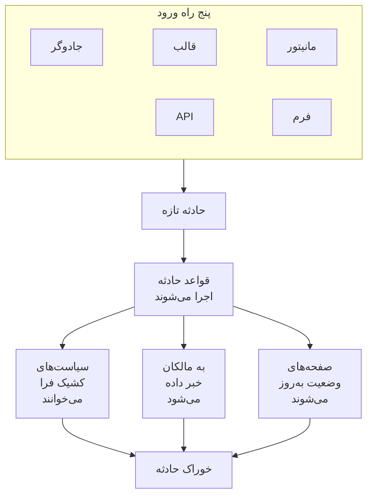
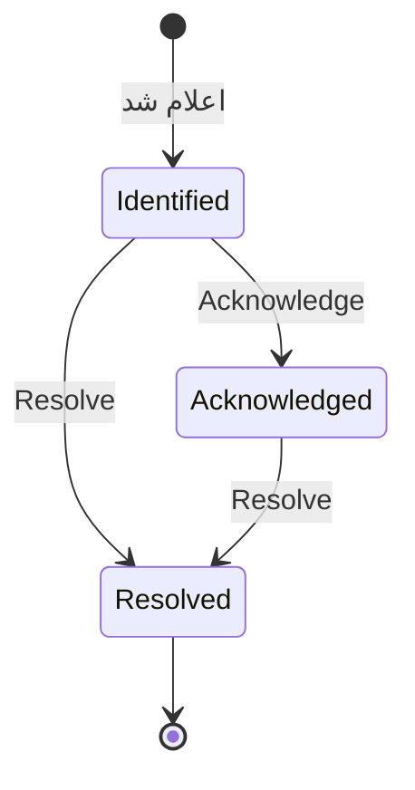

# نمای کلی حوادث

حادثه رکوردی است که تیم شما وقتی چیزی می‌شکند از روی آن کار می‌کند: چه چیزی متأثر است، چقدر بد است، پاسخ کجا ایستاده، مالکش کیست، و هر چیزی که در این میان نوشته می‌شود. اعلام یک حادثه چرخش کشیک درست را فرا می‌خواند، به مالکانش خبر می‌دهد و — اگر بخواهید — قطعی را روی صفحه وضعیتتان می‌گذارد تا مشتریان بدانند در جریانید. مطمئن نیستید مشکلی حادثه است یا هشدار؟ [کدام را به کار ببرم؟](/docs/introduction/which-one#حادثه-هشدار-یا-نوع-دیگری-از-مشکل) آن دو را کنار هم می‌گذارد.

:::cards
- [اعلام یک حادثه](/docs/incidents/declaring-incidents): دستی، از روی قالب، از مانیتور، از راه API یا با یک فرم.
- [وضعیت‌ها و شدت‌های حادثه](/docs/incidents/states-and-severities): چرخه زندگی، و آنچه تصدیق و برطرف کردن انجام می‌دهند.
- [یادداشت‌ها، مالکان و خوراک حادثه](/docs/incidents/notes-owners-and-feed): به‌روزرسانی برای مشتریان و برای تیمتان، و اینکه چه کسی از آن‌ها باخبر می‌شود.
- [هشدارهای پیوندشده](/docs/incidents/linked-alerts): هشدارهایی را که یک قطعی برانگیخته به حادثه‌ای که توضیحشان می‌دهد ببندید.
- [اپیزودها](/docs/incidents/episodes): حادثه‌های مرتبط را گروه کنید و مثل یکی رویشان کار کنید.
- [گزارش‌های پس از حادثه](/docs/incidents/postmortems): آنچه رخ داد را بنویسید و روی صفحه وضعیتتان منتشرش کنید.
- [تنظیمات و خودکارسازی حادثه](/docs/incidents/settings): قالب‌ها، فیلدهای سفارشی، نقش‌ها، اندازه‌گیری‌ها و قواعد.
:::

## در یک نگاه

- **محصولی از آن خودش** — **حوادث** را از منوی **محصولات** در نوار بالا باز کنید؛ فهرست در `/dashboard/{projectId}/incidents` است.
- **سه وضعیت بذرشده** — **شناسایی‌شده**، **تأییدشده** و **برطرف‌شده** برای هر پروژه تازه‌ای ساخته می‌شوند. می‌توانید وضعیت‌های خودتان را بیفزایید؛ سه وضعیت بذرشده را می‌توان تغییر نام و رنگ داد اما هرگز حذف نه.
- **سه شدت بذرشده** — **Critical Incident**، **Major Incident** و **Minor Incident**. شدت برچسبی با رنگ و ترتیب است — رفتاری از خودش ندارد.
- **پنج راه ورود** — جادوگر **اعلام حادثه**، **ساخت از روی قالب**، قاعده‌ای از معیارهای مانیتور، `POST /api/incident`، یا یک [فرم](/docs/forms/index) که هر کسی با پیوندش می‌تواند پرش کند.
- **شماره‌گذاری به ازای هر پروژه** — هر حادثه شماره‌ای از شمارنده‌ای به ازای هر پروژه می‌گیرد که با پیشوند پروژه‌تان نشان داده می‌شود: `INC-42` در پروژه‌ای تازه، یا `#42` بدون پیشوند. شماره پیش از عنوان حادثه می‌آید، در صفحه‌هایش، در زبانه مرورگر، در جستجو و در پنجره‌هایی که درباره آن‌اند، تا حادثه‌هایی که عنوان یکسانی دارند از هم بازشناخته شوند.
- **دو گونه یادداشت** — یادداشت‌های خصوصی (یادداشت‌های داخلی) برای تیمتان، یادداشت‌های عمومی برای مشترکان صفحه وضعیت.
- **هشدارها به حادثه‌ها پیوند می‌شوند** — هشدارهایی را که بخشی از یک حادثه‌اند به آن پیوند دهید، یا حادثه‌ای را مستقیم از روی هشدارها اعلام کنید — از فهرست هشدارها یا از صفحه خودِ یک هشدار — و همزمان آن‌ها را تصدیق کنید. [هشدارهای پیوندشده](/docs/incidents/linked-alerts) را ببینید.
- **تنظیمات زیر حوادث هستند، نه در تنظیمات پروژه** — وضعیت‌ها، شدت‌ها، قالب‌ها، فیلدهای سفارشی و موتورهای قاعده همه در **حوادث ← تنظیمات** و **حوادث ← قواعد** هستند.

## چگونه کار می‌کند

می‌توانید حادثه‌ای را ساعت سه بامداد دستی اعلام کنید، یا بگذارید مانیتوری همان لحظه که معیارهایش برآورده می‌شوند اعلامش کند. در هر دو حالت حادثه همان شیء است، با همان چرخه زندگی و همان رد مکتوب در پایان.

### ۱. اعلام می‌شود

پنج مسیر به همان شیء می‌رسند:

- **دستی** — از فهرست حوادث، روی **اعلام حادثه** کلیک کنید. جادوگر **اعلام حادثه جدید** باز می‌شود، با سه گام: **جزئیات حادثه**، **منابع تحت تأثیر**، **آنکال و نقش‌ها**. گام نخست عنوان، شدت و توضیحات را می‌پرسد، و آنچه بیشتر حادثه‌ها هرگز لازم ندارند زیر **فیلدهای بیشتر** تاشده است. فقط گام نخست چیزی می‌پرسد که باید پاسخش دهید: **بعدی** از باقی گام‌ها می‌گذرد، و **اعلام حادثه** روی خلاصه پایانی است.
  - **از روی هشدارها** — **اعلام حادثه** روی گزینشی از هشدارها، یا در سرصفحه یک هشدار، همان جادوگر را از پیش پرشده از روی هشدارها باز می‌کند، آن‌ها را به حادثه تازه پیوند می‌دهد و، اگر تیک جعبه را برندارید، تصدیقشان می‌کند تا تشدیدشان متوقف شود — [هشدارهای پیوندشده](/docs/incidents/linked-alerts) را ببینید.
  - **از راه پرسش از هوش مصنوعی** — در [پرسش از هوش مصنوعی](/docs/ai/ask-ai) یک حادثه بخواهید: آن را به نام شما اعلام می‌کند، پیوندشده به منبعی که در صفحه‌اش پرسیدید، مثلاً صفحهٔ یک میزبان. برای ثبت مشکلی که کسی از پیش به آن رسیدگی می‌کند، یا از پیش تمام شده است، آن را تأییدشده یا برطرف‌شده بخواهید: در همان وضعیت آغاز می‌شود و کسی را فرا نمی‌خواند — [حادثه‌ای که از پیش تأییدشده یا برطرف‌شده اعلام می‌شود](/docs/incidents/declaring-incidents#حادثهای-که-از-پیش-تأییدشده-یا-برطرفشده-اعلام-میشود) را ببینید.
- **از روی قالب** — روی **ساخت از روی قالب** کلیک کنید و یک **قالب حادثه** ذخیره‌شده برگزینید. قالب‌ها عنوان، توضیحات، شدت، وضعیت آغازین، منابع، سیاست‌های کشیک، مالکان و برچسب‌ها را از پیش پر می‌کنند.
- **از مانیتور** — قاعده‌ای از معیارهای مانیتور که کلید «declare an incident» آن روشن است، همان لحظه که پالایه‌هایش برآورده شوند حادثه را خودکار می‌سازد. عنوان‌ها و توضیحات آنجا از قالب‌بندی `{{variable}}` پشتیبانی می‌کنند.
- **از راه API** — ‏`POST /api/incident` با یک کلید API. کارساز `declaredAt`، وضعیت ساخت و شماره حادثه را برایتان پر می‌کند.
- **با یک فرم** — کسی بیرون از تیمتان فرمی را پر می‌کند که به‌صورت پیوند به اشتراک گذاشته‌اید، بی‌آنکه حساب OneUptime داشته باشد. حادثه پنهان از صفحه‌های وضعیت اعلام می‌شود، و اگر فرم قالب حادثه داشته باشد از روی آن. [فرم‌ها](/docs/forms/index) را ببینید.

گردش‌های کار هم حادثه باز می‌کنند: گردش کار [Huntress](/docs/integrations/huntress) هر گزارش حادثه‌ای را که SOC آن می‌فرستد به یک حادثه تبدیل می‌کند که سیاست کشیکی را که برمی‌گزینید فرا می‌خواند. برای پیمایش فیلدبه‌فیلد [اعلام یک حادثه](/docs/incidents/declaring-incidents) را ببینید.

### ۲. آدم‌های درست باخبر می‌شوند

هنگام ساخت، OneUptime خودکارسازی‌ای را که پیکربندی کرده‌اید اجرا می‌کند: قواعد حریم خصوصی، قواعد مالک، قواعد برچسب، قواعد کشیک و قواعد رانبوک. هر سیاست کشیکی که به حادثه پیوست است — دستی، از قالب، یا افزوده‌شده به دست قاعده کشیکی که برآورده شده — به‌طور موازی اجرا می‌شود.

به مالکان از راه کانال‌هایی خبر داده می‌شود که هر کدامشان در **تنظیمات کاربر ← تنظیمات اعلان** روشن کرده‌اند: ایمیل، پیامک، تماس صوتی، اعلان فوری، WhatsApp، ‏Telegram، ‏Slack، ‏Microsoft Teams، ‏Mattermost یا وب‌هوک. اگر حادثه‌ای اصلاً مالکی نداشته باشد، اعلان به‌جای گم شدن به مالکان پروژه می‌رسد.

اگر حادثه روی صفحه وضعیتی دیده شود و اعلان مشترکان روشن باشد، به مشترکان هم خبر داده می‌شود: مشترکان هر صفحه وضعیتی که یکی از مانیتورهای حادثه را فهرست کرده، یا فقط مشترکان صفحه‌هایی که حادثه را به آن‌ها محدود کرده‌اید. برای دادن صفحه وضعیتی جداگانه به هر مخاطب، [یک صفحه وضعیت برای هر مخاطب](/docs/status-pages/one-status-page-per-audience) را ببینید.

> [!NOTE]
> اعلان‌ها کرون‌محورند و هر دقیقه اجرا می‌شوند، پس به‌جای ارسال آنی، تا حدود یک دقیقه تأخیر انتظار داشته باشید.

### ۳. تیمتان رویش کار می‌کند

پاسخ‌دهندگان حادثه را تصدیق می‌کنند، منابع متأثر را پیوست می‌کنند، هشدارهایی را که به آن تعلق دارند پیوند می‌دهند، رانبوک‌ها را اجرا می‌کنند، نقش‌های حادثه را واگذار می‌کنند، و هر چه یاد می‌گیرند می‌نویسند — یادداشت‌های خصوصی برای تیم، یادداشت‌های عمومی برای مشتریان، و وقتی تصویر روشن‌تر شد صفحه‌های **علت ریشه‌ای** و **رفع مشکل**. هر کاری که می‌کنند در **فید حادثه** روی صفحه **نمای کلی** ثبت می‌شود.

### ۴. برطرف می‌شود

زدن **رفع** حادثه را به وضعیت برطرف‌شده می‌برد، خط زمانی وضعیت را مهر می‌زند، ساعت مدت را متوقف می‌کند، مانیتورهایی را که در دست دارد پس می‌دهد، و حادثه را از بخش فعال هر صفحه وضعیتی که رویش نشان داده می‌شد برمی‌دارد. برای این کار چیز دیگری لازم نیست تغییر کند — صفحه وضعیت فقط حادثه‌هایی را نشان می‌دهد که در وضعیتی بالای وضعیت برطرف‌شده‌اند. [برطرف کردن چه می‌کند](/docs/incidents/states-and-severities#برطرف-کردن-چه-میکند) را ببینید.

پس از آن می‌توانید [پس‌رویدادنامه‌ای](/docs/incidents/postmortems) بنویسید و، اگر خواستید، روی صفحه وضعیت منتشرش کنید.

## اصطلاح‌های کلیدی

چند واژه در هر صفحه دیگر این بخش تکرار می‌شوند. نخست این‌ها را روشن کنید. واژه‌هایی که در سراسر OneUptime به کار می‌روند در [واژه‌نامه](/docs/introduction/glossary) آمده‌اند.

| اصطلاح | یعنی چه |
| ---------------------- | --------------------------------------------------------------------------------------------------------------------------------------------------- |
| **حادثه** | خود رکورد — عنوان، توضیحات، شدت، وضعیت جاری، منابع متأثر، و هر چیزی که در حین پاسخ رویش نوشته می‌شود. |
| **وضعیت حادثه** | حادثه کجای چرخه زندگی‌اش است. سطری محدود به پروژه با نام، رنگ و `order`، به‌علاوه پرچم‌هایی که به آن معنا می‌دهند. |
| **شدت حادثه** | چقدر بد است. سطری محدود به پروژه با نام، رنگ و `order`. صرفاً دسته‌بندی — هیچ‌چیز در محصول با شدتی رفتار ویژه نمی‌کند. |
| **شماره حادثه** | شمارنده‌ای به ازای هر پروژه که به‌صورت `#42` نشان داده می‌شود، یا با پیشوندی که پیکربندی می‌کنید، به‌صورت `INC-42`. |
| **منابع متأثر** | مانیتورها، میزبان‌ها، خوشه‌های Kubernetes، میزبان‌های Docker، سرویس‌ها و دیگر زیرساختی که به حادثه پیوست می‌کنید. |
| **یادداشت عمومی** | به‌روزرسانی‌ای که برای خوانندگان و مشترکان صفحه وضعیت نوشته می‌شود. روی خط زمانی صفحه وضعیت نمایش داده می‌شود. |
| **یادداشت خصوصی** | یادداشتی داخلی (مدل `IncidentInternalNote`) برای تیم پاسخ‌دهنده. هرگز به صفحه وضعیتی نمی‌رسد. |
| **مالک** | کاربر یا تیمی که مسئول حادثه است. مالکان وقتی حادثه ساخته می‌شود، وقتی یادداشتی منتشر می‌شود و وقتی وضعیت تغییر می‌کند باخبر می‌شوند. |
| **خوراک حادثه** | خط زمانی فعالیتِ فقط‌افزودنی روی **نمای کلی** حادثه، که تغییر وضعیت‌ها، یادداشت‌ها، تغییر مالکان، اجرای قواعد و اعلان‌ها را ثبت می‌کند. |
| **خط زمانی وضعیت** | ثبت اینکه حادثه در چه وضعیتی، کی و چه مدت بوده — با وضعیت اعلان مشترکان برای هر گذار. |
| **هشدار پیوندشده** | هشداری که به‌عنوان بخشی از پاسخ به حادثه پیوند شده است. یک هشدار می‌تواند به بیش از یک حادثه پیوند شود، و وضعیت خودش را نگه می‌دارد. |

## سه وضعیتی که OneUptime برای هر پروژه بذر می‌کند

وقتی پروژه‌ای ساخته می‌شود، OneUptime دقیقاً سه وضعیت حادثه، به این ترتیب، بذر می‌کند:

| وضعیت | ترتیب | رنگ | یعنی چه |
| ---------------- | ----- | ------------------ | ------------------------------------------------------------------------- |
| **شناسایی‌شده** | ۱ | قرمز (`#fd625e`) | وضعیتی که حادثه‌ای تازه در آن می‌نشیند. این وضعیت ساخت است. |
| **تأییدشده** | ۲ | زرد (`#ffbf53`) | کسی حادثه را برداشته و رویش کار می‌کند. |
| **برطرف‌شده** | ۳ | سبز (`#2ab57d`) | حادثه تمام شده است. برطرف کردنش همان چیزی است که آن را از صفحه وضعیت شما برمی‌دارد. |

نام‌ها فقط برچسب‌اند — آنچه واقعاً رفتار را تعیین می‌کند سه مقدار بولی روی سطر وضعیت است: `isCreatedState`، `isAcknowledgedState` و `isResolvedState`. انتظار می‌رود در هر پروژه فقط یک وضعیت هر پرچم را داشته باشد.

این تمایز بیش از آنچه به نظر می‌رسد اهمیت دارد:

- `isCreatedState` تعیین می‌کند حادثه‌ای تازه کجا آغاز شود. اگر هنگام ساخت وضعیتی صریحاً برگزیده نشود، OneUptime وضعیت ساخت پروژه را پیدا می‌کند و به کار می‌برد.
- `isAcknowledgedState` و `isResolvedState` وضعیت‌های تصدیق‌شده و برطرف‌شده را مشخص می‌کنند. جایگاه وضعیت حادثه نسبت به آن‌ها دکمه‌های **تأیید** و **رفع** در سرصفحه حادثه، دو کاشی آماری روی **نمای کلی** حادثه، و نشان شمار **حوادث فعال** در منوی کناری را تعیین می‌کند: حادثه‌ای که در وضعیت تصدیق‌شده یا هر وضعیتی پس از آن باشد تصدیق‌شده است، و حادثه‌ای که در وضعیت برطرف‌شده یا هر وضعیتی پس از آن باشد برطرف‌شده.
- **حوادث فعال** صرفاً این‌گونه تعریف شده است: «وضعیت جاری بالای وضعیت برطرف‌شده است». پس وضعیت سفارشی‌ای که بالای وضعیت برطرف‌شده بیفزایید فعال است؛ وضعیتی که پس از آن بگذارید، مانند خود وضعیت برطرف‌شده، برطرف‌شده شمرده می‌شود.

> [!NOTE]
> نخستین وضعیت بذرشده **شناسایی‌شده** نام دارد، هرچند چند توصیف درون محصول هنوز آن را وضعیت ساخت (created) می‌نامند. اگر در فهرست وضعیت‌های پروژه‌تان دنبال «Created» می‌گردید، همان سطری است که **شناسایی‌شده** نام دارد.

می‌توانید وضعیت‌های خودتان را در **حوادث ← تنظیمات ← وضعیت حادثه** بیفزایید. وضعیت تازه درست بالای وضعیت برطرف‌شده افزوده می‌شود، و سطرها را با کشیدن مرتب می‌کنید؛ ستون **در حکم** نشان می‌دهد حادثه‌ای که در هر وضعیت است چه شمرده می‌شود — تصدیق‌نشده، تصدیق‌شده یا برطرف‌شده. سه وضعیت پرچم‌دار برچسب **پیش‌ساخته** دارند: ترتیبشان را نگه می‌دارند و حذف نمی‌شوند، اما می‌توانید تغییر نام و رنگ دهید و جابه‌جایشان کنید، و به همین دلیل رابط کاربری نام وضعیت‌ها را به‌صورت پویا می‌خواند.

ترتیب اعمال می‌شود، نه اینکه آرایشی باشد: حادثه نمی‌تواند به وضعیتی برود که در ترتیب زودتر از وضعیت جاری‌اش قرار دارد. جزئیات کامل در [وضعیت‌ها و شدت‌های حادثه](/docs/incidents/states-and-severities) است.

## سه شدتی که OneUptime برای هر پروژه بذر می‌کند

هر پروژه تازه سه شدت هم می‌گیرد:

| شدت | ترتیب | رنگ | یعنی چه |
| --------------------- | ----- | ------------------ | ---------------------------------------------------------- |
| **Critical Incident** | ۱ | زرشکی (`#b70400`) | اثر بسیار بالا بر مشتری، با نیاز به پاسخ بی‌درنگ. |
| **Major Incident** | ۲ | قرمز (`#fd625e`) | اثر چشمگیر، معمولاً با نیاز به پاسخ بی‌درنگ. |
| **Minor Incident** | ۳ | زرد (`#ffbf53`) | اثر کم، معمولاً در ساعت‌های کاری رسیدگی می‌شود. |

شدت‌ها `name`، `description`، `color` و `order` دارند و نه چیز دیگری. پرچمی ندارند، و هیچ مسیری در کد با «Critical Incident» رفتاری متفاوت از هر سطر دیگری ندارد. شدت ابزار انسان‌ها برای اولویت‌بندی است، و وقتی قواعد کشیک می‌نویسید به‌عنوان معیار تطبیق در دسترس است — اما برگزیدن یک شدت به‌خودی‌خود کسی را فرا نمی‌خواند.

شدت‌ها را در **حوادث ← تنظیمات ← شدت حادثه** ویرایش کنید یا بیفزایید. توضیحات کامل شدت‌های بذرشده در [وضعیت‌ها و شدت‌های حادثه](/docs/incidents/states-and-severities) است.

## حادثه‌ها در داشبورد کجا هستند

**حوادث** را از منوی **محصولات** در نوار بالا باز کنید. منوی کناری‌اش به این بخش‌ها سازمان یافته است:

| بخش | آنجا چه می‌کنید |
| ------------- | -------------------------------------------------------------------------------------------------------------------------------------------------------------------------- |
| **نمای کلی** | **همه حوادث**، **حوادث فعال** و **گزارش‌های پس از حادثه** — دومی نشانی قرمز با شمار حادثه‌هایی دارد که در وضعیتی بالای وضعیت برطرف‌شده‌اند، و سومی پس‌رویدادنامهٔ هر حادثه را فهرست می‌کند تا بر پایهٔ مالک، شدت یا وضعیت فیلترش کنید. |
| **اپیزودها** | اپیزودهای حادثه، قابلیتی جداگانه برای گروه‌بندی با صفحه‌های خودش. |
| **هوش مصنوعی** | **بینش‌ها**، **لاگ‌ها**، **تنظیمات**: آنچه هوش مصنوعی OneUptime از حادثه‌های شما آموخت و هر کاری که برایشان کرد، و آنچه اجازه دارد خودش انجام دهد — همراه با قواعدی که تعیین می‌کنند کدام حادثه‌ها را بررسی و اصلاح کند. [AI SRE](/docs/ai/ai-sre) را ببینید. |
| **فضای کاری** | فضاهای کاری گفتگویی که این پروژه وصل کرده: **Slack**، **Microsoft Teams** و **Mattermost**، هر کدام با قواعد اعلانش برای حادثه‌ها. وقتی هیچ‌کدام وصل نباشد، **اتصال یک فضای کاری** را نگه می‌دارد، صفحه‌ای که هر سه و چگونگی وصل کردنشان را نشان می‌دهد. |
| **قواعد** | موتورهای قاعده: **قواعد گروه‌بندی**، **قواعد آنکال**، **قواعد مالکیت**، **قواعد رانبوک**، **قواعد حریم خصوصی**، **قواعد برچسب**، **قواعد SLA**، **قواعد یادآوری**. |
| **تنظیمات** | **وضعیت حادثه**، **شدت حادثه**، **قالب‌های حادثه**، **قالب‌های یادداشت**، **تأیید یادداشت‌های عمومی**، **اعلان‌های مشترکان**، **قالب‌های گزارش پس از حادثه**، **وضعیت‌های گزارش پس از حادثه**، **فیلدهای سفارشی**، **نقش‌های حادثه**، **اندازه‌گیری‌ها**، **هشدارهای پیوندشده**، **عضویت در اپیزود**، **شماره‌گذاری**، **نگهداری داده**. |

**نمای کلی** و **اپیزودها** باز هستند؛ **هوش مصنوعی**، **فضای کاری**، **قواعد**، **تنظیمات** و **توسعه‌دهنده** به‌طور پیش‌فرض جمع‌اند، تا منو روی فهرست‌هایی باز شود که هر روز به کار می‌برید. روی عنوان یک بخش کلیک کنید تا باز شود و صفحه‌هایی را که باقی این مستندات به آن‌ها ارجاع می‌دهند بیابید؛ هر بخش وقتی روی یکی از صفحه‌هایش باشید خودبه‌خود هم باز می‌شود. پیکربندی حادثه زیر تنظیمات پروژه نیست؛ همه‌اش اینجاست.

خود فهرست حادثه‌ها **شماره حادثه**، **عنوان**، **حالت**، **شدت**، **منابع تحت تأثیر**، **اعلام‌شده**، **مدت**، **برچسب‌ها** و **مالکان** را نشان می‌دهد. منوی **⋯** در انتهای ردیف هر حادثه **تأیید** و **رفع** را تا وقتی حادثه می‌تواند آن گام را بردارد، **تغییر وضعیت**، **تغییر شدت**، **تخصیص به من** را تا وقتی مالک آن نیستید، و **افزودن مالک** را برای سپردن آن به کس دیگر پیش می‌گذارد. چند حادثه را برگزینید تا همین کار را با همه با هم انجام دهید.

## هر صفحه یک حادثه چه نشان می‌دهد

حادثه‌ای را باز کنید؛ منوی کناری خودش صفحه‌هایش را این‌گونه گروه می‌کند:

| بخش منوی کناری | صفحه‌ها |
| ----------------- | ----------------------------------------------------------------------------------------- |
| **نمای کلی** | **نمای کلی**، **خط زمانی حالت**، **SLA** |
| **بررسی** | **توضیحات**، **علت ریشه‌ای**، **رفع مشکل**، **رانبوک‌ها**، **گزارش پس از حادثه**، **هشدارهای پیوندشده** |
| **تیم** | **نقش‌ها**، **اجراهای آنکال**، **مالکان** |
| **اعلان‌ها** | **گزارش‌های اعلان**، **گزارش‌های هوش مصنوعی** — تا روی **اعلان‌ها** کلیک نکنید جمع است |
| **یادداشت‌ها** | **یادداشت‌های خصوصی**، **یادداشت‌های عمومی** |
| **توسعه‌دهنده** | **Terraform**، **API**، **CLI**، **دستیارهای هوش مصنوعی** — تا روی **توسعه‌دهنده** کلیک نکنید جمع است |
| **پیشرفته** | **فیلدهای سفارشی**، **تنظیمات**، **گزارش‌های ممیزی**، **حذف حادثه** — تا روی **پیشرفته** کلیک نکنید جمع است |

هر کدام چه دارد:

- **نمای کلی** — پاسخ در یک نگاه. سرصفحه **فرمانده حادثه** را نام می‌برد — کسی که نقش اصلی پروژه شما را در **نقش‌های حادثه** دارد — و **مالکان** حادثه را، اول تیم‌ها. تا وقتی کسی این نقش را ندارد و حادثه باز است، **تخصیص** جای آن را می‌گیرد و درست زیر خودش فهرستی از افراد پروژه شما را باز می‌کند: روی کسی کلیک کنید تا نقش را به او بدهید؛ سرصفحه و **نقش‌های حادثه** بی‌درنگ نامش را نشان می‌دهند. برای حادثهٔ برطرف‌شده **تخصیص داده نشده** نشان داده می‌شود. زیر سرصفحه، کاشی **اعلام‌شده** نشان می‌دهد حادثه کی اعلام شد، اگر ثبت شده باشد چقدر پس از شروع اثر، و توسط چه کسی؛ سپس زمان تا تصدیق و زمان تا برطرف شدن می‌آیند، و مدت آن نخستین مورد سرصفحه است. کارت **آنچه رخ داد** در صدر صفحه است — توضیح حادثه و **علت ریشه‌ای** آن، که یک **ویرایش** هر دو را با هم تغییر می‌دهد — سپس کارت **OneUptime AI** — آنچه هوش مصنوعی OneUptime یافت، یا اینکه چرا آغاز نشد — و **فید حادثه** زیر آن‌ها. وقتی یک مانیتور حادثه را اعلام کرده باشد، **جزئیات ارزیابی** زیر علت ریشه‌ای آن فیلترهایی را که مطابقت داشتند و آنچه هر کدام یافت نام می‌برد، و **نمایش جزئیات** گزیده‌ای از پاسخ و خود بررسی را اضافه می‌کند. [یک حادثه یا هشدار از بررسی چه چیزی را نگه می‌دارد](/docs/monitor/criteria-and-statuses#یک-حادثه-یا-هشدار-از-بررسی-چه-چیزی-را-نگه-میدارد) را ببینید. وقتی یک مانیتور متریک حادثه را اعلام کرده باشد، کارت تله‌متری آن متریک‌هایی را که مانیتور زیر نظر داشت در پیرامون شروع حادثه رسم می‌کند: مقداری که مانیتور آن‌ها را با آن مقایسه کرد به‌صورت یک خط، لحظه‌های خود حادثه روی نمودارها و آنچه مانیتور ارزیابی کرد به‌صورت سایه‌دار. بازهٔ زمانی دیگری انتخاب کنید (یک ساعت یا یک روز پیش از شروع آن، از شروع آن تا اکنون، آنچه مانیتور دید، یا بازه‌ای از خودتان)، برای بزرگ‌نمایی روی یک نمودار بکشید، یا یک متریک را تغییر دهید، فیلتر کنید یا متریک دیگری بیفزایید، همه بدون ترک حادثه. زبانه‌های لاگ‌ها، ترِیس‌ها و استثناهای آن از همان بازه پیروی می‌کنند، و نشانی صفحه آنچه را تغییر داده‌اید نگه می‌دارد، پس پیوندی به آن همان نمودارها را باز می‌کند. وقتی یک مانیتور لاگ، ترِیس یا استثنا آن را اعلام کرده باشد، کارت آنچه را پرس‌وجوی مانیتور در پنجرهٔ ارزیابی‌شده یافت فهرست می‌کند، با سیگنال‌های دیگر در زبانه‌های کنارش: بازهٔ دیگری پیرامون حادثه یا بازه‌ای از خودتان انتخاب کنید تا همهٔ زبانه‌ها از آن پیروی کنند؛ برای بزرگ‌نمایی روی نمودار حجم بکشید، و **بازنشانی** به آنچه مانیتور دید برمی‌گردد. کنار آن‌ها کارت **منابع تحت تأثیر** با وضعیتی که حادثه به مانیتورها می‌دهد، کارت **تماس تصویری**، کارت **جزئیات حادثه** (سیاست‌های کشیک، اعلان‌های مشترکان، صفحات وضعیتی که به آن‌ها محدود است، برچسب‌ها، شماره حادثه، و شناسه حادثه روی خط کوچک **ID** در پایینش که با یک کلیک در کلیپ‌بورد شماست)، **نقش‌های حادثه** و فیلدهای سفارشی حادثه قرار دارند. وقتی پروژه شما [اندازه‌گیری](/docs/incidents/settings#اندازهگیریها) دارد، کارت **اندازه‌گیری‌ها** زیر **جزئیات حادثه** می‌گوید هر کدام برای این حادثه چه نشان می‌دهد: **۱۲ دقیقه**، **۵ دقیقه است که در جریان است**، **رخ نداد**.
- **خط زمانی حالت** — هر وضعیتی که حادثه در آن بوده، به‌صورت یک خط زمانی: نواری که هر وضعیت در آن به درازای مدتش است، و زیر آن هر تغییر با شروع و پایانش، مدتش و وضعیت اعلان مشترکان. **مشاهده علت** و **مشاهده لاگ‌ها** توضیح می‌دهند چرا هر تغییری رخ داد، و **جدول** همان تغییرها را به‌صورت جدول نشان می‌دهد، با **شروع در**، **پایان در** و **مدت**.
- **SLA** — پیگیری SLA برای این حادثه.
- **توضیحات**، **علت ریشه‌ای**، **رفع مشکل** — سه صفحه مارک‌داون. توضیحات همان است که روی صفحه وضعیت شما نشان داده می‌شود. صفحهٔ علت ریشه‌ای هم متریک‌های پشت حادثه را رسم می‌کند، همان‌طور که کارت تله‌متری نمای کلی این کار را می‌کند، تا بتوانید هنگام نوشتن اینکه چرا حادثه رخ داد، آن‌ها را در هر بازهٔ زمانی پیرامون حادثه بخوانید. وقتی حادثه نمای لحظه‌ای یک بررسی متریک را نگه نداشته باشد (مثلاً حادثه‌ای که دستی روی یک مانیتور متریک اعلام شده)، این صفحه متریک‌های آن مانیتور را همان‌طور که مانیتور اکنون آن‌ها را می‌خواند رسم می‌کند و این را می‌گوید.
- **رانبوک‌ها** — اجراهای رانبوکی که به این حادثه پیوست‌اند.
- **گزارش پس از حادثه** — گزارش و پیوست‌هایش، که می‌توانید اختیاراً روی صفحه وضعیت منتشرش کنید. **ویرایش یادداشت گزارش پس از حادثه** یادداشت و پیوست‌ها را می‌پرسد، سپس **انتشار در صفحه وضعیت** را؛ تنها وقتی آن روشن است **اطلاع به مشترکان** و **گزارش پس از حادثه منتشر شد در** را می‌پرسد، که روشن کردن انتشار آن را روی اکنون می‌گذارد. **ساخت با هوش مصنوعی** یادداشت را برایتان پیش‌نویس می‌کند و **اعمال قالب** — که تنها وقتی پروژه قالب پس‌رویدادنامه دارد نشان داده می‌شود — آن را از یک قالب آغاز می‌کند. مشترکان یک بار باخبر می‌شوند، وقتی پس‌رویدادنامه منتشر می‌شود: نخستین باری که صفحه وضعیت آن را نشان می‌دهد، که روشن بودن **انتشار در صفحه وضعیت** و یادداشتی نوشته‌شده می‌خواهد. ذخیره دوباره، یا ویرایش آن در حالی که منتشر شده، صفحه وضعیت را به‌روز می‌کند و به کسی خبر نمی‌دهد؛ انتشار دوباره‌اش پس از برداشتن از صفحه وضعیت دوباره خبرشان می‌کند. پس‌رویدادنامه‌ای که هنگام پنهان بودن حادثه منتشر شده، وقتی حادثه نمایان شود فرستاده می‌شود. [پس‌رویدادنامه](/docs/status-pages/subscribers#پسرویدادنامه) را ببینید. کارت همچنین نشان می‌دهد پس‌رویدادنامه به کجا رسیده، مثل **شروع‌نشده**، **پیش‌نویس** یا **تکمیل‌شده**، و مالکش کیست، و **نوشتن گزارش پس از حادثه** پس‌رویدادنامه‌ای را که هنوز کسی ننوشته آغاز می‌کند: [پس‌رویدادنامه‌ها](/docs/incidents/postmortems) را ببینید.
- **هشدارهای پیوندشده** — هشدارهایی که به این حادثه پیوند شده‌اند، با وضعیت جاری هر هشدار، و اینکه چه کسی و کی پیوندش داد. هشدارها صفحه متناظر **حوادث پیوندشده** دارند. [هشدارهای پیوندشده](/docs/incidents/linked-alerts) را ببینید.
- **نقش‌ها**، **اجراهای آنکال**، **مالکان** — چه کسی رویش کار می‌کند، کدام سیاست‌ها اجرا شدند، و چه کسی باخبر می‌شود.
- **گزارش‌های اعلان**، **گزارش‌های هوش مصنوعی**، **گزارش‌های ممیزی** — چه چیزی فرستاده شد و چه چیزی تغییر کرد.
- **یادداشت‌های خصوصی** و **یادداشت‌های عمومی** — آنچه به تیمتان و به مشتریانتان گفته شد. [یادداشت‌ها، مالکان و خوراک حادثه](/docs/incidents/notes-owners-and-feed) را ببینید.
- **فیلدهای سفارشی**، **تنظیمات**، **حذف حادثه** — صفحه **تنظیمات** گزینه‌های **قابل مشاهده در صفحه وضعیت** و **حادثه خصوصی**، کارت **دامنهٔ صفحات وضعیت** که حادثه را به برخی صفحه‌های وضعیت محدود می‌کند، و کارت **یادآوری‌ها** را نگه می‌دارد؛ کلید **فرستادن یادآوری‌ها** این کارت همان لحظه که زده شود ذخیره می‌شود و زمان یادآوری بعدی را نشان می‌دهد.

## حادثه‌ها چگونه با باقی OneUptime جفت می‌شوند

- **مانیتورها مشکل را می‌بینند؛ حادثه‌ها ثبتش می‌کنند.** قاعده‌ای از معیارهای مانیتور می‌تواند حادثه‌ای را خودکار اعلام کند و عنوان، شدت، سیاست‌های کشیک، مالکان، برچسب‌ها و یادداشت‌های اصلاح را از پیش پر کند. برای متغیرهای در دسترس آنجا [قالب‌بندی حادثه و هشدار](/docs/monitor/incident-alert-templating) را ببینید.
- **هشدارها سیگنال‌اند؛ حادثه‌ها پاسخ.** هشدارهایی را که حادثه‌ای توضیحشان می‌دهد، از هر دو سو، به آن پیوند دهید، و دو کلید پروژه، که در پروژه‌های تازه روشن‌اند، آن هشدارها را همراه حادثه تصدیق و برطرف می‌کنند. [هشدارهای پیوندشده](/docs/incidents/linked-alerts) را ببینید.
- **سیاست‌های کشیک فراخوانی را انجام می‌دهند.** سیاست‌ها را در گام **آنکال و نقش‌ها** جادوگر اعلام، روی یک قالب، یا از راه **حوادث ← قواعد ← قواعد آنکال** پیوست کنید. هر قاعده‌ای که برآورده شود اجرا می‌شود — مجموعه اجراشده اجتماع همه تطابق‌ها به‌علاوه هر چیزی است که مستقیم پیوست شده، بدون تکرار.
- **رانبوک‌ها به آدم‌ها می‌گویند چه کنند.** قواعد رانبوک وقتی حادثه‌ای منطبق ساخته می‌شود خودکار رویه‌ای را پیوست می‌کنند، و پاسخ‌دهندگان می‌توانند یکی را دستی از روی حادثه آغاز کنند. [نمای کلی رانبوک‌ها](/docs/runbooks/index) را ببینید.
- **صفحه‌های وضعیت به مشتریان می‌گویند.** حادثه‌ای در فهرست فعال یک صفحه وضعیت نشان داده می‌شود وقتی صفحه یکی از مانیتورهایش را فهرست کرده باشد، صفحه حادثه‌ها را روشن داشته باشد، حادثه دیدنی روی صفحه وضعیت علامت خورده باشد، و وضعیت جاری‌اش بالای وضعیت برطرف‌شده باشد. حادثه‌ای که به برخی صفحه‌های وضعیت محدود شده فقط روی همان‌ها نشان داده می‌شود. حادثه‌های خصوصی همیشه از هر صفحه وضعیتی پنهان‌اند. [نمای کلی صفحات وضعیت](/docs/status-pages/index) و [یک صفحه وضعیت برای هر مخاطب](/docs/status-pages/one-status-page-per-audience) را ببینید.
- **گردش‌های کاری پیرامونش خودکارسازی می‌کنند.** تریگرهای **On Create Incident**، **On Update Incident**، **On Create or Update Incident** و **On Delete Incident** به شما امکان می‌دهند خودکارسازی بدون کد را روی چرخه زندگی حادثه بسازید. [نمای کلی گردش‌های کاری](/docs/workflows/index) را ببینید.

## گام‌های بعدی

:::cards
- [اعلام یک حادثه](/docs/incidents/declaring-incidents): جادوگر را فیلدبه‌فیلد بپیمایید، یا از روی قالب، مانیتور یا API اعلام کنید.
- [وضعیت‌ها و شدت‌های حادثه](/docs/incidents/states-and-severities): وضعیت‌های خودتان را بیفزایید و ببینید هر کدام دقیقاً چه می‌کند.
- [نمای کلی صفحات وضعیت](/docs/status-pages/index): حادثه‌ها چگونه به مشتریانتان می‌رسند.
- [مشترکان و اطلاعیه‌ها](/docs/status-pages/subscribers): وقتی حادثه‌ای جابه‌جا می‌شود به چه کسی خبر داده می‌شود.
:::
