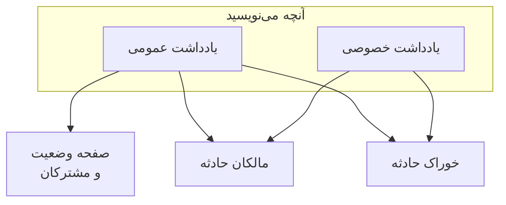

# یادداشت‌ها، مالکان و فید حادثه

هر حادثه در حین کار رویش رکوردی نوشتاری گرد می‌آورد: به‌روزرسانی برای مشتریانتان، یادداشت‌های کاری برای تیمتان، و خوراکی از فعالیت هر چیزی که رخ داده است. این صفحه نوشتن یادداشت‌های عمومی و خصوصی، اینکه هر کدام به چه کسی می‌رسد، خوراک حادثه، و مالکانی را که از هر تغییری باخبر می‌شوند پوشش می‌دهد.

:::cards
- [انتشار یک یادداشت عمومی](#انتشار-یک-یادداشت-عمومی): آنچه می‌دانید را روی صفحه وضعیت و با اعلان به مشتریان بگویید.
- [مشترکان کی خبردار می‌شوند](#یادداشت-عمومی-کی-واقعاً-به-مشترکان-میرسد): بررسی‌هایی که یادداشت عمومی از آن‌ها می‌گذرد، و نشانش.
- [خوراک حادثه](#خوراک-حادثه): خط زمانی هر چیزی که رخ داد.
- [مالکان](#مالکان): چه کسی مسئول است، و به آن‌ها چه گفته می‌شود.
:::

## چگونه کار می‌کند

بخشی از آنچه می‌نویسید برای مشتریان شماست — به‌روزرسانی‌ای که ساعت ۰۲:۱۴ روی صفحه وضعیت می‌رود و می‌گوید استقرار بد را یافته‌اید. باقی برای تیمتان است — ردیابی پشته‌ای که کسی چسبانده، نموداری که سرانجام معنا پیدا کرد، تصمیم به failover. OneUptime این دو مخاطب را از هم جدا نگه می‌دارد و هر دو را روی حادثه ثبت می‌کند.



**یادداشت‌های عمومی** روی صفحه وضعیت شما منتشر می‌شوند و می‌توانند به مشترکان خبر دهند. **یادداشت‌های خصوصی** (مدل `IncidentInternalNote`) درون داشبورد می‌مانند. زیر هر دو، **فید حادثه** قرار دارد، خط زمانی‌ای فقط‌افزودنی که هر چیزی را که برای حادثه رخ داده ثبت می‌کند، و فهرست **مالکان**، که تعیین می‌کند به چه کسی گفته شود.

همه این‌ها در منوی کناری حادثه‌اند: **یادداشت‌ها ← یادداشت‌های عمومی**، **یادداشت‌ها ← یادداشت‌های خصوصی** و **تیم ← مالکان**. خوراک روی صفحه **نمای کلی** حادثه است.

## یادداشت‌های عمومی در برابر خصوصی

این دو گونه یادداشت در داشبورد شبیه هم به نظر می‌رسند و رفتاری بسیار متفاوت دارند.

| | یادداشت عمومی | یادداشت خصوصی |
| ------------------------ | ------------------------------------------------------------------- | --------------------------------------------------------------- |
| مدل | `IncidentPublicNote` | `IncidentInternalNote` |
| روی صفحه‌های وضعیت نشان داده می‌شود | بله، به‌عنوان بخشی از خط زمانی حادثه | هرگز — هیچ چیز در برنامه صفحه وضعیت آن را نمی‌خواند |
| زمان انتشار | `postedAt`، که می‌توانید خودتان بگذارید | ندارد: با `createdAt` مهر و مرتب می‌شود |
| به مشترکان خبر می‌دهد | وقتی **باخبر کردن مشترکان صفحه وضعیت** روشن است | هرگز: اصلاً فیلد مشترکی ندارد |
| پیوست‌ها در دسترس | بازدیدکنندگان صفحه وضعیت، از راه مسیری در صفحه وضعیت | فقط API احرازشده داشبورد |
| به مالکان خبر می‌دهد | بله | بله |

**«خصوصی» واقعاً یعنی چه.** یعنی «روی صفحه وضعیت منتشر نمی‌شود» — نه «به گروه کوچک‌تری از آدم‌ها محدود است». نقش‌های آماده‌ای که می‌توانند حادثه‌ای را بخوانند هر دو گونه یادداشت را می‌خوانند، پس هر کسی که بتواند حادثه را بخواند معمولاً یادداشت‌های خصوصی‌اش را هم می‌تواند بخواند؛ در یک نقش سفارشی این‌ها مجوزهای جداگانه‌اند، **Read Incident Status Page Note** و **Read Incident Internal Note**. اگر لازم است محدود کنید چه کسی اصلاً حادثه‌ای را ببیند، از پرچم **حادثه خصوصی** (`isPrivate`) روی خود حادثه استفاده کنید، که حادثه را از هر صفحه وضعیتی پنهان می‌کند و آن را به کاربران مالک حادثه، اعضای تیم‌های مالکش، و مدیران و مالکان پروژه محدود می‌کند. حادثه خصوصی اصلاً یادداشت عمومی نمی‌پذیرد: [حادثه‌های خصوصی فقط یادداشت خصوصی می‌پذیرند](#حادثههای-خصوصی-فقط-یادداشت-خصوصی-میپذیرند) را ببینید.

**مالکان هر دو را می‌بینند.** کار اعلان به مالکان یادداشت‌های عمومی و خصوصی را با هم پرس‌وجو می‌کند. یادداشت خصوصی از مشترکان شما خصوصی است، نه از کسانی که پاسخ می‌دهند.

| اگر می‌خواهید… | برگزینید |
| ------------------------------------------------------ | ---------------- |
| به مشتریان بگویید چه می‌دانید و کی بیشتر خواهید دانست | **یادداشت عمومی** |
| به‌روزرسانی‌ای را که از پیش جای دیگری فرستاده‌اید با تاریخ گذشته ثبت کنید | **یادداشت عمومی** |
| فرضیه‌ای، فرمانی که اجرا کردید، یا بن‌بستی را ثبت کنید | **یادداشت خصوصی** |
| یک dump حافظه یا تصویری از داشبورد داخلی پیوست کنید | **یادداشت خصوصی** |

## انتشار یک یادداشت عمومی

:::steps
### یادداشت‌های عمومی را باز کنید

حادثه را باز کنید و در منوی کناری‌اش **یادداشت‌ها ← یادداشت‌های عمومی** را برگزینید. نگارنده بالای یادداشت‌ها پیش از انتشار می‌گوید چه کسی یادداشت را می‌خواند: **عمومی · در صفحه وضعیت شما دیده می‌شود**.

### به‌روزرسانی را بنویسید

یادداشت را به مارک‌داون بنویسید، یا از یکی از **قالب‌ها** خود یا از **پیش‌نویس با هوش مصنوعی** آغاز کنید. اگر مشترکان باید فایل‌هایی را ببینند، آن‌ها را با **پیوست** بیفزایید.

### تعیین کنید به چه کسی گفته شود

**باخبر کردن مشترکان صفحه وضعیت** را تیک‌خورده بگذارید تا به مشترکان خبر داده شود، یا تیکش را بردارید تا بی‌صدا منتشر شود. سطر **اطلاع داده می‌شود به** زیر آن نشان می‌دهد یادداشت به کدام صفحه‌های وضعیت می‌رسد، و **پیش‌نمایش** ایمیلی را که دریافت می‌کنند نشان می‌دهد.

### منتشرش کنید

روی **انتشار به‌روزرسانی** کلیک کنید، یا Ctrl+Enter (در Mac، ‏⌘+Enter) را بزنید. یادداشت در بالای فهرست پدیدار می‌شود، با نشانی که اعلانش را پی می‌گیرد.
:::

همین نگارنده از **افزودن یادداشت عمومی** در منوی **اقدام‌ها** خوراک حادثه هم در پنجره‌ای باز می‌شود ([خوراک حادثه](#خوراک-حادثه) را ببینید)، پس یادداشت از هر دو جا یکسان نوشته می‌شود.

| کنترل | کاربرد |
| ---------------------------------- | --------------------------------------------------------------------------------------------------------------------------------------------- |
| خود یادداشت | بدنه، به مارک‌داون. الزامی. |
| **قالب‌ها** | یکی از قالب‌های یادداشت شما را پس از آنچه تایپ کرده‌اید در یادداشت می‌گذارد. [قالب‌های یادداشت](#قالبهای-یادداشت) را ببینید. |
| **پیش‌نویس با هوش مصنوعی** | یادداشت را از روی حادثه پیش‌نویس می‌کند تا ویرایشش کنید. [تولید یادداشت با هوش مصنوعی](#تولید-یادداشت-با-هوش-مصنوعی) را ببینید. |
| **پیوست** | فایل‌هایی که روی صفحه وضعیت با مشترکان به اشتراک گذاشته می‌شوند. اختیاری. |
| **همین حالا منتشر شد** | زمانی که یادداشت می‌گوید منتشر شده: لحظه‌ای که منتشرش می‌کنید، مگر اینکه اینجا زمانی پیش‌تر برگزینید، در منطقه زمانی جاری شما. |
| **باخبر کردن مشترکان صفحه وضعیت** | جعبه انتخاب. به‌طور پیش‌فرض روشن، مگر اینکه حادثه بدون خبر دادن به مشترکان اعلام شده باشد — آن‌گاه خاموش آغاز می‌شود. برای انتشار بی‌صدا خاموشش کنید. |

**حادثه‌های بی‌صدا بی‌صدا می‌مانند.** اگر حادثه‌ای با **اطلاع به مشترکان صفحه وضعیت** خاموش (یا به‌صورت حادثه‌ای خصوصی) اعلام شده باشد، هرگز به مشترکانش درباره‌اش خبر داده نشده، پس یادداشت عمومی نباید نخستین چیزی باشد که می‌شنوند. روی چنین حادثه‌ای جعبه انتخاب خاموش آغاز می‌شود، با خطی زیر آن که دلیلش را می‌گوید. همچنان می‌توانید تیکش بزنید تا درباره آن یادداشت به مشترکان خبر داده شود. یادداشت‌هایی که بدون انتخابی صریح منتشر می‌شوند از همین قاعده پیروی می‌کنند: یادداشت‌های Slack و Microsoft Teams، گردش‌های کاری، و درخواست‌های API که `shouldStatusPageSubscribersBeNotifiedOnNoteCreated` را نمی‌فرستند. یک `true` یا `false` صریح همیشه نگه داشته می‌شود. یادداشت‌های عمومی روی [رویدادهای نگهداری زمان‌بندی‌شده](/docs/status-pages/subscribers#رویدادهای-نگهداری-زمانبندیشده) و [اپیزودهای حادثه](/docs/status-pages/subscribers#اپیزودهای-حادثه) از قاعده‌ای مشابه پیروی می‌کنند، بر پایه اینکه آیا خود رویداد یا اپیزود هنگام ساخته شدن به مشترکان خبر داد. حادثه یا اپیزود خصوصی اصلاً یادداشت عمومی نمی‌پذیرد.

**ببینید یادداشت به چه کسی می‌رسد.** تا **باخبر کردن مشترکان صفحه وضعیت** تیک‌خورده است، سطر **اطلاع داده می‌شود به** زیر آن صفحه‌های وضعیتی را که یادداشت به آن‌ها می‌رود با شمار «حداکثر» مشترکان برای هر کانال فهرست می‌کند، و صفحه‌هایی را که مانیتورهای حادثه را فهرست کرده‌اند اما خبردار نمی‌شوند، با دلیلش. وقتی کسی خبردار نخواهد شد چیزی نشان نمی‌دهد، مگر اینکه حادثه از صفحه‌های وضعیت پنهان باشد یا محدوده صفحه وضعیتش دلیلش باشد. از محدوده صفحه وضعیت حادثه پیروی می‌کند، پس یادداشتی روی حادثه‌ای که به دو صفحه سایت محدود شده می‌گوید به همان دو می‌رسد. [یک صفحه وضعیت برای هر مخاطب](/docs/status-pages/one-status-page-per-audience) را ببینید.

**ببینید چه چیزی به دستشان می‌رسد.** کنار همان جعبه انتخاب، **پیش‌نمایش** ایمیلی را نشان می‌دهد که مشترکان هرکدام از آن صفحه‌های وضعیت برای یادداشتی که می‌نویسید دریافت می‌کنند، و اینکه کدام قالب به کار می‌رود و چرا. تا یادداشت متنی نداشته باشد خاکستری می‌ماند. **ارسال آزمایشی برای من** همان ایمیل را به ایمیل حساب خود شما می‌فرستد، و به هیچ کس دیگر. [پیش‌نمایش ایمیل پیش از فرستادن](/docs/status-pages/subscribers#پیشنمایش-ایمیل-پیش-از-فرستادن) را ببینید.

> [!TIP]
> **زمان انتشار مهر زمانی واقعی یادداشت است.** صفحه‌های وضعیت یادداشت‌های عمومی را بر پایه `postedAt` مرتب و نمایش می‌دهند، نه بر پایه زمان تایپشان — پس اگر صفحه وضعیت را با به‌روزرسانی‌ای که ۴۰ دقیقه پیش فرستادید همراه می‌کنید، **همین حالا منتشر شد** را برگزینید و زمانی را بگذارید که واقعاً رخ داد. اگر یادداشتی از راه API (`/api/incident-public-note`) بدون آن برسد، OneUptime زمان جاری را مهر می‌زند.

هر یادداشت نشان می‌دهد چه کسی آن را نوشته، زمان انتشارش، مارک‌داون نمایش‌داده‌شده با پیوست‌هایش و، در سرصفحه‌اش، اینکه اعلان مشترکانش در چه وضعی است. **جست‌وجوی یادداشت‌ها…** یادداشت‌ها را بر پایه آنچه می‌گویند پیدا می‌کند، و خوراک را می‌توان از تازه‌ترین یا از قدیمی‌ترین خواند. پیوندها به سایت‌های دیگر و به پیوست‌ها در زبانه‌ای جدید باز می‌شوند. خط‌هایی که با `>` شروع می‌شوند به‌صورت نقل‌قول نمایش داده می‌شوند؛ برای نمایش آن به‌صورت کادر برجسته، خط اول آن را جداگانه `> [!NOTE]`، `> [!TIP]` یا `> [!WARNING]` بگذارید.

## انتشار یک یادداشت خصوصی

**یادداشت‌ها ← یادداشت‌های خصوصی** عمداً ساده‌تر است. همان نگارنده است، که می‌گوید **خصوصی • فقط کسانی که این حادثه را می‌بینند، می‌توانند این را بخوانند**، با خود یادداشت، **قالب‌ها**، **پیش‌نویس با هوش مصنوعی** و **پیوست** برای فایل‌ها، که فقط کسانی که می‌توانند یادداشت را بخوانند، می‌توانند بازشان کنند. **افزودن یادداشت خصوصی** در منوی **اقدام‌ها** خوراک حادثه آن را در پنجره‌ای باز می‌کند. از راه API، یادداشت‌های خصوصی `/api/incident-internal-note` هستند.

بدون زمان انتشار، بدون جعبه انتخاب مشترک — یادداشت هنگام ساخته شدن مهر می‌خورد.

هر دو گونه یادداشت در ویرایشگر مارک‌داون نوشته می‌شوند، که با **افزایش تورفتگی** و **کاهش تورفتگی** — یا Tab و Shift+Tab — آیتم‌های فهرست را تودرتو می‌کند، و فهرست‌ها، پیوندها و قالب‌بندی آنچه را از Word، ‏Google Docs یا صفحه‌ای دیگر از OneUptime می‌چسبانید نگه می‌دارد. Ctrl+Z تورفتگی یا بیرون‌آمدگی را برمی‌گرداند، و در حالت دیداری بلوک‌ها و چسباندن‌هایی را هم که ویرایشگر گذاشته، به ترتیب و همراه با آنچه تایپ کرده‌اید. بلوک کدی که از یک یادداشت کپی شود به‌صورت بلوک کد چسبانده می‌شود، و واژه‌ای که از آن کپی شود به‌صورت کد درون‌خطی. [اعلام یک حادثه](/docs/incidents/declaring-incidents#گام-۱-جزئیات-حادثه) را ببینید.

## حادثه‌های خصوصی فقط یادداشت خصوصی می‌پذیرند

حادثه خصوصی روی هیچ صفحه وضعیتی نیست و به هیچ مشترکی خبر نمی‌دهد ([نگه داشتن حادثه بیرون از صفحه وضعیت](/docs/incidents/states-and-severities#نگه-داشتن-حادثه-بیرون-از-صفحه-وضعیت) را ببینید)، پس یادداشت عمومی روی آن به هیچ‌کدام از کسانی که برایشان نوشته شده نمی‌رسد. OneUptime آن را پیشنهاد نمی‌کند:

- **صفحه یادداشت‌های عمومی آن** جایی که نگارنده بود می‌گوید "This incident is private, so public notes cannot be added to it. Use a private note."، با دکمه **افزودن یادداشت خصوصی** که یادداشت‌های خصوصی آن را باز می‌کند. **افزودن یادداشت عمومی** در منوی **اقدام‌ها** خوراک قفل است و همین را می‌گوید.
- **تغییر وضعیت آن** در پنجره، به‌جای یادداشت عمومی، یک یادداشت خصوصی زیر **افزودن یادداشت خصوصی** جمع می‌کند و درباره مشترکان نمی‌پرسد. اقدام گروهی **تغییر وضعیت** یادداشتش را به هر حادثه خصوصی که جابه‌جا می‌کند به‌صورت یادداشت خصوصی می‌افزاید و به هیچ‌کس درباره آن‌ها خبر نمی‌دهد.
- **در Slack و Microsoft Teams**، یک 📣 یا 📢 روی پیامی در کانال آن، پیام را به‌صورت یادداشت خصوصی ذخیره می‌کند و تأیید، دلیلش را می‌گوید.
- **از راه API، گردش‌کارها و OneUptime AI**، یادداشت عمومی روی آن با همان جمله رد می‌شود، و تغییر وضعیتی که همراه چنین یادداشتی فرستاده شود یکسره رد می‌شود، پس وضعیت تغییر نمی‌کند. یادآوری‌های یادداشت عمومی یک قاعده SLA تا وقتی دوباره عمومی شود منتظر می‌مانند؛ یادآوری‌های خصوصی آن طبق معمول منتشر می‌شوند.

یادداشت‌های عمومی‌ای که پیش از خصوصی شدن حادثه منتشر شده‌اند می‌مانند. هنوز می‌توانید آن‌ها را بخوانید، ویرایش و حذف کنید، اما هیچ چیز پیشنهاد نمی‌کند که درباره آن‌ها به مشترکان خبر داده شود. حادثه را دوباره عمومی کنید تا دوباره روی صفحه‌های وضعیتش دیده شوند و بتوان یادداشت عمومی تازه افزود. اپیزودهای حادثه هم همین‌طور کار می‌کنند.

## پیوست‌ها روی یادداشت‌ها

هر دو گونه یادداشت پیوست فایل را از راه دکمه **پیوست** نگارنده می‌پذیرند، و هر دو زیر بدنه یادداشت فهرستی از پیوست‌ها با پیوند **Download attachment** برای هر فایل نمایش می‌دهند.

تفاوتشان در این است که چه کسی می‌تواند فایل را بگیرد:

- **پیوست‌های یادداشت عمومی** برای بازدیدکنندگان صفحه وضعیت از راه مسیری در صفحه وضعیت، کنار خود یادداشت، دریافت‌شدنی‌اند.
- **پیوست‌های یادداشت خصوصی** فقط از راه API احرازشده داشبورد در دسترس‌اند. هیچ مسیری در صفحه وضعیت برایشان نیست.

این پیوست‌ها را به همان تصمیم عمومی/خصوصی متن یادداشت تبدیل می‌کند. تصویری از خط زمانی برای مشتریان روی یادداشتی عمومی می‌رود؛ یک dump پیکربندی روی یادداشتی خصوصی.

تصویرها هم از همین تصمیم پیروی می‌کنند. تصویری که در یادداشتی می‌چسبانید یا رها می‌کنید، یا با **بارگذاری تصویر** می‌افزایید، در پروژه حادثه ذخیره و درون یادداشت نشان داده می‌شود، و اینکه چه کسی آن را می‌بیند از یادداشت پیروی می‌کند:

- **در یادداشتی خصوصی** — یا در یادداشتی عمومی پیش از انتشار — تصویر فقط به اعضای پروژه نشان داده می‌شود، که همان‌طور که پروژه می‌خواهد وارد شده‌اند. هر کس دیگری که نشانی‌اش را باز کند چیزی نمی‌بیند، گویی آنجا تصویری نیست.
- **در یادداشتی عمومی** تصویر به هر کسی که می‌تواند یادداشت را ببیند نشان داده می‌شود: روی صفحه وضعیت، و در ایمیل‌هایی که مشترکانش می‌گیرند. یادداشت عمومی همیشه همراه حادثه‌اش نشان داده می‌شود، هرگز بی آن: تا وقتی حادثه از صفحه‌های وضعیت پنهان یا خصوصی است، تصویرهای یادداشت‌هایش هم فقط به اعضای پروژه نشان داده می‌شوند.

هر بارگذاری خصوصی آغاز می‌شود، چه از داشبورد چه از API. تصویر فقط تا وقتی برای همه دیدنی است که چیزی که صفحه‌های وضعیت شما نشان می‌دهند آن را داشته باشد: یادداشتی عمومی تا وقتی حادثه، اپیزود یا رویداد نگهداری زمان‌بندی‌شده‌اش روی صفحه‌های وضعیت نشان داده می‌شود، اطلاعیه‌ای از زمانی که نمایشش آغاز می‌شود، توضیحات حادثه تا وقتی حادثه **قابل مشاهده در صفحه وضعیت** است و خصوصی نیست، پس‌رویدادنامه‌اش وقتی آن هم آنجا منتشر شده باشد، توضیحات یک اپیزود یا یک رویداد نگهداری زمان‌بندی‌شده تا وقتی روی صفحه‌های وضعیت نشان داده می‌شود (هرگز تا وقتی اپیزود خصوصی است)، و توضیحات نمای کلی، گروه‌ها و منابع خود صفحه وضعیت. وقتی این پایان یابد — حادثه پنهان یا خصوصی شود، تصویر از متن برداشته شود، یادداشت یا حادثه حذف شود — تصویر دوباره خصوصی می‌شود، مگر اینکه چیز دیگری که صفحه‌های وضعیت شما نشان می‌دهند هنوز آن را داشته باشد. توضیحات یک فرم و پیام تشکرش هم، تا وقتی فرم ارسال می‌پذیرد، تصویرهایشان را به همین شکل به همه نشان می‌دهند.

خواندن یک یادداشت از راه API، ‏Terraform یا یک گردش کار فقط پیوست‌هایی را فهرست می‌کند که خواننده می‌تواند باز کند: فایل‌های پروژه یادداشت، و فایل‌های عمومی. پیوستی که یادداشت از پروژه‌ای دیگر نام می‌برد از فهرست کنار گذاشته می‌شود، گویی یادداشت آن را ندارد.

## تولید یادداشت با هوش مصنوعی

نگارنده دکمه **پیش‌نویس با هوش مصنوعی** دارد، هم در هر دو صفحه یادداشت و هم در پنجره‌های **افزودن یادداشت عمومی** و **افزودن یادداشت خصوصی** خوراک. حادثه را به ارائه‌دهنده هوش مصنوعی پروژه شما می‌فرستد و مارک‌داون تولیدشده را در یادداشت می‌گذارد، جایی که پیش از انتشار ویرایشش می‌کنید — هیچ چیز خودکار منتشر نمی‌شود.

| پنجره | چه می‌نویسد | قالب‌ها |
| ---------------------------------- | -------------------------------------------------------------------- | ----------------------------------------------------------------- |
| **ساخت یادداشت عمومی با هوش مصنوعی** | یادداشتی برای مشتریان، از تحلیل داده حادثه. | **Status Update**، **Resolution Notice**، **Maintenance Update** |
| **ساخت یادداشت خصوصی با هوش مصنوعی** | یادداشتی فنی و داخلی. | **Investigation Update**، **Technical Analysis**، **Shift Handoff** |

پشت دکمه، داشبورد به `/incident/generate-note-from-ai/{incidentId}` با قالب برگزیده و نوع یادداشت `public` یا `internal` درخواست می‌فرستد.

آنچه فرستاده می‌شود متن حادثه است. تصویر یا فایلی که در آن جاسازی شده — مثلاً عکس صفحه‌ای که در توضیحات چسبانده شده — با یادداشتی کوتاه مانند `[image omitted: PNG, 340 KB]` جایگزین می‌شود، و هر فیلد متنی به ۱۶٬۰۰۰ نویسه کوتاه می‌شود، تا یک چسباندن بزرگ هرگز جای بقیه را تنگ نکند. خود حادثه تصویرهایش را نگه می‌دارد.

## قالب‌های یادداشت

اگر تیمتان در هر قطعی همان سه به‌روزرسانی را می‌نویسد، یک بار ذخیره‌شان کنید. منوی **قالب‌ها** نگارنده، هم در هر دو صفحه یادداشت و هم در پنجره‌های یادداشت خوراک، آن‌ها را فهرست می‌کند، و برگزیدن یکی آن را در یادداشت می‌گذارد.

قالب‌ها میان یادداشت‌های عمومی و خصوصی مشترک‌اند: یک فهرست قالب به هر دو خدمت می‌کند، و همان قالب را می‌توان در هر گونه یادداشتی گذاشت.

جانگهدارهای یک قالب — `{{incident.title}}`، `{{incident.state}}`، `{{incident.customFields.impact}}` و دیگرانی که زیر [قالب‌های یادداشت](/docs/incidents/settings#قالبهای-یادداشت) فهرست شده‌اند — هنگام برگزیدن قالب با مقادیر کنونی حادثه پر می‌شوند، هم در صفحه‌های یادداشت و هم در پنجره‌های **تأیید** و **رفع**. آنچه پیش‌تر تایپ کرده بودید هرگز تغییر نمی‌کند، و جانگهدار بی‌مقدار همان‌طور که نوشته شده باقی می‌ماند.

> [!IMPORTANT]
> پیش از انتشار یادداشتی عمومی، یادداشت پرشده را بخوانید: `{{incident.affectedStatusPages}}` نام همه صفحه‌های وضعیتی را که حادثه به آن‌ها می‌رسد می‌آورد، و مشترکان همه آن‌ها آن را می‌خوانند.

آن‌ها را در **حوادث ← تنظیمات ← قالب‌های یادداشت** مدیریت می‌کنید — کارت **قالب‌های یادداشت عمومی یا خصوصی برای حوادث** نام دارد و فرمش یک صفحه است: **نام قالب** و **توضیحات قالب**، هر دو الزامی، و سپس بدنه. تا وقتی هیچ قالبی ندارید، منوی **قالب‌ها** همین را می‌گوید و به آنجا پیوند می‌دهد.

## انتشار یادداشت از Slack یا Microsoft Teams

اگر فضای کاری‌ای وصل کرده باشید، پاسخ‌دهندگان هرگز لازم نیست کانال را ترک کنند. هم Slack و هم Microsoft Teams کنشی برای افزودن یادداشت دارند که پنجره‌ای با فهرست کشویی **Note Type** — **Public Note** (منتشرشده روی صفحه وضعیت) یا **Private Note** (فقط کسانی که حادثه را می‌بینند، می‌توانند آن را بخوانند) — و جعبه متن **Note** باز می‌کند، و نتیجه را مستقیم روی حادثه می‌نویسد. روی حادثه خصوصی، **Note Type** را نمی‌پرسد و یک یادداشت خصوصی می‌افزاید: [حادثه‌های خصوصی فقط یادداشت خصوصی می‌پذیرند](#حادثههای-خصوصی-فقط-یادداشت-خصوصی-میپذیرند) را ببینید.

سه جزئیات که دانستنشان می‌ارزد:

- **محافظت از تکرار** — هر یادداشت پیام Slackی را که از آن آمده ثبت می‌کند (`postedFromSlackMessageId`، با قالب `channel_id:message_ts`)، پس چند نفر که به همان پیام واکنش نشان می‌دهند یک یادداشت می‌سازند، نه پنج تا.
- **یادداشت‌ها بازتاب می‌یابند** — انتشار هر گونه یادداشتی پیامی هم به کانال حادثه وصل‌شده می‌فرستد، چون آیتم خوراک یادداشت با اعلان فضای کاری فعال ساخته می‌شود. یادداشت عمومی‌ای که منتظر تأیید است پس از انتشار به آنجا فرستاده می‌شود: [تأیید یادداشت‌های عمومی](#تأیید-یادداشتهای-عمومی) را ببینید.
- **با نام کسی که خواست منتشر می‌شود** — یادداشتی که از پنجره یا از یک واکنش می‌آید با مجوزهای OneUptime همان شخص منتشر می‌شود، پس به مجوز او برای انتشار آن گونه یادداشت روی حادثه نیاز دارد. وقتی رد شود، دلیلش به او گفته می‌شود — در Slack با پیامی مستقیم، و در Microsoft Teams در همان گفتگو (برای یک واکنش، در رشته پیام) — و چیزی منتشر نمی‌شود.

## یادداشت عمومی کی واقعاً به مشترکان می‌رسد

ساختن یادداشتی عمومی با **اطلاع به مشترکان صفحه وضعیت** روشن به‌خودی‌خود تضمین نمی‌کند که ایمیلی بیرون برود. یادداشت باید از زنجیره‌ای از بررسی‌ها بگذرد، و هر ناکامی به‌جای خطا دادن دلیلی مشخص ثبت می‌کند:

```mermaid title="بررسی‌هایی که یادداشت عمومی پیش از رسیدن به مشترکان از آن‌ها می‌گذرد"
flowchart TB
    note["یادداشت عمومی منتشر شد"] --> box{"جعبه خبر دادن روشن است؟"}
    box -->|"خیر"| skipped["به مشترکان خبر داده نشد"]
    box -->|"بله"| incident{"حادثه روی صفحه‌های وضعیت است؟"}
    incident -->|"خیر"| skipped
    incident -->|"بله"| pages{"صفحه در محدوده است؟"}
    pages -->|"خیر"| skipped
    pages -->|"بله"| prefs{"مشترک خواسته است؟"}
    prefs -->|"بله"| sent["پیام فرستاده شد"]
```

1. **اطلاع به مشترکان صفحه وضعیت** باید روشن باشد. اگر نباشد، یادداشت همان لحظه ساخته شدن «گذشته‌شده» مهر می‌خورد. روی حادثه‌هایی که بدون خبر دادن به مشترکان اعلام شده‌اند خاموش آغاز می‌شود.
2. یادداشت باید به حادثه‌ای تعلق داشته باشد که هنوز وجود دارد.
3. حادثه باید دست‌کم یک مانیتور پیوست داشته باشد — بدون مانیتور، منبعی در صفحه وضعیت نیست که یادداشت به آن برسد.
4. پرچم **قابل مشاهده در صفحه وضعیت** حادثه (`isVisibleOnStatusPage`) باید true باشد، و حادثه نباید خصوصی باشد (`isPrivate`). حادثه خصوصی، هر چه آن پرچم بگوید، از هر صفحه وضعیتی پنهان است — [نگه داشتن حادثه بیرون از صفحه وضعیت](/docs/incidents/states-and-severities#نگه-داشتن-حادثه-بیرون-از-صفحه-وضعیت) را ببینید.
5. هر صفحه وضعیتی که حادثه به آن می‌رسد باید **نمایش حوادث** (`showIncidentsOnStatusPage`) را روشن داشته باشد. صفحه‌هایی که حادثه به آن‌ها می‌رسد همان‌هایی‌اند که مانیتورهایش را فهرست کرده‌اند، تنگ‌شده به صفحه‌هایی که حادثه به آن‌ها محدود شده، اگر باشد. حادثه‌ای که به هیچ صفحه‌ای محدود نشده از صفحه‌هایی که فقط حادثه‌های محدودشده به خودشان را نشان می‌دهند می‌گذرد. [یک صفحه وضعیت برای هر مخاطب](/docs/status-pages/one-status-page-per-audience) را ببینید.
6. هر مشترک باید از ترجیحات خودش بگذرد — لغو اشتراک نکرده باشد، و جایی که صفحه به مشترکان اجازه انتخاب می‌دهد، مشترک این منبع و نوع رویداد `Incident` باشد.

> [!NOTE]
> **اعلان‌ها آنی نیستند.** کاری که آن‌ها را می‌فرستد دقیقه‌ای یک بار اجرا می‌شود، پس میان ذخیره یادداشت و بیرون رفتن نامه تا حدود یک دقیقه انتظار داشته باشید. **مشترکان به‌زودی باخبر می‌شوند** روی یک یادداشت، و **به‌زودی ارسال می‌شود** روی اعلان‌های خود حادثه، همین معنا را دارند.

سرصفحه یادداشت عمومی کل این مسیر را با یک نشان پی می‌گیرد. روی آن کلیک کنید تا پیام وضعیت اعلان را بخوانید، که می‌گوید چه رخ داد:

| نشان | یعنی چه |
| ------------------------------ | ------------------------------------------------------------------------------------------------------------------------------------------------- |
| **مشترکان باخبر نشدند** | چیزی فرستاده نشد: یادداشت با **اطلاع به مشترکان صفحه وضعیت** تیک‌نخورده منتشر شد، یا یکی از دروازه‌های بالا بسته بود. دلیل ثبت شده است. |
| **مشترکان به‌زودی باخبر می‌شوند** | در صف، منتظر اجرای بعدی کار ارسال. |
| **در حال باخبر کردن مشترکان** | کار در حال پیمودن فهرست مشترکان است. |
| **مشترکان باخبر شدند** | پیام هر مشترکی فرستاده شد. پیام وضعیت، به ازای هر صفحه وضعیت، فهرست می‌کند چند پیام روی هر کانال رفت. |
| **اعلان ناموفق بود** | به هر مشترکی فرستاده نشد، یا کار با خطا ایستاد. پیام وضعیت می‌گوید کدام. |

**فرستاده یعنی فرستاده.** کار منتظر هر پیام می‌ماند: ایمیل یا پیامک وقتی فرستاده شمرده می‌شود که سرور ایمیل یا فراهم‌کننده پیامک آن را پذیرفته باشد، و پیام Slack، ‏Microsoft Teams یا وب‌هوک وقتی که طرف دیگر پاسخ داده باشد. پیامی که رد شود، خطا بدهد یا ظرف ۴ دقیقه پاسخی نگیرد ناموفق شمرده می‌شود، و یک ناکامی نشان را به **اعلان ناموفق بود** تبدیل می‌کند؛ به مشترکان دیگر همچنان فرستاده می‌شود. آن‌گاه پیام وضعیت چیزی شبیه این است: `Not every subscriber was sent this notification: 2 of 61 messages failed. Site 03: 41 email sent. Site 07: 16 email, 2 SMS sent; 2 email failed.` «فرستاده» تا جایی است که OneUptime می‌بیند: سرور ایمیل هنوز می‌تواند ایمیلی را بعداً برگرداند.

:::details صفحه‌های بزرگ و ارسال‌های طولانی
مشترکان یک صفحه وضعیت در دسته‌های ۱۰٬۰۰۰ تایی خوانده می‌شوند تا به همه‌شان برسد، و ۲۰ پیام هم‌زمان در راه‌اند. یک اعلان پس از ۲۰ دقیقه دیگر پیام تازه‌ای آغاز نمی‌کند: آنچه تا آن زمان به آن نرسیده فهرست می‌شود و **اعلان ناموفق بود** علامت می‌خورد. ارسالی که در میانه راه قطع شده باشد — سرورش از نو راه افتاده یا پاسخ نداده — هم **اعلان ناموفق بود** علامت می‌خورد، با پیامی که با `Interrupted:` آغاز می‌شود، وقتی ۴۰ دقیقه در **در حال باخبر کردن مشترکان** مانده باشد، تا هرگز برای همیشه آنجا نماند. [بررسی آنچه فرستاده شد](/docs/status-pages/subscribers#بررسی-آنچه-فرستاده-شد) را ببینید.
:::

### فرستادن دوباره اعلان یک یادداشت

روی نشان اعلان یک یادداشت کلیک کنید تا ببینید چه رخ داد. یادداشتی که اعلانش ناموفق بوده **تلاش دوباره اعلان** را پیشنهاد می‌کند، و یادداشتی که اعلانش رفته **ارسال دوباره اعلان** را. هر دو نخست می‌پرسند: پنجره تأیید صفحه‌های وضعیتی را که یادداشت اکنون به آن‌ها می‌رسد، با شمار «حداکثر» گیرندگان هر کانال، فهرست می‌کند، یا می‌گوید که به هیچ‌کس نمی‌رسد، و می‌گوید چه رخ می‌دهد. هرکدام یادداشت را به حالت در انتظار برمی‌گرداند تا اجرای بعدی برش دارد، و آن را به هر صفحه وضعیتی که حادثه اکنون به آن می‌رسد می‌فرستد، از جمله به مشترکانی که پیش‌تر آن را گرفته‌اند. اگر از زمان انتشار یادداشت صفحه‌هایی را که حادثه به آن‌ها محدود است تغییر داده باشید، به صفحه‌هایی می‌رود که اکنون به آن‌ها محدود است. یادداشتی که با **اطلاع به مشترکان صفحه وضعیت** تیک‌نخورده منتشر شده هیچ‌کدام را پیشنهاد نمی‌کند، چون هرگز قرار نبود فرستاده شود، و تا وقتی اعلانی هنوز در صف است یا در حال فرستاده شدن است هم هیچ‌کدام پیشنهاد نمی‌شود. یادداشت‌های عمومی رویدادهای نگهداری زمان‌بندی‌شده و اپیزودهای حادثه فقط پس از ناکامی **تلاش دوباره اعلان** را نگه می‌دارند.

فرستادن دوباره اعلان یک یادداشت، درست مانند انتشار آن، آنچه یادداشت می‌گوید را به همه مشترکان می‌گوید؛ پس هم مجوز انتشار یادداشت‌های عمومی‌ای که به مشترکان خبر می‌دهند لازم است و هم مجوز ویرایش یادداشت‌های عمومی. از راه API همان به‌روزرسانی‌ای است که داشبورد انجام می‌دهد، یعنی برگرداندن `subscriberNotificationStatusOnNoteCreated` به `Pending`؛ برای فراخواننده‌ای که این مجوزها را ندارد، برای یادداشتی که بدون خبر دادن به مشترکان منتشر شده، و تا وقتی اعلان یادداشت در حال فرستاده شدن است رد می‌شود.

:::details اعلان «ساخته شد» حادثه چگونه ادامه می‌یابد
فقط اعلان «ساخته شد» حادثه از همان جایی که ایستاده بود ادامه می‌یابد: صفحه‌های وضعیتی را که کامل به آن‌ها فرستاده ثبت می‌کند، و **تلاش دوباره** در **نمای کلی** حادثه از آن‌ها می‌گذرد. این ثبت به ازای هر صفحه وضعیت نگه داشته می‌شود، نه به ازای هر مشترک، پس صفحه‌ای که ارسال در میانه آن ایستاده دوباره کامل فرستاده می‌شود، از جمله به مشترکانی از آن صفحه که پیش‌تر آن را گرفته‌اند. پنجره تأیید **تلاش دوباره** گزینه **دوباره به همه صفحه‌های وضعیت ارسال شود، از جمله صفحه‌هایی که قبلاً به آن‌ها رسیده** را پیشنهاد می‌کند که آن را به **ارسال دوباره به همه صفحه‌ها** تبدیل می‌کند، و **ارسال دوباره** پس از یک ارسال موفق آن را دوباره به همه صفحه‌ها می‌فرستد. [یک صفحه وضعیت برای هر مخاطب](/docs/status-pages/one-status-page-per-audience#افزودن-صفحههای-وضعیت) را ببینید.
:::

### ویرایش یک یادداشت عمومی

**ویرایش یادداشت عمومی بی‌صداست، مگر آنکه بخواهید.** فرم ویرایش یادداشت جعبه انتخاب **اطلاع این به‌روزرسانی به مشترکان** را دارد که هر بار تیک‌نخورده است. برای تغییری که مشترکان باید از آن باخبر شوند تیکش بزنید تا یادداشت ویرایش‌شده را، با نشانه به‌روزرسانی، دریافت کنند؛ آن‌گاه یادداشت کنار نشان اصلی، نشان دومی برای به‌روزرسانی نشان می‌دهد، که پس از ناکامی **تلاش دوباره اعلان** خودش را دارد:

| نشان به‌روزرسانی | یعنی چه |
| ------------------- | --------------------------------------------------- |
| **به‌روزرسانی در صف** | منتظر اجرای بعدی کار ارسال. |
| **در حال ارسال به‌روزرسانی** | کار در حال پیمودن فهرست مشترکان است. |
| **به‌روزرسانی ارسال شد** | یادداشت ویرایش‌شده برای هر مشترکی فرستاده شد. |
| **ارسال به‌روزرسانی ناموفق بود** | برای هر مشترکی فرستاده نشد. |
| **به‌روزرسانی ارسال نشد** | یکی از دروازه‌های بالا جلویش را گرفت. |

به‌روزرسانی فرستاده‌شده دوباره پیشنهاد نمی‌شود: یادداشت را با همان جعبه انتخاب تیک‌خورده ویرایش کنید تا تازه‌ترین متن فرستاده شود، یا خود یادداشت را دوباره بفرستید. اگر اعلان اصلی هنوز فرستاده نشده باشد، به‌روزرسانی جداگانه‌ای نمی‌رود — اعلان اصلی ویرایش را با خود می‌برد. اگر همان لحظه در حال فرستاده شدن باشد، به‌روزرسانی منتظر می‌ماند تا کارش تمام شود و سپس فرستاده می‌شود. این جعبه انتخاب و **تلاش دوباره اعلان** به‌روزرسانی همان مجوزهای فرستادن دوباره اعلان یادداشت را می‌خواهند؛ بدون آن‌ها همچنان می‌توانید یادداشت را ویرایش کنید، بی آنکه به کسی خبر داده شود. [مشترکان و اطلاعیه‌ها](/docs/status-pages/subscribers#گفتن-ویرایش-به-مشترکان) را ببینید.

پیامی که واقعاً به مشترکان می‌رسد به ازای هر صفحه وضعیت و هر کانال قالب‌بندی می‌شود — ایمیل، پیامک، Slack و Microsoft Teams هرکدام قالب خودشان را برای رویداد **Subscriber Incident Note Created** دارند، با متغیرهایی برای نام و نشانی صفحه وضعیت، پیوند جزئیات، منابع متأثر، شدت و عنوان حادثه، بدنه یادداشت، برچسب‌ها، صفحه‌های وضعیت متأثر و فیلدهای سفارشی حادثه، و پیوند لغو اشتراکی برای هر مشترک. پیام‌های پیش‌فرض ایمیل، Slack و Microsoft Teams همچنین فیلدهای سفارشی حادثه را که **گنجاندن در اعلان‌های مشترکان** برایشان روشن است، با مقادیر کنونی‌شان، فهرست می‌کنند. برای اینکه آن قالب‌ها و کانال‌ها چگونه پیکربندی می‌شوند [مشترکان و اطلاعیه‌ها](/docs/status-pages/subscribers) را ببینید.

## تأیید یادداشت‌های عمومی

یک پروژه می‌تواند یادداشت‌های عمومی‌اش را پیش از آنکه مشتریان بخوانند به تأیید برساند، تا کسی یک به‌روزرسانی، مثلاً درباره یک رخنه امنیتی، را پیش از بیرون رفتن بررسی کند. تأیید خاموش است تا وقتی که مالک یا مدیر پروژه آن را روشن کند و برگزیند چه کسی تأیید می‌کند: در **حوادث ← تنظیمات ← تأیید یادداشت‌های عمومی** برای حادثه‌ها و اپیزودهای حادثه، و در **تعمیر و نگهداری زمان‌بندی‌شده ← تنظیمات ← تأیید یادداشت‌های عمومی** برای رویدادهای تعمیر و نگهداری زمان‌بندی‌شده. [تأیید یادداشت‌های عمومی](/docs/incidents/settings#تأیید-یادداشتهای-عمومی) را ببینید.

تا وقتی روشن است، نگارنده می‌گوید یادداشت پس از تأیید منتشر می‌شود و نام می‌برد چه کسی آن را تأیید می‌کند، و **انتشار به‌روزرسانی** به **ارسال برای تأیید** تبدیل می‌شود. یادداشت با نشان **در انتظار تأیید** ذخیره می‌شود و زیر آن نشان می‌دهد چه کسی می‌تواند تأییدش کند، و اگر چند گام باشد، منتظر کدام گام است. تا وقتی تأیید نشده، یک یادداشت:

- روی هیچ صفحه وضعیتی، و در هیچ‌یک از خوراک‌های RSS و Atom آن‌ها، نشان داده نمی‌شود؛
- به هیچ مشترکی خبر نمی‌دهد: اگر **باخبر کردن مشترکان صفحه وضعیت** تیک خورده بود، اعلانش هنگام انتشار فرستاده می‌شود. [یادداشت‌های عمومی در انتظار تأیید](/docs/status-pages/subscribers#یادداشتهای-عمومی-در-انتظار-تأیید) را ببینید؛
- در کانال‌های Slack، Microsoft Teams یا Mattermost حادثه منتشر نمی‌شود، و مالکان حادثه تنها پس از انتشار از آن باخبر می‌شوند؛
- هیچ گردش‌کاری را آغاز نمی‌کند و از آنچه OneUptime AI می‌خواند بیرون می‌ماند، پس هرگز در یادداشتی که پیش‌نویس می‌شود پیدا نمی‌شود؛
- تصویرهایش را تنها به اعضای پروژه نشان می‌دهد.

هر یادداشت عمومی تازه، هر جا که نوشته شود، منتظر می‌ماند: در داشبورد، از راه API، به دست یک گردش‌کار یا OneUptime AI، از Slack، Microsoft Teams یا Mattermost، با یادآور یک قانون SLA یا همراه یک تغییر وضعیت.

**تأیید و رد.** کسانی که گامِ مورد انتظار یادداشت نام می‌برد، و اعضای تیم‌هایی که نام می‌برد، روی یادداشت **تأیید** و **رد کردن** را می‌بینند و از راه تنظیمات اعلانی که برگزیده‌اند باخبر می‌شوند که یادداشت منتظر است: [تأیید یادداشت‌های عمومی](/docs/notifications/notification-settings#تأیید-یادداشتهای-عمومی) را ببینید. در گام آخر، **تأیید** به **تأیید و انتشار** تبدیل می‌شود و یادداشت بی‌درنگ منتشر می‌شود، با تاریخ لحظه انتشار، مگر آنکه زمانش هنگام نوشتن برگزیده شده باشد. پس از انتشار، یادداشت نشان **تأییدشده** و سطری دارد که نام تأییدکنندگانش را می‌برد، و مدخل آن در خوراک و پیامش در کانال‌های حادثه هم با همین نام‌ها پایان می‌یابد. **رد کردن** می‌پرسد **چرا آن را رد می‌کنید؟** ، و نویسنده یادداشت دلیل را می‌بیند. هیچ‌کس یادداشتی را که خودش فرستاده تأیید یا رد نمی‌کند، هیچ‌کس دو گام از یک یادداشت را تأیید نمی‌کند، و کلید API هیچ چیزی را تأیید نمی‌کند: تأییدکنندگان آدم‌ها هستند.

**فرستادن دوباره.** یادداشت ردشده از صفحه‌های وضعیت دور می‌ماند، با برچسب **ردشده**. هر کس اجازه ویرایشش را دارد می‌تواند آن را تغییر دهد یا همان‌طور که هست با **ارسال دوباره برای تأیید** بفرستد؛ در هر دو حالت تأییدش از گام نخست از سر گرفته می‌شود. ویرایش یادداشتی که هنوز منتظر است هم تأییدش را از نو آغاز می‌کند: تأیید از آنِ همان واژه‌هایی است که به آن عرضه شده‌اند.

**ویرایش یک یادداشت منتشرشده.** ویرایش هم منتظر می‌ماند. فرم ویرایش این را می‌گوید، و **ارسال ویرایش برای تأیید** آن را ذخیره می‌کند. صفحه‌های وضعیت یادداشت را همان‌طور که تأیید شده بود نشان می‌دهند، یادداشت ویرایش را زیر **ویرایش پیشنهادی** نشان می‌دهد، با برچسب **ویرایش در انتظار تأیید** یا، پس از رد شدن، **ویرایش رد شد**، و **پس گرفتن ویرایش** آن را کنار می‌گذارد. تا وقتی تأیید روشن است، فایل‌های یادداشت منتشرشده نمی‌توانند تغییر کنند: به جایش یادداشت تازه‌ای با آن فایل‌ها منتشر کنید. ویرایشی که در همان حال که کسی درباره یادداشت تصمیم می‌گیرد فرستاده شود ذخیره نمی‌شود: صفحه را تازه کنید و دوباره ویرایش کنید.

**خاموش کردن تأیید.** از آن پس، یادداشت‌های تازه به محض فرستاده شدن منتشر می‌شوند. یادداشتی که هنوز منتظر بود، یا رد شده بود، به کسانی که اجازه ویرایشش را دارند **انتشار فوری** را پیشنهاد می‌کند، که آن را همان‌طور که هست و بدون تأیید منتشر می‌کند، و خوراک این را می‌گوید.

**از Slack، Microsoft Teams و Mattermost.** فرم افزودن یادداشت می‌گوید یادداشت عمومی پس از تأیید روی صفحه وضعیت منتشر می‌شود. کسی که یادداشتی می‌فرستد باخبر می‌شود که برای تأیید فرستاده شده و منتظر چه کسی است: در Slack و Mattermost در پیامی که تنها خودش می‌بیند، و در Microsoft Teams در گفتگو. یادداشتی که از واکنش 📣 یا 📢 ذخیره شود همین را در تأییدیه‌اش می‌گوید. کانال هنگام انتشار یادداشت از آن باخبر می‌شود.

**تأیید از Slack، Microsoft Teams و Mattermost.** تأییدکنندگانی که Slack، Microsoft Teams یا Mattermost را برای **تأیید یادداشت‌های عمومی** در **تنظیمات کاربر ← تنظیمات اعلان** روشن می‌کنند، یادداشت را همان‌جا در پیامی مستقیم از OneUptime می‌گیرند: چه کسی آن را فرستاده، منتظر کدام مرحله است، و دکمه‌هایی برای تأیید، رد یا باز کردن آن در OneUptime. هر فشردن دکمه به‌عنوان حساب OneUptime‌ای تصمیم می‌گیرد که حساب گفتگوی آن‌ها به آن متصل است، با همان قواعد دکمه‌های روی یادداشت، و رد کردن آنجا هم دلیل می‌خواهد. تنها خود آن‌ها پاسخ را می‌بینند. اگر کسی دیگر زودتر تصمیم گرفته باشد، یا یادداشت یا مرحله‌هایش پس از فرستادن پیام تغییر کرده باشد، هیچ تصمیمی گرفته نمی‌شود و پاسخ می‌گوید چه پیش آمده. وقتی دربارهٔ یادداشت تصمیم گرفته شد، پیام هر تأییدکننده دربارهٔ آن تغییر می‌کند تا بگوید چه پیش آمده، و تنها پیوندش به OneUptime می‌ماند. وقتی گام‌های تأیید در زمانی که یادداشت منتظر است تغییر کنند، پیام‌های مربوط به گامی که دیگر منتظرش نیست هم به همین شکل تغییر می‌کنند، و همچنین پیام هر کسی که گامش دیگر از او نمی‌پرسد؛ کسانی که یادداشت اکنون منتظرشان است، پیامی از آنِ خود با دکمه‌ها می‌گیرند. ببینید [Slack](/docs/workspace-connections/slack)، [Microsoft Teams](/docs/workspace-connections/microsoft-teams) و [Mattermost](/docs/workspace-connections/mattermost).

خوراک هر مرحله را به صورت یک مدخل `PublicNoteApproval` ثبت می‌کند: یادداشتی که برای تأیید فرستاده، تأیید یا رد شده، ویرایشی که پس گرفته شده، یا یادداشتی که بدون تأیید منتشر شده است. این مدخل‌ها در کانال‌های گفتگو منتشر نمی‌شوند؛ یادداشت منتشرشده منتشر می‌شود.

## خوراک حادثه

کارت **فید حادثه** پایین ستون چپ صفحه **نمای کلی** حادثه قرار دارد. داستان حادثه به شکل یک خط زمانی است. هر روز سرتیتری با تاریخش دارد، اگر امروز یا دیروز باشد آن را می‌گوید، و منطقه زمانی زمان‌ها را نام می‌برد: منطقه زمانی تنظیمات کاربری شما، وگرنه منطقه زمانی مرورگرتان. هر آیتم زمانی را که رخ داد نشان می‌دهد، مگر اینکه آیتم بالایی در همان دقیقه رخ داده باشد، و برای یک ساعت گذشته اینکه چقدر پیش بود؛ برای دیدن تاریخ و زمان کامل، نشانگر را روی زمان نگه دارید. کنار زمان، آیکن نوع آیتم و جمله‌ای می‌آید که با آواتار و نام کسی که آن را پدید آورد شروع می‌شود. آنچه کسی نوشته است، مانند یک یادداشت یا علت ریشه‌ای، جدا در کارتی زیر همان جمله می‌آید. سه آیتم یا بیشتر از یک نوع که پشت سر هم در پنج دقیقه می‌آیند، مانند به‌روزرسانی‌های آنکال، اعلان‌های مالکان یا مشترکان یا قواعدی که اجرا شدند، زیر نخستین آیتم جمع می‌شوند، پشت دکمه‌ای که بقیه را نشان می‌دهد. به‌طور پیش‌فرض تازه‌ترین آیتم‌ها در بالا هستند.

برخی آیتم‌ها جزئیات بیشتری دارند — برای نمونه اعلان مالک هر کسی را که نامه گرفت فهرست می‌کند، و اعلان مشترکان هر صفحه وضعیتی را که به آن رفت، با شمار پیام‌های فرستاده و ناموفق روی هر کانال و موضوعی که ایمیلش با آن رفت، و سپس، اگر چیزی فرستاده باشد، مقادیر فیلدهای سفارشی که در پیامی گذاشت، زیر **Custom fields sent**. این جزئیات زیر آیتم باز می‌شوند: **نمایش کسانی که مطلع شدند** روی اعلان مالکان، **نمایش گزارش کامل** روی علت ریشه‌ای که یک بررسی هوش مصنوعی منتشر کرد، و **نمایش جزئیات** روی بقیه. **پنهان کردن جزئیات** دوباره آن‌ها را جمع می‌کند.

سرصفحه کارت منوی **اقدام‌ها** هم دارد تا بتوانید بدون ترک خط زمانی عمل کنید:

- **اجرای رانبوک** — [رانبوکی](/docs/runbooks/index) را روی این حادثه آغاز کنید.
- **اجرای سیاست آنکال** — سیاستی را درجا فرا بخوانید. سیاست بایگانی‌شده کسی را فرانمی‌خواند: گزارش اجرای آن روی حادثه می‌گوید که چون سیاست بایگانی شده اجرا نشد. برای اینکه به‌جای آن افراد سیاست فقط در جریان بمانند، **آن‌ها را به‌عنوان ناظر فرا بخوان** را روشن کنید: پاسخ آن‌ها فقط می‌گوید که فراخوان را دیده‌اند، و حادثه تأیید نمی‌شود.
- **افزودن یادداشت عمومی** — نگارنده صفحه **یادداشت‌های عمومی**، در پنجره‌ای: یادداشت را بنویسید، سپس **انتشار به‌روزرسانی**. قالب‌ها، **پیش‌نویس با هوش مصنوعی**، پیوست‌ها، **باخبر کردن مشترکان صفحه وضعیت** با اینکه به چه کسی می‌رسد، و **پیش‌نمایش** همه آنجا هستند. یادداشت همین حالا منتشر می‌شود؛ برای گذاشتن زمانی پیش‌تر، **همین حالا منتشر شد** را برگزینید.
- **افزودن یادداشت خصوصی** — نگارنده صفحه **یادداشت‌های خصوصی**، در پنجره‌ای: یادداشت را بنویسید، سپس **افزودن یادداشت**.

هر دو کنش یادداشت برای کسی که اجازه نوشتن یادداشت ندارد قفل‌اند و مجوزی را که کم است نام می‌برند. پس از انتشار یادداشت، پنجره بسته می‌شود و خوراک آن را نشان می‌دهد.

باقی چیزها پشت دکمه **⋯** کنارش هستند، همان دکمه **گزینه‌های بیشتر** که سرصفحه کارت یک جدول دارد، تا سرصفحه تا حد امکان دکمه کمتری نشان دهد:

- **تازه‌ترین اول** / **قدیمی‌ترین اول** — ترتیبی که خوراک به آن خوانده می‌شود. ترتیب در حال استفاده تیک می‌خورد، و مرورگرتان این انتخاب را برای خوراک هر حادثه به خاطر می‌سپارد.
- **فیلتر بر اساس نوع رویداد** — پنجره‌ای که نوع‌های رویداد خوراک را، هر کدام با آیکنی که آیتم‌هایش دارند، فهرست می‌کند و وقتی فهرست بلند است جعبه جستجو هم دارد. آن‌هایی را که می‌خواهید نشان داده شوند تیک بزنید و **اعمال فیلترها** را برگزینید؛ اگر چیزی تیک نخورد، همه نوع‌ها نشان داده می‌شوند. تا وقتی خوراک پالایش شده است، جعبه‌ای بالای آن می‌گوید چند نوع رویداد را نشان می‌دهد، با یک برچسب برای هر نوع، و **ویرایش فیلترها** و **پاک کردن فیلترها**. پالایه ذخیره نمی‌شود: از حادثه که بیرون بروید، خوراکش دوباره همه چیز را نشان می‌دهد.
- **تازه‌سازی** — خوراک را دوباره می‌گیرد.

> [!NOTE]
> **خوراک فقط‌افزودنی است، و گزارش حسابرسی شما نیست.** API ساخت و خواندن آیتم‌های خوراک را مجاز می‌کند اما به‌روزرسانی یا حذف آن‌ها را نه، پس کسی نمی‌تواند بی‌صدا تاریخچه حادثه‌ای را بازنویسی کند. دائمی هم نیست: در نصب‌های دارای صورت‌حساب، سطرهای خوراک قدیمی‌تر از سه سال برداشته می‌شوند. برای سابقه‌ای ماندگار از اینکه چه کسی چه چیزی را تغییر داد، از **پیشرفته ← گزارش‌های ممیزی** در منوی کناری حادثه استفاده کنید.

## خوراک چه چیزی را ثبت می‌کند

آیتم‌های خوراک را خود سرویس حادثه، هر دو سرویس یادداشت، خط زمانی وضعیت، تغییرات مالک و عضو، پیوند دادن و برداشتن پیوند هشدارها، موتورهای قاعده، اجرای کشیک، اجراکننده‌های بررسی و پس‌رویدادنامه هوش مصنوعی، و کارهای کرون اعلان می‌نویسند. نوع‌های رویداد این‌ها را پوشش می‌دهند:

- **خود حادثه** — `IncidentCreated`، `IncidentUpdated`، `IncidentStateChanged`. ورودی `IncidentUpdated` ثبت می‌کند که یک ویرایش چه چیزی را تغییر داد: عنوان، توضیحات، ریشه علت، یادداشت‌های اصلاح، برچسب‌ها، شدت، مانیتورها و وضعیتی که روی آن‌ها گذاشته شده، و صفحه‌های وضعیتی که به محدوده حادثه افزوده یا از آن برداشته شده‌اند. برای هر مقداری که تغییر کرد یک خط دارد و برای مقداری که همان‌طور ذخیره شد هیچ خطی ندارد، پس ذخیره کارتی بدون تغییر، یا API یا گردش کاری که حادثه را همان‌طور که هست بازنویسی کند، هیچ ورودی‌ای نمی‌افزاید. متنی که یکسان خوانده می‌شود یکسان است (جز پایان خط‌ها و فاصله‌های پیرامونش)، و برچسب‌ها با هر ترتیبی همان مجموعه‌اند؛ مقداری که پاک شده به‌صورت برداشته‌شده خوانده می‌شود، و برداشتن همه برچسب‌ها به‌صورت "All labels removed.". ورودی‌های **Alert updated** یک هشدار هم همین‌گونه کار می‌کنند.
- **یادداشت‌ها و نوشته‌ها** — `PublicNote`، `PublicNoteApproval`، `PrivateNote`، `RootCause`، `RemediationNotes`، `PostmortemNote`. آیتم `PostmortemNote` وقتی نوشته می‌شود که یادداشت پس‌رویدادنامه تغییر کند، نه هر بار که پس‌رویدادنامه ذخیره می‌شود.
- **آدم‌ها** — `OwnerUserAdded`، `OwnerTeamAdded`، `OwnerUserRemoved`، `OwnerTeamRemoved`، `IncidentMemberAdded`، `IncidentMemberRemoved`، و `ChannelMemberAdded` که به‌صورت **عضو به کانال اضافه شد** نشان داده می‌شود، برای کسی که از صفحه حادثه به کانال Slack یا Mattermost آن اضافه شده است. [چه کسانی در کانال یک رکورد هستند](/docs/workspace-connections/slack#چه-کسانی-در-کانال-یک-رکورد-هستند) را ببینید.
- **هشدارهای پیوندشده** — `AlertLinked` و `AlertUnlinked`، که به‌صورت **هشدار پیوند شد** و **پیوند هشدار لغو شد** نشان داده می‌شوند.
- **اعلان‌ها** — `OwnerNotificationSent`، `SubscriberNotificationSent`، `OnCallPolicy`، `OnCallNotification`.
- **خودکارسازی** — `LabelRuleExecuted`، `OwnerRuleExecuted`، `PrivacyRuleExecuted`، `OnCallRuleExecuted`، `AutoRemediation`.
- **تماس‌های تصویری** — `VideoCallStarted`، `VideoCallFailed`، `VideoCallTranscriptAdded` و `VideoCallSummary`: تماسی که برای حادثه آغاز شد، همراه با پیوند پیوستن به آن، دلیلی که یک ارائه‌دهنده نتوانست تماسی را آغاز کند، رونوشت یک تماس که کسی افزوده یا از ارائه‌دهنده‌اش خوانده شده است، یا آنچه OneUptime AI در آن خوانده، که در کانال‌های حادثه هم منتشر می‌شود. [تماس‌های تصویری](/docs/workspace-connections/video-calls) را ببینید.

ورودی‌های آنکال می‌گویند هر فراخوانی چگونه پیش رفت. ورودیِ یک فراخوانی کانال‌هایی را نام می‌برد که اعلان‌هایش از طریق آن‌ها فرستاده شدند: "On-call policy Payments paged Nitin Kumar via push notification and email at Level 1 of 3." اعلانی که قوانین آنکالِ خودِ فرد بعداً می‌فرستند، مثلاً تماسی ده دقیقه بعد، ورودیِ جداگانه‌ای می‌گیرد ("… paged Nitin Kumar again via phone call …")، و اعلانی که نتوانست فرستاده شود هم همین‌طور ("… could not page Nitin Kumar via SMS …"). تماسی که فرد جواب نداد هم ورودی جداگانه‌ای می‌گیرد، وقتی Twilio گزارش دهد که بی‌پاسخ ماند یا خط اشغال بود: "Nitin Kumar did not answer the phone call from on-call policy Payments at Level 1 of 3." هر کانال در هر فراخوانی یک بار نام برده می‌شود، پس پوشی که تا پاسخ دادنِ کسی تکرار می‌شود هر دقیقه خطی اضافه نمی‌کند. پاسخ، اعلانی را که از آن آمده نام می‌برد: "Nitin Kumar acknowledged the page from on-call policy Payments at Level 1 of 3 via phone call." فراخوانی‌ای که به روش دیگری تأیید شده، مثلاً در خودِ OneUptime یا در برنامه OneUptime On-Call، هیچ کانالی را نام نمی‌برد. فید هرگز نمی‌گوید چرا اعلانی نتوانست فرستاده شود، چون دلیلِ یک ارائه‌دهنده ممکن است شماره تلفن یا نشانی ایمیل داشته باشد: **گزارش‌های اعلان** رخداد و **گزارش‌های آنکال** خودِ فرد دلیل را نشان می‌دهند.

هر نوع آیکن خودش را دارد، پس می‌توانید خوراکی بلند را مرور کنید و تغییر وضعیت‌ها را از میان پرحرفی‌ها بیرون بکشید. تحلیل ریشه علتی که هوش مصنوعی تولید کرده به‌طور متمایز علامت می‌خورد و در حالت محدودی از مارک‌داون نمایش داده می‌شود. آیتم **حادثه ساخته شد**، آیتمی که عنوان تازه را ثبت می‌کند و آیتم‌های پیوستن به یک اپیزود یا جدا شدن از آن، عنوان را دقیقاً همان‌طور که تایپ شده نشان می‌دهند: نویسه‌های `\`، `[`، `]`، `*`، `_`، `~`، بک‌تیک‌ها و \< را در آن خنثی می‌کنند، پس عنوان نمی‌تواند تصویر، HTML خام، اشاره‌ای در Slack مانند \<!here\>، پیوندی که متنش مقصدش را پنهان کند، یا متن پررنگ، کج یا کد شود. نشانی‌ای درون عنوان همچنان به‌صورت پیوندی به همان نشانی نشان داده می‌شود.

هر آیتم نام می‌برد چه کسی تغییر را داده است: آن شخص، با تصویرش، یا، برای تغییری که با یک کلید API پروژه انجام شده، مانند حادثه‌ای که Jira Automation از راه API باز می‌کند یا یادداشتی که یک اسکریپت منتشر می‌کند، همان کلید، با نامی که آن هنگام داشت و با علامت **کلید API**، همان‌طور که لاگ ممیزی نامش را می‌برد. تغییری که خود OneUptime با یک قاعده یا یک کار اعلان انجام داده، هیچ‌کس را نام نمی‌برد. پیام آن در کانال‌های Slack و Microsoft Teams حادثه با همان شخص یا همان کلید آغاز می‌شود، و هرگز با شخصی که آیتم درباره‌ی اوست؛ کسی که حساب خود را آن‌جا وصل کرده، با نامی که آن فضای کاری از او می‌شناسد نام برده می‌شود. وقتی یک گردش کار یا یک مانیتور به کسی نقشی می‌دهد، آیتم همان گردش کار یا مانیتور را نام می‌برد، و کسی که به خودش نقشی می‌دهد، کسی نشان داده می‌شود که آن را برعهده گرفته است. نام هر شخص به صفحه‌ی او در **کاربران** پیوند دارد.

پیوند دادن یک هشدار روی خود هشدار هم ثبت می‌شود. هشدارها خوراک خودشان را دارند، جایی که همان تغییر به‌صورت **به حادثه پیوند شد** (`LinkedToIncident`) یا **پیوند از حادثه لغو شد** (`UnlinkedFromIncident`)، با نام حادثه، دیده می‌شود. فقط ورودی‌های **هشدار پیوند شد** و **پیوند هشدار لغو شد** حادثه به Slack و Microsoft Teams فرستاده می‌شوند، پس هر پیوند یک بار اعلام می‌شود. حادثه‌ای که از روی هشدارها اعلام می‌شود به‌جای یک ورودی برای هر هشدار، یک ورودی **هشدار پیوند شد** می‌گیرد که همه آن‌ها را فهرست می‌کند، و عنوان هشدار یا حادثه خصوصی در ورودی سوی دیگر نوشته نمی‌شود. [هشدارهای پیوندشده](/docs/incidents/linked-alerts) را ببینید.

خوراک‌ها به حریم خصوصی حادثه احترام می‌گذارند: برای حادثه‌های خصوصی، خواندن خوراک همان‌گونه پالایش می‌شود که خود حادثه.

## مالکان

مالکان آدم‌ها و تیم‌هایی‌اند که مسئول حادثه‌اند. همه چیزهایی که برای حادثه رخ می‌دهد به آن‌ها اعلام می‌شود — و دلیل این‌اند که حادثه‌ای، در حالی که همه گمان می‌کنند کس دیگری رویش است، بی‌توجه نماند.

در منوی کناری حادثه **تیم ← مالکان** را باز کنید. کارت **مالکان** نشان شماری دارد و مالکان را آدم‌ها و تیم‌هایی توصیف می‌کند که مسئول این حادثه‌اند و درباره تغییرات خبردار می‌شوند، با شماری جاری مانند «۲ نفر · ۱ تیم». مالکان به‌صورت آواتارهای روی‌هم نمایش داده می‌شوند؛ نگه داشتن نشانگر روی یکی ایمیل شخص را نشان می‌دهد یا ورودی را **تیم** علامت می‌زند. **نمای کلی** حادثه هم مالکانش را در سرصفحه‌اش نام می‌برد، اول تیم‌ها: تا سه مورد، سپس پیوندی به بقیه در همین صفحه. تا وقتی حادثه باز است، **افزودن** زیر آن‌ها همان فهرستی را که **افزودن مالک** در این صفحه باز می‌کند، همان‌جا در سرصفحه باز می‌کند: روی یک شخص یا تیم کلیک کنید تا مالک شود؛ سرصفحه بی‌درنگ نامش را نشان می‌دهد و فهرست برای مورد بعدی باز می‌ماند. تا وقتی حادثه باز است و مالکی ندارد، **افزودن** جای مالکان را می‌گیرد و همان فهرست را باز می‌کند؛ برای حادثهٔ برطرف‌شده **هیچ‌کدام** نشان داده می‌شود.

- برای باز کردن انتخابگری با جعبه جستجوی افراد یا تیم‌ها روی **افزودن مالک** کلیک کنید.
- برای باز کردن تأیید **حذف مالک** روی کنترل برداشتن یک آواتار کلیک کنید، سپس **حذف** را بزنید.
- وقتی هنوز مالکی نیست، کارت همین را می‌گوید و دعوتتان می‌کند هم‌تیمی یا تیمی بیفزایید تا درباره تغییرات خبردار شوند.

کاربران مالک و تیم‌های مالک رکوردهای جداگانه‌اند — افزودن یک تیم، هر عضو آن تیم را برای مقاصد اعلان مالک می‌کند بی آنکه تک‌تک فهرستشان کند. از راه API آن‌ها `/api/incident-owner-user` و `/api/incident-owner-team` هستند.

فقط تیم‌ها و اعضای خود پروژه شما می‌توانند مالک باشند. انتخابگر فقط همین‌ها را پیشنهاد می‌کند، و مالکانی که از راه API، ‏Terraform یا یک گردش کار افزوده می‌شوند نیز همین‌گونه سنجیده می‌شوند: تیمی از پروژه‌ای دیگر، یا کسی که عضو پروژه نیست، رد می‌شود.

## مالکان چگونه گمارده می‌شوند

پنج مسیر به فهرست مالکان هست:

- **هنگام اعلام** — کسی که حادثه‌ای را اعلام می‌کند مالک آن می‌شود، و **مالکان**، زیر **فیلدهای بیشتر** در **اعلام حادثه**، مالکان بیشتری می‌افزاید: هر تیمی که او عضوش است، زیر آن با یک کلیک در دسترس است. ببینید [چه کسی مالک آن خواهد بود](/docs/incidents/declaring-incidents#چه-کسی-مالک-آن-خواهد-بود).
- **از قالب حادثه** — قالب‌ها فیلد **مالکان** دارند: افراد و تیم‌هایی که مالک حادثه‌اند و هنگام ساخت یا به‌روزرسانی آن خبردار می‌شوند، برگزیده از همان فهرست **افزودن مالک**. ساخت حادثه از روی قالب آن‌ها را از پیش پر می‌کند، و وقتی افزوده می‌شوند که کانال‌های Slack و Microsoft Teams حادثه ساخته شده‌اند، پس قاعده اعلانی که مالکان حادثه را به کانال تازه دعوت می‌کند آن‌ها را هم دعوت می‌کند. داشبورد، و گام **Create One Incident** یک گردش کار که در آن یک **Incident Template** برگزیده شده، آن‌ها را بدون اعلان «شما افزوده شدید» می‌افزایند؛ [فرمی](/docs/forms/on-submit) که قالب دارد به آن‌ها خبر می‌دهد، و اعلان **حادثه ساخته شد** حادثه را تا افزوده شدن آن‌ها نگه می‌دارد. [اعلام یک حادثه](/docs/incidents/declaring-incidents) را ببینید.
- **از قواعد مالکیت حادثه** — قواعد منطبق هنگام ساخت، و دوباره وقتی شدت یا برچسب‌های حادثه تغییر کند، خودکار مالک می‌افزایند.
- **هنگام ساخت از راه API** — کاربران و تیم‌های مالکی که با فراخوان ساخت فرستاده می‌شوند به همین شکل افزوده می‌شوند، وقتی کانال‌ها ساخته شده‌اند، و بدون اعلان «شما افزوده شدید».
- **دستی** — کنترل **افزودن مالک** در صفحه **مالکان**، در هر زمانی از حادثه، یا **افزودن** زیر مالکان در سرصفحه **نمای کلی** تا وقتی حادثه باز است.

افزودن دوباره همان شخص بی‌خطر است؛ مالکانی که از پیش گمارده شده‌اند تکرار نمی‌شوند.

## قواعد مالک حادثه

**قواعد مالکیت حادثه** وقتی حادثه‌های منطبق ساخته می‌شوند کاربران و تیم‌های مالک را خودکار می‌گمارند — لایه مسیردهی‌ای که باعث می‌شود حادثه‌ای مربوط به پایگاه داده، بی آنکه کسی به آن فکر کند، به تیم پایگاه داده برسد. آن‌ها را در **حوادث ← قواعد ← قواعد مالکیت** می‌یابید، و باقی خودکارسازی حادثه در [تنظیمات و خودکارسازی حادثه](/docs/incidents/settings) آمده است.

فرم قاعده دو گام دارد — **تطبیق**، شرط‌هایی که حادثه باید برآورده کند، و سپس **مالکان**، آنچه قاعده می‌افزاید:

- **مالکان** — **افزودن مالک** یک فهرست از افراد و تیم‌ها باز می‌کند؛ روی هر کدام کلیک کنید تا افزوده شود، و با **×** روی برچسبش آن را بردارید. وقتی قاعده منطبق شود، هر فرد و تیمی که برگزیده شده به‌عنوان مالک افزوده می‌شود، و مالکانی که از پیش گمارده شده‌اند تکرار نمی‌شوند.
- **به ارث بردن مالکان**، تاشده زیر **مالکان** — به‌جای نام بردن مالکان، آن‌ها را از موجودیت‌های مرتبط بگمارید. **به ارث بردن مالکان از مانیتورها** هر مالک مانیتورهای حادثه را مالک حادثه می‌کند، و **به ارث بردن مالکان از میزبان‌ها**، **به ارث بردن مالکان از خوشه‌های Kubernetes**، **به ارث بردن مالکان از میزبان‌های Docker**، **به ارث بردن مالکان از میزبان‌های Podman** و **به ارث بردن مالکان از سرویس‌ها** همین کار را برای آن منابع می‌کنند. در پایان این بخش، **تیم سازنده** تیم‌هایی را فهرست می‌کند: اگر کسی که حادثهٔ منطبقی را اعلام می‌کند عضو یکی از آن‌ها باشد، آن تیم هم مالک می‌شود. ببینید [تیم سازنده](/docs/configuration/label-and-owner-rules#تیم-سازنده).

یک قاعده تازه باید کسی را بیفزاید: دست‌کم یک مالک برگزینید، یکی از کلیدهای **به ارث بردن مالکان** را روشن کنید، یا تیمی را زیر **تیم سازنده** بیفزایید. API و Terraform هم قاعده تازه‌ای را که کسی را نمی‌افزاید رد می‌کنند. **نام** آن از مالکانی که برمی‌گزینید پر می‌شود — یا، در قاعده‌ای که فقط به ارث می‌برد، از کلیدهایش (_Inherit owners from monitors_) — تا وقتی نامی از خودتان بنویسید. ویرایش یک قاعده هرگز مالک نمی‌خواهد، پس قاعده قدیمی‌ای که چیزی نمی‌افزاید را هنوز می‌توان تغییر نام داد یا خاموش کرد؛ فهرست آن را با **چیزی نمی‌افزاید** مشخص می‌کند. [قواعد برچسب و مالکیت](/docs/configuration/label-and-owner-rules) را ببینید.

**اطلاع به مالکان**، زیر **فیلدهای بیشتر**، تعیین می‌کند که آیا آدم‌ها باخبر شوند. برای مسیردهی واقعی روشن نگهش دارید؛ برای افزودن بی‌صدای مالکان خاموشش کنید — وقتی قاعده‌ای برای سهولت دفترداری است نه فراخوانی، به کار می‌آید.

هر اجرای قاعده در خوراک حادثه نوشته می‌شود، پس همیشه می‌توانید بگویید شخصی را قاعده‌ای افزوده یا انسانی.

قواعد وقتی حادثه‌ای اعلام می‌شود اجرا می‌شوند، و هر بار که شدت یا برچسب‌هایش در حالی که باز است تغییر کند، دوباره اجرا می‌شوند. حادثه‌ای که شدتش به سطحی بالا برود که قاعده‌ای با آن منطبق است، یا برچسبی بگیرد که قاعده‌ای با آن منطبق است، همان موقع مالکان آن قاعده را می‌گیرد، با اعلانی که قاعده می‌گوید، و خوراک آن می‌گوید که قاعده اکنون با آن منطبق است، و چرا: این‌گونه یک تیم حادثه‌ای را که معلوم می‌شود کل سازمان را درگیر کرده است در دست می‌گیرد. وقتی حادثه دیگر منطبق نباشد، مالکان هرگز برداشته نمی‌شوند.

## مالکان درباره چه چیزی خبردار می‌شوند

پنج کار به مالکان خبر می‌دهند، که هر کدام دقیقه‌ای یک بار اجرا می‌شوند:

| اعلان | کی | موضوع ایمیل |
| -------------------------- | ------------------------------------------------------------ | -------------------------------------------------------------- |
| **حادثه ساخته شد** | حادثه اعلام می‌شود. | `[New Incident {number}] - {title}` |
| **یادداشتی منتشر شد** | یادداشتی عمومی *یا* خصوصی منتشر می‌شود. | `[Update Incident {number}] - {title}` |
| **وضعیت تغییر کرد** | حادثه به وضعیتی دیگر می‌رود. | `[{State} Incident {number}] - {title}` |
| **شما افزوده شدید** | شما به‌عنوان مالک افزوده می‌شوید. | `You have been added as the owner of Incident {number} - {title}` |
| **هنوز برطرف نشده** | یادآوری، بر پایه زمان یادآوری بعدی حادثه. | `[Reminder] Incident {number} is still {state} - {title}` |

هر اعلان روی کانال‌هایی می‌رود که هر شخص در **تنظیمات کاربر ← تنظیمات اعلان** روشن کرده — ایمیل، پیامک، تماس صوتی، اعلان فوری، WhatsApp، ‏Telegram، ‏Slack، ‏Microsoft Teams، ‏Mattermost یا وب‌هوک — که تعیین می‌کنند واقعاً چه فرستاده شود. هر گیرنده می‌تواند هر یک از این‌ها را جداگانه خاموش کند — تنظیمات هر کاربر به این صورت نوشته شده‌اند که اعلان‌های ساخته شدن حادثه، انتشار یادداشت، تغییر وضعیت، افزوده شدن مالک، گمارده شدن عضو، و یادآوری هنوز-باز را برایتان می‌فرستند. کسی که فقط برای تغییر وضعیت تماس می‌خواهد می‌تواند دقیقاً همان را داشته باشد. برای معنای تغییر وضعیت، [وضعیت‌ها و شدت‌های حادثه](/docs/incidents/states-and-severities) را ببینید.

**حادثه‌های بی‌مالک بی‌صدا نیستند.** اگر حادثه‌ای اصلاً مالکی نداشته باشد، کارهای اعلان به مالکان پروژه بازمی‌گردند، پس چیزی گم نمی‌شود. اعلان **حادثه ساخته شد** حادثه‌ای که از راه فرمی گزارش شده که قالبش مالک دارد، به‌جای آن منتظر همان مالکان می‌ماند. هر کسی که خبردار می‌شود به آیتم خوراک متناظر هم افزوده می‌شود، پس بعداً می‌توانید دقیقاً ببینید به چه کسی و در چه نشانی‌ای خبر داده شد.

## گام‌های بعدی

:::cards
- [تنظیمات و خودکارسازی حادثه](/docs/incidents/settings): قواعد مالک، قالب‌های یادداشت و باقی خودکارسازی.
- [مشترکان و اطلاعیه‌ها](/docs/status-pages/subscribers): یادداشت‌های عمومی به کجا می‌رسند و چه کسی آن‌ها را دریافت می‌کند.
- [یک صفحه وضعیت برای هر مخاطب](/docs/status-pages/one-status-page-per-audience): یادداشت‌های یک حادثه به کدام صفحه‌های وضعیت می‌رسند.
- [وضعیت‌ها و شدت‌های حادثه](/docs/incidents/states-and-severities): ماشین حالتی که نیمی از خوراک را می‌سازد.
:::
