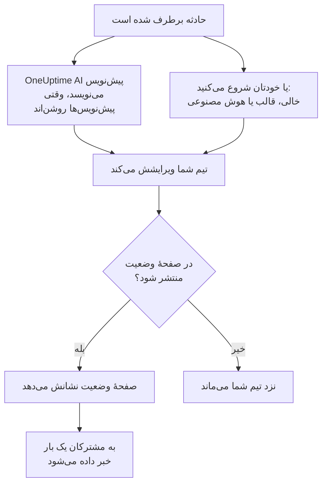

# گزارش‌های پس از حادثه

گزارش پس از حادثه جمع‌بندیِ بعد از یک حادثه است: چه شد، چرا، چه هزینه‌ای برای کاربرانتان داشت و حالا چه چیزی تغییر می‌کند. در OneUptime آن را روی خود حادثه می‌نویسید. می‌تواند از قالب خودتان یا از پیش‌نویسی از OneUptime AI شروع شود، و می‌تواند به عنوان به‌روزرسانی پایانی حادثه روی صفحهٔ وضعیت شما منتشر شود. هر گزارش پس از حادثه یک وضعیت هم دارد، و **حوادث** > **گزارش‌های پس از حادثه** گزارش هر حادثه را فهرست می‌کند تا ببینید کدام‌ها هنوز مانده‌اند.

:::cards
- [نوشتن گزارش پس از حادثه](#نوشتن-گزارش-پس-از-حادثه): در صفحهٔ گزارش پس از حادثهٔ حادثه، در پنج مرحله.
- [شروع از یک قالب یا پیش‌نویس هوش مصنوعی](#شروع-از-یک-قالب-یا-پیشنویس-هوش-مصنوعی): طرح کلی خودتان، یا طرحی که OneUptime AI پر می‌کند.
- [انتشار در صفحهٔ وضعیت شما](#انتشار-در-صفحهٔ-وضعیت-شما): آن را به مشتریان نشان دهید و یک بار به مشترکان خبر دهید.
- [دنبال کردن اینکه هر گزارش به کجا رسیده](#دنبال-کردن-اینکه-هر-گزارش-به-کجا-رسیده): شروع‌نشده، پیش‌نویس، تکمیل‌شده، یا وضعیتی از خودتان.
- [دیدن همهٔ گزارش‌ها](#دیدن-همهٔ-گزارشها): بر اساس مالک، شدت و وضعیت فیلتر کنید تا گزارش‌های مانده را پیدا کنید.
- [گزارش پس از حادثهٔ اپیزودها](#گزارش-پس-از-حادثهٔ-اپیزودها): یک جمع‌بندی برای گروهی از حادثه‌ها.
:::

## گزارش پس از حادثه چگونه شکل می‌گیرد

گزارش پس از حادثه سه بخش دارد که همه روی حادثه‌اند: یادداشت، که با Markdown نوشته می‌شود؛ پیوست‌هایش، مثل تصویرهای صفحه و گزارش‌ها؛ و اینکه روی صفحهٔ وضعیت شما هست یا نه. این‌ها در صفحهٔ **گزارش پس از حادثه** حادثه هستند، زیر **بررسی** در منوی کناری‌اش. هر گزارش یک وضعیت هم دارد که نشان می‌دهد تا کجا پیش رفته، و مالکانی هم دارد: مالکان حادثه.

## نوشتن گزارش پس از حادثه

:::steps
### باز کردن گزارش پس از حادثه

حادثه را باز کنید، سپس روی **گزارش پس از حادثه** زیر **بررسی** در منوی کناری‌اش کلیک کنید. کارت **گزارش پس از حادثه** این‌ها را نشان می‌دهد: **وضعیت** و **مالکان** گزارش، یادداشت، پیوست‌ها و اینکه گزارش روی صفحهٔ وضعیت هست یا نه. **افزودن مالکان** در کنار مالکان، یکی از افراد یا تیم‌های پروژه شما را همان‌جا مالک حادثه می‌کند.

### کلیک روی نوشتن گزارش پس از حادثه

دیالوگ **نوشتن گزارش پس از حادثه** روی نخستین مرحله‌اش، **گزارش پس از حادثه**، باز می‌شود. وقتی گزارش نوشته شد، دکمهٔ کارت **ویرایش یادداشت گزارش پس از حادثه** است که همان مرحله‌ها را باز می‌کند.

### نوشتن یادداشت و پیوست کردن فایل‌ها

**یادداشت گزارش پس از حادثه** را با Markdown بنویسید: چه شد، اثرش، چگونه برطرف شد و کارهای پیگیری. تصویرهای صفحه، گزارش‌ها یا خط‌های زمانی را زیر **پیوست‌های گزارش پس از حادثه** اضافه کنید.

### انتخاب اینکه منتشر شود یا نه

روی **بعدی** کلیک کنید. در مرحلهٔ **صفحه وضعیت**، **انتشار در صفحه وضعیت** خاموش شروع می‌کند، پس گزارش نزد تیم شما می‌ماند. برای نشان دادن آن به مشتریان، [انتشار در صفحهٔ وضعیت شما](#انتشار-در-صفحهٔ-وضعیت-شما) را ببینید.

### ذخیرهٔ گزارش پس از حادثه

روی **ذخیره تغییرات** کلیک کنید. کارت یادداشت و پیوست‌ها را نشان می‌دهد. وضعیت گزارش از **شروع‌نشده** به **پیش‌نویس** می‌رود: [گزارش چگونه پیش می‌رود](#گزارش-چگونه-پیش-میرود) را ببینید.
:::

هر تغییر یادداشت در فید حادثه ثبت می‌شود، و اگر حادثه کانال Slack یا Microsoft Teams داشته باشد در آن هم پست می‌شود. تا وقتی گزارش منتشر نشده، هیچ مشترک صفحهٔ وضعیتی از آن باخبر نمی‌شود.

نوشتن گزارش پس از حادثه به نقش Project Owner، Project Admin، Project Member، Incident Admin یا Incident Member، یا یک نقش سفارشی با مجوز Edit Incident نیاز دارد. هر کسی که بتواند حادثه را بخواند، می‌تواند گزارش آن را هم بخواند.

## شروع از یک قالب یا پیش‌نویس هوش مصنوعی

دو دکمه یادداشت را برایتان پر می‌کنند. تا وقتی چیزی نوشته نشده، کنار **نوشتن گزارش پس از حادثه** هستند: **شروع از قالب**، وقتی پروژه یک قالب گزارش پس از حادثه داشته باشد، و **ساخت با هوش مصنوعی**. وقتی گزارش نوشته شد، در منوی **⋯** کنار **ویرایش یادداشت گزارش پس از حادثه** هستند، با نام‌های **اعمال قالب** و **ساخت با هوش مصنوعی**. هر دو همان ویرایشگر را باز می‌کنند، با یادداشتِ پرشده و بقیهٔ گزارش همان‌طور که بود. تا روی **ذخیره تغییرات** کلیک نکنید چیزی ذخیره نمی‌شود، پس اول یادداشت را بخوانید و اصلاحش کنید.

### اعمال یک قالب

**اعمال قالب** وقتی ظاهر می‌شود که پروژه یک قالب گزارش پس از حادثه داشته باشد. قالب‌ها را زیر **حوادث** > **تنظیمات** > **قالب‌های گزارش پس از حادثه** می‌سازید: [قالب‌های پس‌رویدادنامه](/docs/incidents/settings#قالبهای-پسرویدادنامه) را ببینید. در OneUptime Cloud، قالب‌ها به طرح Growth نیاز دارند.

روی **شروع از قالب**، یا روی **اعمال قالب** در منوی **⋯**، کلیک کنید، در دیالوگ **اعمال قالب گزارش پس از حادثه** یکی را زیر **انتخاب قالب** برگزینید، و روی **اعمال قالب** کلیک کنید. در پروژه‌ای که یک قالب دارد، همان از قبل انتخاب شده است.

### ساختن آن با هوش مصنوعی

روی **ساخت با هوش مصنوعی** کلیک کنید. دیالوگ **ساخت گزارش پس از حادثه با هوش مصنوعی** زیر **انتخاب قالب** یک طرح کلی پیشنهاد می‌کند: **Standard Postmortem**، **Detailed Technical Postmortem** یا **Brief Postmortem**، و سپس قالب‌های گزارش پس از حادثهٔ خودتان. **Template Preview** طرح کلی را نشان می‌دهد، و می‌توانید پیش از ساختن تغییرش دهید.

روی **ساخت با هوش مصنوعی** در پایین دیالوگ کلیک کنید. OneUptime AI حادثه را می‌خواند (توضیحات، علت ریشه‌ای و رفع آن، خط زمانی وضعیتش، یادداشت‌های عمومی و خصوصی‌اش، پیام‌های کانال Slack یا Microsoft Teams آن، و آنچه در [تماس‌هایش](/docs/workspace-connections/video-calls#رونوشت-تماسها) گفته شد) و گزارش را در طرح کلی شما می‌نویسد. سپس ویرایشگر با نتیجه باز می‌شود.

ساختن به روشن بودن هوش مصنوعی برای پروژه، زیر **تنظیمات پروژه** > **هوش مصنوعی** > **AI Features**، و یک ارائه‌دهندهٔ LLM نیاز دارد: [ارائه‌دهندگان LLM](/docs/ai/llm-provider) را ببینید. همچنین به نقش Project Owner یا Project Admin، یا یک نقش سفارشی با مجوز Edit Incident نیاز دارد: نقش‌های دیگر می‌توانند گزارش را بنویسند، ولی نمی‌توانند آن را بسازند.

### بگذارید OneUptime AI هنگام برطرف شدن حادثه پیش‌نویس بنویسد

با روشن بودن **نوشتن پیش‌نویس گزارش پس از حادثه هنگام حل شدن حادثه**، OneUptime AI هر بار که حادثه‌ای برطرف می‌شود پیش‌نویس گزارش را می‌نویسد، آن را به عنوان یادداشت ذخیره می‌کند و برای بازبینی تیم شما در فید حادثه پست می‌کند. این کلید زیر **حوادث** > **هوش مصنوعی** > **تنظیمات** است، و برای پروژه‌های تازه روشن است.

- هرگز یادداشتی را که از قبل نوشته شده جایگزین نمی‌کند.
- هرگز در گزارشی که از قبل منتشر شده نمی‌نویسد، جایی که پیش‌نویس بدون بازبینی به صفحهٔ وضعیت می‌رسید.
- به روشن بودن هوش مصنوعی برای پروژه نیاز دارد، و وقتی پروژه به سقف‌های روزانهٔ هوش مصنوعی‌اش برسد برای آن روز متوقف می‌شود. [گزارش خودکار پس از حادثه](/docs/ai/ai-sre#گزارش-خودکار-پس-از-حادثه) را ببینید.
- اگر هنگام برطرف شدن حادثه رونوشت تماس آن هنوز در راه باشد، منتظر می‌ماند تا OneUptime AI آن را بخواند، تا پیش‌نویس آنچه را در تماس گفته شد بخواند: حداکثر شش ساعت در مدتی که ارائه‌دهنده رونوشت را آماده می‌کند. [ضبط و رونویسی هر تماس](/docs/workspace-connections/video-calls#ضبط-و-رونویسی-هر-تماس) را ببینید.

#### انتخاب اینکه کدام حادثه‌ها پیش‌نویس بگیرند، و قالب آن

بدون قاعده، هر حادثهٔ برطرف‌شده یک پیش‌نویس با ساختار استاندارد OneUptime AI می‌گیرد. **قواعد گزارش پس از حادثه**، زیر **تنظیمات بیشتر** در همان صفحه، این را تغییر می‌دهند:

- یک قاعده با **همه حادثه‌ها** یا با **فقط آن دسته از حادثه‌ها که با شرط‌ها مطابقت دارند** روی مانیتورها، شدت‌ها، برچسب‌ها، برچسب‌های مانیتور، عنوان و توضیح مطابقت دارد، همان‌طور که یک قاعدهٔ هوش مصنوعی مطابقت دارد.
- در **قالب‌ها**، قالب‌های گزارش پس از حادثه‌ای را می‌گذارید که پیش‌نویس می‌تواند از آن‌ها پیروی کند. بدون هیچ قالبی، پیش‌نویس از ساختار استاندارد پیروی می‌کند؛ با یک قالب، از همان قالب؛ با چند قالب، از قالبی که OneUptime AI آن را مناسب‌ترین برای حادثه می‌داند. پست پیش‌نویس در فید، قالبی را که از آن پیروی کرده نام می‌برد.
- **ارائه‌دهنده LLM** آن، زیر **فیلدهای بیشتر**، ارائه‌دهنده‌ای است که OneUptime AI پیش‌نویس را با آن می‌نویسد و قالبش را با آن انتخاب می‌کند. اگر هیچ‌کدام انتخاب نشود، ارائه‌دهندهٔ پیش‌فرض پروژه است و در غیر این صورت ارائه‌دهندهٔ سراسری. پست پیش‌نویس در فید، ارائه‌دهنده‌ای را که قاعده انتخاب کرده نام می‌برد، یا ارائه‌دهنده‌ای را که به جای آن به کار رفت و دلیلش را. [یک قاعده از کدام ارائه‌دهندهٔ LLM استفاده می‌کند](/docs/ai/ai-sre#یک-قاعده-از-کدام-ارائهدهندهٔ-llm-استفاده-میکند) را ببینید.
- نخستین قاعدهٔ فعالی که با حادثه مطابقت دارد، از بالای فهرست، تصمیم می‌گیرد: برای تغییر جای یک قاعده آن را بکشید. حادثه‌ای که هیچ قاعده‌ای با آن مطابقت ندارد پیش‌نویسی نمی‌گیرد، و تا وقتی قواعد خوانده نشوند هیچ حادثه‌ای پیش‌نویس نمی‌گیرد.
- **نوشتن پیش‌نویس گزارش پس از حادثه هنگام حل شدن حادثه** همچنان تنها کلیدی است که پیش‌نویس‌ها را خاموش می‌کند. قواعد فقط دربارهٔ پیش‌نویس‌هایی تصمیم می‌گیرند که OneUptime AI خودش می‌نویسد: **ساخت با هوش مصنوعی** هر ساختاری را پیشنهاد می‌دهد، هر چه قواعد بگویند.
- ساختن، ویرایش و جابه‌جا کردن قواعد به نقش Project Owner یا Project Admin نیاز دارد. در OneUptime Cloud، قالب‌ها به طرح Growth نیاز دارند: پایین‌تر از آن، قواعد همچنان تعیین می‌کنند کدام حادثه‌ها پیش‌نویس بگیرند، و هر پیش‌نویس از ساختار استاندارد پیروی می‌کند.

## انتشار در صفحهٔ وضعیت شما

گزارش منتشرشده به‌روزرسانی پایانی حادثه برای مشتریان شماست: صفحهٔ وضعیت یادداشت را، برجسته در خط زمانی حادثه، همراه با پیوست‌هایش برای دانلود نشان می‌دهد.

:::steps
### باز کردن مرحلهٔ صفحه وضعیت

روی **ویرایش یادداشت گزارش پس از حادثه** کلیک کنید، سپس روی **بعدی** تا به مرحلهٔ **صفحه وضعیت** برسید.

### روشن کردن انتشار در صفحه وضعیت

**انتشار در صفحه وضعیت** را روشن کنید. دو فیلد دیگر ظاهر می‌شوند: **اطلاع به مشترکان**، که روشن است، و **گزارش پس از حادثه منتشر شد در**، که اکنون است.

### تصمیم دربارهٔ اینکه به چه کسی خبر داده شود، و کی نشان داده شود

برای انتشار بدون خبر دادن به مشترکان، **اطلاع به مشترکان** را خاموش کنید. برای نشان دادن زمانی دیگر کنار گزارش، **گزارش پس از حادثه منتشر شد در** را تغییر دهید.

### منتشر کردن آن

روی **ذخیره تغییرات** کلیک کنید. اکنون کارت **گزارش پس از حادثه در صفحه وضعیت دیده شود؟**، **اطلاع به مشترکان**، **وضعیت اعلان به مشترکان** و **گزارش پس از حادثه منتشر شد در** را نشان می‌دهد.
:::

آنچه تعیین می‌کند مشتریان آن را ببینند و از آن باخبر شوند:

- **حادثه باید روی صفحهٔ وضعیت باشد.** یک صفحهٔ وضعیت گزارش را فقط روی حادثه‌ای نشان می‌دهد که خودش نشان می‌دهد: **قابل مشاهده در صفحه وضعیت** روشن، و حادثه خصوصی نباشد.
- **یادداشت باید چیزی بگوید.** گزارشی که با یادداشت خالی منتشر شود نشان داده نمی‌شود، و به هیچ‌کس خبر داده نمی‌شود.
- **به مشترکان یک بار خبر داده می‌شود**، نخستین باری که صفحهٔ وضعیت گزارش را نشان می‌دهد. ذخیرهٔ دوباره، یا ویرایش آن در حالی که منتشر است، صفحه را به‌روز می‌کند و به هیچ‌کس خبر نمی‌دهد. برداشتن آن و انتشار دوباره، دوباره به آن‌ها خبر می‌دهد. گزارشی که وقتی حادثه‌اش پنهان است منتشر شود، وقتی حادثه نمایان شود فرستاده می‌شود.
- **اطلاع به مشترکان هنگام ارسال اعلان خوانده می‌شود.** روشن کردن آن پس از انتشار گزارش چیزی نمی‌فرستد.

**وضعیت اعلان به مشترکان** نشان می‌دهد اعلان فرستاده شده یا نه، و وقتی ناموفق بوده **تلاش دوباره** را پیشنهاد می‌کند. برای هر حالت [پس‌رویدادنامه](/docs/status-pages/subscribers#پسرویدادنامه) را ببینید، و همچنین [تلاش دوباره و ارسال دوباره](/docs/status-pages/subscribers#تلاش-دوباره-و-ارسال-دوباره) را.

**گزارش پس از حادثه منتشر شد در** همچنین زمانی است که گزارش برای اندازه‌گیری **زمان تا گزارش پس از حادثه** منتشرشده به حساب می‌آید: [اندازه‌گیری‌های آماده](/docs/incidents/settings#اندازهگیریهای-آماده) را ببینید.

## دنبال کردن اینکه هر گزارش به کجا رسیده

گزارش پس از حادثهٔ هر حادثه در یکی از وضعیت‌های گزارش پروژه است که زیر **وضعیت** در بالای کارت **گزارش پس از حادثه** آن نشان داده می‌شود. پروژهٔ تازه چهار وضعیت دارد. گزارشی که در **شروع‌نشده** یا **پیش‌نویس** است هنوز مانده است؛ گزارشی که در **تکمیل‌شده** یا **لازم نیست** است، نه:

| وضعیت | معنایش | هنوز مانده |
| --- | --- | --- |
| **شروع‌نشده** | هنوز کسی این گزارش پس از حادثه را ننوشته است. | بله |
| **پیش‌نویس** | گزارش پس از حادثه در حال نوشته شدن است. | بله |
| **تکمیل‌شده** | گزارش پس از حادثه نوشته شده و تمام است. | خیر |
| **لازم نیست** | این حادثه به گزارش پس از حادثه نیازی ندارد. | خیر |

### گزارش چگونه پیش می‌رود

OneUptime در سه لحظه گزارش را خودش جابه‌جا می‌کند:

- گزارش هر حادثهٔ تازه در **شروع‌نشده** آغاز می‌شود، یا در **پیش‌نویس** اگر حادثه با یادداشت اعلام شود، یا در **تکمیل‌شده** اگر آن یادداشت همزمان منتشر شود.
- نخستین یادداشت گزارشی که در **شروع‌نشده** است آن را به **پیش‌نویس** می‌برد، چه کسی آن را بنویسد، چه قالبی اعمال کند، چه OneUptime AI پیش‌نویسش کند.
- انتشار آن در صفحهٔ وضعیت آن را به **تکمیل‌شده** می‌برد، مگر اینکه از پیش تمام شده باشد.

هرگز به عقب برنمی‌گردد: خالی کردن یادداشت، یا برداشتن گزارش از صفحهٔ وضعیت، وضعیتش را همان‌جا که هست نگه می‌دارد. وضعیتی که کسی در همان ذخیره برگزیند همیشه می‌ماند.

### خودتان جابه‌جایش کنید

روی وضعیت کلیک کنید، در صفحهٔ **گزارش پس از حادثه** حادثه یا در ردیف آن در فهرست گزارش‌ها، و یکی را زیر **انتقال گزارش پس از حادثه به** برگزینید. گزارش بی‌درنگ جابه‌جا می‌شود. جابه‌جا کردن گزارش همان نقش‌هایی را می‌خواهد که گزارش را می‌نویسند، و هر کسی که بتواند حادثه را بخواند، می‌بیند گزارشش به کجا رسیده است.

### وضعیت‌های خودتان را بسازید

اگر فرایند شما گامی از خودش دارد، مثل بازبینی، وضعیتی برایش بیفزایید. **حوادث** > **تنظیمات** > **وضعیت‌های گزارش پس از حادثه** را باز کنید، روی **ساخت وضعیت گزارش پس از حادثه** کلیک کنید و نامی مثل **در حال بازبینی**، یک رنگ و یک توضیح به آن بدهید. وضعیت تازه درست بالای **تکمیل‌شده** قرار می‌گیرد؛ برای تغییر جای یک وضعیت، آن را بکشید.

جایگاه یک وضعیت تعیین می‌کند چه محسوب شود، که زیر **در حکم** نشان داده می‌شود: بالای **پیش‌نویس**، **شروع‌نشده**؛ از **پیش‌نویس** به پایین، **در حال انجام**؛ از **تکمیل‌شده** به پایین، **انجام شد**، و دیگر نمانده است. **در حال بازبینی** که میان آن دوست هنوز مانده است؛ **لازم نیست** که زیر **تکمیل‌شده** است، نه.

**شروع‌نشده**، **پیش‌نویس** و **تکمیل‌شده** پیش‌ساخته‌اند، چون OneUptime گزارش‌ها را به آن‌ها می‌برد: می‌توانید نام و رنگشان را تغییر دهید، اما نمی‌توانید حذف یا بایگانی‌شان کنید، و ترتیبشان را نگه می‌دارند. وضعیتی را که دیگر به کار نمی‌برید از منوی **⋯** ردیفش بایگانی کنید: هیچ‌کس دیگر نمی‌تواند گزارشی را به آن ببرد، گزارش‌هایی که در آن هستند تا وقتی کسی جابه‌جایشان نکند می‌مانند، و فهرست همچنان بر اساس آن فیلتر می‌کند. **وضعیت‌های بایگانی‌شدهٔ گزارش پس از حادثه**، که زیر جدول جمع شده است، آن‌ها را فهرست می‌کند، با **خروج از بایگانی** برای بازگرداندن یکی. ساختن، ویرایش و حذف وضعیت‌ها به نقش Project Owner، Project Admin یا Incident Admin، یا یک نقش سفارشی با مجوز متناظر برای وضعیت‌های گزارش نیاز دارد.

## دیدن همهٔ گزارش‌ها

**حوادث** > **گزارش‌های پس از حادثه** گزارش پس از حادثهٔ هر حادثهٔ پروژه را، تازه‌ترین در ابتدا، با ستون‌های **حادثه**، **عنوان**، **وضعیت گزارش پس از حادثه**، **شدت**، **مالکان** و **اعلام‌شده** فهرست می‌کند. **مشاهده** در هر ردیف صفحهٔ **گزارش پس از حادثه** آن حادثه را باز می‌کند.

بالای فهرست، برای هر وضعیت یک کاشی گزارش‌های آن وضعیت را می‌شمارد. روی یک کاشی کلیک کنید تا فقط همان‌ها فهرست شوند، و دوباره کلیک کنید تا همه فهرست شوند.

فهرست را با تراشه‌های بالای آن فیلتر کنید: **مالک**، یک فرد یا یک تیم؛ **شدت**؛ **وضعیت گزارش پس از حادثه**؛ **وضعیت حادثه**؛ **برچسب‌ها**؛ و **منابع تحت تأثیر**. برای دیدن اینکه یک تیم برای شدیدترین حادثه‌های شما هنوز کدام گزارش‌ها را بدهکار است، تیم را زیر **مالک**، شدت را زیر **شدت**، و **شروع‌نشده** و **پیش‌نویس** را زیر **وضعیت گزارش پس از حادثه** برگزینید. فیلترها در نشانی صفحه می‌مانند، پس می‌توانید فهرست را نشانک‌گذاری یا هم‌رسانی کنید.

برای تغییر چندتا با هم، آن‌ها را برگزینید و **اقدامات گروهی** را باز کنید: **تغییر وضعیت گزارش پس از حادثه** همه را به یک وضعیت می‌برد، مثلاً **لازم نیست** برای حادثه‌هایی که به آن نیازی ندارند، و **افزودن مالک** و **حذف مالک** مالکانشان را تغییر می‌دهند.

## گزارش پس از حادثهٔ اپیزودها

یک اپیزود حادثه هم صفحهٔ **گزارش پس از حادثه** دارد، زیر **بررسی**: یک جمع‌بندی برای همهٔ حادثه‌های اپیزود. برای نوشتن آن روی **ویرایش گزارش پس از حادثه** کلیک کنید. **اعمال قالب** و **ساخت با هوش مصنوعی** همان‌طور کار می‌کنند که روی حادثه، و هوش مصنوعی اپیزود و حادثه‌های عضو آن را می‌خواند.

گزارش یک اپیزود فقط یادداشت است: پیوستی ندارد، و هیچ صفحهٔ وضعیتی آن را نشان نمی‌دهد. OneUptime AI وقتی اپیزودی برطرف می‌شود خودبه‌خود پیش‌نویسی برایش نمی‌نویسد. ساختن آن به نقش Project Owner یا Project Admin، یا یک نقش سفارشی با مجوز Edit Incident Episode نیاز دارد. وضعیتی هم ندارد، و فهرست گزارش‌ها آن را در بر نمی‌گیرد.

هشدارها و رویدادهای تعمیر و نگهداری زمان‌بندی‌شده گزارش پس از حادثه ندارند.

## از راه API

گزارش پس از حادثه مجموعه‌ای از فیلدهای حادثه است که مثل بقیهٔ آن از راه `/api/incident` خوانده و نوشته می‌شود:

| فیلد | چیست |
| --- | --- |
| `postmortemNote` | یادداشت، با Markdown. |
| `showPostmortemOnStatusPage` | اینکه گزارش روی صفحه‌های وضعیت شما منتشر شده یا نه. با `false` شروع می‌کند. |
| `notifySubscribersOnPostmortemPublished` | اینکه هنگام انتشار به مشترکان خبر داده شود یا نه. با `true` شروع می‌کند. |
| `postmortemPostedAt` | زمانی که صفحهٔ وضعیت کنار آن نشان می‌دهد. |
| `postmortemStatusId` | وضعیت گزارش: یکی از وضعیت‌های پروژه، در `/api/incident-postmortem-status`. |

نوشتن `showPostmortemOnStatusPage` به صورت `true` روی یک `postmortemNote` نوشته‌شده گزارش را منتشر می‌کند، همان‌طور که دیالوگ می‌کند. این کار گزارش را به **تکمیل‌شده** هم می‌برد، مگر اینکه همان نوشتن `postmortemStatusId` را تعیین کند.

## عیب‌یابی

:::details اعمال قالب روی کارت نیست
پروژه هنوز قالب گزارش پس از حادثه ندارد، یا نقش شما نمی‌تواند قالب‌ها را بخواند. یکی زیر **حوادث** > **تنظیمات** > **قالب‌های گزارش پس از حادثه** بسازید. در OneUptime Cloud، قالب‌ها به طرح Growth نیاز دارند.
:::

:::details ساخت با هوش مصنوعی می‌گوید هوش مصنوعی خاموش است، یا مجوز ندارید
هوش مصنوعی را زیر **تنظیمات پروژه** > **هوش مصنوعی** > **AI Features** روشن کنید. ساختن به نقش Project Owner یا Project Admin، یا یک نقش سفارشی با مجوز Edit Incident نیاز دارد، حتی برای کسی که می‌تواند گزارش را ویرایش کند.
:::

:::details گزارش روی صفحهٔ وضعیت نیست
سه چیز را بررسی کنید: **انتشار در صفحه وضعیت** روشن است، یادداشت خالی نیست، و حادثه روی صفحهٔ وضعیت نشان داده می‌شود (**قابل مشاهده در صفحه وضعیت** روشن، و خصوصی نباشد).
:::

:::details به مشترکان دربارهٔ گزارش خبر داده نشد
**اطلاع به مشترکان** هنگام انتشار خاموش بود، یا حادثه پنهان است: در این صورت به محض نمایان شدن حادثه فرستاده می‌شود. **وضعیت اعلان به مشترکان** روی کارت می‌گوید کدام بوده است.
:::

:::details وقتی حادثه برطرف شد هیچ پیش‌نویس هوش مصنوعی ظاهر نشد
حادثه از قبل یادداشت داشت، گزارش از قبل منتشر شده بود، هیچ قاعدهٔ گزارش پس از حادثه‌ای با آن مطابقت نداشت، یا **نوشتن پیش‌نویس گزارش پس از حادثه هنگام حل شدن حادثه** خاموش است. هوش مصنوعی باید برای پروژه روشن باشد، و پروژه نباید به سقف‌های روزانهٔ هوش مصنوعی‌اش رسیده باشد. وقتی رونوشت تماس حادثه در راه است، پیش‌نویس پس از آنکه OneUptime AI آن را خواند می‌آید.
:::

:::details وضعیت گزارش با نوشتن یادداشتش تغییر نکرد
فقط گزارشی که در **شروع‌نشده** است، یا در وضعیتی از خودتان بالای **پیش‌نویس**، با نخستین یادداشتش خودبه‌خود پیش می‌رود. گزارشی که در جریان است یا تمام شده همان‌جا می‌ماند، و وضعیتی هم که کسی در همان ذخیره برگزیده می‌ماند. خودتان از وضعیتش جابه‌جایش کنید: [خودتان جابه‌جایش کنید](#خودتان-جابهجایش-کنید) را ببینید.
:::

## گام‌های بعدی

:::cards
- [نمای کلی حوادث](/docs/incidents/index): صفحه‌های دیگر حادثه، از اعلام تا برطرف کردن.
- [تنظیمات و خودکارسازی حادثه](/docs/incidents/settings): قالب‌های گزارش پس از حادثه و اندازه‌گیری زمان تا گزارش پس از حادثه.
- [مشترکان و اطلاعیه‌ها](/docs/status-pages/subscribers): هر آنچه یک صفحهٔ وضعیت به مشترکانش می‌گوید.
- [AI SRE](/docs/ai/ai-sre): کاری که OneUptime AI پس از یک حادثه خودبه‌خود انجام می‌دهد.
:::
