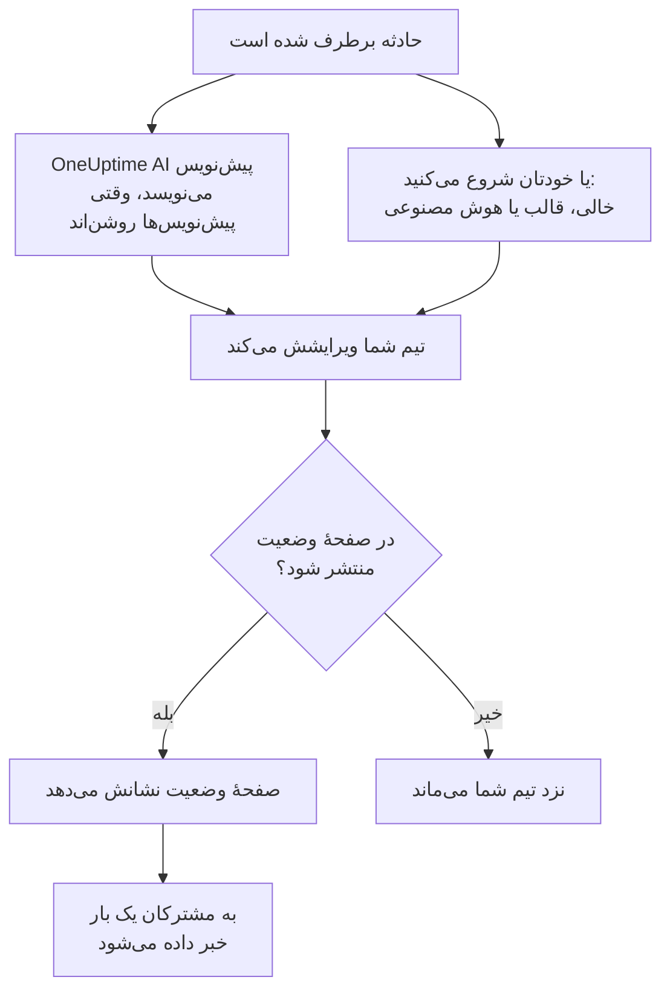

# گزارش‌های پس از حادثه

گزارش پس از حادثه جمع‌بندیِ بعد از یک حادثه است: چه شد، چرا، چه هزینه‌ای برای کاربرانتان داشت و حالا چه چیزی تغییر می‌کند. در OneUptime آن را روی خود حادثه می‌نویسید. می‌تواند از قالب خودتان یا از پیش‌نویسی از OneUptime AI شروع شود، و می‌تواند به عنوان به‌روزرسانی پایانی حادثه روی صفحهٔ وضعیت شما منتشر شود.

:::cards
- [نوشتن گزارش پس از حادثه](#نوشتن-گزارش-پس-از-حادثه): در صفحهٔ گزارش پس از حادثهٔ حادثه، در پنج مرحله.
- [شروع از یک قالب یا پیش‌نویس هوش مصنوعی](#شروع-از-یک-قالب-یا-پیشنویس-هوش-مصنوعی): طرح کلی خودتان، یا طرحی که OneUptime AI پر می‌کند.
- [انتشار در صفحهٔ وضعیت شما](#انتشار-در-صفحهٔ-وضعیت-شما): آن را به مشتریان نشان دهید و یک بار به مشترکان خبر دهید.
- [گزارش پس از حادثهٔ اپیزودها](#گزارش-پس-از-حادثهٔ-اپیزودها): یک جمع‌بندی برای گروهی از حادثه‌ها.
:::

## گزارش پس از حادثه چگونه شکل می‌گیرد

گزارش پس از حادثه سه بخش دارد که همه روی حادثه‌اند: یادداشت، که با Markdown نوشته می‌شود؛ پیوست‌هایش، مثل تصویرهای صفحه و گزارش‌ها؛ و اینکه روی صفحهٔ وضعیت شما هست یا نه. این‌ها در صفحهٔ **گزارش پس از حادثه** حادثه هستند، زیر **بررسی** در منوی کناری‌اش.

## نوشتن گزارش پس از حادثه

:::steps
### باز کردن گزارش پس از حادثه

حادثه را باز کنید، سپس روی **گزارش پس از حادثه** زیر **بررسی** در منوی کناری‌اش کلیک کنید. کارت **یادداشت گزارش پس از حادثه** یادداشت، پیوست‌ها و اینکه گزارش روی صفحهٔ وضعیت هست یا نه را نشان می‌دهد.

### کلیک روی ویرایش یادداشت گزارش پس از حادثه

دیالوگ **ویرایش یادداشت گزارش پس از حادثه** روی نخستین مرحله‌اش، **گزارش پس از حادثه**، باز می‌شود.

### نوشتن یادداشت و پیوست کردن فایل‌ها

**یادداشت گزارش پس از حادثه** را با Markdown بنویسید: چه شد، اثرش، چگونه برطرف شد و کارهای پیگیری. تصویرهای صفحه، گزارش‌ها یا خط‌های زمانی را زیر **پیوست‌های گزارش پس از حادثه** اضافه کنید.

### انتخاب اینکه منتشر شود یا نه

روی **بعدی** کلیک کنید. در مرحلهٔ **صفحه وضعیت**، **انتشار در صفحه وضعیت** خاموش شروع می‌کند، پس گزارش نزد تیم شما می‌ماند. برای نشان دادن آن به مشتریان، [انتشار در صفحهٔ وضعیت شما](#انتشار-در-صفحهٔ-وضعیت-شما) را ببینید.

### ذخیرهٔ گزارش پس از حادثه

روی **ذخیره تغییرات** کلیک کنید. کارت یادداشت و پیوست‌ها را نشان می‌دهد.
:::

هر تغییر یادداشت در فید حادثه ثبت می‌شود، و اگر حادثه کانال Slack یا Microsoft Teams داشته باشد در آن هم پست می‌شود. تا وقتی گزارش منتشر نشده، هیچ مشترک صفحهٔ وضعیتی از آن باخبر نمی‌شود.

نوشتن گزارش پس از حادثه به نقش Project Owner، Project Admin، Project Member، Incident Admin یا Incident Member، یا یک نقش سفارشی با مجوز Edit Incident نیاز دارد. هر کسی که بتواند حادثه را بخواند، می‌تواند گزارش آن را هم بخواند.

## شروع از یک قالب یا پیش‌نویس هوش مصنوعی

دو دکمه روی کارت یادداشت را برایتان پر می‌کنند: **ساخت با هوش مصنوعی**، و **اعمال قالب** وقتی پروژه یک قالب گزارش پس از حادثه داشته باشد. هر دو همان ویرایشگر **ویرایش یادداشت گزارش پس از حادثه** را باز می‌کنند، با یادداشتِ پرشده و بقیهٔ گزارش همان‌طور که بود. تا روی **ذخیره تغییرات** کلیک نکنید چیزی ذخیره نمی‌شود، پس اول یادداشت را بخوانید و اصلاحش کنید.

### اعمال یک قالب

**اعمال قالب** وقتی ظاهر می‌شود که پروژه یک قالب گزارش پس از حادثه داشته باشد. قالب‌ها را زیر **حوادث** > **تنظیمات** > **قالب‌های گزارش پس از حادثه** می‌سازید: [قالب‌های پس‌رویدادنامه](/docs/incidents/settings#قالبهای-پسرویدادنامه) را ببینید. در OneUptime Cloud، قالب‌ها به طرح Growth نیاز دارند.

روی **اعمال قالب** کلیک کنید، در دیالوگ **اعمال قالب گزارش پس از حادثه** یکی را زیر **انتخاب قالب** برگزینید، و روی **اعمال قالب** کلیک کنید. در پروژه‌ای که یک قالب دارد، همان از قبل انتخاب شده است.

### ساختن آن با هوش مصنوعی

روی **ساخت با هوش مصنوعی** کلیک کنید. دیالوگ **ساخت گزارش پس از حادثه با هوش مصنوعی** زیر **انتخاب قالب** یک طرح کلی پیشنهاد می‌کند: **Standard Postmortem**، **Detailed Technical Postmortem** یا **Brief Postmortem**، و سپس قالب‌های گزارش پس از حادثهٔ خودتان. **Template Preview** طرح کلی را نشان می‌دهد، و می‌توانید پیش از ساختن تغییرش دهید.

روی **ساخت با هوش مصنوعی** در پایین دیالوگ کلیک کنید. OneUptime AI حادثه را می‌خواند (توضیحات، علت ریشه‌ای و رفع آن، خط زمانی وضعیتش، یادداشت‌های عمومی و خصوصی‌اش، پیام‌های کانال Slack یا Microsoft Teams آن، و آنچه در [تماس‌هایش](/docs/workspace-connections/video-calls#رونوشت-تماسها) گفته شد) و گزارش را در طرح کلی شما می‌نویسد. سپس ویرایشگر با نتیجه باز می‌شود.

ساختن به روشن بودن هوش مصنوعی برای پروژه، زیر **تنظیمات پروژه** > **هوش مصنوعی** > **AI Features**، و یک ارائه‌دهندهٔ LLM نیاز دارد: [ارائه‌دهندگان LLM](/docs/ai/llm-provider) را ببینید. همچنین به نقش Project Owner یا Project Admin، یا یک نقش سفارشی با مجوز Edit Incident نیاز دارد: نقش‌های دیگر می‌توانند گزارش را بنویسند، ولی نمی‌توانند آن را بسازند.

### بگذارید OneUptime AI هنگام برطرف شدن حادثه پیش‌نویس بنویسد

با روشن بودن **نوشتن پیش‌نویس گزارش پس از حادثه هنگام حل شدن حادثه**، OneUptime AI هر بار که حادثه‌ای برطرف می‌شود پیش‌نویس گزارش را می‌نویسد، آن را به عنوان یادداشت ذخیره می‌کند و برای بازبینی تیم شما در فید حادثه پست می‌کند. این کلید زیر **حوادث** > **هوش مصنوعی** > **تنظیمات** است، و برای پروژه‌های تازه روشن است.

- هرگز یادداشتی را که از قبل نوشته شده جایگزین نمی‌کند.
- هرگز در گزارشی که از قبل منتشر شده نمی‌نویسد، جایی که پیش‌نویس بدون بازبینی به صفحهٔ وضعیت می‌رسید.
- به روشن بودن هوش مصنوعی برای پروژه نیاز دارد، و وقتی پروژه به سقف‌های روزانهٔ هوش مصنوعی‌اش برسد برای آن روز متوقف می‌شود. [گزارش خودکار پس از حادثه](/docs/ai/ai-sre#گزارش-خودکار-پس-از-حادثه) را ببینید.
- اگر هنگام برطرف شدن حادثه رونوشت تماس آن هنوز در راه باشد، منتظر می‌ماند تا OneUptime AI آن را بخواند، تا پیش‌نویس آنچه را در تماس گفته شد بخواند: حداکثر شش ساعت در مدتی که ارائه‌دهنده رونوشت را آماده می‌کند. [ضبط و رونویسی هر تماس](/docs/workspace-connections/video-calls#ضبط-و-رونویسی-هر-تماس) را ببینید.

## انتشار در صفحهٔ وضعیت شما

گزارش منتشرشده به‌روزرسانی پایانی حادثه برای مشتریان شماست: صفحهٔ وضعیت یادداشت را، برجسته در خط زمانی حادثه، همراه با پیوست‌هایش برای دانلود نشان می‌دهد.

:::steps
### باز کردن مرحلهٔ صفحه وضعیت

روی **ویرایش یادداشت گزارش پس از حادثه** کلیک کنید، سپس روی **بعدی** تا به مرحلهٔ **صفحه وضعیت** برسید.

### روشن کردن انتشار در صفحه وضعیت

**انتشار در صفحه وضعیت** را روشن کنید. دو فیلد دیگر ظاهر می‌شوند: **اطلاع به مشترکان**، که روشن است، و **گزارش پس از حادثه منتشر شد در**، که اکنون است.

### تصمیم دربارهٔ اینکه به چه کسی خبر داده شود، و کی نشان داده شود

برای انتشار بدون خبر دادن به مشترکان، **اطلاع به مشترکان** را خاموش کنید. برای نشان دادن زمانی دیگر کنار گزارش، **گزارش پس از حادثه منتشر شد در** را تغییر دهید.

### منتشر کردن آن

روی **ذخیره تغییرات** کلیک کنید. اکنون کارت **گزارش پس از حادثه در صفحه وضعیت دیده شود؟**، **اطلاع به مشترکان**، **وضعیت اعلان به مشترکان** و **گزارش پس از حادثه منتشر شد در** را نشان می‌دهد.
:::

آنچه تعیین می‌کند مشتریان آن را ببینند و از آن باخبر شوند:

- **حادثه باید روی صفحهٔ وضعیت باشد.** یک صفحهٔ وضعیت گزارش را فقط روی حادثه‌ای نشان می‌دهد که خودش نشان می‌دهد: **قابل مشاهده در صفحه وضعیت** روشن، و حادثه خصوصی نباشد.
- **یادداشت باید چیزی بگوید.** گزارشی که با یادداشت خالی منتشر شود نشان داده نمی‌شود، و به هیچ‌کس خبر داده نمی‌شود.
- **به مشترکان یک بار خبر داده می‌شود**، نخستین باری که صفحهٔ وضعیت گزارش را نشان می‌دهد. ذخیرهٔ دوباره، یا ویرایش آن در حالی که منتشر است، صفحه را به‌روز می‌کند و به هیچ‌کس خبر نمی‌دهد. برداشتن آن و انتشار دوباره، دوباره به آن‌ها خبر می‌دهد. گزارشی که وقتی حادثه‌اش پنهان است منتشر شود، وقتی حادثه نمایان شود فرستاده می‌شود.
- **اطلاع به مشترکان هنگام ارسال اعلان خوانده می‌شود.** روشن کردن آن پس از انتشار گزارش چیزی نمی‌فرستد.

**وضعیت اعلان به مشترکان** نشان می‌دهد اعلان فرستاده شده یا نه، و وقتی ناموفق بوده **تلاش دوباره** را پیشنهاد می‌کند. برای هر حالت [پس‌رویدادنامه](/docs/status-pages/subscribers#پسرویدادنامه) را ببینید، و همچنین [تلاش دوباره و ارسال دوباره](/docs/status-pages/subscribers#تلاش-دوباره-و-ارسال-دوباره) را.

**گزارش پس از حادثه منتشر شد در** همچنین زمانی است که گزارش برای اندازه‌گیری **زمان تا گزارش پس از حادثه** منتشرشده به حساب می‌آید: [اندازه‌گیری‌های آماده](/docs/incidents/settings#اندازهگیریهای-آماده) را ببینید.

## گزارش پس از حادثهٔ اپیزودها

یک اپیزود حادثه هم صفحهٔ **گزارش پس از حادثه** دارد، زیر **بررسی**: یک جمع‌بندی برای همهٔ حادثه‌های اپیزود. برای نوشتن آن روی **ویرایش گزارش پس از حادثه** کلیک کنید. **اعمال قالب** و **ساخت با هوش مصنوعی** همان‌طور کار می‌کنند که روی حادثه، و هوش مصنوعی اپیزود و حادثه‌های عضو آن را می‌خواند.

گزارش یک اپیزود فقط یادداشت است: پیوستی ندارد، و هیچ صفحهٔ وضعیتی آن را نشان نمی‌دهد. OneUptime AI وقتی اپیزودی برطرف می‌شود خودبه‌خود پیش‌نویسی برایش نمی‌نویسد. ساختن آن به نقش Project Owner یا Project Admin، یا یک نقش سفارشی با مجوز Edit Incident Episode نیاز دارد.

هشدارها و رویدادهای تعمیر و نگهداری زمان‌بندی‌شده گزارش پس از حادثه ندارند.

## از راه API

گزارش پس از حادثه مجموعه‌ای از فیلدهای حادثه است که مثل بقیهٔ آن از راه `/api/incident` خوانده و نوشته می‌شود:

| فیلد | چیست |
| --- | --- |
| `postmortemNote` | یادداشت، با Markdown. |
| `showPostmortemOnStatusPage` | اینکه گزارش روی صفحه‌های وضعیت شما منتشر شده یا نه. با `false` شروع می‌کند. |
| `notifySubscribersOnPostmortemPublished` | اینکه هنگام انتشار به مشترکان خبر داده شود یا نه. با `true` شروع می‌کند. |
| `postmortemPostedAt` | زمانی که صفحهٔ وضعیت کنار آن نشان می‌دهد. |

نوشتن `showPostmortemOnStatusPage` به صورت `true` روی یک `postmortemNote` نوشته‌شده گزارش را منتشر می‌کند، همان‌طور که دیالوگ می‌کند.

## عیب‌یابی

:::details اعمال قالب روی کارت نیست
پروژه هنوز قالب گزارش پس از حادثه ندارد، یا نقش شما نمی‌تواند قالب‌ها را بخواند. یکی زیر **حوادث** > **تنظیمات** > **قالب‌های گزارش پس از حادثه** بسازید. در OneUptime Cloud، قالب‌ها به طرح Growth نیاز دارند.
:::

:::details ساخت با هوش مصنوعی می‌گوید هوش مصنوعی خاموش است، یا مجوز ندارید
هوش مصنوعی را زیر **تنظیمات پروژه** > **هوش مصنوعی** > **AI Features** روشن کنید. ساختن به نقش Project Owner یا Project Admin، یا یک نقش سفارشی با مجوز Edit Incident نیاز دارد، حتی برای کسی که می‌تواند گزارش را ویرایش کند.
:::

:::details گزارش روی صفحهٔ وضعیت نیست
سه چیز را بررسی کنید: **انتشار در صفحه وضعیت** روشن است، یادداشت خالی نیست، و حادثه روی صفحهٔ وضعیت نشان داده می‌شود (**قابل مشاهده در صفحه وضعیت** روشن، و خصوصی نباشد).
:::

:::details به مشترکان دربارهٔ گزارش خبر داده نشد
**اطلاع به مشترکان** هنگام انتشار خاموش بود، یا حادثه پنهان است: در این صورت به محض نمایان شدن حادثه فرستاده می‌شود. **وضعیت اعلان به مشترکان** روی کارت می‌گوید کدام بوده است.
:::

:::details وقتی حادثه برطرف شد هیچ پیش‌نویس هوش مصنوعی ظاهر نشد
حادثه از قبل یادداشت داشت، گزارش از قبل منتشر شده بود، یا **نوشتن پیش‌نویس گزارش پس از حادثه هنگام حل شدن حادثه** خاموش است. هوش مصنوعی باید برای پروژه روشن باشد، و پروژه نباید به سقف‌های روزانهٔ هوش مصنوعی‌اش رسیده باشد. وقتی رونوشت تماس حادثه در راه است، پیش‌نویس پس از آنکه OneUptime AI آن را خواند می‌آید.
:::

## گام‌های بعدی

:::cards
- [نمای کلی حوادث](/docs/incidents/index): صفحه‌های دیگر حادثه، از اعلام تا برطرف کردن.
- [تنظیمات و خودکارسازی حادثه](/docs/incidents/settings): قالب‌های گزارش پس از حادثه و اندازه‌گیری زمان تا گزارش پس از حادثه.
- [مشترکان و اطلاعیه‌ها](/docs/status-pages/subscribers): هر آنچه یک صفحهٔ وضعیت به مشترکانش می‌گوید.
- [AI SRE](/docs/ai/ai-sre): کاری که OneUptime AI پس از یک حادثه خودبه‌خود انجام می‌دهد.
:::
