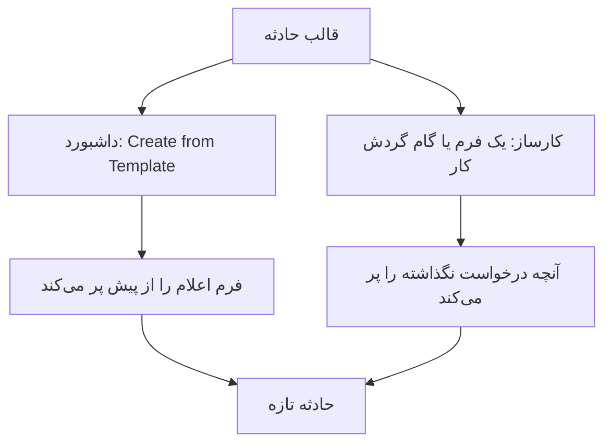
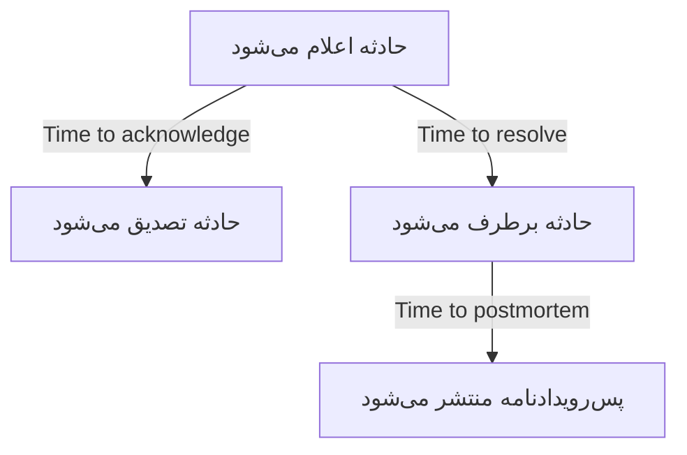
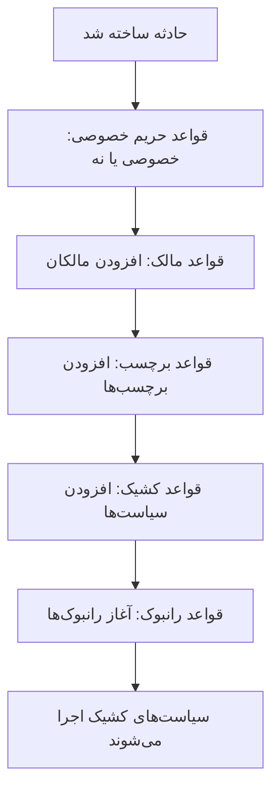

# تنظیمات و خودکارسازی حادثه

پیکربندی حادثه درون **حوادث** است، نه در **تنظیمات پروژه**: وضعیت‌ها و شدت‌ها، قالب‌ها، فیلدهای سفارشی، نقش‌ها، اندازه‌گیری‌ها و شماره‌گذاری، و قواعدی که روی هر حادثه تازه عمل می‌کنند. این صفحه مرجع هر یک از آن صفحه‌هاست، و مرجع آنچه همان لحظه که حادثه‌ای اعلام می‌شود خودبه‌خود اجرا می‌شود.

:::cards
- [قالب‌های حادثه](#قالبهای-حادثه): همان نوع حادثه را هر بار از پیش پرشده اعلام کنید.
- [فیلدهای سفارشی](#فیلدهای-سفارشی): فیلدهای خودتان روی هر حادثه، که هنگام اعلامش پرسیده می‌شوند.
- [اندازه‌گیری‌ها](#اندازهگیریها): زمان تا تصدیق، برطرف شدن یا کاهش اثر، محاسبه‌شده برای هر حادثه.
- [قواعد](#قواعدی-که-هنگام-ساخت-حادثه-اجرا-میشوند): مالکان، برچسب‌ها، فراخوانی و اپیزودها، خودکار تنظیم‌شده.
:::

## تنظیمات حادثه کجا زندگی می‌کنند

**حوادث** را از منوی **محصولات** در نوار بالا باز کنید، سپس **تنظیمات** را پایین منوی کناری‌اش باز کنید. **قواعد** و **تنظیمات** هر دو جمع آغاز می‌شوند، پس پیش از آنکه صفحه‌های زیر پدیدار شوند بازشان کنید. همه چیز اینجا محدود به پروژه است: قالب‌ها، نقش‌ها، فیلدهای سفارشی و قواعد به یک پروژه تعلق دارند و روی هر حادثه‌ای که در آن اعلام شود اعمال می‌شوند، در مسیرهایی که با `/dashboard/{projectId}/incidents/settings/` آغاز می‌شوند.

| صفحه | آنجا چه می‌کنید |
| ------------------------ | -------------------------------------------------------------------------------------------- |
| **وضعیت حادثه** | افزودن، تغییر نام، تغییر رنگ و مرتب کردن وضعیت‌هایی که حادثه از میانشان می‌گذرد. |
| **شدت حادثه** | افزودن، تغییر نام، تغییر رنگ و مرتب کردن سطوح شدت. |
| **قالب‌های حادثه** | از پیش پر کردن کل حادثه — عنوان، توضیحات، منابع، سیاست‌های کشیک، مالکان، برچسب‌ها. |
| **قالب‌های یادداشت** | متن بازکاربردپذیر برای یادداشت‌های عمومی و خصوصی. |
| **تأیید یادداشت‌های عمومی** | یادداشت‌های عمومی را پیش از انتشار به تأیید برسانید و انتخاب کنید چه کسی آن‌ها را تأیید می‌کند. |
| **اعلان‌های مشترکان** | انتخاب اینکه هنگام اعلام حادثه، **اطلاع به مشترکان صفحه وضعیت** از قبل تیک‌خورده باشد یا نه. به‌طور پیش‌فرض روشن. |
| **قالب‌های گزارش پس از حادثه** | ساختارهای بازکاربردپذیر پس‌رویدادنامه. |
| **وضعیت‌های گزارش پس از حادثه** | وضعیت‌هایی که پس‌رویدادنامه از آن‌ها می‌گذرد، از شروع‌نشده تا تکمیل‌شده. |
| **فیلدهای سفارشی** | تعریف فیلدهای اضافه‌ای که روی هر حادثه پدیدار می‌شوند. |
| **نقش‌های حادثه** | تعریف نقش‌هایی که پاسخ‌دهندگان را به آن‌ها می‌گمارید، مانند فرمانده حادثه. |
| **اندازه‌گیری‌ها** | سنجش مدت کارها، مانند زمان تا تصدیق یا زمان تا برطرف شدن، روی هر حادثه. |
| **هشدارهای پیوندشده** | انتخاب اینکه آیا هشدارهای پیوندشده به یک حادثه همراه آن تصدیق و برطرف شوند. هر دو در پروژه‌های تازه روشن‌اند. |
| **عضویت در اپیزود** | انتخاب اینکه آیا هر حادثه فقط می‌تواند در یک اپیزود باشد. به‌طور پیش‌فرض خاموش است. |
| **شماره‌گذاری**     | متنی که پیش از شماره حادثه‌ها و اپیزودها می‌آید، مانند `INC-` در `INC-42`، و شماره‌ای که مورد بعدی می‌گیرد. |
| **نگهداری داده** | مدت نگهداری حوادث برطرف‌شده پیش از حذف. تا وقتی مدتی انتخاب نکنید، همه نگه داشته می‌شوند. |

آنچه هوش مصنوعی OneUptime خودش انجام می‌دهد اینجا تنظیم نمی‌شود: بخشی از آنِ خود دارد، **حوادث ← هوش مصنوعی**، در مسیرهایی که با `/dashboard/{projectId}/incidents/ai/` آغاز می‌شوند. صفحه **تنظیمات** آن بررسی حادثه‌های تازه، اصلاح خودکارشان (که تا روشنش نکنید خاموش است)، و پیش‌نویس پس‌رویدادنامه را روشن یا خاموش می‌کند، و هر کلید همان لحظه که زده شود ذخیره می‌شود؛ قواعد هوش مصنوعی، که محدود می‌کنند کدام حادثه‌ها بررسی و اصلاح شوند و با کدام مخازن کد و درخواست‌های ادغام، قواعد گزارش پس از حادثه، که تعیین می‌کنند کدام حادثه‌های حل‌شده پیش‌نویس بگیرند و پیش‌نویس از کدام قالب‌ها پیروی کند، و محدودیت‌های اختیاری‌ای که هوش مصنوعی زیرشان کار می‌کند، زیر **تنظیمات بیشتر** جمع شده‌اند، و هیچ‌کدام تا وقتی تنظیمشان نکنید اعمال نمی‌شود. **بینش‌ها** و **لاگ‌ها** کنار آن‌اند: آنچه هوش مصنوعی از حادثه‌های شما آموخت، و هر کاری که کرد. [AI SRE](/docs/ai/ai-sre) را ببینید.

**وضعیت حادثه** و **شدت حادثه** به‌طور عمیق در [وضعیت‌ها و شدت‌های حادثه](/docs/incidents/states-and-severities) پوشش داده شده‌اند — باقی این صفحه از **قالب‌های حادثه** ادامه می‌دهد. فرم‌هایی که به آدم‌های بیرون از تیمتان اجازه می‌دهند حادثه گزارش کنند محصولی جداگانه‌اند: [فرم‌ها](/docs/forms/index) را ببینید. ابزارهایی که خودشان حادثه باز می‌کنند، مانند [Huntress](/docs/integrations/huntress)، به شکل گردش کار راه‌اندازی می‌شوند.

**قواعد** را باز کنید و هشت صفحه دیگر می‌بینید: **قواعد گروه‌بندی**، **قواعد آنکال**، **قواعد مالکیت**، **قواعد رانبوک**، **قواعد حریم خصوصی**، **قواعد برچسب**، **قواعد SLA** و **قواعد یادآوری**. آن‌ها پایین‌تر پوشش داده شده‌اند.

## قالب‌های حادثه

قالب حادثه اسکلتی ذخیره‌شده از یک حادثه است. به‌جای تایپ دوباره همان عنوان، همان فهرست مانیتور و همان سیاست کشیک هر بار که خوشه پرداخت می‌لرزد، یک بار ذخیره‌اش می‌کنید و از رویش اعلام می‌کنید.

:::steps
1. به **حوادث ← تنظیمات ← قالب‌های حادثه** (`/dashboard/{projectId}/incidents/settings/templates`) بروید. کارت **قالب‌های حادثه** نام دارد.
2. روی **ساخت قالب حادثه** کلیک کنید. قالب را در **اطلاعات قالب** نام‌گذاری کنید، سپس حادثه‌ای را که اعلام می‌کند در **جزئیات حادثه** پر کنید: یک **عنوان**، یک **شدت حادثه** و یک **توضیحات**.
3. با **بعدی** از گام‌های اختیاری بگذرید — منابع متأثر، فیلدهای سفارشی و سیاست‌های کشیکش — و آنچه هر حادثه‌ای از این نوع مشترک دارد پر کنید.
4. در گام آخر روی **ساخت قالب حادثه** کلیک کنید. از این پس **ساخت از روی قالب** در فهرست حادثه‌ها این قالب را پیشنهاد می‌کند.
:::

ساختن یکی شما را از جادوگری چهارگامی می‌گذراند، که وقتی پروژه شما فیلدهای سفارشی حادثه دارد دو گام بیشتر دارد. فقط دو گام نخست چیزی می‌پرسند که باید پاسخش دهید: **بعدی** از گام‌های اختیاری پس از آن‌ها می‌گذرد، و **ساخت قالب حادثه** در گام آخر است.

- **اطلاعات قالب** — **نام قالب** و **توضیحات قالب**. این‌ها خود قالب را نام‌گذاری می‌کنند؛ هرگز روی حادثه پدیدار نمی‌شوند.
- **جزئیات حادثه** — **عنوان**، **توضیحات** (مارک‌داون) و **شدت حادثه**. زیر **فیلدهای بیشتر**، که سرتیتر تاشده‌اش هر سه را نام می‌برد و هر کدام را که تنظیم شده باشد نشان می‌دهد:
  - **وضعیت اولیه حادثه** — وضعیتی که حادثه‌های اعلام‌شده از این قالب در آن آغاز می‌شوند. مانند فرم اعلام خالی آغاز می‌شود و گزینه‌هایش به ترتیب وضعیت فهرست می‌شوند. اگر خالی بماند، همان‌طور که جانگهدارش می‌گوید، آن حادثه‌ها در وضعیت آغازین معمول آغاز می‌شوند: وضعیت ساخت پروژه، همان وضعیتی که هر حادثه تازه در آن آغاز می‌شود. قالبی که با وضعیتی ذخیره شده آن را نگه می‌دارد.
  - **مالکان** — افراد و تیم‌هایی که مالک حادثه‌های اعلام‌شده از این قالب‌اند. **افزودن مالک** یک فهرست از هر دو باز می‌کند، همان فهرست صفحه **مالکان** حادثه؛ هر انتخاب به‌صورت برچسبی نمایش داده می‌شود که می‌توانید آن را بردارید. قالب موجود آن‌ها را روی کارت **مالکان** نشان می‌دهد.
  - **برچسب‌ها** — برچسب‌هایی که حادثه‌های اعلام‌شده از این قالب با آن‌ها آغاز می‌شوند.
- **منابع تحت تأثیر** — مانند فرم اعلام: **مانیتورها**، سپس **تغییر وضعیت مانیتور به**، سپس **سایر منابع تحت تأثیر** برای میزبان‌ها، خوشه‌ها و سرویس‌ها، با **محدود به این صفحات وضعیت** زیر **فیلدهای بیشتر**. قالب همیشه **تغییر وضعیت مانیتور به** را می‌پرسد، چه مانیتوری برگزیده شده باشد چه نه: این وضعیت روی مانیتورهایی هم اعمال می‌شود که هنگام اعلام حادثه از روی قالب برگزیده می‌شوند، جایی که فرم اعلام به محض برگزیدن نخستین مانیتور آن را نشان می‌دهد. کارت **منابع تحت تأثیر** قالب موجود هم به همین شکل می‌پرسد، و وضعیتی را که قالب برگزیده نشان می‌دهد، یا اگر وضعیتی برنگزیده باشد **مانیتورها وضعیت خود را حفظ می‌کنند.** را. **محدود به این صفحات وضعیت** حادثه‌هایی را که از روی قالب اعلام می‌شوند به برخی از صفحه‌های وضعیتی که مانیتورهایشان را فهرست کرده‌اند محدود می‌کند — قالب `Region East outage` می‌تواند صفحه‌های سایت‌های شرقی را با خود داشته باشد. قالب موجود آن را روی کارت **دامنهٔ صفحات وضعیت**، با **ویرایش دامنهٔ صفحات وضعیت**، نشان می‌دهد. [یک صفحه وضعیت برای هر مخاطب](/docs/status-pages/one-status-page-per-audience) را ببینید.
- **فیلدهای سفارشی** — فقط وقتی پروژه شما فیلدهای سفارشی حادثه دارد: مقادیری که حادثه‌های اعلام‌شده از این قالب با آن‌ها آغاز می‌شوند. همه فیلدها اینجا پیشنهاد می‌شوند، نه فقط آن‌هایی که گام **جزئیات** می‌پرسد، و هیچ‌کدام الزامی نیست. قالب موجود کارت **فیلدهای سفارشی** برای تغییر آن‌ها دارد.
- **فیلدهای سفارشی هنگام ایجاد** — این هم فقط وقتی پروژه شما فیلدهای سفارشی حادثه دارد: گام **جزئیات** هنگام اعلام حادثه‌ای از روی این قالب کدام‌یک از آن‌ها را بپرسد، و کدام باید پر شود. قالب موجود کارت **فیلدهای سفارشی هنگام ایجاد** برای تغییر آن‌ها دارد. [فیلدهای سفارشی هنگام ساخت](#فیلدهای-سفارشی-هنگام-ساخت) را ببینید.
- **آنکال** — **سیاست آنکال**، سیاست‌هایی که هنگام اعلام حادثه‌ای ساخته‌شده از این قالب اجرا می‌شوند.

چند قاعده سریع:

- فهرست قالب‌ها فقط **نام** و **توضیحات** را نشان می‌دهد. سطرها از فهرست ویرایش‌شدنی یا حذف‌شدنی نیستند — برای تغییر یک قالب آن را باز کنید (`/dashboard/{projectId}/incidents/settings/templates/{modelId}`).
- هر کسی که بتواند قالبی را ویرایش کند می‌تواند جزئیات و منابع متأثر آن را تغییر دهد، از جمله **وضعیت اولیه حادثه** و **تغییر وضعیت مانیتور به**: Project Ownerها، Project Adminها و Project Memberها، Incident Adminها و Incident Memberها، و نقشی با **Edit Incident Template**.
- قالب‌ها از وارد و صادر کردن JSON پشتیبانی می‌کنند، پس می‌توانید یکی را میان پروژه‌ها جابه‌جا کنید.
- بی هیچ قالبی، فهرست **هیچ قالب حادثه‌ای یافت نشد** را می‌گوید و **ساخت قالب حادثه** درست زیر آن است.
- بی هیچ قالبی، **ساخت از روی قالب** در فهرست حادثه‌ها هم پنجره **قالب حادثه‌ای نیست** را باز می‌کند که می‌گوید قالب‌ها کجا ساخته می‌شوند، و دکمه **ایجاد قالب** آن **حوادث ← تنظیمات ← قالب‌های حادثه** را باز می‌کند.

### قالب چگونه اعمال می‌شود

دو مسیر هست، و به یک شکل ادغام می‌کنند.



- **در داشبورد** — دکمه **ساخت از روی قالب** در فهرست حادثه‌ها انتخابگر **انتخاب قالب حادثه** را باز می‌کند، و صفحه اعلام قالب را از پارامتر رشته پرس‌وجوی `incidentTemplateId` می‌خواند، سپس فرم را با قالب به‌علاوه تیم‌ها و کاربران مالکش از پیش پر می‌کند. گام **جزئیات** آن از [فیلدهای سفارشی هنگام ساخت](#فیلدهای-سفارشی-هنگام-ساخت) قالب پیروی می‌کند. این مالکان بی آنکه خبردار شوند مالک حادثه می‌شوند، وقتی کانال‌های Slack و Microsoft Teams حادثه ساخته شده‌اند، پس قاعده اعلانی که مالکان حادثه را به کانال تازه دعوت می‌کند آن‌ها را هم دعوت می‌کند.
- **روی کارساز** — [فرمی](/docs/forms/on-submit#قالب-حادثه) که **قالب حادثه** دارد، و گام **Create One Incident** یک گردش کار که در آن تنظیم **Incident Template** برگزیده شده، حادثه را روی کارساز از روی قالب اعلام می‌کنند. این گام قالب را به‌عنوان Project Admin پروژه گردش کار می‌خواند، پس قالبی از پروژه‌ای دیگر، یا قالبی که حذف شده، رد می‌شود، و در طرحی که قالب‌های حادثه را ندارد گام با نام طرحی که لازم دارد رد می‌شود. مالکان قالب، مانند داشبورد، مالک حادثه می‌شوند. [اعلام یک حادثه از روی یک قالب](/docs/workflows/components#اعلام-یک-حادثه-از-روی-یک-قالب) را ببینید.

حادثه‌ای که روی کارساز اعلام می‌شود قالب را در `createdIncidentTemplateId` ثبت می‌کند. فقط خود OneUptime آن ستون را تنظیم می‌کند، برای فرم یا گام گردش کاری که قالبی را نام می‌برد: کلید API یا کاربر واردشده نمی‌تواند، و درخواستی که `createdIncidentTemplateId` بفرستد رد می‌شود. برای اعلام از روی قالب از راه API، قالب را از `/api/incident-templates` بخوانید و مقادیرش را در درخواست بفرستید.

> [!IMPORTANT]
> بخش مهم قاعده ادغام است: **قالب فقط فیلدی را پر می‌کند که تعریف‌نشده گذاشته‌اید**. عنوان، توضیحات، شدت حادثه، وضعیت آغازین حادثه، وضعیت مانیتور پشت **تغییر وضعیت مانیتور به**، مانیتورها، میزبان‌ها، خوشه‌های Kubernetes، میزبان‌های Docker، میزبان‌های Podman، سرویس‌ها، سیاست‌های کشیک، برچسب‌ها و صفحه‌های وضعیت فقط وقتی از قالب کپی می‌شوند که فراخواننده یا فرم چیزی نداده باشد. هر چیزی که صریحاً بگذارید همیشه برنده است، از جمله وضعیت: حادثه‌ای که وضعیتش را نام ببرد در همان آغاز می‌شود و باز هم همه چیز دیگر را از قالب می‌گیرد، همان‌طور که در داشبورد. مقادیر فیلدهای سفارشی فیلد به فیلد ادغام می‌شوند: قالب فیلدهایی را پر می‌کند که حادثه بدون آن‌ها اعلام شده، و مقداری که شما بگذارید — `0`، `false` و `null` هم — بر مقدار قالب برنده است.

### فیلدهای سفارشی هنگام ساخت

تنظیم‌های پروژه تعیین می‌کنند گام **جزئیات** هنگام اعلام حادثه چه بپرسد: **نمایش هنگام ایجاد** فیلدی را می‌پرسد، و **الزامی هنگام ایجاد** آن را اجباری می‌کند. قالب می‌تواند هر دو را برای حادثه‌هایی که از رویش اعلام می‌شوند تغییر دهد. کارت **فیلدهای سفارشی هنگام ایجاد** آن — و گام هم‌نام در جادوگر — هر فیلد سفارشی حادثه را به ترتیب **ترتیب** آن فهرست می‌کند، با یک تنظیم برای هر کدام:

| تنظیم | وقتی حادثه‌ای از روی این قالب اعلام می‌شود |
| ------------ | ---------------------------------------------------------------------------------------------------------------------------------- |
| **پیش‌فرض** | فیلد از **نمایش هنگام ایجاد** و **الزامی هنگام ایجاد** خودش پیروی می‌کند. گزینه می‌گوید کدام، مانند **پیش‌فرض (الزامی)**. |
| **الزامی** | گام **جزئیات** فیلد را می‌پرسد، و باید پر شود. فیلد بله/خیر باید روشن شود. |
| **اختیاری** | گام فیلد را می‌پرسد، و می‌توان خالی‌اش گذاشت — حتی وقتی پروژه آن را الزامی کرده است. |
| **پنهان** | گام فیلد را نمی‌پرسد، حتی وقتی پروژه آن را نشان می‌دهد یا الزامی کرده است. مقدار خود قالب برای آن همچنان اعمال می‌شود. |

روی کارت، فیلدی که قالب آن را **الزامی**، **اختیاری** یا **پنهان** گذاشته، زیر نوعش نشان می‌دهد پروژه با آن چه می‌کند: **پیش‌فرض پروژه: الزامی**، **پیش‌فرض پروژه: اختیاری** یا **پیش‌فرض پروژه: نمایش داده نمی‌شود**. هر کسی که بتواند قالب را ببیند این را می‌بیند.

وقتی از آن استفاده کنید که حادثه‌های یک قالب پاسخی لازم دارند که بقیه ندارند — برای نمونه رده مشتری روی قالب `Customer data exposure` — یا برای بیرون نگه داشتن پرسشی که پروژه همه‌جا می‌پرسد از قالبی که با آن جور نیست.

- **کلیدگذاری با متغیر قالب.** هر تنظیم زیر **متغیر قالب** فیلد ذخیره می‌شود، که هرگز تغییر نمی‌کند، پس تغییر نام فیلد تنظیمش را نگه می‌دارد. فیلدی که حذف و دوباره با همان نام ساخته شود تنظیمش را پس می‌گیرد — برخلاف پرسش‌های یک فرم، که فیلد را با شناسه‌اش نام می‌برند، پس فیلدی که حذف و دوباره ساخته شود تا دوباره افزوده نشود پرسیده نمی‌شود.
- **ویرایش و ذخیره آن‌ها را از نو می‌خوانند.** **ویرایش** روی کارت فیلدها و تنظیم‌های قالب را دوباره می‌خواند، و در این میان پنجره نشانگر بارگذاری را نشان می‌دهد، و **ذخیره** آن‌ها را یک بار دیگر می‌خواند و فقط فیلدهایی را می‌نویسد که در پنجره تغییر داده‌اید. پس تغییری که مدیر دیگری در این میان روی فیلدهای دیگر داده نگه داشته می‌شود — از جمله تنظیمی که به فیلدی داده که وقتی پنجره شما باز بود ساخته شده — و تغییری که به فیلدی داده‌اید که در این میان حذف شده نوشته نمی‌شود. سپس کارت فیلدها را همان‌طور که هستند فهرست می‌کند. اگر هنگام زدن **ویرایش** خواندنشان ممکن نباشد، پنجره دلیلش را می‌گوید و به‌جای **ذخیره**، **تلاش دوباره** را پیشنهاد می‌کند؛ اگر هنگام زدن **ذخیره** ممکن نباشد، دلیلش را می‌گوید، چیزی ذخیره نمی‌کند و انتخاب‌هایتان را نگه می‌دارد.
- **فقط داشبورد آن‌ها را اعمال می‌کند.** مانند **الزامی هنگام ایجاد**، این تنظیم‌ها فقط فرم **اعلام حادثه** را شکل می‌دهند و بس. حادثه‌هایی که از راه API، با یک گردش کار، یک مانیتور، Slack، ‏Microsoft Teams یا هوش مصنوعی اعلام می‌شوند به آن‌ها پایبند نیستند، و [فرم‌ها](/docs/forms/building) پرسش‌های خودشان را دارند. [الزامی هنگام ایجاد فقط در داشبورد بررسی می‌شود](#الزامی-هنگام-ایجاد-فقط-در-داشبورد-بررسی-میشود) را ببینید.
- **فیلدی که از فیلد سفارشی یک مانیتور کپی می‌شود** همچنان وقتی حادثه مانیتوری دارد پرسیده نمی‌شود، هر چه قالب بگوید.
- **هر کسی که بتواند قالب‌های حادثه را ویرایش کند می‌تواند آن‌ها را تغییر دهد** — از جمله Project Member و Incident Member — حتی برای فیلدی که یک Project Admin آن را برای کل پروژه **الزامی هنگام ایجاد** کرده است. خود تنظیم‌های سطح پروژه به Project Owner، ‏Project Admin یا مجوز **Edit Incident Custom Field** نیاز دارند.
- **همراه قالب جابه‌جا می‌شوند.** خروجی JSON قالب آن‌ها را در بر دارد، و در پروژه‌ای که قالب را به آن وارد می‌کنید روی فیلدهایی اعمال می‌شوند که همان **متغیر قالب** را دارند.

از راه API، این‌ها `customFieldSettings` قالب‌اند: شیئی که کلیدهایش **متغیر قالب** هر فیلد است، با `Required`، `Optional`، `Hidden` یا `Default` برای هر فیلد.

```json title="customFieldSettings"
{
  "customFieldSettings": {
    "impact": "Required",
    "affected_location": "Optional",
    "additional_information": "Hidden"
  }
}
```

فیلدی که فهرست نشده از تنظیم‌های خودش پیروی می‌کند، مانند `Default`. درخواست با خطای `400` رد می‌شود وقتی کلیدی **متغیر قالب** معتبری نباشد — حروف کوچک لاتین، رقم‌ها و زیرخط — یا مقداری یکی از این چهار نباشد. کلیدی که با هیچ فیلدی جور نیست نگه داشته و نادیده گرفته می‌شود.

## قالب‌های یادداشت

قالب‌های یادداشت به پاسخ‌دهندگان متنی آماده برای به‌روزرسانی حادثه می‌دهند، تا به‌روزرسانی صفحه وضعیت ساعت سه بامداد را کسی نیمه‌خواب از صفر ننویسد.

:::steps
1. به **حوادث ← تنظیمات ← قالب‌های یادداشت** (`/dashboard/{projectId}/incidents/settings/note-templates`) بروید. کارت **قالب‌های یادداشت عمومی یا خصوصی برای حوادث** نام دارد — یک کتابخانه به هر دو گونه یادداشت خدمت می‌کند.
2. روی **ساخت قالب یادداشت حادثه** کلیک کنید و تنها صفحه آن را پر کنید: **نام قالب** و **توضیحات قالب**، هر دو الزامی، سپس خود **یادداشت**، به مارک‌داون، الزامی: متنی که یادداشت با برگزیدن قالب با آن آغاز می‌شود.
3. ذخیره‌اش کنید. **قالب‌ها** در هر دو صفحه یادداشت، و **انتخاب قالب یادداشت** در پنجره‌های **تأیید حادثه** و **رفع حادثه**، این قالب را پیشنهاد می‌کنند.
:::

مانند قالب‌های حادثه، سطرها به‌جای ویرایش درجا ساخته و دیده می‌شوند؛ برای تغییر یک قالب آن را باز کنید.

**متغیرها.** قالب یادداشت می‌تواند متغیرهایی داشته باشد که هنگام برگزیدن قالب با مقادیر حادثه پر می‌شوند، تا نویسنده متن نهایی را پیش از انتشار ببیند — و همچنان بتواند تغییرش دهد:

| متغیر | با چه پر می‌شود |
| ----------------------------------- | ------------------------------------------------------------------ |
| `{{incident.title}}` | عنوان حادثه. |
| `{{incident.number}}` | شماره‌اش، مثلاً `INC-42` یا `#42`. |
| `{{incident.severity}}` | شدتش. |
| `{{incident.state}}` | وضعیت کنونی‌اش. |
| `{{incident.startedAt}}` | زمان اعلامش، در منطقه زمانی نویسنده، با نام منطقه. |
| `{{incident.labels}}` | برچسب‌هایش، جداشده با ویرگول. |
| `{{incident.affectedStatusPages}}` | صفحه‌های وضعیتی که حادثه روی آن‌ها نشان داده می‌شود و به آن‌ها خبر می‌دهد و نویسنده می‌تواند ببیند. |
| `{{incident.customFields.<key>}}` | مقدار یک فیلد سفارشی، با **متغیر قالب** فیلد، که ویرایشگر **یادداشت** آن را با نام فیلد زیر **متغیرهای قالب** فهرست می‌کند. |

فیلدهای سفارشی پیش‌تر به شکل `{{customFields.<key>}}` نوشته می‌شدند؛ قالب‌هایی که هنوز آن را به کار می‌برند به همان شکل پر می‌شوند. متغیری که مقداری ندارد، یا در این فهرست نیست، دقیقاً همان‌طور که نوشته شده باقی می‌ماند تا نویسنده پرش کند. مقادیر به‌صورت متن گذاشته می‌شوند: عنوان حادثه نمی‌تواند در یادداشت منتشرشده به تصویر، HTML یا پیوندی تبدیل شود که متنش مقصدش را پنهان کند، هرچند نشانی‌ای درون آن همچنان به‌صورت پیوندی به همان نشانی نشان داده می‌شود. فیلد سفارشی **متن قالب‌بندی‌شده (Markdown)** همان مارک‌داونی که هست گذاشته می‌شود.

> [!IMPORTANT]
> متغیرهای فیلد سفارشی، برچسب و صفحه وضعیت با رکوردهای خود تیم شما پر می‌شوند، هر فیلد سفارشی چه **گنجاندن در اعلان‌های مشترکان** برایش روشن باشد چه نه، و همین کتابخانه به یادداشت‌های عمومی هم خدمت می‌کند که روی صفحه‌های وضعیت حادثه نشان داده و برای مشترکانشان ایمیل می‌شوند. پیش از انتشار یادداشتی عمومی، متن پرشده را بخوانید.

**گذاشتن یک متغیر.** هیچ‌گاه لازم نیست نام متغیری را تایپ کنید. ویرایشگر **یادداشت** متغیرها را از سه راه پیشنهاد می‌کند، و هر کدام متغیر را همان‌جایی می‌گذارد که نشانگر است:

- **متغیرهای قالب**، جمع‌شده زیر ویرایشگر: بازش کنید تا هر متغیر را همراه با آنچه با آن پر می‌شود ببینید — فیلدهای سفارشی حادثه پروژه با نامشان — و روی یکی کلیک کنید.
- **درج متغیر**، در انتهای نوار ابزار ویرایشگر: همان فهرست، با جعبه جستجو.
- تایپ `{{` در یادداشت فهرست را زیر نشانگر باز می‌کند. با ادامه تایپ فهرست را کوتاه کنید، با کلیدهای جهت انتخاب کنید و با Enter یا Tab متغیر را بگذارید؛ Escape فهرست را می‌بندد.

همین فهرست، دکمه و `{{` همراه قالب‌های دیگری هم می‌آیند که متغیر دارند: یادآوری‌های یادداشت یک قاعده SLA، عنوان و توضیحات اپیزود در یک قاعده گروه‌بندی حادثه یا هشدار، توضیحات و یادداشت‌های اصلاح حادثه و هشدار در یک قاعده مانیتور، قالب‌های یک قاعده نرخ سوختن SLO و قالب‌های سفارشی اعلان مشترکان یک صفحه وضعیت.

قالب‌های یادداشت جایی پدیدار می‌شوند که واقعاً لازمشان دارید: پنجره‌های تأیید **تأیید حادثه** و **رفع حادثه** هر دو، تاشده زیر **افزودن یادداشت عمومی**، بالای فیلد **یادداشت عمومی** گزینه **انتخاب قالب یادداشت** را پیشنهاد می‌کنند. برای تفاوت یادداشت‌های عمومی و خصوصی [یادداشت‌ها، مالکان و خوراک حادثه](/docs/incidents/notes-owners-and-feed) را ببینید.

## تأیید یادداشت‌های عمومی

**تأیید یادداشت‌های عمومی** یادداشت‌های عمومی حادثه‌ها و اپیزودهای حادثه را پیش از انتشار به تأیید می‌رساند، برای به‌روزرسانی‌هایی که پیش از خوانده شدن به دست مشتریان به یک جفت چشم دیگر نیاز دارند. این صفحه در هر پروژه خاموش است تا وقتی که روشنش کنید.

:::steps
1. به **حوادث ← تنظیمات ← تأیید یادداشت‌های عمومی** (`/dashboard/{projectId}/incidents/settings/public-note-approval`) بروید.
2. زیر **چه کسی تأیید می‌کند** روی **افزودن گام تأیید** کلیک کنید و **تأییدکنندگان** گام را برگزینید: آدم‌ها، تیم‌ها یا هر دو، که هر یک از آن‌ها می‌تواند یادداشتی را برای آن گام تأیید کند. یک **نام**، مانند حقوقی، اختیاری است: یادداشت‌هایی که منتظر آن گام‌اند آن را نشان می‌دهند.
3. **الزام تأیید پیش از انتشار یادداشت‌های عمومی** را روشن کنید. از آن پس یک یادداشت عمومی تازه، و ویرایش یک یادداشت منتشرشده، تا تأیید شدن منتظر می‌ماند.
:::

بیشتر پروژه‌ها به یک گام نیاز دارند. وقتی یادداشتی به تأیید دوم نیاز دارد، گام دیگری بیفزایید، مثلاً از تیم حقوقی‌تان پس از سرپرست پشتیبانی‌تان. گام‌ها به ترتیب فهرست تأیید می‌شوند، که با کشیدن جابه‌جایش می‌کنید، و یادداشت وقتی منتشر می‌شود که گام آخر تأییدش کند.

- **هر گام کسی را نام می‌برد.** هر گام دست‌کم به یک نفر یا یک تیم نیاز دارد، و تا گامی کسی را نام نبرد، تأیید روشن نمی‌شود.
- **تا وقتی تأیید روشن است، گام آخر می‌ماند.** برای حذفش، نخست تأیید را خاموش کنید یا گام دیگری بیفزایید.
- **تغییرها بی‌درنگ اثر می‌کنند.** اینکه چه کسی می‌تواند تأیید کند، هنگامی خوانده می‌شود که کسی تصمیم می‌گیرد، و یادداشت‌هایی که از پیش منتظرند از تغییرهای شما پیروی می‌کنند. وقتی گامی را می‌افزایید، حذف می‌کنید یا جابه‌جا می‌کنید، یا تغییر می‌دهید که یک گام چه کسانی را نام می‌برد، از هر کسی که اکنون می‌تواند یادداشتی منتظر را تأیید کند و هنوز درباره‌اش از او پرسیده نشده، از راه تنظیمات اعلانش پرسیده می‌شود، و همچنین از کسی که به تیمی می‌پیوندد که گامِ مورد انتظار یادداشت نام می‌برد. از هیچ‌کس دو بار درباره همان گام یک یادداشت پرسیده نمی‌شود. کسی که از گام یا از تیم آن برداشته شود، دیگر نمی‌تواند درباره یادداشت تصمیم بگیرد، و پیامش درباره آن در Slack، Microsoft Teams یا Mattermost همین را می‌گوید. یادداشت تأییدهایی را که گرفته نگه می‌دارد.
- **هیچ‌کس یادداشت خودش، یا دو گام از یک یادداشت، را تأیید نمی‌کند.** کسی که یادداشتی را برای تأیید فرستاده نه می‌تواند تأییدش کند و نه ردش، و کسی که یکی از گام‌هایش را تأیید کرده نمی‌تواند گام دیگری را تأیید کند.

تنها مالکان و مدیران پروژه می‌توانند این تنظیمات را تغییر دهند، و همه کسانی که یادداشت‌ها را می‌خوانند می‌بینند چه کسی آن‌ها را تأیید می‌کند. **تعمیر و نگهداری زمان‌بندی‌شده ← تنظیمات ← تأیید یادداشت‌های عمومی** همین صفحه برای رویدادهای تعمیر و نگهداری است، با کلید و گام‌های خودش. اینکه یادداشت در مدت انتظار چه می‌کند، و تأییدکنندگان چگونه تصمیم می‌گیرند، در [تأیید یادداشت‌های عمومی](/docs/incidents/notes-owners-and-feed#تأیید-یادداشتهای-عمومی) آمده است.

## اعلان‌های مشترکان

وقتی کسی حادثه‌ای اعلام می‌کند، **اطلاع به مشترکان صفحه وضعیت** تیک‌خورده آغاز می‌شود، پس مشترکان صفحه وضعیت از حادثه باخبر می‌شوند مگر اینکه اعلام‌کننده تیک آن را بردارد. اگر تیم شما پیش از آنکه کسی بیرون از تیم خبردار شود روی حادثه کار می‌کند، کاری کنید که جعبه بدون تیک آغاز شود: به **حوادث ← تنظیمات ← اعلان‌های مشترکان** (`/dashboard/{projectId}/incidents/settings/subscriber-notifications`) بروید و **اطلاع به مشترکان صفحه وضعیت به‌طور پیش‌فرض** را خاموش کنید. این کلید در هر پروژه روشن است تا وقتی خاموشش کنید، و به‌محض زدنش ذخیره می‌شود. فقط Project Owner و Project Admin می‌توانند تغییرش دهند؛ برای بقیه کلید قفل است و می‌گوید کدام مجوز لازم است.

تا وقتی خاموش است، جعبه در **اعلام حادثه جدید** بدون تیک آغاز می‌شود، چه حادثه از فهرست حوادث اعلام شود، چه از یک قالب، یک هشدار یا یک مانیتور، و توضیحش می‌گوید که در این پروژه به‌طور پیش‌فرض علامت‌گذاری نشده است. مشترکان فقط وقتی خبردار می‌شوند که اعلام‌کننده آن را تیک بزند. در خلاصه، پیش از ثبت، کنار **خیر** آن گزینه **تغییر به «بله»** هست که بدون بازگشت به **منابع تحت تأثیر** جعبه را تیک می‌زند. برای حادثه خصوصی، که هیچ صفحه وضعیتی نشانش نمی‌دهد، پیشنهاد نمی‌شود. این کلید فقط حالت آغازین جعبه را تغییر می‌دهد: حادثه همان حالتی را ثبت می‌کند که جعبه در آن رها شده، و حادثه‌ای که بدون اطلاع‌رسانی اعلام شده بی‌صدا می‌ماند، همان‌طور که [اعلام یک حادثه](/docs/incidents/declaring-incidents) توضیح می‌دهد.

حادثه‌ای که از Slack یا Microsoft Teams، یا با درخواست از OneUptime AI اعلام شود هم از این کلید پیروی می‌کند: آنجا چیزی درباره مشترکان پرسیده نمی‌شود، پس تا وقتی کلید خاموش است، بدون اطلاع به مشترکان اعلام می‌شود و می‌توانید بعداً با یک یادداشت عمومی به آن‌ها خبر دهید. حوادثی که از هر راه دیگری ساخته می‌شوند — با مانیتورها، یا از طریق API، Terraform یا گردش‌های کار — مقدار `shouldStatusPageSubscribersBeNotifiedOnIncidentCreated` خودشان را نگه می‌دارند که تا وقتی `false` نباشد به مشترکان اطلاع می‌دهد. در API، این کلید همان فیلد `notifyStatusPageSubscribersOfNewIncidentsByDefault` پروژه است.

## قالب‌های پس‌رویدادنامه

قالب پس‌رویدادنامه اسکلت گزارشی است که پس از حادثه می‌نویسید — سرتیترهای شما، پرسش‌های راهنمای شما، پرسش‌های همیشگی شما — تا هر بازبینی‌ای در پروژه از همان شکل پیروی کند.

:::steps
1. به **حوادث ← تنظیمات ← قالب‌های گزارش پس از حادثه** (`/dashboard/{projectId}/incidents/settings/postmortem-templates`) بروید. کارت **قالب‌های گزارش پس از حادثه** نام دارد.
2. روی **ساخت قالب گزارش پس از حادثه** کلیک کنید و تنها صفحه آن را پر کنید: **نام قالب** و **توضیحات قالب**، هر دو الزامی، سپس **قالب گزارش پس از حادثه**، خود بدنه، به مارک‌داون، الزامی.
3. ذخیره‌اش کنید. اکنون صفحه **گزارش پس از حادثه** هر حادثه **اعمال قالب** را پیشنهاد می‌کند. تا وقتی هنوز چیزی نوشته نشده، دکمه **شروع از قالب** است؛ وقتی پس‌رویدادنامه نوشته شد، **اعمال قالب** در منوی **⋯** کارت است.
:::

یکی را از حادثه اعمال می‌کنید، نه از تنظیمات. حادثه‌ای را باز کنید، **گزارش پس از حادثه** را در منوی کناری‌اش برگزینید (`/dashboard/{projectId}/incidents/{incidentId}/postmortem`)، و از **اعمال قالب** استفاده کنید. پنجره **اعمال قالب گزارش پس از حادثه** با فهرست کشویی **انتخاب قالب** باز می‌شود؛ برگزیدن یکی بدنه قالب را در ویرایشگر **یادداشت گزارش پس از حادثه** بارگذاری می‌کند، جایی که پیش از ذخیره ویرایشش می‌کنید. اپیزودهای حادثه همان صفحه **گزارش پس از حادثه** را دارند و از همان کتابخانه قالب استفاده می‌کنند. **اعمال قالب** تنها وقتی نشان داده می‌شود که پروژه قالب پس‌رویدادنامه داشته باشد؛ اگر فقط یکی باشد، از پیش برگزیده شده است. ویرایشگر پس‌رویدادنامه حادثه را همان‌طور که هست باز می‌کند و قالب را یادداشت آن می‌گذارد، پس اینکه روی صفحه وضعیت هست یا نه، زمان انتشار و پیوست‌هایش همان‌طور که بودند می‌مانند.

## وضعیت‌های پس‌رویدادنامه

پس‌رویدادنامهٔ هر حادثه در یکی از وضعیت‌های پس‌رویدادنامهٔ پروژه است، تا **حوادث ← گزارش‌های پس از حادثه** بتواند نشان دهد کدام پس‌رویدادنامه‌ها هنوز مانده‌اند. آن‌ها را در **حوادث ← تنظیمات ← وضعیت‌های گزارش پس از حادثه** (`/dashboard/{projectId}/incidents/settings/postmortem-statuses`) ویرایش کنید: پروژهٔ تازه **شروع‌نشده**، **پیش‌نویس**، **تکمیل‌شده** و **لازم نیست** را دارد، و وضعیت‌های خودتان، مثل **در حال بازبینی**، را با **ساخت وضعیت گزارش پس از حادثه** می‌افزایید.

**شروع‌نشده**، **پیش‌نویس** و **تکمیل‌شده** پیش‌ساخته‌اند: OneUptime پس‌رویدادنامه‌ها را هنگام نوشته شدن و انتشار به آن‌ها می‌برد، پس می‌توان نامشان را تغییر داد، اما نمی‌توان حذف یا بایگانی‌شان کرد. جایگاه یک وضعیت تعیین می‌کند پس‌رویدادنامه‌ای که در آن است هنوز مانده یا نه، که زیر **در حکم** نشان داده می‌شود. [پس‌رویدادنامه‌ها](/docs/incidents/postmortems#دنبال-کردن-اینکه-هر-گزارش-به-کجا-رسیده) را ببینید.

## فیلدهای سفارشی

فیلدهای سفارشی به شما امکان می‌دهند فراداده خودتان را روی هر حادثه داشته باشید — نام یک سرویس داخلی، ارجاع به یک تیکت تغییر، رده مشتری — و هر بار که حادثه‌ای اعلام می‌شود همان پرسش‌ها را بپرسید، مانند میزان اثر آن و زمانی که انتظار می‌رود برطرف شود.

:::steps
1. به **حوادث ← تنظیمات ← فیلدهای سفارشی** (`/dashboard/{projectId}/incidents/settings/custom-fields`) بروید. صفحه **فیلدهای سفارشی حادثه** نام دارد و فیلدها را به ترتیب **ترتیب** آن‌ها فهرست می‌کند، هر کدام تنها با **نام فیلد** و **نوع فیلد** آن.
2. روی **ساخت فیلد سفارشی حادثه** کلیک کنید و **نام فیلد**، **توضیحات فیلد** و **نوع فیلد** آن را پر کنید — و برای نوع کشویی، گزینه‌هایش را، درست زیر نوع.
3. برای اینکه فیلد هر بار که حادثه‌ای اعلام می‌شود پرسیده شود، **فیلدهای بیشتر** را باز کنید و **نمایش هنگام ایجاد** را روشن کنید، و اگر باید پاسخ داده شود **الزامی هنگام ایجاد** را هم.
4. ذخیره‌اش کنید، سپس سطر را با دستگیره‌اش به جایی بکشید که فیلد باید فهرست شود. **ویرایش** در سطر هر فیلد بقیه تنظیم‌های آن را باز می‌کند.
:::

ساختن فیلد، **نام فیلد**، **توضیحات فیلد** و **نوع فیلد** آن را در یک صفحه می‌پرسد — و برای نوع کشویی، گزینه‌هایش را، درست زیر نوع. مقادیر فیلد تازه تایپ می‌شوند. بقیه چیزها زیر **فیلدهای بیشتر** است، که چه هنگام ساختن فیلد و چه هنگام ویرایشش تاشده آغاز می‌شود؛ در حالت تاشده، سرتیترش نام آنچه را درون آن است می‌آورد و آنچه را تنظیم شده نشان می‌دهد. برای ساختن فیلدی که مقدارش را به‌جای تایپ از یک فیلد سفارشی مانیتور کپی می‌کند، منوی **بیشتر** (**⋯**) را کنار **ساخت فیلد سفارشی حادثه** باز کنید و **ساخت فیلد سفارشی نگاشت‌شده** را برگزینید — [فیلدهای کپی‌شده از مانیتور](#فیلدهای-کپیشده-از-مانیتور) را ببینید.

هر تعریف این‌ها را دارد:

- **نام فیلد** — الزامی، دست‌کم دو نویسه. جانگهدار نامی شبیه slug مانند `internal-service` پیشنهاد می‌دهد.
- **توضیحات فیلد** — اختیاری.
- **نوع فیلد** — الزامی. تعیین می‌کند داده چگونه وارد شود؛ نوع‌ها پایین‌تر فهرست شده‌اند. نوع‌های کشویی گزینه‌هایشان را هم لازم دارند.
- **گزینه‌های کشویی** — مقادیری که در فهرست کشویی پدیدار می‌شوند، هر کدام با رنگی اختیاری: دکمه کوچک کنار هر گزینه رنگش را نشان می‌دهد و همان رنگ‌های نام‌دار هر فیلد رنگ دیگر را باز می‌کند، با **بدون رنگ** در آغاز و **رنگ دلخواه** برای کدی دقیق. هر گزینه را با دستگیره ابتدای سطرش بکشید تا جایش در فهرست تغییر کند. پس از آنکه حادثه‌ها مقدار گرفتند هم می‌توان گزینه افزود، نامش را تغییر داد و آن را برداشت؛ [تغییر گزینه‌های فهرست کشویی](#تغییر-گزینههای-فهرست-کشویی) را ببینید.
- **ترتیب** — جای فیلد میان فیلدهای سفارشی حادثه: در صفحه **فیلدهای سفارشی** حادثه، در گام **جزئیات** و در پیام‌های مشترکان. عددی وارد نمی‌شود: فیلد را با دستگیره ابتدای ردیفش بالا یا پایین بکشید، و فیلد تازه به انتهای فهرست افزوده می‌شود. تا وقتی پالایه یا جستجویی فهرست را محدود کرده است، کشیدن خاموش است.
- **نمایش هنگام ایجاد** — زیر **فیلدهای بیشتر**. هنگام اعلام حادثه از داشبورد، فیلد را در گام **جزئیات** می‌پرسد ([اعلام یک حادثه](/docs/incidents/declaring-incidents) را ببینید). قالب حادثه می‌تواند به هر فیلدی مقدار آغازین بدهد، چه هنگام ساخت نشان داده شود چه نه، و می‌تواند فیلدی را برای حادثه‌هایی که از رویش اعلام می‌شوند بپرسد یا کنار بگذارد — [فیلدهای سفارشی هنگام ساخت](#فیلدهای-سفارشی-هنگام-ساخت) را ببینید. [فرم‌ها](/docs/forms/building#فیلدهای-سفارشی) از آن پیروی نمی‌کنند: هر فرم فقط فیلدهایی را می‌پرسد که به آن افزوده شده‌اند.
- **الزامی هنگام ایجاد** — زیر **فیلدهای بیشتر**، که وقتی **نمایش هنگام ایجاد** روشن باشد پیشنهاد می‌شود. گام **جزئیات** تا این فیلد پر نشود اجازه اعلام حادثه را نمی‌دهد، و فیلد **بولی** باید روشن شود. داشبورد تنها جایی است که این بررسی می‌شود؛ [الزامی هنگام ایجاد فقط در داشبورد بررسی می‌شود](#الزامی-هنگام-ایجاد-فقط-در-داشبورد-بررسی-میشود) را ببینید.
- **گنجاندن در اعلان‌های مشترکان** — زیر **فیلدهای بیشتر**. فیلد و مقدارش را همراه پیام‌های حادثه برای مشترکان صفحه وضعیت می‌فرستد: پیام‌های پیش‌فرض ایمیل، Slack و Microsoft Teams و وب‌هوک‌ها، اما نه پیامک. مشترکان معمولاً بیرون از تیم شما هستند، پس آن را فقط برای فیلدهایی روشن کنید که به اشتراک گذاشتنشان بی‌خطر است. [فیلدهای سفارشی حادثه در اعلان‌ها](/docs/status-pages/subscribers#فیلدهای-سفارشی-حادثه-در-اعلانها) را ببینید.
- **متغیر قالب** — کلیدی که یک قالب با آن به فیلد می‌رسد، `{{incident.customFields.<key>}}`، در قالب‌های یادداشت و قالب‌های سفارشی اعلان مشترکان. هنگام ساختن فیلد از نام آن ساخته می‌شود — حروف کوچک لاتین، رقم‌ها و زیرخط، پس `Expected Resolution` می‌شود `expected_resolution`، و اگر فیلد دیگری همین کلید را داشته باشد `_2`، `_3` و مانند آن افزوده می‌شود — و با تغییر نام فیلد عوض نمی‌شود. کسی آن را دستی تنظیم نمی‌کند: API مقداری را که برایش فرستاده شود نادیده می‌گیرد. قالب‌هایی که با شکل قدیمی‌تر `{{customFields.<key>}}` نوشته شده‌اند همچنان کار می‌کنند. هیچ‌گاه لازم نیست آن را پیدا کنید: ویرایشگرهایی که آن را می‌گذارند — **یادداشت** یک قالب یادداشت و قالب‌های سفارشی اعلان مشترکان یک صفحه وضعیت برای رویدادهای حادثه — متغیر هر فیلد را با نام فیلد زیر **متغیرهای قالب** فهرست می‌کنند. فرم **ویرایش** هر فیلد هم آن را، فقط‌خواندنی، در پایین **فیلدهای بیشتر** همراه با دکمه‌ای که کپی‌اش می‌کند نشان می‌دهد.

**ترتیب**، **نمایش هنگام ایجاد**، **الزامی هنگام ایجاد**، **گنجاندن در اعلان‌های مشترکان** و **متغیر قالب** فقط روی فیلدهای سفارشی حادثه وجود دارند. فیلدهای سفارشی مانیتورها، هشدارها، رویدادهای تعمیر و نگهداری و منابع دیگر آن‌ها را ندارند.

تعریف‌ها در مدل خودشان هستند؛ مقادیر روی خود حادثه در ستون `customFields`. روی یک حادثه آن‌ها را از **فیلدهای سفارشی** در منوی کناری حادثه پر می‌کنید (`/dashboard/{projectId}/incidents/{incidentId}/custom-fields`)، جایی که فیلدها به ترتیب **ترتیب** فهرست شده‌اند. قالب‌های حادثه مقادیر همین فیلدها را در `customFields` خودشان نگه می‌دارند.

**یک کمبود که دانستنش می‌ارزد.** تعریف‌های فیلدهای سفارشی حادثه تنها بخش خانواده حادثه‌اند که تریگر گردش کاری ندارند — بخش گردش کاری پایین‌تر را ببینید.

### نوع‌های فیلد

| نوع فیلد | چگونه وارد می‌شود | به کار می‌آید برای |
| ---------------------------- | ---------------------------------------------------- | -------------------------------------------------- |
| **متن** | یک خط متن | ارجاع به تیکت تغییر، نام یک سرویس داخلی |
| **شماره** | یک عدد | مدت تخمینی به دقیقه، شمار کاربران درگیر |
| **بولی** | کلید بله/خیر | یک تأیید، «رو به مشتری» |
| **فهرست کشویی (تک‌انتخابی)** | یک گزینه از یک فهرست | میزان اثر، منطقه |
| **فهرست کشویی (چندانتخابی)** | چند گزینه از یک فهرست | سامانه‌های درگیر |
| **تاریخ** | یک تاریخ | تاریخ تمدید قرارداد |
| **تاریخ و زمان** | یک تاریخ و یک زمان از روز | زمان مورد انتظار برای رفع |
| **متن بلند** | چند خط متن ساده | کاربران یا سامانه‌های درگیر، اطلاعات بیشتر |
| **متن قالب‌بندی‌شده (Markdown)** | متن قالب‌بندی‌شده، در ویرایشگر مارک‌داون با حالت دیداری آن | راه‌حلی موقت با پیوند و فهرست |
| **فایل** | یک فایل، که روی فیلد رها یا انتخاب می‌شود | درخواست تغییرِ امضاشده، تصویر صفحه |
| **چند فایل** | حداکثر ۱۰ فایل | تصویرهای صفحه، لاگ‌ها و ضبط‌های بسته |

**متن بلند** و **متن قالب‌بندی‌شده (Markdown)** برای فیلدهای سفارشی همه منابع در دسترس‌اند، نه فقط حادثه‌ها. مقدار متن غنی به همان صورت مارک‌داونی که نوشته شده ذخیره می‌شود. نوعی برای دکمه‌های رادیویی یا گروه جعبه‌های انتخاب نیست: از **فهرست کشویی (تک‌انتخابی)**، **فهرست کشویی (چندانتخابی)** یا **بولی** استفاده کنید.

### فیلدهای فایل

فیلد **فایل** یک فایل نگه می‌دارد و فیلد **چند فایل** حداکثر ۱۰ فایل. در صفحهٔ **فیلدهای سفارشی** حادثه، فایل‌ها را روی فیلد رها کنید یا برای انتخابشان روی آن کلیک کنید: **جایگزینی** فایلِ یک فیلد **فایل** را عوض می‌کند و **حذف** یک فایل را بیرون می‌برد. صفحه هر فایل را با نام و اندازه‌اش فهرست می‌کند و کلیک روی آن، دانلودش می‌کند. فیلدهای سفارشی هر منبع دیگری هم فایل را به همین شکل می‌پذیرند.

| چه چیزی | محدودیت |
| --- | --- |
| یک فایل | ۱۰ مگابایت |
| یک فیلد **چند فایل** | ۱۰ فایل، روی هم ۵۰ مگابایت |
| گونه‌های فایل | فایل‌های PDF، Word، RTF، Excel، PowerPoint و OpenDocument، تصویرها (PNG، JPEG، GIF، WebP، BMP، TIFF، AVIF و HEIC)، متن ساده، فایل‌های Markdown، CSV و JSON، بایگانی‌های ZIP و ضبط‌های بسته |

- **بر پایهٔ محتوایش بررسی می‌شود.** فایل باید همان چیزی را در خود داشته باشد که نوعش می‌گوید، پس صفحهٔ وبی که به `report.pdf` تغییر نام داده شده رد می‌شود. تصویرهای SVG پذیرفته نمی‌شوند، چون می‌توانند اسکریپت داشته باشند.
- **فقط فایل‌های پروژهٔ خودتان.** فیلد فقط فایل‌هایی را می‌پذیرد که در پروژهٔ خود حادثه بارگذاری شده‌اند.
- **دانلود می‌شود، هرگز در صفحه باز نمی‌شود.** فقط کسی که اجازهٔ دیدن حادثه و فیلدهای سفارشی آن را دارد می‌تواند فایل‌هایش را دانلود کند.
- **در هر جای دیگر نام برده می‌شود، نه پیوند.** فهرست حادثه‌ها و خروجی CSV آن، فید، قالب‌های یادداشت و پیام‌های مشترکان، فیلد فایل را با نام فایل‌هایش نشان می‌دهند. پالایهٔ فهرست می‌پرسد که فیلد **دارای فایل** است یا **بدون فایل**. Slack و Microsoft Teams فیلدهای فایل را از فیلدهای سفارشی‌ای که اجازهٔ ویرایششان را می‌دهند کنار می‌گذارند: فایل‌ها را در OneUptime اضافه کنید.
- **همین که چیزی نگهشان ندارد، حذف می‌شوند.** فایلی که برداشته یا جایگزین شود، و فایل‌های حادثه‌ای که حذف شده، حذف می‌شوند، مگر اینکه چیز دیگری، مانند حادثه‌ای دیگر یا یک قالب، هنوز نگهشان دارد.
- **از راه API و Terraform.** فایل را با `POST /api/file` در پروژهٔ حادثه بارگذاری کنید و `name`، `fileType` و بایت‌هایش را به‌صورت base64 در `file` بفرستید، سپس فیلد را روی `_id` برگشتی بگذارید. فیلد به‌صورت فایل‌هایی که نگه می‌دارد خوانده می‌شود، هر کدام با `fileId`، `name`، `fileType` و `size` خودش. در Terraform هر فایل را به شکل `{ fileId = oneuptime_file.contract.id }` بنویسید تا plan با آنچه فیلد برمی‌گرداند یکی باشد.

### الزامی هنگام ایجاد فقط در داشبورد بررسی می‌شود

**الزامی هنگام ایجاد** فقط فرم **اعلام حادثه** را نگه می‌دارد و بس. حادثه‌هایی که یک مانیتور، API، ‏Slack، ‏Microsoft Teams یا هوش مصنوعی باز می‌کند نمی‌توانند فرمی پر کنند، پس با فیلد خالی ساخته می‌شوند. وقتی حادثه‌ای ساخته شد، همه فیلدها در صفحه **فیلدهای سفارشی** آن اختیاری می‌مانند، تا از پاسخ‌دهنده‌ای که وسط قطعی یک مقدار را درست می‌کند هرگز همه مقادیر دیگر خواسته نشود. آن را یادآوری برای کسانی بدانید که حادثه اعلام می‌کنند، نه تضمینی که هر حادثه مقداری دارد.

[فیلدهای سفارشی هنگام ساخت](#فیلدهای-سفارشی-هنگام-ساخت) یک قالب هم همین‌طورند: فقط فرم **اعلام حادثه** را شکل می‌دهند و بس. [فرم‌ها](/docs/forms/building#پرسشهای-الزامی) استثنا هستند، چون کارساز پرسش‌های **الزامی** یک فرم را هنگام ارسال آن بررسی می‌کند.

### فیلدهای کپی‌شده از مانیتور

فیلد سفارشی می‌تواند مقدارش را به‌جای تایپ‌شدن از یک فیلد سفارشی مانیتورهای حادثه بگیرد — برای نمونه منطقه یا رده مشتری‌ای که مانیتورهایتان از پیش ثبت می‌کنند. برای ساختن آن، منوی **بیشتر** (**⋯**) را کنار **ساخت فیلد سفارشی حادثه** باز کنید و **ساخت فیلد سفارشی نگاشت‌شده** را برگزینید. سه چیز می‌پرسد:

- **فیلد مانیتور** — فیلد سفارشی مانیتوری که کپی می‌شود. همه آن‌ها پیشنهاد می‌شوند، هر کدام با نوعش زیر نامش. فیلد تازه همان نوع را می‌گیرد، و برای فهرست کشویی گزینه‌هایش را، پس این دو همیشه با هم جورند.
- **نام فیلد** — با نام فیلد مانیتور آغاز می‌شود، تا وقتی نام دیگری تایپ کنید.
- **توضیحات فیلد** — اختیاری.

مقدار هنگام ساختن حادثه‌ای که مانیتور دارد پر می‌شود، و هر وقت مقدار مانیتور تغییر کند به‌روز می‌ماند. وقتی مانیتورهای حادثه مقادیر گوناگون دارند، فیلد تک‌مقداری همان‌طور که هست می‌ماند و فیلد چندانتخابی همه آن‌ها را می‌گیرد. کپی کردن هرگز مقداری را پاک نمی‌کند: حادثه بدون مانیتور هر چه رویش تایپ شده نگه می‌دارد، و پاک کردن مقدار مانیتور کپی‌ها را دست‌نخورده می‌گذارد. گام **جزئیات** وقتی حادثه مانیتور داشته باشد فیلد کپی‌شده را نمی‌پرسد.

برای کپی کردن مقدار فیلدی موجود از مانیتور، تغییر فیلد مانیتوری که کپی می‌کند، یا بازگشت به تایپ دستی، **ویرایش** را در سطر فیلد باز کنید و از **گرفتن مقدار از** زیر **فیلدهای بیشتر** استفاده کنید. فیلدهای سفارشی هشدار و نگهداری زمان‌بندی‌شده هم به همین شکل می‌توانند از مانیتورهایشان کپی کنند.

### مقادیر فیلدهای سفارشی از راه API

در `POST /api/incident` و در به‌روزرسانی‌های یک حادثه، `customFields` شیئی است که کلیدهایش **نام فیلد** هر فیلد است:

```json title="customFields"
{
  "customFields": {
    "Impact": "Major",
    "Estimated Duration": 90,
    "Acknowledgement": true,
    "Expected Resolution": "2026-10-01T14:30:00.000Z"
  }
}
```

وقتی کاربر یا کلید API حادثه‌ای را می‌سازد یا به‌روز می‌کند، هر مقداری که درخواست تنظیم یا عوض می‌کند باید با فیلدش جور باشد، وگرنه درخواست با خطای `400` رد می‌شود که فیلد و مقدار فرستاده‌شده را نام می‌برد:

| نوع فیلد | می‌پذیرد |
| ---------------------------------------------------- | ------------------------------------------------------------ |
| **متن**، **متن بلند**، **متن قالب‌بندی‌شده (Markdown)** | متن. عدد، `true` یا `false` همان‌طور که فرستاده شده ذخیره می‌شود. |
| **شماره** | یک عدد، یا متنی که عدد است، مانند `"42"`. |
| **بولی** | `true` یا `false`، یا متن `"true"` یا `"false"`. |
| **تاریخ**، **تاریخ و زمان** | یک تاریخ، ترجیحاً به‌صورت متن ISO 8601. |
| **فهرست کشویی (تک‌انتخابی)** | یکی از گزینه‌هایش. |
| **فهرست کشویی (چندانتخابی)** | فهرستی از گزینه‌هایش، یا تنها یک گزینه. |
| **فایل** | شناسهٔ یک فایل، یا `{ "fileId": "<id>" }`، برای فایلی که در پروژهٔ حادثه بارگذاری شده است. |
| **چند فایل** | فهرستی از آن‌ها، حداکثر ۱۰ تا، یا فقط یکی. |

برای **فهرست کشویی (چندانتخابی)**، پیام رد ۱۰ مدخل نخستی را که در میان گزینه‌هایش نیستند نام می‌برد، و سپس می‌گوید چند مدخل دیگر هم هست.

آنچه بررسی نمی‌شود، تا یکپارچه‌سازی‌های موجود کار کنند:

- **مقادیری که درخواست دست‌نخورده می‌گذارد.** کارت **فیلدهای سفارشی** وقتی یکی از مقادیر را ذخیره می‌کنید همه مقادیر را پس می‌فرستد، پس مقداری که پیش از این بررسی‌ها ذخیره شده، یا گزینه‌ای از فهرست کشویی که از آن پس برداشته شده، هرگز مانع ذخیره بقیه نمی‌شود. فیلد چندانتخابی مدخل‌هایی را که داشت نگه می‌دارد.
- **کلیدهایی که نام هیچ فیلد سفارشی حادثه نیستند**، مانند `jiraIssueKey` که [یکپارچه‌سازی Jira](/docs/integrations/jira) می‌نویسد.
- **مقادیر خالی.** `null` یا رشته خالی فیلد را پاک می‌کند.
- **مقادیری که از فیلد سفارشی مانیتور کپی می‌شوند**، و نوشتن‌هایی که خود OneUptime انجام می‌دهد.
- **الزامی هنگام ایجاد.** API هرگز فیلدی را نمی‌خواهد.

حادثه‌ای که یک فرم یا گام **Create One Incident** یک گردش کار از روی قالبی اعلام می‌کند (`createdIncidentTemplateId`) با مقادیر فیلدهای سفارشی قالب آغاز می‌شود، که فیلد به فیلد زیر مقادیری که خودش می‌فرستد ادغام می‌شوند ([قالب چگونه اعمال می‌شود](#قالب-چگونه-اعمال-میشود) را ببینید). کلید API نمی‌تواند از روی قالب اعلام کند: درخواستی که `createdIncidentTemplateId` بفرستد رد می‌شود.

### تغییر نام فیلد

مقادیر زیر نام فیلد ذخیره می‌شوند، پس تغییر نام فیلد باید آن‌ها را جابه‌جا کند. وقتی **نام فیلد** تازه‌ای ذخیره می‌کنید، OneUptime مقدار فیلد را روی هر حادثه و هر قالب حادثه در پروژه به نام تازه منتقل می‌کند، و نماهای ذخیره‌شده فهرست حادثه‌ها را که فیلد را نشان می‌دهند یا با آن پالایش می‌کنند به‌روز می‌کند. این انتقال هیچ گردش کار **On Update Incident** را آغاز نمی‌کند، و زمان آخرین به‌روزرسانی هیچ حادثه‌ای را عوض نمی‌کند. **متغیر قالب** فیلد همان‌طور که بود می‌ماند، پس قالب‌های یادداشت، قالب‌های سفارشی اعلان مشترکان و یکپارچه‌سازی‌های وب‌هوکی که از آن استفاده می‌کنند همچنان کار می‌کنند.

دو تغییر نام رد می‌شوند: تغییر به نامی که فیلد سفارشی حادثه دیگری از پیش دارد (بدون توجه به کوچکی و بزرگی حروف)، و درخواست API که چند فیلد را یک‌جا تغییر نام دهد. گردش‌های کاری و کلاینت‌های API که مقداری را با نام قدیمی فیلد می‌خوانند یا می‌نویسند باید به نام تازه تغییر داده شوند.

پس از تغییر نام، فیلد فقط مقادیر خودش را دارد. حذف یک فیلد مقادیرش را روی حادثه‌هایی که آن‌ها را داشتند باقی می‌گذارد، پس حادثه‌ها ممکن است هنوز زیر نام تازه مقادیری از فیلدی حذف‌شده داشته باشند؛ تغییر نام آن‌ها را پاک می‌کند، به‌جای آنکه آن‌ها را پاسخ‌های این فیلد نشان دهد یا برای مشترکان بفرستد. همه حادثه‌ها و قالب‌ها با هم منتقل می‌شوند: اگر انتقال ناموفق باشد، هیچ‌کدام تغییر نمی‌کند، فیلد نام قدیمی‌اش را نگه می‌دارد و ذخیره خطا را گزارش می‌دهد، پس می‌توانید به‌سادگی دوباره تلاش کنید. فیلدی که با نام یک فیلد حذف‌شده **ساخته** شود فرق دارد: مقادیری را که آن فیلد به جا گذاشته نشان می‌دهد، و وقتی **گنجاندن در اعلان‌های مشترکان** روشن شود آن‌ها را برای مشترکان می‌فرستد.

حذف یک فیلد پرسش‌هایی را که آن را می‌پرسند در همه [فرم‌های](/docs/forms/building#فیلدهای-سفارشی) پروژه نگه می‌دارد، اما دیگر پرسیده نمی‌شوند: سازنده فرم هر کدام را برای حذف علامت می‌زند. فیلدی که دوباره با همان نام ساخته شود فیلدی تازه است، و تا وقتی کسی آن را به فرمی نیفزاید در آن فرم پرسیده نمی‌شود. قالب‌های حادثه تنظیم **فیلدهای سفارشی هنگام ایجاد** خود را برای آن نگه می‌دارند.

### تغییر گزینه‌های فهرست کشویی

گزینه‌های فیلد **فهرست کشویی (تک‌انتخابی)** یا **فهرست کشویی (چندانتخابی)** را هر زمان می‌توان تغییر داد: **ویرایش** را در سطر فیلد باز کنید. هر حادثه متن گزینه‌ای را که به آن داده شده نگه می‌دارد، پس آنچه یک تغییر بر سر حادثه‌هایی که آن گزینه را دارند می‌آورد به خود تغییر بستگی دارد:

| با گزینه چه می‌کنید | بر سر حادثه‌هایی که آن را دارند چه می‌آید |
| ----------------------------------- | ------------------------------------------------------------------------------------------------------------------ |
| **افزودن** | هیچ. از این پس پیشنهاد می‌شود. |
| **تغییر نام** (تغییر متن آن) | نام تازه را نشان می‌دهند. فرم زیر گزینه می‌گوید چند حادثه چنین خواهند کرد. |
| **برداشتن** (سطل زباله کنار آن) | آن را نگه می‌دارند و با برچسب _دیگر گزینه نیست_ نشان داده می‌شود، مگر اینکه زیر **دیگر گزینه نیستند** گزینه دیگری برایشان برگزینید. |
| **کشیدن** از دستگیره‌اش | هیچ. فقط ترتیب فهرست شدن گزینه‌ها تغییر می‌کند. |

وقتی فرم باز می‌شود، می‌شمارد چند حادثه هر مقدار را دارند. **دیگر گزینه نیستند** هر گزینه‌ای را که برمی‌دارید و حادثه‌ای هنوز آن را دارد، و هر مقداری را که حادثه‌ها دارند ولی هرگز گزینه نبوده (مثلاً مقداری که از راه API نوشته شده)، هر کدام با شمار حادثه‌هایی که آن را دارند فهرست می‌کند. برای هر کدام، یا همان‌طور نگهش دارید یا گزینه‌ای را که آن حادثه‌ها باید به‌جایش داشته باشند برگزینید. **واگرد** گزینه‌ای را که به اشتباه برداشته‌اید بازمی‌گرداند.

گزینه‌ای که نامش را تغییر داده‌اید، و مقداری که برایش گزینه‌ای برگزیده‌اید، هنگام ذخیره منتقل می‌شوند: روی هر حادثه و هر قالب حادثه در پروژه، در نماهای ذخیره‌شده فهرست حادثه‌ها که با آن پالایش می‌کنند، و در پاسخ‌هایی که [قالب‌های فرم](/docs/forms/building) برای فیلد می‌دهند. مانند تغییر نام فیلد، این انتقال هیچ گردش کار **On Update Incident** را آغاز نمی‌کند و زمان آخرین به‌روزرسانی هیچ حادثه‌ای را عوض نمی‌کند؛ اگر ناموفق باشد، چیزی منتقل نمی‌شود و فیلد گزینه‌های قدیمی‌اش را نگه می‌دارد. گردش‌های کاری، کلاینت‌های API و پیکربندی‌های Terraform که گزینه‌ای را با متن قدیمی‌اش می‌نویسند به متن تازه نیاز دارند.

حادثه‌ای که فیلدش دیگر مقدار آن را پیشنهاد نمی‌دهد، مقدار را با برچسب _دیگر گزینه نیست_ در صفحه **فیلدهای سفارشی** خود و در فهرست حادثه‌ها نشان می‌دهد. ویرایش فیلدهای دیگرش آن را نگه می‌دارد؛ برای تغییرش گزینه دیگری برگزینید.

فیلدهای سفارشی همه منابع دیگر هم همین‌گونه کار می‌کنند: مانیتورها، هشدارها، رویدادهای تعمیر و نگهداری، صفحه‌های وضعیت، سیاست‌های کشیک، تیم‌ها، اعضای تیم و آیتم‌های موجودی. تغییر نام یا افزودن گزینه‌ای در فیلد مانیتور، همین کار را با فیلدهای حادثه، هشدار و نگهداری زمان‌بندی‌شده‌ای که آن را کپی می‌کنند انجام می‌دهد ([فیلدهای کپی‌شده از مانیتور](#فیلدهای-کپیشده-از-مانیتور) را ببینید)، تا همچنان هر مقداری را که کپی می‌کنند پیشنهاد دهند.

از راه API، فهرست تازه را با `dropdownOptions` بفرستید، و تغییر نام‌ها را در `miscDataProps`:

```json
{
  "data": { "dropdownOptions": "Facility Alpha\nFacility B" },
  "miscDataProps": {
    "renamedDropdownOptions": [{ "from": "Facility A", "to": "Facility Alpha" }]
  }
}
```

هر `to` باید پس از ذخیره یکی از گزینه‌های فیلد باشد، و هر `from` فقط یک بار تغییر نام می‌گیرد. بدون `renamedDropdownOptions` فهرست تغییر می‌کند و هر مقدار ذخیره‌شده همان‌طور می‌ماند، که همان کاری است که تغییر `dropdown_options` در Terraform می‌کند.

### ‏Terraform

تنظیم‌ها روی منبع `oneuptime_incident_custom_field` با نام‌های `sort_order`، `show_on_create`، `is_required_on_create` و `include_in_subscriber_notifications` هستند. `variable_key` فقط‌خواندنی است: کلیدی که OneUptime هنگام ساختن فیلد ساخت.

اگر `sort_order` را ننویسید، فیلد تازه به انتهای فهرست می‌رود. اگر شماره‌ای بدهید که فیلد دیگری دارد، فیلد همان جا می‌نشیند و فیلدهای سر راه یک جا جابه‌جا می‌شوند. شماره‌ای که هیچ فیلد دیگری ندارد همان‌طور که نوشته‌اید می‌ماند.

## اندازه‌گیری‌ها

اندازه‌گیری، زمان میان دو لحظه در یک حادثه است. **زمان تا تأیید** زمانِ از اعلام حادثه تا وقتی است که کسی آن را تصدیق کند؛ **زمان تا برطرف‌شدن** از اعلام حادثه تا برطرف شدنش را می‌سنجد. اندازه‌گیری را یک بار برپا می‌کنید و OneUptime آن را برای هر حادثه، از جمله حادثه‌های گذشته، محاسبه می‌کند و در نمودار نشان می‌دهد، تا ببینید تیمتان سریع‌تر می‌شود یا نه.

به **حوادث ← تنظیمات ← اندازه‌گیری‌ها** (`/dashboard/{projectId}/incidents/settings/measurements`) بروید و **ساخت اندازه‌گیری حادثه** را برگزینید. هر تعریفی **نام**، **نقطه آغاز** و **نقطه پایان** دارد. **کلید** دائمی‌اش همان‌طور که نام را تایپ می‌کنید از نام ساخته می‌شود — «Time to Detect» می‌شود `time-to-detect` — پس چیزی برای پر کردن نیست. برای برگزیدن کلید خودتان، پیش از ساختن اندازه‌گیری روی **ویرایش** کنار آن کلیک کنید.



هشدارها و رویدادهای تعمیر و نگهداری همین قابلیت را دارند، در **هشدارها ← تنظیمات ← اندازه‌گیری‌ها** و **تعمیر و نگهداری زمان‌بندی‌شده ← تنظیمات ← اندازه‌گیری‌ها**. همه چیز در ادامه برای هر سه صدق می‌کند، با لحظه‌های خود هر کدام.

### اندازه‌گیری‌های آماده

فرم روی **چه چیزی را می‌خواهید اندازه بگیرید؟** باز می‌شود. یکی از این‌ها را برگزینید تا نام، توضیحات و هر دو لحظه‌اش پر شوند: **بعدی** لحظه‌ها را نشان می‌دهد، و اندازه‌گیری از همان گام آخر ساخته می‌شود.

| کجا | اندازه‌گیری | آغاز وقتی | پایان وقتی |
| --------------------- | ------------------------ | ------------------------------------- | --------------------------------- |
| حادثه‌ها | **زمان تا تأیید** | حادثه اعلام می‌شود | حادثه تأیید می‌شود |
| حادثه‌ها | **زمان تا تأیید پس از فراخوانی** | نخستین بار کسی فراخوانده می‌شود | حادثه تأیید می‌شود |
| حادثه‌ها | **زمان تا برطرف‌شدن** | حادثه اعلام می‌شود | حادثه برطرف می‌شود |
| حادثه‌ها | **زمان تا گزارش پس از حادثه** | حادثه برطرف می‌شود | گزارش پس از حادثه منتشر می‌شود |
| هشدارها | **زمان تا تأیید** | هشدار ساخته می‌شود | هشدار تأیید می‌شود |
| هشدارها | **زمان تا تأیید پس از فراخوانی** | نخستین بار کسی فراخوانده می‌شود | هشدار تأیید می‌شود |
| هشدارها | **زمان تا برطرف‌شدن** | هشدار ساخته می‌شود | هشدار برطرف می‌شود |
| نگهداری زمان‌بندی‌شده | **تأخیر در شروع** | زمان برنامه‌ریزی‌شده برای شروع نگهداری | نگهداری شروع می‌شود |
| نگهداری زمان‌بندی‌شده | **تجاوز از زمان** | زمان برنامه‌ریزی‌شده برای پایان نگهداری | نگهداری پایان می‌یابد |
| نگهداری زمان‌بندی‌شده | **مدت نگهداری** | نگهداری شروع می‌شود | نگهداری پایان می‌یابد |

برای اینکه دو لحظه را خودتان برگزینید، **مورد دیگر** را انتخاب کنید. نامی که تایپ کرده باشید با برگزیدن یکی از این‌ها حفظ می‌شود.

### برگزیدن دو لحظه

گام دوم، **شروع و پایان**، فیلدهای **زمان شروع** و **زمان پایان** را دارد. هر کدام لحظه‌هایی را که اندازه‌گیری می‌تواند در آن‌ها آغاز یا تمام شود به زبان ساده فهرست می‌کند. اندازه‌گیری تازه از اعلام حادثه آغاز می‌شود، پس بیشتر وقت‌ها فقط پایانش را برمی‌گزینید.

| لحظه | چه وقت رخ می‌دهد | در API به این شکل ذخیره می‌شود |
| --------------------------------------- | ---------------------------------------------------------------------------- | ----------------------------------------------------- |
| **حادثه اعلام می‌شود** | زمانی که حادثه در OneUptime آغاز شد: هنگام ساخته شدن، مگر اینکه کسی زمان زودتری گذاشته باشد. | `Declared At` (`Timeline Start` همان لحظه است) |
| **نخستین بار کسی فراخوانده می‌شود** | وقتی یک سیاست آنکال یا یک فراخوانی مستقیم نخستین بار کسی را از حادثه باخبر می‌کند — پایین‌تر را ببینید. | `First Paged At` |
| **حادثه تأیید می‌شود** | وقتی به وضعیت تصدیق‌شده شما، یا هر وضعیتی پس از آن، می‌رسد (برطرف شدن مستقیم از آغاز هم شمرده می‌شود). | `State Role Entered`، نقش `Acknowledged` |
| **حادثه برطرف می‌شود** | وقتی به وضعیت برطرف‌شده شما می‌رسد. | `State Role Entered`، نقش `Resolved` |
| **گزارش پس از حادثه منتشر می‌شود** | وقتی پس‌رویدادنامه حادثه منتشر می‌شود. | `Postmortem Posted At` |
| **حادثه وارد حالتی می‌شود که انتخاب می‌کنید** | هر یک از وضعیت‌های حادثه شما. سپس فرم می‌پرسد کدام. | `State Entered`، همراه با وضعیت |
| **تأثیر شروع می‌شود** | زمانی که مشتریان نخستین بار متأثر شدند — پایین‌تر را ببینید. | `Impact Started At` |
| **حادثه وارد حالت اول خود می‌شود** | وقتی به وضعیتی می‌رسد که حادثه‌های تازه در آن آغاز می‌شوند، مانند شناسایی‌شده. | `State Role Entered`، نقش `Created` |
| **حادثه در OneUptime ساخته می‌شود** | معمولاً همان لحظه‌ای که اعلام می‌شود. | `Created At` |

هشدارها از **هشدار ساخته می‌شود** آغاز می‌شوند و پس‌رویدادنامه ندارند؛ نگهداری زمان‌بندی‌شده **زمان برنامه‌ریزی‌شده برای شروع نگهداری** و **زمان برنامه‌ریزی‌شده برای پایان نگهداری**، یعنی پنجره برنامه‌ریزی‌شده، را در کنار **نگهداری شروع می‌شود**، **نگهداری پایان می‌یابد** و **نگهداری تکمیل می‌شود** دارد.

لحظه‌های **حادثه تأیید می‌شود** و **حادثه برطرف می‌شود** از هر وضعیتی که آن نقش را دارد پیروی می‌کنند، پس اگر آن وضعیت را تغییر نام دهید یا جایگزین کنید همچنان کار می‌کنند. **حادثه وارد حالتی می‌شود که انتخاب می‌کنید** به همان یک وضعیت سنجاق می‌شود.

### فیلدهای بیشتر

چند گزینه که بیشتر اندازه‌گیری‌ها هرگز تغییرشان نمی‌دهند زیر **فیلدهای بیشتر** در انتهای گام **شروع و پایان** جمع شده‌اند، با همان پیش‌فرض‌هایی که API هم به کار می‌برد. در حالت تاشده، سرتیترش نامشان را می‌آورد و آن‌هایی را که تغییر کرده‌اند نشان می‌دهد.

- **اگر شروع بیش از یک بار رخ دهد** و **اگر پایان بیش از یک بار رخ دهد** برای لحظه‌ای پدیدار می‌شوند که رسیدن به یک وضعیت است. حادثه‌ای که بازگشایی شود ممکن است دوباره به همان وضعیت برسد. **از بار اول استفاده شود** پیش‌فرض است و با زمان‌بندی‌های توکار حادثه می‌خواند؛ **از بار آخر استفاده شود** حادثه بازگشایی‌شده را تا آخرین گذرش دنبال می‌کند.
- **نمایش مدت‌ها بر حسب** واحدی است که نمودارهای اندازه‌گیری به کار می‌برند. **خودکار** پیش‌فرض است: ثانیه را رسم می‌کند، که نمودارها با بزرگ شدن عددها آن را به ثانیه، دقیقه، ساعت یا روز نشان می‌دهند. **دقیقه**، **ساعت** یا **روز** نمودار را در یک واحد نگه می‌دارند. هر نقطه با واحدی که برمی‌گزینید نوشته می‌شود، و تغییر آن نقطه‌های اندازه‌گیری را با واحد تازه بازنویسی می‌کند.
- **خلاصه نمودار** شیوه‌ای است که **مشاهده نمودار** حادثه‌های زیادی را خلاصه می‌کند: به‌طور پیش‌فرض **میانگین**، یا **میانه**، صدک ۹۰، ۹۵ یا ۹۹، **طولانی‌ترین** یا **کوتاه‌ترین**.
- **نمایش در صفحه‌های حادثه** اندازه‌گیری را در کارت **اندازه‌گیری‌ها** صفحه هر حادثه می‌گذارد (پایین‌تر را ببینید). به‌طور پیش‌فرض روشن است؛ برای اندازه‌گیری‌ای که فقط نمودارش را می‌خواهید خاموشش کنید. هشدارها و نگهداری زمان‌بندی‌شده آن را **نمایش در صفحه‌های هشدار** و **نمایش در صفحه‌های رویداد نگهداری** می‌نامند.

ویرایش یک اندازه‌گیری کلید **فعال** را می‌افزاید: خاموشش کنید تا اندازه‌گیری حادثه‌ها متوقف شود. عددهایی که پیش‌تر ثبت شده‌اند نگه داشته می‌شوند.

### اندازه‌گیری چه گزارش می‌دهد

| وضعیت | معنا |
| ------------------ | ----------------------------------------------------------------------------------------- |
| **Recorded** | هر دو لحظه رخ داده‌اند. مدت روی حادثه است و در نمودار می‌آید. |
| **در انتظار** | لحظه‌ای هنوز رخ نداده، اما هنوز می‌تواند — حادثه هنوز باز است. |
| **Not Applicable** | لحظه‌ای هرگز نمی‌تواند رخ دهد — وضعیت از قلم افتاد، یا زمان هرگز ثبت نشد. |
| **Invalid** | هر دو لحظه رخ داده‌اند، اما پایان پیش از آغاز است. زمان‌های ثبت‌شده شما با هم نمی‌خوانند. |

فقط مقادیر **Recorded** به نقطه نمودار تبدیل می‌شوند. لحظه‌ای که از قلم افتاده به‌جای صفر چیزی نمی‌نویسد، پس نمی‌تواند میانگینی را به سوی خودش بکشد.

**Invalid** همان وضعیتی است که پاییدنش می‌ارزد. این همان چیزی است که اندازه‌گیری وقتی می‌گوید که خط زمانی‌ای که از آن محاسبه شده اشتباه است — برای نمونه پایانی ۱۷ دقیقه پیش از آغازش. این عمداً بلندتر از عددی به‌ظاهر درست است که کسی زیر سؤالش نمی‌برد.

### در صفحه هر حادثه

صفحه هر حادثه اندازه‌گیری‌های خودش را در کارت **اندازه‌گیری‌ها**، درست زیر **جزئیات حادثه**، به ترتیب فهرست این صفحه تنظیمات نشان می‌دهد. هر کدام می‌گوید چه چیزی را می‌سنجد — **اعلام‌شده ← تأییدشده** — و برای این حادثه چه نشان می‌دهد:

| چه نشان می‌دهد | چه وقت |
| ----------------------------- | -------------------------------------------------------------------------------------------------------------------------------- |
| یک مدت، مانند **۴ دقیقه** | هر دو لحظه رخ داده‌اند (**Recorded**). با واحد خود اندازه‌گیری است: **خودکار** مانند زمان‌بندی‌های دیگر صفحه خوانده می‌شود، **۱ ساعت و ۵ دقیقه**، و **ساعت** می‌شود **۱٫۵ ساعت**. |
| **۱۲ دقیقه است که در جریان است** | ساعت آغاز شده و پایان هنوز رخ نداده است. تا وقتی صفحه باز است بالا می‌رود. |
| **هنوز آغاز نشده** | آغاز هنوز رخ نداده، یا زمانی است که هنوز در پیش است، مانند آغاز برنامه‌ریزی‌شده یک رویداد نگهداری. |
| **رخ نداد** | حادثه برطرف شده، و لحظه‌ای که اندازه‌گیری منتظرش بود هرگز نرسید — حادثه‌ای که بی آنکه تصدیق شود، یا بی آنکه کسی فراخوانده شود، برطرف شد. |
| **اندازه‌گیری نشد** | لحظه‌ای هرگز نمی‌تواند رخ دهد (**Not Applicable**)، همراه با دلیل، مانند وضعیتی که از قلم افتاد. |
| **پیش از آغاز تمام می‌شود** | زمان‌های ثبت‌شده با هم نمی‌خوانند (**Invalid**)، همراه با اینکه چقدر از هم فاصله دارند. |
| **هنوز محاسبه نشده** | OneUptime هنوز آن را برای این حادثه محاسبه نکرده است، مانند درست پس از ساختن اندازه‌گیری. |

اندازه‌گیری‌ای که آغاز یا پایانش را تغییر می‌دهید، تا وقتی OneUptime آن را از نو محاسبه کند، مقدار قدیمی‌اش را روی هر حادثه نشان می‌دهد، همان‌طور که نمودارش. درست پس از تغییر وضعیت از سرصفحه حادثه، کارت مقادیر تازه را همین که OneUptime محاسبه‌شان کرد نشان می‌دهد، که معمولاً بی‌درنگ است.

هشدارها و رویدادهای تعمیر و نگهداری همین کارت را در صفحه‌هایشان دارند. برای یک رویداد نگهداری، **رخ نداد** وقتی می‌آید که رویداد پایان یافته باشد: وقتی در وضعیت پایان‌یافته یا تکمیل‌شده باشد، یا در یکی از وضعیت‌های خودتان که پس از وضعیت پایان‌یافته گذاشته‌اید. لحظه‌هایش هم از همین جایگاه‌ها پیروی می‌کنند: **نگهداری شروع می‌شود**، **نگهداری پایان می‌یابد** و **نگهداری تکمیل می‌شود** رفتن به وضعیتی‌اند که رویداد در آن در جریان، پایان‌یافته یا تکمیل‌شده است، از وضعیتی که در آن چنین نبود — پس رویدادی که مستقیم از وضعیت در جریان تکمیل شود همان‌جا پایان می‌یابد، رویدادی که از وضعیت پایان‌یافته مستقیم به یکی از وضعیت‌های خودتان پس از وضعیت تکمیل‌شده برود همان‌جا تکمیل می‌شود، و رفتن از وضعیت تکمیل‌شده به چنین وضعیتی دوباره چیزی را تکمیل نمی‌کند. [رویدادهای تعمیر و نگهداری](/docs/status-pages/subscribers#رویدادهای-تعمیر-و-نگهداری) را ببینید. کارت وقتی کنار گذاشته می‌شود که هیچ اندازه‌گیری فعالی **نمایش در صفحه‌های حادثه** را روشن نداشته باشد، و برای کسی که اجازه خواندن اندازه‌گیری‌ها را ندارد.

### زمان شروع اثر، و چرا خالی است

**زمان شروع اثر** فیلدی روی حادثه، و روی هشدار، است. به‌طور پیش‌فرض خالی است و OneUptime هرگز پرش نمی‌کند. با فرم حادثه‌ای که می‌پرسد اثر کی آغاز شد ثبت می‌شود ([فرم‌ها](/docs/forms/index) را ببینید)، یا از راه API. تا وقتی ثبت نشود، اندازه‌گیری‌ای که در **تأثیر شروع می‌شود** آغاز یا تمام می‌شود برای آن حادثه عددی ندارد.

نکته همین است. `Declared At` ثبت می‌کند OneUptime کی باخبر شد، که برای حادثه‌ای که مانیتوری به راه انداخته زمان پردازش معیارهاست — نه زمان آغاز اثر. اگر «Time to Detect» آغازش را به‌طور پیش‌فرض همان مهر زمانی‌ای می‌گرفت که پایانش به کار می‌برد، هر حادثه صفر گزارش می‌کرد و نمودار می‌گفت «ما بی‌درنگ تشخیص می‌دهیم». فیلدی خالی و اندازه‌گیری‌ای **Not Applicable** حقیقت را می‌گویند: کسی ثبت نکرده این کی آغاز شد.

### زمان تا تأیید پس از فراخوانی

**زمان تا تأیید** از اعلام حادثه شمرده می‌شود، پس حادثه‌ای که تا صبح کسی برایش فراخوانده نمی‌شود ساعت‌ها انتظار نشان می‌دهد که هیچ‌کس در آنکال آن را ندیده است. **زمان تا تأیید پس از فراخوانی** در عوض از **نخستین بار کسی فراخوانده می‌شود** شمرده می‌شود: نخستین باری که یک سیاست آنکال یا یک فراخوانی مستقیم کسی را از حادثه باخبر کرد. این اندازه‌گیری با تصدیق حادثه پایان می‌یابد، با همان قاعده‌ای که زمان تا تصدیق دارد.

OneUptime آن لحظه را روی حادثه، و روی هشدار، به‌صورت `First Paged At` ثبت می‌کند، یک بار، و هرگز جابه‌جایش نمی‌کند. فقط فراخوانی‌ای به حساب می‌آید که واقعاً فرستاده شده باشد: در **خط زمانی اجرا** یک سیاست آنکال یا یک فراخوانی مستقیم، فردی که فراخوانی‌اش فرستاده، تصدیق یا تشدید شد. گامی که **نادیده‌گرفته‌شده** بود یا با **خطا** پایان یافت به حساب نمی‌آید، و سیاستی هم که آغاز شد اما کسی را فرا نخواند به حساب نمی‌آید، مانند سیاستی که در زمان‌بندی‌اش کسی آنکال نبود. حادثه‌هایی که پیش از پیدایش `First Paged At` فراخوانده شده‌اند، این لحظه را از اجراهای آنکال خود می‌گیرند.

حادثه‌ای که کسی برایش فراخوانده نشد مقداری ندارد: تا وقتی باز است **هنوز آغاز نشده**، و پس از برطرف شدن **رخ نداد**. نمودار را می‌توان بر پایه شدت تفکیک کرد، تا ببینید وقتی کسی فراخوانده شد، به هر شدت با چه سرعتی پاسخ داده می‌شود. صفحه حادثه هم همین را می‌گوید: زیر زمان تا تصدیق آن، می‌افزاید که چه مدت پس از نخستین فراخوانی تصدیق شد، مانند **۴ دقیقه پس از فراخوانی**. متریک زمان تا تصدیق و MTTA در خلاصه‌های Slack و Microsoft Teams همچنان از زمان اعلام حادثه شمرده می‌شوند.

### تصحیح مهر زمانی اشتباه

هر اندازه‌گیری هر وقت داده زیرینش تغییر کند از صفر دوباره محاسبه می‌شود — ورودی‌ای از خط زمانی وضعیت ساخته، ویرایش یا حذف شود، `Impact Started At`، `Declared At` یا `Postmortem Posted At` روی حادثه اصلاح شود، یا نخستین فراخوانی‌اش فرستاده شود. هیچ چیز به‌صورت افزایشی وصله نمی‌شود، پس مقدار کهنه‌ای برای ترمیم نمی‌ماند.

فیلد **شروع در** روی ورودی خط زمانی وضعیت ویرایش‌شدنی است. اگر حادثه‌ای ساعت ۰۹:۱۲ تصدیق شده اما ورودی ۰۹:۲۹ می‌گوید، ورودی را اصلاح کنید و هر اندازه‌گیری‌ای که از آن به دست آمده همراهش جابه‌جا می‌شود.

### نمودارها، API و Terraform

روی یک اندازه‌گیری **مشاهده نمودار** را برگزینید تا نمودارش در کاوشگر متریک، برای یک ماه گذشته و با شیوه خلاصه‌سازی خودش، باز شود. هر اندازه‌گیری فعال متریکی به نام `oneuptime.incident.measurement.<key>` می‌نویسد که می‌توانید آن را به هر داشبوردی هم بیفزایید. هشدارها `oneuptime.alert.measurement.<key>` و نگهداری زمان‌بندی‌شده `oneuptime.scheduled-maintenance.measurement.<key>` را به کار می‌برند. ستون **کلید** فهرست، که به‌طور پیش‌فرض پنهان است، کلید هر اندازه‌گیری را نشان می‌دهد.

تعریف‌ها منابع معمولی API هستند، پس ارائه‌دهنده Terraform آن‌ها را به‌عنوان `oneuptime_incident_measurement`، `oneuptime_alert_measurement` و `oneuptime_scheduled_maintenance_measurement` مدیریت می‌کند. مقادیر محاسبه‌شده فقط‌خواندنی‌اند و به‌صورت منبع داده در دسترس‌اند. اگر گزینه‌های زیر **فیلدهای بیشتر** فرستاده نشوند، همان پیش‌فرض‌های داشبورد را می‌گیرند: `unit` برابر `seconds` است (یا `minutes`، `hours`، `days`)، `aggregation_type` برابر `Avg` (یا `P50`، `P90`، `P95`، `P99`، `Max`، `Min`)، و `start_state_occurrence` و `end_state_occurrence` برابر `First` (یا `Last`). `show_on_incident_view` (`show_on_alert_view`، `show_on_scheduled_maintenance_view`) برابر `true` است.

**کلید** دائمی است چون بخشی از نام متریک است — تغییرش سری را بی‌صاحب می‌کرد. اندازه‌گیری را آزادانه تغییر نام دهید؛ کلید می‌ماند.

در API و Terraform هم می‌توان کلید را نفرستاد: از نام ساخته می‌شود، و اگر اندازه‌گیری دیگری از پروژه همان کلید را داشته باشد `-2`، `-3` و مانند آن افزوده می‌شود. کلیدی که می‌فرستید همان‌طور که نوشته‌اید نگه داشته می‌شود. باید از حروف کوچک لاتین، رقم‌ها و خط تیره باشد، با یک حرف یا رقم آغاز شود، حداکثر ۵۰ نویسه داشته باشد، و هیچ اندازه‌گیری دیگری از پروژه آن را نداشته باشد.

### مهاجرت از پلتفرم حادثه دیگری

اگر از ابزاری با تعریف‌های اعلانی اندازه‌گیری می‌آیید، این‌ها مستقیم نگاشت می‌شوند:

| اندازه‌گیری آن‌ها | اینجا این‌گونه برپایش کنید |
| ----------------------- | --------------------------------------------------------------------------------------------------- |
| Time to Detect | **مورد دیگر**: **تأثیر شروع می‌شود** ← **حادثه اعلام می‌شود** |
| Time to Acknowledge | **زمان تا تأیید** آماده |
| Time to Mitigate | **مورد دیگر**: **حادثه اعلام می‌شود** ← **حادثه وارد حالتی می‌شود که انتخاب می‌کنید**، وضعیت **Mitigated**ای که میان تأییدشده و برطرف‌شده می‌افزایید |
| Time to Resolve | **زمان تا برطرف‌شدن** آماده |

‏Time to Mitigate به وضعیتی نیاز دارد که به‌طور پیش‌فرض وجود ندارد. آن را در **حوادث ← تنظیمات ← وضعیت حادثه** بیفزایید — وضعیت تازه درست بالای وضعیت برطرف‌شده افزوده می‌شود، و می‌توانید آن را به هر جایی میان دیگر وضعیت‌ها بکشید.

> [!NOTE]
> **یک نکته درباره تاریخچه.** اندازه‌گیری‌ای که امروز می‌سازید برای حادثه‌های گذشته هم، در پس‌زمینه، محاسبه می‌شود: مقدار روی هر حادثه و نقطه‌اش روی نمودار. تغییر جای آغاز یا پایان یک اندازه‌گیری، یا واحدش، آن را برای هر حادثه از نو محاسبه می‌کند. برای نگه داشتن عددهای قدیمی، به‌جایش اندازه‌گیری تازه‌ای بسازید.

## نقش‌های حادثه

نقش‌های حادثه کارهای نام‌داری هستند که در حین پاسخ آدم‌ها را به آن‌ها می‌گمارید. آن‌ها را در **حوادث ← تنظیمات ← نقش‌های حادثه** (`/dashboard/{projectId}/incidents/settings/roles`) تعریف کنید. جدول نام و توضیح هر نقش را فهرست می‌کند.

پروژه تازه با یک نقش آغاز می‌کند، **فرمانده حادثه**، کسی که پاسخ را رهبری می‌کند. OneUptime این نقش را برایتان پر می‌کند: وقتی حادثه‌ای را از داشبورد اعلام می‌کنید و کسی را برای این نقش برنمی‌گزینید، خودتان فرمانده حادثه آن می‌شوید، و حادثه‌ای که هنوز فرمانده حادثه ندارد آن را به نخستین کسی می‌دهد که وضعیتش را تغییر می‌دهد، مگر آنکه او از پیش نقش دیگری در آن حادثه داشته باشد. نام فرمانده حادثه را می‌توان تغییر داد، اما نمی‌توان آن را حذف کرد، و همیشه فقط یک نفر آن را بر عهده دارد. **حذف** آن قفل است و دلیلش را می‌گوید.

نقش‌های دیگری را که تیمتان به کار می‌برد، مانند Responder، ‏Communications Lead یا Scribe، با **ساخت نقش حادثه** بیفزایید. فرم یک صفحه است: یک نام و یک توضیح، سپس **فیلدهای بیشتر**، تاشده، با **اجازه چند کاربر**، آیکن نقش و رنگ آن. رنگ نقش تازه از پیش برگزیده شده است، رنگی که نقش‌های فهرست هنوز به کار نبرده‌اند، و آیکن اختیاری است، پس **فیلدهای بیشتر** را فقط برای تغییر آن‌ها باز می‌کنید. هر نقش را در هر حادثه یک نفر بر عهده دارد، مگر آنکه **اجازه چند کاربر** را روشن کنید. پروژه‌هایی که نسخه‌های پیشین OneUptime ساخته‌اند با Responder، ‏Communications Lead و Observer هم آغاز کرده‌اند. این نقش‌ها تا وقتی حذفشان نکنید می‌مانند.

نقش‌ها فقط تعریف‌اند. آدم‌ها را به ازای هر حادثه به آن‌ها می‌گمارید — جادوگر اعلام آن را در گام **آنکال و نقش‌ها** با فیلد **تخصیص نقش‌های حادثه** می‌پرسد، و هر حادثه صفحه **نقش‌ها** در منوی کناری‌اش دارد. معیارهای یک مانیتور و یک قاعده گروه‌بندی حادثه هم می‌توانند از پیش برای آن‌ها آدم برگزینند. همه این فرم‌ها با همان کارت‌ها می‌پرسند، یک کارت برای هر نقش: نقشی با برچسب **اصلی** همان فرمانده حادثه یا نقش اصلی دیگری است، و نقشی که یک نفر را می‌پذیرد پس از گرفتن یک نفر انتخابگرش را کنار می‌گذارد. در کارت **نقش‌ها** حادثه، نقشی که چند نفر را می‌پذیرد **افزودن بیشتر** را پیشنهاد می‌کند.

### بایگانی یک نقش

نقشی را که تیمتان دیگر از آن استفاده نمی‌کند، به‌جای حذف از منوی **⋯** ردیفش بایگانی کنید. کسانی که آن را در یک حادثه دارند نگهش می‌دارند، اما دیگر نمی‌توان آن را به کسی داد: انتخابگرهای نقش آن را نشان نمی‌دهند یا فقط همراه کسانی که آن را دارند نشان می‌دهند، و API آن را رد می‌کند. نقش اصلی و هر نقشی که نمی‌توان حذفش کرد را نمی‌توان بایگانی کرد. نقش‌های بایگانی‌شده جدا فهرست می‌شوند، در بخش جمع‌شدهٔ **نقش‌های بایگانی‌شدهٔ حادثه**، جایی که **خروج از بایگانی** یکی را برمی‌گرداند.

## پیشوندهای شماره

هر حادثه شماره‌ای از شمارنده‌ای به ازای هر پروژه می‌گیرد. بدون پیشوند به‌صورت `#42` نمایش داده می‌شود؛ با پیشوند به‌صورت `INC-42`. اگر تیم شما بلند می‌گوید «INC-42»، کاری کنید که محصول هم همان را بگوید. پروژه‌های تازه برای حادثه‌ها با `INC-` و برای اپیزودهای حادثه با `IE-` آغاز می‌کنند.

به **حوادث ← تنظیمات ← شماره‌گذاری** (`/dashboard/{projectId}/incidents/settings/numbering`) بروید. کارت **پیشوند شماره** یک سطر برای **حوادث** و یکی برای **اپیزودهای حادثه** دارد. هر سطر پیشوندش را نشان می‌دهد و نمونه‌ای از شماره‌ای که می‌سازد: `INC-`، سپس **نمونه:** `INC-42`. پروژه‌ای بی‌پیشوند **بدون پیشوند** و `#42` را نشان می‌دهد.

:::steps
1. روی **به‌روزرسانی** کلیک کنید. پنجره **ویرایش پیشوند شماره** با دو فیلد باز می‌شود: **پیشوند شماره حادثه** (جانگهدار `INC-`) و **پیشوند شماره اپیزود حادثه** (جانگهدار `IE-`).
2. پیشوند را بنویسید. زیر هر فیلد، **پیش‌نمایش:** همان‌طور که تایپ می‌کنید شماره را نشان می‌دهد، پس پیش از ذخیره `OPS-` شماره `OPS-42` را می‌بینید. برای بازگشت به `#` فیلد را خالی بگذارید.
3. روی **ذخیره تغییرات** کلیک کنید. حادثه‌ها و اپیزودهایی که از این پس ساخته می‌شوند پیشوند تازه را می‌گیرند.
:::

یک پیشوند:

- حداکثر ۲۰ نویسه دارد؛
- از حروف (هر الفبایی)، رقم‌ها و `-` `_` `.` `/` `:` `#` ساخته می‌شود — بدون فاصله، و بدون چیزی که Markdown، ‏Slack یا HTML آن را قالب‌بندی بخوانند؛
- به رقم ختم نمی‌شود، چون رقم به شماره می‌چسبد: `SEV1` حادثه ۴۲ را `SEV142` می‌کند.

پنجره پیش از ذخیره می‌گوید چه چیزی نادرست است، و API همان پیشوندها را رد می‌کند. فاصله‌های دو سوی پیشوند حذف می‌شوند.

**پیشوند تازه چه چیزی را تغییر می‌دهد.** فقط حادثه‌ها و اپیزودهایی که پس از ذخیره ساخته می‌شوند پیشوند تازه را می‌گیرند. هر مورد موجود شماره‌ای را که گرفته نگه می‌دارد: مقدار پیشونددار روی حادثه به‌عنوان `incidentNumberWithPrefix` ذخیره می‌شود، که فهرست حادثه‌ها، سرصفحه حادثه، اعلان‌ها و نام کانال‌های Slack و Microsoft Teams حادثه از آن استفاده می‌کنند. شمارنده ادامه می‌دهد: اگر آخرین حادثه `INC-41` بود و به `OPS-` تغییر دهید، حادثه بعدی `OPS-42` است.

Project Owner، ‏Project Admin و هر کسی با **Edit Project** می‌توانند پیشوندها را تغییر دهند. بقیه آن‌ها را با دکمه **به‌روزرسانی** قفل‌شده می‌بینند.

هشدارها و رویدادهای تعمیر و نگهداری همین صفحه را دارند: **هشدارها ← تنظیمات ← شماره‌گذاری** برای شماره هشدارها و اپیزودهای هشدار (`ALT-` و `AE-` برای پروژه‌های تازه)، و **تعمیر و نگهداری زمان‌بندی‌شده ← تنظیمات ← شماره‌گذاری** برای شماره رویدادها (`SM-`). در هر سه، نشانی‌های قدیمی صفحه هنوز کار می‌کنند و **شماره‌گذاری** را باز می‌کنند: **تنظیمات بیشتر** (`…/settings/more`) و **پیشوند شماره** (`…/settings/number-prefix`).

## شماره‌های بعدی

هر حادثه تازه شماره پس از بزرگ‌ترین شماره‌ای را می‌گیرد که تاکنون به کار رفته، و هر اپیزود تازه هم همین‌طور: `INC-1`، `INC-2`، `INC-3` از نخستین حادثه یک پروژه. از ابزاری دیگر می‌آیید؟ شماره‌های OneUptime را پس از آخرین شماره آن ابزار آغاز کنید تا یک شماره هرگز به دو حادثه متفاوت اشاره نکند: تیمی که آخرین حادثه‌اش در ابزار قدیمی `INC-2345` بوده، شماره بعدی را `2346` می‌گذارد، یا `10000` تا حادثه‌های OneUptime خود را در یک نگاه تشخیص دهد.

کارت **شماره بعدی**، زیر **پیشوند شماره** در همان صفحه، یک سطر برای **حوادث** و یکی برای **اپیزودهای حادثه** دارد. هر سطر شماره‌ای را که مورد بعدی می‌گیرد با پیشوندش نشان می‌دهد، سپس **بیشترین تاکنون:** و بزرگ‌ترین شماره به‌کاررفته، یا **هنوز هیچ‌کدام به کار نرفته** را.

:::steps
1. روی **به‌روزرسانی** در کارت **شماره بعدی** کلیک کنید. پنجره **ویرایش شماره بعدی** با **شماره بعدی حادثه** و **شماره بعدی اپیزود حادثه** باز می‌شود، که هر کدام با شماره‌ای که بعد می‌آید پر شده و می‌گوید باید از چه شماره‌ای بزرگ‌تر باشد.
2. شماره‌ای را که مورد بعدی باید بگیرد بنویسید. زیر هر فیلد، **پیش‌نمایش:** آن را با پیشوندش نشان می‌دهد، پس پیش از ذخیره `10000` شماره `INC-10000` را می‌بینید.
3. روی **ذخیره تغییرات** کلیک کنید. حادثه بعدی همان شماره را می‌گیرد و بعدی‌ها از آنجا به بالا شمرده می‌شوند: `INC-10000`، `INC-10001`.
:::

یک شماره بعدی:

- عددی صحیح از ۱ تا ۱٬۰۰۰٬۰۰۰٬۰۰۰ است؛
- باید از بزرگ‌ترین شماره‌ای که تاکنون به کار رفته بزرگ‌تر باشد — حادثه‌های حذف‌شده هم حساب می‌شوند — تا یک شماره هرگز دو بار به کار نرود؛
- تا وقتی هیچ حادثه‌ای آن را به کار نبرده، می‌توان دوباره پایینش آورد: اشتباه تایپی مانند `100000` به جای `10000` با ذخیره `10000` برطرف می‌شود.

پنجره پیش از ذخیره می‌گوید چه چیزی نادرست است، و فقط شماره‌هایی که تغییر داده‌اید ذخیره می‌شوند. سرور همین قاعده‌ها را بررسی می‌کند، و اگر در حالی که پنجره باز بود حادثه‌ای آن شماره را گرفته باشد، این را می‌گوید و پنجره بزرگ‌ترین شماره تازه را نشان می‌دهد.

**آنچه یک شماره بعدی تازه تغییر می‌دهد.** حادثه‌ها و اپیزودهای موجود شماره‌های خود را نگه می‌دارند. سرور هر شماره را هنگام ساخته شدن رکورد در یک گام می‌گیرد، پس حادثه‌هایی که در یک لحظه اعلام می‌شوند — از سوی یک مانیتور، یک گردش‌کار و یک نفر — هر کدام شماره خود را می‌گیرند، حتی وقتی کسی شماره بعدی را تغییر می‌دهد. در API و در Terraform، شماره بعدی همان جایی است که شماره‌ها از آن آغاز می‌شوند: `incidentNumbersStartAt` و `incidentEpisodeNumbersStartAt` پروژه (`incident_numbers_start_at` و `incident_episode_numbers_start_at` در Terraform). مقداری برابر با بزرگ‌ترین شماره به‌کاررفته یا کمتر از آن رد می‌شود، و مقداری که از پیش تنظیم شده، اگر دوباره فرستاده شود، پذیرفته می‌شود، پس apply در Terraform پس از آنکه حادثه‌ها از آن گذشتند هم موفق می‌شود.

Project Owner، ‏Project Admin و هر کسی با **Edit Project** می‌توانند شماره‌های بعدی را تغییر دهند، همان‌طور که پیشوندها را. بقیه آن‌ها را با دکمه **به‌روزرسانی** قفل‌شده می‌بینند.

هشدارها و رویدادهای تعمیر و نگهداری همان کارت را در صفحه‌های **شماره‌گذاری** خود دارند: **شماره بعدی هشدار** و **شماره بعدی اپیزود هشدار**، و **شماره بعدی تعمیر و نگهداری زمان‌بندی‌شده**. [درون‌ریزی از ابزاری دیگر](/docs/moving-to-oneuptime/incident-io) راه‌اندازی شما را می‌آورد، نه حادثه‌های گذشته را، پس شماره‌ها را همان‌طور که هستند می‌گذارد: پیش از آنکه نخستین حادثه در OneUptime اعلام شود، شماره‌های بعدی را تنظیم کنید.

## کلیدهای هشدارهای پیوندشده

پیوند دادن هشدارها به یک حادثه به‌خودی‌خود هرگز وضعیتشان را تغییر نمی‌دهد. دو کلید پروژه، روی کارت **هشدارهای پیوندشده** در **حوادث ← تنظیمات ← هشدارهای پیوندشده** (`/dashboard/{projectId}/incidents/settings/linked-alerts`)، به حادثه اجازه می‌دهند هشدارهای پیوندشده‌اش را همراه خودش جلو ببرد:

- **تأیید هشدارهای پیوندشده هنگام تأیید حادثه** — تصدیق حادثه هر هشدار پیوندشده‌ای را که هنوز تصدیق نشده تصدیق می‌کند، که تشدید کشیک آن هشدارها را متوقف می‌کند.
- **برطرف کردن هشدارهای پیوندشده هنگام برطرف شدن حادثه** — برطرف کردن حادثه هر هشدار پیوندشده‌ای را که هنوز برطرف نشده برطرف می‌کند، جز هشداری که هنوز به حادثه دیگری پیوند شده که برطرف نشده است.

هر دو در پروژه‌های تازه روشن‌اند؛ پروژه‌ای که پیش از روشن شدن پیش‌فرضشان ساخته شده تنظیمی را که داشت نگه می‌دارد. هر کدام کلیدی است که به‌محض زدنش ذخیره می‌شود. فقط Project Owner و Project Admin می‌توانند تغییرشان دهند؛ برای بقیه کلیدها قفل‌اند و می‌گویند کدام مجوز لازم است. وضعیت‌ها با ترتیبشان مقایسه می‌شوند، پس وضعیت‌های سفارشی هم شمرده می‌شوند؛ هشدارها هرگز به عقب نمی‌روند، بازگشایی حادثه هشدارهایش را بازنمی‌گشاید، و هشداری که به حادثه‌ای از پیش تصدیق‌شده یا برطرف‌شده پیوند می‌شود همان هنگام پیوند هم‌تراز می‌شود. روشن کردن یک کلید، وضعیت هشدارهای پیوندشده را به دست حادثه می‌سپارد: هر کس بتواند وضعیت حادثه‌ای را تغییر دهد، یا هشداری را به حادثه‌ای از پیش تصدیق‌شده یا برطرف‌شده پیوند دهد، هشدارها را هم جابه‌جا می‌کند، بی آنکه به اجازه ویرایش هشدارها نیاز داشته باشد. [هشدارهای پیوندشده](/docs/incidents/linked-alerts) قاعده‌های کامل را دارد، از جمله اینکه چرا برطرف کردن هشداری که مانیتورش هنوز ناموفق است باعث می‌شود مانیتور هشداری تازه برانگیزد.

## عضویت در اپیزود

یک حادثه می‌تواند هم‌زمان در چند اپیزود باشد. **حوادث ← تنظیمات ← عضویت در اپیزود** (`/dashboard/{projectId}/incidents/settings/episode-membership`) یک کلید دارد، **هر حادثه فقط می‌تواند در یک اپیزود باشد**: تا وقتی روشن است، حادثه‌ای که در یک اپیزود است به اپیزود دیگری افزوده نمی‌شود، نه از داشبورد و نه از طریق API، گردش کار یا قاعده گروه‌بندی، مگر اینکه اول از آن اپیزود برداشته شود. تا وقتی روشنش نکنید خاموش است، و به‌محض زدنش ذخیره می‌شود. فقط Project Owner و Project Admin می‌توانند تغییرش دهند؛ برای بقیه کلید قفل است و می‌گوید کدام مجوز لازم است. روشن کردن آن هیچ حادثه‌ای را از اپیزود بیرون نمی‌آورد. [هر حادثه فقط در یک اپیزود](/docs/incidents/episodes#هر-حادثه-فقط-در-یک-اپیزود) می‌گوید هر راه افزودن تا وقتی روشن است چه می‌کند.

## نگهداری داده

حوادث برطرف‌شده تا وقتی کسی حذفشان نکند می‌مانند، هر کدام با خط زمانی حالت، یادداشت‌ها، فید و گزارش‌های اعلانش، پس پایگاه دادهٔ یک پروژهٔ پرکار مدام بزرگ‌تر می‌شود. **حوادث ← تنظیمات ← نگهداری داده** (`/dashboard/{projectId}/incidents/settings/data-retention`) آن‌ها را وقتی به اندازهٔ کافی از برطرف شدنشان گذشته باشد حذف می‌کند. کارت **حوادث برطرف‌شده** در آن، **حذف پس از** را می‌پرسد: **هرگز**، که هر پروژه با آن شروع می‌کند، یا مدتی از ۳۰ روز تا ۳ سال. انتخاب بی‌درنگ ذخیره می‌شود، و مدتی که بیشتر از قبل حذف کند، اول با **حذف حوادث قدیمی** تأیید می‌خواهد.

هر ساعت، هر حادثه‌ای که بیش از این مدت از برطرف شدنش گذشته باشد، با هر چه به آن وابسته است حذف می‌شود: خط زمانی حالت، یادداشت‌ها، فید، مالکان، گزارش‌های اعلان و اجراهای کشیک. این مدت از آخرین تغییر حالت حادثه شمرده می‌شود، پس حادثه‌ای که یک سال باز بوده و هفتهٔ پیش برطرف شده، تمام این مدت می‌ماند. یک اپیزود وقتی حذف می‌شود که به همان اندازه از برطرف شدنش گذشته باشد و هیچ‌یک از حوادثش نمانده باشد. صفحات وضعیت دیگر حوادث حذف‌شده را نشان نمی‌دهند، هیچ چیز حذف‌شده‌ای برنمی‌گردد، و شماره‌های حادثه هرگز دوباره داده نمی‌شوند. پروژه‌ای با سال‌ها حادثهٔ برطرف‌شده، در چند اجرای ساعتی عقب‌ماندگی‌اش را جبران می‌کند.

هر چقدر هم که از برطرف شدنش گذشته باشد، یک حادثه می‌ماند:

- تا وقتی برطرف نشده باشد؛
- تا وقتی پس‌رویدادنامه‌اش **تکمیل‌شده** باشد و **نگه داشتن حوادثی که گزارش پس از حادثه‌شان تکمیل شده است** روشن باشد. این کلید روی همان کارت است، به‌طور پیش‌فرض روشن است، و پیش از خاموش شدن تأیید می‌خواهد. تا وقتی روشن است، اپیزودی که پس‌رویدادنامه‌اش نوشته شده هم می‌ماند؛
- تا وقتی در اپیزودی باشد که هنوز باز است، یا کمتر از مدت انتخاب‌شده پیش برطرف شده است.

فقط Project Owner و Project Admin می‌توانند این تنظیمات را تغییر دهند. در API این‌ها `incidentRetentionInDays` پروژه هستند، با `0` برای **هرگز**، و `keepIncidentsWithCompletedPostmortem`. هشدارها تنظیم خودشان را دارند: [قواعد و تنظیمات هشدار](/docs/alerts/settings#نگهداری-داده) را ببینید.

> [!NOTE]
> در نصب خودمیزبان، PostgreSQL فضایی را که ردیف‌های حذف‌شده آزاد می‌کنند دوباره به کار می‌برد، اما آن را به دیسک برنمی‌گرداند. برای کوچک کردن پایگاه داده پس از نخستین پاک‌سازی بزرگ، در یک بازهٔ نگهداری `VACUUM FULL` را روی بزرگ‌ترین جدول‌ها اجرا کنید، چون هر جدول را هنگام بازنویسی قفل می‌کند، یا از `pg_repack` استفاده کنید، که این کار را نمی‌کند.

## قواعدی که هنگام ساخت حادثه اجرا می‌شوند

**حوادث ← قواعد** هشت موتور قاعده دارد، و **حوادث ← هوش مصنوعی ← تنظیمات** یکی دیگر، زیر **تنظیمات بیشتر**: **قواعد هوش مصنوعی**. همه یک کار را می‌کنند — همان لحظه که حادثه‌ای ساخته می‌شود به آن نگاه می‌کنند و اگر منطبق باشد عمل می‌کنند — اما در آنچه انجام می‌دهند و در اینکه چند قاعده منطبق چگونه با هم کنار می‌آیند فرق دارند. جدول دومی زیر **تنظیمات بیشتر** در آنجا، **قواعد گزارش پس از حادثه**، به‌جای آن هنگام حل شدن حادثه به آن نگاه می‌کند: هوش مصنوعی OneUptime برای کدام حادثه‌های حل‌شده پیش‌نویس گزارش پس از حادثه بنویسد، و پیش‌نویس از کدام قالب‌ها پیروی کند. [گزارش‌های پس از حادثه](/docs/incidents/postmortems#انتخاب-اینکه-کدام-حادثهها-پیشنویس-بگیرند-و-قالب-آن) را ببینید.



قواعد گروه‌بندی، SLA، یادآوری و قواعد هوش مصنوعی هم هر کدام جداگانه روی حادثه تازه عمل می‌کنند: هر قاعده را در ادامه ببینید.

- **قواعد گروه‌بندی** — حادثه‌های مرتبط را در اپیزودها گروه می‌کنند. قواعد از بالای فهرست به پایین سنجیده می‌شوند؛ برای تغییر جای یک قاعده آن را بکشید. پایین‌تر با جزئیات آمده است.
- **قواعد آنکال** — سیاست‌های کشیک را برای حادثه‌های منطبق اجرا می‌کنند. پایین‌تر با جزئیات آمده است.
- **قواعد مالکیت** — مالکان را خودکار می‌گمارند.
- **قواعد رانبوک** — وقتی حادثه‌ای منطبق باشد [رانبوکی](/docs/runbooks/index) را آغاز می‌کنند.
- **قواعد هوش مصنوعی**، زیر **هوش مصنوعی** ← **تنظیمات** — تعیین می‌کنند هوش مصنوعی OneUptime کدام حادثه‌های تازه را بررسی کند و، تا وقتی **اصلاح خودکار حوادث تازه** روشن است، کدام را اصلاح کند و چگونه: با پرسیدن پیش از اصلاح یا بی‌پرسش، و رانبوک‌هایی که OneUptime AI می‌تواند اجرا کند. بی هیچ قاعده‌ای، هر حادثه تازه بررسی می‌شود و تا وقتی اصلاح روشن است، اصلاح هم می‌شود. یک قاعده همچنین می‌تواند OneUptime AI را منتظر نگه دارد تا فقط حادثه‌هایی را بررسی کند که پس از همان تعداد دقیقه هنوز باز باشند. اگر بررسی هوش مصنوعی برای حادثه در صف باشد، اصلاح وقتی آن بررسی تمام شود، با تحلیلش در دست، آغاز می‌شود. [AI SRE](/docs/ai/ai-sre) را ببینید.
- **قواعد حریم خصوصی** — تعیین می‌کنند حادثه منطبق خصوصی باشد یا نه.
- **قواعد برچسب** — برچسب‌ها را خودکار می‌گذارند.
- **قواعد SLA** — زمان پاسخ و برطرف شدن را پی می‌گیرند. قواعد از بالای فهرست به پایین سنجیده می‌شوند؛ برای تغییر جای یک قاعده آن را بکشید.
- **قواعد یادآوری** — تا وقتی حادثه‌ای هنوز باز است به‌طور دوره‌ای به مالکان آن یادآوری می‌کنند. قواعد از بالای فهرست به پایین سنجیده می‌شوند و نخستین قاعده منطبق برنده است؛ برای تغییر جای یک قاعده آن را بکشید. قاعده یک حادثه وقتی شدت یا برچسب‌هایش تغییر کند یا کلید **فرستادن یادآوری‌ها** آن زده شود دوباره تطبیق داده می‌شود، و انتظار برای یادآوری بعدی‌اش از نو آغاز می‌شود. ذخیره شدت و برچسب‌هایی که از پیش دارد — هر ذخیره کارت **جزئیات حادثه** آن‌ها را می‌فرستد — یادآوری بعدی‌اش را همان‌جا که بود می‌گذارد. هشدارها هم همین‌گونه کار می‌کنند.

> [!IMPORTANT]
> **معنای ترتیب یکسان نیست.** قواعد گروه‌بندی، قواعد SLA و قواعد یادآوری به ترتیب سنجیده می‌شوند، و فهرستشان با کشیدن مرتب می‌شود: قاعده تازه به انتهای فهرست افزوده می‌شود. قواعد آنکال این‌گونه نیستند — هر قاعده منطبقی اجرا می‌شود. گمان نکنید یک مدل برای هر نه تا صدق می‌کند.

صفحه‌های **قواعد آنکال**، **قواعد مالکیت**، **قواعد برچسب** و **قواعد حریم خصوصی** زبانه‌دارند — یک زبانه **قواعد حادثه** و یک زبانه **قواعد اپیزود**، هر کدام با جدول خودش. مگر آنکه مشخصاً اپیزودها را در نظر داشته باشید، زبانه **قواعد حادثه** را پیکربندی کنید. **قواعد گروه‌بندی**، **قواعد رانبوک**، **قواعد هوش مصنوعی**، **قواعد SLA** و **قواعد یادآوری** جدول‌هایی تکی‌اند.

قواعد مالک، برچسب و حریم خصوصی فقط روی حادثه‌ها و اپیزودهایی عمل می‌کنند که پس از وجود یافتن قاعده ساخته شوند. برای اعمال یکی از آن‌ها روی حادثه‌هایی که از پیش هستند، از **اجرا همین حالا** در سطر قاعده، در صفحه خودش، یا از کنش‌های انبوه جدول استفاده کنید — [اجرای قواعد روی منابع موجود](/docs/configuration/run-rules-now) را ببینید. قواعد کشیک، رانبوک، هوش مصنوعی، گروه‌بندی، SLA و یادآوری را نمی‌توان روی حادثه‌های موجود اجرا کرد.

**قاعده تازه روشن آغاز می‌شود.** ساختن قاعده نمی‌پرسد که آیا باید فعال باشد: فعال آغاز می‌شود، دقیقاً مانند قاعده‌ای که از راه API یا Terraform ساخته شود، و هر کلید دیگر فرم همان‌طور آغاز می‌شود که API آن را ذخیره می‌کرد — مثلاً **اطلاع به مالکان** روی یک قاعده مالک روشن است. برای مکث یک قاعده بدون حذفش، **فعال** را در فرم ویرایشش خاموش کنید؛ فهرست برای هر قاعده نشان سبز **فعال** یا قرمز **غیرفعال** نشان می‌دهد. قواعد گروه‌بندی استثنا هستند: فرم ساختشان کلید **فعال** را، از پیش روشن، نشان می‌دهد.

**قاعده فقط رکوردهای پروژه شما را نام می‌برد.** مانیتورها، برچسب‌ها، شدت‌ها، سیاست‌های کشیک، نقش‌ها و تیم‌هایی که یک قاعده برمی‌گزیند از آنِ پروژه شما هستند و افراد، اعضای آن — انتخابگرهای فرم چیز دیگری پیشنهاد نمی‌کنند. قواعدی که از راه API، ‏Terraform یا یک گردش کار ذخیره می‌شوند نیز همین‌گونه سنجیده می‌شوند: قاعده‌ای که رکوردی از پروژه‌ای دیگر، رکوردی که وجود ندارد، یا کسی را که عضو پروژه نیست نام ببرد رد می‌شود، و خطا فیلد و شناسه را نام می‌برد. ویرایش یک قاعده فقط آنچه را ویرایش می‌افزاید می‌سنجد، پس قاعده‌ای که از کسی نام می‌برد که بعداً پروژه را ترک کرده هنوز ذخیره می‌شود. وقتی قاعده‌ای اجرا می‌شود، فقط تیم‌های خود پروژه شما را مالک می‌کند و فقط سیاست‌های کشیک خود پروژه شما را فرا می‌خواند.

## قواعد برچسب و مالکیت حادثه

**حوادث ← قواعد ← قواعد برچسب** به حادثه‌های تازه‌ای که منطبق‌اند برچسب می‌زند، و **قواعد مالکیت** کاربران و تیم‌های مالک را به آن‌ها می‌افزاید. **هشدارها ← قواعد** و **تعمیر و نگهداری زمان‌بندی‌شده ← قواعد** همین دو صفحه را دارند و همین‌گونه کار می‌کنند. ساختن یک قاعده دو گام دارد: **تطبیق**، شرط‌هایی که حادثه باید برآورده کند، و سپس **برچسب‌ها** (یا **مالکان**)، آنچه قاعده می‌افزاید. **نام** آن از آنچه برمی‌گزینید پر می‌شود تا وقتی نامی از خودتان بنویسید، و **توضیحات** اختیاری (و **اطلاع به مالکان** یک قاعده مالک) زیر **فیلدهای بیشتر** منتظر است.

**یک قاعده می‌تواند به ارث ببرد.** زیر **برچسب‌هایی که باید افزوده شوند** (یا **مالکان**)، بخش تاشده **به ارث بردن برچسب‌ها** (یا **به ارث بردن مالکان**) شش کلید دارد که برچسب‌ها (یا مالکان) مانیتورها، میزبان‌ها، خوشه‌های Kubernetes، میزبان‌های Docker، میزبان‌های Podman و سرویس‌های حادثه را هم منتقل می‌کنند. قاعده‌ای که به ارث می‌برد می‌تواند **برچسب‌هایی که باید افزوده شوند** را خالی بگذارد، و آن‌گاه به نام آنچه از آن به ارث می‌برد نامیده می‌شود (_Inherit labels from monitors, hosts_)؛ قاعده تازه‌ای که نه چیزی نام می‌برد و نه چیزی به ارث می‌برد ذخیره نمی‌شود — نه از فرم، نه از API و نه از Terraform. قواعد اپیزود، در زبانه **قواعد اپیزود**، کلید ارث‌بری ندارند. در قاعدهٔ مالکیت حادثه یا هشدار، **به ارث بردن مالکان** با **تیم سازنده** پایان می‌یابد: از تیم‌هایی که آنجا آمده‌اند، هر تیمی که اعلام‌کنندهٔ حادثه یا سازندهٔ هشدار عضوش باشد هم مالک می‌شود.

قاعده مالکیت حادثه هم می‌تواند به تیم‌ها تعلق داشته باشد: **تیم‌های مسئول** زیر **فیلدهای بیشتر** مشخص می‌کند چه کسی می‌تواند قاعده را ویرایش یا حذف کند — فقط اعضای آن تیم‌ها و مدیران پروژه — نه اینکه قاعده چه کسی را مالک می‌کند. [قاعده‌هایی که به تیم‌ها تعلق دارند](/docs/permissions/index#قاعدههایی-که-به-تیمها-تعلق-دارند) را ببینید.

**قواعد قدیمی‌ای که چیزی نمی‌افزایند** — که پیش از آنکه OneUptime بپرسد چه می‌افزایند ذخیره شده‌اند — هنوز می‌توانند تغییر نام داده، خاموش یا حذف شوند، و فهرست هر کدام را با **چیزی نمی‌افزاید** مشخص می‌کند. [قواعد برچسب و مالکیت](/docs/configuration/label-and-owner-rules) فرم را گام به گام شرح می‌دهد.

## قواعد گروه‌بندی حادثه

**حوادث ← قواعد ← قواعد گروه‌بندی** (`/dashboard/{projectId}/incidents/settings/grouping-rules`) حادثه‌های مرتبط را در یک اپیزود قرار می‌دهد. وقتی یک پایگاه داده از کار می‌افتد و ۲۰ مانیتور در عرض پنج دقیقه حادثه باز می‌کنند، یک قاعده می‌تواند هر ۲۰ مورد را در یک اپیزود قرار دهد که تیم شما یک‌جا تصدیق و برطرف می‌کند. **هشدارها ← قواعد ← قواعد گروه‌بندی** همین کار را برای هشدارها می‌کند.

**با یک قالب آغاز کنید.** پروژه‌ای که هنوز قاعده گروه‌بندی ندارد به‌جای فهرست خالی پنج قاعده آماده می‌بیند؛ وقتی قاعده‌ای وجود داشته باشد، **ساخت از روی قالب** روی کارت همان پنج را باز می‌کند. **افزودن قاعده** یکی را با یک کلیک ذخیره می‌کند — فعال، در انتهای فهرست، و برای هر حادثه تازه. بعداً می‌توانید آن را مانند هر قاعده دیگری ویرایش کنید.

| قالب | گروه‌بندی | پنجره زمانی |
| ------------------------------------------ | ---------------------------------------------------------- | ----------- |
| **گروه‌بندی حادثه‌های یک مانیتور** | یک اپیزود برای هر مانیتور | ۳۰ دقیقه |
| **گروه‌بندی حادثه‌هایی که با هم رخ می‌دهند** | یک اپیزود مشترک، از هر مانیتوری | ۱۰ دقیقه |
| **گروه‌بندی حادثه‌های سرویس‌های متصل** | یک اپیزود برای سرویس‌هایی که در نقشهٔ سرویس‌ها یکدیگر را فراخوانی می‌کنند | ۳۰ دقیقه |
| **گروه‌بندی حادثه‌ها بر اساس شدت** | یک اپیزود برای هر شدت | ۳۰ دقیقه |
| **گروه‌بندی تکرارهای یک حادثه** | یک اپیزود برای هر عنوان حادثه، با نادیده گرفتن اعداد و کوچکی و بزرگی حروف | ۱ ساعت |

**یا به دو پرسش پاسخ دهید.** **ساخت قاعده سفارشی**، یا دکمه ساخت روی کارت، فرمی را باز می‌کند که از همان آغاز یک قاعده کارا است:

- **گروه‌بندی** — **گروه‌بندی حادثه‌ها بر اساس**: **مانیتور**، **همه با هم**، **سرویس‌های متصل**، **شدت**، **عنوان** یا **سفارشی**. گزینه سفارشی گام **گروه‌بندی بر اساس** را با شش کلیدی که زیر این پاسخ‌ها قرار دارند می‌افزاید (مانیتور، شدت، عنوان حادثه، برچسب‌های حادثه، برچسب‌های مانیتور و سرویس‌های متصل؛ برچسب‌ها بر پایه مجموعه دقیقشان گروه‌بندی می‌شوند). **فقط حادثه‌هایی را که نزدیک به هم می‌رسند گروه‌بندی کن** به‌طور پیش‌فرض روشن است: حادثه فقط وقتی به یک اپیزود می‌پیوندد که در پنجره زمانی حادثه قبلی آن اپیزود برسد. اگر خاموش شود، حادثه‌های منطبق تا برطرف شدن اپیزود باز به آن می‌پیوندند. **نام** تا وقتی نام خودتان را ننوشته‌اید از پاسخ پیروی می‌کند، و **فعال** روشن است.
- **کدام حادثه‌ها** — **همه حادثه‌ها**، که قاعده تازه با آن آغاز می‌شود، هر حادثه تازه را گروه‌بندی می‌کند. **فقط آن دسته از حادثه‌ها که با شرط‌ها مطابقت دارند** شرط‌هایی را باز می‌کند که دامنه قاعده را تنگ می‌کنند.

هر کار دیگری که یک قاعده می‌تواند انجام دهد زیر **فیلدهای بیشتر**، در انتهای گام **گروه‌بندی**، تا شده است، در سه گروه: **آنکال و مالکیت** (سیاست‌های کشیکی که وقتی قاعده اپیزودی باز می‌کند اجرا می‌شوند، **مالکان اپیزود**، و گماردن نقش‌های اپیزود)، **چرخه عمر اپیزود** (صبر برای حادثه‌های بیشتر پیش از باز کردن اپیزود — یک کلید با یک عدد — سپس بازگشایی اپیزودهای به‌تازگی برطرف‌شده، صبر پیش از برطرف کردن اپیزود، و برطرف کردن اپیزودهای ساکت — هر کدام یک کلید با دقیقه‌هایش) و **جزئیات** (توضیحات خود قاعده، قالب‌های عنوان و توضیحات اپیزود، نمایش اپیزودها روی صفحه‌های وضعیت، و برچسب‌های اپیزود). در حالت تاشده، سرتیترش نام آنچه را در خود دارد می‌آورد، و هر تنظیمی که قاعده به کار می‌برد می‌گوید روی چه چیزی تنظیم شده — «On-Call Policies: 2»، «Reopen recently resolved episodes: 30 minutes» — پس ویرایش یک قاعده هرگز آنچه را انجام می‌دهد پنهان نمی‌کند. باز کردن آن گامی نمی‌افزاید: **ساخت قاعده گروه‌بندی حادثه** در **کدام حادثه‌ها**، گام آخر، است. فرم هشدار تنظیم‌های صفحه وضعیت و نقش اپیزود را ندارد.

بازگشایی اپیزودهای به‌تازگی برطرف‌شده تنها راهی است که یک اپیزود در فهرست وضعیت‌هایش به عقب برمی‌گردد. وقتی یک حادثهٔ منطبق در بازهٔ دقیقه‌هایی که این تنظیم تعیین می‌کند برسد، OneUptime اپیزود برطرف‌شده را به وضعیت ساخت شما برمی‌گرداند و حادثه را به اپیزود می‌افزاید. هیچ‌کس دیگری نمی‌تواند این کار را بکند: تغییر وضعیت یک اپیزود درست مانند تغییر وضعیت یک حادثه تابع ترتیب وضعیت‌های حادثهٔ شماست، چه از داشبورد انجام شود و چه از Slack، Microsoft Teams، API یا Terraform ([ترتیب محدودیتی واقعی است](/docs/incidents/states-and-severities#ترتیب-محدودیتی-واقعی-است-نه-ترجیحی-نمایشی) را ببینید). بازگشایی، حادثه‌های اپیزود را هم به عقب برنمی‌گرداند: حادثه‌هایی که از پیش برطرف شده‌اند، برطرف‌شده باقی می‌مانند. قاعده‌های گروه‌بندی هشدار نیز اپیزودهای هشدار را به همین شکل بازگشایی می‌کنند.

**سرویس‌های متصل** حادثه‌ها را بر اساس [نقشهٔ سرویس‌ها](/docs/telemetry/topology) گروه‌بندی می‌کند که OneUptime از ردهای شما می‌کشد. حادثه وقتی به اپیزود باز قاعده می‌پیوندد که یکی از سرویس‌هایش — آن‌هایی که زیر **منابع تحت تأثیر** به آن پیوند خورده‌اند، و آن‌هایی که به مانیتورهایش پیوند خورده‌اند — همان سرویسِ حادثه‌ای باشد که از قبل در اپیزود است، آن را فراخوانی کند یا از آن فراخوانی شود؛ پس حادثه‌های یک خرابی که به فراخوانندگانش سرایت می‌کند یک اپیزود مشترک دارند. متصل یعنی به فاصلهٔ یک فراخوانی: دو سرویسی که فقط یک پایگاه داده یا API بیرونی مشترک را فراخوانی می‌کنند متصل نیستند. حادثهٔ بدون سرویس بر اساس نخستین مانیتورش گروه‌بندی می‌شود. ستون **گروه‌بندی** فهرست می‌گوید «حادثه‌های سرویس‌های متصل یک اپیزود مشترک دارند». در API و Terraform این تنظیم `groupByConnectedServices` است، در قاعده‌های گروه‌بندی هشدار هم.

**منتظر حادثه‌های بیشتر بمان** یک حادثه تنها را بیرون از اپیزود نگه می‌دارد. تا روشنش نکنید خاموش است، و وقتی روشن شود می‌پرسد چند تا: **وقتی ۳ حادثه منطبق در جریان باشند اپیزود را باز کن**، از ۲ تا ۱۰۰. تا وقتی روشن است، حادثه‌ای که اپیزود بازی از گروهش برای پیوستن و اپیزود برطرف‌شده‌ای برای بازگشایی پیدا نکند، اپیزودی باز نمی‌کند: تنها می‌ماند و فقط سیاست‌های کشیک خودش را اجرا می‌کند، مانند حادثه‌ای که هیچ قاعده‌ای با آن منطبق نیست. وقتی به همان تعداد حادثه از آن گروه در جریان باشند، با احتساب حادثه‌ای که تازه رسیده، قاعده یک اپیزود با همه حادثه‌هایی که منتظر مانده‌اند و آخرین حادثه باز می‌کند. اپیزود عنوان، مانیتور و شدتش را از نخستین آن‌ها می‌گیرد و تا شدیدترین شدت بالا می‌رود، و حادثه‌های پس از آن‌ها طبق معمول به آن می‌پیوندند. فقط حادثه‌هایی که هنوز در جریان‌اند شمرده می‌شوند، پس مانیتوری که مدام از کار می‌افتد و برمی‌گردد هرگز به‌تنهایی اپیزودی باز نمی‌کند، و تا وقتی **فقط حادثه‌هایی را که نزدیک به هم می‌رسند گروه‌بندی کن** روشن است، باید در پنجره زمانی آن نسبت به هم رسیده باشند. آن را با **همه با هم** به کار ببرید تا اپیزود فقط برای قطعی‌ای باز شود که هم‌زمان چند مانیتور را فعال می‌کند. این تنظیم با هر پاسخی به **گروه‌بندی حادثه‌ها بر اساس** کار می‌کند: با **عنوان**، یک مشکل وقتی اپیزود می‌گیرد که دوباره رخ دهد در حالی که نخستین حادثه‌اش هنوز باز است. ستون **گروه‌بندی** فهرست می‌گوید «وقتی ۳ حادثه منطبق در جریان باشند اپیزود باز می‌کند». در API و Terraform این تنظیم `enableMinimumIncidentCount` و `minimumIncidentCount` است، و در یک قاعده گروه‌بندی هشدار `enableMinimumAlertCount` و `minimumAlertCount`.

> [!WARNING]
> حادثه‌ای که منتظر می‌ماند فقط سیاست‌های کشیک خودش را اجرا می‌کند. اگر **سیاست‌های آنکال** همین قاعده تنها سیاست‌هایی باشند که برای این حادثه‌ها کسی را خبر می‌کنند، یک حادثه تنها تا وقتی به اندازه کافی حادثه در جریان نباشد به هیچ‌کس خبر نمی‌دهد.

ستون **گروه‌بندی** فهرست می‌گوید هر قاعده چه می‌کند — «One episode per monitor»، «New incidents join while they arrive within 30 minutes of the last one» — با یادداشتی برای هر تنظیم چرخه زندگی که روشن است، برای سیاست‌های کشیکی که اجرا می‌کند و برای نمایش اپیزودها روی صفحه‌های وضعیت. **معیار تطبیق** نشان می‌دهد قاعده برای کدام حادثه‌هاست، و **وضعیت** نشان می‌دهد روشن است یا نه.

**مالکان اپیزود** یک انتخابگر برای افراد و تیم‌هاست که با **افزودن مالک** باز می‌شود. هر کسی که برگزینید مالک هر اپیزودی می‌شود که این قاعده باز می‌کند: در صفحه **مالکان** اپیزود فهرست می‌شود و مانند هر مالک دیگری اعلان می‌گیرد. فقط تیم‌ها و اعضای پروژه خودتان برگزیدنی‌اند، و API قاعده‌ای را که تیمی از پروژه‌ای دیگر یا کسی غیرعضو را نام ببرد رد می‌کند. کسی که بعداً پروژه را ترک کند نادیده گرفته می‌شود، و کسی که دعوتش هنوز در انتظار است مالک اپیزودهایی می‌شود که پس از پیوستنش باز می‌شوند. مالکان روی اپیزودهایی اعمال می‌شوند که قاعده پس از ذخیره باز می‌کند؛ اپیزودهایی که پیش‌تر باز کرده مالکان کنونی خود را نگه می‌دارند.

:::details قواعدی که با مسئول پیش‌فرض ذخیره شده‌اند
قواعدی که پیش از آنکه فرم مالکان را بپرسد ذخیره شده‌اند ممکن است هنوز یک تیم و کاربر پیش‌فرض داشته باشند، که فرم پیش‌تر با نام‌های Default Assign To Team و Default Assign To User می‌پرسید. هیچ جای OneUptime آن مسئول پیش‌فرض را نشان نمی‌داد، پس کسی را مسئول نمی‌کرد. ویرایش چنین قاعده‌ای این را روی سرتیتر تاشده **فیلدهای بیشتر** می‌گوید — **تخصیص‌یافتهٔ پیش‌فرض** و جمله‌ای زیر آن که از شما می‌خواهد درباره‌اش تصمیم بگیرید — و باز کردن آن سطر **تخصیص‌یافتهٔ پیش‌فرض** را زیر **مالکان اپیزود** نشان می‌دهد که آن‌ها را نام می‌برد: **افزودن به‌عنوان مالک** آن‌ها را از آن پس مالک اپیزودهایی می‌کند که قاعده باز می‌کند، و **حذف** تنظیم قدیمی را کنار می‌گذارد. هر کدام با ذخیره اعمال می‌شود. تا وقتی کسی تصمیم نگیرد، قاعده آن را نگه می‌دارد: API همچنان آن را به‌صورت `defaultAssignToUser` و `defaultAssignToTeam` برمی‌گرداند، و هر اپیزود تازه، تا وقتی به یک عضو و یکی از تیم‌های پروژه شما اشاره کند، آن را به‌صورت `assignedToUser` و `assignedToTeam` دارد، اما کسی را مالک نمی‌کند و برای کسی اعلان نمی‌فرستد.
:::

## قواعد کشیک حادثه

**حوادث ← قواعد ← قواعد آنکال** (`/dashboard/{projectId}/incidents/settings/on-call-rules`) جایی است که فراخوانی را خودکار می‌کنید. کارت **قواعد آنکال حادثه** می‌گوید این قواعد چه می‌کنند: برای حادثه‌هایی که مطابقت دارند، سیاست‌های آنکال را خودکار فرا می‌خوانند، برای پاسخ‌گویی یا به‌عنوان ناظرانی که در جریان نگه داشته می‌شوند. صفحه دو زبانه دارد: **قواعد حادثه** و **قواعد اپیزود**.

فرم ساخت دو گام دارد:

:::steps
1. **تطبیق** — **همه حادثه‌ها**، که قاعده تازه با آن آغاز می‌شود، یا **فقط آن دسته از حادثه‌ها که با شرط‌ها مطابقت دارند**، که شرط‌های قاعده را باز می‌کند. هر شرط یک معیار برمی‌گزیند — **مانیتورها**، **شدت‌های حادثه**، **برچسب‌های حادثه**، **برچسب‌های مانیتور**، **عنوان حادثه**، **توضیحات حادثه**، **نام مانیتور** یا **توضیحات مانیتور** — یک عملگر و یک مقدار، و مانند یک جمله خوانده می‌شود: «اگر **عنوان حادثه** شامل `database` است»، «و **برچسب‌های مانیتور** یکی از _Production_ را دارد».
2. **سیاست‌های آنکال** — سیاست‌هایی که این قاعده فرا می‌خواند، و **نام** قاعده، که تا وقتی نام خودتان را وارد نکنید از روی آن‌ها پر می‌شود («فراخواندن Platform on-call»)؛ **توضیحات** زیر **فیلدهای بیشتر** است. قاعده فعال آغاز می‌شود؛ فرم ویرایشش کلید **فعال** را می‌افزاید، و فهرست برای هر قاعده نشان سبز **فعال** یا قرمز **غیرفعال** نمایش می‌دهد.
:::

یک قاعده به‌محض اینکه حادثه‌ای با آن منطبق شود فرا می‌خواند. برای اینکه به‌جای آن منتظر ساعات کاری بماند، به **این قاعده کی باید فرابخواند؟** زیر **فیلدهای بیشتر** پاسخ **فقط در ساعات کاری** را بدهید. **ساعات کاری** در آغاز دوشنبه تا جمعه، ساعت 09:00 تا 17:00، در منطقه زمانی خودتان است: روزهای دیگر، **زمان شروع** یا **زمان پایان** دیگر، یا **منطقه زمانی** دیگری انتخاب کنید، و جمله‌ای زیر گزینه می‌گوید چه پیش می‌آید. در فهرست، قاعده ساعات کاری‌اش را زیر نامش نشان می‌دهد. حادثه‌ای که بیرون از این ساعت‌ها منطبق شود اجرایی می‌گیرد که با وضعیت **در انتظار** منتظر می‌ماند و کسی را فرا نمی‌خواند؛ وقتی ساعات کاری آغاز شود، سیاست نخستین قاعدهٔ تشدیدش را فرا می‌خواند و مثل همیشه تشدید می‌شود. اگر حادثه پیش از آن تأیید یا برطرف شود، کسی فراخوانده نمی‌شود. اگر حادثه در حین انتظار تغییر کند و اکنون با قاعده‌ای منطبق شود که بی‌درنگ فرا می‌خواند، مثلاً چون شدتش بالا رفته، اجرا همان موقع فراخوانی را آغاز می‌کند، و فید حادثه می‌گوید چرا.

یک قاعده افراد سیاست‌هایش را فرا می‌خواند تا پاسخ دهند: تأیید فراخوان، حادثه را تأیید می‌کند. برای اینکه تیمی در جریان بماند در حالی که تیم دیگری پاسخ می‌دهد، مثلاً تیم نظارتی که باید از هر حادثهٔ بحرانی باخبر شود، به **افراد این سیاست‌ها را به این عنوان فرا بخوان** زیر **فیلدهای بیشتر** پاسخ **ناظران** را بدهید. فراخوان آن‌ها می‌گوید که ناظرند، و تأیید آن فقط می‌گوید که آن را دیده‌اند: حادثه تأیید نمی‌شود، فراخوان هیچ‌کس دیگری متوقف نمی‌شود، و هیچ‌کس فرمانده حادثه آن نمی‌شود. فراخوان آن‌ها ادامه دارد تا یکی از آن‌ها پاسخ دهد یا حادثه برطرف شود، و قاعدهٔ Slack یا Microsoft Teams که پاسخ‌دهندگان آنکال را به کانال حادثه دعوت می‌کند، آن‌ها را کنار می‌گذارد. در فهرست، قاعده زیر نامش می‌گوید که به‌عنوان ناظر فرا می‌خواند. سیاستی که یک قاعدهٔ منطبق برای پاسخ‌گویی و قاعدهٔ دیگری به‌عنوان ناظر فرا می‌خواند، برای پاسخ‌گویی فرا می‌خواند.

قاعده‌ها وقتی حادثه‌ای اعلام می‌شود اجرا می‌شوند، و هر بار که شدت یا برچسب‌هایش در حالی که باز است تغییر کند، دوباره اجرا می‌شوند. وقتی شدت حادثه به سطحی بالا برود که قاعده‌ای با آن منطبق است، یا برچسبی بگیرد که قاعده‌ای با آن منطبق است، سیاست‌های آن قاعده همان موقع فرا می‌خوانند، برای پاسخ‌گویی یا به‌عنوان ناظر، و فید حادثه می‌گوید که قاعده اکنون با آن منطبق است، و چرا. سیاستی که پیش‌تر دربارهٔ حادثه فراخوانده است دوباره فرا نمی‌خواند، مگر اینکه به‌عنوان ناظر فراخوانده باشد و اکنون از آن خواسته شود پاسخ دهد. وقتی حادثه دیگر منطبق نباشد چیزی برگردانده نمی‌شود، و تغییر عنوان، توضیح یا مانیتور قاعده‌ها را دوباره اجرا نمی‌کند.

یک قاعده می‌تواند به تیم‌ها تعلق داشته باشد. **تیم‌های مسئول** زیر **فیلدهای بیشتر** آن را به تیم‌هایی که انتخاب می‌کنید محدود می‌کند: فقط اعضای آن‌ها و مدیران پروژه می‌توانند آن را ویرایش یا حذف کنند، و بقیه کسانی که قواعد را می‌بینند آن را فقط‌خواندنی می‌بینند. قاعده‌ای را که به هیچ تیمی تعلق ندارد هر کسی که بتواند قواعد آنکال را ویرایش کند می‌تواند تغییر دهد، و قواعد اپیزود هم می‌توانند به تیم‌ها تعلق داشته باشند. [قاعده‌هایی که به تیم‌ها تعلق دارند](/docs/permissions/index#قاعدههایی-که-به-تیمها-تعلق-دارند) را ببینید.

### تطبیق چگونه تفکیک می‌شود

قواعدی که خود صفحه با آن‌ها می‌آید ارزش به خاطر سپردن دارند:

- با دو شرط یا بیشتر، **تطبیق با همه** (هر شرط باید درست باشد) یا **تطبیق با هر یک** (یکی کافی است) را برمی‌گزینید. قاعده‌ای بدون شرط با هر حادثه‌ای منطبق است.
- یک معیار فهرستی — **مانیتورها**، **شدت‌های حادثه**، **برچسب‌های حادثه**، **برچسب‌های مانیتور** — **یکی از این‌ها را دارد**، **همه این‌ها را دارد** یا **هیچ‌یک از این‌ها را ندارد** مقادیری را که برمی‌گزینید به کار می‌برد.
- یک معیار متنی — عنوان و توضیحات حادثه، نام‌ها و توضیحات مانیتورهایش — **شامل است**، **شامل نیست**، **مساوی است با**، **مساوی نیست با**، **شروع می‌شود با** یا **پایان می‌یابد با** را، بدون توجه به کوچکی و بزرگی حروف، یا **با الگو مطابقت دارد** / **با الگو مطابقت ندارد** را برای یک عبارت باقاعده بدون حساسیت به حروف یا یک wildcard `*` به کار می‌برد. شرط متنی تازه روی **شامل است** آغاز می‌شود.
- **همه قواعد منطبق اجرا می‌شوند.** اولویتی نیست و هیچ قاعده‌ای بقیه را متوقف نمی‌کند.
- مجموعه سیاست‌هایی که واقعاً اجرا می‌شود اجتماع سیاست‌های هر قاعده منطبق به‌علاوه هر سیاستی است که دستی یا با یک قالب به حادثه پیوست شده، بدون تکرار، تا هر سیاست حداکثر یک بار اجرا شود. وقتی دو قاعدهٔ منطبق یک سیاست را فرا می‌خوانند، به‌محض اینکه هر یک اجازه دهد فرا خوانده می‌شود: بی‌درنگ بر ساعات کاری مقدم است.

> [!NOTE]
> شدت اینجا معیار تطبیق است و جای دیگری نه. روی شدت حادثه فیلد کشیکی وجود ندارد — برگزیدن «حادثه بحرانی» به‌خودی‌خود کسی را فرا نمی‌خواند. اگر می‌خواهید شدت فراخوانی را تعیین کند، قاعده کشیکی بنویسید که بر پایه آن تطبیق کند.

## پیوست کردن مستقیم سیاست‌های کشیک

قواعد تنها مسیر نیستند. هر حادثه فهرست سیاست کشیک خودش را دارد، که به‌صورت فیلد **سیاست آنکال** در گام **آنکال و نقش‌ها** جادوگر اعلام و در گام **آنکال** قالب حادثه دیده می‌شود. توضیحات فیلد می‌گوید کی فراخوانده می‌شوند: به محض اعلام حادثه.

وقتی حادثه‌ای ساخته می‌شود، OneUptime قواعد برچسب، سپس قواعد کشیک (که سیاست‌های منطبقشان را در فهرست حادثه ادغام می‌کنند)، سپس قواعد رانبوک را اجرا می‌کند — و اگر فهرست حاصل خالی نباشد، هر سیاستی در آن اجرا می‌شود. اجراها موازی‌اند و مستقل از هم به سرانجام می‌رسند، پس ناکامی یک سیاست بقیه را متوقف نمی‌کند. هر اجرا با حادثه‌ای که آن را به راه انداخته و با نوع رویداد اعلان «حادثه ساخته شد» برچسب می‌خورد.

برای دیدن آنچه رخ داد، حادثه را باز کنید و **اجراهای آنکال** را در منوی کناری‌اش برگزینید (`/dashboard/{projectId}/incidents/{incidentId}/on-call-policy-execution-logs`).

## راندن حادثه‌ها از گردش‌های کاری

تریگرهای گردش کاری برای حادثه‌ها دست‌نویس نیستند — OneUptime آن‌ها را از مدل‌های داده تولید می‌کند، پس هر مدل از خانواده حادثه مؤلفه‌های **On Create X**، **On Update X**، **On Create or Update X** و **On Delete X** را می‌گیرد، که از نام مفرد مدل نام‌گذاری می‌شوند. اصلی‌ها **On Create Incident**، **On Update Incident**، **On Create or Update Incident** و **On Delete Incident** هستند. آن‌ها را در پنل **افزودن تریگر** در `/dashboard/{projectId}/workflows`، زیر **منابع OneUptime** ← **حادثه** می‌یابید؛ دو تای نخست زیر **محبوب** هم هستند.

همان تولید، تریگرهایی برای خود پیکربندی هم به شما می‌دهد: **On Create Incident State**، **On Update Incident Severity**، **On Create Incident Template**، **On Create Incident Note Template**، **On Create Incident State Timeline**، **On Create Incident Public Note**، **On Create Incident Internal Note**، **On Create Incident On-Call Rule**، **On Create Incident Role**، **On Create Incident Member** و بیشتر. هر مدل مؤلفه‌های کنش متناظر هم می‌گیرد — **Find One Incident**، **Create One Incident**، **Update One Incident**، **Delete One Incident** و معادل‌های چندسطری‌شان — پس تریگر و کنشی با نام‌های مشابه کنار هم در همان دسته می‌نشینند. **On Create Incident** گردش کاری را آغاز می‌کند؛ **Create One Incident** حادثه‌ای باز می‌کند.

چند جزئیات که هنگام سیم‌کشی این‌ها مهم‌اند:

- **On Update X** آرگومان اختیاری **Fields to watch** می‌گیرد که تریگر را به به‌روزرسانی‌هایی محدود می‌کند که فیلدهای مشخصی را تغییر می‌دهند، به هر مقداری که تغییر کنند: خاموش کردن یک کلید یا پاک کردن یک فیلد هم شمرده می‌شود. فیلدی که با همان مقداری که دارد ذخیره شود تغییر نیست، پس فرم ویرایشی که آن را با هر ذخیره پس می‌فرستد گردش کار را بیدار نمی‌کند. برای اجرا روی هر تغییری خالی بگذاریدش. اگر به‌روزرسانی‌ای بدون سابقه‌ای از اینکه کدام فیلدها تغییر کرده‌اند برسد، پالایه نادیده گرفته می‌شود و گردش کار به‌هرحال اجرا می‌شود.
- **On Create or Update X** برای هر رکورد تازه یک بار و برای هر به‌روزرسانی‌ای که **Fields to watch** خودش اجازه دهد یک بار اجرا می‌شود، پس یک گردش کار هر دو را پوشش می‌دهد. کنار رکورد، `what-happened` را هم می‌فرستد: `created` یا `updated`.
- **On Create X**، **On Update X** و **On Create or Update X** آرگومان الزامی **Fields to pass on** می‌گیرند؛ **On Delete X** آرگومانی نمی‌گیرد.
- هر چهار یک درگاه خروجی **Success** دارند، و هر کدام آرگومان شناسه‌ای می‌پذیرند تا بتوانید گردش کار را دستی روی یک رکورد اجرا کنید.
- نام‌ها از نام مفرد مدل می‌آیند، نه از نام جدولش — به همین دلیل **On Create Incident Team Owner** و **On Create Incident User Owner** را می‌بینید نه نام‌هایی به شکل جدول.
- برای تعریف‌های فیلدهای سفارشی حادثه تریگری وجود ندارد. آن مدل تنها عضو خانواده حادثه است که گردش‌های کاری‌اش غیرفعال است.

برای ساختن باقی گردش کار، [نوشتن یک گردش کاری](/docs/workflows/authoring) و [متغیرها](/docs/workflows/variables) را ببینید.

## در ادامه چه بخوانیم

:::cards
- [اعلام یک حادثه](/docs/incidents/declaring-incidents): جایی که قالب‌ها، فیلدهای سفارشی و نقش‌ها هنگام اعلام پدیدار می‌شوند.
- [وضعیت‌ها و شدت‌های حادثه](/docs/incidents/states-and-severities): صفحه‌های تنظیمات وضعیت و شدت، و کار پرچم‌ها.
- [هشدارهای پیوندشده](/docs/incidents/linked-alerts): کلیدهای هشدارهای پیوندشده با هشدارهای یک حادثه چه می‌کنند.
- [نمای کلی گردش‌های کاری](/docs/workflows/index): خودکارسازی روی تریگرهای حادثه.
:::
