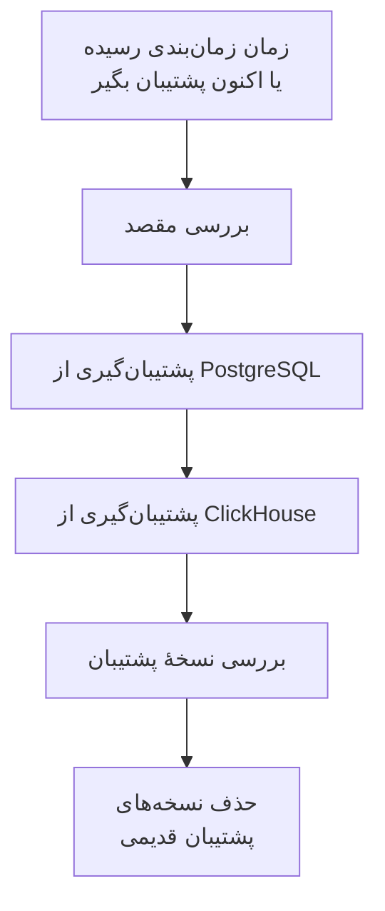

# پشتیبان‌گیری

از OneUptime خودمیزبان، طبق زمان‌بندی، در فضای ذخیره‌سازی متعلق به خودتان پشتیبان بگیرید و آن را از Admin Dashboard بازیابی کنید. هر نسخهٔ پشتیبان شامل PostgreSQL است، با پروژه‌ها، مانیتورها، رخدادها، صفحه‌های وضعیت و کاربران شما، و ClickHouse، با لاگ‌ها، ردگیری‌ها و متریک‌های شما. نسخه‌های پشتیبان هر چند روز که بخواهید نگه داشته می‌شوند، قدیمی‌ترها برایتان حذف می‌شوند و هر نسخهٔ پشتیبان را می‌توان در همان جا بازیابی کرد. پشتیبان‌گیری بخشی از نسخه سازمانی است.

:::cards
- [راه‌اندازی پشتیبان‌گیری](#راهاندازی-پشتیبانگیری): یک مقصد انتخاب کنید، آن را آزمایش کنید و زمان‌بندی را تعیین کنید.
- [مقصدها](#مقصدها): آنچه هر مقصد پیشنهادی می‌خواهد.
- [بازیابی یک نسخهٔ پشتیبان](#بازیابی-یک-نسخهٔ-پشتیبان): چه چیزی جایگزین می‌شود و داده‌های فعلی چگونه امن می‌مانند.
- [انتقال به سرور جدید](#انتقال-به-سرور-جدید): نسخه‌های پشتیبان یک نصب را روی نصب دیگری بازیابی کنید.
:::

## پشتیبان‌گیری چگونه کار می‌کند



- **سازگار.** PostgreSQL در یک تراکنش دامپ می‌شود، پس دامپ همان پایگاه داده است که در یک لحظه بود، در حالی که OneUptime به کار خود ادامه می‌دهد. ClickHouse از هر جدول به همان صورتی پشتیبان می‌گیرد که هنگام خواندن بخش‌هایش بود.
- **مستقیم به مقصد.** خروجی `pg_dump` همزمان با نوشته شدن به فضای ذخیره‌سازی جریان می‌یابد، و ClickHouse نسخهٔ پشتیبان خودش را خودش در فضای ذخیره‌سازی می‌نویسد. هر قدر هم داده‌ها بزرگ باشند، چیزی روی دیسک سرور نوشته نمی‌شود.
- **بررسی‌شده.** پیش از آنکه نسخهٔ پشتیبان حساب شود، `pg_restore` دامپ را از مقصد دوباره می‌خواند، و رکوردی که ClickHouse از نسخهٔ پشتیبان خود نگه می‌دارد آنجا پیدا می‌شود. SHA-256 دامپ همراه نسخهٔ پشتیبان نگه داشته می‌شود، و بازیابی پیش از جایگزین کردن هر چیزی آن را بررسی می‌کند. نسخهٔ پشتیبانی که ناموفق شود یا لغو شود، آنچه نوشته را حذف می‌کند، پس مقصد فقط نسخه‌های پشتیبان کامل را نگه می‌دارد.
- **رمزگذاری‌شده.** نسخه‌های پشتیبان از طریق HTTPS به فضای ذخیره‌سازی می‌روند، مگر اینکه یک نقطهٔ پایانی `http://` وارد کنید. Amazon S3، Google Cloud Storage، Azure Blob Storage و Cloudflare R2 هر چیزی را که ذخیره می‌کنند رمزگذاری می‌کنند؛ در فضای ذخیره‌سازی دیگر، رمزگذاری در حالت سکون را برای باکت روشن کنید. اطلاعات ورود مقصد رمزگذاری‌شده نگه داشته می‌شوند و دیگر هرگز نشان داده نمی‌شوند.
- **یکی در هر زمان.** در کل نصب، در هر زمان فقط یک پشتیبان‌گیری یا بازیابی اجرا می‌شود. بقیه منتظر نوبت خود می‌مانند.

هر نسخهٔ پشتیبان پوشهٔ جداگانه‌ای درون پوشهٔ مقصد است (`oneuptime/backups/` مگر اینکه پوشهٔ دیگری انتخاب کنید)، که به نام زمان شروعش به UTC نام‌گذاری می‌شود:

```text
oneuptime/backups/20261024T020000Z-3f2a9c1b/manifest.json
oneuptime/backups/20261024T020000Z-3f2a9c1b/postgres.dump
oneuptime/backups/20261024T020000Z-3f2a9c1b/clickhouse/
```

`manifest.json` در آخر نوشته می‌شود: می‌گوید نسخهٔ پشتیبان چه چیزی دارد و کدام نسخهٔ OneUptime آن را ساخته است.

## پیش از شروع

- **نسخه سازمانی**، با مجوزی که شامل پشتیبان‌گیری باشد. پشتیبان‌گیری در طول دورهٔ آزمایشی و مهلت اجرا می‌شود. بدون مجوز نسخهٔ پشتیبان جدیدی ساخته نمی‌شود، ولی بازیابی و حذف نسخه‌های پشتیبان همچنان کار می‌کند. [نسخه سازمانی](/docs/self-hosted/enterprise) را ببینید.
- **یک مدیر ارشد.** پشتیبان‌گیری در Admin Dashboard راه‌اندازی می‌شود.
- **یک باکت یا کانتینر فقط برای نسخه‌های پشتیبان**، و اطلاعات ورودی که بتواند در آن بخواند، بنویسد، فهرست کند و حذف کند.
- **مقصدی که ClickHouse هم به آن دسترسی دارد.** ClickHouse نسخهٔ پشتیبان خود را خودش در فضای ذخیره‌سازی می‌نویسد، پس شبکهٔ آن هم باید مانند شبکهٔ OneUptime به فضای ذخیره‌سازی برسد.
- **برای بازیابی PostgreSQL، یک کاربر پایگاه داده که بتواند پایگاه داده بسازد.** بازیابی در پایگاه دادهٔ جدیدی کنار پایگاه دادهٔ فعال می‌نویسد. PostgreSQL همراه OneUptime به‌عنوان ابرکاربر وصل می‌شود که این اجازه را دارد.

## راه‌اندازی پشتیبان‌گیری

:::steps
### صفحهٔ پشتیبان‌گیری را باز کنید

در Admin Dashboard به **تنظیمات** > **نسخه‌های پشتیبان** بروید و روی **راه‌اندازی پشتیبان‌گیری** کلیک کنید.

### انتخاب کنید نسخه‌های پشتیبان کجا بروند

یکی از مقصدهای پیشنهادی را انتخاب کنید. آنچه هر کدام می‌خواهد در [مقصدها](#مقصدها) آمده است.

### اتصال را پر کنید

آنچه مقصد می‌خواهد را پر کنید. پوشه، منطقه و تنظیماتی که بیشتر افراد دست نمی‌زنند زیر **فیلدهای بیشتر** هستند، و **راهنمای راه‌اندازی** بخش آن مقصد را در همین صفحه باز می‌کند.

### مقصد را آزمایش کنید

روی **آزمایش مقصد** کلیک کنید. OneUptime یک فایل آزمایشی کوچک را می‌نویسد، می‌خواند، فهرست می‌کند و حذف می‌کند، بررسی می‌کند که `pg_dump` بتواند از PostgreSQL شما پشتیبان بگیرد، و از ClickHouse می‌خواهد یک نسخهٔ پشتیبان آزمایشی از تعریف جدول‌هایش بنویسد. چیزی ذخیره نمی‌شود، و بررسی‌ای که ناموفق شود می‌گوید چه چیزی را تغییر دهید.

### انتخاب کنید پشتیبان‌گیری کی اجرا شود

**هر چند وقت** و زمان را در **ساعت (UTC)** انتخاب کنید، و برای پشتیبان‌گیری هفتگی **روز هفته** را هم انتخاب کنید. **نگهداری نسخه‌های پشتیبان (روز)** مقدار 30 دارد مگر اینکه تغییرش دهید. برای پشتیبان‌گیری فقط از PostgreSQL، **از ClickHouse هم پشتیبان بگیر** را خاموش کنید.

### پشتیبان‌گیری را شروع کنید

روی **شروع پشتیبان‌گیری** کلیک کنید. اولین پشتیبان‌گیری در زمان زمان‌بندی‌شدهٔ بعدی اجرا می‌شود، و **اکنون پشتیبان بگیر** بی‌درنگ یکی را شروع می‌کند.
:::

سپس صفحه نشان می‌دهد پشتیبان‌گیری‌ها چگونه پیش می‌روند: آخرین پشتیبان‌گیری کی اجرا شد، چه اندازه بود و چقدر طول کشید، و بعدی کی اجرا می‌شود. پشتیبان‌گیری در حال انجام، مرحله‌ای را که در آن است نشان می‌دهد، و **مشاهدهٔ مراحل** هر مرحله را در حین اجرا نشان می‌دهد.

## مقصدها

| مقصد | فضای ذخیره‌سازی | ورود با |
| --- | --- | --- |
| [Amazon S3](#amazon-s3) | Amazon S3 | یک کلید دسترسی |
| [Cloudflare R2](#cloudflare-r2) | فضای ذخیره‌سازی سازگار با S3 | یک توکن API از R2 |
| [Backblaze B2](#backblaze-b2) | فضای ذخیره‌سازی سازگار با S3 | یک کلید برنامه |
| [Wasabi](#wasabi) | فضای ذخیره‌سازی سازگار با S3 | یک کلید دسترسی |
| [MinIO](#minio) | فضای ذخیره‌سازی سازگار با S3 | یک کلید دسترسی |
| [Google Cloud Storage](#google-cloud-storage) | Google Cloud Storage | یک کلید HMAC |
| [Azure Blob Storage](#azure-blob-storage) | Azure Blob Storage | یک توکن SAS یا یک کلید دسترسی |
| [فضای ذخیره‌سازی سازگار با S3 دیگر](#فضای-ذخیرهسازی-سازگار-با-s3-دیگر) | فضای ذخیره‌سازی سازگار با S3 | یک کلید دسترسی |

کلید Amazon S3 یا هر فضای ذخیره‌سازی سازگار با S3 دیگر روی پوشه به `s3:PutObject`، `s3:GetObject`، `s3:ListBucket`، `s3:DeleteObject` و `s3:AbortMultipartUpload` نیاز دارد، و به هیچ چیز دیگری:

```json
{
  "Version": "2012-10-17",
  "Statement": [
    {
      "Effect": "Allow",
      "Action": "s3:ListBucket",
      "Resource": "arn:aws:s3:::my-backups"
    },
    {
      "Effect": "Allow",
      "Action": [
        "s3:PutObject",
        "s3:GetObject",
        "s3:DeleteObject",
        "s3:AbortMultipartUpload"
      ],
      "Resource": "arn:aws:s3:::my-backups/oneuptime/backups/*"
    }
  ]
}
```

### Amazon S3

| فیلد | چه وارد کنید |
| --- | --- |
| **باکت** | باکتی که نسخه‌های پشتیبان در آن نوشته می‌شوند. آن را فقط برای نسخه‌های پشتیبان نگه دارید. |
| **منطقه** | منطقهٔ باکت. در ابتدا `us-east-1` است. |
| **شناسه کلید دسترسی** | یک کلید دسترسی با مجوزهای بالا. |
| **کلید دسترسی مخفی** | رمز کلید. |
| **پوشه** | زیر **فیلدهای بیشتر**. اگر خالی بماند، نسخه‌های پشتیبان به `oneuptime/backups/` می‌روند. |

Amazon S3 هر فایلی را که نگه می‌دارد رمزنگاری می‌کند، و OneUptime برای هر فایلی که می‌نویسد این را (SSE-S3) از آن می‌خواهد.

### Cloudflare R2

نشانی S3 API حساب خود، `https://<account-id>.r2.cloudflarestorage.com`، را از تنظیمات باکت در R2 به‌عنوان **نقطه پایانی** وارد کنید. سپس **باکت** را وارد کنید، و **شناسه کلید دسترسی** و **کلید دسترسی مخفی** یک توکن API از R2 را که بتواند در آن اشیا را بخواند و بنویسد. خواندن دوبارهٔ نسخه‌های پشتیبان از R2 هزینه‌ای ندارد.

### Backblaze B2

نقطهٔ پایانی S3 باکت را که در صفحهٔ Buckets آن در Backblaze نمایش داده می‌شود، مانند `https://s3.us-west-004.backblazeb2.com`، به‌عنوان **نقطه پایانی** وارد کنید. سپس **باکت** را وارد کنید، و شناسه و خود کلید یک کلید برنامه را به‌عنوان **شناسه کلید دسترسی** و **کلید دسترسی مخفی**. منطقه از نقطهٔ پایانی خوانده می‌شود.

### Wasabi

نشانی سرویس منطقهٔ باکت، مانند `https://s3.us-east-1.wasabisys.com`، را به‌عنوان **نقطه پایانی** وارد کنید، سپس **باکت** و یک کلید دسترسی را. منطقه از نقطهٔ پایانی خوانده می‌شود.

### MinIO

نشانی S3 API سرور MinIO خود، مانند `https://minio.example.com:9000`، را به‌عنوان **نقطه پایانی** وارد کنید، سپس **باکت** و یک کلید دسترسی را که سیاستش اجازهٔ خواندن، نوشتن، فهرست کردن و حذف در آن را بدهد. OneUptime و ClickHouse هر دو باید به این نشانی دسترسی داشته باشند.

### Google Cloud Storage

**باکت** را وارد کنید، و **کلید دسترسی HMAC** و **رمز HMAC** یک حساب سرویس با نقش Storage Object Admin روی باکت را. کلید را در تنظیمات Cloud Storage، در زبانهٔ قابلیت همکاری بسازید. OneUptime و ClickHouse از طریق API سازگار با S3 در Cloud Storage به باکت دسترسی پیدا می‌کنند.

### Azure Blob Storage

**حساب ذخیره‌سازی** و **کانتینر** را وارد کنید، و در **ورود با** روش ورود را انتخاب کنید: یک **توکن SAS** با مجوزهای خواندن، افزودن، ایجاد، نوشتن، حذف و فهرست روی کانتینر، یا یک **کلید دسترسی** حساب ذخیره‌سازی. توکن SAS را می‌توان به کانتینر محدود کرد، پس انتخاب امن‌تری است. **ابر** و **پوشه** زیر **فیلدهای بیشتر** هستند.

### فضای ذخیره‌سازی سازگار با S3 دیگر

برای Ceph، DigitalOcean Spaces، Hetzner Object Storage و هر فضای ذخیره‌سازی دارای S3 API، نشانی S3 آن را به‌عنوان **نقطه پایانی** وارد کنید، سپس **باکت** و یک کلید دسترسی را. **منطقه** زیر **فیلدهای بیشتر** فقط وقتی لازم است که فضای ذخیره‌سازی آن را بخواهد. اگر خالی بماند، از نقطهٔ پایانی خوانده می‌شود، وگرنه `us-east-1` است.

## زمان‌بندی و نگهداری

| تنظیم | چه کاری می‌کند |
| --- | --- |
| **هر چند وقت** | **هر ساعت**، **هر 6 ساعت**، **هر 12 ساعت**، **هر روز** یا **هر هفته**. هر روز برای بیشتر نصب‌ها مناسب است. |
| **ساعت (UTC)** | ساعتی که پشتیبان‌گیری شروع می‌شود، به UTC، با زمان خودتان در کنارش. فاصله‌های 6 یا 12 ساعته از همین ساعت شمرده می‌شوند: با `02:00`، پشتیبان‌گیری هر 6 ساعت در 02:00، 08:00، 14:00 و 20:00 اجرا می‌شود. پشتیبان‌گیری ساعتی سر هر ساعت اجرا می‌شود. |
| **روز هفته** | روزی که پشتیبان‌گیری هفتگی اجرا می‌شود. |
| **نگهداری نسخه‌های پشتیبان (روز)** | از 1 تا 3650 روز. 30 مگر اینکه تغییرش دهید. |
| **از ClickHouse هم پشتیبان بگیر** | روشن، مگر اینکه خاموشش کنید. از PostgreSQL همیشه پشتیبان گرفته می‌شود. |

پس از هر پشتیبان‌گیری، نسخه‌های پشتیبانی که بیش از **نگهداری نسخه‌های پشتیبان (روز)** پیش شروع شده‌اند، از مقصد و از فهرست حذف می‌شوند، به‌جز جدیدترین نسخهٔ پشتیبان موفق که هر قدر هم قدیمی باشد نگه داشته می‌شود. پس خاموش کردن پشتیبان‌گیری یا منقضی شدن مجوز، هرگز شما را بدون نسخهٔ پشتیبانی برای بازیابی نمی‌گذارد.

**خاموش کردن پشتیبان‌گیری زمان‌بندی‌شده** در منوی کارت وضعیت، زمان‌بندی را متوقف می‌کند. **اکنون پشتیبان بگیر** همچنان کار می‌کند و هیچ نسخهٔ پشتیبانی حذف نمی‌شود. **روشن کردن** زمان‌بندی را دوباره شروع می‌کند.

## بازیابی یک نسخهٔ پشتیبان

:::warning بازیابی چه چیزی را جایگزین می‌کند
بازیابی، داده‌های فعلی را با داده‌های نسخهٔ پشتیبان جایگزین می‌کند. هر چیزی که از زمان ساخت نسخهٔ پشتیبان تغییر کرده از دست می‌رود، مگر اینکه ابتدا از داده‌های فعلی پشتیبان بگیرید.
:::

:::steps
### نسخهٔ پشتیبان را انتخاب کنید

در جدول **نسخه‌های پشتیبان**، روی **بازیابی** نسخهٔ پشتیبانی که می‌خواهید به آن برگردید کلیک کنید. OneUptime ابتدا نسخهٔ پشتیبان را بررسی می‌کند: اینکه فایل‌هایش در مقصد و بدون تغییر هستند، کدام نسخهٔ OneUptime آن را ساخته، و اینکه این سرور می‌تواند آن را بازیابی کند.

### انتخاب کنید چه چیزی بازیابی شود

**PostgreSQL: پروژه‌ها، مانیتورها، رخدادها، کاربران**، **ClickHouse: لاگ‌ها، ردگیری‌ها، متریک‌ها** یا هر دو را علامت بزنید. پنجره نشان می‌دهد نسخهٔ پشتیبان چند پروژه، کاربر و مانیتور دارد، و اکنون چند تا هست.

### داده‌های فعلی را امن نگه دارید

**ابتدا از داده‌های فعلی پشتیبان بگیر** علامت خورده است: بازیابی با یک پشتیبان‌گیری از داده‌هایی که جایگزین می‌کند شروع می‌شود، تا بتوانید به آن‌ها برگردید. فقط اگر نسخهٔ دیگری دارید علامت را بردارید، چون بدون آن بازیابی قابل برگشت نیست.

### تأیید کنید

`restore` را تایپ کنید و روی **بازیابی** کلیک کنید.
:::

بازیابی مرحله به مرحله اجرا می‌شود و صفحه هر مرحله را نشان می‌دهد:

| مرحله | چه اتفاقی می‌افتد |
| --- | --- |
| **بررسی نسخهٔ پشتیبان** | فایل‌های نسخهٔ پشتیبان موجودند و این نصب می‌تواند آن را بازیابی کند. |
| **پشتیبان‌گیری از داده‌های فعلی** | پشتیبان‌گیری از داده‌های فعلی، مگر اینکه علامتش را برداشته باشید. |
| **بازیابی PostgreSQL** | نسخهٔ پشتیبان در پایگاه دادهٔ جدیدی کنار پایگاه دادهٔ فعال بازیابی و بررسی می‌شود. |
| **بازیابی ClickHouse** | تله‌متری فعال کنار گذاشته می‌شود و تله‌متری نسخهٔ پشتیبان به جای آن بازیابی می‌شود. |
| **جابه‌جایی به داده‌های بازیابی‌شده** | پایگاه دادهٔ بازیابی‌شده در یک لحظه نام پایگاه دادهٔ فعال را می‌گیرد. |
| **به‌روزرسانی داده‌های بازیابی‌شده** | مهاجرت‌های پایگاه دادهٔ این نسخه روی داده‌های بازیابی‌شده اجرا می‌شوند. |
| **پاک‌سازی** | آنچه کنار گذاشته شده بود حذف می‌شود. |

OneUptime تا لحظهٔ جابه‌جایی با داده‌های فعلی کار می‌کند و پیش از آن هیچ چیزی که استفاده می‌کند تغییر نمی‌کند. بازیابی‌ای که پیش از جابه‌جایی ناموفق شود یا لغو شود همه چیز را همان‌طور که بود باقی می‌گذارد، و بازیابی‌ای که در حین جابه‌جایی ناموفق شود آنچه را کنار گذاشته بود سر جایش برمی‌گرداند. تله‌متری‌ای که در طول بازیابی ClickHouse می‌رسد ذخیره نمی‌شود. پس از بازیابی PostgreSQL ممکن است از حساب خارج شوید: با حسابی وارد شوید که در نسخهٔ پشتیبان وجود دارد.

:::details بازیابی می‌گوید نسخهٔ پشتیبان با ENCRYPTION_SECRET دیگری ساخته شده است
اطلاعات ورودی که OneUptime ذخیره می‌کند، مانند کلید یک مقصد، با `ENCRYPTION_SECRET` رمزنگاری شده‌اند. پیش از بازیابی، همان `ENCRYPTION_SECRET` را که نسخهٔ پشتیبان با آن ساخته شده تنظیم کنید، وگرنه آن اطلاعات ورود بعداً قابل خواندن نیستند.
:::

## انتقال به سرور جدید

:::steps
### OneUptime را روی سرور جدید نصب کنید

نسخه سازمانی را نصب کنید، در همان نسخه‌ای که نسخه‌های پشتیبان را ساخته یا نسخه‌ای جدیدتر.

### همان مقصد را راه‌اندازی کنید

در **تنظیمات** > **نسخه‌های پشتیبان** مقصدی را که نسخه‌های پشتیبانتان در آن است راه‌اندازی کنید. صفحه نسخه‌های پشتیبانی را که از قبل آنجا هستند پیدا می‌کند و فهرست می‌کند، آمادهٔ بازیابی. **یافتن نسخه‌های پشتیبان** در منوی کارت وضعیت دوباره جست‌وجو می‌کند.

### جدیدترین نسخهٔ پشتیبان را بازیابی کنید

آن را مانند بالا بازیابی کنید. نسخهٔ پشتیبانی که نسخهٔ قدیمی‌تری از OneUptime ساخته به این نسخه به‌روز می‌شود. نسخهٔ پشتیبانی که نسخهٔ جدیدتری ساخته، پس از به‌روزرسانی قابل بازیابی است.
:::

## وقتی پشتیبان‌گیری ناموفق است

کارت وضعیت **آخرین پشتیبان‌گیری ناموفق بود** را همراه با خطا نشان می‌دهد، و **مشاهدهٔ مراحل** مرحله‌ای را که در آن متوقف شد و دلیلش را نشان می‌دهد. هر مدیر ارشد هم یک ایمیل دریافت می‌کند، تا زمانی که پشتیبان‌گیری‌ها همچنان ناموفق باشند حداکثر هر 12 ساعت یک‌بار. بازیابی ناموفق همیشه با ایمیل اطلاع داده می‌شود.

## عیب‌یابی

:::details ClickHouse به مقصد نمی‌رسد
ClickHouse خودش به فضای ذخیره‌سازی وصل می‌شود. اجازه دهید شبکهٔ آن مانند شبکهٔ OneUptime به نشانی مقصد برسد، سپس مقصد را دوباره آزمایش کنید.
:::

:::details pg_dump وجود ندارد یا خیلی قدیمی است
ایمیج سازمانی `pg_dump` و `pg_restore` نسخه‌های 16، 17 و 18 را دارد که از PostgreSQL 18 و همهٔ نسخه‌های پیش از آن پشتیبان می‌گیرند. روی ایمیج دیگری، ابزارهای کلاینت PostgreSQL را نصب کنید، یا `BACKUP_POSTGRES_BIN_DIR` را روی پوشه‌ای که آن‌ها را دارد تنظیم کنید. `pg_dump` باید دست‌کم به جدیدی سرور PostgreSQL شما باشد.
:::

:::details بازیابی PostgreSQL به یک تغییر نیاز دارد
بازیابی یک پایگاه داده می‌سازد، و کاربر پایگاه دادهٔ OneUptime باید اجازهٔ این کار را داشته باشد. این را به‌عنوان ابرکاربر روی PostgreSQL اجرا کنید، با `DATABASE_USERNAME` خودتان به جای `oneuptime`، سپس دوباره بازیابی کنید:

```sql
ALTER USER oneuptime CREATEDB;
```
:::

:::details یک نسخهٔ پشتیبان در مقصد قبلی است
پس از تغییر مقصد، نسخه‌های پشتیبانی که در مقصد قبلی ساخته شده‌اند با علامت **در یک مقصد قبلی** در فهرست می‌مانند. برای بازیابی یکی از آن‌ها آن مقصد را دوباره راه‌اندازی کنید، یا آن را از فهرست حذف کنید: فایل‌هایش همان جایی که هستند می‌مانند.
:::

## گام‌های بعدی

:::cards
- [نسخه سازمانی](/docs/self-hosted/enterprise): مجوزها، و آنچه نسخه سازمانی اضافه می‌کند.
- [ارتقا](/docs/installation/upgrading): پیش از هر ارتقا پشتیبان بگیرید.
- [Docker Compose](/docs/installation/docker-compose): OneUptime را روی یک سرور اجرا کنید.
:::
