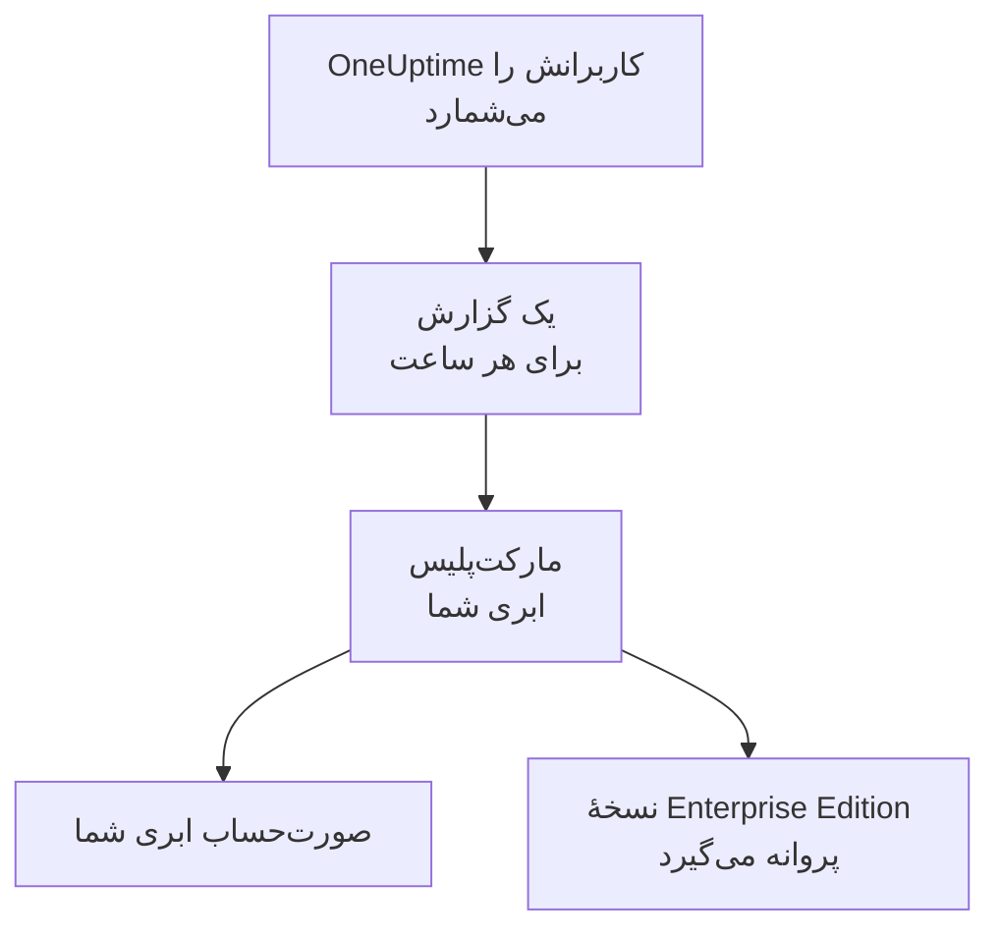

# مارکت‌پلیس‌های ابری

‏OneUptime Enterprise را که از AWS Marketplace، Microsoft Marketplace یا Google Cloud Marketplace خریده‌اید، در خوشهٔ Kubernetes خودتان اجرا کنید. مارکت‌پلیس هزینهٔ هر کاربر نصب شما را ساعتی روی صورت‌حساب ابری‌تان می‌آورد، و اشتراک شما پروانهٔ Enterprise Edition است: کلید پروانه‌ای برای فعال کردن در کار نیست.

:::cards
- [نصب OneUptime](#نصب-oneuptime): روی Amazon EKS، Azure Kubernetes Service یا Google Kubernetes Engine.
- [صورت‌حساب چگونه کار می‌کند](#صورتحساب-چگونه-کار-میکند): ساعتی USD 0.10 برای هر کاربر، که هر ساعت گزارش می‌شود.
- [ارتقا](#ارتقا): انتشار تازه چگونه به خوشهٔ شما می‌رسد.
- [رفع اشکال](#رفع-اشکال): وقتی برچسب نسخه دربارهٔ مارکت‌پلیس هشدار می‌دهد.
:::

## چگونه کار می‌کند

‏OneUptime هر 15 دقیقه کاربرانش را می‌شمارد و هر ساعت را یک بار، با بیشترین تعداد کاربری که در آن ساعت دیده، به مارکت‌پلیسی که OneUptime را از آن خریده‌اید گزارش می‌دهد. مارکت‌پلیس آن ساعت را به صورت‌حساب ابری شما می‌افزاید. هر گزارشی که مارکت‌پلیس می‌پذیرد به OneUptime هم می‌گوید که اشتراک شما فعال است، و همین پروانهٔ Enterprise Edition را معتبر نگه می‌دارد.



| | AWS | Microsoft | Google Cloud |
| --- | --- | --- | --- |
| صفحهٔ محصول | هنوز عمومی نیست: [با ما تماس بگیرید](https://oneuptime.com/enterprise/demo) | [OneUptime Enterprise](https://marketplace.microsoft.com/en-us/product/oneupitme.oneuptime-enterprise) | هنوز عمومی نیست: [با ما تماس بگیرید](https://oneuptime.com/enterprise/demo) |
| محل اجرا | Amazon EKS | Azure Kubernetes Service (AKS) | Google Kubernetes Engine (GKE) |
| روش نصب | Helm، از رجیستری محصول | پورتال Azure | کنسول Google Cloud |
| اعتبارنامهٔ گزارش‌دهی OneUptime | نقش IAM حساب سرویس Kubernetes آن | هویت مدیریت‌شده‌ای که Azure به نصب می‌دهد | راز گزارش‌دهی‌ای که Google Cloud Marketplace برای استقرار می‌سازد |
| انتشارهای تازه | با Helm ارتقا می‌دهید | نسخه‌های فرعی برایتان نصب می‌شوند | دستی ارتقا می‌دهید |

## پیش از شروع

- **یک خوشهٔ Kubernetes** روی ابر همان مارکت‌پلیس، با دست‌کم 3 گره که هر کدام 4 vCPU و 16 GiB حافظه دارند، یک StorageClass پیش‌فرض، و پشتیبانی از سرویس‌های `LoadBalancer`. OneUptime خودش PostgreSQL، ClickHouse و Valkey را درون خوشه اجرا می‌کند؛ برای اندازه‌گذاری آن‌ها، [تعیین اندازه و برنامه‌ریزی ظرفیت](/docs/installation/sizing) را ببینید.
- **یک نام دامنه** برای OneUptime، مانند `oneuptime.example.com`، که بتوانید آن را به متعادل‌کنندهٔ بار خوشه اشاره دهید.
- **HTTPS خروجی** از خوشه به مارکت‌پلیس، تا OneUptime بتواند کاربرانش را گزارش دهد: `metering.marketplace.<region>.amazonaws.com` و `sts.<region>.amazonaws.com` در AWS، `marketplaceapi.microsoft.com` در Azure، و `servicecontrol.googleapis.com` و `oauth2.googleapis.com` در Google Cloud.

## نصب OneUptime

### AWS Marketplace

در AWS، OneUptime کاربرانش را با یک نقش IAM گزارش می‌دهد که EKS به حساب سرویس Kubernetes آن می‌دهد (نقش‌های IAM برای حساب‌های سرویس). AWS Marketplace مصرف را از EKS فقط وقتی می‌پذیرد که به این شکل امضا شده باشد.

:::steps
1. در AWS Marketplace مشترک OneUptime Enterprise شوید، سپس **Continue to Configuration** را برگزینید، نسخه را انتخاب کنید و **Continue to Launch** را برگزینید.
2. اگر خوشه هنوز ارائه‌دهندهٔ IAM OIDC ندارد، یکی به آن بدهید، و با فرمان‌های زیر حساب سرویس `oneuptime` را همراه یک نقش IAM بسازید که سیاست `AWSMarketplaceMeteringFullAccess` را دارد. این فرمان‌ها را به‌جای فرمان `eksctl` در گام 1 بخش **General launch instructions** صفحهٔ راه‌اندازی اجرا کنید: آن فرمان نقشی را وصل می‌کند که باید اول خودتان آن را ساخته باشید.
3. با فرمان‌های گام 2 بخش **General launch instructions**، Helm را وارد رجیستری محصول کنید و چارت را نصب کنید. در فرمان `helm install`، مقدار `serviceAccount.name` را `oneuptime`، مقدار `host` را نام دامنهٔ خود، و اگر گواهی‌ای جلوی OneUptime هست، مقدار `httpProtocol` را `https` بگذارید.
4. [OneUptime را باز کنید](#باز-کردن-oneuptime).
:::

```bash
eksctl utils associate-iam-oidc-provider --cluster <cluster> --approve
eksctl create iamserviceaccount --name oneuptime --namespace oneuptime --cluster <cluster> \
  --attach-policy-arn arn:aws:iam::aws:policy/AWSMarketplaceMeteringFullAccess \
  --approve --override-existing-serviceaccounts
```

مقدارهای گام 3 را در یک فایل نگه دارید و آن را به هر `helm upgrade` بدهید:

```yaml title="values.yaml"
host: oneuptime.example.com
httpProtocol: https
serviceAccount:
  name: oneuptime
```

### Microsoft Marketplace

در Azure، OneUptime یک برنامهٔ Kubernetes است: AKS آن را به‌صورت یک افزونهٔ خوشه نصب می‌کند، و هویت مدیریت‌شده‌ای را به آن می‌دهد که OneUptime کاربرانش را با آن گزارش می‌دهد.

:::steps
1. در پورتال Azure، صفحهٔ OneUptime Enterprise را در Microsoft Marketplace باز کنید، یا خوشهٔ AKS خود را باز کنید و **Extensions + applications** > **Add** را برگزینید، سپس طرح را انتخاب کنید و **Create** را برگزینید.
2. اشتراک و گروه منابع را انتخاب کنید، و اینکه روی یک خوشهٔ AKS موجود نصب شود یا خوشهٔ تازه‌ای ساخته شود.
3. در گام **OneUptime**، یک نام برای نصب، نام دامنهٔ خود و پروتکل آن را وارد کنید.
4. **Review + create** و سپس **Create** را برگزینید. نصب چند دقیقه طول می‌کشد؛ وقتی **Extensions + applications** وضعیت تأمین آن را **Succeeded** نشان دهد، کار تمام شده است.
5. [OneUptime را باز کنید](#باز-کردن-oneuptime).
:::

سنجه‌های سفارشی صورت‌حساب روی خوشه‌های AKS کار می‌کنند، نه روی Kubernetes مجهز به Azure Arc، پس OneUptime Enterprise در Microsoft Marketplace فقط روی AKS نصب می‌شود.

### Google Cloud Marketplace

در Google Cloud، مارکت‌پلیس یک ابزار استقرار اجرا می‌کند که OneUptime را در فضای نامی که انتخاب می‌کنید نصب می‌کند، همراه با یک راز گزارش‌دهی که OneUptime کاربرانش را با آن گزارش می‌دهد.

:::steps
1. در کنسول Google Cloud، صفحهٔ OneUptime Enterprise را در Google Cloud Marketplace باز کنید و **Configure** را برگزینید.
2. خوشهٔ GKE و فضای نام را انتخاب کنید، و یک نام برای نصب، نام دامنهٔ خود و پروتکل آن را وارد کنید.
3. **Deploy** را برگزینید. استقرار چند دقیقه طول می‌کشد؛ وقتی برنامه زیر **Kubernetes Engine** > **Applications** آماده نشان داده شود، کار تمام شده است.
4. [OneUptime را باز کنید](#باز-کردن-oneuptime).
:::

## باز کردن OneUptime

‏OneUptime کار را با اجرای مهاجرت‌های پایگاه داده‌اش شروع می‌کند، که روی یک نصب تازه چند دقیقه طول می‌کشد. سپس نام دامنهٔ خود را به متعادل‌کنندهٔ بار آن اشاره دهید:

```bash
kubectl get service --namespace <namespace>
```

سرویسی که نامش به `-nginx` ختم می‌شود یک `EXTERNAL-IP` دارد: برای نام دامنهٔ خود یک رکورد DNS بسازید که به آن اشاره کند. نام دامنه را باز کنید و ثبت‌نام کنید. نخستین حساب یک نصب تازه، مدیر اصلی آن می‌شود و می‌تواند داشبورد مدیریت را در `/admin` باز کند.

ظرف یک ساعت، Enterprise Edition روی برچسب نسخه نشان داده می‌شود، با پروانه‌ای که از مارکت‌پلیس شما می‌آید. مدیران اصلی برچسب نسخه را در سرصفحهٔ داشبورد مدیریت و در پانویس Dashboard می‌بینند.

## صورت‌حساب چگونه کار می‌کند

| مورد | چگونه کار می‌کند |
| --- | --- |
| قیمت | ساعتی USD 0.10 برای هر کاربر، یعنی حدود USD 73 برای هر کاربر در ماه. |
| چه کسانی شمرده می‌شوند | هر کسی که روی این نصب حساب کاربری OneUptime دارد. مشترکان صفحهٔ وضعیت و کسانی که وارد یک صفحهٔ وضعیت خصوصی می‌شوند شمرده نمی‌شوند. |
| چه زمانی | OneUptime هر 15 دقیقه کاربرانش را می‌شمارد و هر ساعت را یک بار، با بیشترین تعداد کاربری که در آن ساعت دیده، گزارش می‌دهد. برای ساعتی که OneUptime در آن اجرا نمی‌شده، هزینه‌ای حساب نمی‌شود. |
| کجا | روی صورت‌حساب AWS، Azure یا Google Cloud شما، از راه مارکت‌پلیس. |
| چه چیزی شامل نمی‌شود | خود خوشه: ابر شما هزینهٔ گره‌ها، دیسک‌ها و متعادل‌کننده‌های بار آن را مثل همیشه حساب می‌کند. |

هزینهٔ هر نصب جداگانه حساب می‌شود، پس نصب staging هم هزینه دارد. برای قیمت سالانه، تخفیف حجمی یا قیمتی ویژهٔ نصب‌های غیرتولیدی، از [sales@oneuptime.com](mailto:sales@oneuptime.com) یک پیشنهاد خصوصی بخواهید؛ این پیشنهاد را در مارکت‌پلیس می‌پذیرید.

وقتی گزارشی به خاطر مشکل شبکه یا قطعی مارکت‌پلیس فرستاده نشود، OneUptime آن را در اجرای بعدی‌اش دوباره می‌فرستد. هر گزارش کلیدی مخصوص ساعت خودش دارد، پس هزینهٔ هیچ ساعتی دو بار حساب نمی‌شود.

## پروانه چگونه کار می‌کند

اشتراک مارکت‌پلیس شما همان پروانهٔ شماست. هر گزارشی که مارکت‌پلیس بپذیرد، همهٔ قابلیت‌های سازمانی را برای همهٔ کاربران تا 72 ساعت بعد زیر پوشش پروانه قرار می‌دهد. کلید پروانه‌ای که از OneUptime گرفته‌اید هم روی همان نصب کار می‌کند: نصب با هر کدام از این دو که بهتر باشد اجرا می‌شود.

| چه رخ می‌دهد | برچسب نسخه چه نشان می‌دهد |
| --- | --- |
| مارکت‌پلیس گزارش‌های ساعتی را می‌پذیرد | نسخهٔ Enterprise Edition، با پروانه‌ای که از مارکت‌پلیس شما می‌آید. |
| در 72 ساعت گذشته هیچ گزارشی پذیرفته نشده است | **Enterprise Edition (Marketplace Reports Failing)**: همهٔ قابلیت‌های سازمانی در یک دورهٔ مهلت 30 روزه به کار ادامه می‌دهند. |
| مارکت‌پلیس می‌گوید نصب اشتراک ندارد، یا دورهٔ مهلت تمام می‌شود | **Enterprise Edition (Marketplace Subscription Ended)**: قابلیت‌های سازمانی متوقف می‌شوند، همان‌طور که با [منقضی شدن پروانه](/docs/self-hosted/enterprise#وقتی-پروانه-منقضی-شده-یا-وجود-ندارد) متوقف می‌شوند. |

مارکت‌پلیس اشتراکی را که لغو یا تعلیق شده، یا نصبی را که همان نصبی نیست که خریده‌اید، رد می‌کند. پایش، هشدارها، حادثه‌ها، کشیک و صفحه‌های وضعیت در هر حالتی به کار ادامه می‌دهند، و هیچ چیز حذف نمی‌شود. دوباره مشترک شوید تا گزارش پذیرفته‌شدهٔ بعدی، بدون راه‌اندازی دوباره، پروانهٔ Enterprise Edition را برگرداند.

## ارتقا

| مارکت‌پلیس | انتشار تازه چگونه به خوشهٔ شما می‌رسد |
| --- | --- |
| AWS Marketplace | هر انتشار، نسخهٔ تازه‌ای از محصول در مارکت‌پلیس است. `helm upgrade` را با چارت رجیستری محصول، نسخهٔ تازه و فایل values خود اجرا کنید. |
| Microsoft Marketplace | AKS نسخه‌های فرعی و وصله‌ای تازه را برایتان نصب می‌کند. نسخهٔ اصلی تازه منتظر می‌ماند تا آن را بپذیرید. می‌توانید ارتقای خودکار را در صفحهٔ نصب در **Extensions + applications** خاموش کنید. |
| Google Cloud Marketplace | Google Cloud Marketplace هر استقرار را روی نسخه‌ای که نصب کرده نگه می‌دارد و هرگز آن را به‌روز نمی‌کند. پیش از بردن یک استقرار به نسخهٔ تازه، با [پشتیبانی](https://oneuptime.com/support) تماس بگیرید. |

‏OneUptime هنگام شروع انتشار تازه، مهاجرت‌های پایگاه داده‌اش را اجرا می‌کند. پیش از رفتن به یک نسخهٔ اصلی تازه، [یادداشت‌های ارتقا](/docs/installation/upgrading) را بخوانید.

از راه مارکت‌پلیس ارتقا دهید. نصبی که از مارکت‌پلیس انجام شده خود را با انتشارهای OneUptime در GitHub مقایسه نمی‌کند: نسخه‌هایی که مارکت‌پلیس شما ارائه می‌دهد همان‌هایی هستند که باید به آن‌ها ارتقا دهید.

## تنظیمات و مقیاس‌دهی

با بزرگ شدن مقیاس، صورت‌حساب شما تغییر نمی‌کند: هزینهٔ OneUptime به ازای هر کاربر حساب می‌شود. رونوشت‌های بیشتر یا گره‌های بزرگ‌تر فقط هزینه‌ای را تغییر می‌دهند که ابر شما برای خوشه حساب می‌کند.

| مارکت‌پلیس | تنظیمات شما کجا هستند |
| --- | --- |
| AWS Marketplace | فایل values شما. همهٔ تنظیمات [چارت Helm](https://artifacthub.io/packages/helm/oneuptime/oneuptime) کار می‌کنند، جز اپراتورهای همراه. |
| Microsoft Marketplace | تنظیمات پیکربندی نصب، در صفحهٔ آن در **Extensions + applications** یا با `az k8s-extension update --configuration-settings`. هر تنظیم یک مقدار چارت است، مانند `autoscaling.enabled=true`. |
| Google Cloud Marketplace | فیلدهای فرم استقرار. هر چیز دیگری را با `kubectl` و روی منابع خود استقرار تغییر دهید. |

- **برای مقیاس دادن به OneUptime** از تنظیمات رونوشت و مقیاس‌دهی خودکار چارت (`deployment.replicaCount`، `autoscaling.enabled` و بازنویسی‌های خود هر سرویس) استفاده کنید، و برای گره‌ها از مقیاس‌دهندهٔ خودکار خوشهٔ خود.
- **تنظیمات مارکت‌پلیس را همان‌طور که محصول تنظیم کرده نگه دارید**: `enterpriseMarketplace`، و در AWS همچنین `serviceAccount`. بدون آن‌ها OneUptime نمی‌تواند گزارش دهد و Enterprise Edition پروانه نمی‌گیرد.
- **اپراتورهای KEDA، CloudNativePG و Altinity ClickHouse در نسخهٔ مارکت‌پلیس نیستند**، چون هر مارکت‌پلیس فقط ایمیج‌هایی را عرضه می‌کند که در صفحهٔ محصولش آمده‌اند. برای ذخیره‌گاه‌های داده با دسترس‌پذیری بالا، OneUptime را با `externalPostgres`، `externalRedis` و `externalClickhouse` به سرویس‌های مدیریت‌شده وصل کنید.

صورت‌حساب به تعداد رونوشت‌هایی که اجرا می‌شوند بستگی ندارد: در هر زمان فقط یک اجرا گزارش می‌دهد، و هر ساعت یک گزارش دارد.

## رفع اشکال

:::details برچسب نسخه Enterprise Edition (Marketplace Reports Failing) را نشان می‌دهد
‏OneUptime نمی‌تواند به مارکت‌پلیس گزارش دهد. هر خطی که دربارهٔ آن در لاگ ثبت می‌کند با `OneUptime Enterprise marketplace billing` شروع می‌شود؛ خطی که می‌گوید مصرف «cannot be reported»، نام چیزی را که کم است می‌آورد. علت‌های معمول:

- **AWS:** حساب سرویس `oneuptime` نقش IAM ندارد، یا نقش آن سیاست `AWSMarketplaceMeteringFullAccess` را ندارد (`AWSMarketplaceMeteringRegisterUsage` کافی نیست). سیاست را به نقش وصل کنید، یا نقش را با فرمان `eksctl` در بخش [AWS Marketplace](#aws-marketplace) بسازید و سپس پادهای OneUptime را با `kubectl rollout restart deployment --namespace oneuptime` دوباره راه‌اندازی کنید.
- **Azure:** نصب، برنامهٔ Microsoft Marketplace نیست، برای نمونه چون با Helm نصب شده است، پس هویت یا طرحی ندارد که با آن گزارش دهد. آن را از پورتال Azure نصب کنید.
- **Google Cloud:** راز گزارش‌دهی استقرار حذف یا جایگزین شده است.
- **همهٔ مارکت‌پلیس‌ها:** یک فایروال یا پراکسی، HTTPS خروجی‌ای را که در [پیش از شروع](#پیش-از-شروع) آمده است مسدود می‌کند.

تا وقتی مشکل را رفع کنید، مصرف نگه داشته می‌شود و به محض اینکه OneUptime دوباره بتواند گزارش دهد، هزینه‌اش حساب می‌شود. برای مصرفِ قدیمی‌تر از 30 روز هزینه‌ای حساب نمی‌شود.
:::

:::details برچسب نسخه Enterprise Edition (Marketplace Subscription Ended) را نشان می‌دهد
مارکت‌پلیس نصب را رد کرده است: اشتراک لغو یا تعلیق شده، یا نصب همان نصبی نیست که از مارکت‌پلیس خریده شده است. اشتراک را در مارکت‌پلیس بررسی کنید و دوباره مشترک شوید؛ گزارش پذیرفته‌شدهٔ بعدی پروانهٔ Enterprise Edition را برمی‌گرداند. همین برچسب وقتی هم نشان داده می‌شود که گزارش‌ها در تمام دورهٔ مهلت شکست خورده باشند.
:::

:::details پادها پس از نصب در وضعیت Pending می‌مانند
پایگاه‌های دادهٔ OneUptime به حجم‌های ماندگار نیاز دارند. به خوشه یک StorageClass پیش‌فرض بدهید: در Amazon EKS، افزونهٔ درایور Amazon EBS CSI را نصب کنید.
:::

## گام‌های بعدی

:::cards
- [نسخه سازمانی](/docs/self-hosted/enterprise): آنچه Enterprise Edition اضافه می‌کند، و آنچه با منقضی شدن پروانه متوقف می‌شود.
- [ارتقا](/docs/installation/upgrading): یادداشت‌های ارتقای هر انتشار.
- [تعیین اندازه و برنامه‌ریزی ظرفیت](/docs/installation/sizing): اندازهٔ ذخیره‌گاه‌های داده را برای تله‌متری خود تعیین کنید.
- [معماری](/docs/self-hosted/architecture): آنچه در خوشهٔ شما اجرا می‌شود.
- [عامل Kubernetes](/docs/telemetry/kubernetes-agent#نصب-بهصورت-افزونه-amazon-eks): در AWS Marketplace هم رایگان است، به‌صورت افزونهٔ Amazon EKS، برای خوشه‌هایی که به OneUptime داده می‌فرستند.
:::
