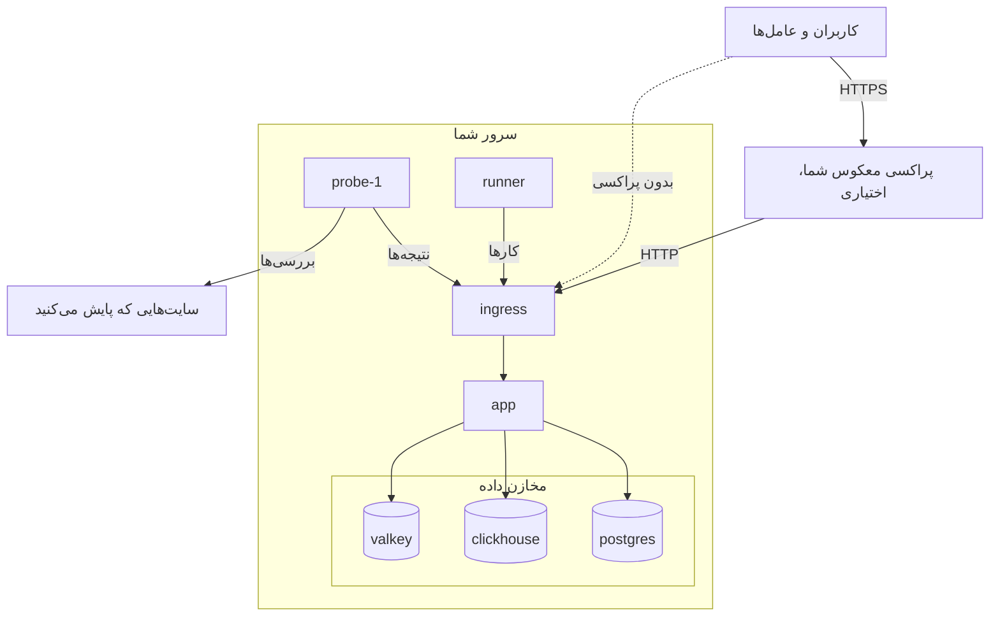

# Docker Compose

با Docker Compose یک نمونهٔ کامل و رایگان OneUptime را روی یک سرور Linux اجرا کنید. این صفحه شما را از یک سرور تازه به یک نمونهٔ در حال اجرا می‌رساند و سپس HTTPS، مقاوم‌سازی برای محیط عملیاتی، پشتیبان‌گیری، به‌روزرسانی و حذف را پوشش می‌دهد.

:::cards
- [نصب OneUptime](#نصب-oneuptime): از یک سرور تازه تا نخستین حساب شما، در شش گام.
- [راه‌اندازی HTTPS](#راهاندازی-https): بگذارید OneUptime گواهی بگیرد، یا پراکسی خودتان را جلوی آن بگذارید.
- [چک‌لیست محیط عملیاتی](#چکلیست-محیط-عملیاتی): آنچه پیش از رسیدن ترافیک واقعی باید روشن شود.
- [به‌روزرسانی OneUptime](#بهروزرسانی-oneuptime): رفتن به تازه‌ترین نسخه.
:::

## چگونه کار می‌کند

Docker Compose هر بخش از OneUptime را به‌صورت یک کانتینر روی سرور شما اجرا می‌کند. همهٔ ترافیک از کانتینر `ingress` وارد می‌شود و این کانتینر آن را به `app` می‌فرستد. برنامه داده‌هایش را در PostgreSQL، ClickHouse و Valkey نگه می‌دارد. یک پراب همراه، بررسی‌های مانیتورهای شما را اجرا می‌کند و نتیجه را از راه ingress گزارش می‌دهد.



| سرویس | ایمیج | چه می‌کند |
| --- | --- | --- |
| `ingress` | `oneuptime/nginx` | همهٔ ترافیک را روی درگاه‌های ۸۰ و ۴۴۳ می‌گیرد و به برنامه می‌فرستد. وقتی OneUptime گواهی را مدیریت می‌کند، HTTPS ارائه می‌دهد. |
| `app` | `oneuptime/app` | داشبورد، API، صفحه‌های وضعیت، دریافت تله‌متری و کارگرهای پس‌زمینه. |
| `probe-1` | `oneuptime/probe` | یک پراب سراسری که بررسی‌های مانیتورهای شما را اجرا می‌کند. از شبکهٔ میزبان استفاده می‌کند. |
| `runner` | `oneuptime/runner` | Runner نمونه، که اصلاح کد با هوش مصنوعی را اجرا می‌کند. از شبکهٔ میزبان استفاده می‌کند. |
| `postgres` | `postgres:15` | پیکربندی و وضعیت: مانیتورها، رخدادها، کاربران. در ولوم `postgres` ذخیره می‌شود. |
| `clickhouse` | `clickhouse/clickhouse-server:26.7` | تله‌متری: لاگ‌ها، متریک‌ها، تریس‌ها و استثناها. در ولوم `clickhouse` ذخیره می‌شود. |
| `valkey` | `valkey/valkey:9.1-alpine` | حافظهٔ نهان و صف‌ها. چیزی روی دیسک نگه نمی‌دارد. |

> [!NOTE]
> سرویس `valkey` برنامهٔ [Valkey](https://valkey.io) را اجرا می‌کند که انشعابی با مجوز BSD از Redis 7.2 است و با تنظیمات `VALKEY_*` در `config.env` پیکربندی می‌شود. هر سروری که پروتکل Redis را پشتیبانی کند کار می‌کند — اگر ترجیح می‌دهید، `VALKEY_HOST` را به یک Redis مدیریت‌شده نشانه بروید. نام این تنظیمات تا نسخهٔ 13.0.0 `REDIS_*` بود؛ نام‌های قدیمی هنوز خوانده می‌شوند، کانتینر هنوز به نام میزبان `redis` پاسخ می‌دهد و `npm run update` آن‌ها را بازنویسی نمی‌کند، پس یک `config.env` قدیمی‌تر به هیچ ویرایشی نیاز ندارد.

برای محیط عملیاتی در مقیاس بزرگ، یا وقتی به دسترس‌پذیری بالا نیاز دارید، به‌جای آن از [چارت Helm](https://artifacthub.io/packages/helm/oneuptime/oneuptime) روی Kubernetes استفاده کنید: Docker Compose از هر سرویس فقط یک نسخه را روی یک سرور اجرا می‌کند.

## نیازمندی‌ها

اندازهٔ سرور را بر اساس آنچه روی آن اجرا می‌کنید انتخاب کنید. آنچه حافظه و دیسک را تعیین می‌کند تله‌متری (لاگ‌ها، متریک‌ها، تریس‌ها) است؛ وقتی حجم داده‌هایتان را دانستید، [تعیین اندازه و برنامه‌ریزی ظرفیت](/docs/installation/sizing) را ببینید.

| | پیشنهادی | حداقل برای هوم‌لب |
| --- | --- | --- |
| **حافظه** | ۱۶ GB | ۸ GB |
| **CPU** | ۸ هسته | ۴ هسته |
| **دیسک** | ۴۰۰ GB | ۲۰ GB |
| **سیستم** | Ubuntu 22.04، یا یک Linux دیگر بر پایهٔ Debian، Ubuntu یا RHEL | همان |
| **معماری** | x86-64 (`amd64`) یا ARM (`arm64`) | همان |

حداقل برای هوم‌لب مناسب استفادهٔ شخصی و آزمایشی است — برخی کاربران OneUptime را روی یک Raspberry Pi اجرا می‌کنند.

به این‌ها هم نیاز دارید:

- **Docker** همراه افزونهٔ **Docker Compose v2** (فرمان `docker compose`).
- **Git**، برای دریافت OneUptime.
- **Node.js و npm**، که اسکریپت‌های `npm start` و `npm run update` را اجرا می‌کنند که Docker Compose را در بر می‌گیرند.
- **درگاه‌های آزاد ۸۰ و ۴۴۳** روی سرور. جدول زیر همهٔ درگاه‌هایی را که OneUptime روی میزبان استفاده می‌کند فهرست می‌کند.

| درگاه میزبان | استفاده‌کننده | تنظیم | کاربرد |
| --- | --- | --- | --- |
| ۸۰ | `ingress` | `ONEUPTIME_HTTP_PORT` | داشبورد، API، دریافت تله‌متری و اعتبارسنجی Let's Encrypt. |
| ۴۴۳ | `ingress` | `STATUS_PAGE_HTTPS_PORT` | HTTPS برای نمونهٔ شما وقتی OneUptime گواهی را مدیریت می‌کند، و برای صفحه‌های وضعیت و داشبوردهای روی دامنه‌های سفارشی. |
| ۵۴۰۰ | `postgres` | تنظیم‌شده در `docker-compose.yml` | به `npm run backup` اجازه می‌دهد به PostgreSQL برسد. آن را به روی اینترنت بسته نگه دارید. |
| ۳۸۷۴ | `probe-1` | `GLOBAL_PROBE_1_PORT` | سرور خود پراب. هیچ چیز بیرون از سرور به آن نیاز ندارد. |
| ۳۸۷۶ | `runner` | `ONEUPTIME_RUNNER_PORT` | سرور خود Runner. هیچ چیز بیرون از سرور به آن نیاز ندارد. |

یک [ویدیوی گام‌به‌گام](https://youtu.be/j1SWmMW2oL4) از نصب هم وجود دارد.

## نصب OneUptime

:::steps
### شاخهٔ release را کلون کنید

شاخهٔ `release` فایل‌های تازه‌ترین نسخه را دارد.

```bash
git clone --depth 1 --single-branch --branch release https://github.com/OneUptime/oneuptime.git
cd oneuptime
```

### فایل config.env را بسازید

همهٔ تنظیمات OneUptime در `config.env` قرار دارند. از نمونه شروع کنید:

```bash
cp config.example.env config.env
```

### نام میزبان را تنظیم کنید

`config.env` را باز کنید و `HOST` را روی نام دامنه یا نشانی IP‌ای بگذارید که دیگران برای رسیدن به OneUptime به کار می‌برند، بدون `http://`. `localhost` را فقط برای امتحان OneUptime روی رایانهٔ خودتان نگه دارید.

```ini title="config.env"
HOST=oneuptime.example.com
```

### رازهای تصادفی بسازید

فایل نمونه رازهای جای‌نگهداری دارد که روی GitHub عمومی‌اند. هر کدام را با یک مقدار تصادفی مخصوص خودش جایگزین کنید:

```bash
while grep -q "please-change-this-to-random-value" config.env; do
  sed -i "0,/please-change-this-to-random-value/{s/please-change-this-to-random-value/$(openssl rand -hex 32)/}" config.env
done
grep -c "please-change-this" config.env
```

فرمان آخر `0` را چاپ می‌کند: هیچ جای‌نگهداری باقی نمانده است. این حلقه از GNU `sed` استفاده می‌کند که هر سرور Linux آن را دارد. این‌ها تنظیماتی هستند که پر می‌کند:

| تنظیم | از چه چیزی محافظت می‌کند |
| --- | --- |
| `ONEUPTIME_SECRET` | فراخوانی‌های میان سرویس‌های خود OneUptime. |
| `ENCRYPTION_SECRET` | رازهایی که OneUptime ذخیره می‌کند، مانند توکن‌های یکپارچه‌سازی و گذرواژه‌های SMTP، و توکن‌های ورودی که صادر می‌کند. |
| `DATABASE_PASSWORD`، `CLICKHOUSE_PASSWORD`، `VALKEY_PASSWORD` | سه مخزن داده. |
| `REGISTER_PROBE_KEY` | ثبت پراب‌ها در نمونهٔ شما. |
| `GLOBAL_PROBE_1_KEY`، `GLOBAL_PROBE_2_KEY` | پراب‌های سراسری‌ای که Docker Compose می‌تواند اجرا کند (`probe-1` به‌طور پیش‌فرض اجرا می‌شود). |
| `ONEUPTIME_RUNNER_KEY` | Runner همراه. |

> [!IMPORTANT]
> رازها را پیش از نخستین اجرا تنظیم کنید و پس از آن تغییرشان ندهید. PostgreSQL گذرواژه‌اش را فقط هنگام ساختن پایگاه داده‌اش می‌گیرد، و تغییر `ENCRYPTION_SECRET` در آینده هر مقداری را که با مقدار قبلی رمزگذاری شده ناخوانا می‌کند.

### OneUptime را اجرا کنید

:::tabs
@tab npm
```bash
npm start
```
@tab Docker CLI
```bash
(export $(grep -v '^#' config.env | xargs) && docker compose up --remove-orphans -d)
```
:::

نخستین اجرا چند دقیقه طول می‌کشد: Docker ایمیج‌ها را دانلود می‌کند و OneUptime پایگاه‌های داده‌اش را می‌سازد. `npm start` منتظر می‌ماند تا هر بخش پاسخ دهد و با **OneUptime is up!** تمام می‌شود.

### نخستین حساب را بسازید

`http://` و پس از آن `HOST` خود را باز کنید (برای نمونه `http://localhost`) و ثبت‌نام کنید. نخستین حساب یک نمونهٔ تازه، مدیر اصلی آن می‌شود و می‌تواند Admin Dashboard را در `/admin` باز کند.

هر کسی که به این صفحه دسترسی داشته باشد می‌تواند پس از شما ثبت‌نام کند. برای جلوگیری از آن، Admin Dashboard را باز کنید، به **تنظیمات** > **احراز هویت** بروید و **اجازه ثبت‌نام** را خاموش کنید. کسانی که به یک پروژه دعوت می‌کنید همچنان می‌توانند حساب خود را بسازند.
:::

## راه‌اندازی HTTPS

OneUptime تا وقتی یکی از دو راه افزودن HTTPS را برنگزینید، HTTP ساده ارائه می‌کند:

| | گذاشتن گرفتن گواهی به OneUptime | استفاده از پراکسی معکوس خودتان |
| --- | --- | --- |
| **TLS در کجا پایان می‌یابد** | `ingress` در OneUptime، با یک گواهی رایگان Let's Encrypt که خودش تمدید می‌کند | پراکسی شما: Caddy، Nginx یا یک متعادل‌کنندهٔ بار |
| **به چه نیاز دارید** | یک نام دامنهٔ عمومی که به سرور اشاره کند، و درگاه‌های ۸۰ و ۴۴۳ که از اینترنت در دسترس باشند | یک پراکسی، و یک گواهی برای دامنهٔ شما |
| **تنظیمات** | `PROVISION_SSL=true`، `HTTP_PROTOCOL=https` | `PROVISION_SSL=false`، `HTTP_PROTOCOL=https`، `TRUSTED_PROXY_HOPS=2` |
| **صفحه‌های وضعیت روی دامنه‌های سفارشی** | بدون تنظیم اضافه کار می‌کنند | پراکسی شما باید آن دامنه‌ها را هم ارائه کند |

اگر صفحه‌های وضعیت یا داشبوردها را روی دامنه‌های سفارشی می‌گذارید، سپردن TLS به OneUptime ساده‌ترین راه است: ingress خودش گواهی آن دامنه‌ها را سفارش می‌دهد و ارائه می‌کند.

### گذاشتن گرفتن گواهی به OneUptime

:::steps
#### دامنهٔ خود را به سرور اشاره دهید

برای دامنهٔ خود یک رکورد DNS از نوع `A` (یا `AAAA` برای IPv6) بسازید که مقدارش نشانی IP عمومی سرور باشد.

#### گرفتن گواهی را روشن کنید

این مقادیر را در `config.env` تنظیم کنید:

```ini title="config.env"
HOST=oneuptime.example.com
PROVISION_SSL=true
HTTP_PROTOCOL=https
```

`HOST` باید یک نام دامنه باشد: OneUptime نمی‌تواند برای یک نشانی IP یا برای `localhost` گواهی بگیرد.

#### با تنظیمات تازه دوباره اجرا کنید

```bash
npm start
```

#### نمونهٔ خود را از راه HTTPS باز کنید

`https://oneuptime.example.com` را باز کنید. OneUptime هنگام اجرا گواهی را سفارش می‌دهد، سپس هر ساعت آن را بررسی می‌کند و وقتی کمتر از ۳۰ روز از اعتبارش مانده باشد، تمدیدش می‌کند. تا رسیدن نخستین گواهی، که معمولاً چند دقیقه طول می‌کشد، ingress یک گواهی موقت خودامضا ارائه می‌دهد و مرورگر به شما هشدار می‌دهد.
:::

### استفاده از پراکسی معکوس خودتان

این گام‌ها پراکسی را روی همان سروری اجرا می‌کنند که OneUptime روی آن است. اگر پراکسی شما روی ماشین دیگری اجرا می‌شود، گام نخست را رد کنید و پراکسی را به درگاه ۸۰ این سرور نشانه بروید.

:::steps
#### ingress را از درگاه‌های ۸۰ و ۴۴۳ جابه‌جا کنید

پراکسی به درگاه‌های ۸۰ و ۴۴۳ نیاز دارد، پس ingress را به درگاه‌های دیگری ببرید. پراب و Runner از شبکهٔ میزبان استفاده می‌کنند و از راه `http://localhost` به OneUptime می‌رسند، پس همراه آن جابه‌جا می‌شوند:

```ini title="config.env"
ONEUPTIME_HTTP_PORT=8080
STATUS_PAGE_HTTPS_PORT=8443
GLOBAL_PROBE_1_ONEUPTIME_URL=http://localhost:8080
ONEUPTIME_RUNNER_ONEUPTIME_URL=http://localhost:8080
```

#### به OneUptime بگویید پشت یک پراکسی است

```ini title="config.env"
HOST=oneuptime.example.com
HTTP_PROTOCOL=https
PROVISION_SSL=false
TRUSTED_PROXY_HOPS=2
```

`HTTP_PROTOCOL=https` باعث می‌شود پیوندهایی که OneUptime می‌سازد از HTTPS استفاده کنند. `TRUSTED_PROXY_HOPS=2` پراکسی شما و ingress در OneUptime را می‌شمارد، تا OneUptime نشانی واقعی بازدیدکننده را برای فهرست‌های مجاز IP و محدودیت‌های نرخ بخواند. برای هر پراکسی دیگری که چیزی به `X-Forwarded-For` می‌افزاید، مانند یک CDN یا یک متعادل‌کنندهٔ بار، یکی اضافه کنید.

#### OneUptime را روی درگاه‌های تازه دوباره اجرا کنید

```bash
(export $(grep -v '^#' config.env | xargs) && docker compose up --remove-orphans -d)
bash Tests/Scripts/status-check.sh localhost:8080
```

`npm start` نشانی `http://localhost` را روی درگاه ۸۰ بررسی می‌کند، جایی که پراکسی شما قرار خواهد گرفت، پس درگاه تازه را خودتان بررسی کنید. اسکریپت با **OneUptime is up!** تمام می‌شود.

#### پراکسی را پیکربندی کنید

:::tabs
@tab Caddy
```text title="Caddyfile"
oneuptime.example.com {
	reverse_proxy localhost:8080
}
```
Caddy گواهی را خودش می‌گیرد و تمدید می‌کند، HTTP را به HTTPS هدایت می‌کند و اتصال‌های WebSocket را عبور می‌دهد. پس از تغییر فایل، Caddy را دوباره بارگذاری کنید، برای نمونه با `sudo systemctl reload caddy`.
@tab Nginx
```nginx title="/etc/nginx/conf.d/oneuptime.conf"
map $http_upgrade $oneuptime_connection_upgrade {
    default upgrade;
    ""      close;
}

server {
    listen 80;
    server_name oneuptime.example.com;
    return 301 https://$host$request_uri;
}

server {
    listen 443 ssl;
    server_name oneuptime.example.com;

    ssl_certificate     /etc/letsencrypt/live/oneuptime.example.com/fullchain.pem;
    ssl_certificate_key /etc/letsencrypt/live/oneuptime.example.com/privkey.pem;

    # The limits OneUptime's own ingress uses.
    client_max_body_size 50M;
    proxy_read_timeout 300s;
    proxy_send_timeout 300s;

    proxy_http_version 1.1;
    proxy_set_header Host $host;
    proxy_set_header X-Forwarded-For $proxy_add_x_forwarded_for;
    proxy_set_header X-Forwarded-Proto $scheme;
    proxy_set_header Upgrade $http_upgrade;
    proxy_set_header Connection $oneuptime_connection_upgrade;

    location / {
        proxy_pass http://127.0.0.1:8080;
    }

    # MCP clients keep a stream open.
    location /mcp {
        proxy_pass http://127.0.0.1:8080;
        proxy_buffering off;
        proxy_read_timeout 86400s;
        proxy_send_timeout 86400s;
    }
}
```
مسیرهای گواهی همان جایی است که Certbot گواهی Let's Encrypt را می‌گذارد؛ اگر گواهی شما از جای دیگری آمده است، مسیرهای خودش را به کار ببرید. فایل را بررسی کنید و Nginx را با `sudo nginx -t && sudo systemctl reload nginx` دوباره بارگذاری کنید.
:::

#### نمونهٔ خود را از راه پراکسی باز کنید

`https://oneuptime.example.com` را باز کنید. باید صفحهٔ ورود OneUptime را ببینید که با گواهی پراکسی شما ارائه شده است.
:::

> [!NOTE]
> پشت پراکسی خودتان، تله‌متری را از راه OTLP/HTTP (`/otlp`) بفرستید. OTLP روی gRPC فقط وقتی به OneUptime می‌رسد که ingress خود آن TLS را پایان دهد (`PROVISION_SSL=true`).

## چک‌لیست محیط عملیاتی

Docker Compose از هر سرویس فقط یک نسخه را روی یک سرور اجرا می‌کند، که برای تیم‌های کوچک و هوم‌لب‌ها مناسب است. پیش از اینکه به آن تکیه کنید، این فهرست را مرور کنید.

| حوزه | چه باید کرد |
| --- | --- |
| **رازها** | هیچ مقداری در `config.env` هنوز جای‌نگهدار `please-change-this-to-random-value` نیست. [رازهای تصادفی بسازید](#رازهای-تصادفی-بسازید) را ببینید. |
| **HTTPS** | همه از راه HTTPS به OneUptime می‌رسند و `HTTP_PROTOCOL=https` تنظیم شده است. [راه‌اندازی HTTPS](#راهاندازی-https) را ببینید. |
| **ثبت‌نام‌ها** | وقتی همهٔ اعضای تیم حساب گرفتند، **اجازه ثبت‌نام** را زیر **تنظیمات** > **احراز هویت** در Admin Dashboard خاموش کنید. |
| **فایروال** | فقط درگاه‌های ۸۰ و ۴۴۳ (و SSH) به روی اینترنت باز هستند. PostgreSQL برای پشتیبان‌گیری روی درگاه ۵۴۰۰ منتشر شده است: آن را با فایروال ارائه‌دهندهٔ ابری خود ببندید، چون قواعد `ufw` روی درگاه‌هایی که Docker منتشر می‌کند اعمال نمی‌شوند. |
| **پشتیبان‌گیری** | از PostgreSQL هر روز پشتیبان گرفته می‌شود و نسخه‌ها از سرور بیرون می‌روند. [پشتیبان‌گیری و بازیابی](#پشتیبانگیری-و-بازیابی) را ببینید. |
| **ایمیل** | یک سرور ایمیل زیر **تنظیمات** > **اعلان‌ها** > **ایمیل‌ها** در Admin Dashboard راه‌اندازی شده است تا OneUptime بتواند دعوت‌نامه‌ها و اعلان‌ها را بفرستد. [SMTP](/docs/emails/smtp) را ببینید. |
| **دیسک** | فضای آزاد زیر نظر است. ClickHouse با تله‌متری‌ای که نگه می‌دارید بزرگ‌تر می‌شود ([تعیین اندازه و برنامه‌ریزی ظرفیت](/docs/installation/sizing) را ببینید)؛ لاگ هر کانتینر حداکثر ۱۰۰۰ MB است. |
| **به‌روزرسانی‌ها** | OneUptime دست‌کم هفته‌ای یک بار به‌روز می‌شود. نسخه‌های تازه زیاد منتشر می‌شوند. [به‌روزرسانی OneUptime](#بهروزرسانی-oneuptime) را ببینید. |
| **دسترس‌پذیری بالا** | اگر به آن نیاز دارید، به [چارت Helm](https://artifacthub.io/packages/helm/oneuptime/oneuptime) روی Kubernetes بروید. |

## پشتیبان‌گیری و بازیابی

PostgreSQL هر چیزی را که پیکربندی می‌کنید نگه می‌دارد: مانیتورها، رخدادها، صفحه‌های وضعیت، کاربران. `npm run backup` آن را در یک فایل درون پوشهٔ `Backups` تخلیه می‌کند.

:::steps
### گذرواژهٔ پایگاه داده را به اسکریپت پشتیبان‌گیری بدهید

در `config.env`، `DATABASE_BACKUP_PASSWORD` را روی مقدار `DATABASE_PASSWORD` بگذارید. اسکریپت `config.env` را به‌صورت متن ساده می‌خواند، پس `${DATABASE_PASSWORD}` که همراهش می‌آید هرگز جایگزین نمی‌شود.

### پشتیبان‌گیری را اجرا کنید

```bash
npm run backup
```

گذرواژهٔ sudo شما را می‌پرسد و `Backups/db-<day of the month>.backup` را می‌نویسد، پس پشتیبان‌های روزانه جای پشتیبان‌های یک ماه پیش را می‌گیرند. آن را دست‌کم روزی یک بار اجرا کنید.

### پشتیبان‌ها را به بیرون از سرور کپی کنید

پشتیبانی که روی همان دیسک پایگاه داده است، با از دست رفتن آن دیسک از بین می‌رود.
:::

ClickHouse تله‌متری شما را در ولوم Docker به نام `oneuptime_clickhouse` نگه می‌دارد و هیچ اسکریپتی از آن پشتیبان نمی‌گیرد. اگر باید آن تله‌متری را نگه دارید، از ولوم با یک ابزار ClickHouse مانند [clickhouse-backup](https://github.com/Altinity/clickhouse-backup) پشتیبان بگیرید، یا آن را وقتی OneUptime متوقف است کپی کنید.

برای بازیابی PostgreSQL، مقادیر `DATABASE_RESTORE_*` را در `config.env` تنظیم کنید: `DATABASE_RESTORE_PASSWORD` را مانند پشتیبان‌گیری روی مقدار `DATABASE_PASSWORD`، و `DATABASE_RESTORE_FILENAME` را روی پشتیبانی که باید بازیابی شود، مانند `db-31.backup`. سپس `bash restore.sh` را اجرا کنید. پایگاه داده‌ای که در آن بازیابی می‌شود باید از پیش وجود داشته باشد؛ در یک نصب در حال اجرا وجود دارد.

> [!CAUTION]
> `restore.sh` پیش از ساختن دوبارهٔ هر شیء موجود در پشتیبان، آن را از پایگاه دادهٔ مقصد حذف می‌کند. پیش از شروع پرسش می‌کند؛ نام پایگاه داده‌ای را که نشان می‌دهد بررسی کنید.

## به‌روزرسانی OneUptime

ابتدا پشتیبان بگیرید، سپس اجرا کنید:

```bash
git checkout release
git pull
npm run update
```

`npm run update` گذرواژهٔ sudo شما را می‌پرسد، تنظیمات تازهٔ `config.example.env` را به `config.env` شما می‌افزاید (مقادیر خودتان می‌مانند)، ایمیج‌های تازه را می‌گیرد و OneUptime را دوباره راه‌اندازی می‌کند. مانند `npm start`، با **OneUptime is up!** تمام می‌شود.

رفتن به یک نسخهٔ اصلی تازه (برای نمونه از ۱۳ به ۱۴) ممکن است کار بیشتری بخواهد: پیش از شروع، [ارتقای OneUptime](/docs/installation/upgrading) را بخوانید.

`APP_TAG=release` در `config.env` همیشه تازه‌ترین نسخهٔ Community Edition را می‌گیرد. برای ماندن روی یک نسخه، `APP_TAG` را روی شمارهٔ آن بگذارید، مانند `14.0.22`. برای Enterprise Edition، برچسب‌ها `enterprise-release` و `enterprise-14.0.22` هستند.

## حذف OneUptime

OneUptime را متوقف کنید و کانتینرها و شبکهٔ آن را حذف کنید:

```bash
npm run down
```

داده‌های شما در ولوم‌های `oneuptime_postgres` و `oneuptime_clickhouse` می‌مانند، و پوشهٔ `oneuptime`، `config.env` و پشتیبان‌های شما را نگه می‌دارد. برای حذف داده‌ها هم:

```bash
(export $(grep -v '^#' config.env | xargs) && docker compose down --volumes --remove-orphans)
```

سپس پوشهٔ `oneuptime` را حذف کنید.

> [!CAUTION]
> `--volumes` همهٔ مانیتورها، رخدادها، کاربران و کل تله‌متری را برای همیشه حذف می‌کند. اگر ممکن است به چیزی از آن‌ها نیاز پیدا کنید، ابتدا پشتیبان بگیرید.

## عیب‌یابی

:::details هنگام اجرای npm start، Docker پیام "permission denied" می‌دهد
کاربر شما به سرویس Docker دسترسی ندارد. آن را به گروه `docker` بیفزایید، سپس خارج شوید و دوباره وارد شوید:

```bash
sudo usermod -aG docker $USER
```
:::

:::details ingress راه‌اندازی نمی‌شود چون درگاه ۸۰ یا ۴۴۳ در حال استفاده است
برنامهٔ دیگری روی سرور، اغلب یک وب‌سرور، درگاه را در اختیار دارد. آن را متوقف کنید، یا ingress را به درگاه‌های دیگری ببرید و آن برنامه را مطابق [استفاده از پراکسی معکوس خودتان](#استفاده-از-پراکسی-معکوس-خودتان) جلوی OneUptime بگذارید.
:::

:::details npm start با "Maximum retries reached" تمام می‌شود
بررسی پایانی `npm start` پیش از پاسخ دادن OneUptime دست کشید. نخستین اجرا، در حالی که ایمیج‌ها دانلود و پایگاه‌های داده ساخته می‌شوند، ممکن است بیشتر از زمان انتظار بررسی طول بکشد. ببینید چه چیزهایی در حال اجرا هستند و لاگ‌ها را بخوانید:

```bash
npm run ps
npm run logs
```

وقتی همهٔ کانتینرها اجرا شدند، بررسی را با `npm run status-check` دوباره اجرا کنید. اگر ingress را از درگاه ۸۰ جابه‌جا کرده‌اید، به‌جای آن درگاه تازه‌اش را بررسی کنید: `bash Tests/Scripts/status-check.sh localhost:8080`.
:::

:::details برخی صفحه‌ها بارگذاری می‌شوند، اما به‌روزرسانی‌های زنده یا بارگذاری فایل‌ها شکست می‌خورند
OneUptime را با نشانی موجود در `HOST` باز کنید. ingress درخواست‌ها را بر اساس نام میزبان هدایت می‌کند: فقط `HOST` و `localhost` به کل برنامه می‌رسند، و هر نام دیگری، مانند نشانی IP سرور، به‌عنوان دامنهٔ یک صفحهٔ وضعیت در نظر گرفته می‌شود. `HOST` را روی نامی بگذارید که دیگران به کار می‌برند، سپس `npm start` را اجرا کنید.
:::

:::details پس از تنظیم PROVISION_SSL، مرورگر دربارهٔ گواهی هشدار می‌دهد
تا وقتی Let's Encrypt گواهی را صادر کند، ingress یک گواهی موقت خودامضا ارائه می‌دهد. اگر هشدار بیش از چند دقیقه ماند، بررسی کنید که:

- `HOST` یک نام دامنه باشد، نه یک نشانی IP یا `localhost`.
- رکورد DNS دامنه به این سرور اشاره کند.
- درگاه ۸۰ از اینترنت در دسترس باشد تا Let's Encrypt بتواند دامنه را اعتبارسنجی کند.

وقتی سفارشی شکست بخورد، برنامه خطایی ثبت می‌کند که با `CoreSSL:EnsurePrimaryHostCertificate` شروع می‌شود و پس از آن دلیلش می‌آید:

```bash
(export $(grep -v '^#' config.env | xargs) && docker compose logs app) | grep -A 5 CoreSSL
```
:::

:::details پس از جابه‌جایی درگاه ingress، پراب همراه وضعیت قطع‌شده را نشان می‌دهد
Admin Dashboard پراب را زیر **تنظیمات** > **پایش** > **پراب‌های سراسری** فهرست می‌کند. پراب از راه `GLOBAL_PROBE_1_ONEUPTIME_URL` به OneUptime می‌رسد که به‌طور پیش‌فرض `http://localhost` (درگاه ۸۰) است. آن را روی درگاه تازهٔ ingress بگذارید، برای نمونه `http://localhost:8080`، `ONEUPTIME_RUNNER_ONEUPTIME_URL` را هم به همین شکل تنظیم کنید و OneUptime را دوباره راه‌اندازی کنید.
:::

## گام‌های بعدی

:::cards
- [ارتقای OneUptime](/docs/installation/upgrading): آنچه هر نسخهٔ اصلی از شما می‌خواهد.
- [تعیین اندازه و برنامه‌ریزی ظرفیت](/docs/installation/sizing): حافظه و دیسک را برای تله‌متری خود برنامه‌ریزی کنید.
- [معماری خودمیزبان](/docs/self-hosted/architecture): اجزا چگونه کنار هم قرار می‌گیرند.
- [نسخه سازمانی](/docs/self-hosted/enterprise): ایمیج Enterprise چه چیزی می‌افزاید، و مجوز آن.
:::
