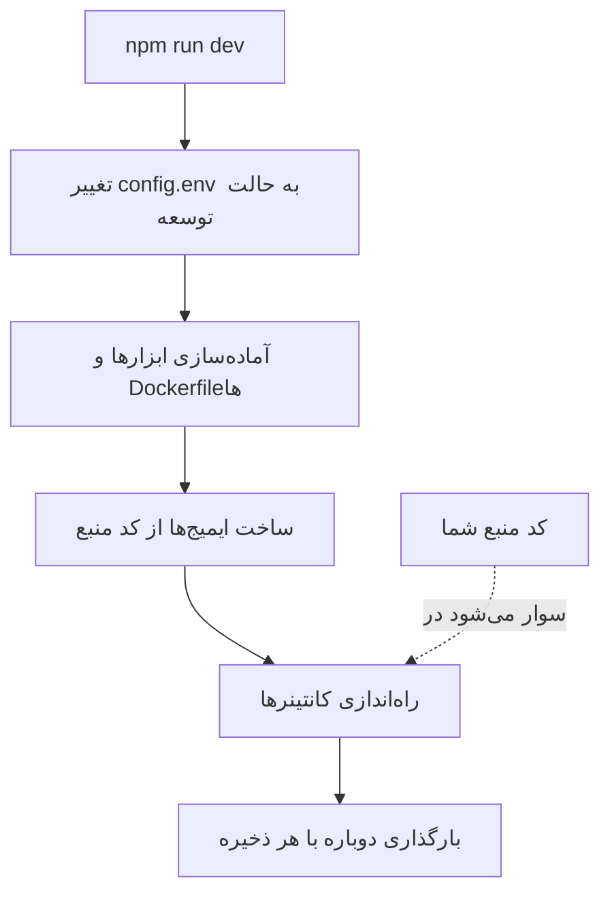

# توسعه محلی

OneUptime را از کد منبع روی رایانهٔ خودتان اجرا کنید تا روی آن کار کنید. پشتهٔ توسعه هر سرویس را از کد دریافت‌شدهٔ شما می‌سازد، کد منبع را درون کانتینرها سوار می‌کند و هر بار که فایلی را ذخیره می‌کنید آن‌ها را دوباره بارگذاری می‌کند.

برای اجرای یک نسخهٔ منتشرشده، از [Docker Compose](/docs/installation/docker-compose) استفاده کنید.

## پشتهٔ توسعه چگونه کار می‌کند

`npm run dev` کد دریافت‌شدهٔ شما را آماده می‌کند و سپس پشته‌ای را که در `Scripts/Dev/docker-compose.dev.yml` تعریف شده است راه می‌اندازد:



| مرحله | چه اتفاقی می‌افتد |
| --- | --- |
| تغییر به حالت توسعه | `ENVIRONMENT=development` را در `config.env` تنظیم می‌کند. |
| آماده‌سازی | گذرواژهٔ sudo شما را می‌پرسد، ابزارهایی را که نیستند نصب می‌کند (Git، curl، Node.js، Docker، gomplate، ts-node)، روی شاخهٔ فعلی شما `git pull` اجرا می‌کند، تنظیمات تازهٔ `config.example.env` را به `config.env` می‌افزاید و از هر `Dockerfile.tpl` یک `Dockerfile` می‌سازد. |
| ساخت | برای هر سرویس از کد منبع یک ایمیج می‌سازد. نخستین ساخت مدتی طول می‌کشد. |
| اجرا | کانتینرها را با کد منبع سوارشدهٔ شما راه می‌اندازد. |
| بارگذاری دوباره | App با تغییر یک فایل سرور، API خود را دوباره راه می‌اندازد و هم‌زمان با ویرایش شما داشبوردها را دوباره می‌سازد. |

وقتی پوشهٔ `ee/` در مخزن هست، App نسخهٔ Enterprise Edition را از آن بارگذاری می‌کند. برای اجرای Community Edition به‌جای آن، `ONEUPTIME_EDITION=community` را در `config.env` تنظیم کنید.

## پیش از شروع

| آنچه نیاز دارید | توضیح |
| --- | --- |
| **Docker** | در macOS و Windows، Docker Desktop؛ در Linux، Docker Engine همراه افزونهٔ Docker Compose v2. |
| **Node.js ۲۶ یا جدیدتر، و npm** | نسخه‌ای که `package.json` مخزن می‌خواهد و CI هم از آن استفاده می‌کند. |
| **Git** | برای کلون کردن مخزن. |
| **دسترسی sudo** | `npm run dev` پیش از نصب هر چیزی گذرواژهٔ شما را می‌پرسد. |
| **پورت‌های آزاد ۸۰ و ۴۴۳** | پشته OneUptime را روی `http://localhost` (پورت ۸۰) و HTTPS را روی پورت ۴۴۳ ارائه می‌کند. |

## راه‌اندازی پشتهٔ توسعه

:::steps
### مخزن را کلون کنید

```bash
git clone https://github.com/OneUptime/oneuptime.git
cd oneuptime
```

### فایل config.env را بسازید

```bash
cp config.example.env config.env
```

مقادیر نمونه برای توسعه همان‌طور که هستند کار می‌کنند. می‌توانید تغییرشان دهید، اما لازم نیست.

### پشته را راه بیندازید

```bash
npm run dev
```

این فرمان گذرواژهٔ sudo شما را می‌پرسد، سپس ایمیج‌ها را می‌سازد و کانتینرها را در پس‌زمینه راه می‌اندازد. راه‌اندازی App را با `docker logs -f oneuptime-app-1` دنبال کنید.

### OneUptime را باز کنید

`http://localhost` را باز کنید و ثبت‌نام کنید. نخستین حساب، مدیر ارشد می‌شود و می‌تواند Admin Dashboard را در `http://localhost/admin` باز کند.
:::

## کار روی کد

فایل‌های زیر `packages/` را ویرایش و ذخیره کنید: کانتینرها تغییر را دریافت می‌کنند.

پیش از باز کردن یک pull request، تغییر خود را روی رایانهٔ خودتان و بیرون از کانتینرها بررسی کنید. برای این کار وابستگی‌ها را یک بار نصب کنید: `npm install` را در ریشهٔ مخزن اجرا کنید (برای ESLint و ابزارهای مهاجرت)، سپس `npm run install-modules` را، که `node_modules` هر بسته را پاک و دوباره نصب می‌کند و مدتی طول می‌کشد.

:::steps
### آنچه را تغییر داده‌اید کامپایل کنید

کامپایلر را در هر بسته‌ای که تغییر داده‌اید اجرا کنید، برای نمونه در App:

```bash
cd packages/App
npm run compile
```

### فقط فایل‌های خودتان را lint کنید

از ریشهٔ مخزن، فایل‌هایی را که تغییر داده‌اید بدهید:

```bash
npx eslint --fix packages/App/path/to/File.ts
```

از `npm run lint` و `npm run fix-lint` پرهیز کنید: این دو کل مخزن را lint می‌کنند.

### آزمون‌هایی را که تغییرتان را پوشش می‌دهند اجرا کنید

در بسته، به‌جای کل مجموعه فقط فایل‌های آزمون مرتبط را اجرا کنید:

```bash
cd packages/App
npx jest Tests/path/to/YourChange.test.ts
```
:::

### مهاجرت‌های پایگاه داده

| پایگاه داده | چگونه یک مهاجرت اضافه کنید |
| --- | --- |
| PostgreSQL | مدل را تغییر دهید، سپس به‌جای نوشتن دستی مهاجرت، `npm run generate-postgres-migration` را اجرا کنید. فایل تازه را در `packages/Common/Server/Infrastructure/Postgres/SchemaMigrations/Index.ts` ثبت کنید: تا آنجا فهرست نشود اجرا نمی‌شود. `npm run check-postgres-schema-drift` هر دستوری را که هنوز جا مانده است نشان می‌دهد. |
| ClickHouse | مهاجرت را به‌صورت دستی در `packages/App/FeatureSet/Workers/DataMigrations` و به سبک مهاجرت‌های موجود بنویسید. |

## مرجع

### فرمان‌ها

این‌ها را از ریشهٔ مخزن اجرا کنید.

| کار | فرمان |
| --- | --- |
| راه‌اندازی پشته، یا اعمال تغییرات `config.env` | `npm run dev` |
| ساخت دوبارهٔ ایمیج‌ها پس از تغییر وابستگی‌ها | `npm run build`، سپس `npm run dev` |
| ساخت دوبارهٔ ایمیج‌ها از صفر | `npm run force-build-dev`، سپس `npm run dev` |
| فهرست کانتینرهای در حال اجرا | `docker ps` |
| دنبال کردن لاگ‌های یک سرویس | `docker logs -f oneuptime-app-1` |
| توقف پشته و حذف کانتینرهای آن | `npm run down` |

`npm run down` داده‌های شما را نگه می‌دارد: حجم‌های PostgreSQL و ClickHouse باقی می‌مانند.

### پورت‌ها

پشتهٔ توسعه ذخیره‌گاه‌های داده را منتشر می‌کند تا بتوانید با ابزارهای خودتان به آن‌ها وصل شوید. گذرواژه‌ها در `config.env` هستند.

| سرویس | نشانی | ورود با |
| --- | --- | --- |
| OneUptime | `http://localhost` | حسابی که ساختید |
| PostgreSQL | `localhost:5400` | کاربر `postgres`، پایگاه داده `oneuptimedb`، گذرواژه `DATABASE_PASSWORD` |
| ClickHouse | `localhost:8189` (HTTP)، `localhost:9034` (بومی) | کاربر `default`، پایگاه داده `oneuptime`، گذرواژه `CLICKHOUSE_PASSWORD` |
| Valkey | `localhost:6310` | گذرواژه `VALKEY_PASSWORD` |

## عیب‌یابی

:::details npm run dev روی git pull می‌ایستد
`npm run dev` پیش از ساخت، روی شاخهٔ فعلی شما `git pull` اجرا می‌کند. Git روی شاخه‌ای که upstream ندارد، یا وقتی pull تغییرات commitنشدهٔ شما را بازنویسی می‌کند، نمی‌پذیرد. upstream شاخه را تنظیم کنید (برای نمونه با push کردن آن با `git push -u origin <branch>`) یا کارتان را commit کنید، سپس `npm run dev` را دوباره اجرا کنید.
:::

:::details npm run dev هنگام نصب یک ابزار می‌ایستد
آن ابزار را خودتان نصب کنید، برای نمونه gomplate یا ts-node، و `npm run dev` را دوباره اجرا کنید: از هر ابزاری که از پیش نصب است می‌گذرد.
:::

:::details یک سرویس پس از تغییر وابستگی‌هایش از کار می‌افتد
ایمیج‌ها هنوز وابستگی‌های قدیمی را دارند. آن‌ها را با `npm run build` دوباره بسازید، سپس پشته را با `npm run dev` دوباره راه بیندازید. اگر کافی نبود، با `npm run force-build-dev` از صفر بسازید.
:::

:::details پورت ۸۰ یا ۴۴۳ از پیش در حال استفاده است
برنامهٔ دیگری روی رایانهٔ شما، اغلب یک وب‌سرور محلی، پورت را گرفته است. آن را متوقف کنید، سپس `npm run dev` را دوباره اجرا کنید.
:::

## گام‌های بعدی

:::cards
- [معماری خودمیزبان](/docs/self-hosted/architecture): سرویس‌هایی که همین حالا راه انداختید چگونه کنار هم کار می‌کنند.
- [Docker Compose](/docs/installation/docker-compose): اجرای یک نسخهٔ منتشرشده روی یک سرور.
- [مرجع API](/docs/api-reference/api-reference): فراخوانی API نمونهٔ محلی شما.
:::
