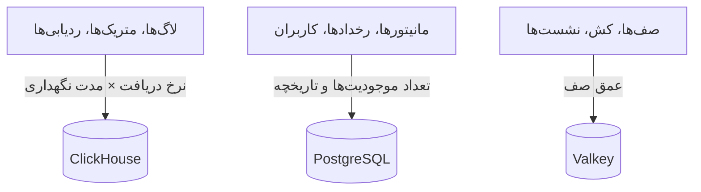

# تعیین اندازه و برنامه‌ریزی ظرفیت

CPU، حافظه و دیسک را برای یک OneUptime خودمیزبان روی Kubernetes با [چارت Helm](https://artifacthub.io/packages/helm/oneuptime/oneuptime) برنامه‌ریزی کنید. اندازهٔ سه ذخیره‌گاه داده – **ClickHouse**، **PostgreSQL** و **Valkey** – و برنامه را جداگانه تعیین کنید، از یکی از سطح‌های پایین شروع کنید و وقتی اعداد واقعی دارید آن را تنظیم کنید.

> [!IMPORTANT]
> مقادیر پیش‌فرض چارت اندازه‌گذاری محیط عملیاتی نیستند. سرویس‌هایی که به‌طور پیش‌فرض اجرا می‌کند **هیچ درخواست یا محدودیت CPU یا حافظه‌ای تنظیم نمی‌کنند**، و PostgreSQL و ClickHouse حجم‌های کوچک **25 Gi** می‌گیرند تا چارت روی هر خوشه‌ای نصب شود. برای هر کاری فراتر از آزمایش، منابع و فضای ذخیره‌سازی را خودتان با اعداد این صفحه تنظیم کنید.

به‌جای آن از نصب Docker Compose روی یک سرور استفاده می‌کنید؟ اندازه‌گذاری آن ساده‌تر است: [نیازمندی‌ها](/docs/installation/docker-compose#نیازمندیها) را ببینید (۱۶ گیگابایت حافظه، ۸ هسته و ۴۰۰ گیگابایت دیسک توصیه می‌شود).

:::cards
- [آنچه هر ذخیره‌گاه داده را بزرگ می‌کند](#آنچه-هر-ذخیرهگاه-داده-را-بزرگ-میکند): سه ذخیره‌گاه که با سه چیز متفاوت بزرگ می‌شوند.
- [سطح‌های آغازین](#سطحهای-آغازین): نقطه‌های شروع کوچک، متوسط و بزرگ.
- [دسترس‌پذیری بالا](#دسترسپذیری-بالا): رونوشت‌ها و جابه‌جایی هنگام خرابی برای هر ذخیره‌گاه.
- [مدت نگهداری](#مدت-نگهداری-و-اثر-آن-بر-فضای-ذخیرهسازی): تنظیمی که دیسک شما را چند برابر می‌کند.
:::

## اندازهٔ نصب خود را تعیین کنید

:::steps
1. دریابید چه مقدار تله‌متری می‌فرستید: چند گیگابایت لاگ، متریک و ردیابی در روز. اگر می‌توانید، آن را روی یک نصب کوچک اندازه بگیرید.
2. تصمیم بگیرید آن را چند روز نگه دارید. مدت نگهداری دیسک ClickHouse را چند برابر می‌کند ([مدت نگهداری](#مدت-نگهداری-و-اثر-آن-بر-فضای-ذخیرهسازی) را ببینید).
3. دیسک ClickHouse را با [فرمول ذخیره‌سازی](#فرمول-ذخیرهسازی) حساب کنید، سپس دیسک PostgreSQL و Valkey را از بخش‌های خودشان.
4. [سطح آغازینی](#سطحهای-آغازین) را که به اعداد شما نزدیک‌تر است انتخاب کنید و CPU، حافظه و فضای ذخیره‌سازی آن را در values Helm خود تنظیم کنید.
5. [دسترس‌پذیری بالا](#دسترسپذیری-بالا) را برای ذخیره‌گاه‌هایی که به آن نیاز دارند روشن کنید، سپس مصرف واقعی را زیر نظر بگیرید و تنظیم کنید.
:::

## آنچه هر ذخیره‌گاه داده را بزرگ می‌کند

OneUptime در محیط عملیاتی به سه ذخیره‌گاه داده نیاز دارد. هر کدام با چیز متفاوتی بزرگ می‌شود، پس اندازهٔ آن‌ها را مستقل از هم تعیین کنید.



| ذخیره‌گاه داده | چه چیزی را نگه می‌دارد | چه چیزی اندازه‌اش را تعیین می‌کند |
| --- | --- | --- |
| **ClickHouse** | همهٔ تله‌متری – لاگ‌ها، متریک‌ها، ردیابی‌ها، استثناها، پروفایل‌ها | تله‌متری: **نرخ دریافت × مدت نگهداری**. این حدود ۹۵٪ فضای ذخیره‌سازی شما و بزرگ‌ترین هزینه است. |
| **PostgreSQL** | پیکربندی و وضعیت – مانیتورها، رخدادها، هشدارها، کاربران، تیم‌ها، پروژه‌ها، گردش‌کارها، صفحه‌های وضعیت، داشبوردها | **تعداد موجودیت‌ها و تاریخچه**، نه حجم تله‌متری. آهسته بزرگ می‌شود. |
| **Valkey** | کش، صف‌های کار و نشست‌ها | **عمق صف و نشست‌های فعال**. وابسته به حافظه و کم‌حجم. منبع حقیقت نیست. |

OneUptime برای اجرا هرگز به ذخیره‌ساز شیء (S3، MinIO) نیاز ندارد و تله‌متری قدیمی‌تر را به ذخیره‌ساز شیء منتقل نمی‌کند. فقط اگر پشتیبان‌گیری در ذخیره‌ساز شیء را انتخاب کنید به آن نیاز دارید: افزونهٔ Barman Cloud برای CloudNativePG، یا [clickhouse-backup](https://github.com/Altinity/clickhouse-backup) برای ClickHouse. پشتیبان‌گیری CloudNativePG خود چارت (`postgresOperator.cnpg.backup`) از حجم‌ها اسنپ‌شات می‌گیرد و به ذخیره‌ساز شیء نیازی ندارد. CloudNativePG اسنپ‌شات‌های قدیمی را هرگز پاک نمی‌کند: خودتان آن‌ها را پاک کنید، وگرنه مدام بیشتر می‌شوند.

## ClickHouse – بزرگ‌ترین عامل

تقریباً همهٔ فضای ذخیره‌سازی و بخش بزرگی از حافظهٔ شما صرف ClickHouse می‌شود، چون هر خط لاگ، هر نقطهٔ متریک، هر span ردیابی و هر استثنا آنجا نگه داشته می‌شود.

### فرمول ذخیره‌سازی

```text
ClickHouse disk ≈ (daily raw telemetry GB ÷ compression) × retention days × replicas × 1.3 (headroom)
```

فشرده‌سازی به نوع سیگنال بستگی دارد:

| سیگنال | فشرده‌سازی معمول | چه چیزی آن را تغییر می‌دهد |
| --- | --- | --- |
| لاگ‌ها | حدود ۵:۱ | لاگ‌ها خوب فشرده می‌شوند. |
| متریک‌ها | حدود ۲:۱ | **کاردینالیتی** بالای برچسب‌ها دیسک و حافظه را سریع‌تر از حجم خام بزرگ می‌کند. کاردینالیتی برچسب‌ها را پایین نگه دارید. |
| ردیابی‌ها | میان این دو | ویژگی‌های spanی که می‌فرستید. |

### نمونهٔ محاسبه

ناوگانی از **۱۰ خوشه**، که هر کدام حدود ۱۰ گره و ۱۰۰ پاد دارد که در سطح INFO لاگ می‌نویسند، تقریباً **۵۰ تا ۱۵۰ گیگابایت لاگ خام برای هر خوشه در ۳۰ روز** تولید می‌کند (حدود ۱٫۷ تا ۵ گیگابایت در روز برای هر خوشه). برای کل ناوگان، با افزودن متریک‌ها و ردیابی‌ها و پس از فشرده‌سازی، تقریباً **۵ تا ۱۵ گیگابایت تله‌متری فشرده در روز** در نظر بگیرید.

| مدت نگهداری | یک رونوشت | ۲ رونوشت + ۳۰٪ حاشیه |
| --- | --- | --- |
| ۳۰ روز | ~۱۵۰ تا ۴۵۰ GB | **~۰٫۴ تا ۱٫۲ TB** |
| ۹۰ روز | ~۰٫۴۵ تا ۱٫۳۵ TB | **~۱٫۲ تا ۳٫۵ TB** |

فضای ذخیره‌سازی **به‌طور خطی با مدت نگهداری** بزرگ می‌شود: یک بازهٔ ۹۰ روزه حدود سه برابر یک بازهٔ ۳۰ روزه هزینه دارد.

### حافظه و نوع دیسک

- **از NVMe یا SSD استفاده کنید.** تله‌متری پرنوشتن است و خواندن‌های تجمیعی به‌صورت انفجاری دارد؛ ClickHouse روی دیسک‌های چرخان به زحمت می‌افتد.
- **به ClickHouse حافظهٔ فراوان بدهید.** پرس‌وجوهای تجمیعی حافظهٔ زیادی می‌خواهند. به‌عنوان قاعدهٔ سرانگشتی، حافظه را برابر ۲۵ تا ۵۰٪ دادهٔ فشردهٔ *داغ* (اخیراً پرس‌وجوشده) در نظر بگیرید، با کف عملی ۱۶ گیگابایت برای هر ناوگان عملیاتی واقعی.
- **کاردینالیتی متریک‌ها را مهار کنید.** این بزرگ‌ترین اهرم منفرد بر حافظه و دیسک ClickHouse است. جایی که متریک‌ها را گردآوری می‌کنید، قراردادهای برچسب با کاردینالیتی پایین را اجرا کنید و تعداد سری‌های فعال را زیر نظر بگیرید.

## PostgreSQL – پیکربندی و وضعیت

PostgreSQL پیکربندی و وضعیت عملیاتی شما را نگه می‌دارد، نه تله‌متری را، پس آهسته بزرگ می‌شود و کنار ClickHouse کوچک می‌ماند. حتی استقرارهای بزرگ معمولاً در حد چند ده گیگابایت هستند. حجم پیش‌فرض **25 Gi** برای نصب‌های کوچک کافی است؛ برای نصب‌های بزرگ‌تر ۵۰ تا ۱۰۰ گیگابایت با حاشیه‌ای برای تاریخچهٔ رخدادها و هشدارها در نظر بگیرید.

با رونوشت‌های زیاد از برنامه، workerها و کاوشگرها، اتصال‌های پایگاه داده ممکن است پیش از فضای ذخیره‌سازی تمام شوند. هر پاد به‌طور پیش‌فرض تا ۵۰ اتصال باز می‌کند و PostgreSQL همراه چارت ۵۰۰ اتصال را مجاز می‌داند. چارت دقیقاً برای همین یک تجمیع‌کنندهٔ اتصال اختیاری به نام **PgBouncer** (`pgbouncer.enabled`) دارد: آن را برای استقرارهایی با رونوشت‌های زیاد روشن کنید.

## Valkey – کش، صف‌ها و نشست‌ها

لایهٔ کش [Valkey](https://valkey.io)، انشعاب دارای مجوز BSD از Redis 7.2، را به‌عنوان کش، صف کار و ذخیره‌گاه نشست اجرا می‌کند. هر سروری با پروتکل Redis می‌تواند جایگزین آن شود و اندازه‌گذاری زیر در هر دو حالت صدق می‌کند. Valkey **وابسته به حافظه** است و ماندگاری **به‌طور پیش‌فرض خاموش** است: منبع حقیقت نیست و می‌توان آن را از نو ساخت. اندازهٔ آن را بر پایهٔ عمق صف و نشست‌های هم‌زمان تعیین کنید؛ ۲ تا ۸ گیگابایت حافظه برای بیشتر استقرارها کافی است. سیاست بیرون‌رانی آن `noeviction` است، پس اگر صف‌ها زیر بار پیوسته انباشته شوند حافظهٔ آن را زیر نظر بگیرید.

## توان پردازشی برنامه

افزون بر ذخیره‌گاه‌های داده، اندازهٔ بارهای کاری بی‌حالت را هم تعیین کنید. هر کدام تا وقتی خودتان تنظیم نکنید **بدون هیچ درخواست یا محدودیت منابع** و با یک رونوشت اجرا می‌شود، جز telemetry writer که دو رونوشت دارد.

| بار کاری | کلید values | با چه چیزی بزرگ می‌شود |
| --- | --- | --- |
| برنامه: داشبورد، API و دریافت | `app` | کاربران، فراخوانی‌های API و تله‌متری ورودی |
| workerها، وقتی از برنامه جدا شده‌اند | `worker` | تله‌متری و پردازش کارهای پس‌زمینه |
| کاوشگرها | `probes` | تعداد مانیتورهای فعال |
| درگاه ورودی | `nginx` | حجم درخواست‌ها |
| telemetry writer، وقتی روشن است | `telemetryWriter` | نه با بار: هر درج تله‌متری را به‌صورت دسته‌ای در ClickHouse می‌نویسد، پس اندازه‌اش بر پایهٔ ظرفیت ClickHouse تعیین می‌شود |

چارت **KEDA** را همراه دارد تا برنامه، workerها، کاوشگرها و Runner بتوانند بر پایهٔ عقب‌ماندگی صف خود مقیاس بگیرند. `keda.enabled` را همراه `keda.enabled` خود هر سرویس روشن کنید (برای نمونه `app.keda.enabled`). روی خوشه‌ای که هنوز KEDA ندارد، نخستین نصب یک دور اضافه لازم دارد: [راهنمای KEDA](https://github.com/OneUptime/oneuptime/blob/master/HelmChart/Docs/Keda.md) چارت را ببینید. سرویس‌هایی که KEDA آن‌ها را مدیریت نمی‌کند می‌توانند به‌جای آن از مقیاس‌دهندهٔ خودکار مبتنی بر CPU یا حافظه (`autoscaling`) استفاده کنند.

## سطح‌های آغازین

سطحی را که به محیط شما نزدیک‌تر است نقطهٔ شروع بگیرید، سپس مصرف واقعی (`kubectl top pods`، رشد دیسک ClickHouse و PostgreSQL) را زیر نظر بگیرید و تنظیم کنید.

- **کوچک / PoC** – ۱ تا ۳ خوشه، حداکثر ۳۰ گره، حداکثر ۵ گیگابایت تله‌متری خام در روز، نگهداری ۳۰ روزه.
- **متوسط / ناوگان عملیاتی** – حدود ۱۰ خوشه، حدود ۱۰۰ گره، ۱۰ تا ۳۰ گیگابایت تله‌متری خام در روز، نگهداری ۳۰ تا ۹۰ روزه.
- **بزرگ / چند ناوگان** – بیش از ۵۰ خوشه، بیش از ۵۰۰ گره، بیش از ۱۰۰ گیگابایت تله‌متری خام در روز، نگهداری ۹۰ روزه.

| | کوچک / PoC | متوسط / ناوگان عملیاتی | بزرگ / چند ناوگان |
| --- | --- | --- | --- |
| **ClickHouse** | 4 vCPU / 16 GB / 200 GB NVMe | 8 vCPU / 32 GB / 1–3 TB NVMe | 16+ vCPU / 64–128 GB / 5–15 TB NVMe، **شارددار** |
| **PostgreSQL** | 2 vCPU / 4 GB / 50 GB SSD | 4 vCPU / 8 GB / 100 GB SSD | 8 vCPU / 16–32 GB / 250 GB SSD (+ PgBouncer) |
| **Valkey** | 1 vCPU / 2 GB | 2 vCPU / 4 GB | 4 vCPU / 8–16 GB |
| **مدت نگهداری فرض‌شده** | ۳۰ روز | ۳۰ تا ۹۰ روز | ۹۰ روز |

این سطح‌ها اندازهٔ بک‌اند OneUptime را تعیین می‌کنند. عاملی که روی هر خوشهٔ پایش‌شده نصب می‌کنید در صفحهٔ [عامل Kubernetes](/docs/telemetry/kubernetes-agent) شرح داده شده است، که نشان می‌دهد چگونه حجم داده‌ای را که می‌فرستد کم کنید.

## دسترس‌پذیری بالا

ذخیره‌گاه‌های دادهٔ داخلی چارت به‌طور پیش‌فرض به‌صورت **نمونه‌های تکی** اجرا می‌شوند. برای دسترس‌پذیری بالا در محیط عملیاتی:

| ذخیره‌گاه داده | برای دسترس‌پذیری بالا |
| --- | --- |
| **PostgreSQL** | اپراتور همراه [CloudNativePG](https://cloudnative-pg.io) (`postgresOperator.cnpg.enabled`) را با **۳ نمونه** (`postgresOperator.cnpg.instances`) روشن کنید: یک نمونهٔ اصلی و دو نمونهٔ آمادهٔ داغ، با جابه‌جایی خودکار هنگام خرابی. |
| **ClickHouse** | اپراتور همراه [Altinity](https://github.com/Altinity/clickhouse-operator) (`clickhouseOperator.altinity.enabled`) را با **۲ رونوشت یا بیشتر برای هر شارد** (`clickhouseOperator.altinity.cluster.replicasCount`) روشن کنید. ClickHouse Keeper همراه آن برای حد نصاب روی **۳ گره** اجرا می‌شود. وقتی دیسک یا حافظهٔ یک گره به حد رسید، شارد اضافه کنید (`shardsCount`). |
| **Valkey** | چارت از آن رونوشت نمی‌گیرد. OneUptime را به یک Redis یا Valkey مدیریت‌شدهٔ بیرونی با جابه‌جایی خودکار هنگام خرابی (`externalValkey`) وصل کنید. OneUptime به یک میزبان و پورت وصل می‌شود، پس از نقطهٔ پایانی اصلی سرویس استفاده کنید، نه نقطهٔ پایانی حالت خوشه‌ای. |

> [!WARNING]
> روشن کردن هر یک از این اپراتورها برای یک نصب موجود، یک پایگاه دادهٔ تازه و خالی راه می‌اندازد: هیچ‌کدام داده‌های پایگاه دادهٔ تک‌نمونه‌ای را که جایگزین می‌کند کپی نمی‌کند. داده‌های خود را همان‌طور که راهنماهای چارت شرح می‌دهند منتقل کنید – برای [PostgreSQL](https://github.com/OneUptime/oneuptime/blob/master/HelmChart/Docs/MigratePostgresStandaloneToOperator.md) و برای [ClickHouse](https://github.com/OneUptime/oneuptime/blob/master/HelmChart/Docs/MigrateClickhouseStandaloneToOperator.md).

## مدت نگهداری و اثر آن بر فضای ذخیره‌سازی

مدت نگهداری تله‌متری یک **TTL در ClickHouse است که به روز شمرده می‌شود**. هر ویرایش مقدار پیش‌فرض پروژه را دارد، در **تنظیمات پروژه** > **تله‌متری و APM** > **نگهداری داده** (**نگهداری پیش‌فرض (روز)**)؛ وقتی چیزی تنظیم نشده باشد، ۱۵ روز است. [Enterprise Edition](/docs/self-hosted/enterprise) بازنویسی‌هایی می‌افزاید: بر پایهٔ سیگنال (لاگ‌ها، ردیابی‌ها، متریک‌ها، پروفایل‌ها)، بر پایهٔ شدت لاگ و وضعیت ردیابی، و برای هر سرویس یا منبع.

لاگ‌ها و متریک‌ها روزبه‌روز حذف می‌شوند، در نخستین نیمه‌شب (به وقت سرور ClickHouse) پس از پایان مدت نگهداری‌شان؛ این کار ClickHouse را از بازنویسی هر روز از آن‌ها در فاصله‌های چندساعته تا زمان انقضا بی‌نیاز می‌کند. درست پیش از نیمه‌شب، تا یک روز بیش از بازهٔ نگهداری هنوز روی دیسک است: اندازهٔ لاگ‌ها و متریک‌ها را برای **روزهای نگهداری + ۱** تعیین کنید.

چون مدت نگهداری فضای ذخیره‌سازی ClickHouse را چند برابر می‌کند، پیش از تعیین اندازهٔ دیسک درباره‌اش تصمیم بگیرید. OneUptime تله‌متری قدیمی را بایگانی **نمی‌کند** و به ذخیره‌ساز شیء هم منتقل نمی‌کند. برای نگهداری چندساله به دلایل انطباق، بازهٔ نگهداری را طولانی‌تر کنید و فضای ذخیره‌سازی ClickHouse را متناسب با آن تعیین کنید، یا به یک بایگانی بیرونی دلخواه برون‌بری کنید.

## پیش از تصمیم، اندازه بگیرید

حجم تله‌متری با میزان جزئیات لاگ‌های برنامه، تعداد namespaceها، فاصلهٔ scrape و روشن بودن لاگ‌گیری DEBUG در هر جایی بسیار تغییر می‌کند. سطح‌های بالا را نقطهٔ شروع بدانید: **دست‌کم چهار هفته از محیط خود داده گردآوری کنید**، گیگابایت واقعی روزانهٔ هر سیگنال را اندازه بگیرید و سپس مدت نگهداری و فضای ذخیره‌سازی را بر پایهٔ دادهٔ واقعی تعیین کنید.

## گام‌های بعدی

:::cards
- [Docker Compose](/docs/installation/docker-compose): نیازمندی‌های نصب روی یک سرور.
- [معماری خودمیزبان](/docs/self-hosted/architecture): اجزا چگونه کنار هم قرار می‌گیرند.
- [عامل Kubernetes](/docs/telemetry/kubernetes-agent): گردآورنده‌ای که تله‌متری خوشه را می‌فرستد.
- [Enterprise Edition](/docs/self-hosted/enterprise): بازنویسی‌های مدت نگهداری و دیگر قابلیت‌های Enterprise.
:::
