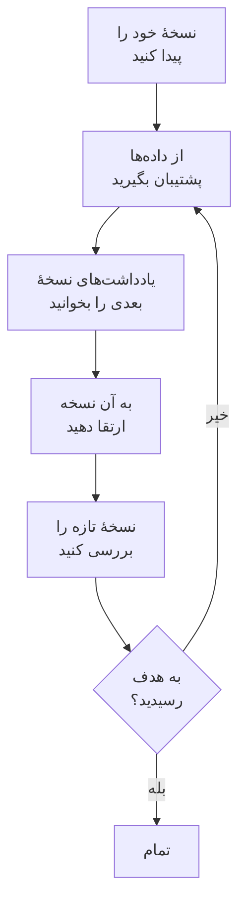

# ارتقا

یک OneUptime خودمیزبان — با Docker Compose، یا Kubernetes با Helm — را به نسخهٔ تازه‌تری ارتقا دهید. روند زیر را دنبال کنید، و یادداشت‌های هر نسخهٔ اصلی میان نسخه‌ای که اجرا می‌کنید و نسخه‌ای که به آن می‌روید را بخوانید.

:::cards
- [روش ارتقا](#روش-ارتقا): روند کار، برای Docker Compose و Kubernetes.
- [یادداشت‌های هر نسخه](#یادداشتهای-نسخهٔ-خود-را-پیدا-کنید): آنچه هر نسخهٔ اصلی از شما می‌خواهد، در یک نگاه.
- [ایمیج‌های Community Edition و Enterprise Edition](#ایمیجهای-community-edition-و-enterprise-edition): از 14 به بعد کدام ایمیج را اجرا کنید.
- [ارتقا از OneUptime 13 → 14](#ارتقا-از-oneuptime-13-14): تازه‌ترین نسخهٔ اصلی.
:::

## روش ارتقا

سه قاعده ارتقا را امن نگه می‌دارد:

- **هر بار فقط یک نسخهٔ اصلی ارتقا دهید** (برای نمونه 6 → 7 → 8). هیچ نسخهٔ اصلی‌ای را رد نکنید.
- **نسخه‌های فرعی و وصله‌ای را هر طور که خواستید رد کنید** (برای نمونه 8.1 → 8.4)، به شرط آنکه یادداشت‌های انتشارشان را دنبال کنید.
- **پیش از هر ارتقا پشتیبان بگیرید**، و بررسی کنید که می‌توانید پشتیبان را بازگردانی کنید.



:::steps
### نسخهٔ فعلی خود را پیدا کنید

به‌عنوان مدیر اصلی، برچسب نسخه را در سرصفحهٔ داشبورد مدیریت باز کنید: **This installation** نسخه‌ای را که اجرا می‌کنید نشان می‌دهد. خود نصب هم آن را در `/version` گزارش می‌کند:

```bash
curl http://localhost/version
```

`http://localhost` را با نشانی نصب خود جایگزین کنید. پاسخ JSON است، مانند `{"version":"14.0.22","commit":"..."}`.

### از داده‌های خود پشتیبان بگیرید

از PostgreSQL پشتیبان بگیرید، و اگر به تله‌متری ClickHouse نیاز دارید از ClickHouse هم. در Docker Compose، [پشتیبان‌گیری و بازگردانی](/docs/installation/docker-compose#پشتیبانگیری-و-بازیابی) را ببینید. در Kubernetes، از اسنپ‌شات‌های والیوم خود یا پشتیبان‌های CloudNativePG چارت استفاده کنید.

### یادداشت‌های نسخهٔ اصلی بعدی را بخوانید

آن‌ها را در [جدول زیر](#یادداشتهای-نسخهٔ-خود-را-پیدا-کنید) پیدا کنید، و پیش از ارتقا آنچه را می‌خواهند انجام دهید: برخی گام‌ها، مانند تغییر نام مقادیر Helm، باید اول انجام شوند.

### ارتقا را اجرا کنید

:::tabs
@tab Docker Compose
```bash
git checkout release
git pull
npm run update
```
`npm run update` تنظیمات تازه را بدون تغییر تنظیمات شما به `config.env` شما اضافه می‌کند، ایمیج‌های تازه را می‌کشد و OneUptime را دوباره راه‌اندازی می‌کند.
@tab Kubernetes
```bash
helm repo update
helm upgrade my-oneuptime oneuptime/oneuptime -f values.yaml
```
نام release و فایل values خودتان را به کار ببرید. چارت پیش از آنکه پادهای تازه به ترافیک پاسخ دهند، مهاجرت‌های پایگاه داده را در یک Job جداگانه اجرا می‌کند.
:::

### نسخهٔ تازه را بررسی کنید

در Docker Compose، `npm run update` با **OneUptime is up!** پایان می‌یابد. در Kubernetes، صبر کنید تا همهٔ پادها `Running` و آماده شوند:

```bash
kubectl get pods -n <namespace>
```

سپس مانند گام اول، نسخهٔ خود را دوباره بررسی کنید. اگر هنوز به نسخهٔ هدف نرسیده‌اید، به [از داده‌های خود پشتیبان بگیرید](#از-دادههای-خود-پشتیبان-بگیرید) برگردید و نسخهٔ اصلی بعدی را بگیرید.
:::

### یادداشت‌های نسخهٔ خود را پیدا کنید

| ارتقا | کاری که باید بکنید |
| --- | --- |
| [13 → 14](#ارتقا-از-oneuptime-13-14) | یک نسخه انتخاب کنید. نصب‌های Docker Compose که `IS_ENTERPRISE_EDITION=true` را تنظیم کرده‌اند به `APP_TAG=enterprise-release` می‌روند. در Enterprise Edition یک پروانه فعال کنید. مانیتورهای Ping، Port و SSL با IPv6 را دوباره ذخیره کنید. |
| [12 → 13](#ارتقا-از-oneuptime-12-13) | معمولاً هیچ: Valkey جای Redis را می‌گیرد، و نام‌های قدیمی تنظیمات همچنان کار می‌کنند. Docker Compose را دستی اجرا می‌کنید؟ `--remove-orphans` را اضافه کنید. از کش خودتان استفاده می‌کنید؟ [اگر کش خودتان را اجرا می‌کنید](#اگر-کش-خودتان-را-اجرا-میکنید) را بخوانید. |
| [11 → 12](#ارتقا-از-oneuptime-11-12) | Runbook Agentها را به‌صورت Runner دوباره مستقر کنید. در Docker Compose، `ONEUPTIME_RUNNER_KEY` را تنظیم کنید. در Helm، نام `aiAgent:` را به `runner:` تغییر دهید. مجوزهای Runner را که کلیدهای API مستقیماً داشتند دوباره بدهید. |
| [10 → 11](#ارتقا-از-oneuptime-10-11) | SCIM و تنظیمات انطباق تیم به Enterprise Edition نیاز دارند. برای نگه‌داشتن تاریخچهٔ تله‌متری، پیش از ارتقا نام جدول‌های قدیمی ClickHouse را تغییر دهید. |
| [9 → 10](#ارتقا-از-oneuptime-9-10) | هیچ. |
| [8 → 9](#ارتقا-از-oneuptime-8-9) | در Helm، بازنویسی‌های `oneuptimeIngress` را از values خود حذف کنید. |
| [7 → 8](#ارتقا-از-oneuptime-7-8) | در Helm، به ساختار تازهٔ values برای Postgres، Redis و ClickHouse بروید. اول پشتیبان بگیرید. |

## ایمیج‌های Community Edition و Enterprise Edition

OneUptime اکنون برنامه را در قالب دو ایمیج عرضه می‌کند. **Community Edition** متن‌باز و تحت Apache License 2.0 است و شامل ورود یکپارچهٔ SAML و OIDC، SSO سراسری و «Require SSO for login» است. **Enterprise Edition** ماژول‌های سازمانی پوشهٔ `ee/` مخزن را اضافه می‌کند: SCIM، انطباق تیم، لاگ‌های ممیزی و داشبوردهای سازمانی Health در داشبورد مدیریت. پیش از این تغییر هر دو نسخه کد یکسانی اجرا می‌کردند، و `IS_ENTERPRISE_EDITION` تعیین می‌کرد کدام قابلیت‌ها روشن باشند. اکنون ایمیج تعیین می‌کند، و ایمیج Community پوشهٔ `ee/` را ندارد.

صفحهٔ [نسخه سازمانی](/docs/self-hosted/enterprise) مقایسهٔ کامل قابلیت‌ها، جزئیات پروانه و آنچه هنگام تغییر نسخه رخ می‌دهد را دارد.

### پیش از ارتقا چه کنید

- **Community Edition بدون SCIM:** هیچ. مثل همیشه ارتقا دهید.
- **Helm با `image.type: enterprise-edition`:** هیچ. چارت از قبل ایمیج‌های `enterprise-` را می‌کشد، که اکنون ماژول‌های سازمانی را دارند.
- **Docker Compose با `IS_ENTERPRISE_EDITION=true`:** هنگام ارتقا با تنظیم `APP_TAG=enterprise-release` (یا `enterprise-<version>`) در `config.env` به ایمیج Enterprise بروید. `APP_TAG=release` ایمیج Community است، و `IS_ENTERPRISE_EDITION=true` دیگر چیزی را روشن نمی‌کند. تا وقتی `IS_ENTERPRISE_EDITION=true` است، `npm run update` این تغییر را برای شما انجام می‌دهد (`release` به `enterprise-release` تبدیل می‌شود، و `13.0.7` سنجاق‌شده به `enterprise-13.0.7`) و آنچه را تغییر داده چاپ می‌کند. اکنون وقتی `IS_ENTERPRISE_EDITION=true` روی ایمیج Community تنظیم شده باشد، برنامه به‌جای اینکه بی‌صدا تأمین SCIM و ثبت ممیزی را متوقف کند، **از شروع سر باز می‌زند**. خطا می‌گوید چه چیزی را تنظیم کنید: `APP_TAG=enterprise-<version>` برای نگه‌داشتن Enterprise Edition، یا `IS_ENTERPRISE_EDITION=false` برای اجرای Community Edition.
- **ایمیج Community با SCIM از پیش پیکربندی‌شده:** تأمین SCIM با این ارتقا متوقف می‌شود، از جمله لغو تأمین. برای نگه‌داشتنش به ایمیج Enterprise بروید. در غیر این صورت، پیش از ارتقا [رفتن از Enterprise به Community](/docs/self-hosted/enterprise#رفتن-از-enterprise-به-community) را بخوانید. توضیح می‌دهد چه چیزی متوقف می‌شود و چه کسانی را اول حذف کنید. برای اجرای Community Edition، `IS_ENTERPRISE_EDITION=false` را هم تنظیم کنید. ورود یکپارچه تحت تأثیر قرار نمی‌گیرد: ایمیج Community هم آن را ارائه می‌کند.

پیکربندی شما هرگز حذف نمی‌شود، و برای تغییر نسخه در هیچ جهتی مهاجرتی لازم نیست.

### پروانه پس از ارتقا

Enterprise Edition اکنون پروانهٔ خود را بررسی می‌کند:

- **نصبی که کلید پروانه دارد** به کار ادامه می‌دهد. هنگام شروع و روزی یک بار پروانه را نزد OneUptime بررسی می‌کند. اگر پروانه منقضی شود، همه چیز برای یک دورهٔ مهلت 30 روزه کار می‌کند، و پس از آن همان اتفاقی می‌افتد که برای نصب بدون پروانه.
- **نصبی که پروانه ندارد**، برای نمونه نصبی که Enterprise Edition را فقط با `IS_ENTERPRISE_EDITION=true` اجرا می‌کرد، از نخستین شروع این نسخه یک دورهٔ آزمایشی 14 روزه می‌گیرد. **اگر از SCIM یا ثبت ممیزی استفاده می‌کنید، پیش از پایان دورهٔ آزمایشی یک پروانه فعال کنید.** پس از دورهٔ آزمایشی، تأمین SCIM متوقف می‌شود و ثبت ممیزی دیگر چیزی ثبت نمی‌کند. پیکربندی سازمانی هم فقط‌خواندنی می‌شود و داشبوردهای سازمانی Health قفل می‌شوند. ورود یکپارچه تحت تأثیر قرار نمی‌گیرد. به محض اینکه پروانه‌ای فعال کنید، همه چیز بدون راه‌اندازی دوباره از سر گرفته می‌شود. دورهٔ آزمایشی برای ارزیابی است: استفادهٔ تولیدی از Enterprise Edition به اشتراک OneUptime Enterprise نیاز دارد. [وقتی پروانه منقضی شده یا وجود ندارد](/docs/self-hosted/enterprise#وقتی-پروانه-منقضی-شده-یا-وجود-ندارد) را ببینید.
- **نصب‌های جدا از شبکه** می‌توانند به‌جای کلید با یک توکن پروانهٔ امضاشده فعال شوند. [فعال‌سازی آفلاین](/docs/self-hosted/enterprise#فعالسازی-آفلاین-نصبهای-جدا-از-شبکه) را ببینید.

### مشتریان OneUptime Cloud

برای شما چیزی تغییر نمی‌کند. OneUptime Cloud نسخهٔ Enterprise Edition را اجرا می‌کند، و همچنان طرح شما تعیین می‌کند کدام قابلیت‌ها را دارید: SSO، OIDC، SCIM و انطباق تیم از طرح Scale به بالا، و لاگ‌های ممیزی در طرح Enterprise. پروژه‌های طرح Scale اکنون تنظیمات SSO، OIDC، SCIM و انطباق تیم را می‌بینند که پیش‌تر پیام ارتقا نشان می‌دادند.

### تغییرات API و نقطه‌های پایانی

- `GET /api/global-config/license` کلید پروانه، توکن پروانه، فهرست نمونه‌ها، شناسهٔ نمونه و جزئیات نسخه را فقط به مدیران اصلی برمی‌گرداند. فراخوان‌های دیگر نسخه و وضعیت پروانه را می‌گیرند.
- نصب‌های خودمیزبان دیگر نقطه‌های پایانی سرور پروانه زیر `/api/enterprise-license/` را ارائه نمی‌کنند. فقط oneuptime.com از آن‌ها استفاده می‌کند.
- نقطه‌های پایانی SCIM در Enterprise Edition مسیرهای دقیقاً یکسانی را نگه می‌دارند، بنابراین پیکربندی ارائه‌دهندهٔ هویت تغییر نمی‌کند. در Community Edition آن‌ها `404` برمی‌گردانند. در Enterprise Edition، تا وقتی پروانه منقضی است (پس از دورهٔ آزمایشی یا دورهٔ مهلت) درخواست‌ها را رد می‌کنند، و به محض فعال شدن پروانه دوباره پاسخ می‌دهند.
- نقطه‌های پایانی SSO و OIDC (نشانی‌های ورود SAML و ACS، URIهای بازگشت OIDC، و نقطه‌های پایانی SSO سراسری) مسیرهای دقیقاً یکسانی را نگه می‌دارند و هر دو نسخه در هر وضعیت پروانه‌ای آن‌ها را ارائه می‌کنند.

## ارتقا از OneUptime 13 → 14

OneUptime 14 برنامه را به دو نسخه تقسیم می‌کند، و ایمیجی که می‌کشید تعیین می‌کند کدام را اجرا کنید. **Community Edition** (Apache-2.0، تگ‌های `release` و `<version>`) شامل SAML SSO، OpenID Connect، SSO سراسری و «Require SSO for login» است. پوشهٔ `ee/` مخزن را ندارد، بنابراین تأمین SCIM، تنظیمات انطباق تیم، لاگ‌های ممیزی، داشبوردهای **Health** مدیریت و **Query Console** مدیریت اصلاً در آن ایمیج نیستند. **Enterprise Edition** (تگ‌های `enterprise-release` و `enterprise-<version>`) آن‌ها را دارد، و در حین اجرا یک پروانهٔ Enterprise را بررسی می‌کند، کاری که OneUptime 13 هرگز نمی‌کرد. ورود یکپارچه به آن پروانه وابسته نیست.

[ایمیج‌های Community Edition و Enterprise Edition](#ایمیجهای-community-edition-و-enterprise-edition) در بالا مرجع این تغییر است: هر نسخه چه چیزی دارد، در هر مسیر استقرار چه چیزی را تنظیم کنید، و پروانه چه می‌کند. این بخش خودِ ارتقاست. از 13 ارتقا دهید — اگر هنوز روی 12 هستید، اول 12 → 13 را انجام دهید.

در هیچ‌یک از دو نسخه چیزی حذف نمی‌شود. ورود یکپارچه در هر دو یکسان کار می‌کند: پیکربندی SSO و OIDC و تنظیمات «Require SSO for login» شما همان‌طور که هستند منتقل می‌شوند. پیکربندی SCIM شما و لاگ‌های ممیزی‌ای که تاکنون ثبت شده‌اند در پایگاه داده می‌مانند. Community Edition فقط آن‌ها را ارائه نمی‌کند، و تغییر نسخه در هیچ جهتی به مهاجرت نیاز ندارد.

### کاری که باید بکنید

1. **تعیین کنید این نصب کدام نسخه را اجرا کند.** اگر از تأمین SCIM، تنظیمات انطباق تیم یا لاگ‌های ممیزی استفاده می‌کنید، یا داشبوردهای **Health** مدیریت را می‌خواهید، آن نسخه Enterprise Edition است. در غیر این صورت اینجا به تصمیمی نیاز نیست: Community Edition همان چیزی است که از قبل دارید، و شامل SAML SSO و OpenID Connect است.
2. **در Helm، نسخه را در فایل values خود تنظیم کنید:** `image.type: enterprise-edition` (پیش‌فرض `community-edition` است). به `image.tag` دست نزنید — چارت پیشوند `enterprise-` را خودش اضافه می‌کند، بنابراین `image.tag: release` ایمیج `oneuptime/app:enterprise-release` را می‌کشد. این مقدار تازه نیست. اگر از قبل `enterprise-edition` را اجرا می‌کنید، چیزی برای تغییر نیست: تگی که از قبل می‌کشید اکنون `ee/` را دارد.
3. **در Docker Compose، `APP_TAG=enterprise-release` را در `config.env` تنظیم کنید** (یا `enterprise-<version>` را برای سنجاق کردن یک نسخه). `APP_TAG=release` ایمیج Community است. این تنها چیزی است که یک نصب 13 را متوقف می‌کند: در 13 یک نصب Enterprise با Compose همان `APP_TAG=release` به‌همراه `IS_ENTERPRISE_EDITION=true` بود، و این ترکیب اکنون به‌جای اینکه به‌عنوان Community Edition با تأمین SCIM و ثبت ممیزیِ بی‌صدا متوقف‌شده بالا بیاید، **از شروع سر باز می‌زند**. تا وقتی `IS_ENTERPRISE_EDITION=true` است، `npm run update` مقدار `APP_TAG` را برای شما بازنویسی می‌کند (`release` به `enterprise-release` تبدیل می‌شود، و `13.0.8` سنجاق‌شده به `enterprise-13.0.8`) و آنچه را تغییر داده چاپ می‌کند. اگر به‌جای آن ایمیج‌ها را دستی می‌کشید، اول خودتان `APP_TAG` را تنظیم کنید.
4. **در Enterprise Edition، یک پروانه فعال کنید.** نصبی که پروانه ندارد یک دورهٔ آزمایشی 14 روزه می‌گیرد که از نخستین شروع Enterprise Edition در آن شمرده می‌شود — برای یک ارتقا این همان روزی است که ارتقا می‌دهید، نه روزی که OneUptime را برای نخستین بار نصب کردید. یک مدیر اصلی آن را از برچسب نسخه در سرصفحهٔ داشبورد مدیریت فعال می‌کند؛ نصب‌های جدا از شبکه به‌جای آن با یک توکن امضاشده فعال می‌شوند. [پروانه](/docs/self-hosted/enterprise#پروانه) را ببینید.
5. **اگر این نصب Community Edition را اجرا خواهد کرد در حالی که ارائه‌دهندهٔ هویت شما کاربران را از طریق SCIM لغو تأمین می‌کند، پیش از ارتقا بررسی کنید چه کسانی دسترسی دارند.** لغو تأمین SCIM متوقف می‌شود، بنابراین افرادی که در ارائه‌دهندهٔ هویت خود حذف می‌کنید حساب‌های OneUptime خود را نگه می‌دارند، و مگر آنکه «Require SSO for login» دربارهٔ آن‌ها اعمال شود، هر کسی که هنوز به صندوق پست چنین حسابی دسترسی دارد می‌تواند با «فراموشی رمز عبور» یک رمز عبور تنظیم کند و وارد شود. اول آن کاربران را حذف کنید: [رفتن از Enterprise به Community](/docs/self-hosted/enterprise#رفتن-از-enterprise-به-community).
6. **اگر نشانی‌های IPv6 را با مانیتورهای Ping، Port یا SSL پایش می‌کنید، پس از ارتقا آن مانیتورها را دوباره ذخیره کنید.** مقصدهایی که پیش از 14 ذخیره شده‌اند ممکن است بریده ذخیره شده باشند — [مانیتورهای Ping، Port و SSL با IPv6](#مانیتورهای-ping-port-و-ssl-با-ipv6) را ببینید.

### نسخه‌ها: چه تغییر کرد، و چه نه

| | تا 13 | از 14 |
| --- | --- | --- |
| کد سازمانی | در هر ایمیج؛ `IS_ENTERPRISE_EDITION=true` آن را روشن می‌کرد | در `ee/`، و فقط در ایمیج‌های `enterprise-` |
| انتخابگر Helm | `image.type` | `image.type` — بدون تغییر، اما ایمیج‌ها اکنون متفاوت‌اند |
| انتخابگر Compose | `IS_ENTERPRISE_EDITION=true` | `APP_TAG=enterprise-release` |
| پروانهٔ Enterprise | در حین اجرا هرگز بررسی نمی‌شد | هنگام شروع و روزی یک بار بررسی می‌شود |
| نقطه‌های پایانی SSO و OIDC | مسیرهای یکسان در هر دو نسخه | مسیرهای یکسان در هر دو نسخه، در هر وضعیت پروانه |
| نقطه‌های پایانی SCIM | مسیرهای یکسان در هر دو نسخه | مسیرهای یکسان در Enterprise؛ `404` در Community |
| پیکربندی سازمانی شما | ذخیره و اعمال می‌شد | در هر دو حالت ذخیره می‌شود، در Enterprise اعمال می‌شود |

یک مهاجرت اجرا می‌شود: یک ستون nullable به نام `enterpriseEditionFirstSeenAt` روی جدول تک‌ردیفی `GlobalConfig`، که آنی است. هیچ مهاجرت ClickHouse وجود ندارد، چیزی حذف نمی‌شود، و تغییر نسخه در هیچ جهتی به مهاجرت نیاز ندارد.

### خط زمانی پروانه در Enterprise Edition

- **نصبی که پروانه ندارد** یک دورهٔ آزمایشی 14 روزه اجرا می‌کند که از نخستین شروع Enterprise Edition شمرده می‌شود. در طول آن همهٔ قابلیت‌های سازمانی کار می‌کنند، و برچسب نسخه پیش از پایانش هشدار می‌دهد. دورهٔ آزمایشی برای ارزیابی است: استفادهٔ تولیدی از Enterprise Edition به اشتراکی تحت OneUptime Enterprise License نیاز دارد.
- **پروانه‌ای که منقضی می‌شود** از تاریخ انقضایش یک دورهٔ مهلت 30 روزه می‌گیرد، که در طول آن همهٔ قابلیت‌های سازمانی کار می‌کنند و برچسب نسخه هشدار می‌دهد.
- **پس از دورهٔ آزمایشی، یا پس از آن دورهٔ مهلت**، تا وقتی پروانه‌ای فعال شود: درخواست‌های SCIM ارائه‌دهندهٔ هویت شما رد می‌شوند و ثبت ممیزی دیگر چیزی ثبت نمی‌کند. پیکربندی سازمانی فقط‌خواندنی می‌شود — همچنان می‌توانید آن را ببینید و حذف کنید و یک توکن bearer مربوط به SCIM را بازنشانی کنید، که همان چیزی است که یک حادثه لازم دارد — و داشبوردهای Health و Query Console مدیریت قفل می‌شوند.
- **چیزی حذف نمی‌شود، و پایش اصلی هرگز تحت تأثیر قرار نمی‌گیرد.** مانیتورها، هشدارها، حوادث، آنکال، صفحه‌های وضعیت و تله‌متری بیرون از پروانه‌اند، و ورود هم همین‌طور: ورود با SSO و OIDC، «Require SSO for login» و ورود با رمز عبور برای همهٔ کاربران، از جمله مدیران اصلی، در هر وضعیت پروانه یکسان کار می‌کنند. فعال کردن یک پروانه، تأمین SCIM و ثبت ممیزی را با پیکربندی‌ای که از قبل دارید، بدون راه‌اندازی دوباره بازمی‌گرداند.
- **کلید پروانه‌ای که از قبل دارید پذیرفته می‌شود**، به‌عنوان یک پروانهٔ «unverified»: تاریخ انقضا و سقف صندلی‌هایش از آنچه سرور پروانه پیش‌تر به این نصب گفته است می‌آیند، و پس از آن انقضا همان دورهٔ مهلت 30 روزه را می‌گیرد. پروانه‌هایی که از این پس صادر می‌شوند امضا شده‌اند و خودِ برنامه آن‌ها را تأیید می‌کند. برای این ارتقا به کلید تازه‌ای نیاز ندارید.
- **کلیدی که این نصب هرگز انقضایش را ثبت نکرده است** به‌جای توقف، در طول دورهٔ آزمایشی کار می‌کند. سرور پروانه کلید و تاریخ انقضا را جداگانه می‌نویسد، بنابراین یک نصب ممکن است کلیدی داشته باشد که انقضایش هرگز به آن گفته نشده است. با چنین نصبی دقیقاً مانند نصبی بدون پروانه رفتار می‌شود: همهٔ قابلیت‌های سازمانی در طول دورهٔ آزمایشی 14 روزه‌ای که از نخستین شروع Enterprise Edition شمرده می‌شود کار می‌کنند، و پس از دورهٔ آزمایشی همان چیزهایی متوقف می‌شوند که در بالا آمد. تا وقتی پروانه در این وضعیت است سقف صندلی‌ها اعمال نمی‌شود، چون رکورد پروانه‌ای که این نصب نگه می‌دارد از قبل ناقص است. فعال‌سازی دوبارهٔ پروانه از برچسب نسخه توسط یک مدیر اصلی، یا دریافت تاریخ انقضا از oneuptime.com توسط همگام‌سازی روزانهٔ پروانه، آن را بدون راه‌اندازی دوباره درست می‌کند.

برای جدول کامل وضعیت‌ها، [وقتی پروانه منقضی شده یا وجود ندارد](/docs/self-hosted/enterprise#وقتی-پروانه-منقضی-شده-یا-وجود-ندارد) را ببینید.

### Docker Compose: تگ ایمیج را انتخاب کنید

```bash
git checkout release # Please make sure you're on release branch.
git pull
npm run update
```

- **تا وقتی `IS_ENTERPRISE_EDITION=true` است، `npm run update` مقدار `APP_TAG` را جابه‌جا می‌کند**، به ایمیج Enterprise همان نسخه، و آنچه را تغییر داده چاپ می‌کند. توضیحات و نقل‌قول‌های شما را نگه می‌دارد، به مقدار `APP_TAG` که از قبل یک تگ `enterprise-` است دست نمی‌زند، و در اجرای دوم چیزی را تغییر نمی‌دهد.
- **کشیدن دستی ایمیج‌ها این گام را رد می‌کند**، و سپس برنامه هنگام شروع با خطایی بیرون می‌رود که دقیقاً می‌گوید چه چیزی را تنظیم کنید: `APP_TAG=enterprise-<version>` برای نگه‌داشتن Enterprise Edition، یا `IS_ENTERPRISE_EDITION=false` برای اجرای Community Edition.
- **برای رفتن آگاهانه به Community Edition**، `APP_TAG=release` و `IS_ENTERPRISE_EDITION=false` را تنظیم کنید. اگر ارائه‌دهندهٔ هویت شما کاربران را از طریق SCIM لغو تأمین می‌کند، اول بند 5 بالا را بخوانید.
- برای این نسخه، چیز دیگری در `config.env` نباید تغییر کند.

### Helm: نوع ایمیج را انتخاب کنید

```bash
helm repo update
helm upgrade my-oneuptime oneuptime/oneuptime -f values.yaml
```

- **نصبی که از قبل روی `image.type: enterprise-edition` است به تغییر values نیاز ندارد.** چارت مدت‌هاست که به تگ پیشوند می‌افزاید؛ آنچه تازه است این است که ایمیج‌های `enterprise-` اکنون `ee/` را دارند. از این نسخه، طبق خط زمانی بالا، پروانه دربارهٔ آن اعمال می‌شود.
- **`image.tag: release` پیش‌فرض است**، بنابراین چارتی که روی تگ شناور مانده در ارتقای بعدی‌اش بدون هیچ تغییری در values به 14 می‌رود. اگر آن نصب SCIM را روی `community-edition` پیکربندی کرده است، در همان ارتقا `image.type: enterprise-edition` را تنظیم کنید.
- **چارت همچنان `IS_ENTERPRISE_EDITION` را منتشر می‌کند**، که از `image.type` گرفته می‌شود تا این دو هرگز ناهمخوان نباشند. چیزی را کنترل نمی‌کند. اجبار آن به `true` از طریق `extraEnv` روی یک ایمیج Community فقط باعث می‌شود برنامه از شروع سر باز بزند. هرگز `ONEUPTIME_EDITION` را از طریق چارت تنظیم نکنید.
- **پروب‌های چارت دوباره از `probes.<key>.allowPrivateNetworkMonitors` پیروی می‌کنند** ([#3879](https://github.com/OneUptime/oneuptime/issues/3879)). تا آن را تنظیم نکنید چیزی تغییر نمی‌کند — پیش‌فرض آن همچنان `false` است — و دربارهٔ مانیتورهای همهٔ پروژه‌های این نصب اعمال می‌شود، چون پروب‌های چارت پروب‌های سراسری‌اند. Loopback، link-local و `169.254.169.254` هر چه تنظیم کنید مسدود می‌مانند.

### تغییرات دیگر در 14

این‌ها رفتار OneUptime را پس از ارتقا تغییر می‌دهند، و بیشترشان به هیچ اقدامی نیاز ندارند. اگر از نقش‌های سفارشی یا کلیدهای API ساخته‌شده از مجوزهای تکی، وضعیت‌های سفارشی حادثه، هشدار یا تعمیر و نگهداری، Terraform یا API، SSO، یا برنامه‌های Slack و Microsoft Teams استفاده می‌کنید، آن‌ها را بخوانید.

:::details خواندن تغییرات دیگر در 14
- **دریافت OTLP یک دسته را فقط پس از آنکه صف آن را بپذیرد تأیید می‌کند.** 13 اول با `200` پاسخ می‌داد و بعد آن را در صف می‌گذاشت، بنابراین دسته‌ای که صف رد می‌کرد بی‌صدا از دست می‌رفت. 14 به‌جای آن با `503` همراه با `Telemetry queue unavailable. Please retry.` پاسخ می‌دهد، و نقطهٔ پایانی gRPC مقدار `UNAVAILABLE` را برمی‌گرداند؛ هر دو قابل تکرارند، و صادرکننده‌ها دوباره تلاش می‌کنند. این برای لاگ‌ها، متریک‌ها، ردیابی‌ها و پروفایل‌ها اعمال می‌شود. به هیچ اقدامی نیاز نیست، اما جایی که داده‌ها پیش‌تر ناپدید می‌شدند، اکنون تلاش‌های دوبارهٔ سمت صادرکننده و فشار برگشتی صف دیده می‌شوند — اگر ظرفیت دریافت را اندازه می‌گیرید دانستنش ارزشمند است.
- **داشبوردهای Health و Query Console در داشبورد مدیریت به Enterprise Edition نیاز دارند**، همراه با هشدارهای سلامت PostgreSQL و Valkey. در 13 این‌ها فقط با `IS_ENTERPRISE_EDITION=true` به دست می‌آمدند، بنابراین برای نصب Communityای که از آن‌ها استفاده می‌کرد این یک کمبود آشکار است. پایش ظرفیت ClickHouse و پاک‌سازی آن، وضعیت مهاجرت، پروب‌های سراسری و بستهٔ پشتیبانی در هر دو نسخه هستند.
- **مانیتورهای HTTPS که از طریق پراکسی یک پروب به یک نشانی IP می‌رسند دوباره کار می‌کنند.** پروب پیش‌تر IP را به‌عنوان نام سرور TLS می‌فرستاد، که نام سرور معتبری نیست و Node آن را یکسره رد می‌کند، بنابراین مانیتوری روی `https://<private IP>` از یک پروب سراسری با `PROBE_ALLOW_PRIVATE_NETWORK_MONITORS` در دست‌دهی شکست می‌خورد. پروب اکنون برای مقصد IP نام سرور را حذف می‌کند و گواهی را با خود IP می‌سنجد. مقصدهای نام میزبان تغییری نمی‌کنند.
- **CLI `oneuptime` نسخهٔ واقعی خود را گزارش می‌کند**، برای `--version`، به‌جای یک جای‌نگهدار.
- **هشدار یا اپیزود تازه در وضعیتی شروع می‌شود که ساختنش نام می‌برد.** API، Terraform (`current_alert_state_id`، `current_incident_state_id`) و گردش‌های کار می‌توانند وضعیتی را که یک هشدار، اپیزود هشدار یا اپیزود حادثه در آن شروع می‌شود نام ببرند، همان‌طور که فیلد **وضعیت اولیه** داشبورد این کار را می‌کند. پیش‌تر آن وضعیت با وضعیت ساخت پروژه جایگزین می‌شد؛ پیکربندی Terraformی که آن را تنظیم می‌کرد مقداری متفاوت از برنامه‌اش پس می‌گرفت. ساختی که هیچ وضعیتی نام نمی‌برد همچنان در وضعیت ساخت شروع می‌شود، و وضعیتِ پروژه‌ای دیگر رد می‌شود. [وضعیتی که یک رکورد تازه در آن شروع می‌شود](/docs/api-reference/api-reference) را ببینید.
- **رکوردی که از همان ابتدا تأییدشده یا برطرف‌شده ساخته می‌شود کسی را صدا نمی‌زند.** حادثه، هشدار یا اپیزودی که در وضعیتی بعدی ساخته می‌شود — از طریق **وضعیت اولیه**، وضعیت آغازین یک قالب، API، Terraform یا یک گردش کار — دیگر سیاست‌های آنکال خود را اجرا نمی‌کند؛ به‌جای آن فیدش این را می‌گوید. رکوردی که برطرف‌شده ساخته می‌شود دیگر در اپیزودی گروه‌بندی نمی‌شود، رفع مشکل نمی‌شود، OneUptime AI آن را بررسی نمی‌کند، و کانال Slack یا Microsoft Teams نمی‌گیرد، و حادثه‌ای که برطرف‌شده ساخته می‌شود به وضعیت و پایش مانیتورهایش دست نمی‌زند و هیچ SLAای را شروع نمی‌کند. رکوردی که تأییدشده ساخته می‌شود SLA خود را از پیش پاسخ‌داده‌شده شروع می‌کند. رکوردهایی که در وضعیت ساخت ساخته می‌شوند، مانند هر رکوردی که یک مانیتور باز می‌کند، تغییری نمی‌کنند. [اعلام‌شده در حالتی که از پیش تأییدشده یا برطرف‌شده است](/docs/incidents/declaring-incidents#حادثهای-که-از-پیش-تأییدشده-یا-برطرفشده-اعلام-میشود) را ببینید.
- **وضعیتی پس از وضعیت برطرف‌شدهٔ شما همه‌جا برطرف‌شده به شمار می‌آید.** حادثه، هشدار یا اپیزودی در وضعیتی که پس از وضعیت برطرف‌شده قرار داده‌اید — برای نمونه یک وضعیت **Closed** زیر **برطرف‌شده** — پیش‌تر در برخی جاها برطرف‌شده و در جاهای دیگر باز به شمار می‌آمد. اکنون همهٔ آن‌ها از یک قاعده پیروی می‌کنند: وضعیت برطرف‌شدهٔ پروژه، و هر وضعیت پس از آن، برطرف‌شده است. رکوردهایی در چنین وضعیتی از فهرست‌های **حوادث فعال** و **هشدارهای فعال** و شمارنده‌های منوی کناری آن‌ها، فهرست‌های حادثه و هشدار در داشبوردها، اپیزودهای فعال و فهرست‌های رکوردهای باز برنامهٔ موبایل بیرون می‌روند؛ خلاصه‌های Slack و Microsoft Teams آن‌ها را برطرف‌شده می‌شمارند، و خط زمانی صفحهٔ وضعیت چنین ردیفی را برطرف‌شده نشان می‌دهد. مانیتور یا قاعدهٔ نرخ مصرف SLOای که حادثه یا هشدارش در چنین وضعیتی است، دفعهٔ بعد که فعال شود یک مورد تازه باز می‌کند، در حالی که پیش‌تر مورد قدیمی را همچنان باز می‌دانست. بردن مستقیم یک حادثه به چنین وضعیتی آن را همان‌طور برطرف می‌کند که **برطرف‌شده** می‌کند، و بردن آن از **برطرف‌شده** به جلوتر دیگر اپیزودی را دوباره باز نمی‌کند یا SLA تازه‌ای برای حادثه شروع نمی‌کند. پروژه‌هایی که همهٔ وضعیت‌های سفارشی‌شان بالای وضعیت برطرف‌شده‌اند تغییری نمی‌بینند. [فهرست حوادث فعال](/docs/incidents/states-and-severities#فهرست-active-incidents) را ببینید.
- **وضعیتی پس از وضعیت تأییدشدهٔ شما همه‌جا تأییدشده به شمار می‌آید.** حادثه، هشدار یا اپیزودی در وضعیتی که میان وضعیت‌های تأییدشده و برطرف‌شدهٔ خود قرار داده‌اید — برای نمونه یک وضعیت **Investigating** زیر **تأییدشده** — از قبل صدا زدن آنکال را متوقف می‌کرد، اما برنامهٔ موبایل و Microsoft Teams همچنان **Acknowledge** را برایش ارائه می‌کردند، و تأیید یک هشدار یا اپیزود در آن (از Teams، Slack یا یک صفحهٔ آنکال) آن را به **تأییدشده** برمی‌گرداند. اکنون همهٔ آن‌ها از یک قاعده پیروی می‌کنند: وضعیت تأییدشدهٔ پروژه، هر وضعیت پس از آن، و یک وضعیت برطرف‌شده تأییدشده به شمار می‌آیند. **Acknowledge** دیگر در هیچ جایی برای چنین رکوردی ارائه نمی‌شود، و تأیید آن به‌جای برگرداندنش رد می‌شود ("... is already acknowledged.")؛ پاسخ‌دهنده‌ای که فراخوان خودش را برای آن تأیید می‌کند فقط آن فراخوان را کامل می‌کند. بردن مستقیم یک رکورد به چنین وضعیتی اکنون SLA حادثه را پاسخ‌داده‌شده علامت می‌زند — در حالی که پیش‌تر تا برطرف شدن حادثه بی‌پاسخ می‌ماند، که می‌توانست هدف پاسخ را نقض کند — و به‌عنوان تأیید آن در زمان تأیید در نمای کلی، متریک **Time to Acknowledge**، اندازه‌گیری‌ها و MTTA در خلاصه‌های Slack و Microsoft Teams شمرده می‌شود. رکوردی که بدون تأیید برطرف شده اکنون در زمان برطرف شدن تأییدشده به شمار می‌آید، همان‌طور که نمای کلی از قبل نشان می‌داد. فیلترهای فهرست **تأییدشده** هم رکوردهای چنین وضعیت‌هایی را نشان می‌دهند، و ویژگی `isAcknowledgedState` متریک **Time in State** برای آن‌ها `true` است. پروژه‌هایی که همهٔ وضعیت‌های سفارشی‌شان بالای وضعیت تأییدشده‌اند تغییری نمی‌بینند. [تأیید چه می‌کند](/docs/incidents/states-and-severities#تصدیق-کردن-چه-میکند) را ببینید.
- **اپیزودها با همان قاعده‌ای میان وضعیت‌هایشان حرکت می‌کنند که حوادث و هشدارها پیروی می‌کنند.** یک اپیزود حادثه یا هشدار را می‌شد در فهرست وضعیت‌هایش به بالا برگرداند — برای نمونه یک اپیزود برطرف‌شده را به **تأییدشده** — از خط زمانی وضعیت داشبورد، Slack، Microsoft Teams، API یا Terraform، و این جابه‌جایی به حوادث یا هشدارهایش هم می‌رسید. اکنون بردن آن به وضعیتی که در ترتیب پیش از وضعیت فعلی اپیزود است با همان خطایی رد می‌شود که یک حادثه می‌گیرد ("Episode cannot transition to Acknowledged state from Resolved state because Acknowledged is before Resolved in the order of incident states.")، و چیزی تغییر نمی‌کند. **بازگشایی اپیزودهای تازه حل‌شده** یک قاعدهٔ گروه‌بندی همچنان یک اپیزود را دوباره باز می‌کند، به‌عنوان جابه‌جایی خودِ OneUptime. برای اصلاح وضعیتی که اشتباهی تنظیم شده، مانند یک حادثه، ردیف آن را از خط زمانی وضعیت اپیزود حذف کنید؛ اپیزود به وضعیت تازه‌ترین ردیف باقی‌مانده‌اش برمی‌گردد، و حذف ردیفی که آن را برطرف کرد زمان برطرف شدنش را پاک می‌کند. یک اپیزود هر یک از حوادث یا هشدارهایش را فقط به جایی می‌برد که وضعیت خودشان می‌رفت: آنچه از قبل در آن وضعیت یا فراتر از آن است، همان‌جا که هست می‌ماند.
- **نوشتن وضعیت فعلی یک رکورد هم از همان قاعده پیروی می‌کند.** به‌روزرسانی وضعیت فعلی یک حادثه، هشدار، اپیزود یا رویداد تعمیر و نگهداری زمان‌بندی‌شده از طریق API یا Terraform (`currentIncidentStateId`، `currentAlertStateId`، `currentScheduledMaintenanceStateId`) وقتی رکورد را در فهرستش به بالا برمی‌گرداند، پیش از ذخیرهٔ هر چیزی با همان خطا رد می‌شود. پیش‌تر نوشتن به رکورد می‌رسید و سپس خط زمانی وضعیت آن را رد می‌کرد، و رکورد را در وضعیتی باقی می‌گذاشت که خط زمانی‌اش هرگز نداشت. نوشتن وضعیت یک اپیزود حادثه اکنون آن را در خط زمانی وضعیت اپیزود ثبت می‌کند و حوادثش را جابه‌جا می‌کند، همان‌طور که نوشتن وضعیت یک اپیزود هشدار از قبل می‌کرد. برنامهٔ Terraformی که وضعیتی قبلی را تنظیم کند در apply شکست می‌خورد؛ وضعیت‌ها را به ترتیبشان تنظیم کنید، یا وضعیت را با یک ردیف خط زمانی وضعیت تغییر دهید.
- **Change State در Slack و Microsoft Teams فقط وضعیت‌هایی را ارائه می‌کند که یک رکورد می‌تواند در گام بعد به آن‌ها برود.** رکوردی که در آخرین وضعیتِ قابل‌دسترسش است به‌جای فرمی که هر گزینه‌اش رد می‌شد، پاسخ "There is no later state to move this incident to." را می‌گیرد. منوی **Change state to** در سرصفحهٔ داشبورد هم از همین قاعده پیروی می‌کند.
- **خطای یک رویداد تعمیر و نگهداری زمان‌بندی‌شده که در فهرستش به بالا برگردانده شود اکنون مانند بقیه نوشته می‌شود:** "Scheduled Maintenance cannot transition to Scheduled state from Ongoing state because Scheduled is before Ongoing in the order of scheduled maintenance states." (پیش‌تر `ScheduledMaintenance` و `scheduledMaintenance states` می‌گفت). اسکریپتی که با متن قدیمی تطبیق می‌داد به متن تازه نیاز دارد. [ترتیب یک محدودیت واقعی است](/docs/incidents/states-and-severities#ترتیب-محدودیتی-واقعی-است-نه-ترجیحی-نمایشی) را ببینید.
- **برطرف کردن یک حادثه فقط مانیتورهایی را پس می‌دهد که نگه داشته است.** OneUptime اکنون ثبت می‌کند که آیا یک حادثه وضعیت مانیتورهایش را نگه داشته است یا نه. حادثه‌ای که یک بار برطرف شده و سپس دوباره باز شده، وقتی دوباره برطرف شود دیگر مانیتورهایش را به حالت عملیاتی برنمی‌گرداند، بنابراین وضعیتی که در این میان گرفته‌اند — از پروب‌هایشان، از تعمیر و نگهداری یا دستی — می‌ماند؛ ویرایش مانیتورهای آن، یا وضعیتی که به آن‌ها می‌دهد، تا وقتی باز است باعث می‌شود دوباره آن‌ها را نگه دارد. حوادث پیش از ارتقا در برطرف شدن بعدی‌شان مانیتورهایشان را پس می‌دهند، همان‌طور که همیشه می‌کردند. [برطرف کردن چه می‌کند](/docs/incidents/states-and-severities#برطرف-کردن-چه-میکند) را ببینید.
- **اپیزود یک حادثه یا هشدار فقط توسط اعضای اپیزود تنظیم می‌شود.** `incidentEpisodeId` و `alertEpisodeId` (و رابطه‌های `incidentEpisode` و `alertEpisode`) فقط‌خواندنی‌اند. API، Terraform (`incident_episode_id`، `alert_episode_id`)، ابزارهای MCP و گردش‌های کار می‌توانستند بدون افزودن رکورد به اپیزود آن‌ها را بنویسند: آنگاه نمای کلی اپیزود حادثه یا هشداری را فهرست می‌کرد که صفحهٔ **اعضا** آن نداشت، و رکوردی که با اپیزودِ تنظیم‌شده ساخته می‌شد هرگز گروه‌بندی نمی‌شد. ساخت یا به‌روزرسانی‌ای که یکی از این‌ها را بفرستد اکنون رد می‌شود، با پیامی که به اعضای اپیزود اشاره می‌کند: رکورد را با `POST /api/incident-episode-member` (یا `/api/alert-episode-member`) اضافه کنید و برای بیرون بردنش آن عضو را حذف کنید، و ارجاع اپیزود از آن پیروی می‌کند. خواندن آن تغییری نمی‌کند. پیکربندی Terraformی که `incident_episode_id` یا `alert_episode_id` را تنظیم می‌کند باید پس از ارتقای provider آن را کنار بگذارد، چون provider اکنون فقط آن‌ها را می‌خواند؛ منابع `oneuptime_incident_episode_member` و `oneuptime_alert_episode_member` عضویت را مدیریت می‌کنند. [اپیزودی که یک حادثه یا هشدار در آن است](/docs/api-reference/api-reference) را ببینید.
- **قواعد تشدید تماس ورودی تازه 20 ثانیه زنگ می‌زنند، نه 30.** بسیاری از تلفن‌ها تماس بی‌پاسخ را در 30 ثانیه به پست صوتی می‌فرستند، و پست صوتی‌ای که پاسخ دهد تماس را همان‌جا تمام می‌کند به‌جای آنکه آن را به قاعدهٔ بعدی بفرستد. فیلد **مدت زنگ (به ثانیه)** داشبورد، API (`escalateAfterSeconds`) و Terraform provider (`escalate_after_seconds`) اکنون قاعدهٔ تازه را با 20 شروع می‌کنند. قواعدی که از قبل وجود دارند زمان زنگشان را نگه می‌دارند: ارتقا فقط پیش‌فرض ستون را تغییر می‌دهد. پیکربندی Terraformی که `escalate_after_seconds` را کنار می‌گذارد، پس از ارتقای provider برای قواعدی که مدیریت می‌کند `30 -> 20` را برنامه‌ریزی خواهد کرد؛ برای نگه‌داشتن 30، `escalate_after_seconds = 30` را تنظیم کنید. [سیاست تماس ورودی](/docs/on-call/incoming-call-policy) را ببینید.
- **خلاصه‌های Slack و Microsoft Teams هنگام تغییر ساعت‌ها، ساعتِ روزشان را نگه می‌دارند.** یک خلاصه اکنون یک منطقهٔ زمانی دارد، و زمان‌بندی‌اش با همان ساعت خوانده می‌شود. تاکنون با UTC خوانده می‌شد، بنابراین خلاصه‌ای که برای 09:00 در برلین تنظیم شده بود، پس از عقب کشیدن ساعت‌ها، ساعت 08:00 آنجا فرستاده می‌شد. ارتقا به هر خلاصهٔ موجود منطقهٔ زمانی نمایهٔ سازنده‌اش را می‌دهد، همان ساعتی که داشبورد به آن‌ها نشان می‌داد، یا UTC وقتی سازنده‌ای با منطقهٔ زمانی ندارد (یک کلید API آن را ساخته است)، که همان چیزی است که تاکنون با آن خوانده می‌شد. هیچ ارسال بعدی‌ای در طول ارتقا جابه‌جا نمی‌شود؛ از ارسال بعدی‌اش به بعد، خلاصه‌ای که یک ساعت جابه‌جا شده بود به ساعتِ روزِ نخستین خلاصه‌اش برمی‌گردد، و یک خلاصهٔ ماهانه در روزهای 29 تا 31 دیگر به روز 28 نمی‌لغزد. API و Terraform (`timezone`) نام منطقهٔ زمانی IANA می‌گیرند؛ خلاصه‌ای که بدون آن ساخته شود منطقهٔ زمانی نمایهٔ سازنده‌اش را می‌گیرد، یا UTC وقتی یک کلید API آن را بسازد، و نامی که منطقهٔ زمانی نیست رد می‌شود. [خلاصه‌ها](/docs/workspace-connections/slack#خلاصهها) را ببینید.
- **مدخل «به‌روزرسانی‌شده»ی فید یک حادثه یا هشدار فقط آنچه را تغییر کرده ثبت می‌کند.** ذخیرهٔ کارت **جزئیات حادثه** پس از تغییر فقط عنوان، یا بازنویسی یک حادثه یا هشدار به همان شکلی که هست توسط یک کلاینت API، یک گردش کار یا یک اسکریپت، پیش‌تر مدخلی اضافه می‌کرد که عنوان، توضیح، علت ریشه‌ای، یادداشت‌های رفع مشکل و برچسب‌هایی را که داشت تکرار می‌کرد — که در کانال‌های Slack و Microsoft Teams حادثه یا هشدار هم منتشر می‌شد — و هر نوشتنی که برچسب‌ها یا سوئیچ **فرستادن یادآوری‌ها** را داشت فاصلهٔ یادآوری را از نو شروع می‌کرد، حتی وقتی چیزی تغییر نکرده بود، بنابراین حادثه‌ای که زیاد ویرایش می‌شد یادآوری‌هایش را مدام عقب می‌انداخت. اکنون برای هر مقداری که تغییر کرده یک خط نوشته می‌شود، و برای ذخیره‌ای که چیزی را تغییر نداده هیچ؛ قاعدهٔ یادآوری دوباره تطبیق داده می‌شود و فاصله از نو شروع می‌شود، فقط وقتی شدت یا برچسب‌ها تغییر کنند یا **فرستادن یادآوری‌ها** تغییر وضعیت دهد. متنی که یکسان خوانده می‌شود یکسان به شمار می‌آید (پایان خط‌ها و فاصله‌های اطرافش به کنار)، و برچسب‌ها به‌عنوان یک مجموعهٔ یکسان با هر ترتیبی. هشدارها اکنون علت ریشه‌ای‌ای را هم که در صفحهٔ خودشان تغییر کرده ثبت می‌کنند، که پیش‌تر مگر آنکه عنوان هم همراهش تغییر می‌کرد از دست می‌رفت، و توضیح، علت ریشه‌ای یا یادداشت‌های رفع مشکلی را که پاک شده باشد. برداشتن همهٔ برچسب‌ها به‌صورت "All labels removed." ثبت می‌شود. [فید چه چیزی را ثبت می‌کند](/docs/incidents/notes-owners-and-feed#خوراک-چه-چیزی-را-ثبت-میکند) را ببینید.
- **مدخل «به‌روزرسانی‌شده»ی فید یک رویداد تعمیر و نگهداری زمان‌بندی‌شده یا یک مانیتور هم فقط آنچه را تغییر کرده ثبت می‌کند.** ذخیرهٔ کارت **Maintenance Details** یا **منابع تحت تأثیر** یک رویداد یا جزئیات یک مانیتور بدون هیچ تغییری، یا بازنویسی یک رویداد یا مانیتور به همان شکلی که هست توسط یک کلاینت API، یک گردش کار، Terraform یا یک اسکریپت، پیش‌تر مدخلی اضافه می‌کرد که عنوان (نام یک مانیتور)، بازهٔ زمانی، توضیح، یادآوری‌ها، صفحه‌های وضعیت، منابع تحت تأثیر و برچسب‌هایی را که داشت تکرار می‌کرد — که در کانال‌های Slack و Microsoft Teams آن هم منتشر می‌شد — و هر نوشتنی که برچسب‌های یک رویداد یا سوئیچ **فرستادن یادآوری‌ها** آن را داشت فاصلهٔ یادآوری‌اش را از نو شروع می‌کرد. اکنون برای هر مقداری که تغییر کرده یک خط نوشته می‌شود، و برای ذخیره‌ای که چیزی را تغییر نداده هیچ؛ قاعدهٔ یادآوری یک رویداد فقط وقتی دوباره تطبیق داده می‌شود که برچسب‌هایش تغییر کنند یا **فرستادن یادآوری‌ها** تغییر وضعیت دهد. یک زمان وقتی همان لحظه را نام ببرد یکسان به شمار می‌آید، هر طور که نوشته شده باشد، و یادآوری‌ها، صفحه‌های وضعیت، منابع تحت تأثیر و برچسب‌ها به‌عنوان یک مجموعهٔ یکسان با هر ترتیبی. پاک کردن توضیح، یادآوری‌ها، صفحه‌های وضعیت یا برچسب‌های یک رویداد، یا توضیح یا برچسب‌های یک مانیتور، اکنون ثبت می‌شود، و نام، توضیح و نام برچسب‌های یک مانیتور همان‌طور که تایپ شده‌اند نشان داده می‌شوند، به‌جای آنکه به‌عنوان Markdown خوانده شوند. رویدادی که از **زمان‌بندی‌شده** مستقیماً به وضعیتی از خودتان برده شود که میان **در جریان** و **پایان‌یافته** قرار دارد، اکنون همان‌طور شروع می‌شود که **در جریان** شروع می‌شود: مانیتورهایش به **تغییر وضعیت مانیتور به** آن تغییر می‌کنند، در حالی که تاکنون همان‌طور که بودند رها می‌شدند. [رویدادهای تعمیر و نگهداری زمان‌بندی‌شده](/docs/status-pages/subscribers#رویدادهای-نگهداری-زمانبندیشده) را ببینید.
- **رویداد تعمیر و نگهداری در وضعیتی از خودتان پیش از «در جریان» سر وقتش شروع می‌شود، و به‌عنوان رویداد پیش رو فهرست می‌شود.** رویداد تعمیر و نگهداری زمان‌بندی‌شده‌ای که از **زمان‌بندی‌شده** به وضعیتی از خودتان برده شده بود که بالای **در جریان** قرار دارد — برای نمونه یک گام "Confirmed" — هرگز در **شروع در** خود شروع نمی‌شد: مانیتورهایش به تعمیر و نگهداری نمی‌رفتند و به مالکان و مشترکانش خبر داده نمی‌شد، تا وقتی کسی دستی آن را جلو می‌برد. همچنین از رویدادهای پیش روی صفحه‌های وضعیتش و فیدهای RSS و Atom آن‌ها، و از تعمیر و نگهداری زمان‌بندی‌شدهٔ برنامهٔ Microsoft Teams حذف می‌شد، و یادآوری‌های پیش از رویداد مشترکانش کنار گذاشته می‌شدند. اکنون همان‌طور سر وقتش شروع می‌شود که رویدادی که در **زمان‌بندی‌شده** مانده، و تا آن زمان به‌عنوان رویداد پیش رو فهرست و یادآوری می‌شود. رویدادی که در چنین وضعیتی از زمان شروعش گذشته باشد در یک دقیقه پس از ارتقا شروع می‌شود — و وقتی **پایان در** آن هم گذشته باشد یک دقیقه بعد پایان می‌یابد — و به مالکان و مشترکانش مانند هر شروع و پایانی خبر داده می‌شود، بنابراین پیش از ارتقا، هر رویداد جامانده‌ای از این دست را جلو ببرید یا حذف کنید. وضعیتی از خودتان که پیش از **زمان‌بندی‌شده** قرار دارد — یک پیش‌نویس یا گام تأیید — مانند گذشته به یک نفر سپرده می‌شود. چهار تغییر کوچک‌تر هم همراه آن می‌آیند. هر تغییر وضعیت یک رویداد بی‌درنگ وضعیت سایت‌های شبکه‌ای را که پوشش می‌دهد محاسبه می‌کند، حتی وقتی به این دلیل به عقب برمی‌گردد که مدخل وضعیتی که در آن است از **خط زمانی حالت** آن حذف شده، در حالی که تاکنون بازگشت به عقب منتظر پیمایش پنج‌دقیقه‌ای می‌ماند. یک رویداد در **تکمیل‌شده** و در هر وضعیتی از خودتان که پس از آن قرار دارد ("Archived") کامل است: پس از تغییر یک قاعدهٔ یادآوری، یادآوری‌های مالکانش دیگر برای آن دوباره برنامه‌ریزی نمی‌شوند، Microsoft Teams وقتی دنبال واکنش‌هایی برای تبدیل به یادداشت می‌گردد آن را بسته در نظر می‌گیرد، و فید و خط زمانی صفحهٔ وضعیتش آن را پایان‌یافته علامت می‌زنند. کارت **اندازه‌گیری‌ها** رویداد، رویدادی را در وضعیتی از خودتان که پس از **پایان‌یافته** قرار دارد پایان‌یافته در نظر می‌گیرد، همان‌طور که سرصفحه‌اش می‌کند، و «ورود به وضعیت پایان‌یافته» و «ورود به وضعیت تکمیل‌شده» جابه‌جایی‌هایی به وضعیتی هستند که رویداد در آن پایان‌یافته یا کامل است، بنابراین رویدادی که مستقیماً از **در جریان** تکمیل شود پایانش را آنجا ثبت می‌کند. و وضعیتی که بیش از یکی از چهار پرچم داخلی را دارد اکنون در سرصفحهٔ رویداد همان‌طور خوانده می‌شود که روی سرور. پروژه‌هایی که هیچ وضعیتی از خودشان ندارند فقط تغییرات سایت شبکه و اندازه‌گیری را می‌بینند. [رویدادهای تعمیر و نگهداری زمان‌بندی‌شده](/docs/status-pages/subscribers#رویدادهای-نگهداری-زمانبندیشده) را ببینید.
- **رویداد تعمیر و نگهداری در وضعیتی از خودتان پس از «در جریان» همه‌جا در حال انجام به شمار می‌آید.** رویداد تعمیر و نگهداری زمان‌بندی‌شده‌ای که از **در جریان** به وضعیتی از خودتان برده شده بود که بالای **پایان‌یافته** قرار دارد — برای نمونه یک گام "Verifying" — مانیتورهایش را در تعمیر و نگهداری نگه می‌داشت، اما هیچ چیز دیگری آن را در حال انجام نمی‌دانست: نمای کلی صفحه‌های وضعیتش آن را به‌کلی کنار می‌گذاشت، سایت‌های شبکه و سری‌های تله‌متری‌ای که پوشش می‌دهد دیگر خاموش نمی‌شدند، هشدارهای نرخ مصرف SLO روی مانیتورهایش فعال می‌شدند، فهرست‌های **در جریان** زیر **تعمیر و نگهداری زمان‌بندی‌شده** و **خانه**، نشان‌های منوی آن‌ها و کاشی **تعمیر و نگهداری در حال انجام** آن را کنار می‌گذاشتند، برنامهٔ Microsoft Teams آن را فهرست نمی‌کرد، و هیچ چیز آن را در **پایان در** آن پایان نمی‌داد: در همان وضعیت، با مانیتورهایش در تعمیر و نگهداری، می‌ماند تا کسی آن را جلو ببرد. اکنون همهٔ آن‌ها از یک قاعده پیروی می‌کنند: یک رویداد در وضعیت در جریان و در هر وضعیتی از خودتان که میان **در جریان** و **پایان‌یافته** قرار دارد در حال انجام است. چنین رویدادی مانند یک رویداد در جریان در **پایان در** خود پایان می‌یابد، و اگر **هنگام پایان رویداد** روشن باشد به مشترکانش خبر می‌دهد، بنابراین رویدادی که پس از پایانش در "Verifying" مانده باشد در یک دقیقه پس از ارتقا پایان می‌یابد. وضعیتی از خودتان که پس از **پایان‌یافته** قرار دارد ("Reviewing") پایان‌یافته است: بردن یک رویداد از **در جریان** یا "Verifying" به آن اکنون آن را همان‌طور پایان می‌دهد که **پایان‌یافته** می‌دهد، در حالی که تاکنون مانیتورهایش برای همیشه در تعمیر و نگهداری می‌ماندند، و سرصفحهٔ رویداد دیگر **علامت‌گذاری به‌عنوان پایان‌یافته** را برای آن ارائه نمی‌کند. وضعیتی که پیش از **در جریان** قرار دارد همچنان منتظر شروع می‌ماند. بردن دستی یک رویداد به وضعیتی از خودتان که آن را شروع یا پایان می‌دهد، **اطلاع به مشترکان صفحه وضعیت** را همان‌طور به راه می‌اندازد که **علامت‌گذاری به‌عنوان در جریان** یا **علامت‌گذاری به‌عنوان پایان‌یافته** می‌انداختند. صفحهٔ رویدادهای زمان‌بندی‌شدهٔ صفحهٔ وضعیت و فیدهای RSS و Atom آن هم رویدادی در حال انجام را فهرست می‌کنند که پیش از پنجرهٔ تاریخچهٔ صفحه شروع شده است. پروژه‌هایی که همهٔ وضعیت‌های خودشان پیش از **در جریان** قرار دارند تغییری نمی‌بینند. سه اصلاح کوچک‌تر هم همراه آن می‌آیند: جابه‌جا کردن **شروع در** یک رویداد، وقتی قاعدهٔ یادآوری‌اش منتظر شروع است، نخستین یادآوری‌اش را هم با آن جابه‌جا می‌کند؛ برداشتن آخرین منبع تحت تأثیرش به‌جز مانیتورها در فیدش به‌صورت "No other affected resources." ثبت می‌شود؛ و یک **شروع در** یا **پایان در** که بدون منطقهٔ زمانی نوشته شده باشد به‌عنوان UTC مقایسه می‌شود، همان‌طور که ذخیره می‌شود، بنابراین سروری که با UTC اجرا نمی‌شود دیگر جابه‌جایی‌ای را که رخ نداده ثبت نمی‌کند. [رویدادهای تعمیر و نگهداری زمان‌بندی‌شده](/docs/status-pages/subscribers#رویدادهای-نگهداری-زمانبندیشده) را ببینید.
- **ذخیرهٔ دوبارهٔ یک راز به همان شکلی که هست چیزی را تغییر نمی‌دهد.** یک راز مانیتور، یک متغیر گردش کار، یک راز یا اعتبارنامهٔ رانبوک، کلید API یک ارائه‌دهندهٔ LLM، یک راز کلاینت OIDC و دیگر مقادیری که OneUptime رمزنگاری‌شده ذخیره می‌کند، در هر ذخیره از نو رمزنگاری می‌شوند، بنابراین ذخیره‌ای که یکی از آن‌ها را بدون تغییر پس می‌فرستاد مانند یک تغییر به نظر می‌رسید: گردش‌های کار **On Update** رکورد را اجرا می‌کرد، رکورد را به داشبوردهای باز می‌فرستاد و یک مدخل لاگ ممیزی اضافه می‌کرد. مقداری که به همان شکلی که هست بازنویسی شود اکنون بدون تغییر به شمار می‌آید؛ یک مقدار تازه همچنان هر سه کار را انجام می‌دهد، و همچنان رمزنگاری‌شده ذخیره می‌شود.
- **در OneUptime Cloud، کلیدهای API زیر طرحشان از کار می‌افتند، و SCIM فقط افراد را حذف می‌کند.** کلیدهای API یک پروژه به **Growth** نیاز دارند و اتصال‌های SCIM آن — اتصال پروژه و صفحه‌های وضعیتش — به **Scale**. تاکنون آن‌ها پس از پایان دورهٔ آزمایشی یا رفتن پروژه به طرحی پایین‌تر به کار ادامه می‌دادند. اکنون هر درخواستی که با یکی از کلیدهای API پروژه انجام شود — REST API، Terraform، CLI، کلاینت‌های MCP متصل‌شده با یک کلید API — با `402` و پیامی که نام طرح را می‌برد رد می‌شود، و هر درخواست SCIM که افراد یا گروه‌ها را اضافه یا تغییر دهد با `402` در قالب خطای SCIM رد می‌شود. SCIM در هر طرحی همچنان افراد را غیرفعال، حذف و برکنار می‌کند، بنابراین هر کسی که می‌رود همچنان دسترسی‌اش را از دست می‌دهد. چیزی حذف نمی‌شود: به محض اینکه پروژه دوباره روی آن طرح باشد، ظرف یک دقیقه همان‌طور که هستند دوباره کاملاً کار می‌کنند. وقتی تغییر طرح آن‌ها را متوقف کند مالکان پروژه یک ایمیل می‌گیرند، و مالکان پروژه‌هایی که از قبل زیر این طرح‌ها بودند پس از این ارتقا یک ایمیل می‌گیرند که می‌گوید چه چیزی متوقف شده و چطور دوباره روشنش کنند. **تنظیمات پروژه** > **صورت‌حساب** می‌گوید یک طرح پایین‌تر چند مورد را متوقف یا محدود می‌کند. افرادی که وارد می‌شوند، کلاینت‌های MCP متصل‌شده با ورود، کلیدهای دریافت تله‌متری، کلیدهای پروب و کلیدهای عامل تحت تأثیر نیستند، و نصب‌های خودمیزبان (بدون طرح) تغییری نمی‌بینند. [کلیدهای API و SCIM زیر طرحشان](/docs/api-reference/api-reference) را ببینید.
- **سوئیچی که به‌صورت متن نوشته شود همان سوئیچی است که ذخیره می‌شود، و ذخیره‌ای که چیزی را تغییر ندهد چیزی را به راه نمی‌اندازد.** API، Terraform و گردش‌های کار می‌توانند یک فیلد روشن/خاموش را به‌صورت متن یا عدد بفرستند: `"true"`، `"yes"`، `"on"`، `"1"` یا `1` برای روشن، `"false"`، `"no"`، `"off"`، `"0"` یا `0` برای خاموش. پایگاه داده همیشه این‌ها را به‌صورت روشن یا خاموش ذخیره می‌کرد، اما خودِ OneUptime متن را می‌خواند: رویداد تعمیر و نگهداری زمان‌بندی‌شده‌ای که با `"isVisibleOnStatusPage": "true"` فرستاده می‌شد روی صفحهٔ وضعیتش نشان داده می‌شد اما تصویرهایش خصوصی می‌ماندند، بنابراین آنجا بار نمی‌شدند، و مانیتوری که با `"isArchived": "false"` فرستاده می‌شد بایگانی‌نشده می‌ماند اما مهر می‌خورد که چه کسی و کی آن را بایگانی کرده است. اکنون هر مقدار از این دست همان روشن یا خاموشی است که پایگاه داده ذخیره می‌کند، در هر جایی که OneUptime آن را می‌خواند. مقداری که پایگاه داده نمی‌تواند ذخیره کند، مانند `"maybe"`، `""` یا `2`، به‌جای یک خطای سرور با `400` و پیامی که نام فیلد را می‌برد (`isEnabled must be true or false.`) رد می‌شود؛ این شامل `""` برای گزینه‌های هشدار و حادثهٔ یک قاعدهٔ نرخ مصرف SLO هم هست، که پیش‌تر به‌عنوان پیش‌فرضشان خوانده می‌شد. بازنویسی یک رکورد با مقادیری که از قبل دارد — سوئیچی که خاموش است و خاموش فرستاده شده، شمارشی از 0 که 0 فرستاده شده، همان برچسب‌ها با ترتیبی دیگر — دیگر گردش‌های کار **On Update** آن را به راه نمی‌اندازد، به‌روزرسانی زنده نمی‌فرستد یا مدخل لاگ ممیزی اضافه نمی‌کند، و مدخل یک تغییر واقعی فقط فیلدهایی را که تغییر کرده‌اند فهرست می‌کند. **Listen on** یک گردش کار اکنون فقط فیلدهایی را می‌شنود که یک به‌روزرسانی تغییر می‌دهد، و هر تغییری در آن‌ها را می‌شنود: گردش کاری که به یک سوئیچ گوش می‌دهد وقتی آن سوئیچ خاموش می‌شود هم اجرا می‌شود، چیزی که پیش‌تر از دستش می‌رفت. [سوئیچ‌ها](/docs/api-reference/api-reference) را ببینید.
- **Runnerها از تنظیمات پروژه به رانبوک‌ها منتقل شدند.** Runnerها اکنون زیر **رانبوک‌ها** > **Runnerها** (`…/runbooks/runners`) هستند و اعتبارنامه‌های Runner زیر **رانبوک‌ها** > **Runnerها** > **اعتبارنامه‌ها** (`…/runbooks/runner-credentials`)، کنار رانبوک‌هایی که گام‌هایشان را اجرا می‌کنند. نشانی‌های قدیمی `…/settings/runners` و `…/settings/runner-credentials` تغییر مسیر می‌دهند، بنابراین نشانک‌ها همچنان کار می‌کنند. چیز دیگری تغییر نمی‌کند: Runnerها شناسه‌ها، کلیدها، قابلیت‌ها و مجوزهایشان را نگه می‌دارند، و همچنان اصلاح‌های کد با هوش مصنوعی و دستورهای رفع مشکل با هوش مصنوعی را اجرا می‌کنند. ایمیج Runner قدیمی‌تر از این نسخه همچنان در پیام‌های لاگش "Project Settings > Runners" را می‌نویسد؛ آن را رانبوک‌ها > Runnerها بخوانید.
- **به‌روزرسانی‌های زنده با ورودی که آن‌ها را باز کرده پایان می‌یابند، و همان چیزی را می‌خواهند که هر درخواستی می‌خواهد.** به‌روزرسانی‌های زندهٔ یک صفحهٔ باز — شمارنده‌های سرصفحه، لاگ‌های زنده، گفت‌وگوی هوش مصنوعی — اکنون وقتی ورودش پایان یابد متوقف می‌شوند: خروج، تغییر رمز عبور، مسدود شدن، یا تمام شدن توکن دسترسی 15 دقیقه‌ای. یک دقیقه پیش از تمام شدن توکن، صفحه ورودش را تمدید می‌کند و خودش دوباره وصل می‌شود، بنابراین به‌روزرسانی‌های زنده‌اش ادامه می‌یابند؛ ورودی که نتوان تمدیدش کرد، مانند گذشته فرد را به صفحهٔ ورود می‌برد. پروژه‌ای که SSO را الزامی کرده، یا نصبی که چنین کرده، به‌روزرسانی‌های زنده را فقط به صفحه‌هایی می‌دهد که با SSO وارد شده‌اند، و صفحه‌ای را که بدون آن است برای ورود با SSO می‌فرستد، همان‌طور که درخواست‌هایش از قبل می‌کردند — از جمله صفحه‌هایی که هنگام روشن شدن این الزام از قبل باز هستند. تغییری در مجوزهای کسی، یک مسدودسازی، یا دیگر مدیر اصلی نبودن، بی‌درنگ به صفحه‌های بازش می‌رسد، روی همهٔ سرورهای برنامه و نه فقط سروری که تغییر را انجام داد: هر سرور برنامه یک اتصال دیگر به Valkey نگه می‌دارد که مشترک کانال `oneuptime:realtime:access-changes` است. وقتی نتوان به آن کانال رسید، سرور ظرف 30 ثانیه برای مجوزها، یک دقیقه برای یک مسدودسازی، و 15 دقیقهٔ توکن دسترسی برای یک نشست یا یک ورود SSO تازه‌الزامی، عقب‌ماندگی را جبران می‌کند. [کاربران، تیم‌ها و مجوزها](/docs/permissions/index) را ببینید.
- **خاموش کردن یا حذف کردن ارائه‌دهندهٔ SSO یک پروژه ورودهایی را که داده است پایان می‌دهد.** جایی که SSO الزامی است، افرادی که با یک ارائه‌دهندهٔ SAML یا OIDC وارد شده‌اند که خاموش یا حذف شده، باید در درخواست بعدی‌شان دوباره با SSO وارد شوند، صفحه‌های بازشان دیگر به‌روزرسانی زنده نمی‌گیرند، و کلاینت‌های MCPای که با آن ورود متصل کرده‌اند باید دوباره متصل شوند. روشن کردن دوبارهٔ ارائه‌دهنده آن ورودها را برنمی‌گرداند، و ارائه‌دهنده‌ای که هنگام ارتقا از قبل خاموش است در زمان ارتقا خاموش‌شده به شمار می‌آید. یک گواهی یا راز کلاینت تازه همه را وارد نگه می‌دارد. تا وقتی یک پروژه SSO را الزامی کرده، آخرین ارائه‌دهنده‌اش، و ارائه‌دهنده‌ای که الزامی کرده، تا وقتی «Require SSO for Login» خاموش نشود قابل خاموش کردن یا حذف نیستند؛ وقتی کل سرور SSO را الزامی کرده، آخرین ارائه‌دهندهٔ یک پروژه تا وقتی ارائه‌دهندهٔ دیگری روشن نشود قابل خاموش کردن یا حذف نیست. [SSO](/docs/identity/sso#خاموش-کردن-یا-حذف-یک-ارائهدهنده) را ببینید.
- **ارائه‌دهنده‌های SSO سراسری و صفحهٔ وضعیت هم ورودهایشان را به همین شکل پایان می‌دهند، و روشن کردن «Require SSO for Login» به یک ارائه‌دهنده نیاز دارد.** خاموش کردن یا حذف کردن یک ارائه‌دهندهٔ سراسری SAML یا OIDC ورودهایی را که داده است پایان می‌دهد، همان‌طور که ارائه‌دهندهٔ یک پروژه می‌کند، و روشن کردن دوباره‌اش آن‌ها را برنمی‌گرداند؛ ارائه‌دهندهٔ سراسری‌ای که هنگام ارتقا از قبل خاموش است در زمان ارتقا خاموش‌شده به شمار می‌آید. تغییری در یک ارائه‌دهندهٔ سراسری یا پروژه‌های پیوسته‌اش که پروژه‌ای را که SSO را الزامی کرده — خودش یا چون کل سرور الزامی کرده — بدون ارائه‌دهنده‌ای برای ورود رها کند، با نام بردن از آن پروژه‌ها رد می‌شود. روشن کردن «Require SSO for Login»، برای یک پروژه یا برای کل سرور، تا وقتی هیچ ارائه‌دهنده‌ای افراد را آنجا وارد نکند رد می‌شود؛ پیام می‌گوید اول چه چیزی را راه‌اندازی کنید. خاموش کردن یا حذف کردن ارائه‌دهندهٔ SSO یا OIDC یک صفحهٔ وضعیت، کاربران خصوصی‌ای را که وارد کرده است خارج می‌کند، و صفحهٔ وضعیتی که SSO را الزامی کرده دیگر نشست‌هایی را که با رمز عبور وارد شده‌اند نگه نمی‌دارد. کاربران خصوصی‌ای که تنها SSO آن‌ها را وارد کرده است، پس از ارتقا یک بار دیگر وارد می‌شوند. [SSO سراسری](/docs/identity/global-sso#خاموش-کردن-یا-حذف-یک-ارائهدهنده) و [صفحه‌های وضعیت](/docs/status-pages/index#sso-و-oidc) را ببینید.
- **ساختن پروژه هم از قواعد SSO پیروی می‌کند، و تغییرهایی که اجازهٔ ورود افراد را می‌دهند بی‌درنگ به همهٔ سرورهای برنامه می‌رسند.** تا وقتی کل سرور ورود با SSO را الزامی کرده، ساختن پروژه به یک ارائه‌دهندهٔ SSO سراسری نیاز دارد که روشن باشد و افراد را به همهٔ پروژه‌ها وارد کند، چون پروژهٔ تازه هنوز ارائه‌دهندهٔ خودش را ندارد؛ بدون آن، ساختن پروژه رد می‌شود، و پیام از یک مدیر سرور می‌خواهد یکی را روشن کند. مدیران اصلی همچنان می‌توانند پروژه بسازند. پروژه‌ای که با «Require SSO for Login» از پیش روشن ساخته شود هم همین را نیاز دارد. روشن کردن یک ارائه‌دهنده یا پیوست یک ارائه‌دهندهٔ سراسری، برداشتن محدودیت یک ارائه‌دهندهٔ سراسری به پروژه‌های پیوسته‌اش، و خاموش کردن «Require SSO for Login»، برای یک پروژه یا برای کل سرور، اکنون بی‌درنگ به همهٔ سرورهای برنامه می‌رسند، همان‌طور که تغییرهایی که ورودها را پایان می‌دهند از قبل می‌رسیدند، نه وقتی پاسخ کش‌شدهٔ سرور دیگری یک دقیقه بعد منقضی شود. فقط وقتی دو تغییر در یک تنظیم دقیقاً در یک لحظه ذخیره شوند، یک سرور برنامه ممکن است همچنان تا یک دقیقه برای همگام شدن زمان بگیرد. [SSO](/docs/identity/sso#الزامی-کردن-sso-برای-پروژهٔ-شما) و [SSO سراسری](/docs/identity/global-sso#اعمال-sso) را ببینید.
- **ذخیرهٔ دوبارهٔ «Require SSO for Login» در حالت روشن همان‌طور بررسی می‌شود که روشن کردنش.** ذخیره‌ای که «Require SSO for Login» را روشن می‌فرستد — برای یک پروژه یا برای کل سرور — یا ارائه‌دهنده‌ای را که یک پروژه الزامی کرده نام می‌برد، اکنون حتی وقتی تنظیم از قبل آن مقدار را دارد بررسی می‌شود، همان‌طور که API، Terraform و ابزارهای دیگری که با هر ذخیره همهٔ تنظیمات را می‌فرستند انجام می‌دهند. تا وقتی هیچ ارائه‌دهنده‌ای افراد را آنجا وارد نکند، یا ارائه‌دهنده‌ای که یک پروژه الزامی کرده خاموش باشد، چنین ذخیره‌ای با همان پیامی رد می‌شود که روشن کردنش می‌دهد، هر چه دیگری را هم که تغییر دهد: اول یک ارائه‌دهنده را روشن کنید، یا تنظیم را خاموش کنید. خاموش کردن آن و پاک کردن ارائه‌دهندهٔ الزامی هرگز رد نمی‌شوند. [SSO](/docs/identity/sso#الزامی-کردن-sso-برای-پروژهٔ-شما) را ببینید.
- **رکوردی که اجازهٔ خواندنش را ندارید دیگر قابل تغییر یا حذف نیست، و تغییری با شناسه که به چیزی نمی‌رسد این را می‌گوید.** یک تغییر یا حذف — از داشبورد، API، Terraform، ابزارهای MCP یا یک گردش کار — اکنون فقط به رکوردهایی می‌رسد که فراخوانش اجازهٔ خواندنشان را دارد، و رکوردی که از طریق رکورد دیگری خوانده می‌شود فقط از طریق رکوردی که فراخوانش اجازهٔ خواندنش را دارد. نقش‌هایی که OneUptime عرضه می‌کند مانند گذشته کار می‌کنند: هر نقشی که می‌تواند نوعی رکورد را تغییر دهد یا حذف کند، می‌تواند آن را بخواند، نقش‌های هشدار همچنان می‌بینند هشدارهایشان به کدام حوادث پیوند دارند، نقش‌های Telemetry همچنان قواعد خط لولهٔ متریک و نگاشت‌های منبع را می‌خوانند، و همه همچنان لاگ اعلان‌هایی را که برایشان فرستاده شده می‌خوانند. آنچه تغییر می‌کند برای نقش‌های سفارشی و کلیدهای API ساخته‌شده از مجوزهای تکی است:
  - مجوز تغییر یا حذف نوعی رکورد به مجوزی برای خواندن آن نیاز دارد: `EditProjectIncident` بدون مجوزی برای خواندن حوادث هیچ حادثه‌ای را تغییر نمی‌دهد. نقشی که خواندن‌هایش به برخی برچسب‌ها یا مالکان محدود است، فقط همان رکوردها را تغییر می‌دهد و حذف می‌کند، هر قدر هم مجوزهای ویرایش یا حذفش گسترده باشند، و مسدودسازی خواندن، تغییر و حذف را هم می‌گیرد.
  - رکوردی که از طریق رکورد دیگری خوانده می‌شود — یادداشت‌های یک حادثه یا هشدار، اطلاعیه‌ها و دامنه‌های یک صفحهٔ وضعیت، قواعد تشدید یک سیاست آنکال و مانند آن — به مجوزی برای خواندن آن رکورد دیگر نیاز دارد: `ReadIncidentInternalNote` بدون مجوزی برای خواندن حوادث اکنون به هیچ یادداشتی نمی‌رسد، در حالی که پیش‌تر به یادداشت‌های همهٔ حوادث می‌رسید. مسدودسازی با برچسب روی خواندن حوادث، یادداشت‌های حوادثی را که آن برچسب‌ها را دارند کنار می‌گذارد.
  - تغییر یا حذف یک رکورد با شناسه‌اش (`PUT` یا `DELETE /api/<resource>/<id>`، و مسیرهای `update-item` و `delete-item`) وقتی رکورد وجود ندارد یا فراخوان اجازهٔ خواندنش را ندارد با `404` پاسخ می‌دهد، و وقتی فراخوان می‌تواند آن را بخواند اما نمی‌تواند تغییرش دهد با `422`. پیش‌تر یک حذف بدون حذف چیزی با `200` پاسخ می‌داد، و یک به‌روزرسانی در هر دو حالت با `422`. Terraform یک `404` را هنگام destroy به معنای از پیش حذف‌شده می‌خواند.

  به یک نقش سفارشی یا کلید API کنار هر مجوز ویرایش یا حذف، مجوز خواندن را بدهید، و کنار مجوز یک یادداشت یا اطلاعیه، مجوز خواندن والد را. یک کلید API با Project Admin اکنون ارائه‌دهنده‌های SSO و OIDC پروژه را هم می‌خواند که از قبل می‌توانست تغییرشان دهد. [تغییر یا حذف رکوردی که اجازهٔ خواندنش را ندارید](/docs/api-reference/api-reference) و [کاربران، تیم‌ها و مجوزها](/docs/permissions/index) را ببینید.
- **رکوردی که از طریق رکورد دیگری خوانده می‌شود فقط زیر رکوردی ساخته می‌شود که سازنده‌اش اجازهٔ خواندنش را دارد.** یادداشت‌ها، خط زمانی وضعیت و فید یک حادثه، یک هشدار، یک اپیزود یا یک رویداد تعمیر و نگهداری زمان‌بندی‌شده، اطلاعیه‌ها، دامنه‌ها، گروه‌ها و مالکان یک صفحهٔ وضعیت، قواعد تشدید یک سیاست آنکال و دیگر رکوردهایی که از طریق رکورد دیگری خوانده می‌شوند — از داشبورد، API، Terraform یا ابزارهای MCP — فقط زیر رکوردی ساخته می‌شوند که فراخوان اجازهٔ خواندنش را دارد، با همان قاعده‌ای که خواندنش پیروی می‌کند: برچسب‌ها یا مالکانی که مجوز خواندن فراخوان به آن‌ها می‌رسد، منهای آنچه مسدودسازی با برچسب روی خواندنش کنار می‌گذارد. رکوردی که فراخوان اجازهٔ خواندنش را ندارد طوری رد می‌شود که گویی وجود ندارد، با `400` که فیلد و شناسه را نام می‌برد، و چیزی نوشته نمی‌شود. یک حادثه، هشدار یا اپیزود خصوصی این‌ها را فقط از مالکانش، مستقیم یا از طریق یک تیم، و از مالکان و مدیران پروژه می‌پذیرد. یک اطلاعیه فقط روی صفحه‌های وضعیتی ساخته می‌شود که فراخوان اجازهٔ خواندنشان را دارد، روی تک‌تک آن‌ها، و فراخوانی که مجوز خواندن صفحه‌های وضعیتش فقط به برخی از آن‌ها می‌رسد دست‌کم یکی را نام می‌برد. نقش‌هایی که OneUptime عرضه می‌کند مانند گذشته کار می‌کنند، و همین‌طور یک نقش سفارشی یا کلید API که رکوردهایی را که زیرشان می‌سازد در کل پروژه می‌خواند. آنچه تغییر می‌کند برای آن‌هایی است که از مجوزهای تکی ساخته شده‌اند: `CreateIncidentInternalNote` بدون مجوزی برای خواندن حوادث اکنون هیچ یادداشتی نمی‌سازد، در حالی که پیش‌تر می‌توانست به هر حادثه‌ای یادداشت اضافه کند، و با `ReadProjectIncident` محدود به برخی برچسب‌ها یا دامنهٔ **متعلق به کاربر** فقط به همان حوادث یادداشت اضافه می‌کند. تاریخچهٔ وضعیت یک مانیتور هم از همین قاعده پیروی می‌کند: حادثه‌ای که کسی اعلام یا ویرایش می‌کند وضعیت مانیتورهایی را تغییر می‌دهد که آن فرد اجازهٔ خواندنشان را دارد و بقیه را همان‌طور که هستند رها می‌کند. به یک نقش سفارشی یا کلید API کنار هر مجوز ساخت از این دست، مجوز خواندن رکوردی را که زیرش می‌سازد بدهید. [رکوردهایی که یک درخواست نام می‌برد](/docs/api-reference/api-reference) و [کاربران، تیم‌ها و مجوزها](/docs/permissions/index) را ببینید.
- **رکوردی که زیر رکورد دیگری برده می‌شود یا رکوردهای بیشتری در یک فهرست می‌گیرد، فقط رکوردهایی می‌گیرد که ویرایشگرش اجازهٔ خواندنشان را دارد، و مجوز ساختنی که به برچسب‌ها یا دامنهٔ «متعلق به کاربر» محدود است، رکوردی را که می‌سازد هم در بر می‌گیرد.** تغییری که رکوردی را جابه‌جا می‌کند که از طریق رکورد دیگری خوانده می‌شود — اطلاعیه‌ای که روی صفحه‌های وضعیت بیشتری گذاشته می‌شود، قاعده‌ای که به سرویس دیگری برده می‌شود — از همان قاعده‌ای پیروی می‌کند که یک ساخت پیروی می‌کند: هر رکوردی که به‌عنوان والد اضافه می‌کند باید رکوردی باشد که فراخوان اجازهٔ خواندنش را دارد، وگرنه تغییر با `400` که فیلد و شناسه را نام می‌برد رد می‌شود، و چیزی نوشته نمی‌شود. رکوردهایی که یک ساخت یا تغییر فهرست می‌کند — مانیتورهای یک حادثه، سرویس‌های یک هشدار، صفحه‌های وضعیت یک رویداد تعمیر و نگهداری زمان‌بندی‌شده — وقتی فراخوان مجوزی برای خواندن آن نوع رکورد داشته باشد در محدودهٔ آن می‌مانند، و در هر حال در محدودهٔ مسدودسازی با برچسب روی خواندنش. آنچه یک تغییر سر جایش رها می‌کند، چه به‌عنوان والد و چه در یک فهرست، دوباره بررسی نمی‌شود. مجوز ساختی که به برچسب‌ها محدود است فقط رکوردهایی می‌سازد که یکی از برچسب‌هایش را دارند — برای رکوردی بدون برچسب‌های خودش، رکوردهایی زیر رکوردی که یکی از آن‌ها را دارد — مگر آنکه مجوز دیگری برای ساختن آن نوع رکورد به کل پروژه برسد، و مسدودسازی با برچسب روی یک مجوز ساخت رکوردی را که یکی از برچسب‌هایش را دارد رد می‌کند؛ هر کدام با `422` که برچسب‌ها را نام می‌برد رد می‌شود. مجوز ساختی که به **متعلق به کاربر** محدود شده، یک مانیتور، یک صفحهٔ وضعیت یا رکورد دیگری با مالکان خودش را فقط برای یک فرد می‌سازد که مالک آن می‌شود، و یک یادداشت را فقط روی حادثه‌ای که آن فرد یا یکی از تیم‌هایش مالک آن است. نقش‌ها و کلیدهای API که مجوزهایشان به کل پروژه می‌رسد مانند گذشته کار می‌کنند؛ به نقشی که به برچسب‌ها محدود است، روی هر رکوردی که می‌سازد یکی از آن برچسب‌ها را بدهید. مالکانی که هنگام ساختن یک مانیتور، یک حادثه، یک هشدار، یک رویداد تعمیر و نگهداری زمان‌بندی‌شده، یک صفحهٔ وضعیت یا یک قالب انتخاب می‌شوند، و نخستین قاعدهٔ تشدیدی که هنگام ساختن یک سیاست آنکال انتخاب می‌شود، برای سازنده‌شان اضافه می‌شوند حتی وقتی خواندن خودِ سازنده به رکورد تازه نمی‌رسد. انتخابی که مجوز افزودنش به آن نمی‌رسد — برای نمونه، محدود به برچسب‌هایی که رکورد تازه ندارد — ساخت را رد می‌کند، و چیزی ذخیره نمی‌شود. [رکوردهایی که یک درخواست نام می‌برد](/docs/api-reference/api-reference) و [کاربران، تیم‌ها و مجوزها](/docs/permissions/index) را ببینید.
- **تنها رکوردی که یک نوشتن نام می‌برد، و تغییر برچسب‌های یک رکورد، هم به مجوزهای فراخوان پایبند می‌مانند.** تنها رکوردی که یک ساخت یا تغییر در فیلدی از خودش نام می‌برد — مانیتور یک هشدار، مانیتوری که یک منبع صفحهٔ وضعیت نشان می‌دهد، سرویس یک بودجهٔ هزینه، حادثه‌ای که اجرای یک رانبوک به آن پیوند دارد — با هر یک از نام‌هایش از همان قاعده‌ای پیروی می‌کند که رکوردهای فهرست‌شده در یک نوشتن پیروی می‌کنند: رکوردی بیرون از مجوز فراخوان برای خواندن آن نوع رکورد، یا رکوردی که برچسبی دارد که مسدودسازی روی خواندنش کنار می‌گذارد، با `400` که فیلد و شناسه را نام می‌برد رد می‌شود، و چیزی نوشته نمی‌شود. یک تغییر فقط وقتی این را بررسی می‌کند که رکورد دیگری را نام ببرد. پروب‌های سراسری و عامل‌های هوش مصنوعی OneUptime برای همهٔ پروژه‌ها باز می‌مانند. رکوردهایی که یک سرویس برای فراخوانش پر می‌کند — مانیتورها، صفحه‌های وضعیت و سیاست‌های آنکالی که یک قالب حادثه به حادثه‌ای که از آن اعلام می‌شود اضافه می‌کند — به همین شکل بررسی می‌شوند، پیش از ذخیرهٔ هر چیزی و پیش از آنکه حادثه شماره‌اش را بگیرد. تغییر برچسب‌هایی که یک رکورد دارد، آن را در محدودهٔ مجوز فراخوان برای تغییرش نگه می‌دارد: وقتی به برچسب‌ها محدود باشد، رکورد یکی از آن‌ها را نگه می‌دارد، و مسدودسازی با برچسب روی تغییرش دادن یکی از برچسب‌هایش به آن را رد می‌کند؛ هر کدام با `422` که برچسب‌ها را نام می‌برد رد می‌شود. سازنده‌ای که مجوز ساختش فقط به آنچه مالکش است می‌رسد، درست پس از ذخیره و پیش از آنکه اتفاق دیگری برای رکورد بیفتد مالک آن می‌شود، و وقتی این کار شکست بخورد رکورد دوباره حذف می‌شود و ساخت با `500` رد می‌شود. مالکان مانیتورها، حوادث، هشدارها، رویدادهای تعمیر و نگهداری زمان‌بندی‌شده و قالب‌هایشان اکنون از طریق رکوردی که مالکش هستند خوانده می‌شوند، همان‌طور که مالکان یک صفحهٔ وضعیت و یک سرویس خوانده می‌شوند. نقش‌ها و کلیدهای API که مجوزهایشان به کل پروژه می‌رسد مانند گذشته کار می‌کنند؛ به یک نقش سفارشی یا کلید API محدود به برچسب‌ها، خواندن رکوردهایی را که نام می‌برد بدهید. [رکوردهایی که یک درخواست نام می‌برد](/docs/api-reference/api-reference) و [کاربران، تیم‌ها و مجوزها](/docs/permissions/index) را ببینید.
- **آنچه یک اشتراک، Run Now یک قاعده، فهرست ارائه‌دهندگان LLM و تأیید یک برنامهٔ هوش مصنوعی به آن می‌رسند، در محدودهٔ آنچه مجازند می‌ماند.**
  - اشتراک یک صفحهٔ وضعیت فقط منابع صفحهٔ وضعیت خودش را نام می‌برد. ثبت‌نام یا تغییری روی صفحهٔ وضعیت فقط منابعی را نام می‌برد که صفحه نشان می‌دهد، بنابراین منبعی را که مانیتورش بایگانی شده نه، و ساخت یا تغییری توسط تیم، یک کلید API یا یک گردش کار فقط منابع صفحهٔ مشترک را نام می‌برد؛ هر منبع دیگری، مانند منبعی که وجود ندارد، با `400` که فیلد و شناسه را نام می‌برد رد می‌شود. یک تغییر فقط دربارهٔ منابعی که اضافه می‌کند می‌پرسد، بنابراین یک اشتراک آنچه را از قبل نام می‌برد نگه می‌دارد. اشتراکی که پیش از این ذخیره شده و منبع صفحهٔ دیگری را نام می‌برد همان‌طور که هست رها می‌شود: فقط از طریق منابع صفحهٔ خودش از رویدادها باخبر می‌شود، همان‌طور که همیشه بود.
  - **Run Now** روی قواعد تخصیص سایت، برچسب دستگاه و درون‌ریزی خودکار یک شبکه به مجوزهایی نیاز دارد که به کل پروژه برسند، همان‌طور که **Run Now** هر قاعدهٔ دیگری نیاز دارد: ویرایش قاعده، و `EditNetworkDevice` — یا، برای یک قاعدهٔ درون‌ریزی خودکار، `CreateNetworkDevice`، و `CreateProjectMonitor` وقتی قاعده یک قالب مانیتور دارد. مجوزی که به برچسب‌ها یا منابع تحت مالکیت محدود است با `422` رد می‌شود، و همین‌طور مسدودسازی با برچسب یک تیم روی منابعی که یک اجرا تغییر می‌دهد، برای **Run Now** همهٔ قواعد: اجرا منابعی را هم که آن برچسب‌ها را دارند تغییر می‌داد. به نقش یا کلید APIای که قواعد را اجرا می‌کند این مجوزها را با دامنهٔ همهٔ منابع پروژه بدهید.
  - ارائه‌دهندگان LLM فقط توسط اعضای پروژه‌ای خوانده می‌شوند که اجازهٔ خواندن تنظیماتش را دارند (`ProjectOwner`، `ProjectAdmin`، `ProjectMember`، `Viewer`، `SettingsAdmin`، `SettingsMember`، `SettingsViewer` و `ReadProjectLlm`)؛ درخواستی که وارد نشده `401` می‌گیرد. فهرست ارائه‌دهندگان سراسری LLM در **تنظیمات پروژه** > **هوش مصنوعی** > **ارائه‌دهندگان LLM** نام، توضیح و قیمتشان را به هر کسی که وارد شده نشان می‌دهد.
  - تأیید یک برنامهٔ دستور هوش مصنوعی که دستور SSH دارد به مجوز خواندن اعتبارنامه‌های رانبوک نیاز دارد (`ReadRunbookCredential`، یا `ProjectOwner` یا `ProjectAdmin`)، همان‌طور که نام بردن یک اعتبارنامه در یک گام رانبوک نیاز دارد؛ بدون آن تأیید با `422` رد می‌شود و چیزی اجرا نمی‌شود. ذخیرهٔ یک قاعدهٔ رفع خودکار مشکل که به OneUptime AI اجازه می‌دهد دستورهایش را بدون پرسیدن اجرا کند — OneUptime AI که دستورها را می‌نویسد، **اصلاح بدون پرسیدن** و یک فهرست مجاز دستورها — وقتی ذخیره این را روشن کند (از جمله روشن کردن چنین قاعده‌ای) یا الگوهای فهرست مجاز یا Runnerهایی اضافه کند، به همان مجوز نیاز دارد. قواعدی که از قبل این‌طور اجرا می‌شوند به اجرا ادامه می‌دهند، و محدود کردنشان یا خاموش کردن این به چیز بیشتری نیاز ندارد. روشن کردن **دستورهای رفع مشکل با هوش مصنوعی را اجرا می‌کند** برای Runnerی که اعتبارنامه‌های SSH دارد به همان مجوز نیاز دارد؛ Runnerی که از قبل آن‌ها را اجرا می‌کند به این کار ادامه می‌دهد. `ProjectMember` و نقش‌های رانبوک وقتی `ReadRunbookCredential` به تیمشان اضافه شود چنین برنامه‌هایی را تأیید می‌کنند.
  [اجازه دادن به مشترکان برای انتخاب منابع و انواع رویداد](/docs/status-pages/subscribers#اجازه-دادن-به-مشترکان-برای-برگزیدن-منابع-و-نوع-رویداد)، [اجرای قواعد روی منابع موجود](/docs/configuration/run-rules-now#پیش-از-شروع) و [کاربران، تیم‌ها و مجوزها](/docs/permissions/index) را ببینید.
- **مالک یک منبع و تنظیمی که اطلاعات ورود را نگه می‌دارد فقط توسط کسی نام برده می‌شوند که اجازه خواندنشان را دارد.** مالکان هر منبع — سیاست‌ها و برنامه‌های آنکال، گروه‌های مانیتور، داشبوردها، سیاست‌های تماس ورودی، گردش‌های کار، رانبوک‌ها، پروب‌ها، میزبان‌ها و خوشه‌ها، SLOها و بقیه — اکنون از طریق منبعی که مالکش هستند فهرست، خوانده، اضافه و حذف می‌شوند، همان‌طور که مالکان یک مانیتور، یک صفحهٔ وضعیت و یک سرویس: نقش یا کلید APIای که به برچسب‌ها محدود است به مالکان منابعی که برچسب‌هایش را دارند می‌رسد، مسدودسازی با برچسب روی خواندن منبع مالکانشان را کنار می‌گذارد، و مجوزی که فقط روی مالکان است به هیچ‌کدام نمی‌رسد. مالکان سیاست‌های تماس ورودی اکنون به‌جای نقش‌های آنکال از نقش‌های خودِ سیاست (`SettingsAdmin`، `SettingsMember`، `SettingsViewer`) پیروی می‌کنند. ساخت یا تغییری که یک سرور SMTP، یک ارائه‌دهندهٔ تماس و پیامک، یک اعتبارنامهٔ رانبوک، اعتبارنامه‌های SNMP، یک اتصال تماس تصویری یا یک کلید API را نام می‌برد — سرور SMTP یا ارائه‌دهندهٔ تماس و پیامک یک صفحهٔ وضعیت، ارائه‌دهندهٔ یک سیاست تماس ورودی، اعتبارنامه‌ای که یک خوشهٔ Kubernetes به OneUptime AI می‌دهد، اعتبارنامه‌های SNMP یک دستگاه یا سایت شبکه، اتصال یک تماس تصویری، کلید یک مجوز کلید API، اعتبارنامهٔ گام‌های SSH و Kubernetes یک رانبوک — به مجوزی برای خواندن آن نوع تنظیم نیاز دارد، و در غیر این صورت با `400` که فیلد و شناسه را نام می‌برد رد می‌شود؛ دربارهٔ تغییری که تنظیمی را که یک رکورد از قبل نام می‌برد نگه می‌دارد پرسیده نمی‌شود. نقشی که صفحه‌های وضعیت را ویرایش می‌کند اما نمی‌تواند سرورهای SMTP یا ارائه‌دهندگان تماس و پیامک پروژه را بخواند، مانند `StatusPageAdmin`، دیگر یکی از آن‌ها را برای یک صفحهٔ وضعیت انتخاب نمی‌کند؛ نویسندهٔ رانبوک برای نام بردن یک اعتبارنامه در یک گام به `ReadRunbookCredential` نیاز دارد. جست‌وجوی شماره‌ها برای خرید، و فهرست کردن شماره‌هایی که یک ارائه‌دهندهٔ تماس و پیامک دارد، به همان خواندن ارائه‌دهنده‌ای که نام می‌برند نیاز دارند. اینکه یک پروژه از کجا خریداری شده — فروشنده‌اش، طرح فروشنده‌اش و پروانه‌اش — فقط توسط OneUptime تنظیم می‌شود: ساخت پروژه‌ای که `resellerId`، `resellerPlanId`، `resellerLicenseId` یا رابطه‌هایشان را بفرستد با `400` که فیلد را نام می‌برد رد می‌شود، همان‌طور که تغییر آن‌ها از قبل رد می‌شد. [رکوردهایی که یک درخواست نام می‌برد](/docs/api-reference/api-reference) و [کاربران، تیم‌ها و مجوزها](/docs/permissions/index) را ببینید.
- **هر اعطا و دامنه آنچه را به آن می‌رسد محدود می‌کند، و خواندن رکوردی با شناسه که اجازهٔ خواندنش را ندارید با `404` پاسخ می‌دهد.** همان قاعده اکنون در جاهایی که هنوز به آن‌ها نرسیده بود هم برقرار است:
  - خواندن یک رکورد با شناسه‌اش (`POST /api/<resource>/<id>/get-item`) وقتی رکورد وجود ندارد، در پروژهٔ دیگری است یا رکوردی است که فراخوان اجازهٔ خواندنش را ندارد با `404` پاسخ می‌دهد — یک پاسخ یکسان برای هر کدام، همان‌طور که یک تغییر یا حذف با شناسه از قبل می‌دهد. پیش‌تر با `200` و یک بدنهٔ خالی پاسخ می‌داد. داشبورد مانند گذشته چنین رکوردی را یافت‌نشده نشان می‌دهد. ابزارهای MCP با خطای یافت‌نشده‌ای پاسخ می‌دهند که به ابزار فهرست اشاره می‌کند، و CLI با کد `3` خارج می‌شود. Terraform provider منبعی را که دیگر نمی‌تواند بخواند هنگام refresh از state خود حذف می‌کند، و برنامهٔ بعدی دوباره آن را می‌سازد: به کلید APIای که Terraform به کار می‌برد مجوزها، و برچسب‌ها، را برای خواندن هر منبعی که مدیریت می‌کند بدهید ([عیب‌یابی](/docs/terraform/troubleshooting) را ببینید).
  - یک مجوز **All Operational Resources** محدود به برچسب‌ها (`ReadAllOperationalResources`، `EditAllOperationalResources`، `DeleteAllOperationalResources`) به هر مانیتور، حادثه، صفحهٔ وضعیت و دیگر منبع عملیاتی پروژه می‌رسید، برچسب‌هایش هر چه بود. اکنون به آن‌هایی می‌رسد که یکی از برچسب‌هایش را دارند، همان‌طور که مجوز خودِ هر منبع که به همان برچسب‌ها محدود است می‌رسد، و مسدودسازی با برچسب روی آن، منابعی را که آن برچسب‌ها را دارند از آنچه اعطا می‌کند کم می‌کند. تیم یا کلید APIای که به همهٔ منابع نیاز دارد، این مجوز را با دامنهٔ **همه** نگه می‌دارد.
  - وقتی یک نقش فقط می‌تواند حوادث را با دامنهٔ **متعلق به کاربر** بخواند، رکوردهایی که از طریق یک حادثه خوانده می‌شوند — یادداشت‌ها، خط زمانی وضعیت، فید و مانند آن — رکوردهای حوادثی هستند که افرادش یا تیم‌هایشان مالکشان هستند، برای خواندن، تغییر و حذف یکسان، دامنهٔ مجوز خودِ آن رکوردها هر چه باشد. همین برای هشدارها، اپیزودها، تعمیر و نگهداری زمان‌بندی‌شده، مانیتورها، سیاست‌های آنکال، صفحه‌های وضعیت و هر رکورد دیگری که رکوردهای دیگر از طریقش خوانده می‌شوند برقرار است: یادداشت‌های یک اپیزود، یا اطلاعیه‌های یک صفحهٔ وضعیت، پیش‌تر به یادداشت‌ها یا اطلاعیه‌های همهٔ اپیزودها یا صفحه‌های وضعیت می‌رسیدند.
  - حذف تله‌متری — لاگ‌ها، ردیابی‌ها، متریک‌ها، استثناها، پروفایل‌ها و بازپخش نشست‌ها — به منابعی محدود می‌ماند که فراخوان هم اجازهٔ خواندن و هم اجازهٔ حذف تله‌متری‌شان را دارد، منهای آن‌هایی که مسدودسازی با برچسب کنار می‌گذارد، و هر بار در یک پروژه انجام می‌شود: درخواستی روی همهٔ پروژه‌های فراخوان رد می‌شود. حذف یک ردیف با شناسه‌اش که به چیزی نمی‌رسد با `404` پاسخ می‌دهد، یا با `422` وقتی فراخوان می‌تواند ردیف را بخواند اما نمی‌تواند حذفش کند.
  - ارائه‌دهندگان ورود SAML و OIDC یک صفحهٔ وضعیت توسط `ProjectOwner`، `ProjectAdmin`، `ProjectMember`، `Viewer` و مجوزهای **Read Status Page SSO** و **Read Status Page OIDC** خوانده می‌شوند، و دیگر توسط هر عضوی که می‌تواند صفحهٔ وضعیت را بخواند خوانده نمی‌شوند. صفحهٔ ورود خودِ صفحهٔ وضعیت تحت تأثیر قرار نمی‌گیرد.

  [خواندن یک رکورد با شناسه‌اش](/docs/api-reference/api-reference) و [کاربران، تیم‌ها و مجوزها](/docs/permissions/index) را ببینید.
- **Runbook Member رانبوک‌ها را اجرا می‌کند و هیچ‌کدام را نمی‌سازد.** `RunbookMember` می‌توانست رانبوک‌ها، Runnerها و مالکانشان را بسازد و حذف کند، هرچند نمی‌توانست ویرایششان کند. اکنون رانبوک‌ها و اجراهایشان را باز می‌کند و آن‌ها را اجرا می‌کند — یک اجرا را شروع می‌کند، گام‌هایش را کامل یا رد می‌کند، آن را لغو می‌کند — و هیچ‌کدام را نمی‌سازد، تغییر نمی‌دهد یا حذف نمی‌کند: `RunbookAdmin` را به کسانی بدهید که رانبوک می‌سازند. یک نقش همچنین فقط رانبوک‌هایی را اجرا می‌کند که برچسب‌ها و دامنهٔ مالکیتش به آن‌ها می‌رسد، که با اعطای خودِ آن نقش خوانده می‌شوند: پیش‌تر، یک `RunbookMember` محدود به برخی برچسب‌ها می‌توانست هر رانبوک پروژه را اجرا کند، از صفحهٔ رانبوک، API آن یا با تأیید یک پیشنهاد رفع مشکل. **Run Now** برای هر کسی که نمی‌تواند رانبوک اجرا کند قفل است، و دلیلش در راهنمای ابزارش آمده است. `WorkflowMember` دیگر مالکان یک گردش کار را اضافه یا حذف نمی‌کند. [مجوزها](/docs/runbooks/configuration#دسترسیها) را ببینید.
- **نقش‌های صورت‌حساب همان کاری را می‌کنند که می‌گویند.** `BillingViewer` صفحه‌ها و رکوردهای صورت‌حساب پروژه را می‌خواند — طرح و اشتراک، فاکتورها، مصرف، موجودی‌ها، اعتبارهای هوش مصنوعی، روش‌های پرداخت و جزئیات تماس صورت‌حساب — و چیزی را تغییر نمی‌دهد. `BillingMember` فاکتورها را هم دانلود می‌کند و جزئیات تماس صورت‌حساب را تغییر می‌دهد، و `BillingAdmin` کاری را که `BillingMember` می‌کند انجام می‌دهد و پیامک، تماس تلفنی، WhatsApp و Telegram را روشن و خاموش می‌کند. پیش‌تر، تیم یا کلید APIای که فقط `BillingViewer` یا `BillingMember` داشت هیچ‌کدام از این‌ها را نمی‌توانست بخواند، و صفحهٔ صورت‌حساب برای همه به‌جز مالکان شکست می‌خورد. **Manage Billing** اکنون فاکتورها را هم می‌خواند و پرداخت می‌کند. تغییر طرح، روش‌های پرداخت یا موجودی‌ها، و پرداخت فاکتورها، همچنان به `ProjectOwner` یا **Manage Billing** نیاز دارد: آن دکمه‌ها برای همهٔ دیگران قفل‌اند، و می‌گویند چه کسی اجازه دارد.
- **ایمیل‌های مالکان از مسدودسازی‌های تیم پیروی می‌کنند.** ایمیل‌هایی که مالکان یک پروژه می‌گیرند — تغییرهای طرح، قطع شدن به‌خاطر طرح، محدودیت‌ها و اعتبارهای هوش مصنوعی، موجودی‌های کم — به اعضایی می‌روند که `ProjectOwner` دارند، و دیگر به کسی که یک تیم او را از آن مسدود کرده نمی‌روند. یک دعوت در انتظار عضویت به شمار نمی‌آید.
- **توضیح هر نقش می‌گوید آن نقش چه می‌کند.** توضیح‌های انتخابگر نقش با مجوزهای هر نقش سنجیده شدند. آن‌هایی که بیش از کاری که نقش می‌کند وعده می‌دادند — کلیدهای API، تیم‌ها، برچسب‌ها، SSO و دامنه‌ها در `SettingsAdmin`، خط لوله‌ها و کلیدهای دریافت در `TelemetryAdmin`، پروب‌ها و رازها در `MonitorAdmin`، SSO در `StatusPageAdmin` — اکنون می‌گویند چه می‌کند، و آن‌هایی که خیلی کم می‌گفتند، مانند "can view most resources" در `ProjectMember`، می‌گویند چه چیزی را تغییر می‌دهد. هیچ نقش دیگری چیزی از آنچه می‌توانست بکند از دست نداد: فقط `RunbookMember` و `WorkflowMember` بالا از دست دادند. **Create Team** دیگر به `ProjectMember`، `SettingsAdmin` و `SettingsMember` ارائه نمی‌شود: نام یک تیم به `ProjectAdmin` یا **Create Team** نیاز دارد، بنابراین آن‌ها هرگز نمی‌توانستند تیمی بسازند.
- **اتصال Slack، Microsoft Teams یا GitHub که به پایان نمی‌رسد، در صفحه‌ای که از آن شروع شده دلیلش را می‌گوید.** اتصالی که هنگام پایان یافتن شکست می‌خورد — تبادل توکنی که Slack رد کرد، خواندن یا نوشتنی که شکست خورد — می‌توانست مرورگر را بدون هیچ پاسخی منتظر بگذارد؛ اتصال ردشدهٔ Slack یا GitHub روی یک صفحهٔ خطای خالی تمام می‌شد، و اتصال‌های Microsoft Teams و GitHub می‌توانستند پاسخ Microsoft یا GitHub را نشان دهند. اکنون مرورگر همیشه به صفحه‌ای برمی‌گردد که اتصال از آن شروع شد — Slack یا Microsoft Teams در تنظیمات پروژه یا در تنظیمات کاربری خودتان، GitHub در مخزن‌های کد — که به زبان شما می‌گوید وصل نشد و چرا، با دکمهٔ اتصالش همان‌جا. پاسخ ارائه‌دهنده فقط در لاگ سرور است. پیوندی که دیگر قابل استفاده نیست به `/dashboard/connect-return` می‌رود، که صفحهٔ ارائه‌دهنده را در پروژه‌ای که باز دارید باز می‌کند. چیزی برای پیکربندی نیست: نشانی‌های بازگشت برنامهٔ Slack، ثبت برنامهٔ Microsoft و GitHub App تغییری نمی‌کنند. [Slack](/docs/self-hosted/slack-integration#عیبیابی)، [Microsoft Teams](/docs/self-hosted/microsoft-teams-integration#اتصال-کامل-نشد) و [GitHub](/docs/self-hosted/github-integration#عیبیابی) را ببینید.
- **مدیر سرور درون یک پروژه به هیچ طرحی مقید نیست.** جایی که صورت‌حساب روشن است، درخواستی که یک مدیر سرور از طریق مسیرهای خودِ API در یک پروژه انجام می‌داد — یک اعلان آزمایشی، شروع یک اتصال GitHub — به طرح پروژه مقید بود، در حالی که ساختن رکوردها هرگز نبود. اکنون یک قاعده همه‌جا برقرار است: مدیر سروری که در یک پروژه عمل می‌کند به هیچ طرحی مقید نیست، و همهٔ دیگران به طرح پروژه. نصب‌هایی که صورت‌حساب در آن‌ها خاموش است، یعنی پیش‌فرض خودمیزبان، تغییری نمی‌بینند.
- **تغییر یک وضعیت به مجوز خط زمانی وضعیت نیاز دارد، و نه چیزی بیشتر.** یک حادثه، هشدار، اپیزود یا رویداد تعمیر و نگهداری زمان‌بندی‌شده وضعیتش را، و یک مانیتور وضعیتش را، با یک ردیف تازه در خط زمانی وضعیتش تغییر می‌دهد، و سپس رکورد وضعیت تازه را می‌گیرد. آن نوشتن دوم پیش‌تر با مجوزهای خودِ شما انجام می‌شد، بنابراین یک نقش سفارشی با **Create Incident State Timeline** اما بدون **Edit Incident** — یا تیمی با مسدودسازی روی **Edit Incident** — تغییرش روی خط زمانی ثبت و روی حادثه رد می‌شد، که وضعیت قدیمی‌اش را نگه می‌داشت. اکنون OneUptime وقتی ردیف خط زمانی مجاز باشد خودش وضعیت رکورد را می‌نویسد، بنابراین آن نقش‌ها وضعیت‌ها را تغییر می‌دهند. اگر از مسدودسازی روی ویرایش استفاده می‌کردید تا تیمی را از تغییر وضعیت‌ها بازدارید، به‌جای آن مجوز ساخت خط زمانی وضعیت را مسدود کنید. یادداشتی که همراه یک تغییر منتشر شود همچنان به مجوز خودِ یادداشت نیاز دارد. تغییر وضعیتی که پس از شروع شکست خورده هم دیگر تغییر بعدی همان رکورد را معطل نمی‌کند: تغییر بعدی بی‌درنگ پیش می‌رود، در حالی که پیش‌تر حدود ده ثانیه صبر می‌کرد و سپس بدون قفلی که مانع تداخل دو تغییر می‌شود پیش می‌رفت. [تغییر یک وضعیت](/docs/permissions/index#تغییر-یک-وضعیت) را ببینید.
- **تأیید هشدارها هنگام اعلام یک حادثه همان چیزی را نیاز دارد که تأییدشان در هر جای دیگری نیاز دارد.** اعلام یک حادثه از هشدارها با زدن تیک کادر تأییدشان — `acknowledgeAlertsToLink` در API — پیش‌تر برای هر هشداری که تأیید می‌کرد هم **Edit Alert** و هم **Create Alert State Timeline** را لازم داشت، بیش از تأیید همان هشدارها یکی‌یکی در صفحه‌های خودشان. اکنون فقط **Create Alert State Timeline** را لازم دارد، که با برچسب‌ها، مالکان و حریم خصوصی هر هشدار شما محدود می‌شود همان‌طور که در صفحهٔ هشدار، بنابراین یک نقش سفارشی با آن مجوز اما بدون **Edit Alert** — یا تیمی با مسدودسازی روی **Edit Alert** — هنگام اعلام هشدارها را تأیید می‌کند. مسدودسازی روی **Create Alert State Timeline** همچنان تیم را از آن بازمی‌دارد، و نقش‌های داخلی تغییری نمی‌بینند. کادر داشبورد هم همین را می‌خواهد، و Terraform حادثه‌ها را از هشدارها اعلام نمی‌کند، بنابراین آنجا چیزی تغییر نمی‌کند. [تأیید هشدارها هنگام اعلام](/docs/incidents/linked-alerts#تصدیق-هشدارها-هنگام-اعلام) را ببینید.
- **شماره‌های تلفن یک سیاست تماس ورودی از نقش‌های آن سیاست پیروی می‌کنند.** جست‌وجوی شماره‌ها — `POST /api/notification/phone-number/search` و `/list-owned` — به مجوز خواندن سیاست‌های تماس ورودی و خواندن پیکربندی‌های تماس و پیامک نیاز دارد، بنابراین **Viewer** و نقش‌های **Settings** اکنون می‌توانند شماره‌ها را جست‌وجو کنند، و یک نقش سفارشی که فقط **Read Incoming Call Policy** دارد، که راه داده می‌شد و سپس به آن گفته می‌شد پیکربندی پیدا نشد، با "Looking up phone numbers needs permission to read incoming call policies and call and SMS settings." رد می‌شود. خرید، پیوست کردن و آزادسازی یک شماره — `/purchase`، `/assign-existing` و `/release` — به مجوز ویرایش سیاست‌های تماس ورودی نیاز دارد، که **Settings Admin** و **Settings Member** اکنون اینجا هم دارند، همان‌طور که روی خودِ سیاست دارند. مسدودسازی بدون برچسب یک تیم روی هر یک از این مجوزها آن را می‌گیرد، در حالی که پیش‌تر نادیده گرفته می‌شد. دکمه‌های **Add Phone Number** و **آزادسازی** داشبورد برای هر کسی که API ردش می‌کند، قفل‌شده روی صفحه می‌مانند. خرید یک شماره همچنان از حساب Twilio خودتان هزینه برمی‌دارد و به هیچ مجوز صورت‌حسابی نیاز ندارد. Terraform شماره‌های تلفن را مدیریت نمی‌کند، بنابراین آنجا چیزی تغییر نمی‌کند. [چه کسی می‌تواند شماره‌های تلفن را اضافه و آزاد کند](/docs/on-call/incoming-call-policy#چه-کسی-میتواند-شماره-تلفن-اضافه-و-آزاد-کند) را ببینید.
- **فرم‌های Slack و Microsoft Teams به‌عنوان عضوی از OneUptime عمل می‌کنند که از آن‌ها استفاده می‌کند.** `/incident` و `/maintenance` در Slack، کارت‌های `create incident` و `create maintenance` در Microsoft Teams، و انتخابگرهای **Execute On-Call Policy** پیش‌تر هر شدت، مانیتور، وضعیت مانیتور، سیاست آنکال و برچسب پروژه را فهرست می‌کردند، و `/incident` در Slack برای هر کسی در فضای کار باز بود، متصل یا نه. اکنون از کسی که حساب گفت‌وگویش به OneUptime متصل نیست خواسته می‌شود آن را متصل کند، به کسی که اجازهٔ اعلام حادثه، ساخت رویداد یا اجرای سیاست را ندارد پیش از باز شدن هر فرمی این گفته می‌شود، هر فهرست فقط چیزی را دارد که آن عضو اجازهٔ خواندنش را دارد، و ارسال با مجوزهای خودِ عضو انجام می‌شود: رکوردی که اجازهٔ خواندنش را ندارد، یا رکوردی از پروژهٔ دیگر، مانند رکوردی که پروژه ندارد رد می‌شود، و چیزی ساخته نمی‌شود. نماهای مانیتور و سیاست آنکال Teams هم به‌عنوان آن عضو می‌خوانند، و تشدید یک سیاست از یک کارت به مجوز اجرای آن نیاز دارد. هیچ تنظیم پروژه‌ای اعلام از Slack بدون حساب متصل را بازنمی‌گرداند. REST API و Terraform تغییری نمی‌کنند. [Slack](/docs/workspace-connections/slack#ایجاد-حادثه-و-نگهداری-از-slack) و [Microsoft Teams](/docs/workspace-connections/microsoft-teams#ایجاد-حادثه-و-نگهداری-از-microsoft-teams) را ببینید.
- **دکمه‌های Slack و Microsoft Teams به‌عنوان عضوی از OneUptime عمل می‌کنند که آن‌ها را فشار می‌دهد.** دکمه‌های **Acknowledge**، **Resolve**، **Change State**، **Mark as Ongoing**، **Mark as Complete**، **Add Note** و **Execute On-Call Policy** روی حوادث، هشدارها، اپیزودها و رویدادهای تعمیر و نگهداری زمان‌بندی‌شده، و یادداشت‌هایی که با یک واکنش از یک پیام ذخیره می‌شوند، اکنون همان تغییری را انجام می‌دهند که داشبورد برای همان کنش انجام می‌دهد، با مجوزهای خودِ عضو، و آن را به نام او ثبت می‌کنند. عضوی که اجازهٔ انجام آن تغییر را در OneUptime ندارد، رکوردی بیرون از برچسب‌هایش یا از پروژهٔ دیگر، و تغییری که طرح پروژه شامل آن نیست رد می‌شوند، و چیزی تغییر نمی‌کند. **Acknowledge** و **Resolve** در Microsoft Teams پیش‌تر به مجوز ویرایش حادثه یا هشدار نیاز داشتند؛ مانند پنل وضعیت داشبورد، اکنون به مجوز تغییر وضعیت آن نیاز دارند (**Create Incident State Timeline**، **Create Alert State Timeline**)، بنابراین نقش‌های سفارشی‌ای را که یکی از این دو را دارند و دیگری را نه بررسی کنید. **Change State** فقط وضعیت‌هایی را فهرست می‌کند که عضو اجازهٔ خواندنشان را دارد. **Escalate** در Teams سیاستش را برای حادثه، هشدار یا اپیزودی اجرا می‌کند که کارتش دربارهٔ آن است، و به کارتی که دربارهٔ هیچ‌کدام نیست به‌جای آن پاسخ داده می‌شود. اجرای یک سیاست آنکال بایگانی‌شده، از **اجرای سیاست آنکال** یک رکورد یا از طریق API، کسی را صدا نمی‌زند، و لاگ اجرایش دلیلش را می‌گوید، همان‌طور که اعلام یک حادثه با چنین سیاستی از قبل می‌کرد. [Slack](/docs/workspace-connections/slack#اقدام-روی-حوادث-هشدارها-و-رویدادها-از-slack) و [Microsoft Teams](/docs/workspace-connections/microsoft-teams#اقدام-روی-حوادث-هشدارها-و-رویدادها-از-microsoft-teams) را ببینید.
- **کنش‌های Ask AI به‌عنوان کسی که پرسیده انجام می‌شوند.** تأیید یا برطرف کردن یک حادثه یا هشدار، صدا زدن یک سیاست آنکال، اجرای یک رانبوک، تغییر شدت یک حادثه، شروع یک بررسی هوش مصنوعی و نوشتن کد در یک مخزن از Ask AI اکنون همان تغییری را انجام می‌دهند که داشبورد برای همان کنش انجام می‌دهد، با مجوزها، برچسب‌ها و مالکان خودِ پرسنده، و آن را به نام او ثبت می‌کنند. تأیید و برطرف کردن پیش‌تر به مجوز ویرایش حادثه یا هشدار نیاز داشتند؛ مانند پنل وضعیت داشبورد، اکنون به مجوز تغییر وضعیت آن نیاز دارند (**Create Incident State Timeline**، **Create Alert State Timeline**). صدا زدن پیش‌تر به مجوز ویرایش حوادث نیاز داشت و اکنون به مجوز اجرای سیاست‌های آنکال نیاز دارد (**Create On-Call Duty Policy Execution Log**)، و اجرای یک رانبوک پیش‌تر به مجوز ویرایش رانبوک‌ها نیاز داشت و اکنون به مجوز شروع اجراهای رانبوک نیاز دارد (**Create Runbook Execution**)، بنابراین نقش‌های سفارشی‌ای را که مجوز قدیمی را دارند و مجوز تازه را نه بررسی کنید. کنشی که رد شود چیزی را تغییر نمی‌دهد، و Ask AI دلیلش را می‌گوید. پاسخ‌های هوش مصنوعی در Slack و Microsoft Teams، و بررسی‌های خودکار هوش مصنوعی، هیچ‌یک از این کنش‌ها را انجام نمی‌دهند. [Ask AI](/docs/ai/ask-ai) را ببینید.
- **یک اعتبارنامهٔ SSH فقط از طریق کسی که اجازهٔ خواندن اعتبارنامه‌های رانبوک را دارد به Runnerی می‌رسد که دستورهای OneUptime AI را اجرا می‌کند.** ساختن یک اعتبارنامهٔ رانبوک SSH با Runnerی که **دستورهای رفع مشکل با هوش مصنوعی را اجرا می‌کند** در آن روشن است، یا افزودن چنین Runnerی به یک اعتبارنامه، اکنون به مجوز خواندن اعتبارنامه‌های رانبوک نیاز دارد (`ReadRunbookCredential`، یا `ProjectOwner` یا `ProjectAdmin`)، همان‌طور که روشن کردن آن سوئیچ برای Runnerی که اعتبارنامه‌های SSH دارد از قبل نیاز دارد؛ بدون آن ذخیره با `422` که نام Runner را می‌برد رد می‌شود. اعتبارنامه‌ها Runnerهایی را که پیش از ارتقا به آن‌ها اختصاص یافته بودند نگه می‌دارند، و حذف Runnerها، ذخیرهٔ یک اعتبارنامه با Runnerهایی که دارد و اعتبارنامه‌های Kubernetes به چیز بیشتری نیاز ندارند. ساختن چنین اعتبارنامه‌ای و روشن کردن آن سوئیچ توسط کسی که آن مجوز را ندارد در یک پروژه یکی‌یکی ذخیره می‌شوند: چنین ذخیره‌ای که برای دیگری بیش از حد منتظر بماند، یا نتواند به Valkey برسد، با `400` که می‌خواهد کمی بعد دوباره تلاش کنید رد می‌شود. ذخیرهٔ یک Runner بدون تغییر سوئیچش — برای نمونه ویرایش توضیحش — هرگز منتظر نمی‌ماند و به Valkey نیاز ندارد، هر کسی که ذخیره‌اش کند. گام‌های یک گردش کار به‌عنوان Project Admin عمل می‌کنند اما هرگز خواندن اعتبارنامه‌های رانبوک، یا هیچ تنظیم دیگری که اعتبارنامه نگه می‌دارد، به آن‌ها قرض داده نمی‌شود: گامی که بگذارد دستورهای OneUptime AI از یک اعتبارنامهٔ رانبوک استفاده کنند، یا یک سرور SMTP، یک ارائه‌دهندهٔ تماس و پیامک، اعتبارنامه‌های SNMP، یک اتصال تماس تصویری، یک کلید API یا یک اعتبارنامهٔ رانبوک را نام ببرد، رد می‌شود، و لاگ اجرایش می‌گوید کسی که اجازهٔ خواندنشان را دارد باید آن تغییر را انجام دهد. ارتقا از 14.0.26 تا 14.0.31: آن نسخه‌ها به‌جای این دربارهٔ کسی می‌پرسیدند که آخرین بار گام‌های یک گردش کار را ذخیره کرده بود، که در ستون فقط‌خواندنی `lastSavedByUserId` روی گردش‌های کار ثبت می‌شد. آن ستون هنگام شروع حذف می‌شود، API و Terraform دیگر آن را برنمی‌گردانند، و گام رد می‌شود هر کسی که گردش کار را ذخیره کرده باشد. [Runnerهایی که دستورهای OneUptime AI را اجرا می‌کنند](/docs/runbooks/credentials#runnerهایی-که-دستورهای-oneuptime-ai-را-اجرا-میکنند) و [گام‌های گردش کار چه کاری می‌توانند بکنند](/docs/workflows/configuration#گامهای-گردش-کاری-چه-کاری-میتوانند-بکنند) را ببینید.
- **پارامترهای اضافی یک ارائه‌دهندهٔ LLM مانند کلید API آن خوانده می‌شوند، و نشانی پایه‌اش فقط توسط کسانی تغییر می‌کند که اجازهٔ خواندن آن‌ها را دارند.** فیلد **پارامترهای اضافی** یک ارائه‌دهنده با هر درخواست به ارائه‌دهنده فرستاده می‌شود و می‌تواند یک توکن یا یک سرآیند را حمل کند، بنابراین اکنون فقط مالکان و مدیران پروژه (`ProjectOwner`، `ProjectAdmin`) آن را می‌خوانند، همان‌طور که **کلید API** از قبل این‌طور بود. اعضای دیگر، و کلیدهای APIای که نقش‌هایشان را دارند، وقتی `additionalParams` را بخواهند `422` می‌گیرند؛ آن‌ها می‌توانند به‌جای آن فیلد فقط‌خواندنی تازهٔ `hasAdditionalParams` را بخوانند، که می‌گوید آیا پارامتری ذخیره شده است یا نه و در هر خواندن از روی آن‌ها محاسبه می‌شود. اعضایی که اجازهٔ ویرایش یک ارائه‌دهنده را دارند همچنان می‌توانند کلید API و پارامترهایش را جایگزین کنند. کلید API و پارامترها به **نشانی پایه** ارائه‌دهنده فرستاده می‌شوند، بنابراین تغییر `baseUrl` هم اکنون به `ProjectOwner` یا `ProjectAdmin` نیاز دارد؛ هر کس دیگری یک `422` می‌گیرد که می‌گوید چه کسی اجازهٔ تغییرش را دارد. Terraform provider و سرور MCP آنچه را یک کلید API اجازهٔ خواندنش را ندارد کنار می‌گذارند، بنابراین کلید APIای که Terraform با آن `additional_params` یا `base_url` را مدیریت می‌کند به `ProjectOwner` یا `ProjectAdmin` نیاز دارد. هر کسی که یک ارائه‌دهنده را می‌خواند **نشانی پایه** آن را می‌خواند، بنابراین کلیدها و توکن‌ها را در آن نگذارید. [چه کسی می‌تواند یک ارائه‌دهنده را ببیند](/docs/ai/llm-provider#برپا-کردن-یک-ارائهدهنده-llm) را ببینید.
- **پروب‌ها و عامل‌های هوش مصنوعی فقط توسط اعضای پروژه‌شان خوانده می‌شوند.** خواندن پروب‌ها یا عامل‌های هوش مصنوعی یک پروژه به نقشی نیاز دارد که اجازهٔ خواندنشان را داشته باشد، مانند **Viewer**، **Settings Viewer**، **Read Probe** یا **Read AI Agent** (و برای پروب‌ها، نقش‌های مانیتور)، و به درخواستی بدون کاربر واردشده یا کلید API با `401` پاسخ داده می‌شود. هر کسی که اجازهٔ خواندن، ساختن یا ویرایش مانیتورها، پروب‌های یک مانیتور، دستگاه‌های شبکه، اسکن‌های کشف آن‌ها یا سایت‌های شبکه را دارد، آنچه را یک انتخابگر پروب از پروب‌های پروژه نشان می‌دهد می‌خواند — نام، توضیح، نماد، وضعیت و اینکه آیا مانیتورهای تازه با آن شروع می‌شوند — اما کلید، نسخه، برچسب‌ها یا گزارش ضبط بستهٔ یک پروب را نه. کلید یک پروب نزد مالکان و مدیران پروژه می‌ماند. فهرست‌های پروب‌های سراسری و عامل‌های سراسری هوش مصنوعی فقط به کاربران واردشده پاسخ می‌دهند.
- **یک به‌روزرسانی یا حذف پروژه‌اش را نام می‌برد.** به‌روزرسانی یا حذف رکوردهای یک پروژه توسط کاربر واردشده که هیچ پروژه‌ای را نام نبرد (بدون سرآیند `tenantid`)، یا روی همهٔ پروژه‌هایش بپرسد (سرآیند `is-multi-tenant-query`)، با `400` که می‌گوید شناسهٔ پروژه را بفرستید رد می‌شود. چنین درخواستی پیش‌تر با `500` شکست می‌خورد. کلیدهای API در پروژهٔ خودشان عمل می‌کنند، و داشبورد و برنامهٔ موبایل همیشه پروژه را همراه یک تغییر می‌فرستند، بنابراین هیچ‌کدام تحت تأثیر قرار نمی‌گیرند. [تغییرها هر بار در یک پروژه انجام می‌شوند](/docs/api-reference/api-reference) را ببینید.
- **عبارت پایگاه داده‌ای که برنامه دیگر منتظرش نمی‌ماند لغو می‌شود.** وقتی یک عبارت بیش از `DATABASE_QUERY_TIMEOUT_MS` (به‌طور پیش‌فرض 35 ثانیه) اجرا شود، برنامه اکنون به‌جای اینکه فقط از آن دست بکشد، آن را روی پایگاه داده لغو می‌کند و اتصالی را که روی آن اجرا شده می‌بندد. پشت PgBouncer چنین عبارتی پیش‌تر به اجرا ادامه می‌داد، و ساختی که بخشی از آن بود می‌توانست توسط درخواست بعدی‌ای که از آن اتصال استفاده می‌کرد commit شود، پس از آنکه به درخواست اول گفته شده بود شکست خورده است. درخواستی که عبارتش این‌قدر طول بکشد اکنون تا 5 ثانیهٔ دیگر منتظر می‌ماند تا پایگاه داده لغو را تأیید کند، و سپس مانند گذشته شکست می‌خورد. PgBouncer چارت اکنون عبارتی را که 30 ثانیه در صفش برای یک اتصال آزاد سرور منتظر مانده رد می‌کند (`pgbouncer.queryWaitTimeoutSeconds`؛ پیش‌فرض خودِ PgBouncer 120 ثانیه است)، بنابراین هرگز پس از آنکه برنامه از آن دست کشید شروع نمی‌شود. اگر PgBouncer خودتان یا یک نقطهٔ پایانی pool مدیریت‌شده را اجرا می‌کنید، `query_wait_timeout` آن را کمتر از `DATABASE_QUERY_TIMEOUT_MS` تنظیم کنید، و `statement_timeout` را روی نقش پایگاه دادهٔ برنامه تنظیم‌شده نگه دارید: این همچنان عبارتی را که درخواست لغوش نمی‌تواند به پایگاه داده برسد پایان می‌دهد. تغییری در تنظیمات ورود SSO، یا در Runnerها و اعتبارنامه‌هایی که OneUptime AI می‌تواند به کار ببرد، که نوشتنش لغو شده باشد، اکنون قفلش را بی‌درنگ پس می‌دهد به‌جای اینکه تغییرهای دیگر از این دست را تا یک دقیقه نگه دارد.
- برای نقطه‌های پایانی‌ای که جابه‌جا یا سخت‌گیرانه‌تر شدند، از جمله `GET /api/global-config/license` و نقطه‌های پایانی سرور پروانه که نصب‌های خودمیزبان دیگر ارائه نمی‌کنند، [تغییرات API و نقطه‌های پایانی](#تغییرات-api-و-نقطههای-پایانی) را در بالا ببینید.
:::

### گام‌های گردش کار به‌عنوان Project Admin عمل می‌کنند

گام‌های Find، Create، Update و Delete یک گردش کار، و تریگرهای On Create، On Update و On Delete آن، پیش‌تر به‌عنوان خودِ OneUptime عمل می‌کردند: هیچ بررسی مجوز، ستون یا طرحی روی آن‌ها اعمال نمی‌شد. اکنون به‌عنوان یک **Project Admin** پروژهٔ گردش کار، روی طرح پروژه، عمل می‌کنند. [گام‌های گردش کار چه کاری می‌توانند بکنند](/docs/workflows/configuration#گامهای-گردش-کاری-چه-کاری-میتوانند-بکنند) را ببینید.

برای یک گردش کار موجود چه چیزی تغییر می‌کند:

- گامی که به یک تیم یا کلید API مجوزی می‌داد که Project Admin ندارد — **Project Owner**، صورت‌حساب یا حذف پروژه، یا هر مجوزی بیرون از مجوزهای Project Admin — رد می‌شود، و همین‌طور گامی که کسی را به تیمی با مجوزهای بیشتر از Project Admin اضافه می‌کند، مانند تیم مالکان.
- گامی که یک مدخل فید را ویرایش یا حذف می‌کرد، یک لاگ اعلان می‌نوشت، مقداری را تنظیم می‌کرد که OneUptime برای خودش نگه می‌دارد (یک CNAME تأییدشده، سوئیچ‌های حفاظتی یک تیم، نقش اصلی حادثه، فیلدهای اطلاع‌رسانی و یادآوری، اینکه اکنون چه کسی آنکال است، نتایج یک SLO، توکن بازنشانی رمز عبور یک کاربر خصوصی…) یا رکوردی را زیر والد دیگری می‌برد، رد می‌شود. فهرست در همان صفحه است.
- گام **Create One Incident** که با فرستادن `createdIncidentTemplateId` از یک قالب اعلام می‌کرد رد می‌شود. به‌جای آن قالب را در تنظیم **Incident Template** گام انتخاب کنید، و `createdIncidentTemplateId` را از **JSON Object** آن بیرون بیاورید. آنگاه گام حادثه را همان‌طور از قالب اعلام می‌کند که داشبورد می‌کند — هر چه گام تنظیم کند برنده است، از جمله وضعیت — مالکان قالب را اضافه می‌کند، و قالب را ثبت می‌کند. لاگ اجرای گامی که هنوز آن ستون را می‌فرستد به آن تنظیم اشاره می‌کند. [اعلام یک حادثه از یک قالب](/docs/workflows/components#اعلام-یک-حادثه-از-روی-یک-قالب) را ببینید.
- گامی که انتخاب می‌کند چه کسی یک پروب یا عامل هوش مصنوعی را ساخته است رد می‌شود.
- گامی که یک سرور SMTP، یک ارائه‌دهندهٔ تماس و پیامک، اعتبارنامه‌های SNMP، یک اتصال تماس تصویری، یک کلید API یا یک اعتبارنامهٔ رانبوک را نام ببرد رد می‌شود — برای نمونه گامی که سرور SMTP یک صفحهٔ وضعیت را تنظیم می‌کند، یا به یک کلید API مجوزی می‌دهد. خواندن تنظیماتی که اعتبارنامه نگه می‌دارند هرگز به یک گام قرض داده نمی‌شود: کسی که اجازهٔ خواندنشان را دارد باید آن تغییر را انجام دهد. گامی که تنظیمی را که یک رکورد از قبل نام می‌برد نگه دارد، یا آن را پاک کند، رد نمی‌شود.
- در OneUptime Cloud، گامی که چیزی را بسازد یا تغییر دهد که طرح پروژه شامل آن نیست، با نام طرح لازم رد می‌شود، همان‌طور که در داشبورد.
- یک گام Update دیگر پروژه را نمی‌نویسد: یک رکورد مانند گذشته در پروژهٔ خودش می‌ماند.

گامی که رد شود بدون انجام تغییر ردشده خروجی **Error** خود را می‌گیرد، و لاگ اجرایش گام و دلیل را نام می‌برد (یک گام Create Many در رکورد ردشده متوقف می‌شود و رکوردهایی را که پیش از آن ساخته نگه می‌دارد). پس از ارتقا، **اجراها** گردش‌های کار خود را برای گام‌های ردشده بررسی کنید.

آنچه تغییر نمی‌کند: API، Terraform و سرور MCP از قبل فراخوان‌هایشان را به این بررسی‌ها مقید می‌کردند، و همچنان می‌کنند، بنابراین برای آن‌ها چیزی تغییر نمی‌کند. گام‌های گردش کار که با سامانه‌های دیگر حرف می‌زنند (API، Email، گفت‌وگو، Custom Code، هوش مصنوعی) تحت تأثیر قرار نمی‌گیرند. اینکه چه کسی می‌تواند یک گردش کار را ویرایش یا اجرا کند تغییری نمی‌کند.

لاگ ممیزی اکنون تغییرهایی را که گام‌های یک گردش کار انجام می‌دهند ثبت می‌کند و گردش کار را با نامی که در آن زمان داشت نام می‌برد. این‌ها پیش‌تر رویدادهای سامانه بودند، که فقط وقتی **ذخیره رویدادهای سامانه** روشن بود ثبت می‌شدند. دو ستون تازهٔ لاگ ممیزی، `workflowId` و `workflowName`، هنگام شروع اضافه می‌شوند؛ مدخل‌هایی که پیش از ارتقا نوشته شده‌اند مانند گذشته خوانده می‌شوند.

کنش‌های Slack و Microsoft Teams هم به طرح پروژه مقیدند: صدا زدن یک سیاست آنکال از گفت‌وگو روی طرحی که آنکال را شامل نمی‌شود، با نام طرح لازم رد می‌شود، همان‌طور که در داشبورد.

### مانیتورهای Ping، Port و SSL با IPv6

مقصد Ping یا Portی که با فاصله‌های اطرافش چسبانده شده باشد — که همان چیزی است که کپی کردن یک نشانی از یک looking glass یا پیکربندی یک روتر به شما می‌دهد — پیش‌تر بریده ذخیره می‌شد: `2001:518:2800:9::2 ` به میزبان `2001` با پورت `518` تبدیل می‌شد. هر دو نیمه معتبرند، بنابراین چیزی شکست نمی‌خورد و هیچ خطایی نشان داده نمی‌شد؛ مانیتور فقط میزبانی را پایش می‌کرد که کسی تایپ نکرده بود. نشانی‌های IPv4 هرگز تحت تأثیر قرار نگرفتند، چون دونقطه‌ای برای جدا کردن ندارند. 14 تجزیه را درست می‌کند، همراه با مانیتورهای Ping با IPv6 روی پروب‌های macOS و FreeBSD که بلافاصله و برای همیشه شکست می‌خوردند (و به‌عنوان قطعی واقعی گزارش می‌شدند) و مانیتورهای SSL با IPv6 که با `ENOTFOUND` شکست می‌خوردند.

برای مقصدهایی که از قبل ذخیره شده‌اند هیچ مهاجرتی وجود ندارد، بنابراین **پس از ارتقا هر مانیتور Ping، Port و SSL با IPv6 را دوباره باز کنید و دوباره ذخیره کنید**، و مقصدی را که نشان می‌دهد بررسی کنید. انتظار داشته باشید مانیتورهایی که روی پروب‌های macOS یا FreeBSD برای همیشه شکست می‌خوردند شروع به گزارش واقعیت کنند، که ممکن است حوادثی را برطرف یا حوادث تازه‌ای ایجاد کند.

### چارت عامل Kubernetes: عامل هوش مصنوعی Kubernetes

چارت `kubernetes-agent` اکنون به‌طور پیش‌فرض **عامل هوش مصنوعی Kubernetes** را اجرا می‌کند: یک پاد کوچک و فقط‌خواندنی (`component=ai-agent`، ایمیج `oneuptime/kubernetes-ai-agent`) که به OneUptime AI اجازه می‌دهد هنگام بررسی یک حادثه یا هشدار روی آن خوشه `kubectl` اجرا کند. این جایگزین Runner درون‌خوشه‌ای می‌شود که `aiAccess.enabled=true` نصب می‌کرد. ربطی به AI Agent بازنشسته‌شده در OneUptime 12 ندارد ([اگر AI Agent مستقل را اجرا می‌کردید](#اگر-ai-agent-مستقل-را-اجرا-میکردید)).

- **سرور OneUptime را پیش از چارت ارتقا دهید.** عامل هوش مصنوعی به API‌ای نیاز دارد که سرورهای قدیمی‌تر ندارند. در برابر چنین سروری، "This OneUptime server does not have the Kubernetes AI agent API" را لاگ می‌کند و هر 5 دقیقه دوباره تلاش می‌کند — و ارتقای چارت از قبل Runner درون‌خوشه‌ای قدیمی را حذف کرده است. تا وقتی نتوانید سرور را ارتقا دهید، نسخه‌ای از چارت را نصب کنید که با آن جور است (`--version <your OneUptime version>`).
- **اگر ارتقاهایتان منتظر می‌مانند، ایمیج را آینه کنید، یا از آن صرف‌نظر کنید.** ارتقای چارت پادی اضافه می‌کند که `docker.io/oneuptime/kubernetes-ai-agent` را می‌کشد. اگر نودهای شما از طریق یک آینه یا یک فهرست مجاز ایمیج می‌کشند و با `--wait` یا `--atomic`، با Terraform یا با Flux ارتقا می‌دهید، ایمیج را آینه کنید و `aiAgent.image.repository` را تنظیم کنید (و برای یک رجیستری خصوصی `aiAgent.imagePullSecrets` را)، یا `--set aiAgent.enabled=false` را بدهید. در غیر این صورت پاد هرگز آماده نمی‌شود، زمان ارتقا تمام می‌شود، و `--atomic` کل release را برمی‌گرداند.
- **تنظیمات `aiAccess` منتقل می‌شوند.** دسترسی نوشتن، فهرست namespaceها، سوئیچ عملیات نود و `aiAccess.extraEnv` تا وقتی مقدار متناظر `aiAgent.*` را تنظیم کنید اعمال می‌شوند، که همیشه برنده است. `aiAccess.enabled=false` عامل هوش مصنوعی را خاموش نمی‌کند — `--set aiAgent.enabled=false` می‌کند — و `aiAccess.image` و `aiAccess.resources` منتقل نمی‌شوند.
- **تنظیمات هوش مصنوعی خوشه نگه داشته می‌شوند**، با دو تغییر که ارتقای سرور انجام می‌دهد: خوشه‌ای که کسی Runner آن را جدا یا حذف کرده بود (Runner درون‌خوشه‌ای یا هر Runner دیگری) با دسترسی kubectl خاموش شروع می‌شود، و **خودکار** یا **رد شدن از تأیید** روی خوشه‌ای که پروژه‌اش هرگز **Enable AI Command Execution** را روشن نکرده بود به **درخواست تأیید** تبدیل می‌شود.
- **برای پایین آوردن نسخهٔ چارت از `helm rollback` استفاده کنید**، نه `helm upgrade --version <older version>`: schema یک چارت قدیمی‌تر مقادیر `aiAgent` ذخیره‌شده در release را رد می‌کند. تا یک هفته پس از ارتقا، rollback Runner درون‌خوشه‌ای را برمی‌گرداند، و وقتی عامل هوش مصنوعی متوقف شد خودش دوباره وصل می‌شود. پس از آن، OneUptime ممکن است Runner قدیمی را حذف کرده باشد، و Runner برگردانده‌شده تا وقتی آن را دوباره با API یا Terraform به خوشه پیوند ندهید استفاده نمی‌شود (**AI Access Runner** خوشه؛ یک Project Owner، یک Project Admin یا **Edit Auto Remediation Rule** می‌تواند این کار را بکند)، یا تا وقتی چارت را دوباره ارتقا دهید.

```bash
helm repo update
helm upgrade kubernetes-agent oneuptime/kubernetes-agent \
  --namespace oneuptime-agent --reset-then-reuse-values \
  --set aiAgent.enabled=true
```

اگر نام release و namespace شما متفاوت است، نام‌های خودتان را به کار ببرید. [ارتقای عامل](/docs/telemetry/kubernetes-agent) در صفحهٔ عامل Kubernetes جزئیات را دارد، و [AI SRE — دسترسی خوشه](/docs/ai/ai-sre) توضیح می‌دهد عامل چه کاری می‌تواند بکند و چطور اجازه دهید آنچه را پیدا می‌کند اصلاح کند.

### آنچه هوش مصنوعی می‌تواند بکند روی عامل هوش مصنوعی تنظیم می‌شود

بررسی و اصلاح روی یک خوشهٔ Kubernetes یا یک منبع زیرساخت اکنون تنظیمات خودِ عامل هوش مصنوعی هستند — `aiAgent.investigation` و `aiAgent.fixes` چارت، یا `ONEUPTIME_AI_INVESTIGATION` و `ONEUPTIME_AI_FIXES` جایی که یک عامل هوش مصنوعی منبع اجرا می‌شود. عامل آن‌ها را گزارش می‌کند، OneUptime آن‌ها را اعمال می‌کند، و صفحهٔ عامل هوش مصنوعی آن‌ها را فقط‌خواندنی نشان می‌دهد: **تغییر** به‌جای ذخیرهٔ چیزی، دستور هر گزینه را نشان می‌دهد.

- **تنظیماتی که انتخاب کرده‌اید می‌مانند.** خوشه یا منبعی که کسی تنظیمات هوش مصنوعی‌اش را در صفحهٔ عامل هوش مصنوعی آن انتخاب کرده است، آن‌ها را تا وقتی پیکربندی عاملش آن‌ها را نام ببرد نگه می‌دارد. عامل یا چارتی قدیمی‌تر از این نسخه چیزی گزارش نمی‌کند، و صفحه مانند گذشته آن‌ها را تنظیم می‌کند.
- **پیکربندی‌ای که آن‌ها را نام ببرد برنده است.** آنگاه OneUptime تغییری را که در هر جای دیگری انجام شود — صفحهٔ عامل هوش مصنوعی، API، Terraform — تا وقتی پیکربندی دیگر آن‌ها را نام نبرد رد می‌کند. فهرست مجاز دستورها روی صفحه می‌ماند.
- **هنوز چیزی انتخاب نشده: پیش‌فرض‌های عامل.** بررسی روشن، و اصلاح‌ها وقتی عامل دسترسی نوشتن دارد **درخواست تأیید**، وگرنه **خاموش**.
- خوشه‌ای که دستورهای هوش مصنوعی‌اش از طریق Runnerی که شما پیوند داده‌اید اجرا می‌شوند تنظیماتش را روی صفحه نگه می‌دارد.

[AI SRE — دسترسی خوشه](/docs/ai/ai-sre) و [عامل‌های هوش مصنوعی زیرساخت](/docs/ai/infrastructure-ai-agents#what-ai-may-do-set-by-the-agent) دستورها را دارند.

### «فعال کردن هوش مصنوعی» تنها سوئیچ هوش مصنوعی است

**تنظیمات پروژه** > **AI Features** سه سوئیچ داشت. **Enable Auto-Remediation** و **Enable AI Command Execution (for Runners)** حذف شده‌اند: رفع خودکار مشکل و دستورهای هوش مصنوعی روی Runnerها هر وقت **فعال کردن هوش مصنوعی** روشن باشد اجرا می‌شوند. خاموش کردن **فعال کردن هوش مصنوعی** آن‌ها را همراه با همهٔ قابلیت‌های دیگر هوش مصنوعی متوقف می‌کند، از جمله قواعد رفع خودکار مشکل که یک رانبوک را بدون هوش مصنوعی شروع می‌کنند. بنابراین پروژه‌ای که **فعال کردن هوش مصنوعی** آن از قبل خاموش است پس از ارتقا اجرای آن قواعد را متوقف می‌کند؛ برای نگه‌داشتنشان **فعال کردن هوش مصنوعی** را روشن کنید.

این دو سوئیچ پیش‌تر جلوی برخی اصلاح‌ها را می‌گرفتند. برای اینکه با حذف آن‌ها هیچ چیز بدون یک انسان شروع به تغییر سامانه‌های شما نکند، ارتقای سرور آن اصلاح‌ها را به پرسیدن پیش از اقدام منتقل می‌کند:

- در پروژه‌ای که **Enable Auto-Remediation** را خاموش کرده بود، قواعد **Full Auto** به **Suggest** تبدیل می‌شوند، و خوشه‌ها و منابعی که روی **خودکار** یا **رد شدن از تأیید** تنظیم شده‌اند به **درخواست تأیید** تبدیل می‌شوند.
- در پروژه‌ای که هرگز **Enable AI Command Execution** را روشن نکرده بود، قواعد **Full Auto** که به هوش مصنوعی اجازهٔ نوشتن دستور می‌دهند به **Suggest** تبدیل می‌شوند. خوشهٔ Kubernetesی که هوش مصنوعی از طریق Runnerی که شما به آن پیوند داده‌اید (با یک اعتبارنامهٔ Kubernetes) به آن می‌رسد، از **خودکار** یا **رد شدن از تأیید** به **درخواست تأیید** می‌رود. خوشه‌هایی که از طریق عامل هوش مصنوعی Kubernetes به آن‌ها رسیده می‌شود حالتشان را نگه می‌دارند، و منابع هم همین‌طور: آن‌ها هرگز به آن سوئیچ نیاز نداشتند.

چیزی خاموش نمی‌شود. قواعد، خوشه‌ها و منابعی که یکی از این سوئیچ‌ها ساکتشان نگه داشته بود شروع به پیشنهاد اصلاح می‌کنند، و هر اصلاح همچنان منتظر یک انسان می‌ماند. برای دور نگه‌داشتن رفع خودکار مشکل از یک پروژه، **فعال کردن هوش مصنوعی** را خاموش کنید، یا **اصلاح خودکار حوادث تازه** و **اصلاح خودکار هشدارهای تازه** را خاموش کنید (حوادث یا هشدارها > هوش مصنوعی > تنظیمات؛ [اصلاح حوادث و هشدارهای تازه سوئیچ خودش را دارد](#اصلاح-حوادث-و-هشدارهای-تازه-سوئیچ-خودش-را-دارد) را ببینید). کلاینت‌های API و پیکربندی‌های Terraform که `enableAutoRemediation` یا `enableAiCommandExecution` (در Terraform، `enable_auto_remediation` یا `enable_ai_command_execution`) را تنظیم می‌کنند باید تنظیم آن‌ها را متوقف کنند.

### پروژه‌های تازه با همهٔ قابلیت‌های هوش مصنوعی روشن شروع می‌شوند

پروژه‌ای که پس از ارتقا ساخته شود با همهٔ قابلیت‌های هوش مصنوعی روشن شروع می‌شود، نه فقط بررسی خودکار حادثه و هشدار: پیش‌نویس‌های پس‌از‌حادثه (حوادث > هوش مصنوعی > تنظیمات)، و AI Insights با Pull Requestهای اصلاحی‌اش و بایگانی خودکار استثناهای ردِ مورد انتظار (هوش مصنوعی > بینش‌ها > تنظیمات). Pull Requestهایی که OneUptime AI برای حوادث و هشدارها باز می‌کند بخشی از اصلاح هستند، که خاموش شروع می‌شود؛ [سوئیچ‌های Pull Request بخشی از اصلاح هستند](#سوئیچهای-pull-request-بخشی-از-اصلاح-هستند) را ببینید.

پروژه‌هایی که از قبل وجود دارند تنظیماتی را که دارند نگه می‌دارند؛ ارتقا چیزی را روشن نمی‌کند. روشن بودن به معنای در حال اجرا بودن هم نیست: هر قابلیت همچنان به یک ارائه‌دهندهٔ LLM نیاز دارد (و در OneUptime Cloud به اعتبار هوش مصنوعی)، و آن‌هایی که Pull Request باز می‌کنند به یک مخزن متصل و یک Runner با قابلیت اصلاح کد نیاز دارند. هر کدام را در صفحهٔ تنظیماتش خاموش کنید، یا همه را با **فعال کردن هوش مصنوعی**.

پروژه‌ای که از طریق API ساخته شود و یکی از این فیلدها را `false` تنظیم کند آن را خاموش نگه می‌دارد. پیش‌فرض Terraform provider برای این ویژگی‌ها همچنان `false` است، بنابراین پروژه‌ای که با Terraform ساخته شود با آن‌ها خاموش شروع می‌شود مگر آنکه پیکربندی‌اش آن‌ها را `true` تنظیم کند.

### هوش مصنوعی به‌طور پیش‌فرض هیچ محدودیتی ندارد

هر محدودیتی روی کاری که هوش مصنوعی خودش انجام می‌دهد اکنون اختیاری است، و محدودیتی که کسی تنظیم نکرده اعمال نمی‌شود. جایی که یک پروژهٔ موجود یکی از این تنظیمات را خالی گذاشته بود، پیش‌تر یک پیش‌فرض می‌گرفت و اکنون هیچ محدودیتی نمی‌گیرد:

| تنظیم | پیش‌تر | اکنون |
| --- | --- | --- |
| **Minimum Severity To Investigate** (هشدارها) | دو ردهٔ شدت بالای پروژه | همهٔ شدت‌ها |
| **Re-investigation Cooldown (Minutes)** (حوادث و هشدارها) | 30 دقیقه | بدون زمان انتظار: هر حادثه و هشدار بررسی می‌شود |
| **Max Concurrent Incident Investigations**، **Max Concurrent Alert Investigations** | 3، و مقداری که تنظیم می‌کردید به 1–25 محدود می‌شد | بدون محدودیت: هر بررسی بی‌درنگ شروع می‌شود |
| **Daily Incident AI Fix Task Limit**، **Daily Alert AI Fix Task Limit** | 25 در هر روز UTC | بدون محدودیت |
| کار هوش مصنوعی بیرون از حوادث و هشدارها: دسته‌بندی بینش‌ها، و کارهای اصلاح برای استثناها، بینش‌ها و کارایی | 3 اجرا هم‌زمان، 25 کار اصلاح در هر روز UTC | بدون محدودیت |
| **Max Open Fix Pull Requests** (صفحهٔ **تنظیمات** یک مخزن) | 5 | بدون سقف |

مقادیری که یک پروژه از قبل تنظیم کرده است دقیقاً نگه داشته می‌شوند، و چیزی مهاجرت داده نمی‌شود. مانند گذشته کار می‌کنند، جز اینکه سقف هم‌زمانی دیگر به 25 محدود نیست: می‌تواند هر عددی از 1 به بالا باشد. بررسی‌ها فقط در خطی که سقف دارد برای یک جای خالی در صف می‌مانند، و بررسی‌ای که در صف است همچنان پس از 30 دقیقه منقضی می‌شود. 0 همچنان همان‌جا که مکث می‌داد مکث می‌دهد: محدودیت روزانهٔ کار اصلاح 0 کارهای اصلاح آن خط را متوقف می‌کند، و **Max Open Fix Pull Requests** برابر 0 جلوی Pull Requestهای اصلاحی هوش مصنوعی را روی آن مخزن می‌گیرد. زمان انتظار همچنان حداکثر به 1440 دقیقه (یک روز) محدود است.

برای نگه‌داشتن محدودیت‌های قدیمی، خودتان آن‌ها را تنظیم کنید: **Minimum Severity To Investigate**، زمان انتظار، سقف‌های هم‌زمانی و محدودیت‌های روزانهٔ کار اصلاح را در **حوادث** > **هوش مصنوعی** > **تنظیمات** و **هشدارها** > **هوش مصنوعی** > **تنظیمات**، و **Max Open Fix Pull Requests** را در صفحهٔ **تنظیمات** هر مخزن. کار هوش مصنوعی بیرون از حوادث و هشدارها هیچ تنظیمی ندارد، بنابراین بدون این محدودیت‌ها اجرا می‌شود. برای **Daily Incident AI Token Limit** و **Daily Alert AI Token Limit** (0 همچنان آن خط را متوقف می‌کند) یا برای محدودیت زمانی بررسی چیزی تغییر نمی‌کند: آن‌ها از قبل به‌طور پیش‌فرض تنظیم‌نشده بودند، که یعنی بدون محدودیت.

صفحه‌های هوش مصنوعی در منوهای کناری حوادث و هشدارها هم تغییر کردند. بخش **هوش مصنوعی** هر منو، درست پس از **اپیزودها** و تا وقتی بازش نکنید جمع‌شده، همهٔ کارهایی را که OneUptime AI برای آن نوع سیگنال انجام می‌دهد در خود دارد: **بینش‌ها** و **لاگ‌ها**، که تازه‌اند، سپس **تنظیمات**، صفحه‌ای که **بررسی** نام داشت، و **قواعد رفع خودکار مشکل**، صفحه‌ای که **رفع مشکل** نام داشت. نشانی‌هایشان از `…/settings/ai` و `…/settings/auto-remediation-rules` به `…/ai/settings` و `…/ai/auto-remediation-rules` منتقل شد. نشانی‌های قدیمی صفحه‌های تازه را باز می‌کنند، بنابراین نشانک‌ها همچنان کار می‌کنند.

### AI Logs برای محدودیت‌های روزانهٔ هوش مصنوعی یک نمایه می‌گیرند

محدودیت‌های روزانهٔ هوش مصنوعی یک پروژه (**تنظیمات پروژه** > **AI Features** > **تنظیمات بیشتر**) و محدودیت‌های روزانهٔ توکن حادثه و هشدار، پیش از هر فراخوانی هوش مصنوعی AI Logs آن روز را جمع می‌زنند. تاکنون این کار هر AI Logی را که پروژه تا آن زمان نوشته بود می‌خواند، و یک نصب خودمیزبان همهٔ آن‌ها را نگه می‌دارد. ارتقا یک نمایه روی AI Logs (`LlmLog`)، بر اساس پروژه و زمان هر فراخوانی، اضافه می‌کند، بنابراین هر بررسی فقط موارد آن روز را می‌خواند. صفحهٔ AI Logs هم لاگ‌های یک پروژه را سریع‌تر فهرست می‌کند.

کاری لازم نیست: نمایه در طول ارتقا به‌صورت آنلاین ساخته می‌شود (`CREATE INDEX CONCURRENTLY`)، و فراخوانی‌های هوش مصنوعی در حین ساخت آن کار می‌کنند. روی یک جدول بزرگ AI Logs این کار چند دقیقه طول می‌کشد. ساخت حداکثر دو دقیقه پشت هر تراکنش طولانی، مانند یک پشتیبان‌گیری، منتظر می‌ماند و حداکثر پانزده دقیقه اجرا می‌شود. اگر نتواند تمام شود، ارتقا همچنان کامل می‌شود، محدودیت‌ها بدون نمایه کار می‌کنند، و لاگ این را و چگونگی ساختنش را می‌گوید. این را هر زمان روی پایگاه دادهٔ OneUptime، بیرون از یک تراکنش، اجرا کنید:

```sql
CREATE INDEX CONCURRENTLY IF NOT EXISTS "IDX_LLM_LOG_PROJECT_CREATED_AT"
  ON "LlmLog" ("projectId", "createdAt");
```

اگر لاگ بگوید یک نسخهٔ ناتمام (INVALID) باقی مانده است، اول آن را با `DROP INDEX CONCURRENTLY IF EXISTS "IDX_LLM_LOG_PROJECT_CREATED_AT";` حذف کنید. این وقتی رخ می‌دهد که یک پشتیبان‌گیری در طول ارتقا اجرا شود: پشتیبان‌گیری جدول را تا پایانش نگه می‌دارد. نمایه‌ای که پیش از ارتقا این‌طور بسازید همان‌طور که هست نگه داشته می‌شود.

در Helm با `migrate.hook: true`، `helm upgrade` برای مهاجرت‌ها منتظر می‌ماند، به‌طور پیش‌فرض 5 دقیقه. اگر جدول AI Logs شما خیلی بزرگ است، این ارتقا را با `--timeout 20m` اجرا کنید.

### اصلاح حوادث و هشدارهای تازه سوئیچ خودش را دارد

**حوادث** > **هوش مصنوعی** > **تنظیمات** و **هشدارها** > **هوش مصنوعی** > **تنظیمات** هر کدام یک سوئیچ تازه دارند، **اصلاح خودکار حوادث تازه** و **اصلاح خودکار هشدارهای تازه**. تا وقتی خاموش است، هیچ چیز تازه‌ای از آن نوع اصلاح نمی‌شود: نه اصلاح خوشهٔ Kubernetes یا میزبان، و نه قاعدهٔ رفع خودکار مشکل. خاموش شروع می‌شود، برای پروژه‌های تازه هم، چون به OneUptime AI اجازه می‌دهد زیرساخت شما را تغییر دهد. **فعال کردن هوش مصنوعی** همچنان همهٔ هوش مصنوعی را یک‌جا خاموش می‌کند.

ارتقا هر پروژه را به اصلاح همان چیزی که پیش‌تر اصلاح می‌کرد ادامه می‌دهد:

- سوئیچ برای حوادث (یا هشدارها) در پروژه‌ای روشن است که یک قاعدهٔ رفع خودکار مشکلِ فعال برای آن‌ها داشت، یا اصلاح را برای هر یک از خوشه‌های Kubernetes یا میزبان‌هایش روشن کرده بود. در همهٔ جاهای دیگر خاموش است.
- با قواعدی که تنظیم شده‌اند، اکنون فقط حوادثی اصلاح می‌شوند که با یکی از آن‌ها جور باشند. تاکنون OneUptime AI هر حادثه‌ای را روی خوشه‌ها و میزبان‌هایی که به آن‌ها پیوند داشت اصلاح می‌کرد، قواعد هر چه می‌گفتند، بنابراین پروژه‌ای با قواعد فعال و اصلاح روشن برای یک خوشه یا میزبان یک قاعدهٔ دیگر می‌گیرد، **Fix every incident with OneUptime AI** (یا **Fix every alert with OneUptime AI**)، که با همه جور است و به OneUptime AI اجازه می‌دهد آن را اصلاح کند. برای اصلاح فقط آنچه قواعد دیگرتان با آن جورند، آن را حذف کنید.
- یک قاعدهٔ رفع خودکار مشکل اکنون سه سؤال می‌پرسد: کدام حوادث (شرط‌هایش)، **روش اصلاح** (**OneUptime AI** یا **رانبوک‌ها**) و **تأیید** (**پرسیدن پیش از اصلاح** یا **اصلاح بدون پرسیدن**). یک قاعدهٔ موجود بدون تنظیم هوش مصنوعی یک قاعدهٔ **رانبوک‌ها** است و مانند گذشته رانبوک‌هایش را اجرا می‌کند؛ قاعده‌ای که به هوش مصنوعی اجازهٔ نوشتن دستور یا انتخاب رانبوک می‌داد همین کار را ادامه می‌دهد. تنظیمات دیگرشان (فهرست مجاز دستورها، Runnerهای دستور، پنجرهٔ تأیید و برطرف‌سازی خودکار) نگه داشته می‌شوند، و از طریق API یا Terraform تنظیم می‌شوند: داشبورد دیگر آن‌ها را نشان نمی‌دهد.
- قواعد از صفحهٔ جداگانهٔ خودشان به **تنظیمات بیشتر** در صفحهٔ تنظیمات هوش مصنوعی منتقل شدند، کنار **قواعد بررسی** تازه، که محدود می‌کنند کدام حوادث (یا هشدارها) بررسی شوند؛ بدون هیچ‌کدام، همه بررسی می‌شوند. `…/ai/auto-remediation-rules` و `…/settings/auto-remediation-rules` صفحهٔ تنظیمات هوش مصنوعی را باز می‌کنند.

کلاینت‌های API و پیکربندی‌های Terraform می‌توانند اصلاح را با `enableAutomaticIncidentRemediation` و `enableAutomaticAlertRemediation` پروژه (در Terraform، `enable_automatic_incident_remediation` و `enable_automatic_alert_remediation`) روشن کنند، و در `remediationAction` یک قاعده بگویند با چه چیزی اصلاح می‌کند (`OneUptimeAI` یا `Runbooks`). قاعده‌ای که بدون آن ساخته شود، با رانبوک‌ها و بدون تنظیم هوش مصنوعی، یک قاعدهٔ **رانبوک‌ها** است، همان‌طور که پیش‌تر اجرا می‌شد.

### سوئیچ‌های Pull Request بخشی از اصلاح هستند

**باز کردن Pull Request اصلاحی وقتی بررسی تغییری در کد پیدا می‌کند** و **باز کردن Pull Requestی که تله‌متری گمشده را اضافه می‌کند** (حوادث یا هشدارها > هوش مصنوعی > تنظیمات) اکنون زیر **اصلاح خودکار حوادث تازه** (یا **اصلاح خودکار هشدارهای تازه**) قرار دارند. فقط وقتی اصلاح روشن است نشان داده می‌شوند، روشن کردن اصلاح هر دو را روشن می‌کند، و خاموش کردنش هر دو را خاموش می‌کند. تا وقتی اصلاح روشن است، هر کدام را می‌توان جداگانه خاموش کرد.

پس از ارتقا چه چیزی تغییر می‌کند:

- یک Pull Request فقط وقتی خودبه‌خود باز می‌شود که اصلاح هم مانند سوئیچ خودش روشن باشد. پروژه‌ای که یک سوئیچ Pull Request روشن و اصلاح خاموش داشت، باز کردن خودبه‌خودِ آن Pull Requestها را متوقف می‌کند. برای برگرداندنشان اصلاح را روشن کنید. برای اینکه OneUptime AI خوشه‌ها یا میزبان‌های شما را تغییر ندهد، **اصلاحات** را در صفحه‌های **عامل هوش مصنوعی** آن‌ها خاموش نگه دارید (پیش‌فرض) و هیچ قاعدهٔ رفع خودکار مشکلی اضافه نکنید.
- ارتقا هیچ تنظیم ذخیره‌شده‌ای را تغییر نمی‌دهد. سوئیچ Pull Requestی که زیر اصلاحِ خاموش روشن بود روشن می‌ماند و منتظر است؛ صفحهٔ تنظیمات وقتی اصلاح روشن شود آن را نشان می‌دهد، و روشن کردن اصلاح در هر حال آن را روشن می‌کند.
- یک پروژهٔ تازه با سوئیچ‌های Pull Request خاموش شروع می‌شود، مانند اصلاح. بررسی‌ها، پیش‌نویس‌های پس‌از‌حادثه و AI Insights همچنان روشن شروع می‌شوند.
- **Open Fix PR from this analysis** روی یک بررسی تغییری نمی‌کند: به هیچ‌یک از این دو سوئیچ نیاز ندارد.

کلاینت‌های API و پیکربندی‌های Terraform فیلدهایشان را نگه می‌دارند (`enableAutomaticIncidentCodeFixes`، `enableIncidentInstrumentationFixTasks`، `enableAutomaticAlertCodeFixes`، `enableAlertInstrumentationFixTasks`، یا `enable_automatic_incident_code_fixes` و بقیه در Terraform). سرور آنچه را می‌نویسند ذخیره می‌کند، و فیلدهای Pull Request را همراه `enableAutomaticIncidentRemediation` (یا فیلد هشدار) روشن یا خاموش نمی‌کند: برای روشن کردن اصلاح همراه Pull Requestهایش، هر سه را در یک درخواست تنظیم کنید.

### نسخه و پروانه را بررسی کنید

- **برچسب نسخه در سرصفحهٔ داشبورد مدیریت** نسخه‌ای را که اجرا می‌شود نام می‌برد، و در Enterprise Edition وضعیت پروانه را هم همراهش.
- **Compose:** `docker compose images` تگ‌هایی را که اجرا می‌کنید فهرست می‌کند — در Enterprise Edition هر ایمیج OneUptime پیشوند `enterprise-` را دارد.
- **Helm:** `kubectl get pods -n <namespace> -o jsonpath='{..image}'` ایمیج‌هایی را که پادها اجرا می‌کنند چاپ می‌کند؛ همان قاعدهٔ پیشوند برقرار است.
- نقطه‌های پایانی SCIM این دو حالت را از هم جدا می‌کنند: `404` یعنی این ایمیج `ee/` را ندارد (Community Edition)، در حالی که `402` یا `403` یعنی Enterprise Edition با پروانه‌ای اجرا می‌شود که به رسیدگی نیاز دارد.

### بازگشت به 13

- هر دو نسخه و هر دو انتشار دادهٔ یکسانی را می‌خوانند، و تنها تغییر schema یک ستون nullable است که 13 نادیده می‌گیرد، بنابراین برگرداندن ایمیج‌ها به هیچ کاری روی پایگاه داده نیاز ندارد.
- **Docker Compose:** `APP_TAG` را به تگ 13ای که اجرا می‌کردید برگردانید (`13.0.8`، یا `enterprise-13.0.8`) و `npm run update` را اجرا کنید. در 13 این `IS_ENTERPRISE_EDITION=true` است که قابلیت‌های سازمانی را روشن می‌کند، بنابراین اگر آن را داشتید دوباره اضافه‌اش کنید.
- **Helm:** `helm rollback my-oneuptime`، یا `image.tag` را روی `13.0.8` سنجاق کنید.
- اجرای 14 به پیکربندی سازمانی شما دست نمی‌زند، بنابراین بازگشت آن را همان‌طور که بود پیدا می‌کند.

> [!TIP]
> در Enterprise Edition، پروانه را در روز ارتقا فعال کنید نه در پایان دورهٔ آزمایشی. فعال‌سازی همان چیزی است که تأمین SCIM و ثبت ممیزی را در حال اجرا نگه می‌دارد، و دورهٔ آزمایشی از این ارتقا شمرده می‌شود، نه از تاریخ نصب اصلی شما.

## ارتقا از OneUptime 12 → 13

OneUptime 13 به‌جای Redis از [Valkey](https://valkey.io) به‌عنوان موتور کش و صف همراه استفاده می‌کند. Redis 7.4 پروانهٔ BSD را کنار گذاشت و بیشتر مشارکت‌کنندگان اصلی Redis به Valkey رفتند، که یک انشعاب از Redis 7.2 است و همان پروتکل ارتباطی را به کار می‌برد. بالاتر از سوکت چیزی تغییر نکرد — و اگر ترجیح می‌دهید، همچنان می‌توانید OneUptime را به یک Redis واقعی، یا به یک سرویس مدیریت‌شدهٔ سازگار با Redis، وصل کنید.

هر چیزی که پیکربندی می‌کنید اکنون به نام آن نام‌گذاری شده است: تنظیمات `VALKEY_*` هستند، مقادیر Helm `valkey:` / `externalValkey:` هستند، و اشیای Kubernetes `<release>-valkey*` هستند. **همهٔ نام‌های قدیمی همچنان کار می‌کنند**، بنابراین یک `config.env` یا `values.yaml` دست‌نخورده ارتقا می‌یابد و به اجرا ادامه می‌دهد. هیچ پیکربندی‌ای نیست که مجبور به ویرایشش باشید، و هیچ داده‌ای برای مهاجرت نیست — کش منبع حقیقت نیست، و Postgres و ClickHouse دست‌نخورده می‌مانند.

کاری که باید بکنید به روش استقرار شما بستگی دارد:

- **Docker Compose:** به روش همیشگی ارتقا دهید، با یک پرچم که مهم است — [ارتقاهای Docker Compose](#ارتقاهای-docker-compose) را ببینید.
- **Helm:** هیچ تغییری در values لازم نیست، اما پاد کش دوباره ساخته می‌شود و خالی برمی‌گردد — [ارتقاهای Helm](#ارتقاهای-helm) را ببینید.
- **OneUptime را به کشی وصل می‌کنید که خودتان اجرا می‌کنید** (Redis مدیریت‌شده، ElastiCache، Memorystore، Valkey خودتان): [اگر کش خودتان را اجرا می‌کنید](#اگر-کش-خودتان-را-اجرا-میکنید) را بخوانید. این تنها راه‌اندازی‌ای است که ممکن است بی‌صدا دیگر به سرور شما نرسد.
- **داشبوردها، هشدارها، سیاست‌های شبکه یا اسکریپت‌هایی دارید که بر نام اشیای Kubernetes تکیه دارند:** آن نام‌ها تغییر می‌کنند — [ارتقاهای Helm](#ارتقاهای-helm) را ببینید.

### چه تغییر کرد، و چه نه

| | تا 12 | از 13 |
| --- | --- | --- |
| موتور | `redis:7.0.12` | `valkey/valkey:9.1-alpine` |
| تنظیمات | `REDIS_*` | `VALKEY_*` — `REDIS_*` همچنان خوانده می‌شود |
| سرویس Compose | `redis` | `valkey` — همچنان به نام میزبان `redis` پاسخ می‌دهد |
| مقادیر Helm | `redis:`، `externalRedis:` | `valkey:`، `externalValkey:` — کلیدهای قدیمی همچنان اعمال می‌شوند |
| اشیای Kubernetes | `<release>-redis`، `<release>-redis-master` | `<release>-valkey`، `<release>-valkey-master` |
| Secret تولیدشده | `redis-password` در `<release>-redis` | `valkey-password` در `<release>-valkey` |
| Secret کش بیرونی | `<release>-external-redis` | `<release>-external-valkey` |

ده تنظیمی که نامشان تغییر کرد `VALKEY_HOST`، `VALKEY_PORT`، `VALKEY_DB`، `VALKEY_USERNAME`، `VALKEY_PASSWORD`، `VALKEY_IP_FAMILY`، `VALKEY_TLS_CA`، `VALKEY_TLS_CERT`، `VALKEY_TLS_KEY` و `VALKEY_TLS_SENTINEL_MODE` هستند. جایی که یک تنظیم با هر دو نوشتار وجود دارد، برنامه نوشتار `VALKEY_*` را ترجیح می‌دهد. چارت Helm این برخورد را برعکس حل می‌کند: یک کلید قدیمی `redis:` بر پیش‌فرض تازه برتری دارد، بنابراین فایل valuesی که هرگز به آن دست نزده‌اید دقیقاً مانند گذشته رفتار می‌کند.

**کش یک بار دوباره راه‌اندازی می‌شود**، در هر دو مسیر استقرار، چون کانتینر جایگزین می‌شود. چیزی روی دیسک نگه نمی‌دارد (`appendonly no`، `save ""`)، بنابراین سرد برمی‌گردد: مقادیر کش‌شده از بین می‌روند، و کارهای BullMQ که منتظر، به‌تأخیرافتاده یا در حال عقب‌نشینی بودند از دست می‌روند. کارهای تکرارشونده و cron هنگام اتصال دوباره خودشان را دوباره ثبت می‌کنند. اگر تله‌متری در جریان یا تلاش‌های دوبارهٔ گردش کار برایتان مهم است، در زمانی خلوت ارتقا دهید.

### ارتقاهای Docker Compose

به‌روزرسانی استاندارد تنها چیزی است که لازم دارید:

```bash
git checkout release # Please make sure you're on release branch.
git pull
npm run update
```

- **اگر compose را دستی اجرا می‌کنید، از `--remove-orphans` استفاده کنید.** `npm run update` و `npm run start` از قبل آن را می‌فرستند، و همین است که کانتینر قدیمی `redis` را حذف می‌کند. اگر آن کانتینر را در حال اجرا رها کنید، دو کانتینر به نام میزبان `redis` پاسخ می‌دهند — اتصال‌ها به‌طور تصادفی به کانتینر کهنه می‌رسند.
- **`config.env` شما بازنویسی نمی‌شود.** `npm run update` معمولاً هر تنظیمی را که در `config.example.env` پیدا کند و فایل شما نداشته باشد اضافه می‌کند، اما این ده مورد را به‌عنوان تغییر نام می‌شناسد و مقادیر شما — از جمله `REDIS_PASSWORD` شما — را دقیقاً همان‌جا که هستند رها می‌کند. چاپ می‌کند کدام‌ها را نگه داشته است.
- تغییر نام کلیدهای خودتان به `VALKEY_*` اختیاری است و انجامش در آینده امن است. برای هر تنظیم فقط یک نوشتار را تنظیم کنید.
- **اگر متغیرهای کش را در یک `docker-compose.override.yml` تنظیم می‌کنید، نامشان را به `VALKEY_*` تغییر دهید.** فایل پایه اکنون `VALKEY_HOST` را از `REDIS_HOST` شما تنظیم می‌کند، و برنامه اول `VALKEY_HOST` را می‌خواند، بنابراین بازنویسی‌ای که فقط `REDIS_HOST` را تنظیم می‌کند دیگر برنده نیست.

### ارتقاهای Helm

```bash
helm repo update
helm upgrade my-oneuptime oneuptime/oneuptime -f values.yaml
```

- **به هیچ تغییری در values نیاز نیست.** `redis:` و `externalRedis:` همچنان کار می‌کنند — هر چه زیر آن‌ها تنظیم کنید روی پیش‌فرض‌های تازهٔ `valkey:` / `externalValkey:` قرار می‌گیرد — و `helm upgrade` یک اطلاعیهٔ `DEPRECATED VALUES` چاپ می‌کند که کلیدهای قدیمی پیداشده را فهرست می‌کند. هر وقت راحت بودید نامشان را تغییر دهید.
- **چیزی چرخانده نمی‌شود.** چارت رمز عبور را از Secret موجود `<release>-redis` شما می‌خواند و آن را به `<release>-valkey` می‌برد، به‌جای اینکه رمز تازه‌ای بسازد.
- **هر دو Secret قدیمی نگه داشته می‌شوند.** `<release>-redis` و، اگر کش خودتان را می‌آورید، `<release>-external-redis` با `helm.sh/resource-policy: keep` حاشیه‌نویسی شده‌اند، بنابراین با نسخه‌هایی که دیگر استفاده نمی‌شوند باقی می‌مانند. وقتی ارتقا جا افتاد آن‌ها را حذف کنید — اما اول [بازگشت](#بازگشت-به-12) را بخوانید.
- **نام اشیا تغییر می‌کند.** هر چیزی را که بر `<release>-redis` یا `<release>-redis-master` تکیه دارد به‌روز کنید: داشبوردهای Grafana، قواعد هشدار، NetworkPolicyها، ServiceMonitorها، کارهای پشتیبان‌گیری.
- Service با نام قدیمی‌اش، `<release>-redis-master`، هم منتشر می‌شود، تا پادهایی که هنوز به‌روز نشده‌اند به‌جای اینکه در تمام مدت rollout چیزی را resolve نکنند، خودشان دوباره وصل شوند. وقتی همهٔ بارهای کاری به‌روز شدند، برای حذف آن `valkey.legacyServiceAlias: false` را تنظیم کنید.
- **اگر `persistence.enabled: true` داشتید**، StatefulSet تازه یک والیوم تازهٔ `data-<release>-valkey-0` درخواست می‌کند. `data-<release>-redis-0` قدیمی هرگز چیزی نگه نداشت، بنابراین برای اینکه دیگر هزینه‌اش را نپردازید آن را حذف کنید.

### اگر کش خودتان را اجرا می‌کنید

وصل کردن OneUptime به کشی که خودش اجرا نمی‌کند همچنان کاملاً پشتیبانی می‌شود، و سرور آن سو می‌تواند Valkey، Redis یا یک سرویس مدیریت‌شدهٔ سازگار با Redis باشد. آنچه تغییر می‌کند نام بلوکی است که آن را پیکربندی می‌کند.

- در فایل values خود نام `externalRedis:` را به `externalValkey:` تغییر دهید. اختیاری است — کلید قدیمی همچنان اعمال می‌شود — اما همان چیزی است که چارت اکنون مستند می‌کند.
- چارت Secret را با نام تازه، `<release>-external-valkey`، دوباره می‌سازد. `<release>-external-redis` قدیمی نگه داشته می‌شود و دیگر به‌روز نمی‌شود، بنابراین اگر هر یک از manifestهای خودتان با نام به آن ارجاع می‌دهد، آن را به نام تازه اشاره دهید.
- **بازنویسی‌های `extraEnv` دیگر به کش نمی‌رسند — و این یکی بی‌صدا شکست می‌خورد.** اگر به‌جای بلوک `externalValkey:` با `extraEnv: [{name: REDIS_HOST, ...}]` به یک کش مدیریت‌شده اشاره می‌کنید، مدخل شما همچنان جایگاه `REDIS_HOST` را می‌گیرد، اما برنامه اکنون اول `VALKEY_HOST` را می‌خواند — و چارت آن را روی کش درون‌خوشه‌ای خودش تنظیم می‌کند. بازنویسی شما در مشخصات پاد هست و نادیده گرفته می‌شود. نام آن مدخل‌ها را به `VALKEY_*` تغییر دهید، یا تنظیمات را به `externalValkey:` ببرید، که روش پشتیبانی‌شده است. `helm upgrade` دربارهٔ مدخل‌های `extraEnv` سراسری چارت هشدار می‌دهد؛ نمی‌تواند فهرست‌های `<service>.extraEnv` هر سرویس را ببیند، بنابراین آن‌ها را خودتان بررسی کنید. معادل Compose یک فایل بازنویسی است که فقط `REDIS_HOST` را تنظیم می‌کند.

### ارتقا را بررسی کنید

- **داشبورد مدیریت** > **سلامت OneUptime** > **Valkey** باید Connected را نشان دهد، با یک رقم حافظه. این همان بررسی دسترس‌پذیری است که ایمیل‌های هشدار سلامت به کار می‌برند.
- **Compose:** `docker compose ps` یک سرویس `valkey` و هیچ کانتینر `redis`ی فهرست نمی‌کند.
- **Helm:** `kubectl get pods,svc -n <namespace>` پاد `<release>-valkey-0` را در حالت Running و Service `<release>-valkey-master` را نشان می‌دهد. برای دیدن دوبارهٔ اطلاعیه‌های منسوخ‌شدنی که ارتقا چاپ کرد، `helm get notes my-oneuptime` را اجرا کنید.
- برای نگاهی عمیق‌تر، `HelmChart/Public/diagnose.sh` حافظهٔ کش، بیرون‌رانی‌ها و اتصال را گزارش می‌کند، و هم نام‌های قدیمی و هم نام‌های تازهٔ اشیا را می‌فهمد.

### بازگشت به 12

- **Helm:** `helm rollback` کار می‌کند، چون چارت 12 Secret `<release>-redis` را که ساخته بود هنوز سر جایش پیدا می‌کند و رمز عبورش را دوباره به کار می‌برد. به همین دلیل Secretهای قدیمی نگه داشته می‌شوند — تا مطمئن نشده‌اید که روی 13 می‌مانید آن‌ها را حذف نکنید.
- **Docker Compose:** تا مطمئن نشده‌اید نوشتار `REDIS_*` را در `config.env` نگه دارید. OneUptime 12 فقط `REDIS_*` را می‌خواند، بنابراین بازگشت با `config.env`ی که نام کلیدهایش را تغییر داده‌اید کش را بدون رمز عبور پیکربندی‌شده رها می‌کند، و کش روی شبکهٔ compose کاملاً باز شروع می‌شود در حالی که برنامه نمی‌تواند احراز هویت کند. نگه‌داشتن هر دو نوشتار، با مقادیر یکسان، هم کار می‌کند.
- بازگشت کش را دوباره راه‌اندازی می‌کند، با همان هزینهٔ شروع سرد.

### نام‌هایی که عمداً Redis ماندند

این‌ها از قلم افتادگی نیستند، و هیچ‌کدام به اقدامی نیاز ندارند:

- **API شکل خودش را نگه می‌دارد.** `components.redis` و `summary.redis` در دادهٔ سلامت نصب، مسیر `/api/admin/health/redis`، و مقدار موتور `redis` در Query Console مدیریت کلیدهای ارتباطی‌اند، نه متن نمایشی. هر چه علیه آن‌ها اسکریپت کرده‌اید به کار ادامه می‌دهد.
- **واژگان پروتکل Redis:** `redis-cli`، فیلد `redis_version` در `INFO`، و کلید ذخیره‌شدهٔ خط پایهٔ حافظه که اعلان‌های سلامت با آن مقایسه می‌کنند. تغییر نام آن کلید تاریخچهٔ هر نصب را دور می‌ریخت.
- **نام میزبان پیش‌فرض همچنان `redis` است**، برای manifestهای دست‌نویس و راه‌اندازی‌های سادهٔ `docker run`. فقط وقتی به کار می‌رود که نه `VALKEY_HOST` و نه `REDIS_HOST` تنظیم شده باشد، که در Compose یا Helm خود ما هرگز رخ نمی‌دهد.
- نام کلاس‌های داخلی و نام ستون‌های Postgres، که هیچ خواننده‌ای آن‌ها را نمی‌بیند و تغییر نامشان یک مهاجرت هزینه داشت.

## ارتقا از OneUptime 11 → 12

OneUptime 12 دو مؤلفه را در یکی ادغام می‌کند. **Runbook Agent** (کانتینری که برای اجرای گام‌های رانبوک روی میزبان‌های خودتان نصب می‌کردید) و **AI Agent** (سرویسی که روی اصلاح‌های کد با هوش مصنوعی کار می‌کرد) اکنون یک مؤلفهٔ واحدند: **OneUptime Runner**، که به‌صورت ایمیج Docker `oneuptime/runner` عرضه می‌شود. ایمیج‌های قدیمی `oneuptime/runbook-agent` و `oneuptime/ai-agent` دیگر ساخته یا منتشر نمی‌شوند — تگ‌های موجود همچنان قابل کشیدن‌اند، اما هرگز به‌روزرسانی دیگری نمی‌گیرند.

یک Runner یک کانتینر نصب‌شده است که می‌تواند چند **قابلیت** داشته باشد، که برای هر Runner در داشبورد روشن و خاموش می‌شوند: **رانبوک‌ها را اجرا می‌کند** (به‌طور پیش‌فرض روشن)، **اصلاح کد با هوش مصنوعی را اجرا می‌کند** (به‌طور پیش‌فرض خاموش)، و **دستورهای رفع مشکل با هوش مصنوعی را اجرا می‌کند** (به‌طور پیش‌فرض خاموش). تغییرهای قابلیت در ضربان بعدی Runner اعمال می‌شوند — به راه‌اندازی دوباره نیازی نیست. برای اینکه این مؤلفه روزانه چطور کار می‌کند، [Runnerها](/docs/runbooks/agents) را ببینید.

کاری که باید بکنید به روش استقرار شما بستگی دارد:

- **همه:** [آنچه خودکار رخ می‌دهد](#آنچه-خودکار-رخ-میدهد) و [صفحه‌های داشبورد جابه‌جا شدند](#صفحههای-داشبورد-جابهجا-شدند) را بخوانید.
- **Runbook Agentها را روی میزبان‌هایتان نصب کرده‌اید:** آن‌ها را روی ایمیج تازه دوباره مستقر کنید — [Runbook Agentهای خود را دوباره مستقر کنید](#runbook-agentهای-خود-را-دوباره-مستقر-کنید) را ببینید.
- **Docker Compose:** تغییر نام متغیرهای محیطی به‌علاوهٔ **یک گام مرتبط با امنیت** — [استقرارهای Docker Compose](#استقرارهای-docker-compose) را ببینید.
- **Helm:** یک تغییر نام در فایل values که اگر انجام نشود اعتبارسنجی را شکست می‌دهد — [استقرارهای Helm](#استقرارهای-helm) را ببینید.
- **کلیدهای APIای که مجوزهای عامل مستقیماً به آن‌ها داده شده بود:** دوباره به آن‌ها بدهید — [مجوزها: تیم‌ها مهاجرت می‌کنند، کلیدهای API نه](#مجوزها-تیمها-مهاجرت-میکنند-کلیدهای-api-نه) را ببینید.

### آنچه خودکار رخ می‌دهد

هیچ کار دستی روی پایگاه داده لازم نیست. در نخستین راه‌اندازی، v12 مهاجرتی اجرا می‌کند که:

- نام جدول‌ها و ستون‌های Postgres را تغییر می‌دهد (`RunbookAgent` → `Runner`، `RunbookAgentJob` → `RunnerJob`، به‌علاوهٔ جدول‌های مالک، برچسب و پیوند متناظر). شناسه‌ها، کلیدها و تاریخچهٔ کارهای Runner دست‌نخورده می‌مانند — این یک تغییر نام است، نه ثبت دوباره.
- هر اعطای مجوز **تیم** را از نام‌های مجوز قدیمی `…RunbookAgent…` به نام‌های تازهٔ `…Runner…` منتقل می‌کند، بنابراین نقش‌های تیم بدون تخصیص دوباره به کار ادامه می‌دهند. (اعطاهای مستقیم به کلیدهای API استثنا هستند — پایین را ببینید.)

API هم سازگار می‌ماند:

- درخواست‌ها به `/api/runbook-agent`، `/api/runbook-agent-job`، `/api/runbook-agent-owner-team` و `/api/runbook-agent-owner-user` در سمت سرور به معادل‌های `/runner…` خود بازنویسی می‌شوند، بنابراین اسکریپت‌های موجود به کار ادامه می‌دهند.
- مسیر دریافت سمت عامل `/runbook-agent-ingest` همچنان در کنار `/runner-ingest` تازه ارائه می‌شود، بنابراین **کانتینرهای Runbook Agent که هنوز دوباره مستقرشان نکرده‌اید به فرستادن ضربان و اجرای گام‌های Bash و JavaScript روی یک سرور v12 ادامه می‌دهند**. هر کدام روی سرور یک هشدار منسوخ‌شدن لاگ می‌کند که عاملی را که باید دوباره مستقر شود نام می‌برد.

### Runbook Agentهای خود را دوباره مستقر کنید

عامل‌های موجود شما گام‌های Bash و JavaScript را بدون تغییر اجرا می‌کنند، بنابراین این مانع ارتقا نیست — اما زود پس از آن انجامش دهید:

- **گام‌های SSH و Kubernetes (تازه در v12) روی عامل‌های قدیمی شکست می‌خورند.** سرور عامل‌های قدیمی را از برداشتن آن‌ها منع نمی‌کند: عاملی که هنوز روی ایمیج `runbook-agent` است یک کار SSH یا Kubernetes را برمی‌دارد و با `Unsupported step type` شکستش می‌دهد — معمولاً در میانهٔ یک حادثه، وقتی رانبوک اجرا می‌شود. عامل را **پیش از** نوشتن گام‌های SSH یا Kubernetes که آن را هدف می‌گیرند دوباره مستقر کنید.
- ایمیج قدیمی هیچ به‌روزرسانی دیگری از هیچ نوعی نمی‌گیرد.

استقرار دوباره یعنی اجرای دوبارهٔ دستور نصب با ایمیج و نام متغیرهای تازه. شناسه و کلید عامل **بدون تغییر** می‌مانند (همان ردیف پایگاه داده) — نام‌ها را عوض کنید، مقادیر را نگه دارید:

```bash
docker rm -f oneuptime-runbook-agent

docker run --name oneuptime-runner --restart unless-stopped \
  -e ONEUPTIME_RUNNER_ID=<agent-id> \
  -e ONEUPTIME_RUNNER_KEY=<agent-key> \
  -e ONEUPTIME_URL=https://oneuptime.yourdomain.com \
  -d oneuptime/runner:release
```

(یا Runner را در **رانبوک‌ها** > **Runnerها** باز کنید و برای یک دستور ازپیش‌پرشده از **نمایش دستورالعمل‌های راه‌اندازی** استفاده کنید.)

اگر عامل را با متغیرهای محیطی تنظیم کرده بودید، نامشان را تغییر دهید — ایمیج تازه نام‌های قدیمی را **بی‌صدا نادیده می‌گیرد**:

| قدیمی (Runbook Agent) | تازه (Runner) |
| --- | --- |
| `RUNBOOK_AGENT_ID` | `ONEUPTIME_RUNNER_ID` |
| `RUNBOOK_AGENT_KEY` | `ONEUPTIME_RUNNER_KEY` |
| `RUNBOOK_AGENT_POLL_INTERVAL_MS` | `ONEUPTIME_RUNNER_POLL_INTERVAL_MS` |
| `RUNBOOK_AGENT_HEARTBEAT_INTERVAL_MS` | `ONEUPTIME_RUNNER_HEARTBEAT_INTERVAL_MS` |
| `RUNBOOK_AGENT_JOB_HEARTBEAT_INTERVAL_MS` | `ONEUPTIME_RUNNER_JOB_HEARTBEAT_INTERVAL_MS` |
| `RUNBOOK_AGENT_CONCURRENCY` | `ONEUPTIME_RUNNER_CONCURRENCY` |

### اگر AI Agent مستقل را اجرا می‌کردید

صفحهٔ **تنظیمات** > **هوش مصنوعی** > **عامل‌های هوش مصنوعی** حذف شده و ایمیج `oneuptime/ai-agent` دیگر ساخته نمی‌شود. اگر خودتان یک کانتینر AI Agent نصب کرده بودید، آن را با یک Runner جایگزین کنید:

:::steps
1. یک Runner زیر **رانبوک‌ها** > **Runnerها** بسازید و آن را با دستوری که **نمایش دستورالعمل‌های راه‌اندازی** می‌دهد نصب کنید.
2. **اصلاح کد با هوش مصنوعی را اجرا می‌کند** را روی آن روشن کنید. تغییر در ضربان بعدی اعمال می‌شود.
:::

اعتبارنامه‌های قدیمی AI Agent همچنان ایمیج تازهٔ `oneuptime/runner` را از طریق یک راه پشتیبان قدیمی راه‌اندازی می‌کنند (فقط اصلاح کد، با یک هشدار لاگ‌شده که به شما می‌گوید یک Runner واقعی بسازید) — این را پلی در طول مهاجرت بدانید، نه مقصد.

### استقرارهای Docker Compose

سرویس compose `ai-agent` اکنون `runner` است. اگر با روند استاندارد `npm run update` ارتقا دهید، متغیرهای تازه خودکار به `config.env` شما اضافه می‌شوند و stack بالا می‌آید — اما هشدار کلید را در پایین بخوانید. تغییر نام‌ها، اگر `config.env` یا بازنویسی‌ها را دستی مدیریت می‌کنید:

| قدیمی | تازه |
| --- | --- |
| `AI_AGENT_KEY` | `ONEUPTIME_RUNNER_KEY` |
| `AI_AGENT_ONEUPTIME_URL` | `ONEUPTIME_RUNNER_ONEUPTIME_URL` |
| `AI_AGENT_PORT` | `ONEUPTIME_RUNNER_PORT` |
| `DISABLE_TELEMETRY_FOR_AI_AGENT` | `DISABLE_TELEMETRY_FOR_RUNNER` |
| `ENABLE_PROFILING_FOR_AI_AGENT` | `ENABLE_PROFILING_FOR_RUNNER` |

خط‌های قدیمی `AI_AGENT_*` می‌توانند در `config.env` بمانند؛ دیگر هیچ چیز آن‌ها را نمی‌خواند.

**مهم — `ONEUPTIME_RUNNER_KEY` را روی یک مقدار تصادفی تنظیم کنید.** ادغام قالب آن را با جای‌نگهدار تحت‌اللفظی `please-change-this-to-random-value` اضافه می‌کند؛ مقدار قدیمی `AI_AGENT_KEY` شما منتقل **نمی‌شود**. این کلید Runner سراسری نصب را ثبت می‌کند و پروتکل اصلاح کد با هوش مصنوعی را احراز هویت می‌کند — از جمله صدور توکن‌های دسترسی مخزن — بنابراین رها کردن این جای‌نگهدارِ شناخته‌شده یک حفرهٔ امنیتی است. پیش از شروع v12، آن را روی یک مقدار تصادفی طولانی تنظیم کنید (استفادهٔ دوباره از مقدار قدیمی `AI_AGENT_KEY` شما اشکالی ندارد).

**کانتینر یتیم `ai-agent` را حذف کنید.** `npm start` compose را با `--remove-orphans` اجرا می‌کند و آن را پاک می‌کند. اگر `docker compose up -d` را دستی اجرا می‌کنید، `--remove-orphans` را اضافه کنید (یا کانتینر قدیمی را با `docker rm -f` حذف کنید) — وگرنه AI Agent قدیمی به اجرا ادامه می‌دهد و در کنار Runner تازه همچنان کارهای اصلاح کد را برمی‌دارد.

### استقرارهای Helm

- نام بلوک `aiAgent:` را در بازنویسی‌های values خود به `runner:` تغییر دهید. همهٔ زیرکلیدها (`enabled`، `replicaCount`، `resources`، `keda` و غیره) بدون تغییرند. این یک شکست سخت است: schema چارت کلیدهای ناشناخته را رد می‌کند، بنابراین تا وقتی یک بلوک `aiAgent:` باقی است، `helm upgrade` **در اعتبارسنجی شکست می‌خورد**.
- نام بارهای کاری از `<release>-ai-agent` به `<release>-runner` تغییر می‌کند — هر چیزی را که بر نام‌های قدیمی تکیه دارد به‌روز کنید (داشبوردها، هشدارها، سیاست‌های شبکه).
- کلید secret انتشار از `ai-agent-key` به `runner-key` تغییر می‌کند. هنگام ارتقا یک کلید تازه تولید می‌شود و Runner درون‌خوشه‌ای خودکار دوباره ثبت می‌شود، بنابراین کاری برای انجام نیست مگر اینکه چیزی بیرونی به مقدار secret قدیمی ارجاع داده باشد.
- عمداً بدون تغییر: متریک مقیاس‌بندی KEDA همچنان `oneuptime_ai_agent_queue_size` نام دارد — آن را در مقیاس‌دهنده‌های سفارشی تغییر نام ندهید.

### مجوزها: تیم‌ها مهاجرت می‌کنند، کلیدهای API نه

دوازده مجوز تغییر نام دادند (`CreateRunbookAgent` → `CreateRunner`، `EditRunbookAgent` → `EditRunner`، `DeleteRunbookAgent` → `DeleteRunner`، `ReadRunbookAgent` → `ReadRunner`، و همان چهار فعل برای `…RunbookAgentOwnerTeam` → `…RunnerOwnerTeam` و `…RunbookAgentOwnerUser` → `…RunnerOwnerUser`). اعطاهایی که از طریق **تیم‌ها** نگه داشته می‌شوند خودکار مهاجرت می‌کنند. اعطاهایی که **مستقیماً به یک کلید API** پیوست شده‌اند نه — کلیدی که یکی از این دوازده مجوز را داشت پس از ارتقا آن دسترسی را از دست می‌دهد. مجوزهای تازهٔ `…Runner…` را دوباره در داشبورد به آن کلیدها بدهید. خانواده‌های مجوز `RunbookSecret`، `RunbookCredential` و `RunbookExecution` نامشان را نگه داشتند.

جدا از این، v12 یک حفره را می‌بندد: شروع اجرای یک رانبوک اکنون به یک فراخوانِ احراز هویت‌شده با `ProjectOwner`، `ProjectAdmin`، `ProjectMember`، `CreateRunbookExecution`، `RunbookAdmin` یا `RunbookMember` نیاز دارد — جلو بردن یا لغو یک اجرا `EditRunbookExecution` را هم می‌پذیرد. به راه انداختن بدون احراز هویت دیگر کار نمی‌کند، و نقش‌های فقط‌خواندنی (برای نمونه `RunbookViewer`) دیگر نمی‌توانند اجراها را شروع کنند — خودکارسازی APIای که رانبوک‌ها را به راه می‌اندازد به `CreateRunbookExecution` نیاز دارد.

### صفحه‌های داشبورد جابه‌جا شدند

از نشانی‌های قدیمی هیچ تغییر مسیری وجود ندارد — نشانک‌ها و پیوندهای ویکی داخلی را به‌روز کنید:

| صفحه | مکان قدیمی | مکان تازه |
| --- | --- | --- |
| Runnerها (پیش‌تر «Agents») | رانبوک‌ها > تنظیمات > Agents (`…/runbooks/settings/agents`) | تنظیمات > Runnerها (`…/settings/runners`) |
| اعتبارنامه‌های Runner | رانبوک‌ها > تنظیمات > اعتبارنامه‌ها (`…/runbooks/settings/credentials`) | تنظیمات > اعتبارنامه‌های Runner (`…/settings/runner-credentials`) |
| عامل‌های هوش مصنوعی | تنظیمات > هوش مصنوعی > عامل‌های هوش مصنوعی (`…/settings/ai-agents`) | حذف شد — Runnerهایی با قابلیت **اصلاح کد با هوش مصنوعی را اجرا می‌کند** جایش را می‌گیرند |

رازهای رانبوک همان‌جا که بود می‌ماند، زیر رانبوک‌ها > تنظیمات > رازها.

صفحه‌ها در 12 و 13 همین‌جا بودند. در 14 دو صفحهٔ Runner دوباره جابه‌جا شدند، به **رانبوک‌ها** > **Runnerها** (`…/runbooks/runners`) و **رانبوک‌ها** > **Runnerها** > **اعتبارنامه‌ها** (`…/runbooks/runner-credentials`)؛ نشانی‌های 12 و 13 در جدول به آنجا تغییر مسیر می‌دهند. [تغییرات دیگر در 14](#تغییرات-دیگر-در-14) را ببینید.

### تازه در 12، چیزی تصادفی روشن نمی‌شود

v12 دستورهای رفع مشکلی را اضافه می‌کند که هوش مصنوعی می‌نویسد: هوش مصنوعی می‌تواند یک برنامهٔ دستور پیشنهاد دهد و آن را برای اجرا به یک Runner بسپارد. همه چیز دربارهٔ آن به‌طور پیش‌فرض خاموش است و تا وقتی دو بار موافقت نکنید خاموش می‌ماند — هم تنظیم **AI command execution** در سطح پروژه و هم قابلیت **دستورهای رفع مشکل با هوش مصنوعی را اجرا می‌کند** هر Runner باید روشن باشند، و فقط رانبوک‌ها/قواعدی که برای آن پیکربندی می‌کنید شرکت می‌کنند. ارتقا اینجا چیزی را تغییر نمی‌دهد.

> [!TIP]
> مانند هر ارتقای اصلی، پیش از ارتقا از Postgres پشتیبان بگیرید (بازگشت به v11 یعنی بازگردانی آن پشتیبان)، اول در محیط staging آزمایش کنید، و گام‌به‌گام ارتقا دهید — 11 → 12، از نسخه‌های اصلی قدیمی‌تر نپرید.

## ارتقا از OneUptime 10 → 11

OneUptime 11 دو تغییر دارد که پیش از ارتقا به توجه شما نیاز دارند:

1. **تأمین SCIM و تنظیمات انطباق تیم به Enterprise Edition منتقل شدند** — اگر از آن‌ها روی یک ساخت Community خودمیزبان استفاده می‌کنید، اول این را بخوانید.
2. **ذخیره‌سازی تله‌متری ClickHouse از نو ساخته شد** — اگر می‌خواهید تله‌متری گذشته را با خود ببرید به آن مربوط است.

این صفحه هر دو را توضیح می‌دهد — چه چیزی تغییر می‌کند، چه کسی باید اقدامی بکند، و (برای بازسازی تله‌متری) هر پرس‌وجویی که برای مهاجرت تاریخچه لازم است.

### SCIM و تنظیمات انطباق تیم اکنون به Enterprise Edition نیاز دارند

در v11، قابلیت‌های مدیریت دسترسی زیر به **OneUptime Enterprise Edition** منتقل شدند و دیگر بخشی از ساخت رایگان و متن‌باز (Community) نیستند:

- **تأمین کاربر با SCIM** — پروژه و صفحهٔ وضعیت
- **تنظیمات انطباق تیم**

SAML SSO، OpenID Connect (OIDC) و SSO سراسری (در کل نصب)، برای ورود به پروژه و ورود به صفحهٔ وضعیت، بخشی از Community Edition هستند — [ایمیج‌های Community Edition و Enterprise Edition](#ایمیجهای-community-edition-و-enterprise-edition) را ببینید.

**پس از ارتقا چه خواهید دید:** اگر SCIM یا تنظیمات انطباق تیم را روی یک ساخت Community Edition پیکربندی کرده بودید، صفحه‌های تنظیمات به‌جای فرم پیکربندی یک پیام ارتقا نشان می‌دهند، و پیکربندی دیگر قابل تغییر نیست. پیکربندی موجود شما **در پایگاه داده حفظ می‌شود** — چیزی حذف نمی‌شود — و به محض اینکه نصب Enterprise Edition را اجرا کند دوباره کار می‌کند.

**دسترس‌پذیری:**

- **خودمیزبان:** به ساخت **Enterprise Edition** نیاز دارد.
- **OneUptime Cloud:** به طرح **Scale** (یا بالاتر) نیاز دارد.

**اگر به SCIM متکی هستید و خودمیزبانی می‌کنید**، برای یک پروانهٔ Enterprise Edition به [support@oneuptime.com](mailto:support@oneuptime.com) ایمیل بزنید، بگویید که از v10 به v11 ارتقا داده‌اید، و ما کمک می‌کنیم دوباره راه بیفتد. اگر تیم شما در میانهٔ ارتقاست و این جلوی تأمین را گرفته است، پیش از ارتقای محیط تولید با ما تماس بگیرید تا با شما برنامه‌ریزی کنیم.

### آنچه در v11 تغییر می‌کند (ذخیره‌سازی تله‌متری)

تله‌متری (لاگ‌ها، ردیابی‌ها، متریک‌ها، استثناها، پروفایل‌ها، لاگ‌های مانیتور، لاگ‌های ممیزی) به جدول‌های تازهٔ ClickHouse با پارتیشن‌بندی مبتنی بر زمان، کدک‌های فشرده‌سازی برای هر ستون، و ستون‌های تازهٔ مدل موجودیت منتقل می‌شود:

| جدول قدیمی | جدول تازه |
| --- | --- |
| `LogItemV2` | `LogItemV3` |
| `MetricItemV2` | `MetricItemV3` |
| `SpanItemV2` | `SpanItemV3` |
| `ExceptionItemV2` | `ExceptionItemV3` |
| `ProfileItemV2` | `ProfileItemV3` |
| `ProfileSampleItemV2` | `ProfileSampleItemV3` |
| `MonitorLogV2` | `MonitorLogV3` |
| `AuditLogV1` | `AuditLogV2` |

دو ستون روی همهٔ جدول‌های تله‌متری تغییر نام می‌دهند: `serviceId` → `primaryEntityId` و `serviceType` → `primaryEntityType`. این یک تغییر نام قطعی است — **اگر مستقیماً با فیلترهای `serviceId`/`serviceType` از API تحلیلی OneUptime پرس‌وجو می‌کنید، آن‌ها را به نام‌های تازه به‌روز کنید.** داشبوردها، مانیتورها و هشدارهای درون OneUptime خودکار مهاجرت داده می‌شوند.

این جابه‌جایی **فقط رو به جلو** است: جدول‌های تازه خالی شروع می‌شوند، همهٔ تله‌متری‌ای که پس از ارتقا دریافت می‌شود بی‌درنگ در آن‌ها می‌نشیند، و تاریخچه با گذشت زمان خودبه‌خود پر می‌شود. جدول‌های قدیمی در طول ارتقا برای بازپس‌گیری دیسکشان **خودکار حذف می‌شوند** — اگر گزینهٔ بردن تاریخچه را می‌خواهید، **پیش از** ارتقا نامشان را تغییر دهید ([پیش از ارتقا، نام جدول‌های قدیمی را تغییر دهید](#پیش-از-ارتقا-نام-جدولهای-قدیمی-را-تغییر-دهید)).

> [!IMPORTANT]
> **از قبل روی 11.0.0 یا 11.0.1 هستید؟** آن نسخه‌ها جدول‌های قدیمی را نگه می‌داشتند (با TTL خالی می‌شدند، و کپی را می‌شد «هر زمانی پس از ارتقا» اجرا کرد). هر به‌روزرسانی بعدی **هنگام راه‌اندازی آن‌ها را حذف می‌کند**. اگر هنوز کپی تاریخچه را می‌خواهید و انجامش نداده‌اید، پیش از اعمال به‌روزرسانی نام جدول‌های قدیمی را تغییر دهید ([پیش از ارتقا، نام جدول‌های قدیمی را تغییر دهید](#پیش-از-ارتقا-نام-جدولهای-قدیمی-را-تغییر-دهید)).

### چه کسی باید کاری بکند

- **نصب‌های تازه:** کاری لازم نیست.
- **ارتقاهایی که به تله‌متری پیش از ارتقا در رابط کاربری نیاز ندارند:** کاری لازم نیست. صفحه‌های تله‌متری فقط داده‌ها را از لحظهٔ ارتقا به بعد نشان می‌دهند؛ جدول‌های قدیمی در طول ارتقا حذف می‌شوند.
- **ارتقاهایی که می‌خواهند تله‌متری پیش از ارتقا دیده شود:** **پیش از** ارتقا نام جدول‌های قدیمی را تغییر دهید ([پیش از ارتقا، نام جدول‌های قدیمی را تغییر دهید](#پیش-از-ارتقا-نام-جدولهای-قدیمی-را-تغییر-دهید))، سپس کپی دستی را هر زمانی پس از آن اجرا کنید.

مثل همیشه: نسخه‌های اصلی را گام‌به‌گام ارتقا دهید (10 → 11، نپرید)، و پیش از ارتقا از Postgres و ClickHouse پشتیبان بگیرید.

### اختیاری: تاریخچهٔ تله‌متری را با خود ببرید

گام اول **پیش از ارتقا** اجرا می‌شود؛ هر گام پس از آن **پس از اینکه ارتقا کاملاً راه‌اندازی شد** اجرا می‌شود (جدول‌های تازه و نماهای مادی‌شده‌شان باید وجود داشته باشند). مستقیماً روی میزبان ClickHouse خود وصل شوید — پروتکل بومی هیچ مهلت HTTP ندارد، بنابراین عبارت‌های چندساعته مشکلی ندارند:

```bash
clickhouse-client --database oneuptime
```

پیش از شروع بهتر است بدانید:

- اجرای کپی در حالی که OneUptime فعال است امن است. تله‌متری تازه مستقل از آن در جدول‌های تازه نوشته می‌شود؛ تاریخچهٔ کپی‌شده پشت سرش پر می‌شود.
- در مقیاس بزرگ (صدها GB) انتظار ساعت‌ها را داشته باشید.
- هر عبارت در پایین یک `insert_deduplication_token` دارد، و جدول‌های تازه با یک پنجرهٔ حذف تکرار عرضه می‌شوند — بنابراین **اجرای دوبارهٔ عبارتی که در میانه شکست خورده امن است** (بلوک‌هایی که از قبل درج شده‌اند رد می‌شوند، از جمله در rollupهای متریک)، به شرط آنکه آن را نسبتاً زود دوباره اجرا کنید. زیر دریافت زندهٔ سنگین، پنجره (آخرین 10,000 بلوک درج برای هر جدول) سرانجام توکن‌های قدیمی را بیرون می‌راند.
- کپی کردن متریک‌ها rollupهای از پیش تجمیع‌شدهٔ داشبورد را هم خودکار از نو می‌سازد (هر ردیف کپی‌شده دوباره به نماهای مادی‌شدهٔ rollup می‌رود) — این کپی متریک را از بقیه کندتر می‌کند؛ آن را آخر از همه اجرا کنید.

:::details کپی، گام‌به‌گام
:::steps
#### پیش از ارتقا، نام جدول‌های قدیمی را تغییر دهید

ارتقا هنگام راه‌اندازی جدول‌های قدیمی را حذف می‌کند، بنابراین آن‌هایی را که می‌خواهید از آن‌ها کپی کنید اول از دسترسش بیرون ببرید. OneUptime را متوقف کنید (استقرار را کوچک کنید) تا هیچ چیز نتواند در آن‌ها بنویسد یا دوباره بسازدشان، سپس نامشان را تغییر دهید — `RENAME TABLE` یک عملیات فراداده‌ای آنی است، و `IF EXISTS` به دسته اجازه می‌دهد جدول‌هایی را که نصب شما هرگز نداشته رد کند (استقرارهای قدیمی‌تر از میانهٔ 10.0.x ممکن است `AuditLogV1` یا برخی جدول‌های `…V2` را اصلاً نداشته باشند — تاریخچه‌ای از آن نوع برای کپی وجود ندارد):

```sql
RENAME TABLE IF EXISTS LogItemV2 TO LogItemV2_backup;
RENAME TABLE IF EXISTS MetricItemV2 TO MetricItemV2_backup;
RENAME TABLE IF EXISTS SpanItemV2 TO SpanItemV2_backup;
RENAME TABLE IF EXISTS ExceptionItemV2 TO ExceptionItemV2_backup;
RENAME TABLE IF EXISTS ProfileItemV2 TO ProfileItemV2_backup;
RENAME TABLE IF EXISTS ProfileSampleItemV2 TO ProfileSampleItemV2_backup;
RENAME TABLE IF EXISTS MonitorLogV2 TO MonitorLogV2_backup;
RENAME TABLE IF EXISTS AuditLogV1 TO AuditLogV1_backup;
RENAME TABLE IF EXISTS MetricItemAggMV1mByHost TO MetricItemAggMV1mByHost_backup;
```

سپس ارتقا دهید و پیش از ادامه بگذارید OneUptime کاملاً راه‌اندازی شود.

> [!WARNING]
> اگر پس از تغییر نام به v10 برگردید (v10 هنگام راه‌اندازی جدول‌های خالی با نام قدیمی را دوباره می‌سازد)، پیش از راه‌اندازی دوبارهٔ v10 نام جدول‌های `_backup` را به نام‌های اصلی‌شان برگردانید — وگرنه تله‌متری‌ای که در طول بازگشت دریافت می‌شود در جدول‌های دوباره‌ساخته‌شده می‌نشیند و در ارتقای بعدی حذف می‌شود.

#### پارتیشن‌های مبدأ را فهرست کنید

هر جدول قدیمی حداکثر 16 پارتیشن دارد. برای هر جدول مبدأ:

```sql
SELECT DISTINCT _partition_id FROM LogItemV2_backup ORDER BY _partition_id;
```

#### عبارت کپی را تولید کنید

مجموعهٔ ستون‌ها ممکن است میان نصب‌ها کمی متفاوت باشد (استقرارهای قدیمی‌تر ممکن است ستون‌هایی را که اخیراً اضافه شده‌اند نداشته باشند)، بنابراین عبارت را به‌جای کپی کردن یک عبارت ثابت از schema زندهٔ خود تولید کنید. `src` و `dst` را در بند `WITH` روی یکی از جفت جدول‌های جدول بالا تنظیم کنید (مبدأ پسوند `_backup` گام اول را دارد)، و اجرا کنید:

```sql
WITH 'LogItemV2_backup' AS src, 'LogItemV3' AS dst
SELECT concat(
  'INSERT INTO ', dst, ' (`', arrayStringConcat(groupArray(name), '`, `'), '`)',
  ' SELECT ', arrayStringConcat(groupArray(selectExpr), ', '),
  ' FROM ', src,
  ' WHERE _partition_id = ''{PARTITION}''',
  ' ORDER BY ', (SELECT sorting_key FROM system.tables WHERE database = currentDatabase() AND name = dst), ', _id',
  ' SETTINGS max_execution_time = 0, max_partitions_per_insert_block = 0, insert_deduplication_token = ''v3copy:', dst, ':{PARTITION}'', deduplicate_blocks_in_dependent_materialized_views = 1'
) AS copy_sql
FROM (
  SELECT name,
    multiIf(name = 'primaryEntityId', 'serviceId', name = 'primaryEntityType', 'serviceType', name) AS srcName,
    if(srcName = name, concat('`', name, '`'), concat('`', srcName, '` AS `', name, '`')) AS selectExpr,
    position
  FROM system.columns
  WHERE database = currentDatabase() AND table = dst
    AND srcName IN (SELECT name FROM system.columns WHERE database = currentDatabase() AND table = src)
  ORDER BY position
);
```

عبارت تولیدشده فقط ستون‌هایی را کپی می‌کند که هر دو جدول دارند (ستون‌های تازه مقدار پیش‌فرضشان را می‌گیرند)، نام `serviceId`/`serviceType` را در همان حین تغییر می‌دهد، ردیف‌ها را به ترتیبی قطعی مرتب می‌کند تا تلاش دوباره بلوک‌های یکسان و قابل حذف تکرار بسازد، و محدودیت‌های زمان اجرا و تعداد پارتیشن را که عبارتی به این اندازه لازم دارد برمی‌دارد.

#### آن را اجرا کنید، هر بار یک پارتیشن

عبارت تولیدشده را بردارید و `{PARTITION}` را (که دو بار می‌آید — در `WHERE` و در توکن) با هر شناسهٔ پارتیشنی که فهرست کردید جایگزین کنید. عبارت‌ها را یکی‌یکی اجرا کنید، سپس برای هر جفت جدول دوباره فهرست کنید، تولید کنید و اجرا کنید.

> [!NOTE]
> اگر یک جدول مبدأ در نصب شما وجود نداشت، گام اول آن را رد کرده است، و فهرست کردن پارتیشن‌هایش با `UNKNOWN_TABLE` شکست می‌خورد — به‌سادگی آن جفت را رد کنید؛ تاریخچه‌ای از آن نوع برای کپی وجود ندارد.

اگر یک عبارت در میانه شکست خورد، **همان** عبارت را بی‌درنگ دوباره اجرا کنید — بلوک‌هایی که از قبل commit شده‌اند حذف تکرار می‌شوند. اگر خیلی دیرتر دوباره اجرا می‌کنید، اول تعداد ردیف‌ها را مقایسه کنید ([کپی را بررسی کنید](#کپی-را-بررسی-کنید)).

#### اختیاری: rollupهای متریک هر میزبان را کپی کنید

ردیف‌های خام متریکِ کپی‌شده rollupهای سطح سرویس را خودکار از نو می‌سازند، اما rollup **هر میزبان** را نه (ردیف‌های قدیمی کلید موجودیت میزبان ندارند). جدول rollup قدیمی‌ای که در گام اول نامش را تغییر دادید تنها منبع این تاریخچه است؛ با محاسبهٔ کلید تازه از نام میزبان آن را با خود ببرید:

```sql
INSERT INTO MetricItemAggMV1mByHostV2 (projectId, name, hostEntityKey, bucketTime, valueSumState, valueCountState, valueMinState, valueMaxState, retentionDate)
SELECT
  projectId,
  name,
  substring(lower(hex(SHA256(concat(projectId, '|host|host.name=', lower(trimBoth(hostIdentifier)))))), 1, 16) AS hostEntityKey,
  bucketTime,
  valueSumState,
  valueCountState,
  valueMinState,
  valueMaxState,
  retentionDate
FROM MetricItemAggMV1mByHost_backup
ORDER BY projectId, name, hostIdentifier, bucketTime, _id
SETTINGS max_execution_time = 0, insert_deduplication_token = 'v3copy:MetricItemAggMV1mByHostV2:all';
```

`ORDER BY` مهم است: باعث می‌شود اجرای دوباره بلوک‌های درج یکسانی بسازد تا توکن حذف تکرار بتواند آن‌ها را بشناسد. بدون آن، یک تلاش دوباره ممکن است بی‌صدا رد شود یا دو بار شمرده شود. (حالت مرزی: نام‌های میزبانی که `\`، `|` یا `=` دارند — که نویسه‌های مجاز نام میزبان در RFC-1123 نیستند — کلیدی متفاوت از برنامه محاسبه می‌کنند؛ مگر اینکه بدانید چنین میزبان‌هایی دارید، نادیده‌اش بگیرید.)

#### کپی را بررسی کنید

مجموع‌ها را برای هر جفت جدول مقایسه کنید (جدول تازه ردیف‌های پس از ارتقا را هم دارد، بنابراین باید بزرگ‌تر یا مساوی جدول قدیمی باشد):

```sql
SELECT
  (SELECT count() FROM LogItemV2_backup) AS old_rows,
  (SELECT count() FROM LogItemV3) AS new_rows;
```

#### پشتیبان‌ها را حذف کنید

جدول‌های تغییرنام‌داده TTL نگهداری‌شان را نگه می‌دارند، بنابراین خودشان خالی و کوچک می‌شوند — اما وقتی از کپی راضی بودید، برای بازپس‌گیری بی‌درنگ دیسک آن‌ها را حذف کنید:

```sql
DROP TABLE IF EXISTS LogItemV2_backup SETTINGS max_table_size_to_drop = 0;
DROP TABLE IF EXISTS MetricItemV2_backup SETTINGS max_table_size_to_drop = 0;
DROP TABLE IF EXISTS SpanItemV2_backup SETTINGS max_table_size_to_drop = 0;
DROP TABLE IF EXISTS ExceptionItemV2_backup SETTINGS max_table_size_to_drop = 0;
DROP TABLE IF EXISTS ProfileItemV2_backup SETTINGS max_table_size_to_drop = 0;
DROP TABLE IF EXISTS ProfileSampleItemV2_backup SETTINGS max_table_size_to_drop = 0;
DROP TABLE IF EXISTS MonitorLogV2_backup SETTINGS max_table_size_to_drop = 0;
DROP TABLE IF EXISTS AuditLogV1_backup SETTINGS max_table_size_to_drop = 0;
DROP TABLE IF EXISTS MetricItemAggMV1mByHost_backup SETTINGS max_table_size_to_drop = 0;
```

(`max_table_size_to_drop = 0` حفاظت 50 GB حذف سرور را برای همان یک عبارت برمی‌دارد.)
:::
:::

> [!TIP]
> مانند هر ارتقای اصلی، اول در یک محیط staging آزمایش کنید و پیش از تکیه بر کپی در محیط تولید، مطمئن شوید تله‌متری در جدول‌های تازه جریان دارد.

## ارتقا از OneUptime 9 → 10

هیچ تغییری به اقدام دستی نیاز ندارد: [روش ارتقا](#روش-ارتقا) را دنبال کنید.

## ارتقا از OneUptime 8 → 9

چارت Helm دیگر یک منبع Ingress در Kubernetes فراهم نمی‌کند. OneUptime یک کانتینر دروازهٔ ورودی عرضه می‌کند که از قبل TLS را خاتمه می‌دهد، دامنه‌های صفحهٔ وضعیت را مدیریت می‌کند، و ترافیک پلتفرم را مسیریابی می‌کند، بنابراین یک ingress controller خوشه دیگر لازم نیست.

- پیش از ارتقا همهٔ بازنویسی‌های `oneuptimeIngress` را از فایل‌های `values.yaml` سفارشی خود حذف کنید. آن کلیدها اکنون نادیده گرفته می‌شوند و اگر بمانند خطای اعتبارسنجی ایجاد می‌کنند.
- مطمئن شوید `nginx.service.type` نشان می‌دهد که می‌خواهید دروازهٔ ورودی همراه را چطور در دسترس بگذارید (برای نمونه `LoadBalancer`، `NodePort`، یا `ClusterIP` با یک متعادل‌کنندهٔ بار بیرونی).
- بررسی کنید که هر رکورد DNS برای صفحه‌های وضعیت یا میزبان‌های اصلی همچنان به Service یا متعادل‌کنندهٔ باری اشاره می‌کند که جلوی دروازهٔ ورودی OneUptime قرار دارد.
- پس از ارتقا، مطمئن شوید گواهی‌های TLS همچنان از طریق دروازهٔ تعبیه‌شده تمدید می‌شوند و دامنه‌های صفحهٔ وضعیت درست resolve می‌شوند.

## ارتقا از OneUptime 7 → 8

اگر روی Kubernetes اجرا می‌کنید، تغییرات ناسازگار مهمی وجود دارد:

- به‌دلیل [تغییرات پروانهٔ Bitnami](https://github.com/bitnami/charts/issues/35164) دیگر از چارت‌های Bitnami برای Postgres، Redis و ClickHouse استفاده نمی‌کنیم
- این تغییرات با گذشته سازگار نیستند. باید از ساختار تازهٔ `values.yaml` چارت Helm پیروی کنید.
- پیش از ارتقا از داده‌های خود (Postgres، ClickHouse و هر والیوم پایداری) پشتیبان بگیرید.

> [!TIP]
> اول ارتقا را در یک محیط staging آزمایش کنید. پیش از ارتقای محیط تولید مطمئن شوید بارهای کاری شما سالم‌اند و داده‌ها دست‌نخورده‌اند.

## گام‌های بعدی

:::cards
- [Docker Compose](/docs/installation/docker-compose): یک نصب تک‌سروری را نصب، پشتیبان‌گیری و به‌روزرسانی کنید.
- [نسخه سازمانی](/docs/self-hosted/enterprise): نسخه‌ها، پروانه و جابه‌جایی میان آن‌ها.
- [تعیین اندازه و برنامه‌ریزی ظرفیت](/docs/installation/sizing): پیش از بزرگ شدن نصب، منابع را برنامه‌ریزی کنید.
- [معماری](/docs/self-hosted/architecture): مؤلفه‌ها چطور با هم جور می‌شوند.
:::
