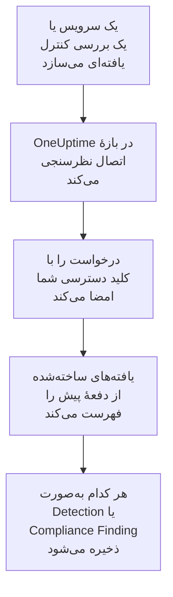

# AWS Security Hub

یافته‌های [AWS Security Hub](https://aws.amazon.com/security-hub/) را به رویدادهای امنیتی OneUptime وارد کنید: یافته‌های GuardDuty، Inspector، Macie و IAM Access Analyzer، بررسی‌های کنترل خود Security Hub، و یافته‌های محصولات شریک. آنجا آن‌ها را کنار لاگ‌ها، ترِیس‌ها و متریک‌هایتان جستجو می‌کنید، با هر منبع دیگری هم‌بسته می‌کنید، و برای آن‌هایی که مهم‌اند آنکال را فرا می‌خوانید. OneUptime آن‌ها را با یک کلید دسترسی که خودتان می‌سازید و فقط یک کنش فقط‌خواندنی برایش مجاز است می‌خواند، و هیچ چیزی را در AWS تغییر نمی‌دهد. هیچ عامل، قاعدهٔ EventBridge یا خروجی S3 برای راه‌اندازی وجود ندارد.

:::cards
- [راه‌اندازی اتصال](#راهاندازی-اتصال): یک سیاست IAM، یک کلید دسترسی، و فرم اتصال.
- [چه چیزی وارد می‌شود](#چه-چیزی-وارد-میشود): هر یافته چگونه به یک رویداد امنیتی تبدیل می‌شود.
- [نظرسنجی چگونه کار می‌کند](#نظرسنجی-چگونه-کار-میکند): پنجره‌ای که هر نظرسنجی می‌خواند، و اینکه چرا ۳۰ دقیقه هم‌پوشانی دارد.
- [عیب‌یابی](#عیبیابی): معنای هر خطا، و آنچه باید تغییر دهید.
:::

## چگونه کار می‌کند



OneUptime هر دقیقه از هر اتصال فعالی که بازهٔ نظرسنجی‌اش گذشته باشد نظرسنجی می‌کند. یک نظرسنجی `GetFindings` در Security Hub را در منطقهٔ شما، امضاشده با [Signature Version 4](https://docs.aws.amazon.com/IAM/latest/UserGuide/reference_sigv-create-signed-request.html)، برای یافته‌های ساخته‌شده از نظرسنجی پیش فرا می‌خواند. هر کدام را به‌صورت یک رویداد [OCSF](https://schema.ocsf.io/) ذخیره می‌کند: یک بررسی کنترل به‌صورت Compliance Finding (کلاس `2003`)، و هر یافتهٔ دیگر به‌صورت Detection Finding (کلاس `2004`). از آن پس قاعده‌های تشخیص، مانیتورها و داشبوردها با آن مانند یک رویداد امنیتی از هر منبع دیگری رفتار می‌کنند.

## پیش از شروع

- در OneUptime، نقش Project Owner، Project Admin یا Security Admin. Security Member و Security Viewer می‌توانند اتصال‌ها و تاریخچهٔ اجرایشان را ببینند، اما نمی‌توانند آن‌ها را تغییر دهند.
- یک حساب AWS که Security Hub در منطقه‌ای که وصل می‌کنید در آن فعال است. Security Hub منطقه‌ای است: یک اتصال یافته‌هایی را می‌خواند که یک حساب در یک منطقه دارد.
- برای خواندن یافته‌های همهٔ حساب‌ها و همهٔ منطقه‌ها از طریق یک اتصال، حساب مدیر واگذارشدهٔ Security Hub، در منطقهٔ اصلی‌اش، با [تجمیع میان‌منطقه‌ای](https://docs.aws.amazon.com/securityhub/latest/userguide/finding-aggregation.html) روشن. **Security Hub → Settings → Regions** منطقهٔ اصلی را نشان می‌دهد.
- HTTPS خروجی از برنامه و کارگرهای OneUptime به `securityhub.<region>.amazonaws.com`، یا `securityhub.<region>.amazonaws.com.cn` در چین، و ساعت درست روی میزبان‌هایشان: AWS درخواستی را که با بیش از ۵ دقیقه اختلاف امضا شده باشد رد می‌کند.

## راه‌اندازی اتصال

اتصال درخواست‌هایش را با یک کلید دسترسی IAM امضا می‌کند. هویت کلید به یک کنش نیاز دارد، `securityhub:GetFindings`، و هیچ چیز دیگر: اتصال هرگز یک یافته را تغییر نمی‌دهد.

:::steps
### اجازهٔ خواندن یافته‌ها

در [کنسول IAM](https://console.aws.amazon.com/iam/)، **Policies → Create policy** را باز کنید، **JSON** را برگزینید، و این سیاست را بچسبانید. نامی به آن بدهید، برای نمونه `OneUptimeSecurityHubRead`:

```json
{
  "Version": "2012-10-17",
  "Statement": [
    {
      "Effect": "Allow",
      "Action": "securityhub:GetFindings",
      "Resource": "*"
    }
  ]
}
```

`GetFindings` را نمی‌توان به یک منبع محدود کرد، پس `Resource` همان `*` می‌ماند. سیاست مدیریت‌شدهٔ `AWSSecurityHubReadOnlyAccess` هم کار می‌کند، اما اجازهٔ بیشتری می‌دهد.

### ساختن یک کلید دسترسی

1. **Users → Create user** را باز کنید، به کاربر نامی بدهید، برای نمونه `oneuptime-security-hub`، دسترسی کنسول را خاموش بگذارید، و سیاست را پیوست کنید. برای یافته‌های حساب‌های دیگر، این کار را در حساب مدیر واگذارشده انجام دهید.
2. کاربر را باز کنید، سپس **Security credentials → Access keys → Create access key** را، و **Third-party service** را برگزینید.
3. **شناسه کلید دسترسی** و **کلید دسترسی مخفی** را کپی کنید. AWS رمز را یک بار نشان می‌دهد.

### افزودن اتصال در OneUptime

**محصولات** > **رویدادهای امنیتی** > **Connections** (`/dashboard/{projectId}/security-events/connections`) را باز کنید، روی **افزودن اتصال** کلیک کنید، **AWS Security Hub** را برگزینید، و روی **بعدی** کلیک کنید. تنظیمات جدول زیر را پر کنید، روی **بعدی** کلیک کنید، و رمز را در **کلید دسترسی مخفی** بچسبانید.

### آزمایش پیش از ذخیره

روی **Test these settings** زیر **آزمایش پیش از ذخیره** کلیک کنید. آزمایش با مقدارهای فرم یک درخواست را امضا می‌کند، و چیزی ذخیره نمی‌کند، پس کلید نادرست یا مجوزی که کم است پیش از ساخته شدن اتصال آشکار می‌شود. سپس روی **بعدی** کلیک کنید، به اتصال یک **نام** بدهید، و آن را بسازید.
:::

| تنظیم | چه چیزی وارد کنید |
| --- | --- |
| **منطقه** | کد منطقه، مانند `us-east-1`، `eu-central-1` یا `us-gov-west-1`: برای یافته‌های حساب‌های دیگر، منطقهٔ اصلی حساب مدیر. |
| **شناسه کلید دسترسی** | شناسهٔ کلید: ۱۶ تا ۱۲۸ حرف یا رقم، معمولاً ۲۰ تا که با `AKIA` شروع می‌شود، یا `ASIA` برای اعتبارنامه‌های موقت. |
| **کلید دسترسی مخفی** | رمز کلید. رمزگذاری می‌شود، API هرگز آن را برنمی‌گرداند و دیگر هرگز نشان داده نمی‌شود. آن را با **Update credentials** روی اتصال جایگزین کنید. |
| **Session token** | فقط برای اعتبارنامه‌های موقت، که به آن نیاز دارند: کلید `ASIA` بدون آن رد می‌شود، و کلید `AKIA` با آن رد می‌شود. |

اعتبارنامه‌های موقت از `aws sts assume-role` یا `aws sts get-session-token` منقضی می‌شوند، برای نقشی که assume شده حداکثر پس از ۱۲ ساعت، و نظرسنجی تا وقتی اعتبارنامه‌های تازه را با **Update credentials** بچسبانید متوقف می‌شود. یک کلید بلندمدت با این سیاست محدود، که با زمان‌بندی خودتان چرخانده می‌شود، نظرسنجی را بدون نظارت ادامه می‌دهد. برای رفتن از اعتبارنامه‌های موقت به یک کلید بلندمدت، کلید تازه را در **Update credentials** وارد کنید و **Remove the stored Session token** را روشن کنید.

گام **Polling** همچنین یک **توضیحات** اختیاری دارد، **Poll Interval (Minutes)**، یک عدد صحیح از `1` تا `1440` که با `5` شروع می‌شود، و **فعال**، که از آغاز روشن است.

## چه چیزی وارد می‌شود

هر یافته به یک رویداد تبدیل می‌شود، با فروشندهٔ `Amazon Web Services` و محصول `AWS Security Hub`. یافته‌ای با یک شیء `Compliance`، یعنی بررسی کنترلی در برابر استانداردی مانند AWS Foundational Security Best Practices یا CIS، به یک Compliance Finding تبدیل می‌شود (کلاس OCSF `2003`). هر یافتهٔ دیگر به یک Detection Finding تبدیل می‌شود (کلاس OCSF `2004`).

| فیلد یافته | ستون OneUptime |
| --- | --- |
| `Id`، یک ARN برای یافته‌هایی که AWS می‌سازد | UID رویداد، که تکراری‌ها هم بر پایهٔ آن کنار گذاشته می‌شوند |
| `CreatedAt`، وگرنه `UpdatedAt`، وگرنه `FirstObservedAt` | زمان رویداد |
| `Title` | نام قاعده |
| `GeneratorId`، مانند نوع یافتهٔ GuardDuty یا شناسهٔ کنترل | شناسهٔ قاعده |
| `Title`، وگرنه `Description` | پیام |
| `Severity.Label`، وگرنه بازه‌ای از `Severity.Normalized` | شدت |
| `Workflow.Status`: `NEW`، `NOTIFIED`، `RESOLVED` یا `SUPPRESSED`، وگرنه `WorkflowState` قدیمی‌تر | وضعیت |
| `Types` زیر `TTPs/`: `TTPs/Initial Access/...` به `TA0001` تبدیل می‌شود | تاکتیک‌ها و تکنیک‌های MITRE ATT&CK |
| کاربر IAM یک منبع کلید دسترسی یا کاربر، `Network.SourceIpV4` یا `SourceIpV6`، `Process.Name` یا `Process.Path` | کاربر، IP و فرایند اصلی |
| `Process.Name` و `Process.Path` | نام و مسیر فرایند. یک یافته نه خط فرمانی دارد و نه فرایند والدی. |
| شناسهٔ نمونهٔ یک منبع `AwsEc2Instance`، `Network.DestinationIpV4` یا `DestinationIpV6`، `Network.DestinationPort`، نخستین `Resources[].Id` | میزبان، IP، پورت و منبع هدف |
| همان‌ها، هر `Resources[].Id`، `AwsAccountId`، دامنه‌های شبکه، نام‌های بدافزار و مقدارهای اطلاعات تهدید | Observableها |
| کل یافته، تخت‌شده به کلیدهای نقطه‌دار، مانند `Compliance.Status` و `Remediation.Recommendation.Url` | `attributes` |

وقتی یافته‌ای `Severity.Label` ندارد، `Severity.Normalized` تعیین می‌کند: `0` Informational است، `1` تا `39` Low، `40` تا `69` Medium، `70` تا `89` High، و `90` تا `100` Critical. یافته‌ای که Security Hub بعداً به‌روز می‌کند، با یک `Workflow.Status` تازه یا کنترلی که اکنون قبول می‌شود، `Id` خود را نگه می‌دارد، پس دوباره وارد نمی‌شود: رویداد یافته را همان‌طور نگه می‌دارد که هنگام وارد شدن بود.

## نظرسنجی چگونه کار می‌کند

هر نظرسنجی یافته‌های ساخته‌شده در پنجره‌اش را، قدیمی‌ترین‌ها اول، ۱۰۰ تا در هر صفحه، فهرست می‌کند، و `NextToken` را دنبال می‌کند تا کل پنجره را بخواند:

```text
POST https://securityhub.{region}.amazonaws.com/findings
    {"Filters": {"CreatedAt": [{"Start": "{window start}", "End": "{window end}"}]},
     "SortCriteria": [{"Field": "CreatedAt", "SortOrder": "asc"}],
     "MaxResults": 100}
```

- **زمان ساخت، نشانگر است.** یافته‌ها بر پایهٔ `CreatedAt` فهرست می‌شوند، هرگز بر پایهٔ `FirstObservedAt`. GuardDuty یافته‌ای را وقتی می‌سازد که فعالیت کافی دیده باشد، و یک بررسی کنترل را وقتی که Security Hub نخستین بار منبع را بررسی می‌کند، ساعت‌ها یا روزها پس از آغاز فعالیت. نشانگری بر پایهٔ زمان مشاهده آن‌ها را جا می‌انداخت.
- **نخستین نظرسنجی ۲۴ ساعت به عقب نگاه می‌کند**، پس یک اتصال تازه بی‌درنگ یافته‌های اخیرش را نشان می‌دهد.
- **هر نظرسنجی بعدی ۳۰ دقیقه پیش از نشانگر ذخیره‌شده شروع می‌شود.** `CreatedAt` را سرویسی تعیین می‌کند که مشکل را یافته است، و یافته بعدتر به Security Hub می‌رسد: GuardDuty یافته‌های تازه را ظرف پنج دقیقه می‌فرستد، و تحویلی که از طریق EventBridge شکست بخورد تا ۲۴ ساعت دوباره تلاش می‌شود. هم‌پوشانی چنین یافته‌هایی را در نظرسنجی بعدی می‌خواند. یافته‌ای که بیش از ۳۰ دقیقه پس از `CreatedAt` خود برسد ممکن است پشت نشانگر بیفتد: بازهٔ زمانی آن را وارد کنید تا بازیابی شود.
- **یک نظرسنجی حداکثر ۲۴ ساعت پس از نشانگر را می‌خواند.** اتصالی که نشانگرش عقب افتاده، در رشته‌ای از پنجره‌های ۲۴ ساعته جبران می‌کند، و **Health** آن **Catching up** را نشان می‌دهد.
- **تکراری‌ها بر پایهٔ `Id` یافته کنار گذاشته می‌شوند**، درون پروژه، پس هم‌پوشانی، پنجره‌ای که دوباره امتحان شده و یک وارد کردن هرگز یک یافته را دو بار ذخیره نمی‌کنند.

### وقتی یک پنجره بیش از توان یک نظرسنجی دارد

یک نظرسنجی حداکثر ۲۰ درخواست ۱۰۰ یافته‌ای می‌فرستد: ۲٬۰۰۰ یافته. وقتی پنجره‌ای بیشتر از این داشته باشد، اجرا **Partial** است، با هشداری مانند:

```text
Stopped after 20 findings requests (the per-run request limit) before the window was fully read. The last finding read was created at 2026-09-14T08:12:44.000Z.
```

یافته‌ها قدیمی‌ترین‌ها اول خوانده می‌شوند، پس OneUptime نشانگر را به زمان ساخت آخرین یافته‌ای که خوانده می‌برد، و نظرسنجی بعدی از آنجا، بدون هم‌پوشانی ۳۰ دقیقه‌ای، با همان طول پنجره شروع می‌شود. یک حساب پرکار در هر نظرسنجی حدود ۲٬۰۰۰ یافته جبران می‌کند، به جای اینکه همان یافته‌ها را دوباره بخواند. هم‌پوشانی وقتی برمی‌گردد که نشانگر ۳۰ دقیقه از آن نقطه جلوتر رفته باشد.

وقتی یک اجرا اصلاً نتواند از نشانگر ذخیره‌شده جلوتر برود، برای نمونه چون فقط ۳۰ دقیقهٔ هم‌پوشانی بیش از ۲٬۰۰۰ یافته دارد، OneUptime به جای آن پنجره را کوتاه می‌کند:

1. **باریک کردن.** نظرسنجی بعدی پنجره‌ای به نصف طول را از همان نقطهٔ شروع می‌خواند، و تا وقتی پنجره‌ای کامل خوانده شود دوباره نصف می‌کند، تا حداقل یک دقیقه. هشدار اجرا همین را می‌گوید: `This window holds more records than one poll can read; the next poll reads a {n} minute window from the same starting point.`
2. **دوباره بزرگ کردن.** پس از اینکه پنجره‌ای کامل خوانده شد، پنجرهٔ بعدی دوباره دو برابر می‌شود، تا ۲۴ ساعت.
3. **گذشتن از یک دقیقهٔ تنها.** اگر حتی یک دقیقه بیش از توان یک نظرسنجی داشته باشد، نظرسنجی از آن می‌گذرد، تا یافته‌های تازه‌تر همچنان برسند، و هم‌پوشانی نظرسنجی‌های بعدی دیگر به آن نمی‌رسد. اجرا **Partial** می‌ماند، و **آخرین خطا** این را نشان می‌دهد: `More records were created in the one minute from {cursor} to {end} than one poll can read. Polling moved past this minute so newer records keep arriving; use Import this time range in Diagnostics on this minute to recover what one run can read.` آن دقیقه را با **Import this time range** وارد کنید تا آنچه یک اجرا می‌تواند بخواند بازیابی شود.

اجرایی که با خطایی از AWS یکسره شکست بخورد، نشانگر و طول پنجره را نگه می‌دارد، و نظرسنجی بعدی همان پنجره را دوباره می‌خواند. تنها استثنا درخواستی است که زمانش سر رسیده: نشانگر می‌ماند، اما پنجرهٔ بعدی نصف طول می‌شود، چون پنجره‌ای که برای پاسخ به‌موقع بیش از حد سنگین است در هر تلاش به پایان زمان می‌خورد. تغییر **Poll Interval (Minutes)** هیچ‌کدام از این‌ها را تغییر نمی‌دهد: این تنظیم تعیین می‌کند یک نظرسنجی هر چند وقت شروع شود، نه اینکه پنجره‌اش از کجا شروع شود.

### اجرا، پیش‌نمایش و وارد کردن در صورت نیاز

روی **Diagnostics** یک اتصال کلیک کنید تا اجراهای اخیرش را ببینید و دستی با آن کار کنید. هر کسی که بتواند اتصال را تغییر دهد می‌تواند این‌ها را شروع کند؛ هر کسی که بتواند آن را ببیند می‌تواند تاریخچه را بخواند.

- **Run now** بی‌درنگ یک نظرسنجی با نشانگر معمول شروع می‌کند، حتی وقتی اتصال **فعال** نیست.
- **Preview findings** یک بازهٔ زمانی تا ۷ روز را می‌خواند و چیزی وارد نمی‌کند.
- **Import this time range** پس از تأیید شما بازه‌ای تا ۷ روز را وارد می‌کند، بی‌آنکه نشانگر را جابه‌جا کند. یافته‌هایی که پیش‌تر وارد شده‌اند رد می‌شوند.
- **Copy diagnostics** روی یک اجرا، گزارش آن را برای پشتیبانی کپی می‌کند. هرگز اعتبارنامه‌ها را در بر ندارد.

## آزمایش اتصال

**آزمایش اتصال** در ردیف یک اتصال، و **Test these settings** در فرم، در فرایند API اجرا می‌شوند، نه در یک کارگر پس‌زمینه، پس یک آزمایش حتی وقتی مشکل از کارگرهاست هم پاسخ می‌دهد. این بررسی‌ها را به ترتیب انجام می‌دهد:

| بررسی | چه چیزی را بررسی می‌کند |
| --- | --- |
| **پیکربندی** | هر تنظیم موجود و درست‌شکل است. وقتی این شکست بخورد با هیچ جایی تماس گرفته نمی‌شود. |
| **Authenticate with AWS** | AWS یک درخواست امضاشدهٔ `GetFindings` را برای یک یافتهٔ ساخته‌شده در ۲۴ ساعت گذشته می‌پذیرد. AWS امضا را پیش از سیاست IAM بررسی می‌کند، پس ردی از سوی سیاست هم این بررسی را قبول می‌کند: کلید درست است. |
| **Read findings** | Security Hub به آن درخواست پاسخ می‌دهد: هویت می‌تواند `securityhub:GetFindings` را فرا بخواند، و Security Hub در منطقه فعال است. |
| **Findings available to import** | چند یافته در ۲۴ ساعت گذشته و ۷ روز گذشته ساخته شده است، برای هر کدام یک صفحه با ۱۰۰ یافته، پس `100+` یعنی بیشتر. هیچ یافته‌ای در ۷ روز یک هشدار است، نه یک شکست. |
| **Background workers**، **Poll scheduler**، **Security event storage** | سمت خود OneUptime: فرایندی کارهای صف Worker را برمی‌دارد، کار نظرسنجی هر دقیقه اجرا می‌شود، و انبارهٔ رویدادهای امنیتی پاسخ می‌دهد. |
| **Scheduled polling** | برای یک اتصال ذخیره‌شده: نظرسنجی روشن است، هیچ اجرایی در انتظار یک کارگر گیر نکرده، و نظرسنجی‌ها به‌موقع اجرا می‌شوند. |

هر درخواست در یک آزمایش مهلتی ۲۰ ثانیه‌ای دارد. یک آزمایش هرگز چیزی وارد نمی‌کند یا نشانگر را جابه‌جا نمی‌کند، و هر بررسی شکست‌خورده می‌گوید چه چیزی را تغییر دهید.

## عیب‌یابی

**آخرین خطا** اتصال پیام خطای کامل را، با اعتبارنامه‌های پوشانده‌شده، پشت پیشوندی نگه می‌دارد که گام شکست‌خورده را نام می‌برد. وقتی اتصالی خطا دارد، برای خواندنش **مشاهده خطا** را در ستون **اقدام‌ها** آن برگزینید، و برای کپی کردنش **کپی خطا** را در کادر گفتگو. هر پیام با `AWS Security Hub findings request` شروع می‌شود؛ آنچه پس از آن می‌آید را بخوانید.

:::details Last Error می‌گوید `failed (HTTP 401)` یا `failed (HTTP 403)`
AWS درخواست را رد کرد. پیام کد خطای AWS را نقل می‌کند، یا وقتی AWS کدی نفرستاد، کلمات خود AWS را:

- `AccessDeniedException`، یا `is not authorized to perform`: کلید درست است، اما هویت آن اجازه ندارد `securityhub:GetFindings` را فرا بخواند. سیاست بخش [راه‌اندازی اتصال](#راهاندازی-اتصال) را پیوست کنید. یک مرز مجوزها یا یک سیاست کنترل سرویس هم می‌تواند آن را رد کند.
- `InvalidAccessException`، یا `is not subscribed to AWS Security Hub`: Security Hub برای این حساب در این **منطقه** فعال نیست، یا حساب آنجا مدیر آن نیست.
- `InvalidSignatureException` یا `SignatureDoesNotMatch`، یا `The request signature we calculated does not match`: **کلید دسترسی مخفی** متعلق به **شناسه کلید دسترسی** نیست. یک کلید دسترسی تازه بسازید، و آن را با **Update credentials** ذخیره کنید.
- `UnrecognizedClientException` یا `InvalidClientTokenId`، یا `The security token included in the request is invalid`: AWS این **شناسه کلید دسترسی** را نمی‌شناسد. اشتباه تایپ شده، حذف یا غیرفعال شده یا از پارتیشن دیگری است، یا یک کلید موقت بدون **Session token** آن است.
- `ExpiredTokenException`، یا `The security token included in the request is expired`: اعتبارنامه‌های موقت منقضی شده‌اند. اعتبارنامه‌های تازه صادر کنید، یا به یک کلید بلندمدت بروید.
- `RequestTimeTooSkewed` یا `RequestExpired`، یا `Signature expired`: ساعت میزبان‌های OneUptime بیش از ۵ دقیقه اختلاف دارد. NTP را روی میزبان‌های برنامه و کارگر درست کنید.
- بدون هیچ کدی: AWS نگفت کلید آن را رد کرد یا سیاست. اول کلید را بررسی کنید، سپس سیاست را.
:::

:::details Last Error می‌گوید `failed (HTTP ...)` با وضعیتی دیگر
- `HTTP 404`: هیچ نقطهٔ پایانی Security Hub در این **منطقه** پاسخ نداد. آن را با منوی منطقه در کنسول AWS مقایسه کنید: `us-east-1`، نه `us-east1` یا `N. Virginia`.
- `HTTP 429`: حساب به محدودیت Security Hub خورد، ۳ درخواست `GetFindings` در ثانیه در یک منطقه. نظرسنجی بعدی دوباره تلاش می‌کند. اگر تکرار شد، دنبال ابزار یا اتصال دیگری بگردید که همان حساب و منطقه را می‌خواند.
- `HTTP 5xx`: Security Hub در سمت خودش مشکلی داشت. نظرسنجی بعدی دوباره تلاش می‌کند.
- `HTTP 400`: Security Hub پرس‌وجو را رد کرد، که OneUptime آن را می‌سازد، نه تنظیمات شما. پیام را برای پشتیبانی OneUptime بفرستید.
:::

:::details Last Error می‌گوید `returned`، `timed out` یا `Could not reach data source`
- `returned a non-JSON body` یا `returned an unrecognized response shape`: چیزی جز Security Hub پاسخ داد، مانند صفحهٔ ورود یک پراکسی یا دروازه‌ای که پاسخ‌ها را بازنویسی می‌کند. این گزارش می‌شود به جای اینکه یک پنجرهٔ خالی به حساب آید، پس نشانگر هرگز از یافته‌هایی که کسی نخوانده جلوتر نمی‌رود.
- `timed out after 60 seconds with no response`، یا `failed: Could not reach data source`: درخواست هیچ پاسخی نگرفت. نقطه‌های پایانی Security Hub عمومی‌اند، پس DNS، دیوارهای آتش و پراکسی‌های میان برنامه و کارگرهای OneUptime و `securityhub.<region>.amazonaws.com` را بررسی کنید.
:::

:::details Last Polled برابر Never است و Last Error خالی است
هیچ نظرسنجی‌ای برای این اتصال تمام نشده است. **آزمایش اتصال** را اجرا کنید: بررسی‌های **Background workers** و **Poll scheduler** آن علت را نام می‌برند. در یک نصب خودمیزبان، علت معمول `DISABLE_QUEUE_WORKERS=true` روی برنامه است، بدون استقرار کارگر جداگانه‌ای که کارها را بردارد: آن را روی `false` بگذارید، یا استقرار کارگر را اجرا کنید (Helm: `worker.enabled: true`).
:::

:::details یک اجرا Partial است
- `Stopped after 20 findings requests`: پنجره بیش از ۲٬۰۰۰ یافته‌ای داشت که یک اجرا می‌خواند. چیزی از دست نمی‌رود: نظرسنجی بعدی پس از آخرین یافتهٔ خوانده‌شده شروع می‌شود. اتصالی که نظرسنجی پس از نظرسنجی **Partial** می‌ماند در حال جبران یک انباشت است، و **Last Polled** و **Last Event Imported** آن همچنان جلو می‌روند. اگر هرگز جبران نکند، حساب در هر بازهٔ نظرسنجی بیش از ۲٬۰۰۰ یافته می‌سازد: **Poll Interval (Minutes)** را کوتاه کنید.
- `More records were created in the one minute from ... than one poll can read`: نظرسنجی از آن دقیقه گذشت. آن را با **Import this time range** در **Diagnostics** وارد کنید. یک وارد کردن به اندازهٔ یک نظرسنجی می‌خواند.
:::

:::details آزمایش موفق است، اما چیزی وارد نمی‌شود
**Findings available to import** را در گزارش آزمایش بخوانید. `0` در ۷ روز گذشته یعنی Security Hub در این حساب و منطقه هیچ یافته‌ای نساخته است: بررسی کنید که GuardDuty، Inspector یا یک استاندارد امنیتی آنجا روشن باشد. برای دیدن یافته‌های حساب‌ها و منطقه‌های دیگر، حساب مدیر را در منطقهٔ اصلی‌اش وصل کنید.
:::

:::details یافته‌ای در کنسول Security Hub هرگز نرسید
`CreatedAt` آن را با `ProcessedAt` آن، یعنی وقتی Security Hub آن را دریافت کرد، مقایسه کنید. یافته‌ای که بیش از ۳۰ دقیقه پس از `CreatedAt` خود رسیده باشد ممکن است پشت نشانگر بیفتد: `CreatedAt` آن را با **Import this time range** وارد کنید.
:::

## چه به دست می‌آورید

- **جستجو.** یافته‌ها را در کاوشگر رویدادهای امنیتی، کنار هر منبع دیگری، بر پایهٔ شدت، وضعیت، قاعده، حساب، منبع یا هر observable پالایش کنید.
- **هم‌بسته‌سازی.** کاربران، نمونه‌ها، IPها، ARNهای منبع و شناسه‌های حساب هر یافته به‌صورت observable نمایه می‌شوند، پس یک جستجو هر چیزی را که به آن‌ها اشاره می‌کند پیدا می‌کند.
- **قاعده‌های تشخیص.** قاعده‌های Sigma که بر اساس زمان‌بندی روی رویدادهای امنیتی شما اجرا می‌شوند، و هشدارهایی باز می‌کنند که آنکال را فرا می‌خوانند.
- **مانیتورها.** مانیتورهای رویدادهای امنیتی رویدادهای جور را می‌شمارند، برای نمونه یافته‌های بحرانی تازهٔ GuardDuty یا کنترل‌های شکست‌خورده، و پس از گذشتن از یک آستانه حادثه یا هشدار باز می‌کنند.

رویدادهای امنیتی مانند بقیهٔ تله‌متری شما، بر اساس هر گیگابایت دریافت‌شده صورت‌حساب می‌شوند. [قیمت‌گذاری](https://oneuptime.com/pricing) را ببینید.

## گام‌های بعدی

:::cards
- [رویدادهای امنیتی](/docs/telemetry/security-events): آنچه را وارد می‌کنید جستجو و هم‌بسته کنید و روی آن هشدار بگیرید.
- [Okta System Log](/docs/integrations/okta): ورودهای ارائه‌دهندهٔ هویت خود را هم وارد کنید.
- [نقش‌ها](/docs/permissions/reference#نقشها): آنچه نقش‌های Security می‌توانند ببینند و تغییر دهند.
- [نمای کلی یکپارچه‌سازی‌ها](/docs/integrations/index): ابزارهای دیگری که می‌توانید وصل کنید.
:::
