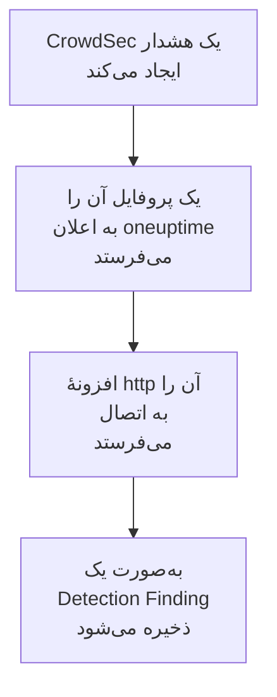

# CrowdSec

هشدارهای [CrowdSec](https://www.crowdsec.net/) را همان لحظه که CrowdSec آن‌ها را ایجاد می‌کند در رویدادهای امنیتی OneUptime دریافت کنید، و نشانی‌های فهرست مسدودسازی پروژهٔ خود را با CrowdSec مسدود کنید. افزونهٔ اعلان خود CrowdSec هر هشدار را به یک اتصال CrowdSec می‌فرستد، و این اتصال از تشخیص‌های CrowdSec پرونده باز می‌کند. وقتی مسدودسازی را روشن کنید، OneUptime هر نشانی‌ای را که مسدود می‌کنید از طریق Local API مربوط به CrowdSec ممنوع می‌کند، و هر باونسری که آن را می‌خواند نشانی را مسدود می‌کند.

:::cards
- [راه‌اندازی اتصال](#راهاندازی-اتصال): یک اتصال، و اعلانی که هشدارهای CrowdSec را به آن می‌فرستد.
- [چه چیزی دریافت می‌شود](#چه-چیزی-دریافت-میشود): هر هشدار CrowdSec چگونه به یک رویداد امنیتی تبدیل می‌شود.
- [مسدود کردن نشانی‌ها با CrowdSec](#مسدود-کردن-نشانیها-با-crowdsec): نشانی‌های فهرست مسدودسازی خود را در CrowdSec ممنوع کنید.
- [خواندن فهرست‌های مسدودسازی CrowdSec](#خواندن-فهرستهای-مسدودسازی-crowdsec): فهرست‌هایی که CrowdSec Console ارائه می‌دهد، به‌صورت یک فید هوش تهدید.
- [عیب‌یابی](#عیبیابی): معنای هر خطا، و آنچه باید تغییر دهید.
:::

## چگونه کار می‌کند



Local API مربوط به CrowdSec هر هشداری را که یک پروفایل به یک اعلان می‌فرستد، به افزونهٔ همان اعلان می‌سپارد. اعلان اتصال از افزونهٔ `http` در CrowdSec استفاده می‌کند: این افزونه هشدار را با JSON خود CrowdSec، همراه با کلید دریافت شما و با نام بردن از اتصال، به نقطهٔ دریافت رویدادهای امنیتی می‌فرستد. OneUptime آن را به‌صورت یک رویداد Detection Finding از [OCSF](https://schema.ocsf.io/) (کلاس `2004`) ذخیره می‌کند، آن را با قاعده‌های تشخیص شما می‌سنجد، و از هر تشخیص خود CrowdSec که در سطح **بازکردن پرونده از** اتصال یا بالاتر باشد یک پرونده باز می‌کند. هیچ نظرسنجی‌ای در کار نیست: یک هشدار چند ثانیه پس از آنکه CrowdSec آن را ایجاد کند می‌رسد.

## پیش از شروع

- در OneUptime، نقش مالک پروژه، مدیر پروژه یا مدیر امنیت. عضو امنیت و بیننده امنیت می‌توانند اتصال‌ها را ببینند، اما نمی‌توانند آن‌ها را تغییر دهند.
- CrowdSec 1.5 یا بالاتر، با Local API آن و افزونهٔ اعلان `http` که همراهش عرضه می‌شود. این صفحه بر پایهٔ CrowdSec v1.8.2 نوشته شده است.
- HTTPS خروجی از میزبانی که Local API مربوط به CrowdSec را اجرا می‌کند به OneUptime شما.
- برای مسدود کردن نشانی‌ها هم: Local APIای که OneUptime بتواند به آن برسد، و یک ماشین برای OneUptime (ببینید [مسدود کردن نشانی‌ها با CrowdSec](#مسدود-کردن-نشانیها-با-crowdsec)).

## راه‌اندازی اتصال

:::steps
### افزودن اتصال در OneUptime

**محصولات** > **رویدادهای امنیتی** > **اتصال‌ها** (`/dashboard/{projectId}/security-events/connections`) را باز کنید، روی **افزودن اتصال** کلیک کنید، **CrowdSec** را برگزینید، و روی **بعدی** کلیک کنید. برای اینکه فقط هشدارها را دریافت کنید، همهٔ تنظیمات جدول زیر را خالی بگذارید؛ برای مسدود کردن نشانی‌ها هم، آن‌ها را پر کنید.

### آزمایش پیش از ذخیره

روی **آزمودن این تنظیمات** زیر **آزمایش پیش از ذخیره** کلیک کنید. اگر Local API تنظیم نشده باشد، آزمایش همین را می‌گوید و با هیچ جایی تماس نمی‌گیرد؛ اگر تنظیم شده باشد، به Local API می‌رسد و به‌عنوان ماشین وارد می‌شود، و چیزی ذخیره نمی‌کند. سپس روی **بعدی** کلیک کنید، در گام **هشدارها** به اتصال یک **نام** بدهید، مقدار **بازکردن پرونده از** را برگزینید، و آن را بسازید.

### ذخیرهٔ اعلان روی میزبان CrowdSec

با ساختن اتصال، **ارسال هشدارها** برای آن باز می‌شود، که بعدها از ردیف اتصال دوباره بازش می‌کنید. **یک کلید دریافت انتخاب کنید**، سپس اعلانی را که نشان می‌دهد، با کلید و اتصال شما که از پیش پر شده‌اند، روی میزبانی که Local API مربوط به CrowdSec را اجرا می‌کند ذخیره کنید:

```yaml title="/etc/crowdsec/notifications/oneuptime.yaml"
type: http
name: oneuptime

# info or quieter: at debug, CrowdSec logs each request's headers.
log_level: info

format: |
  {{.|toJson}}

url: https://oneuptime.com/security-events/v1/ingest?connection=YOUR_CONNECTION_ID&format=crowdsec
method: POST
headers:
  Content-Type: application/json
  x-oneuptime-token: YOUR_INGESTION_TOKEN
```

### هشدارهای پروفایل‌هایتان را به این اعلان بفرستید

در `/etc/crowdsec/profiles.yaml`، `oneuptime` را به `notifications` هر پروفایلی که OneUptime باید هشدارهایش را دریافت کند اضافه کنید، سپس CrowdSec را دوباره بارگذاری کنید:

```yaml title="/etc/crowdsec/profiles.yaml"
notifications:
  - oneuptime
```

```bash
sudo systemctl reload crowdsec
```

### یک هشدار آزمایشی بفرستید

```bash
sudo cscli notifications test oneuptime
```

**ارسال هشدارها** می‌گوید هشدار کی می‌رسد، و **مشاهده هشدارها** آن را در رویدادهای امنیتی باز می‌کند. این یک رویداد با شدت Informational است، و هیچ پرونده‌ای باز نمی‌کند.
:::

| تنظیم | چه چیزی وارد کنید |
| --- | --- |
| **نشانی Local API** | فقط برای مسدود کردن نشانی‌ها: جایی که OneUptime به Local API مربوط به CrowdSec می‌رسد، مانند `https://crowdsec.example.com:8080`. هر جا اتصال از شبکه‌ای بگذرد، از `https` استفاده کنید. |
| **شناسه ماشین** | فقط برای مسدود کردن نشانی‌ها: ماشینی که OneUptime با آن وارد می‌شود، و روی میزبان CrowdSec با `sudo cscli machines add oneuptime --auto -f -` افزوده شده است. |
| **مسدود کردن نشانی‌ها با CrowdSec** | روی یک اتصال تازه خاموش است. وقتی روشن باشد، نشانی‌ها و محدوده‌های فهرست مسدودسازی شما را در CrowdSec ممنوع می‌کند، و به سه تنظیم دیگر نیاز دارد (ببینید [مسدود کردن نشانی‌ها با CrowdSec](#مسدود-کردن-نشانیها-با-crowdsec)). |
| **رمز عبور ماشین** | فقط برای مسدود کردن نشانی‌ها: رمز عبوری که `cscli` برای ماشین چاپ کرد. رمزگذاری می‌شود، API هرگز آن را برنمی‌گرداند و دیگر هرگز نشان داده نمی‌شود. آن را با **به‌روزرسانی اطلاعات ورود** روی اتصال جایگزین کنید. |

گام **هشدارها** همچنین یک **توضیحات** اختیاری دارد، و **فعال**، که از آغاز روشن است. اتصالی که فعال نیست هشدارهایی را که دریافت می‌کند به‌صورت رویداد نگه می‌دارد، و از آن‌ها هیچ پرونده‌ای باز نمی‌کند.

در یک کانتینر، اعلان در پوشه‌ای قرار می‌گیرد که در `/etc/crowdsec/notifications/` سوار شده است، و راه‌اندازی دوبارهٔ کانتینر آن را می‌خواند. یک نصب Kubernetes آن را در مقدارهای Helm خود زیر `config.notifications` نام می‌برد، و `profiles.yaml` را کنارش زیر `config`.

## چه چیزی دریافت می‌شود

هر هشداری که CrowdSec می‌فرستد به یک رویداد Detection Finding تبدیل می‌شود (کلاس OCSF `2004`)، با فروشنده و محصول `CrowdSec`:

| فیلد CrowdSec | ستون OneUptime |
| --- | --- |
| `uuid`، یا هشی از هشداری که آن را ندارد | UID رویداد، که تکراری‌ها هم بر پایهٔ آن کنار گذاشته می‌شوند |
| `stop_at`، یا `start_at` | زمان رویداد |
| `scenario` | شناسه قاعده، و نام قاعده: عنوان سناریو در CrowdSec Hub، یا نام آن |
| `source.ip`، یا `source.value` در یک هشدار `Ip` | IP اصلی |
| `target_fqdn` یا `target_host` هشدار یا رویدادهای آن، وگرنه `machine` که رویدادهایش نام می‌برند | میزبان هدف |
| `target_user`، `target_uri` | کاربر و منبع هدف |
| `type` نخستین تصمیم | وضعیت: `Blocked` برای ممنوعیت، `Challenge` برای کپچا، `Logged` بدون تصمیم یا در حالت شبیه‌سازی |
| رفتار سناریو | شدت، و تاکتیک‌ها و تکنیک‌های MITRE ATT&CK آن |
| هر چیز دیگر، مانند `source.cn`، `source.as_name` و `events_count` | `attributes`: فیلدهای هشدار تخت‌شده به کلیدهای نقطه‌دار، ۱۰ رویداد نخست آن به‌طور کامل، و برداشت OneUptime زیر `crowdsec.` |

یک هشدار CrowdSec شدتی از خود ندارد، پس OneUptime آن را از آنچه سناریو تشخیص می‌دهد می‌گیرد، همان‌گونه که CrowdSec Hub آن را برچسب می‌زند (`ssh:bruteforce`، `http:exploit`):

| رفتار | شدت |
| --- | --- |
| یک اکسپلویت، مانند یک CVE یا آنچه مؤلفهٔ AppSec مسدود کرد، یا کاری که مهاجم پس از نفوذ انجام می‌دهد | High |
| حملهٔ جست‌وجوی فراگیر (brute force)، منع سرویس، تقلب، یک ورود ناممکن، یا رفتاری که OneUptime نمی‌تواند دسته‌بندی کند | Medium |
| اسکن‌ها، کاوش‌ها، خزش‌ها، بات‌ها، هرزنامه و تغییرات ممیزی ابری | Low |
| سناریوهای آزمایشی خود CrowdSec | Informational |

وقتی **بازکردن پرونده از** روی **بالا و بالاتر** باشد، اکسپلویت‌های CrowdSec پرونده باز می‌کنند، و ممنوعیت‌های روزمرهٔ آن برای اسکنرها و حدس‌زنندگان رمز عبور، رویدادهایی برای قاعده‌های تشخیص شما باقی می‌مانند. فقط تشخیص‌های خود CrowdSec پرونده باز می‌کنند. تصمیمی که کسی با `cscli` یا در Console مربوط به CrowdSec افزوده است، نشانی‌ای روی یک فهرست مسدودسازی CrowdSec، هشدار آزمایشی، و ممنوعیت‌های خود OneUptime که بازمی‌گردند، شدت Informational دارند و هیچ پرونده‌ای باز نمی‌کنند. هشداری که دو بار فرستاده شود، همان‌طور که `cscli notifications reinject` می‌کند، یک بار ذخیره می‌شود.

## مسدود کردن نشانی‌ها با CrowdSec

**مسدود کردن نشانی‌ها با CrowdSec** را روی یک اتصال روشن کنید، و نشانی‌ها و محدوده‌های [فهرست مسدودسازی](/docs/telemetry/security-cases#فهرست-مسدودسازی) پروژهٔ شما در CrowdSec ممنوع می‌شوند. هر باونسری که Local API آن را می‌خواند، مانند باونسرهای فایروال، nginx و Traefik آن، آن‌ها را همان جایی که اجرا می‌شود مسدود می‌کند، همان‌گونه که ممنوعیت‌های خود CrowdSec را مسدود می‌کند. مسدودسازی‌ها از همان تأییدها، همان محدودیت‌های پاسخ خودکار و همان **رفع مسدودیت** می‌گذرند که در هر جای دیگری که فهرست مسدودسازی شما اعمال می‌شود.

این کلید روی یک اتصال تازه خاموش است. برای روشن کردن آن:

1. روی میزبان CrowdSec یک ماشین برای OneUptime اضافه کنید؛ این فرمان رمز عبور آن را چاپ می‌کند:

   ```bash
   sudo cscli machines add oneuptime --auto -f -
   ```

2. بگذارید OneUptime به Local API برسد، که اگر چیز دیگری گفته نشود روی `127.0.0.1:8080` گوش می‌دهد: `api.server.listen_uri` را در `config.yaml` مربوط به CrowdSec تنظیم کنید، Local API را روی TLS یا پشت یک پراکسی `https` ارائه دهید، و بگذارید نشانی‌های OneUptime از فایروال شما بگذرند.
3. اتصال را ویرایش کنید، **نشانی Local API** و **شناسه ماشین** را پر کنید، رمز عبور را در **رمز عبور ماشین** بگذارید، **مسدود کردن نشانی‌ها با CrowdSec** را روشن کنید، و ذخیره کنید. سپس **آزمایش اتصال** بررسی می‌کند که ماشین وارد می‌شود و ممنوعیت‌های OneUptime را می‌خواند، بی‌آنکه چیزی را تغییر دهد.

یک ممنوعیت چگونه ساخته می‌شود، و چگونه پایان می‌یابد:

- هر مسدودسازی یک تصمیم ممنوعیت است که همان‌گونه ساخته می‌شود که `cscli decisions add` می‌سازد، زیر سناریوی `oneuptime/blocklist`. CrowdSec آن را به‌صورت یک تصمیم دستی نگه می‌دارد، پس هرگز با Central API مربوط به CrowdSec به اشتراک گذاشته نمی‌شود، مگر آنکه تصمیم‌های دستی را به اشتراک بگذارید. OneUptime فقط ممنوعیت‌های خودش را می‌خواند و حذف می‌کند، هرگز ممنوعیتی را که یک نفر یا CrowdSec ساخته است.
- مسدودسازی‌ای که پایانی دارد، ممنوعیتی دقیقاً تا همان پایان است، و CrowdSec آن را در آن زمان خودش برمی‌دارد، چه OneUptime بتواند به CrowdSec برسد چه نه. مسدودسازی‌ای که تا برداشته شدن ادامه دارد، یک ممنوعیت ۷ روزه است که وقتی ۳ روز یا کمتر از آن مانده باشد تمدید می‌شود، پس ممنوعیتی که OneUptime دیگر نگهش نمی‌دارد ظرف یک هفته پایان می‌یابد.
- **رفع مسدودیت** ممنوعیت را در دور بعدی، ظرف یک دقیقه، حذف می‌کند. ممنوعیتی که در CrowdSec با `cscli decisions delete` یا یک flush حذف شود، تا وقتی مسدودسازی ادامه دارد، در دور بعدی دوباره ساخته می‌شود.
- نشانی یا محدوده‌ای که روی یکی از فهرست‌های مجاز CrowdSec باشد هرگز ممنوع نمی‌شود: مسدودسازی آن را در آنجا اعمال‌نشده نشان می‌دهد و فهرست مجاز را نام می‌برد، و ممنوعیتی که از پیش ساخته شده، به‌محض اینکه یک فهرست مجاز آن نشانی را در بر بگیرد، حذف می‌شود.
- نشانی‌های خود پروژهٔ شما، مانند **پراکسی‌های مورد اعتماد**، متعادل‌کننده‌های بار و لبه‌های شما، هرگز در هیچ جا مسدود نمی‌شوند، از جمله در CrowdSec.
- CrowdSec فقط ممنوع می‌کند: چالش در آنجا اعمال نمی‌شود، و دامنه، URL یا فایل به آن فرستاده نمی‌شود.

وقتی نتوان به Local API رسید، در CrowdSec چیزی تغییر نمی‌کند: ممنوعیت‌هایی که دارد می‌مانند، و وقتی پایانشان برسد پایان می‌یابند. **محل اعمال** در **فهرست مسدودسازی** می‌گوید CrowdSec آخرین بار کی هر مسدودسازی را در اختیار داشته است، و OneUptime پس از ۱ دقیقه دوباره تلاش می‌کند، سپس هر بار دو برابر صبر می‌کند، تا ۳۰ دقیقه. یک مسدودسازی تازه صبر می‌کند تا بتوان آن را ساخت.

## خواندن فهرست‌های مسدودسازی CrowdSec

CrowdSec Console فهرست‌های مسدودسازی‌ای را که سازمان شما مشترکشان است به‌صورت یک یکپارچه‌سازی Raw IP List ارائه می‌دهد: هر سطر یک نشانی، پشت یک نام کاربری و رمز عبور. یک [فید هوش تهدید](/docs/telemetry/threat-intelligence) آن‌ها را می‌خواند، و رویدادهای شما را با آن‌ها تطبیق می‌دهد:

1. در CrowdSec Console، یک یکپارچه‌سازی Raw IP List با تجمیع IP خاموش بسازید: OneUptime نشانی‌ها را تطبیق می‌دهد، نه محدوده‌ها را. نقطهٔ پایانی، نام کاربری و رمز عبور آن را کپی کنید.
2. در OneUptime، **محصولات** > **رویدادهای امنیتی** > **تشخیص‌ها** > **اطلاعات تهدید** را باز کنید، روی **ساخت فید اطلاعات تهدید** کلیک کنید، و **فهرست شاخص‌ها** را برگزینید.
3. نقطهٔ پایانی را به‌عنوان **URL فهرست** بچسبانید، زیر **ورود** گزینهٔ **نام کاربری و رمز عبور** را برگزینید، و هر دو را بچسبانید. در طرح Community مربوط به CrowdSec، که روزی یک دانلود را مجاز می‌داند، **فاصله فراخوانی (دقیقه)** را روی `1440` بگذارید.

فهرست‌ها متعلق به CrowdSec هستند: می‌توانید آن‌ها را در ابزارهای خودتان به کار ببرید، اما نمی‌توانید به دیگران بدهید. OneUptime هیچ فهرستی از خودش ارائه نمی‌دهد.

## آزمایش اتصال

**آزمایش اتصال** در ردیف یک اتصال، و **آزمودن این تنظیمات** در فرم، در فرایند API اجرا می‌شوند، نه در یک کارگر پس‌زمینه. این بررسی‌ها را به ترتیب انجام می‌دهند:

| بررسی | چه چیزی را بررسی می‌کند |
| --- | --- |
| **پیکربندی** | تنظیمات یا همه خالی‌اند یا همه داده شده‌اند، و درست‌شکل‌اند. وقتی این شکست بخورد با هیچ جایی تماس گرفته نمی‌شود. |
| **Reach CrowdSec's Local API** | `GET /health` پاسخ می‌دهد. اگر Local API تنظیم نشده باشد، بررسی می‌گوید اتصال فقط هشدار دریافت می‌کند، و سه بررسی بعدی اجرا نمی‌شوند. |
| **Sign in to the Local API** | `POST /v1/watchers/login` ماشین و رمز عبور آن را می‌پذیرد. |
| **Read CrowdSec's allowlists** | `GET /v1/allowlists` پاسخ می‌دهد، و اینکه فهرست‌های مجاز چند نشانی و محدوده در بر دارند. یک Local API قدیمی‌تر از 1.6.8، که هیچ فهرست مجازی ندارد، قبول می‌شود. |
| **Block with CrowdSec** | فقط وقتی **مسدود کردن نشانی‌ها با CrowdSec** روشن است: ماشین می‌تواند ممنوعیت‌های OneUptime را بازخوانی کند، و اینکه چندتا از آن‌ها برقرارند. این بررسی چیزی را تغییر نمی‌دهد. |
| **Background workers**، **Security event storage** | سمت خود OneUptime: فرایندی کارهای صف Worker را برمی‌دارد، که آنچه CrowdSec می‌فرستد ذخیره می‌کنند، و انبارهٔ رویدادهای امنیتی پاسخ می‌دهد. |
| **Alerts received** | برای یک اتصال ذخیره‌شده: آخرین هشدار کی رسیده است. اگر هنوز هیچ هشداری نرسیده باشد، بررسی هشدار می‌دهد و می‌گوید چگونه یک هشدار آزمایشی بفرستید. |

یک آزمایش هرگز چیزی را ممنوع یا حذف نمی‌کند. **کپی گزارش** فهرست بررسی را به‌صورت JSON کپی می‌کند، بدون رمز عبور یا توکن‌ها.

## عیب‌یابی

**سلامت** اتصال تا رسیدن نخستین هشدار **در انتظار هشدارها** را نشان می‌دهد، سپس **در حال دریافت هشدارها** را، هر قدر هم رسیدن هشدار بعدی طول بکشد؛ **بازکردن پرونده متوقف شده** یعنی اتصال فعال نیست. CrowdSec پاسخی را که افزونه گرفته است در لاگ خودش، `/var/log/crowdsec.log`، به‌صورت `HTTP server returned non 200 status code` می‌نویسد.

:::details هیچ هشداری نمی‌رسد
- `sudo cscli notifications list` را اجرا کنید: `oneuptime` باید در فهرست باشد، و در یک پروفایل فعال باشد. اعلانی که هیچ پروفایلی نامش را نبرد چیزی نمی‌فرستد.
- `401`: کلید دریافت در `x-oneuptime-token` وجود ندارد، نادرست است یا منقضی شده است، و `422`: خاموش شده است. در **ارسال هشدارها** یک کلید برگزینید، و اعلان را دوباره کپی کنید.
- `400`: نشانی هیچ اتصال CrowdSec از این پروژه را نام نمی‌برد. نشانی را از **ارسال هشدارها** در ردیف اتصال کپی کنید: به شناسهٔ اتصال ختم می‌شود.
- هیچ چیزی در لاگ نیست: میزبان CrowdSec نمی‌تواند به OneUptime شما برسد. HTTPS خروجی از آن، و پراکسی آن را بررسی کنید.
:::

:::details آزمایش اتصال در Reach CrowdSec's Local API شکست می‌خورد
`CrowdSec Local API health check could not be completed` یعنی هیچ چیزی پاسخ نداد: Local API به‌طور پیش‌فرض روی `127.0.0.1` گوش می‌دهد، پس OneUptime تا وقتی `api.server.listen_uri` و فایروال شما اجازه ندهند نمی‌تواند به آن برسد. هشداری که می‌گوید روی `http` پاسخ می‌دهد یعنی رمز عبور ماشین بدون رمزگذاری از شبکه می‌گذرد: Local API را روی TLS ارائه دهید، یا یک پراکسی `https` جلوی آن بگذارید.
:::

:::details آزمایش اتصال در Sign in to the Local API شکست می‌خورد
`CrowdSec Local API login failed (HTTP 401)` با کاری که باید بکنید پایان می‌یابد: شناسهٔ ماشین و رمز عبور را با `sudo cscli machines list` بررسی کنید، ماشینی را که هنوز تأیید نشده با `sudo cscli machines validate oneuptime` تأیید کنید، یا ماشینی بیفزایید که با رمز عبور وارد می‌شود. رمز عبور تازه را با **به‌روزرسانی اطلاعات ورود** ذخیره کنید.
:::

:::details یک مسدودسازی در CrowdSec اعمال نمی‌شود
نشانگر را روی **محل اعمال** آن نگه دارید: فهرست مجازی را که نشانی را در بر دارد، چالشی را که CrowdSec اعمال نمی‌کند، یا خطای Local API را نام می‌برد. تا وقتی نتوان به Local API رسید، OneUptime به تلاش ادامه می‌دهد، و ممنوعیت‌هایی که CrowdSec از پیش دارد برقرار می‌مانند.
:::

:::details CrowdSec هشدارهایش را می‌فرستد، اما هیچ‌کدام ذخیره نمی‌شود
آنچه CrowdSec می‌فرستد را کارگرهای پس‌زمینه ذخیره می‌کنند: در یک نصب خودمیزبان با `DISABLE_QUEUE_WORKERS=true` روی برنامه و بدون استقرار کارگر جداگانه، هشدارها دریافت می‌شوند و هرگز ذخیره نمی‌شوند. **آزمایش اتصال** این را به‌صورت یک بررسی شکست‌خوردهٔ **Background workers** نشان می‌دهد. آن را روی `false` بگذارید، یا استقرار کارگر را اجرا کنید (Helm: `worker.enabled: true`).
:::

## گام‌های بعدی

:::cards
- [رویدادهای امنیتی](/docs/telemetry/security-events): آنچه را CrowdSec می‌فرستد جستجو و هم‌بسته کنید و روی آن هشدار بگیرید.
- [پرونده‌های امنیتی](/docs/telemetry/security-cases): روی پرونده‌هایی که تشخیص‌های CrowdSec باز می‌کنند کار کنید، و از آن‌ها مسدود کنید.
- [هوش تهدید](/docs/telemetry/threat-intelligence): رویدادهای خود را با فهرست‌های مسدودسازی CrowdSec تطبیق دهید.
- [نمای کلی یکپارچه‌سازی‌ها](/docs/integrations/index): ابزارهای دیگری که می‌توانید وصل کنید.
:::
