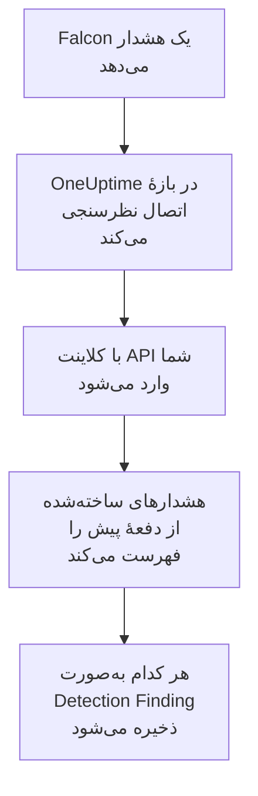

# CrowdStrike Falcon

هشدارهای [CrowdStrike Falcon](https://www.crowdstrike.com/platform/)، از تشخیص‌های نقطهٔ پایانی، هویت و ابر، را به رویدادهای امنیتی OneUptime وارد کنید. آنجا آن‌ها را کنار لاگ‌ها، ترِیس‌ها و متریک‌هایتان جستجو می‌کنید، با هر منبع دیگری هم‌بسته می‌کنید، و برای آن‌هایی که مهم‌اند آنکال را فرا می‌خوانید. OneUptime آن‌ها را از طریق Falcon Alerts API با یک کلاینت API که خودتان می‌سازید می‌خواند، و هرگز در Falcon چیزی نمی‌نویسد.

:::cards
- [راه‌اندازی اتصال](#راهاندازی-اتصال): یک کلاینت API با یک دامنهٔ دسترسی، و فرم اتصال.
- [چه چیزی وارد می‌شود](#چه-چیزی-وارد-میشود): هر هشدار Falcon چگونه به یک رویداد امنیتی تبدیل می‌شود.
- [نظرسنجی چگونه کار می‌کند](#نظرسنجی-چگونه-کار-میکند): پنجره‌ای که هر نظرسنجی می‌خواند، و اینکه یک CID پرکار با آن چه می‌کند.
- [عیب‌یابی](#عیبیابی): معنای هر خطا، و آنچه باید تغییر دهید.
:::

## چگونه کار می‌کند



OneUptime هر دقیقه از هر اتصال فعالی که بازهٔ نظرسنجی‌اش گذشته باشد نظرسنجی می‌کند. یک نظرسنجی با شناسه و رمز کلاینت API به ابر Falcon شما وارد می‌شود، هشدارهای ساخته‌شده از نظرسنجی پیش را از Alerts API می‌خواهد، و هر کدام را به‌صورت یک رویداد Detection Finding از [OCSF](https://schema.ocsf.io/) (کلاس `2004`) ذخیره می‌کند. از آن پس قاعده‌های تشخیص، مانیتورها و داشبوردها با آن مانند یک رویداد امنیتی از هر منبع دیگری رفتار می‌کنند.

## پیش از شروع

- در OneUptime، نقش Project Owner، Project Admin یا Security Admin. Security Member و Security Viewer می‌توانند اتصال‌ها و تاریخچهٔ اجرایشان را ببینند، اما نمی‌توانند آن‌ها را تغییر دهند.
- یک شناسهٔ مشتری Falcon (CID)، و یک کاربر کنسول Falcon که بتواند کلاینت‌های API را مدیریت کند: نقش Falcon Administrator، یا یک نقش سفارشی با مجوز API clients and keys.
- HTTPS خروجی از برنامه و کارگرهای OneUptime به میزبان API ابر Falcon شما، که زیر **Falcon cloud** در پایین فهرست شده است.

## راه‌اندازی اتصال

:::steps
### ساختن یک کلاینت API

1. در کنسول Falcon، **Support and resources → API clients and keys** را باز کنید، و **Create API client** را برگزینید.
2. نامی به آن بدهید، برای نمونه `OneUptime security events`. زیر **API scopes**، **Alerts → Read** را روشن کنید، و همهٔ دامنه‌های دیگر را خاموش بگذارید: اتصال هرگز در Falcon چیزی نمی‌نویسد.
3. کلاینت را بسازید. Falcon شناسهٔ کلاینت، رمز و نشانی پایهٔ آن را یک بار نشان می‌دهد. هر سه را همین حالا کپی کنید: رمز را می‌توان بعداً بازنشانی کرد، اما دیگر هرگز نشان داده نمی‌شود.

### یافتن ابر Falcon شما

نشانی پایه‌ای که Falcon نشان داد می‌گوید CID شما در کدام ابر است. صفحهٔ **API clients and keys** هم آن را کنار هر کلاینت نشان می‌دهد. کلاینتی از یک ابر در ابرهای دیگر رد می‌شود.

| نشانی پایه‌ای که Falcon نشان می‌دهد | ابر Falcon |
| --- | --- |
| `https://api.crowdstrike.com` | US-1 |
| `https://api.us-2.crowdstrike.com` | US-2 |
| `https://api.eu-1.crowdstrike.com` | EU-1 |
| `https://api.laggar.gcw.crowdstrike.com` | US-GOV-1 |

### افزودن اتصال در OneUptime

**محصولات** > **رویدادهای امنیتی** > **Connections** (`/dashboard/{projectId}/security-events/connections`) را باز کنید، روی **افزودن اتصال** کلیک کنید، **CrowdStrike Falcon** را برگزینید، و روی **بعدی** کلیک کنید. تنظیمات جدول زیر را پر کنید، روی **بعدی** کلیک کنید، و رمز را در **Client secret** بچسبانید.

### آزمایش پیش از ذخیره

روی **Test these settings** زیر **آزمایش پیش از ذخیره** کلیک کنید. آزمایش با مقدارهای فرم وارد می‌شود و هشدارها را می‌خواند، و چیزی ذخیره نمی‌کند، پس ابر نادرست یا یک دامنهٔ دسترسی جاافتاده پیش از ساخته شدن اتصال آشکار می‌شود. سپس روی **بعدی** کلیک کنید، به اتصال یک **نام** بدهید، و آن را بسازید.
:::

| تنظیم | چه چیزی وارد کنید |
| --- | --- |
| **شناسه کلاینت** | شناسهٔ کلاینت API، همان‌طور که Falcon هنگام ساختن کلاینت نشان داد. |
| **Falcon cloud** | ابری که CID شما در آن است: **US-1 (api.crowdstrike.com)**، **US-2 (api.us-2.crowdstrike.com)**، **EU-1 (api.eu-1.crowdstrike.com)** یا **US-GOV-1 (api.laggar.gcw.crowdstrike.com)**. هر درخواست به میزبان API همان ابر می‌رود. |
| **Client secret** | رمز کلاینت API. رمزگذاری می‌شود، API هرگز آن را برنمی‌گرداند و دیگر هرگز نشان داده نمی‌شود. آن را با **Update credentials** روی اتصال جایگزین کنید. |

گام **Polling** همچنین یک **توضیحات** اختیاری دارد، **Poll Interval (Minutes)**، یک عدد صحیح از `1` تا `1440` که با `5` شروع می‌شود، و **فعال**، که از آغاز روشن است. اتصالی که فعال نیست باز هم می‌تواند آزمایش شود، و دستی نظرسنجی شود.

## چه چیزی وارد می‌شود

اتصال هشدارهای Falcon را می‌خواند: آنچه کنسول Falcon زیر **Endpoint security → Endpoint detections** و **Next-Gen SIEM → Alerts** فهرست می‌کند، از هر محصولی که آن‌ها را می‌دهد. هر هشدار به یک رویداد Detection Finding تبدیل می‌شود (کلاس OCSF `2004`)، با فروشندهٔ `CrowdStrike` و محصول `Falcon`:

| فیلد Falcon | ستون OneUptime |
| --- | --- |
| `composite_id` | UID رویداد، که تکراری‌ها هم بر پایهٔ آن کنار گذاشته می‌شوند |
| `created_timestamp` | زمان رویداد |
| `display_name`، یا `name` | نام قاعده |
| `pattern_id` | شناسهٔ قاعده |
| `description`، یا نام قاعده | پیام |
| `severity_name`، یا `severity` از ۰ تا ۱۰۰ | شدت |
| `status`، مانند `new`، `in_progress` یا `closed` | وضعیت |
| `tactic_id`, `technique_id` | تاکتیک‌ها و تکنیک‌های MITRE ATT&CK |
| `device.hostname`، `device.local_ip`، `user_name`، `filename` یا `cmdline` | میزبان، IP، کاربر و فرایند اصلی |
| `filename`، `filepath` و `cmdline`؛ `parent_details.filename`، `parent_details.filepath` و `parent_details.cmdline` | نام، مسیر و خط فرمان فرایند؛ نام، مسیر و خط فرمان فرایند والد |
| `device.hostname`، `device.local_ip`، `device.external_ip`، `user_name`، `sha256` | Observableها |
| هر چیز دیگر، مانند `device.platform_name`، `falcon_host_link`، `product` و `timestamp` | `attributes`، تخت‌شده به کلیدهای نقطه‌دار |

زمان رویداد عمداً زمانی است که Falcon هشدار را ساخت: زمان رفتاری که پشت آن است، `timestamp`، در `attributes.timestamp` می‌ماند.

## نظرسنجی چگونه کار می‌کند

- **زمان ساخت، نشانگر است.** هشدارها بر پایهٔ `created_timestamp` فهرست می‌شوند، هرگز بر پایهٔ زمان رفتاری که پشت آن‌هاست. Falcon ممکن است مدت‌ها پس از فعالیتی که هشدار توصیفش می‌کند آن را بدهد، و نشانگری بر پایهٔ زمان فعالیت همهٔ این هشدارها را جا می‌انداخت.
- **نخستین نظرسنجی ۲۴ ساعت به عقب نگاه می‌کند**، پس یک اتصال تازه بی‌درنگ هشدارهای اخیرش را نشان می‌دهد.
- **هر نظرسنجی بعدی ۱ دقیقه پیش از نشانگر ذخیره‌شده شروع می‌شود**، پس هشداری که روی مرز دو پنجره ساخته شود هرگز از دست نمی‌رود.
- **یک نظرسنجی حداکثر ۲۴ ساعت پس از نشانگر را می‌خواند.** اتصالی که نشانگرش عقب افتاده، در رشته‌ای از پنجره‌های ۲۴ ساعته جبران می‌کند.
- **تکراری‌ها بر پایهٔ `composite_id` کنار گذاشته می‌شوند**، درون پروژه، پس هم‌پوشانی و پنجره‌ای که دوباره امتحان شده هرگز یک هشدار را دو بار ذخیره نمی‌کنند.
- **هزینهٔ هر پنجره** یک درخواست توکن است، که در طول عمر توکن نگه داشته می‌شود، سپس برای هر ۱٬۰۰۰ هشدار یک پرس‌وجوی هشدار و یک واکشی هشدار، هر کدام با مهلت خودش.

### وقتی یک پنجره بیش از توان یک نظرسنجی دارد

یک نظرسنجی حداکثر ۲۰ درخواست می‌فرستد. با یک درخواست توکن و دو درخواست برای هر ۱٬۰۰۰ هشدار، حداکثر ۹٬۰۰۰ هشدار می‌خواند. وقتی پنجره‌ای بیشتر از این داشته باشد، اجرا **Partial** است، با هشداری مانند:

```text
Stopped after 19 requests before reading the whole window. Alerts are read oldest first; every alert created before 2026-09-14T08:12:44.995Z was read.
```

پرس‌وجوی هشدارها بر پایهٔ `created_timestamp`، قدیمی‌ترین‌ها اول، مرتب می‌شود، پس OneUptime نشانگر را به زمان ساخت آخرین هشداری که خوانده می‌برد، و نظرسنجی بعدی با همان طول پنجره، از جابه‌جایی `0`، از آنجا شروع می‌شود. یک CID پرکار در هر نظرسنجی حدود ۹٬۰۰۰ هشدار جبران می‌کند، به جای اینکه همان هشدارها را دوباره بخواند. هشدارهایی که در همان لحظه ساخته شده‌اند دو بار خوانده می‌شوند، و بررسی تکراری نسخهٔ دوم را کنار می‌گذارد.

پرس‌وجوی هشدارهای Falcon نمی‌تواند از ۱۰٬۰۰۰ نتیجه (`limit` به‌علاوهٔ `offset`) فراتر صفحه بزند. سقف درخواست‌ها یک اجرا را پیش از آن سقف، در ۹٬۰۰۰ هشدار، متوقف می‌کند. اگر روزی آن سقف خواندنی را متوقف کند، به همین شکل با آن رفتار می‌شود: اجرا **Partial** است، نشانگر به آخرین هشدار خوانده‌شده می‌رود، و پرس‌وجوی بعدی دوباره از جابه‌جایی `0` شروع می‌شود.

وقتی یک اجرا اصلاً نتواند از نشانگر ذخیره‌شده جلوتر برود، برای نمونه چون بیش از ۹٬۰۰۰ هشدار در دقیقهٔ هم‌پوشانی هستند، OneUptime به جای آن پنجره را کوتاه می‌کند:

1. **باریک کردن.** نظرسنجی بعدی پنجره‌ای به نصف طول را از همان نقطهٔ شروع می‌خواند، و تا وقتی پنجره‌ای کامل خوانده شود دوباره نصف می‌کند، تا حداقل یک دقیقه. هشدار اجرا همین را می‌گوید: `This window holds more records than one poll can read; the next poll reads a {n} minute window from the same starting point.`
2. **دوباره بزرگ کردن.** پس از اینکه پنجره‌ای کامل خوانده شد، پنجرهٔ بعدی دوباره دو برابر می‌شود، تا ۲۴ ساعت.
3. **گذشتن از یک دقیقهٔ تنها.** اگر حتی یک دقیقه بیش از توان یک نظرسنجی داشته باشد، نظرسنجی از آن می‌گذرد، تا هشدارهای تازه‌تر همچنان برسند. اجرا **Partial** می‌ماند، و **آخرین خطا** این را نشان می‌دهد: `More records were created in the one minute from {cursor} to {end} than one poll can read. Polling moved past this minute so newer records keep arriving; use Import this time range in Diagnostics on this minute to recover what one run can read.` آن دقیقه را با **Import this time range** وارد کنید تا آنچه یک اجرا می‌تواند بخواند بازیابی شود.

اجرایی که با خطایی از Falcon یکسره شکست بخورد، نشانگر و طول پنجره را نگه می‌دارد، و نظرسنجی بعدی همان پنجره را دوباره می‌خواند. تنها استثنا درخواستی است که زمانش سر رسیده: نشانگر می‌ماند، اما پنجرهٔ بعدی نصف طول می‌شود، چون پنجره‌ای که برای پاسخ به‌موقع بیش از حد سنگین است در هر تلاش به پایان زمان می‌خورد. تغییر **Poll Interval (Minutes)** هیچ‌کدام از این‌ها را تغییر نمی‌دهد: این تنظیم تعیین می‌کند یک نظرسنجی هر چند وقت شروع شود، نه اینکه پنجره‌اش از کجا شروع شود.

### اجرا، پیش‌نمایش و وارد کردن در صورت نیاز

روی **Diagnostics** یک اتصال کلیک کنید تا اجراهای اخیرش را ببینید و دستی با آن کار کنید. هر کسی که بتواند اتصال را تغییر دهد می‌تواند این‌ها را شروع کند؛ هر کسی که بتواند آن را ببیند می‌تواند تاریخچه را بخواند.

- **Run now** بی‌درنگ یک نظرسنجی با نشانگر معمول شروع می‌کند، حتی وقتی اتصال **فعال** نیست.
- **Preview alerts** یک بازهٔ زمانی تا ۷ روز را می‌خواند و چیزی وارد نمی‌کند.
- **Import this time range** پس از تأیید شما بازه‌ای تا ۷ روز را وارد می‌کند، بی‌آنکه نشانگر را جابه‌جا کند. هشدارهایی که پیش‌تر وارد شده‌اند رد می‌شوند.
- **Copy diagnostics** روی یک اجرا، گزارش آن را برای پشتیبانی کپی می‌کند. هرگز اعتبارنامه‌ها را در بر ندارد.

## آزمایش اتصال

**آزمایش اتصال** در ردیف یک اتصال، و **Test these settings** در فرم، در فرایند API اجرا می‌شوند، نه در یک کارگر پس‌زمینه، پس یک آزمایش حتی وقتی مشکل از کارگرهاست هم پاسخ می‌دهد. این بررسی‌ها را به ترتیب انجام می‌دهد:

| بررسی | چه چیزی را بررسی می‌کند |
| --- | --- |
| **پیکربندی** | **شناسه کلاینت**، **Falcon cloud** و **Client secret** موجود و درست‌شکل‌اند. وقتی این شکست بخورد با هیچ جایی تماس گرفته نمی‌شود. |
| **Authenticate with CrowdStrike Falcon** | `POST /oauth2/token` با شناسه و رمز کلاینت API، روی میزبان ابر شما، یک توکن برمی‌گرداند. |
| **Read alerts from the Falcon Alerts API** | یک پرس‌وجوی هشدار برای یک هشدار (`limit=1`) روی ۲۴ ساعت گذشته پذیرفته می‌شود، که دامنهٔ **Alerts → Read** را ثابت می‌کند. |
| **Alerts available to import** | چند هشدار در ۲۴ ساعت گذشته و ۷ روز گذشته ساخته شده است. هیچ هشداری در ۷ روز یک هشدار است، نه یک شکست: نظرسنجی هشدارهای تازه را همان‌طور که Falcon می‌سازدشان وارد می‌کند. |
| **Background workers**، **Poll scheduler**، **Security event storage** | سمت خود OneUptime: فرایندی کارهای صف Worker را برمی‌دارد، کار نظرسنجی هر دقیقه اجرا می‌شود، و انبارهٔ رویدادهای امنیتی پاسخ می‌دهد. |
| **Scheduled polling** | برای یک اتصال ذخیره‌شده: نظرسنجی روشن است، هیچ اجرایی در انتظار یک کارگر گیر نکرده، و نظرسنجی‌ها به‌موقع اجرا می‌شوند. |

هر درخواست در یک آزمایش مهلتی ۲۰ ثانیه‌ای دارد. یک آزمایش هرگز چیزی وارد نمی‌کند یا نشانگر را جابه‌جا نمی‌کند، و هر بررسی شکست‌خورده می‌گوید چه چیزی را تغییر دهید. **Copy report** فهرست بررسی را به‌صورت JSON کپی می‌کند، بدون اعتبارنامه‌ها یا توکن‌ها.

## عیب‌یابی

**آخرین خطا** اتصال، و هر بررسی شکست‌خورده، پیام خطای کامل را، با اعتبارنامه‌های پوشانده‌شده، پشت پیشوندی نگه می‌دارند که گام شکست‌خورده را نام می‌برد. وقتی اتصالی خطا دارد، برای خواندنش **مشاهده خطا** را در ستون **اقدام‌ها** آن برگزینید، و برای کپی کردنش **کپی خطا** را در کادر گفتگو. اول پیشوند را بخوانید.

:::details Last Error با `CrowdStrike Falcon token request` شروع می‌شود
- `CrowdStrike Falcon token request failed (HTTP 401)` یا `(HTTP 403)`: Falcon شناسه و رمز کلاینت API را رد کرد، پیش از اینکه با Alerts API تماس گرفته شود. بررسی کنید که **Falcon cloud** ابر CID شما باشد، چون کلاینتی از ابر دیگر همین‌جا رد می‌شود، که **شناسه کلاینت** متعلق به همان کلاینت باشد، و که **Client secret** رمزی باشد که همراه آن صادر شده است. اگر رمز گم شده، آن را در کنسول Falcon بازنشانی کنید، و با **Update credentials** ذخیره کنید.
- `CrowdStrike Falcon token request returned ...`: Falcon با چیزی بی‌استفاده پاسخ داد، بدنه‌ای که JSON نیست یا `access_token` ندارد. این معمولاً یک پراکسی یا دروازه در میانه است، نه اعتبارنامه‌ها.
:::

:::details Last Error با `CrowdStrike Falcon alerts` شروع می‌شود
- `CrowdStrike Falcon alerts query failed (HTTP 403)`: توکن پذیرفته شد، اما کلاینت API دامنهٔ **Alerts → Read** را ندارد. آن را برای کلاینت زیر **API clients and keys** روشن کنید، و ذخیره کنید. این روی توکن بعدی اعمال می‌شود، پس پس از یک دقیقه دوباره آزمایش کنید.
- `CrowdStrike Falcon alerts query failed (HTTP 401)`: Alerts API توکن را رد کرد، که تقریباً همیشه یعنی **Falcon cloud** همان ابری نیست که کلاینت را صادر کرده است.
- `CrowdStrike Falcon alerts query failed (HTTP 429)` یا `CrowdStrike Falcon alerts fetch failed (HTTP 429)`: Falcon نرخ این کلاینت API را محدود می‌کند. کلاینت HTTP در OneUptime هنگام خطا هیچ سرآیند پاسخی نگه نمی‌دارد، پس پیام معمولاً به جای نقل آن، با `the X-RateLimit-RetryAfter header was not available` تمام می‌شود. نظرسنجی‌های زمان‌بندی‌شده خودشان دوباره تلاش می‌کنند. اگر تکرار شد، به OneUptime یک کلاینت API مخصوص خودش بدهید، به جای کلاینتی که با ابزارهای دیگر مشترک است.
- `CrowdStrike Falcon alerts query failed (HTTP 400)`: Falcon پرس‌وجو را رد کرد. اتصال یک پالایهٔ FQL ثابت روی `created_timestamp` می‌فرستد، پس گزارش را کپی کنید و برای پشتیبانی OneUptime بفرستید.
- `CrowdStrike Falcon alerts query returned ...` یا `CrowdStrike Falcon alerts fetch returned ...`: Falcon با `200` پاسخ داد، با بدنه‌ای که JSON نیست، یا شکلی ندارد که اتصال بشناسد. این گزارش می‌شود به جای اینکه یک پنجرهٔ خالی به حساب آید، پس نشانگر هرگز از هشدارهایی که کسی نخوانده جلوتر نمی‌رود.
- `CrowdStrike Falcon alerts fetch failed (HTTP ...)`: هشدارها فهرست شدند، اما واکشی آن‌ها به همان دلیل‌های پرس‌وجو شکست خورد. یک `403` در اینجا یعنی دامنه میان دو فراخوانی برداشته شده است.
:::

:::details Last Error می‌گوید درخواست کامل نشد
`CrowdStrike Falcon token request could not be completed`، `CrowdStrike Falcon alerts query could not be completed` و `CrowdStrike Falcon alerts fetch could not be completed` یعنی چیزی برنگشت: پایان زمان، شکست DNS یا ترافیک خروجی مسدودشده. HTTPS خروجی را از برنامه و کارگرهای OneUptime به میزبان API ابرتان، مانند `api.crowdstrike.com`، بررسی کنید.
:::

:::details Last Error یک ابر ناشناخته را نام می‌برد
`CrowdStrike Falcon cloud "..." is not one of us-1, us-2, eu-1, us-gov-1` یعنی ابر ذخیره‌شده ابری نیست که اتصال بشناسد. اتصال را ویرایش کنید، و ابری را از فهرست برگزینید.
:::

:::details یک اجرا Partial است
- `Stopped after 19 requests before reading the whole window`: پنجره بیش از ۹٬۰۰۰ هشداری داشت که یک اجرا می‌خواند. چیزی از دست نمی‌رود: نظرسنجی بعدی پس از آخرین هشدار خوانده‌شده شروع می‌شود. اتصالی که نظرسنجی پس از نظرسنجی **Partial** می‌ماند در حال جبران یک انباشت است، و **Last Polled** و **Last Event Imported** آن همچنان جلو می‌روند. وقتی توکن در طول اجرا تمدید شده باشد، شمارش می‌تواند کمی بیش از ۱۹ باشد.
- `Falcon returned alerts out of created_timestamp order, so this run cannot name a point to resume from.`: پرس‌وجو ترتیب قدیمی‌ترین‌ها اول را نادیده گرفت، پس اجرا نمی‌تواند نشانگر را به آخرین هشدارش ببرد، و نظرسنجی بعدی به جای آن پنجره‌ای کوتاه‌تر می‌خواند. اگر تکرار شد، گزارش اجرا را برای پشتیبانی OneUptime بفرستید.
- `More records were created in the one minute from ... than one poll can read`: نظرسنجی از آن دقیقه گذشت. آن را با **Import this time range** در **Diagnostics** وارد کنید. یک وارد کردن به اندازهٔ یک نظرسنجی می‌خواند.
:::

:::details Last Polled برابر Never است و Last Error خالی است
هیچ نظرسنجی‌ای اجرا نشده، پس چیزی به Falcon نرسیده است. **آزمایش اتصال** این را به‌صورت یک بررسی شکست‌خوردهٔ **Background workers** یا **Poll scheduler** نشان می‌دهد. در یک نصب خودمیزبان، علت معمول `DISABLE_QUEUE_WORKERS=true` روی برنامه است، بدون استقرار کارگر جداگانه‌ای که کارها را بردارد: آن را روی `false` بگذارید، یا استقرار کارگر را اجرا کنید (Helm: `worker.enabled: true`).
:::

:::details آزمایش موفق است، اما هیچ رویدادی ظاهر نمی‌شود
**Alerts available to import** را بخوانید: یک هشدار در آنجا یعنی Falcon در ۷ روز گذشته هیچ هشداری نساخته، پس هنوز چیزی برای وارد کردن نیست. وگرنه **Diagnostics** را باز کنید، پنجره و شمارش‌های آخرین نظرسنجی را بررسی کنید، و روی یک اجرا از **View events in this time range** استفاده کنید تا بازهٔ زمانی هشدارهایی که وارد کرده باز شود.
:::

## چه به دست می‌آورید

- **جستجو.** هشدارهای Falcon را در کاوشگر رویدادهای امنیتی، کنار لاگ‌ها و متریک‌های همان میزبان، بر پایهٔ شدت، وضعیت، تاکتیک MITRE، میزبان، کاربر یا هر observable پالایش کنید.
- **هم‌بسته‌سازی.** نام‌های میزبان، IPها، کاربران و هش‌های پروندهٔ هر هشدار به‌صورت observable نمایه می‌شوند، پس یک جستجو در همهٔ منابع هر چیزی را که به یک میزبان اشاره می‌کند پیدا می‌کند.
- **قاعده‌های تشخیص.** قاعده‌های Sigma که بر اساس زمان‌بندی روی رویدادهای امنیتی شما اجرا می‌شوند، و هشدارهایی باز می‌کنند که آنکال را فرا می‌خوانند.
- **مانیتورها.** مانیتورهای رویدادهای امنیتی رویدادهای جور را می‌شمارند، و پس از گذشتن از یک آستانه حادثه یا هشدار باز می‌کنند.

رویدادهای امنیتی مانند بقیهٔ تله‌متری شما، بر اساس هر گیگابایت دریافت‌شده صورت‌حساب می‌شوند. [قیمت‌گذاری](https://oneuptime.com/pricing) را ببینید.

## گام‌های بعدی

:::cards
- [رویدادهای امنیتی](/docs/telemetry/security-events): آنچه را وارد می‌کنید جستجو و هم‌بسته کنید و روی آن هشدار بگیرید.
- [Microsoft Defender XDR](/docs/integrations/microsoft-defender-xdr): هشدارهای بارهای کاری Defender در Microsoft را هم وارد کنید.
- [نقش‌ها](/docs/permissions/reference#نقشها): آنچه نقش‌های Security می‌توانند ببینند و تغییر دهند.
- [نمای کلی یکپارچه‌سازی‌ها](/docs/integrations/index): ابزارهای دیگری که می‌توانید وصل کنید.
:::
