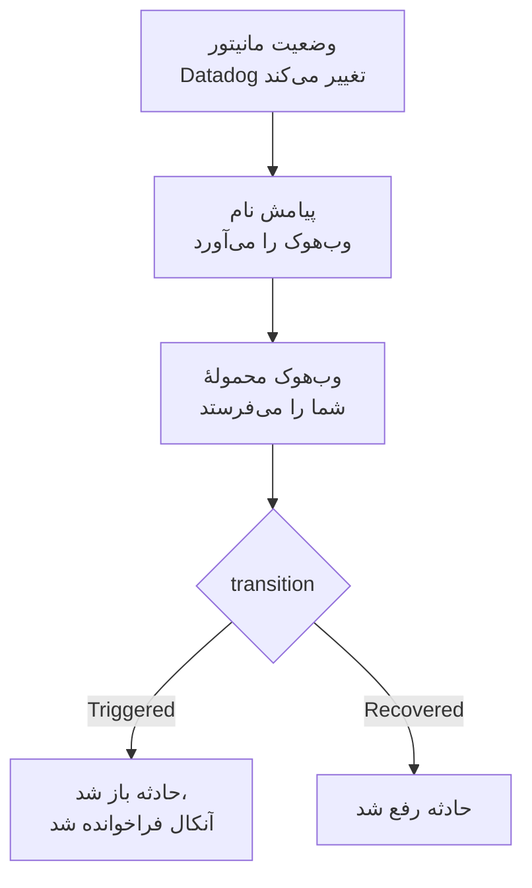

# Datadog

هشدارهای مانیتورهای [Datadog](https://www.datadoghq.com) را به OneUptime بفرستید تا هر هشدار به حادثه‌ای تبدیل شود که تیم آنکال شما را فرا می‌خواند، و وقتی مانیتور Datadog بهبود یافت رفع شود. Datadog هشدارهایش را از طریق [یکپارچه‌سازی Webhooks](https://docs.datadoghq.com/integrations/webhooks/) خود می‌فرستد، پس در هیچ طرفی چیزی برای نصب نیست.

:::cards
- [انتخاب اینکه OneUptime هشدارها را چگونه دریافت کند](#انتخاب-اینکه-oneuptime-هشدارها-را-چگونه-دریافت-کند): یک مانیتور Incoming Request، یا یک گردش کاری از خودتان.
- [دریافت هشدارها با یک مانیتور](#دریافت-هشدارها-با-یک-مانیتور): یک حادثه برای هر هشدار، که با بهبود رفع می‌شود.
- [پیکربندی Datadog](#پیکربندی-datadog): یک وب‌هوک، و مانیتورهایی که آن را خبر می‌کنند.
- [عیب‌یابی](#عیبیابی): وقتی هشدارها نمی‌رسند، یا حادثه‌ها باز می‌مانند.
:::

## چگونه کار می‌کند



یک مانیتور Datadog وقتی وضعیتش تغییر می‌کند، یعنی وقتی فعال می‌شود، هشدار می‌دهد، بهبود می‌یابد یا داده‌ای ندارد، وب‌هوک‌هایی را که پیامش نام برده خبر می‌کند. بدنهٔ JSON وب‌هوک را خودتان با [متغیرهای قالب](https://docs.datadoghq.com/integrations/webhooks/#usage) Datadog می‌نویسید، پس این راهنما بدنه‌ای به شما می‌دهد که هر هشدار را نام می‌برد و می‌گوید چه بر سرش آمده است.

## پیش از شروع

- یک حساب Datadog که بتوانید در آن یکپارچه‌سازی‌ها را پیکربندی و مانیتورها را ویرایش کنید.
- در OneUptime، اجازهٔ ساختن مانیتور، یا اگر آن راه را برمی‌گزینید، گردش کاری.

## انتخاب اینکه OneUptime هشدارها را چگونه دریافت کند

اول OneUptime را راه بیندازید: نشانی‌ای را که Datadog به آن می‌فرستد، OneUptime به شما می‌دهد.

| روش | کی از آن استفاده کنید |
| --- | --- |
| یک مانیتور Incoming Request (پیشنهادی) | می‌خواهید هر هشدار حادثه‌ای باشد که آنکال را فرا می‌خواند، و وقتی مانیتور Datadog بهبود یافت رفع شود. چیزی برای ساختن نیست. |
| یک گردش کاری با تریگر Webhook | به منطق خودتان نیاز دارید: پالایش هشدارها، تغییر شکل آن‌ها، یا اول فراخواندن سامانه‌های دیگر. یک گردش کاری برای هر هشداری که می‌گیرد یک حادثه اعلام می‌کند، و آن را با بهبود رفع نمی‌کند. |

هر دو از همان وب‌هوک همان JSON را می‌گیرند، پس می‌توانید با یکی شروع کنید و بعدها با تغییر یک نشانی در Datadog به دیگری بروید.

## دریافت هشدارها با یک مانیتور

یک [مانیتور Incoming Request](/docs/monitor/incoming-request-monitor) یک نشانی به شما می‌دهد، و معیارهایش تعیین می‌کنند هر هشدار چه کند.

:::steps
### ساختن مانیتور

به **مانیتورها** بروید و روی **ساخت مانیتور** کلیک کنید. زیر **نوع مانیتور**، **Incoming Request** را برگزینید، نامش را `Datadog` بگذارید، و روی **بعدی** کلیک کنید.

### اعلام یک حادثه برای هر هشدار

در گام **معیارها**، نخستین معیار را باز کنید، همان که مانیتور را آفلاین علامت می‌زند. پالایهٔ آن را روی **بدنه درخواست**، **شامل است**، `"transition":"Triggered"` بگذارید. این معیار از پیش وقتی پالایه‌اش جور شود حادثه اعلام می‌کند. حادثه را پر کنید:

- **عنوان حادثه**: `{{requestBody.title}}`.
- **توضیحات حادثه**، زیر **توضیحات**: `{{requestBody.body}}`، سپس `Datadog: {{requestBody.link}}` در یک خط جداگانه.
- **شدت**: شدت حادثه‌ای که این هشدارها باید داشته باشند.
- **سیاست‌های آنکال**، زیر **آنکال**: سیاست‌هایی که باید فراخوانده شوند.
- **رفع خودکار حادثه**، زیر **فیلدهای بیشتر**: آن را روشن بگذارید، همان‌طور که از آغاز هست. بدون آن، بهبودها نادیده گرفته می‌شوند و حادثه‌ها باز می‌مانند.

### باز کردن یک حادثه برای هر هشدار

در همان معیار، **تنظیمات** را باز کنید و **Group incidents and alerts by a payload field** را روشن کنید. آن را مانند جدول زیر پر کنید تا هر هشدار حادثهٔ خودش را بگیرد و بهبودش آن را رفع کند:

| فیلد | مقدار |
| --- | --- |
| **Open a separate incident for each…** | `requestBody.alert_key` |
| **Field that signals recovery** | `requestBody.transition` |
| **Value that means recovered** | `Recovered` |

### برگرداندن مانیتور به حالت آنلاین

معیار دوم را باز کنید، همان که مانیتور را آنلاین علامت می‌زند، و پالایه‌اش را روی **بدنه درخواست**، **شامل است**، `"transition":"Recovered"` بگذارید.

### کپی کردن نشانی

روی **ساخت مانیتور** کلیک کنید. صفحهٔ **نمای کلی** مانیتور، **Heartbeat URL** آن را نشان می‌دهد. آن را برای Datadog کپی کنید:

```text
https://oneuptime.com/heartbeat/<secret key>
```

یک نصب خودمیزبان به جای `oneuptime.com` میزبان خودش را دارد.
:::

محمولهٔ زیر `alert_key` را روی شناسهٔ مانیتور Datadog و برچسب‌های گروهی که هشدار داده می‌گذارد، پس هر گروه از یک مانیتور چندهشداره حادثهٔ خودش را می‌گیرد، و بهبود همان گروه آن را رفع می‌کند. مانیتوری که در حالی که حادثه‌اش باز است دوباره فعال شود یا دوباره خبر کند، حادثهٔ دومی باز نمی‌کند. برای اینکه هر تنظیم چه می‌کند، [دریافت هشدار از سامانه‌ای دیگر](/docs/monitor/incoming-request-monitor#دریافت-هشدار-از-سامانهای-دیگر) را ببینید.

> [!NOTE]
> با این پالایه‌ها، اعلان **Warn** یا **No Data** هیچ حادثه‌ای باز نمی‌کند. برای اینکه برای هشدارهای سطح Warn هم فراخوانده شوید، روی **افزودن معیار** کلیک کنید، به معیار تازه پالایهٔ **بدنه درخواست**، **شامل است**، `"transition":"Warn"`، یک حادثه با **شدت** خودش، و همان تنظیمات گروه‌بندی را بدهید، سپس آن را بالای نخستین معیار بکشید. معیارها از بالا بررسی می‌شوند، و نخستین معیاری که جور شود تصمیم می‌گیرد.

## پیکربندی Datadog

:::steps
### افزودن وب‌هوک

در Datadog، [کاشی یکپارچه‌سازی Webhooks](https://app.datadoghq.com/integrations/webhooks) را باز کنید، و اگر هنوز نصب نشده آن را نصب کنید. یک وب‌هوک با این تنظیمات اضافه کنید، سپس آن را ذخیره کنید:

- **Name**: `oneuptime`. مانیتورها با این نام، به‌صورت `@webhook-oneuptime`، وب‌هوک را نام می‌برند.
- **URL**: نشانی‌ای که از OneUptime کپی کردید.
- **Payload**:

  ```json
  {
    "alert_key": "$ALERT_ID $ALERT_SCOPE",
    "transition": "$ALERT_TRANSITION",
    "title": "$EVENT_TITLE",
    "body": "$TEXT_ONLY_MSG",
    "host": "$HOSTNAME",
    "priority": "$PRIORITY",
    "link": "$LINK"
  }
  ```

### نام بردن وب‌هوک در مانیتورهایتان

در هر مانیتور Datadog که باید از طریق OneUptime فراخوانی کند، `@webhook-oneuptime` را به پیام اعلان مانیتور اضافه کنید، و مانیتور را ذخیره کنید. از آن پس Datadog هشدارها و بهبودهای آن مانیتور را به OneUptime می‌فرستد.
:::

| متغیر | آنچه Datadog در آن می‌گذارد |
| --- | --- |
| `$ALERT_ID` | شناسهٔ مانیتور Datadog که هشدار داده است. |
| `$ALERT_SCOPE` | برچسب‌های گروهی که هشدار داده است، مانند `host:web-1`. |
| `$ALERT_TRANSITION` | آنچه رخ داده است: `Triggered`، `Re-Triggered`، `Warn`، `Recovered`، `No Data` یا `Renotify`، و موارد دیگر. |
| `$EVENT_TITLE` | عنوان رویداد، مانند `[Triggered] High CPU`. |
| `$TEXT_ONLY_MSG` | پیام مانیتور، بدون Markdown. |
| `$LINK` | پیوندی به رویداد در Datadog. |

## آزمایش آن

یک هشدار را همان‌طور که Datadog می‌فرستد، به OneUptime بفرستید:

```bash
curl -X POST "https://oneuptime.com/heartbeat/<secret key>" \
  -H "Content-Type: application/json" \
  -d '{
    "alert_key": "1234 host:web-1",
    "transition": "Triggered",
    "title": "[Triggered] High CPU",
    "body": "CPU is above 90% on web-1.",
    "host": "web-1",
    "priority": "normal",
    "link": "https://app.datadoghq.com/event/event?id=1"
  }'
```

حادثه‌ای با عنوان `[Triggered] High CPU` باز می‌شود. همان درخواست را با `transition` روی `Recovered` بفرستید، و حادثه رفع می‌شود.

سپس از Datadog آزمایش کنید: مانیتوری را که وب‌هوک را نام می‌برد باز کنید، روی **Test Notifications** کلیک کنید، و اعلان **Alert** آن را بفرستید. خط زمانی مانیتور OneUptime را بررسی کنید تا ببینید رسیده است.

## دریافت هشدارها با یک گردش کاری

وقتی میان Datadog و حادثه به گام‌های خودتان نیاز دارید، از یک [گردش کاری](/docs/workflows/index) استفاده کنید.

:::steps
### ساختن گردش کاری

به **گردش‌های کاری** بروید، روی **ساخت گردش کاری** و سپس **شروع از صفر** کلیک کنید. نامش را `Datadog alerts` بگذارید و روی **ساخت گردش کاری** کلیک کنید.

### افزودن تریگر Webhook

روی بلوک خط‌چین **انتخاب کنید چه چیزی این گردش کاری را شروع کند** کلیک کنید و **Webhook** را برگزینید. روی تریگر کلیک کنید، سپس روی **کپی نشانی**، و آن نشانی را در وب‌هوک Datadog به کار ببرید.

### بررسی اینکه مانیتور فعال شده است

روی **افزودن مؤلفه** کلیک کنید، یک بلوک **If / Else** اضافه کنید، و نقطهٔ **Out** تریگر را به آن وصل کنید. **Value to check** را روی `{{local.components.webhook-1.returnValues.request-body.transition}}`، **Comparison** را روی **is equal to**، و **Compare with** را روی `Triggered` بگذارید.

### اعلام حادثه

یک بلوک **Create One Incident** اضافه کنید، و سمت **Yes** بلوک **If / Else** را به آن وصل کنید. در **Incident Template**، قالبی را برگزینید که شدت و سیاست‌های آنکالی را که باید فراخوانده شوند تعیین می‌کند ([قالب‌های حادثه](/docs/incidents/settings#قالبهای-حادثه) را ببینید). در **JSON Object**، آنچه را از Datadog می‌آید تعیین کنید:

```json
{
  "title": "{{local.components.webhook-1.returnValues.request-body.title}}",
  "description": "{{local.components.webhook-1.returnValues.request-body.body}}\nDatadog: {{local.components.webhook-1.returnValues.request-body.link}}"
}
```

بدون قالب، **JSON Object** به `incidentSeverityId` هم نیاز دارد، یعنی شناسهٔ یکی از شدت‌های حادثهٔ پروژه.

### روشن کردن گردش کاری

در بالای **سازنده** گزینهٔ **فعال** را روشن کنید. گردش کاری خاموش به Datadog با `400` پاسخ می‌دهد.
:::

هر اعلان `Triggered` یک حادثهٔ تازه اعلام می‌کند. بهبود به سمت **No** بلوک **If / Else** می‌رود، جایی که چیزی وصل نیست، پس اجرا همان‌جا تمام می‌شود. برای یک حادثه برای هر هشدار، که با بهبود رفع شود، از مانیتور استفاده کنید.

## عیب‌یابی

:::details چیزی به OneUptime نمی‌رسد
- بررسی کنید که پیام مانیتور Datadog نام `@webhook-oneuptime` را آورده باشد، با همان املایی که وب‌هوک نام‌گذاری شده است.
- مانیتور پیش از بررسی هر چیزی، بی‌درنگ با `200` پاسخ می‌دهد، حتی برای کلید محرمانهٔ نادرست. برای دیدن اینکه هشدارها می‌رسند یا نه، خط زمانی مانیتور را بررسی کنید.
- گردش کاری خاموش با `400` پاسخ می‌دهد. در بالای **سازنده** آن، **فعال** را روشن کنید.
:::

:::details حادثه‌ها باز می‌شوند اما هرگز رفع نمی‌شوند
- مانیتور Datadog باید بهبودهایش را هم به وب‌هوک خبر دهد. پیامی که فقط برای هشدارها، درون یک شرط، وب‌هوک را نام می‌برد، هیچ بهبودی نمی‌فرستد.
- حادثهٔ معیار به **رفع خودکار حادثه**، زیر **فیلدهای بیشتر**، نیاز دارد.
- **Value that means recovered** باید دقیقاً `Recovered` باشد. مقایسه به بزرگی و کوچکی حروف حساس است.
- `alert_key` بهبود باید همان کلید خود هشدار باشد: `$ALERT_ID $ALERT_SCOPE` را در محموله همان‌طور که هست نگه دارید.
:::

:::details یک فیلد نام یک متغیر را نشان می‌دهد، یا هیچ چیز
Datadog فقط متغیرهایی را پر می‌کند که به رویداد مربوط‌اند. یک اعلان آزمایشی بفرستید، سپس ببینید چه رسیده است: در خط زمانی مانیتور، یا برای یک گردش کاری در **لاگ‌ها** > **اجراها**.
:::

:::details همهٔ هشدارهای یک مانیتور در یک حادثه ادغام می‌شوند
هر گروه به `alert_key` خودش نیاز دارد. بررسی کنید که محموله آن را از هر دوی `$ALERT_ID` و `$ALERT_SCOPE` بسازد، و مسیر گروه‌بندی `requestBody.alert_key` باشد.
:::

## امنیت

- **با نشانی مانند یک گذرواژه رفتار کنید.** هر کسی که آن را داشته باشد می‌تواند حادثه باز کند. اگر لو رفت، آن را بازنشانی کنید: **بازنشانی کلید محرمانه درخواست ورودی** در صفحهٔ **تنظیمات** مانیتور، یا **بازنشانی نشانی** در تریگر **Webhook** گردش کاری. سپس **URL** وب‌هوک را در Datadog به‌روزرسانی کنید.
- **خودمیزبان؟** Datadog وب‌هوک‌ها را از اینترنت می‌فرستد، پس OneUptime شما باید از اینترنت با HTTPS در دسترس باشد.

## گام‌های بعدی

:::cards
- [مانیتور درخواست ورودی](/docs/monitor/incoming-request-monitor): همهٔ تنظیمات مانیتوری که هشدارهای شما را دریافت می‌کند.
- [Prometheus Alertmanager](/docs/integrations/prometheus-alertmanager): همین راه‌اندازی، برای Alertmanager.
- [قواعد تشدید](/docs/on-call/escalation-rules): تعیین کنید یک سیاست آنکال چه کسی را و کی فرا بخواند.
- [نمای کلی یکپارچه‌سازی‌ها](/docs/integrations/index): ابزارهای دیگری که می‌توانید وصل کنید.
:::
