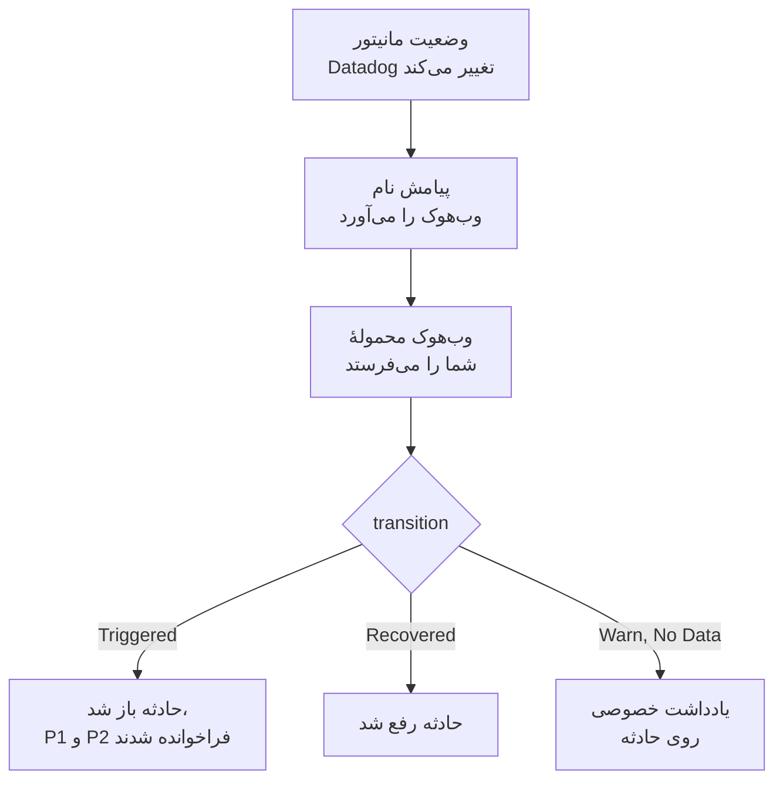

# Datadog

هشدارهای مانیتورهای [Datadog](https://www.datadoghq.com) را به OneUptime بفرستید تا هر کدام به یک حادثه یا یک هشدار تبدیل شود، وقتی فوری است تیم آنکال شما را فرا بخواند، و وقتی مانیتور Datadog بهبود یافت رفع شود. Datadog هشدارهایش را از طریق [یکپارچه‌سازی Webhooks](https://docs.datadoghq.com/integrations/webhooks/) خود می‌فرستد، پس در هیچ طرفی چیزی برای نصب نیست.

:::cards
- [انتخاب اینکه OneUptime هشدارها را چگونه دریافت کند](#انتخاب-اینکه-oneuptime-هشدارها-را-چگونه-دریافت-کند): یک قالب گردش کاری، یا یک مانیتور درخواست ورودی.
- [شروع با قالب](#شروع-با-قالب): تعیین کنید چه کسی فراخوانده شود، نشانی را کپی کنید، و ببینید هر هشدار چه می‌کند.
- [دریافت هشدارها با یک مانیتور](#دریافت-هشدارها-با-یک-مانیتور): یک حادثه برای هر هشدار، که با بهبود رفع می‌شود.
- [پیکربندی Datadog](#پیکربندی-datadog): یک وب‌هوک، و مانیتورهایی که آن را خبر می‌کنند.
- [عیب‌یابی](#عیبیابی): وقتی هشدارها نمی‌رسند، یا حادثه‌ها باز می‌مانند.
:::

## چگونه کار می‌کند



یک مانیتور Datadog وقتی وضعیتش تغییر می‌کند، یعنی وقتی فعال می‌شود، هشدار می‌دهد، بهبود می‌یابد یا داده‌ای ندارد، وب‌هوک‌هایی را که پیامش نام برده خبر می‌کند. بدنهٔ JSON وب‌هوک را خودتان با [متغیرهای قالب](https://docs.datadoghq.com/integrations/webhooks/#usage) Datadog می‌نویسید، پس این راهنما بدنه‌ای به شما می‌دهد که هر هشدار را نام می‌برد و می‌گوید چه بر سرش آمده است.

## پیش از شروع

- یک حساب Datadog که بتوانید در آن یکپارچه‌سازی‌ها را پیکربندی و مانیتورها را ویرایش کنید.
- در OneUptime، اجازه ساختن گردش کاری، یا اگر راه مانیتور را برمی‌گزینید، مانیتور. در OneUptime Cloud، گردش‌های کاری به طرح **Growth** یا بالاتر نیاز دارند.

## انتخاب اینکه OneUptime هشدارها را چگونه دریافت کند

اول OneUptime را راه بیندازید: نشانی‌ای را که Datadog به آن می‌فرستد، OneUptime به شما می‌دهد.

| روش | کی از آن استفاده کنید |
| --- | --- |
| قالب گردش کاری (پیشنهادی) | می‌خواهید هر هشدار یک حادثه یا هشدار با شدتی برگرفته از اولویت مانیتور باشد، برای P1 و P2 آنکال فراخوانده شود، هشدارهای سطح Warn روی آن یادداشت شوند، و با بهبود رفع شود. چیزی برای ساختن نیست. |
| یک مانیتور درخواست ورودی | حادثه‌ها را بدون گردش کاری، در هر طرحی، و مانیتوری می‌خواهید که وضعیتش از Datadog پیروی کند. |

هر دو از همان وب‌هوک همان JSON را می‌گیرند، پس می‌توانید با یکی شروع کنید و بعدها با تغییر یک نشانی در Datadog به دیگری بروید.

## شروع با قالب

پنجره **ساخت یک گردش کاری** دو قالب Datadog دارد، زیر **Datadog** در فهرست دسته‌هایش: **Declare an incident when a Datadog monitor triggers**، و برای هشدارها **Create an alert when a Datadog monitor triggers**. هر دو یک کار را می‌کنند، هر کدام با نوع رکورد خودش.

:::steps
1. به **گردش‌های کاری** بروید و روی **ساخت گردش کاری** کلیک کنید. زیر **یا از یک قالب شروع کنید**، **Datadog** را از فهرست دسته‌ها برگزینید، روی **Declare an incident when a Datadog monitor triggers** یا **Create an alert when a Datadog monitor triggers** کلیک کنید، و روی **استفاده از این قالب** کلیک کنید.
2. زیر **Who to page for P1 and P2 monitors** سیاست‌های آنکالی را که باید فراخوانده شوند انتخاب کنید، یا هیچ‌کدام را تا کسی فراخوانده نشود، و روی **ساخت گردش کاری** کلیک کنید. گردش کاری در **سازنده** باز می‌شود، خاموش.
3. روی تریگر **Webhook** کلیک کنید، سپس روی **کپی نشانی**، و نشانی را برای Datadog نگه دارید.
4. در بالای **سازنده** گزینه **فعال** را روشن کنید. گردش کاری خاموش به Datadog با `400` پاسخ می‌دهد.
:::

سپس [Datadog را پیکربندی کنید](#پیکربندی-datadog) تا هشدارهایش را به آن نشانی بفرستد. گام `read-event-1` گردش کاری با همان راه‌اندازی باز می‌شود، برای وقتی که در **سازنده** به آن برمی‌گردید.

### آنچه گردش کاری انجام می‌دهد

پس از تریگر **Webhook**، گام **Check With JavaScript** با شناسه `read-event-1` مقدار `transition` را که Datadog می‌فرستد می‌خواند، و **Incident From Another Tool**، یا در قالب هشدار **Alert From Another Tool**، با کلید چرخهٔ هشدار کاری را می‌کند که آن تغییر می‌خواهد. Datadog این کلید را از لحظه‌ای که هشدار فعال می‌شود تا وقتی بهبود می‌یابد نگه می‌دارد، و دفعهٔ بعد که فعال شود کلید تازه است، پس هر بار حادثهٔ خودش را می‌گیرد. حادثه کلید را در فیلد سفارشی `datadogAlertCycleKey` خود نگه می‌دارد.

| انتقال | آنچه گردش کاری انجام می‌دهد |
| --- | --- |
| `Triggered`, `Re-Triggered` | حادثه‌ای با عنوان `Datadog: <monitor>` اعلام می‌کند، با شدتی که اولویت مانیتور به آن نگاشته می‌شود، و آن را از صفحه‌های وضعیت شما دور نگه می‌دارد. توضیحش به هشدار در Datadog پیوند می‌دهد و اولویت، میزبان، دامنه و پیام مانیتور را فهرست می‌کند. اعلانی برای هشداری که حادثه‌اش هست، حادثه دومی باز نمی‌کند و دوباره کسی را فرا نمی‌خواند. |
| `Recovered` | حادثهٔ هشدار را رفع می‌کند، مگر اینکه از پیش رفع شده باشد. دلیلش روی خط زمانی آن است. |
| `Warn`, `Re-Warn`, `No Data`, `Re-No Data` | یک یادداشت خصوصی به حادثهٔ هشدار اضافه می‌کند، که می‌گوید وضعیت مانیتور اکنون چیست. |
| `Renotify` | هیچ: هشدار هنوز باز است. |

یک هشدار سطح Warn یا یک بهبود برای هشداری که حادثه ندارد چیزی را تغییر نمی‌دهد. هر چیز دیگری، مانند درخواستی از ابزاری دیگر، دست‌نخورده می‌ماند: `read-event-1` مسیر **No** را می‌گیرد، و **گام‌ها**ی اجرا دلیلش را می‌گویند. چیزی به Datadog برنمی‌گردد: Datadog هشدارهای خودش را وقتی سیگنال بهبود می‌یابد رفع می‌کند، و همین حادثه را رفع می‌کند.

### اولویت‌ها و فراخواندن

یک حادثه جدید وقتی مانیتورش P1 یا P2 است، یا اولویتی ندارد، سیاست‌های آنکالی را که برگزیدید فرا می‌خواند. P3، P4 و P5 حادثه‌ای باز می‌کنند و کسی را فرا نمی‌خوانند. در یک پروژه جدید، اولویت‌ها به این شدت‌های حادثه و هشدار نگاشته می‌شوند:

| اولویت Datadog | حادثه | هشدار | آنکال |
| --- | --- | --- | --- |
| P1 | Critical Incident | High | فراخوانده می‌شود |
| P2 | Critical Incident | High | فراخوانده می‌شود |
| بدون اولویت | Critical Incident | High | فراخوانده می‌شود |
| P3 | Major Incident | Low | فراخوانده نمی‌شود |
| P4 | Minor Incident | Low | فراخوانده نمی‌شود |
| P5 | Minor Incident | Low | فراخوانده نمی‌شود |

با شدت‌های خودتان، P1، P2 و بدون اولویت به شدیدترین، P3 به میانی، و P4 و P5 به کم‌شدت‌ترین شما می‌روند.

- برای نگاشت یک اولویت به یکی از شدت‌های خودتان با نام، `SEVERITY_BY_NAME` را در گام `read-event-1` ویرایش کنید، مانند `{ P3: 'Minor Incident' }`.
- برای فراخواندن آنکال برای P3 هم، **Compare with** در گام **If / Else** با شناسه `if-page-1` را روی `3` بگذارید.

## دریافت هشدارها با یک مانیتور

یک [مانیتور درخواست ورودی](/docs/monitor/incoming-request-monitor) یک نشانی به شما می‌دهد، و معیارهایش تعیین می‌کنند هر هشدار چه کند.

:::steps
### ساختن مانیتور

به **مانیتورها** بروید و روی **ساخت مانیتور** کلیک کنید. زیر **نوع مانیتور**، **درخواست ورودی** را برگزینید، نامش را `Datadog` بگذارید، و روی **بعدی** کلیک کنید.

### اعلام یک حادثه برای هر هشدار

در گام **معیارها**، نخستین معیار را باز کنید، همان که مانیتور را آفلاین علامت می‌زند. پالایهٔ آن را روی **بدنه درخواست**، **شامل است**، `"transition":"Triggered"` بگذارید. این معیار از پیش وقتی پالایه‌اش جور شود حادثه اعلام می‌کند. حادثه را پر کنید:

- **عنوان حادثه**: `{{requestBody.title}}`.
- **توضیحات حادثه**، زیر **توضیحات**: `{{requestBody.body}}`، سپس `Datadog: {{requestBody.link}}` در یک خط جداگانه.
- **شدت**: شدت حادثه‌ای که این هشدارها باید داشته باشند.
- **سیاست‌های آنکال**، زیر **آنکال**: سیاست‌هایی که باید فراخوانده شوند.
- **رفع خودکار حادثه**، زیر **فیلدهای بیشتر**: آن را روشن بگذارید، همان‌طور که از آغاز هست. بدون آن، بهبودها نادیده گرفته می‌شوند و حادثه‌ها باز می‌مانند.

### باز کردن یک حادثه برای هر هشدار

در همان معیار، **تنظیمات** را باز کنید و **گروه‌بندی حوادث و هشدارها بر اساس یک فیلد payload** را روشن کنید. آن را مانند جدول زیر پر کنید تا هر هشدار حادثهٔ خودش را بگیرد و بهبودش آن را رفع کند:

| فیلد | مقدار |
| --- | --- |
| **باز کردن یک حادثه جداگانه برای هر…** | `requestBody.alert_key` |
| **فیلدی که نشانه بهبود است** | `requestBody.transition` |
| **مقداری که به معنای بهبود است** | `Recovered` |

### برگرداندن مانیتور به حالت آنلاین

معیار دوم را باز کنید، همان که مانیتور را آنلاین علامت می‌زند، و پالایه‌اش را روی **بدنه درخواست**، **شامل است**، `"transition":"Recovered"` بگذارید.

### کپی کردن نشانی

روی **ساخت مانیتور** کلیک کنید. صفحهٔ **نمای کلی** مانیتور، **نشانی ضربان** آن را نشان می‌دهد. آن را برای Datadog کپی کنید:

```text
https://oneuptime.com/heartbeat/<secret key>
```

یک نصب خودمیزبان به جای `oneuptime.com` میزبان خودش را دارد.
:::

محمولهٔ زیر `alert_key` را روی شناسهٔ مانیتور Datadog و برچسب‌های گروهی که هشدار داده می‌گذارد، پس هر گروه از یک مانیتور چندهشداره حادثهٔ خودش را می‌گیرد، و بهبود همان گروه آن را رفع می‌کند. مانیتوری که در حالی که حادثه‌اش باز است دوباره فعال شود یا دوباره خبر کند، حادثهٔ دومی باز نمی‌کند. برای اینکه هر تنظیم چه می‌کند، [دریافت هشدار از سامانه‌ای دیگر](/docs/monitor/incoming-request-monitor#دریافت-هشدار-از-سامانهای-دیگر) را ببینید.

> [!NOTE]
> با این پالایه‌ها، اعلان **Warn** یا **No Data** هیچ حادثه‌ای باز نمی‌کند. برای اینکه برای هشدارهای سطح Warn هم فراخوانده شوید، روی **افزودن معیار** کلیک کنید، به معیار تازه پالایهٔ **بدنه درخواست**، **شامل است**، `"transition":"Warn"`، یک حادثه با **شدت** خودش، و همان تنظیمات گروه‌بندی را بدهید، سپس آن را بالای نخستین معیار بکشید. معیارها از بالا بررسی می‌شوند، و نخستین معیاری که جور شود تصمیم می‌گیرد.

## پیکربندی Datadog

:::steps
### افزودن وب‌هوک

در Datadog، [کاشی یکپارچه‌سازی Webhooks](https://app.datadoghq.com/integrations/webhooks) را باز کنید، و اگر هنوز نصب نشده آن را نصب کنید. یک وب‌هوک با این تنظیمات اضافه کنید، سپس آن را ذخیره کنید:

- **Name**: `oneuptime`. مانیتورها با این نام، به‌صورت `@webhook-oneuptime`، وب‌هوک را نام می‌برند.
- **URL**: نشانی‌ای که از OneUptime کپی کردید.
- **Payload**:

  ```json
  {
    "alert_key": "$ALERT_ID $ALERT_SCOPE",
    "alert_cycle_key": "$ALERT_CYCLE_KEY",
    "transition": "$ALERT_TRANSITION",
    "alert_priority": "$ALERT_PRIORITY",
    "title": "$EVENT_TITLE",
    "body": "$TEXT_ONLY_MSG",
    "host": "$HOSTNAME",
    "scope": "$ALERT_SCOPE",
    "priority": "$PRIORITY",
    "link": "$LINK"
  }
  ```

### نام بردن وب‌هوک در مانیتورهایتان

در هر مانیتور Datadog که باید از طریق OneUptime فراخوانی کند، `@webhook-oneuptime` را به پیام اعلان مانیتور اضافه کنید، و مانیتور را ذخیره کنید. از آن پس Datadog هشدارها و بهبودهای آن مانیتور را به OneUptime می‌فرستد.
:::

| متغیر | آنچه Datadog در آن می‌گذارد |
| --- | --- |
| `$ALERT_ID` | شناسهٔ مانیتور Datadog که هشدار داده است. |
| `$ALERT_SCOPE` | برچسب‌های گروهی که هشدار داده است، مانند `host:web-1`. |
| `$ALERT_CYCLE_KEY` | شناسه‌ای که از لحظهٔ فعال شدن یک هشدار تا بهبودش ثابت می‌ماند. |
| `$ALERT_TRANSITION` | آنچه رخ داده است: `Triggered`، `Re-Triggered`، `Warn`، `Recovered`، `No Data` یا `Renotify`، و موارد دیگر. |
| `$ALERT_PRIORITY` | اولویت مانیتور Datadog، از `P1` تا `P5`، یا هیچ برای مانیتوری که اولویتی ندارد. |
| `$EVENT_TITLE` | عنوان رویداد، مانند `[Triggered] High CPU`. |
| `$TEXT_ONLY_MSG` | پیام مانیتور، بدون Markdown. |
| `$LINK` | پیوندی به رویداد در Datadog. |

یک محموله هر دو راه را پوشش می‌دهد: قالب از `alert_cycle_key` و `alert_priority` پیروی می‌کند، و مانیتور از `alert_key`. همه را نگه دارید، و می‌توانید بعدها فقط با تغییر نشانی به دیگری بروید.

## آزمایش آن

یک هشدار را همان‌طور که Datadog می‌فرستد، به نشانی‌ای که کپی کردید بفرستید:

```bash
curl -X POST "<url>" \
  -H "Content-Type: application/json" \
  -d '{
    "alert_key": "1234 host:web-1",
    "alert_cycle_key": "7151157925468446720",
    "transition": "Triggered",
    "alert_priority": "P1",
    "title": "[Triggered] High CPU",
    "body": "CPU is above 90% on web-1.",
    "host": "web-1",
    "scope": "host:web-1",
    "priority": "normal",
    "link": "https://app.datadoghq.com/event/event?id=1"
  }'
```

با قالب، حادثه‌ای با عنوان `Datadog: High CPU` باز می‌شود، و سیاست‌های آنکالی که برگزیدید فراخوانده می‌شوند. با مانیتور، حادثه‌ای با عنوان `[Triggered] High CPU` باز می‌شود. همان درخواست را با `transition` روی `Recovered` بفرستید، و حادثه رفع می‌شود.

سپس از Datadog آزمایش کنید: مانیتوری را که وب‌هوک را نام می‌برد باز کنید، روی **Test Notifications** کلیک کنید، و اعلان **Alert** آن را بفرستید. برای دیدن اینکه رسیده است، در گردش کاری **لاگ‌ها** > **اجراها** را، یا خط زمانی مانیتور OneUptime را باز کنید.

## عیب‌یابی

:::details چیزی به OneUptime نمی‌رسد
- بررسی کنید که پیام مانیتور Datadog نام `@webhook-oneuptime` را آورده باشد، با همان املایی که وب‌هوک نام‌گذاری شده است.
- مانیتور پیش از بررسی هر چیزی، بی‌درنگ با `200` پاسخ می‌دهد، حتی برای کلید محرمانهٔ نادرست. برای دیدن اینکه هشدارها می‌رسند یا نه، خط زمانی مانیتور را بررسی کنید.
- گردش کاری خاموش با `400` پاسخ می‌دهد. در بالای **سازنده** آن، **فعال** را روشن کنید.
:::

:::details گردش کاری اجرا می‌شود، اما چیزی باز نمی‌کند
اجرا را در **لاگ‌ها** > **اجراها** باز کنید. مدخل `read-event-1` در **گام‌ها**ی آن می‌گوید چرا **No** را گرفته است.

- `Datadog named no alert cycle key`: `"alert_cycle_key": "$ALERT_CYCLE_KEY"` را به محموله وب‌هوک در Datadog اضافه کنید.
- `Datadog named no transition`: `"transition": "$ALERT_TRANSITION"` را به محموله وب‌هوک در Datadog اضافه کنید.
:::

:::details آنکال فراخوانده نمی‌شود
- فقط مانیتورهای P1 و P2 و مانیتورهای بدون اولویت فرا می‌خوانند. [اولویت‌ها و فراخواندن](#اولویتها-و-فراخواندن) را ببینید.
- اعلانی برای هشداری که حادثه‌اش هست دوباره کسی را فرا نمی‌خواند.
- اگر در پنجره **ساخت یک گردش کاری** هیچ‌کس انتخاب نشده باشد، گردش کاری گامی که فرا بخواند ندارد.
:::

:::details حادثه‌ها باز می‌شوند اما هرگز رفع نمی‌شوند
- مانیتور Datadog باید بهبودهایش را هم به وب‌هوک خبر دهد. پیامی که فقط برای هشدارها، درون یک شرط، وب‌هوک را نام می‌برد، هیچ بهبودی نمی‌فرستد.
- با قالب، اجرای بهبود را در **لاگ‌ها** > **اجراها** باز کنید: آخرین گامش دلیلش را می‌گوید. `alert_cycle_key` بهبود باید همان کلید هشدار باشد، پس `$ALERT_CYCLE_KEY` را در محموله همان‌طور که هست نگه دارید.
- با مانیتور، حادثهٔ معیار به **رفع خودکار حادثه**، زیر **فیلدهای بیشتر**، نیاز دارد.
- **مقداری که به معنای بهبود است** باید دقیقاً `Recovered` باشد. مقایسه به بزرگی و کوچکی حروف حساس است.
- `alert_key` بهبود باید همان کلید خود هشدار باشد: `$ALERT_ID $ALERT_SCOPE` را در محموله همان‌طور که هست نگه دارید.
:::

:::details یک فیلد نام یک متغیر را نشان می‌دهد، یا هیچ چیز
Datadog فقط متغیرهایی را پر می‌کند که به رویداد مربوط‌اند. یک اعلان آزمایشی بفرستید، سپس ببینید چه رسیده است: در خط زمانی مانیتور، یا برای یک گردش کاری در **لاگ‌ها** > **اجراها**.
:::

:::details همهٔ هشدارهای یک مانیتور در یک حادثه ادغام می‌شوند
با مانیتور، هر گروه به `alert_key` خودش نیاز دارد. بررسی کنید که محموله آن را از هر دوی `$ALERT_ID` و `$ALERT_SCOPE` بسازد، و مسیر گروه‌بندی `requestBody.alert_key` باشد.
:::

## امنیت

- **با نشانی مانند یک گذرواژه رفتار کنید.** هر کسی که آن را داشته باشد می‌تواند حادثه باز کند. اگر لو رفت، آن را بازنشانی کنید: **بازنشانی نشانی** در تریگر **Webhook** گردش کاری، یا **بازنشانی کلید محرمانه درخواست ورودی** در صفحه **تنظیمات** مانیتور. سپس **URL** وب‌هوک را در Datadog به‌روزرسانی کنید.
- **پیوندها به Datadog می‌روند.** قالب، هر چه یک درخواست بگوید، یک هشدار را فقط روی یک سایت Datadog پیوند می‌دهد، و آنچه Datadog فرستاده را به‌صورت متن می‌نویسد.
- **خودمیزبان؟** Datadog وب‌هوک‌ها را از اینترنت می‌فرستد، پس OneUptime شما باید از اینترنت با HTTPS در دسترس باشد.

## گام‌های بعدی

:::cards
- [قالب‌های گردش کاری](/docs/workflows/authoring): یک گردش کاری از یک قالب بسازید، و آن را در سازنده تغییر دهید.
- [مانیتور درخواست ورودی](/docs/monitor/incoming-request-monitor): همهٔ تنظیمات مانیتوری که هشدارهای شما را دریافت می‌کند.
- [New Relic](/docs/integrations/new-relic): همان قالب، برای issueهای New Relic.
- [قواعد تشدید](/docs/on-call/escalation-rules): تعیین کنید یک سیاست آنکال چه کسی را و کی فرا بخواند.
- [نمای کلی یکپارچه‌سازی‌ها](/docs/integrations/index): ابزارهای دیگری که می‌توانید وصل کنید.
:::
