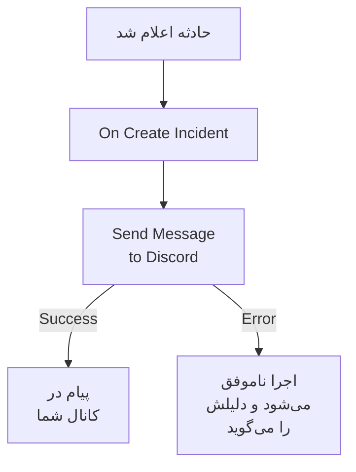

# Discord

وقتی حادثه‌ای باز می‌شود، پیامی در یک کانال [Discord](https://discord.com) بگذارید، تا کسانی که آن کانال را دنبال می‌کنند بی‌درنگ باخبر شوند. مرحلهٔ گردش کاری **Send Message to Discord** در OneUptime از راه وب‌هوک کانال پیام می‌گذارد، و یک قالب آماده کل گردش کاری را برایتان می‌سازد. این یکپارچه‌سازی **خروجی** است: OneUptime در کانال پیام می‌گذارد و گفت‌وگوهای آن را نمی‌خواند.

:::cards
- [چگونه کار می‌کند](#چگونه-کار-میکند): گردش کاری وقتی حادثه‌ای باز می‌شود چه می‌کند.
- [راه‌اندازی](#راهاندازی-یکپارچهسازی): یک وب‌هوک در Discord، سپس گردش کاری: از قالب یا از صفر.
- [نکته‌ها](#نکتهها): قالب‌بندی، پیام‌های بلند، و رویدادهای بیشتر.
- [عیب‌یابی](#عیبیابی): خطاهای مرحله چه معنایی دارند و چه چیزی را باید تغییر داد.
:::

## چگونه کار می‌کند



مرحله **Message Text** را به وب‌هوک کانال می‌فرستد. وقتی Discord پیام را بپذیرد از خروجی **Success** ادامه می‌دهد، و وقتی Discord آن را رد کند، با دلیل Discord، از خروجی **Error**. وقتی چیزی به **Error** وصل نباشد، مانند قالب، اجرایی که نتوانست پیام بگذارد ناموفق می‌شود، و **گام‌ها**ی آن دلیلش را می‌گویند.

## پیش از شروع

- در Discord، مجوز **Manage Webhooks** روی کانال.
- در OneUptime، اجازه ساختن گردش کاری و متغیر. در OneUptime Cloud، گردش‌های کاری به طرح **Growth** یا بالاتر نیاز دارند.

## راه‌اندازی یکپارچه‌سازی

:::steps
### ساختن یک وب‌هوک در Discord

1. در Discord، تنظیمات کانال را با **Edit Channel** باز کنید، سپس **Integrations → Webhooks** را، و **New Webhook** را برگزینید.
2. نامی به آن بدهید، برای نمونه `OneUptime`، و بررسی کنید که در کانال درست پیام می‌گذارد.
3. **Copy Webhook URL** را برگزینید.

هر کسی که این نشانی را داشته باشد می‌تواند در کانال پیام بگذارد، پس آن را به اندازهٔ یک رمز عبور امن نگه دارید.

### ساخت گردش کاری

از قالب شروع کنید، که کل گردش کاری را برایتان می‌سازد، یا از صفر.

:::tabs
@tab از قالب
1. **گردش‌های کاری** را باز کنید و روی **ساخت گردش کاری** کلیک کنید.
2. در **جستجو در قالب‌ها…** عبارت `Discord` را بنویسید، روی **Tell Discord when an incident opens** کلیک کنید، سپس روی **استفاده از این قالب** کلیک کنید.
3. نام **Notify Discord on new incident** را نگه دارید یا تغییر دهید، و روی **بعدی** کلیک کنید.
4. نشانی را در **Discord Webhook URL** بچسبانید، و روی **ساخت گردش کاری** کلیک کنید.

گردش کاری در **سازنده** با دو مرحله باز می‌شود: **On Create Incident**، و **Send Message to Discord** که شماره، عنوان، شدت و وضعیت حادثه را می‌فرستد. نشانی به‌صورت متغیر راز `discordWebhookUrl` گردش کاری ذخیره می‌شود.
@tab از صفر
1. نشانی را به‌صورت یک متغیر سراسری راز ذخیره کنید: به **گردش‌های کاری** > **متغیرهای سراسری** بروید، روی **ساخت متغیر گردش کاری** کلیک کنید، نامش را `DISCORD_WEBHOOK_URL` بگذارید، و روی **بعدی** کلیک کنید. نشانی را در **محتوا** بچسبانید، **راز** را روشن کنید، و روی **ساخت متغیر گردش کاری** کلیک کنید.
2. به **گردش‌های کاری** بروید، روی **ساخت گردش کاری** کلیک کنید، **شروع از صفر** را برگزینید، برای گردش کاری نامی بگذارید، و روی **ساخت گردش کاری** کلیک کنید.
3. در **سازنده** روی **انتخاب کنید چه چیزی این گردش کاری را شروع کند** کلیک کنید و **On Create Incident** را زیر **محبوب** برگزینید. روی تریگر کلیک کنید: **Fields to pass on** آن از پیش **عنوان** را دارد، پس روی **افزودن فیلد** کلیک کنید و فیلدهای دیگری را که پیامتان نشان می‌دهد برگزینید، مانند **Incident Number With Prefix**.
4. روی **افزودن مؤلفه** کلیک کنید، `discord` را جستجو کنید، و روی **Send Message to Discord** کلیک کنید. خروجی **Success** تریگر را به آن وصل کنید.
5. روی مرحلهٔ تازه کلیک کنید. در **Discord Incoming Webhook URL** روی **{ }** کلیک کنید و `DISCORD_WEBHOOK_URL` را زیر **Global variables** برگزینید. در **Message Text** پیام را بنویسید، و فیلدهای حادثه را با **{ }** درج کنید.
:::

پیامی که از صفر ساخته شده فیلدهای حادثه را با ارجاع‌هایی مانند این‌ها می‌خواند:

```text
🚨 **Incident {{local.components.incident-on-create-1.returnValues.model.incidentNumberWithPrefix}} declared**
**Title:** {{local.components.incident-on-create-1.returnValues.model.title}}
```

### روشن کردن و آزمودن

**فعال** را در بالای **سازنده** روشن کنید. از این پس هر حادثهٔ تازه در کانال منتشر می‌شود.

برای آزمودن بدون باز کردن حادثه، روی **اجرای گردش کاری** کلیک کنید و زیر **حادثه** حادثه‌ای را که از پیش دارید برگزینید: تازه‌ترین‌ها فهرست شده‌اند، و با تایپ شماره یا بخشی از عنوانش حادثهٔ دیگری پیدا می‌شود. روی **اجرای دستی گردش کاری** کلیک کنید و با **اجرا** تأیید کنید. پنل **اجرای گردش کاری** اجرا را دنبال می‌کند، و پیام در کانال پدیدار می‌شود. اگر مرحله به‌جای آن از **Error** ادامه دهد، اجرا ناموفق می‌شود، و مدخل مرحله در **گام‌ها** دلیل را می‌گوید: [عیب‌یابی](#عیبیابی) را ببینید.
:::

## نکته‌ها

- **قالب‌بندی با Markdown در Discord.** متن همان‌طور که نوشته شده فرستاده می‌شود، پس Markdown در Discord در آن کار می‌کند: ستاره‌ها دور یک واژه آن را پررنگ می‌کنند، و یک نشانی به‌صورت پیوند نشان داده می‌شود.
- **محدودیت ۲٬۰۰۰ نویسه را در نظر بگیرید.** Discord پیام‌هایی تا ۲٬۰۰۰ نویسه را می‌پذیرد. پیام بلندتر به جای رد شدن کوتاه می‌شود، و با "… (truncated — see OneUptime for the full text)" پایان می‌یابد.
- **بیش از حادثه‌های تازه بفرستید.** گردش کاری دیگری روی **On Update Incident** برای تغییرات وضعیت، یا روی **On Create Alert** برای هشدارها، با همان مرحله بسازید. برای فرستادن فقط برخی حادثه‌ها، یک بلوک **If / Else** پیش از مرحله بگذارید.
- **فقط نشانی‌های خود Discord.** مرحله به یک نشانی `https` روی `discord.com` یا `discordapp.com` پیام می‌فرستد، و تغییر مسیرها را دنبال نمی‌کند، پس نشانی‌ای که به هر جای دیگری اشاره کند اجرا را متوقف می‌کند.

## عیب‌یابی

وقتی مرحله از **Error** ادامه می‌دهد، اجرا ناموفق می‌شود، و مدخل مرحله در **گام‌ها**ی اجرا دلیل Discord را می‌گوید.

:::details Discord با "Unknown Webhook" یا "Invalid Webhook Token" پاسخ می‌دهد
وب‌هوک حذف شده، یا نشانی نادرست کپی شده است. یک وب‌هوک تازه بسازید، و نشانی را جایگزین کنید: در گردش کاری قالب، متغیر `discordWebhookUrl`؛ در گردش کاری خودتان، محتوای `DISCORD_WEBHOOK_URL`.
:::

:::details Discord با "You are being rate limited" پاسخ می‌دهد
Discord محدود می‌کند که یک وب‌هوک هر چند وقت یک بار پیام بگذارد. موجی از حادثه‌ها می‌تواند به این محدودیت بخورد: پیام‌های کمتری بفرستید، برای نمونه فقط برای برخی شدت‌ها.
:::

:::details اجرا با "Discord Webhook URL must be an https URL on discord.com or discordapp.com" متوقف می‌شود
**Discord Incoming Webhook URL** چیزی جز یک وب‌هوک Discord در خود دارد، یا متغیری که می‌خواند خالی است. نشانی را دوباره از **Copy Webhook URL** بچسبانید.
:::

## گام‌های بعدی

:::cards
- [اجزای گردش کاری](/docs/workflows/components#discord): همهٔ تنظیمات مرحله، و معنای خروجی‌هایش.
- [Telegram](/docs/integrations/telegram): همین ایده، در یک گفتگوی Telegram.
- [اجراهای گردش کاری](/docs/workflows/runs-and-logs): ببینید هر اجرای گردش کاری چه کرد.
- [نمای کلی یکپارچه‌سازی‌ها](/docs/integrations/index): الگوی خروجی، و ابزارهای دیگری که می‌توانید وصل کنید.
:::
