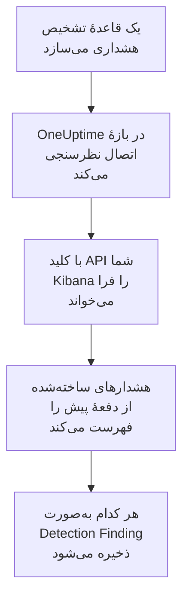

# Elastic Security

هشدارهای تشخیصی را که قاعده‌های [Elastic Security](https://www.elastic.co/security) شما می‌دهند، به رویدادهای امنیتی OneUptime وارد کنید. آنجا آن‌ها را کنار لاگ‌ها، ترِیس‌ها و متریک‌هایتان جستجو می‌کنید، با هر منبع دیگری هم‌بسته می‌کنید، و برای آن‌هایی که مهم‌اند آنکال را فرا می‌خوانید. OneUptime آن‌ها را از طریق API موتور تشخیص Kibana با یک کلید API که خودتان می‌سازید می‌خواند، و هیچ چیزی را در Elastic تغییر نمی‌دهد.

:::cards
- [راه‌اندازی اتصال](#راهاندازی-اتصال): یک کلید API، امتیازهایش، و فرم اتصال.
- [چه چیزی وارد می‌شود](#چه-چیزی-وارد-میشود): هر هشدار تشخیص چگونه به یک رویداد امنیتی تبدیل می‌شود.
- [نظرسنجی چگونه کار می‌کند](#نظرسنجی-چگونه-کار-میکند): پنجره‌ای که هر نظرسنجی می‌خواند، و اینکه یک فضای پرکار با آن چه می‌کند.
- [عیب‌یابی](#عیبیابی): معنای هر خطا، و آنچه باید تغییر دهید.
:::

## چگونه کار می‌کند



OneUptime هر دقیقه از هر اتصال فعالی که بازهٔ نظرسنجی‌اش گذشته باشد نظرسنجی می‌کند. یک نظرسنجی هشدارهای تشخیصی را که از نظرسنجی پیش در فضای شما ساخته شده‌اند، ۱٬۰۰۰ تا در هر بار، از Kibana می‌خواهد، و هر کدام را به‌صورت یک رویداد Detection Finding از [OCSF](https://schema.ocsf.io/) (کلاس `2004`) ذخیره می‌کند. هر نوع قاعده‌ای حساب می‌شود: پرس‌وجوی سفارشی، آستانه، EQL، تطبیق شاخص، یادگیری ماشینی و عبارت‌های تازه. از آن پس قاعده‌های تشخیص، مانیتورها و داشبوردها با این هشدارها مانند رویدادهای امنیتی از هر منبع دیگری رفتار می‌کنند.

## پیش از شروع

- در OneUptime، نقش Project Owner، Project Admin یا Security Admin. Security Member و Security Viewer می‌توانند اتصال‌ها و تاریخچهٔ اجرایشان را ببینند، اما نمی‌توانند آن‌ها را تغییر دهند.
- Elastic Security نسخهٔ 8.x یا جدیدتر، روی Elastic Cloud یا پشتهٔ Elastic خودتان، با قاعده‌های تشخیصی که در یک فضای Kibana اجرا می‌شوند.
- دسترسی‌ای در Kibana که بتواند هشدارهای تشخیص را در آن فضا ببیند: امتیازهای ایندکس `read` و `view_index_metadata` روی `.alerts-security.alerts-<space-id>`، و یک امتیاز ویژگی Kibana Security که اجازه دهد هشدارها را آنجا بخواند.
- یک Kibana که OneUptime بتواند از طریق HTTPS به آن برسد. OneUptime Cloud از اینترنت وصل می‌شود، پس Kibana به یک نشانی عمومی نیاز دارد، چنان‌که استقرارهای Elastic Cloud دارند: نشانی‌های خصوصی رد می‌شوند. یک OneUptime خودمیزبان از کانتینرهای برنامه و کارگرش وصل می‌شود، و می‌تواند به یک Kibana در شبکهٔ خصوصی شما برسد، مگر اینکه `DATA_SOURCE_BLOCK_PRIVATE_ADDRESSES` برابر `true` باشد.

## راه‌اندازی اتصال

:::steps
### ساختن یک کلید API

1. در Kibana، **Stack Management → API keys** را باز کنید، و **Create API key** را برگزینید.
2. نامی به آن بدهید، برای نمونه `oneuptime-security-events`. یک کلید امتیازهای کاربری را دارد که آن را می‌سازد، مگر اینکه امتیازهای کمتری به آن بدهید: فقط به امتیازهای بالا نیاز دارد.
3. زمان انقضایش را برگزینید، یا هرگز. کلیدی که منقضی شود اتصال را تا وقتی جایگزینش کنید متوقف می‌کند.
4. کلید را بسازید، و مقدار **Base64** آن را کپی کنید، که Kibana یک بار نشان می‌دهد. نه شناسهٔ کلید، و نه جفت `id:api_key`.

### یافتن شناسهٔ فضای شما

هشدارها برای هر فضا جداگانه ذخیره می‌شوند. فضایی را که قاعده‌هایتان را اجرا می‌کند باز کنید: شناسهٔ آن بخشی از نشانی Kibana پس از `/s/` است، مانند `security` در `https://kibana.example.com/s/security/app/security`. فضای پیش‌فرض بخش `/s/` ندارد، و به شناسه نیاز ندارد.

### افزودن اتصال در OneUptime

**محصولات** > **رویدادهای امنیتی** > **اتصال‌ها** (`/dashboard/{projectId}/security-events/connections`) را باز کنید، روی **افزودن اتصال** کلیک کنید، **Elastic Security** را برگزینید، و روی **بعدی** کلیک کنید. تنظیمات جدول زیر را پر کنید، روی **بعدی** کلیک کنید، و کلید را در **کلید API** بچسبانید.

### آزمایش پیش از ذخیره

روی **آزمودن این تنظیمات** زیر **آزمایش پیش از ذخیره** کلیک کنید. آزمایش با مقدارهای فرم وارد می‌شود و هشدارها را می‌خواند، و چیزی ذخیره نمی‌کند، پس فضای نادرست یا امتیازی که کم است پیش از ساخته شدن اتصال آشکار می‌شود. سپس روی **بعدی** کلیک کنید، به اتصال یک **نام** بدهید، و آن را بسازید.
:::

| تنظیم | چه چیزی وارد کنید |
| --- | --- |
| **Kibana URL** | نشانی‌ای که Kibana از آن ارائه می‌شود، مانند `https://kibana.example.com` یا `https://<deployment>.kb.<region>.cloud.es.io`. بدون مسیر: نه `/app/security`، نه `/api`، و نه بخش `/s/<space>`. |
| **Kibana space** | شناسهٔ فضا، نه نامش: حروف، رقم‌ها، خط تیره‌ها و زیرخط‌ها. برای فضای پیش‌فرض آن را خالی بگذارید. |
| **کلید API** | مقدار **Base64** کلید، به‌تنهایی: OneUptime طرح `ApiKey` را خودش می‌افزاید. رمزگذاری می‌شود، API هرگز آن را برنمی‌گرداند و دیگر هرگز نشان داده نمی‌شود. آن را با **به‌روزرسانی اطلاعات ورود** روی اتصال جایگزین کنید. |

گام **فراخوانی دوره‌ای** همچنین یک **توضیحات** اختیاری دارد، **فاصله فراخوانی (دقیقه)**، یک عدد صحیح از `1` تا `1440` که با `5` شروع می‌شود، و **فعال**، که از آغاز روشن است.

## چه چیزی وارد می‌شود

هر هشدار تشخیص به یک رویداد Detection Finding تبدیل می‌شود (کلاس OCSF `2004`)، با فروشندهٔ `Elastic` و محصول `Elastic Security`:

| فیلد هشدار | ستون OneUptime |
| --- | --- |
| `_id`، شناسهٔ هشدار | UID رویداد، که تکراری‌ها هم بر پایهٔ آن کنار گذاشته می‌شوند |
| `kibana.alert.original_time`، وگرنه `kibana.alert.start`، وگرنه `@timestamp` | زمان رویداد |
| `kibana.alert.rule.name` | نام قاعده |
| `kibana.alert.rule.uuid`، وگرنه `kibana.alert.rule.rule_id` | شناسهٔ قاعده |
| `kibana.alert.reason`، وگرنه نام قاعده، وگرنه `kibana.alert.rule.description` | پیام |
| `kibana.alert.severity`، وگرنه بازه‌ای از `kibana.alert.risk_score` | شدت |
| `kibana.alert.workflow_status`: `open`، `acknowledged` یا `closed` | وضعیت |
| `kibana.alert.rule.threat`، با زیرتکنیک‌ها | تاکتیک‌ها و تکنیک‌های MITRE ATT&CK |
| `user.name`، `host.name`، `source.ip` یا `host.ip`، `process.name` یا `process.executable` | کاربر، میزبان، IP و فرایند اصلی |
| `user.target.name`، `destination.domain`، `destination.ip`، `destination.port`، `file.path` | کاربر، میزبان، IP، پورت و منبع هدف |
| همان‌ها، و `related.*`، `dns.question.name`، `url.domain` و هش‌های پرونده | Observableها |
| کل هشدار، تخت‌شده به کلیدهای نقطه‌دار، با `_index` و `_id` | `attributes` |

زمان یک هشدار عمداً زمان فعالیتی است که دربارهٔ آن است. `@timestamp` آن، یعنی وقتی قاعده آن را ساخت، همان چیزی است که نظرسنجی می‌خواند، پس هشداری که امروز دربارهٔ فعالیت دیروز ساخته شود در کاوشگر رویدادهای امنیتی زیر دیروز نشان داده می‌شود. وقتی هشداری شدت ندارد، امتیاز ریسک آن تعیین می‌کند: `74` و بالاتر Critical است، `48` و بالاتر High، `22` و بالاتر Medium، و هر چیز پایین‌تر Low.

## نظرسنجی چگونه کار می‌کند

هر نظرسنجی هشدارهای ساخته‌شده در پنجره‌اش را، قدیمی‌ترین‌ها اول، ۱٬۰۰۰ تا در هر صفحه، فهرست می‌کند. در فضایی جز فضای پیش‌فرض، مسیر با `/s/{Kibana space}` شروع می‌شود:

```text
POST {Kibana URL}/api/detection_engine/signals/search
    {"query": {"range": {"@timestamp": {"gte": "{window start}", "lt": "{window end}"}}},
     "size": 1000, "sort": [{"@timestamp": "asc"}]}
```

- **زمان ساخت، نشانگر است.** هشدارها بر پایهٔ `@timestamp` خودشان فهرست می‌شوند، یعنی وقتی اجرای قاعده آن‌ها را ساخت، هرگز بر پایهٔ زمان فعالیتی که دربارهٔ آن‌اند. قاعده‌ای که هر ساعت اجرا می‌شود هشدارهایی دربارهٔ فعالیتی تا یک ساعت پیش می‌سازد، و نشانگری بر پایهٔ زمان فعالیت همهٔ آن‌ها را جا می‌انداخت.
- **نخستین نظرسنجی ۲۴ ساعت به عقب نگاه می‌کند**، پس یک اتصال تازه بی‌درنگ هشدارهای اخیرش را نشان می‌دهد.
- **هر نظرسنجی بعدی ۱ دقیقه پیش از نشانگر ذخیره‌شده شروع می‌شود**، پس هشداری که روی مرز دو پنجره ساخته شود هرگز جا نمی‌افتد.
- **یک نظرسنجی حداکثر ۲۴ ساعت پس از نشانگر را می‌خواند.** اتصالی که نشانگرش عقب افتاده، در رشته‌ای از پنجره‌های ۲۴ ساعته جبران می‌کند، و **سلامت** آن **Catching up** را نشان می‌دهد.
- **تکراری‌ها بر پایهٔ `_id` هشدار کنار گذاشته می‌شوند**، درون پروژه، پس هم‌پوشانی، پنجره‌ای که دوباره امتحان شده و یک وارد کردن هرگز یک هشدار را دو بار ذخیره نمی‌کنند.

جستجوی هشدار در Kibana یک اندازه و یک ترتیب می‌گیرد، اما توکن صفحه نه. پس OneUptime با بردن آغاز بازه به آخرین هشدار هر صفحه صفحه‌بندی می‌کند، و هشدارهایی را که در آن لحظه خوانده، بر پایهٔ `_id`، کنار می‌گذارد. یک اجرای قاعده اغلب هشدارهای بسیاری را با یک زمان مهر می‌زند، و چنین گروهی صفحه به صفحه خوانده می‌شود، بی‌آنکه هیچ‌کدام دو بار خوانده یا جا انداخته شود.

### وقتی یک پنجره بیش از توان یک نظرسنجی دارد

یک نظرسنجی حداکثر ۱۰٬۰۰۰ هشدار را، در حداکثر ۲۰ درخواست، می‌خواند. وقتی پنجره‌ای بیشتر از این داشته باشد، اجرا **جزئی** است، با هشداری مانند:

```text
Stopped after collecting 10000 alerts; the window holds more.
```

هشدارها قدیمی‌ترین‌ها اول خوانده می‌شوند، پس OneUptime نشانگر را به زمان ساخت آخرین هشداری که خوانده می‌برد، و نظرسنجی بعدی با همان طول پنجره از آنجا شروع می‌شود. یک فضای پرکار در هر نظرسنجی ۱۰٬۰۰۰ هشدار جبران می‌کند، به جای اینکه همان هشدارها را دوباره بخواند. هشدارهایی که در همان لحظه ساخته شده‌اند دو بار خوانده می‌شوند، و بررسی تکراری نسخهٔ دوم را کنار می‌گذارد.

شناسه‌های کنار گذاشته‌شده در هر درخواست فرستاده می‌شوند، و Kibana اندازهٔ یک درخواست را محدود می‌کند. وقتی هشدارهایی که در یک لحظه شریک‌اند بیش از آن باشند که یک درخواست بتواند کنار بگذارد، حدود ۷٬۸۰۰، اجرا همان‌جا به‌صورت **جزئی** متوقف می‌شود، با هشداری که آن لحظه را نام می‌برد.

وقتی یک اجرا اصلاً نتواند از نشانگر ذخیره‌شده جلوتر برود، OneUptime به جای آن پنجره را کوتاه می‌کند:

1. **باریک کردن.** نظرسنجی بعدی پنجره‌ای به نصف طول را از همان نقطهٔ شروع می‌خواند، و تا وقتی پنجره‌ای کامل خوانده شود دوباره نصف می‌کند، تا حداقل یک دقیقه. هشدار اجرا همین را می‌گوید: `This window holds more records than one poll can read; the next poll reads a {n} minute window from the same starting point.`
2. **دوباره بزرگ کردن.** پس از اینکه پنجره‌ای کامل خوانده شد، پنجرهٔ بعدی دوباره دو برابر می‌شود، تا ۲۴ ساعت.
3. **گذشتن از یک دقیقهٔ تنها.** اگر حتی یک دقیقه بیش از توان یک نظرسنجی داشته باشد، نظرسنجی از آن می‌گذرد، تا هشدارهای تازه‌تر همچنان برسند. اجرا **جزئی** می‌ماند، و **آخرین خطا** این را نشان می‌دهد: `More records were created in the one minute from {cursor} to {end} than one poll can read. Polling moved past this minute so newer records keep arriving; use Import this time range in Diagnostics on this minute to recover what one run can read.` آن دقیقه را با **Import this time range** وارد کنید تا آنچه یک اجرا می‌تواند بخواند بازیابی شود.

اجرایی که با خطایی از Kibana یکسره شکست بخورد، نشانگر و طول پنجره را نگه می‌دارد، و نظرسنجی بعدی همان پنجره را دوباره می‌خواند. تنها استثنا درخواستی است که زمانش سر رسیده: نشانگر می‌ماند، اما پنجرهٔ بعدی نصف طول می‌شود، چون پنجره‌ای که برای پاسخ به‌موقع بیش از حد سنگین است در هر تلاش به پایان زمان می‌خورد. تغییر **فاصله فراخوانی (دقیقه)** هیچ‌کدام از این‌ها را تغییر نمی‌دهد: این تنظیم تعیین می‌کند یک نظرسنجی هر چند وقت شروع شود، نه اینکه پنجره‌اش از کجا شروع شود.

### اجرا، پیش‌نمایش و وارد کردن در صورت نیاز

روی **عیب‌یابی** یک اتصال کلیک کنید تا اجراهای اخیرش را ببینید و دستی با آن کار کنید. هر کسی که بتواند اتصال را تغییر دهد می‌تواند این‌ها را شروع کند؛ هر کسی که بتواند آن را ببیند می‌تواند تاریخچه را بخواند.

- **اجرای اکنون** بی‌درنگ یک نظرسنجی با نشانگر معمول شروع می‌کند، حتی وقتی اتصال **فعال** نیست.
- **Preview alerts** یک بازهٔ زمانی تا ۷ روز را می‌خواند و چیزی وارد نمی‌کند.
- **Import this time range** پس از تأیید شما بازه‌ای تا ۷ روز را وارد می‌کند، بی‌آنکه نشانگر را جابه‌جا کند. هشدارهایی که پیش‌تر وارد شده‌اند رد می‌شوند.
- **Copy diagnostics** روی یک اجرا، گزارش آن را برای پشتیبانی کپی می‌کند. هرگز اعتبارنامه‌ها را در بر ندارد.

## آزمایش اتصال

**آزمایش اتصال** در ردیف یک اتصال، و **آزمودن این تنظیمات** در فرم، در فرایند API اجرا می‌شوند، نه در یک کارگر پس‌زمینه، پس یک آزمایش حتی وقتی مشکل از کارگرهاست هم پاسخ می‌دهد. این بررسی‌ها را به ترتیب انجام می‌دهد:

| بررسی | چه چیزی را بررسی می‌کند |
| --- | --- |
| **پیکربندی** | هر تنظیم موجود و درست‌شکل است. وقتی این شکست بخورد با هیچ جایی تماس گرفته نمی‌شود. |
| **Authenticate with Kibana** | `/api/status` در Kibana پاسخ کامل می‌دهد. Kibana به فراخواننده‌هایی که احراز هویت نکرده هم پاسخ می‌دهد، با اطلاعات کمتر، پس یک پاسخ کوتاه این بررسی را شکست می‌دهد. |
| **Read detection alerts** | یک هشدار ساخته‌شده در ۲۴ ساعت گذشته را می‌توان خواند. این امتیازها و فضا را ثابت می‌کند. |
| **Alerts available to import** | چند هشدار در ۲۴ ساعت گذشته و ۷ روز گذشته ساخته شده است، با `+` جایی که Elasticsearch فقط بخشی از آن‌ها را شمرد. هیچ هشداری در ۷ روز یک هشدار است، نه یک شکست. |
| **Background workers**، **Poll scheduler**، **Security event storage** | سمت خود OneUptime: فرایندی کارهای صف Worker را برمی‌دارد، کار نظرسنجی هر دقیقه اجرا می‌شود، و انبارهٔ رویدادهای امنیتی پاسخ می‌دهد. |
| **Scheduled polling** | برای یک اتصال ذخیره‌شده: نظرسنجی روشن است، هیچ اجرایی در انتظار یک کارگر گیر نکرده، و نظرسنجی‌ها به‌موقع اجرا می‌شوند. |

هر درخواست در یک آزمایش مهلتی ۲۰ ثانیه‌ای دارد. یک آزمایش هرگز چیزی وارد نمی‌کند یا نشانگر را جابه‌جا نمی‌کند، و هر بررسی شکست‌خورده می‌گوید چه چیزی را تغییر دهید.

## ارسال رویدادهای امنیتی به Elastic Security

OneUptime می‌تواند آنچه را می‌یابد به‌صورت سندهای Elastic Common Schema (ECS) در یک جریان داده به Elasticsearch هم بفرستد، تا هشدارها، خط‌های زمانی و قاعده‌های تشخیص Elastic Security تشخیص‌های OneUptime را کنار تشخیص‌های خودتان ببینند. یک تشخیص سندی با `event.kind` برابر `alert` است، و هر رویداد دیگری `event.kind` برابر `event` دارد.

:::steps
### ساختن یک کلید API که بتواند بنویسد

در Kibana، **Stack Management → API keys** را باز کنید، روی **Create API key** کلیک کنید، دسترسی‌های زیر را به آن بدهید، و مقدار **Encoded** آن را کپی کنید.

### افزودن مقصد

**محصولات** > **رویدادهای امنیتی** > **اتصال‌ها** را باز کنید. زیر **ارسال به SIEM شما**، روی **افزودن مقصد** کلیک کنید، Elastic Security را زیر **SIEM** انتخاب کنید و روی **بعدی** کلیک کنید. **URL Elasticsearch** را با نقطهٔ پایانی Elasticsearch استقرار پر کنید، نه نقطهٔ پایانی Kibana، و کلید را در **کلید API** بچسبانید. **جریان داده** اختیاری است: اگر خالی بماند، سندها به `logs-oneuptime.security-default` می‌روند، که Elasticsearch در نخستین نوشتن آن را می‌سازد.

### ارسال یک رویداد آزمایشی و شروع ارسال

روی **ارسال رویداد آزمایشی** کلیک کنید: یک سند به جریان داده می‌رسد. سپس زیر **چه چیزی فرستاده شود** گزینهٔ **فقط تشخیص‌ها** را نگه دارید یا **همه رویدادهای امنیتی** را برگزینید، و روی **شروع ارسال** کلیک کنید.
:::

دسترسی‌های کلید، برای جریان دادهٔ پیش‌فرض:

```json title="oneuptime-writer-role.json"
{
  "oneuptime-writer": {
    "indices": [
      {
        "names": [
          "logs-oneuptime.security-*"
        ],
        "privileges": [
          "create_doc",
          "auto_configure"
        ]
      }
    ]
  }
}
```

- سندها در دسته‌هایی تا ۵۰۰ تایی می‌روند، هر کدام با شناسهٔ خود رویدادش، پس رویدادی که دو بار فرستاده شود یک بار ذخیره می‌شود.
- سندی که Elasticsearch نتواند نگاشت کند کنار گذاشته می‌شود و در **مشاهده خطا** نام برده می‌شود، و سندی که فعلاً نمی‌تواند بپذیرد (`429`) دوباره فرستاده می‌شود.
- هشدارهایی که OneUptime از Elastic Security وارد کرده هرگز به آن برگردانده نمی‌شوند.

## عیب‌یابی

**آخرین خطا** اتصال پیام خطای کامل را، با اعتبارنامه‌های پوشانده‌شده، پشت پیشوندی نگه می‌دارد که گام شکست‌خورده را نام می‌برد. وقتی اتصالی خطا دارد، برای خواندنش **مشاهده خطا** را در ستون **اقدام‌ها** آن برگزینید، و برای کپی کردنش **کپی خطا** را در کادر گفتگو. اول پیشوند را بخوانید.

:::details Last Error با `Elastic Security status request` شروع می‌شود
- `Elastic Security status request failed (HTTP ...)`: Kibana درخواست وضعیت را رد کرد.
  - `HTTP 401`: Kibana کلید API را نپذیرفت. مقدار **Base64** نیست، یا منقضی یا باطل شده است. یک کلید تازه بسازید، و آن را با **به‌روزرسانی اطلاعات ورود** ذخیره کنید.
  - `HTTP 404`: **Kibana URL** مسیر دارد، یا Kibana نیست.
  - `HTTP 503`: Kibana خودش را در دسترس‌ناپذیر گزارش می‌کند، معمولاً چون نمی‌تواند به Elasticsearch برسد.
  - `HTTP 3xx`: Kibana درخواست را تغییر مسیر داد، و تغییر مسیرها رد می‌شوند. نشانی‌ای را به کار ببرید که Kibana از آن ارائه می‌شود.
- `Elastic Security status request returned ...`: چیزی جز Kibana پاسخ داد، مانند یک صفحهٔ ورود یا یک پراکسی.
- وقتی فقط آزمایش شکست می‌خورد، با این پیام که Kibana `answered without authenticating the request`، کلید به Kibana نرسیده است. بررسی کنید که مقدار **Base64** باشد، و اینکه هیچ پراکسی‌ای جلوی Kibana سرآیند `Authorization` را دور نمی‌اندازد.
:::

:::details Last Error با `Elastic Security alerts search` شروع می‌شود
- `Elastic Security alerts search failed (HTTP ...)`: Kibana جستجوی هشدار را رد کرد.
  - `HTTP 403`: کلید وارد می‌شود، اما نمی‌تواند هشدارهای فضا را بخواند. امتیازهای زیر [پیش از شروع](#پیش-از-شروع) را به آن بدهید.
  - `HTTP 404`: هیچ فضایی آن شناسهٔ **Kibana space** را ندارد، یا Elastic Security در آن فعال نیست.
  - `HTTP 429` یا `HTTP 5xx`: Kibana یا Elasticsearch درخواست‌ها را محدود می‌کند یا شکست می‌خورد. نظرسنجی بعدی دوباره تلاش می‌کند.
- `Elastic Security alerts search returned ...`: Kibana با `200` پاسخ داد، اما بدون صفحهٔ خواندنی‌ای از هشدارها، مانند خطای خودش. پیام آن را نقل می‌کند. این گزارش می‌شود به جای اینکه یک پنجرهٔ خالی به حساب آید، پس نشانگر هرگز از هشدارهایی که کسی نخوانده جلوتر نمی‌رود.
:::

:::details Last Error با `did not complete` تمام می‌شود
`Elastic Security alerts search did not complete`، و همین برای درخواست وضعیت، یعنی درخواست هیچ پاسخی نگرفت: پایان زمان، نامی که به نشانی تبدیل نمی‌شود، اتصالی که رد شد، یا نشانی خصوصی ردشده. بررسی کنید که برنامه و کارگرهای OneUptime بتوانند با طرح و پورت درست به Kibana برسند. پس از پایان زمان، نظرسنجی بعدی پنجره‌ای به نصف طول می‌خواند.
:::

:::details Last Polled برابر Never است و Last Error خالی است
هیچ نظرسنجی‌ای برای این اتصال تمام نشده است. **آزمایش اتصال** را اجرا کنید: بررسی‌های **Background workers** و **Poll scheduler** آن علت را نام می‌برند. در یک نصب خودمیزبان، علت معمول `DISABLE_QUEUE_WORKERS=true` روی برنامه است، بدون استقرار کارگر جداگانه‌ای که کارها را بردارد: آن را روی `false` بگذارید، یا استقرار کارگر را اجرا کنید (Helm: `worker.enabled: true`).
:::

:::details یک اجرا Partial است
- `Stopped after collecting 10000 alerts; the window holds more`: پنجره بیش از ۱۰٬۰۰۰ هشداری داشت که یک اجرا می‌خواند. چیزی از دست نمی‌رود: نظرسنجی بعدی پس از آخرین هشدار خوانده‌شده شروع می‌شود. اتصالی که نظرسنجی پس از نظرسنجی **جزئی** می‌ماند در حال جبران یک انباشت است، و **آخرین فراخوانی** و **آخرین رویداد واردشده** آن همچنان جلو می‌روند. اگر هرگز جبران نکند، فضا در هر بازهٔ نظرسنجی بیش از ۱۰٬۰۰۰ هشدار می‌سازد: **فاصله فراخوانی (دقیقه)** را کوتاه کنید.
- `More records were created in the one minute from ... than one poll can read`: نظرسنجی از آن دقیقه گذشت. آن را با **Import this time range** در **عیب‌یابی** وارد کنید. یک وارد کردن به اندازهٔ یک نظرسنجی می‌خواند.
:::

:::details آزمایش موفق است، اما چیزی وارد نمی‌شود
**Alerts available to import** را در گزارش آزمایش بخوانید. `0` در ۷ روز گذشته یعنی هیچ قاعده‌ای در آن فضا هشداری نساخته است: بررسی کنید که قاعده‌ها آنجا فعال باشند، و اینکه **Kibana space** همان فضایی باشد که در آن اجرا می‌شوند. اگر هشدارها وجود دارند، بازهٔ زمانی را در کاوشگر رویدادهای امنیتی بازتر کنید: هشدارها زیر زمان فعالیتشان نشان داده می‌شوند، که می‌تواند مدت‌ها پیش از ساخته شدنشان باشد.
:::

## چه به دست می‌آورید

- **جستجو.** هشدارها را در کاوشگر رویدادهای امنیتی، کنار هر منبع دیگری، بر پایهٔ شدت، وضعیت، قاعده، تکنیک MITRE ATT&CK، کاربر، میزبان یا هر observable پالایش کنید.
- **هم‌بسته‌سازی.** کاربران، میزبان‌ها، IPها، دامنه‌ها و هش‌های هر هشدار به‌صورت observable نمایه می‌شوند، پس یک جستجو هر چیزی را که به آن‌ها اشاره می‌کند پیدا می‌کند.
- **قاعده‌های تشخیص.** قاعده‌های Sigma که بر اساس زمان‌بندی روی رویدادهای امنیتی شما اجرا می‌شوند، و هشدارهایی باز می‌کنند که آنکال را فرا می‌خوانند.
- **مانیتورها.** مانیتورهای رویدادهای امنیتی رویدادهای جور را می‌شمارند، برای نمونه هشدارهای بحرانی تازه، و پس از گذشتن از یک آستانه حادثه یا هشدار باز می‌کنند.

رویدادهای امنیتی مانند بقیهٔ تله‌متری شما، بر اساس هر گیگابایت دریافت‌شده صورت‌حساب می‌شوند. [قیمت‌گذاری](https://oneuptime.com/pricing) را ببینید.

## گام‌های بعدی

:::cards
- [رویدادهای امنیتی](/docs/telemetry/security-events): آنچه را وارد می‌کنید جستجو و هم‌بسته کنید و روی آن هشدار بگیرید.
- [Splunk Enterprise Security](/docs/integrations/splunk): رویدادهای قابل توجه یک search head در Splunk را هم وارد کنید.
- [نقش‌ها](/docs/permissions/reference#نقشها): آنچه نقش‌های Security می‌توانند ببینند و تغییر دهند.
- [نمای کلی یکپارچه‌سازی‌ها](/docs/integrations/index): ابزارهای دیگری که می‌توانید وصل کنید.
:::
